# The Formation of Vegetable Mould, through the Action of Worms, with Observations on their Habits

London: John Murray, fifth thousand (corrected), 1881. Full work: title matter, contents, Introduction, Chapters I–VII, Index, pp. i–viii and 1–326.

Source: https://darwin-online.org.uk/converted/published/1881_Worms_F1361/1881_Worms_F1361.html

<!-- source-id: H001; original-page: i -->
### THE FORMATION

阵型

<!-- source-id: H002; original-page: i -->
### OF

的

<!-- source-id: H003; original-page: i -->
### VEGETABLE MOULD,

腐殖土，

<!-- source-id: H004; original-page: i -->
### THROUGH THE

通过

<!-- source-id: H005; original-page: i -->
### ACTION OF WORMS,

蚯蚓的作用，

<!-- source-id: H006; original-page: i -->
### WITH

与

<!-- source-id: H007; original-page: i -->
### OBSERVATIONS ON THEIR HABITS.

对他们习惯的观察。

<!-- source-id: H008; original-page: i -->
### BY CHARLES DARWIN, LLD., F.R.S.

作者：查尔斯·达尔文 (CHARLES DARWIN), LLD., F.R.S.

<!-- source-id: H009; original-page: i -->
### WITH ILLUSTRATIONS.

带插图。

<!-- source-id: H010; original-page: i -->
### FIFTH THOUSAND (CORRECTED).

五千（已更正）。

<!-- source-id: H011; original-page: i -->
### LONDON:

伦敦：

<!-- source-id: H012; original-page: i -->
### JOHN MURRAY, ALBEMARLE STREET.

约翰·默里，阿尔伯马尔街。

<!-- source-id: S001; original-page: i -->
1881.

1881.

<!-- source-id: S002; original-page: i -->
The right of Translation is reserved.

保留翻译权。

<!-- source-id: H013; original-page: ii -->
### LONDON:

伦敦：

<!-- source-id: H014; original-page: ii -->
### PRINTED BY WILLIAM CLOWES AND SONS, LIMITED,

由威廉·克劳斯父子有限公司印制，

<!-- source-id: H015; original-page: ii -->
### STAMFORD STREET AND CHARING CROSS.

斯坦福街和查令十字街。

<!-- source-id: H016; original-page: iii -->
## CONTENTS.

目录

<!-- source-id: S003; original-page: iii -->
INTRODUCTION . . . . . . Page 1–7

简介。 。 。 。 。 。第 1–7 页

<!-- source-id: H017; original-page: iii -->
## CHAPTER I.

第一章

<!-- source-id: H018; original-page: iii -->
### HABITS OF WORMS.

蚯蚓的习性

<!-- source-id: S004; original-page: iii -->
Nature of the sites inhabited—Can live long under water—Nocturnal—Wander about at night—Often lie close to the mouths of their burrows, and are thus destroyed in large numbers by birds—Structure—Do not possess eyes, but can distinguish between light and darkness—Retreat rapidly when brightly illuminated, not by a reflex action—Power of attention—Sensitive to heat and cold—Completely deaf —Sensitive to vibrations and to touch—Feeble power of smell—Taste—Mental qualities—Nature of food—Omnivorous—Digestion—Leaves before being swallowed, moistened with a fluid of the nature of the pancreatic secretion—Extra-stomachal digestion—Calciferous glands, structure of—Calcareous concretions formed in the anterior pair of glands—The calcareous matter primarily an excretion, but secondarily serves to neutralise the acids generated during the digestive process . 8-54

栖息地的性质 — 能在水下长期生活 — 夜间活动 — 夜间徘徊 — 经常靠近洞穴口，因此被鸟类大量破坏 — 结构 — 没有眼睛，但能区分光明和黑暗 — 明亮照明时迅速撤退，而不是通过反射动作 — 注意力强 — 对热和冷敏感 — 完全聋 — 对振动和触摸敏感 — 力量微弱气味——味道——精神品质——食物的性质——杂食性——消化——吞咽前的叶子，被胰腺分泌物性质的液体润湿——胃外消化——钙质腺体的结构——在前一对腺体中形成的钙质结核——钙质物质主要是排泄物，但其次用于中和消化过程中产生的酸。 8-54

<!-- source-id: H019; original-page: iv -->
## CHAPTER II.

第二章

<!-- source-id: S005; original-page: iv -->
HABITS OF WORMS— continued .

蚯蚓的习性——继续。

<!-- source-id: S006; original-page: iv -->
Manner in which worms seize objects—Their power of suction—The instinct of plugging up the mouths of their burrows—Stones piled over the burrows—The advantages thus gained—Intelligence shown by worms in their manner of plugging up their burrows—Various kinds of leaves and other objects thus used—Triangles of paper—Summary of reasons for believing that worms exhibit some intelligence—Means by which they excavate their burrows, by pushing away the earth and swallowing it—Earth also swallowed for the nutritious matter which it contains—Depth to which worms burrow, and the construction of their burrows—Burrows lined with castings, and in the upper part with leaves—The lowest part paved with little stones or seeds—Manner in which the castings are ejected—The collapse of old burrows—Distribution of worms—Tower-like castings in Bengal—Gigantic castings on the Nilgiri Mountains—Castings ejected in all countries . . . . . Page 55-128

蚯蚓抓住物体的方式——它们的吸力——堵塞洞口的本能——在洞上堆放石头——由此获得的优势——蚯蚓堵塞洞穴的方式所表现出的智力——由此使用的各种树叶和其他物体——纸的三角形——相信蚯蚓表现出某种智力的理由概述——它们挖掘洞穴的方式，推开泥土并将其吞噬——地球也吞噬了其中所含的营养物质——蚯蚓挖洞的深度和洞穴的结构——洞穴内衬有蚓粪，上部有树叶——最下面的部分铺有小石头或种子——蚓粪排出的方式——旧洞穴的倒塌——蚯蚓——孟加拉的塔状蚯蚓粪——尼尔吉里山脉的巨型蚯蚓粪——各国喷出的蚯蚓粪。 。 。 。 。第55-128页

<!-- source-id: H020; original-page: iv -->
## CHAPTER III.

第三章

<!-- source-id: H021; original-page: iv -->
### THE AMOUNT OF FINE EARTH BROUGHT UP BY WORMS TO THE SURFACE.

蚯蚓带出地表的细土量。

<!-- source-id: S007; original-page: iv -->
Rate at which various objects strewed on the surface of grass-fields are covered up by the castings of worms —The burial of a paved path—The slow subsidence of great stones left on the surface—The number of worms which live within a given space—The weight of earth ejected from a burrow, and from all the burrows within a given space—The thickness of the layer of mould which the castings on a given space would form within a given time if uniformly spread out—The slow rate at which mould can increase to a great thickness—Conclusion

散布在草地表面的各种物体被蚓粪覆盖的比率 — 铺好的道路的掩埋 — 留在地表的大石头的缓慢沉降 — 生活在给定空间内的蚯蚓数量 — 从洞穴中以及给定空间内的所有洞穴中喷出的土的重量 — 蚓粪在给定空间上撒下的腐殖土层的厚度如果均匀分布的话，会在给定的时间内形成——腐殖土增加到很大厚度的速度很慢——结论

<!-- source-id: S008; original-page: v -->
Page 129–175

第 129–175 页

<!-- source-id: H022; original-page: v -->
## CHAPTER IV.

第四章

<!-- source-id: H023; original-page: v -->
### THE PART WHICH WORMS HAVE PLAYED IN THE BURIAL OF ANCIENT BUILDINGS.

蚯蚓在古建筑埋葬中所扮演的角色。

<!-- source-id: S009; original-page: v -->
The accumulation of rubbish on the sites of great cities independent of the action of worms—The burial of a Roman villa at Abinger—The floors and walls penetrated by worms—Subsidence of a modern pavement—The buried pavement at Beaulieu Abbey —Roman villas at Chedworth and Brading—The remains of the Roman town at Silchester—The nature of the débris by which the remains are covered—The penetration of the tesselated floors and walls by worms—Subsidence of the floors—Thickness of the mould—The old Roman city of Wroxeter—Thickness of the mould—Depth of the foundations of some of the buildings—Conclusion

大城市遗址上垃圾的堆积，与蚯蚓的作用无关——阿宾格罗马别墅的掩埋——蚯蚓穿透的地板和墙壁——现代人行道的沉降——博利厄修道院埋藏的人行道——切德沃斯和布雷丁的罗马别墅——西尔切斯特的罗马城镇遗迹——覆盖遗迹的碎片的性质——棋盘格地板和墙壁的渗透蚯蚓的作用—地板沉降—腐殖土的厚度—古罗马城市罗克塞特—腐殖土的厚度—一些建筑物地基的深度—结论

<!-- source-id: S010; original-page: v -->
176–229

176–229

<!-- source-id: H024; original-page: v -->
## CHAPTER V.

第五章

<!-- source-id: H025; original-page: v -->
### THE ACTION OF WORMS IN THE DENUDATION OF THE LAND.

蚯蚓在土地剥蚀中的作用。

<!-- source-id: S011; original-page: v -->
Evidence of the amount of denudation which the land has undergone—Sub-aerial denudation—The deposition of dust—Vegetable mould, its dark colour and fine texture largely due to the action of worms—The disintegration of rocks by the humus-acids—Similar acids apparently generated within the bodies of worms—The action of these acids facilitated by the continued movement of the particles of earth—A thick bed of mould checks the disintegration of the underlying soil and rocks—Particles of stone worn or triturated in the gizzards of worms—Swallowed stones serve as millstones—The levigated state of the castings—Fragments of brick in the castings over ancient buildings well rounded. The triturating power of worms not quite insignificant under a geological point of view . Page 230–258

土地遭受剥蚀程度的证据——地下剥蚀——灰尘的沉积——腐殖土，其深色和细腻的质地主要是由于蚯蚓的作用——腐殖酸对岩石的分解——显然在蚯蚓体内产生了类似的酸——地球颗粒的持续运动促进了这些酸的作用——厚厚的腐殖土床检查了下面土壤的分解岩石——在蚯蚓砂囊中磨损或磨碎的石头颗粒——被吞下的石头充当磨石——蚓粪的研磨状态——蚓粪中的砖块碎片在圆形的古建筑上。从地质学的角度来看，蚯蚓的粉碎能力并非微不足道。第 230–258 页

<!-- source-id: H026; original-page: vi -->
## CHAPTER VI.

第六章

<!-- source-id: S012; original-page: vi -->
THE DENUDATION OF THE LAND— continued .

土地的剥削——继续。

<!-- source-id: S013; original-page: vi -->
Denudation aided by recently ejected castings flowing down inclined grass-covered surfaces—The amount of earth which annually flows downwards—The effect of tropical rain on worm-castings—The finest particles of earth washed completely away from castings—The disintegration of dried castings into pellets, and their rolling down inclined surfaces—The formation of little ledges on hill-sides, in part due to the accumulation of disintegrated castings—Castings blown to leeward over level land—An attempt to estimate the amount thus blown—The degradation of ancient encampments and tumuli—The preservation of the crowns and furrows on land anciently ploughed—The formation and amount of mould over the Chalk formation . . 259–304

最近排出的蚓粪沿着倾斜的草覆盖表面流下，造成剥蚀——每年向下流动的泥土量——热带降雨对蚯蚓-蚓粪的影响——从蚓粪中完全冲走最细的泥土颗粒——干燥的蚓粪分解成颗粒，并从倾斜的表面滚下——在山坡上形成小壁架，部分原因是分解的积累蚓粪——蚓粪被吹到平地上的下风处——试图估计被吹走的数量——古代营地和坟墓的退化——古代耕作的土地上的树冠和犁沟的保存——白垩地层上腐殖土的形成和数量。 。 259–304

<!-- source-id: H027; original-page: vii -->
## CHAPTER VII.

第七章

<!-- source-id: H028; original-page: vii -->
### CONCLUSION.

结论

<!-- source-id: S014; original-page: vii -->
Summary of the part which worms have played in the history of the world—Their aid in the disintegration of rocks—In the denudation of the land—In the preservation of ancient remains—In the preparation of the soil for the growth of plants—Mental powers of worms—Conclusion Page 305–313

蚯蚓在世界历史中所扮演的角色概要——它们帮助岩石崩解——土地被剥蚀——古代遗迹的保存——为植物生长准备土壤——蚯蚓的精神力量——结论第305-313页

<!-- source-id: S015; original-page: vii -->
INDEX . . . . . . . 315–326

索引。 。 。 。 。 。 。 315–326

<!-- source-id: H029; original-page: 1 -->
### THE

的

<!-- source-id: H030; original-page: 1 -->
### FORMATION OF VEGETABLE MOULD,

腐殖土的形成，

<!-- source-id: H031; original-page: 1 -->
### THROUGH THE ACTION OF WORMS, WITH

通过蚯蚓的作用，

<!-- source-id: H032; original-page: 1 -->
### OBSERVATIONS ON THEIR HABITS.

对他们习惯的观察。

<!-- source-id: H033; original-page: 1 -->
## INTRODUCTION.

引言

<!-- source-id: S016; original-page: 1 -->
THE share which worms have taken in the formation of the layer of vegetable mould, which covers the whole surface of the land in every moderately humid country, is the subject of the present volume. This mould is generally of a blackish colour and a few inches in thickness. In different districts it differs but little in appearance, although it may rest on various subsoils. The uniform fineness of the particles of which it is composed is one of its chief characteristic features; and this may be well observed in any gravelly country, where a recently-ploughed field immediately adjoins one which has long remained undisturbed for pasture, and where the vegetable mould is exposed on the sides of a ditch or hole. The subject may appear an insignificant one, but we shall see that it possesses some interest; and the maxim "de minimis lex non curat," does not apply to science. Even Élie de Beaumont, who generally undervalues small agencies and their accumulated effects, remarks.* "la "couche très-mince de la terre végétale est un "monument d'une haute antiquité, et, par le "fait de sa permanence, un objet digne d'occuper" le géologue, et capable de lui fournir "des remarques intéressantes." Although the superficial layer of vegetable mould as a whole no doubt is of the highest antiquity, yet in regard to its permanence, we shall hereafter see reason to believe that its component particles are in most cases removed at not a very slow rate, and are replaced by others due to the disintegration of the underlying materials.

蚯蚓在腐殖土层的形成中所占的份额是本卷的主题，腐殖土覆盖了每个中等湿润国家的整个土地表面。这种腐殖土通常呈黑色，厚度为几英寸。在不同的地区，它的外观虽然有所不同，但差别不大，尽管它可能位于不同的底土上。其组成颗粒的细度均匀是其主要特征之一；在任何砾石国家都可以很好地观察到这一点，那里的一块新耕过的田地紧邻着一块长期未受干扰的牧场，并且腐殖土暴露在沟渠或洞的两侧。这个主题可能看起来微不足道，但我们会发现它具有一定的趣味性。格言“de minimis lex non curat”并不适用于科学。就连通常低估小型机构及其累积影响的埃利·德·博蒙特也评论道。虽然腐殖土的表层作为一个整体无疑是最古老的，但就其持久性而言，我们将在下文中看到有理由相信，在大多数情况下，其组成颗粒以不慢的速度被去除，并且由于底层材料的分解而被其他颗粒所取代。

<!-- source-id: S017; original-page: 2 -->
As I was led to keep in my study during many months worms in pots filled with earth, I became interested in them, and wished to learn how far they acted consciously, and how much mental power they displayed. I was the more desirous to learn something on this head, as few observations of this kind have been made, as far as I know, on animals so low in the scale of organization and so poorly provided with sense-organs, as are earth-worms.

当我被引导在我的研究中将蚯蚓放在装满泥土的花盆里养了好几个月后，我对它们产生了兴趣，并希望了解它们有意识地行动到什么程度，以及它们表现出多少精神力量。我更想在这方面了解一些东西，因为据我所知，对组织规模如此之低、感觉器官如此缺乏的动物（如蚯蚓）进行过此类观察。

<!-- source-id: N001; original-page: 2 -->
* 'Leçons de Géologie Pratique,' tom. i. 1845, p. 140.

*“Leçons de Géologie Pratique”，汤姆。岛1845，p。 140.

<!-- source-id: S018; original-page: 3 -->
In the year 1837, a short paper was read by me before the Geological Society of London,* "On the Formation of Mould," in which it was shown that small fragments of burnt marl, cinders, &c., which had been thickly strewed over the surface of several meadows, were found after a few years lying at the depth of some inches beneath the turf, but still forming a layer. This apparent sinking of superficial bodies is due, as was first suggested to me by Mr. Wedgwood of Maer Hall in Staffordshire, to the large quantity of fine earth continually brought up to the surface by worms in the form of castings. These castings are sooner or later spread out and cover up any object left on the surface. I was thus led to conclude that all the vegetable mould over the whole country has passed many times through, and will again pass many times through, the intestinal canals of worms. Hence the term "animal mould" would be in some respects more appropriate than that commonly used of "vegetable mould."

1837年，我在伦敦地质学会面前读到了一篇短文，*《论腐殖土的形成》，文中指出，厚厚地撒在几片草地表面的烧焦泥灰、煤渣等小碎片，几年后被发现位于草皮下方几英寸深处，但仍然形成了一层。正如斯塔福德郡马尔霍尔的韦奇伍德先生首先向我提出的那样，表面物体的这种明显下沉是由于蚯蚓不断地将大量细土以蚓粪的形式带到地表。这些蚓粪迟早会散开并覆盖留在表面的任何物体。由此我得出结论，全国所有的腐殖土都已经并且还将多次通过蚯蚓的肠道。因此，术语“动物腐殖土”在某些方面比常用的“腐殖土”更合适。

<!-- source-id: N002; original-page: 3 -->
* 'Transactions Geolog. Soc.' vol. v. p. 505. Read November 1, 1837.

* '交易地质记录。苏格拉底。”卷。 v. p. 505. 阅读 1837 年 11 月 1 日。

<!-- source-id: S019; original-page: 4 -->
Ten years after the publication of my paper, M. D'Archiac, evidently influenced by the doctrines of Élie de Beaumont, wrote about my "singulière théorie," and objected that it could apply only to "les prairies basses et humides;" and that "les terres labourées, les bois, les prairies élevées, n'apportent aucune preuve à l'appui de cette manière de voir."* But M. D'Archiac must have thus argued from inner consciousness and not from observation, for worms abound to an extraordinary degree in kitchen gardens where the soil is continually worked, though in such loose soil they generally deposit their castings in any open cavities or within their old burrows instead of on the surface. Von Hensen estimates that there are about twice as many worms in gardens as in corn-fields.* With respect to "prairies élevées," I do not know how it may be in France, but nowhere in England have I seen the ground so thickly covered with castings as on commons, at a height of several hundred feet above the sea. In woods again, if the loose leaves in autumn are removed, the whole surface will be found strewed with castings. Dr. King, the superintendent of the Botanic Garden in Calcutta, to whose kindness I am indebted for many observations on earthworms, informs me that he found, near Nancy in France, the bottom of the State forests covered over many acres with a spongy layer, composed of dead leaves and innumerable worm-castings. He there heard the Professor of "Aménagement des Forêtsquot; lecturing to his pupils, and pointing out this case as a "beautiful example of the natural cultivation" of the soil; for year after year the "thrown-up castings cover the dead leaves; "the result being a rich humus of great "thickness."

我的论文发表十年后，达奇亚克先生显然受到埃利·德·博蒙学说的影响，写了一篇关于我的“奇异理论”的文章，并反对说它只能适用于“les prairies basses et humes”； “les terres labourées, les bois, les prairies élevées, n'apportent aucune preuve à l'appui de cette manière de voir。”*但是达奇亚克先生一定是从内心意识而不是观察出发进行论证的，因为在不断耕作土壤的厨房花园里，蚯蚓的数量达到了惊人的程度，尽管在如此松散的土壤中，它们通常将蚓粪沉积在土壤中。任何开放的洞穴或旧洞穴内而不是表面上。冯·汉森估计，花园里的蚯蚓数量大约是玉米地里的两倍。*关于“大草原”，我不知道法国的情况如何，但在英国，我从未见过像公地那样厚厚地覆盖着蚓粪的地面，海拔数百英尺。又在树林里，如果把秋天的落叶除去，就会发现整个表面都布满了蚯蚓的粪便。金博士是加尔各答植物园的园长，我对他对蚯蚓的多次观察表示感谢，他告诉我，他在法国南锡附近发现，国家森林的底部覆盖着许多英亩的海绵层，由枯叶和无数蚓粪组成。他在那里听到“Aménagement des Forêts”教授向他的学生讲课，并指出这个案例是土壤“自然耕作的美丽例子”；年复一年，“吐出的蚓粪覆盖了枯叶； “其结果是形成了具有巨大‘厚度’的丰富腐殖质。

<!-- source-id: N003; original-page: 4 -->
* 'Histoire des progrès de la Géologie,' tom. i. 1847, p. 224.

*《地质学进展史》，汤姆。岛1847，p。 224.

<!-- source-id: N004; original-page: 5 -->
* 'Zeitschrift für wissenschaft. Zoologie,' B. xxviii. 1877, p. 361.

*《Zeitschrift für wissenschaft》。 《动物学》，B. xxviii。 1877，p。 361.

<!-- source-id: S020; original-page: 6 -->
In the year 1869, Mr. Fish* rejected my conclusions with respect to the part which worms have played in the formation of vegetable mould, merely on account of their assumed incapacity to do so much work. He remarks that "considering their weakness and their "size, the work they are represented to "have accomplished is stupendous." Here we have an instance of that inability to sum up the effects of a continually recurrent cause, which has often retarded the progress of science, as formerly in the case of geology, and more recently in that of the principle of evolution.

1869年，菲什先生*拒绝了我关于蚯蚓在腐殖土形成过程中所起作用的结论，仅仅因为它们被认为没有能力做这么多工作。他评论说，“考虑到他们的弱点和规模，他们所完成的工作是惊人的”。这里我们有一个例子，说明我们无法总结不断重复发生的原因的影响，这常常阻碍科学的进步，就像以前的地质学和最近的进化原理一样。

<!-- source-id: S021; original-page: 6 -->
Although these several objections seemed to me to have no weight, yet I resolved to make more observations of the same kind as those published, and to attack the problem on another side; namely, to weigh all the castings thrown up within a given time in a measured space, instead of ascertaining the rate at which objects left on the surface were buried by worms. But some of my observations have been rendered almost superfluous by an admirable paper by Von Hensen, already alluded to, which appeared in 1877. Before entering on details with respect to the castings, it will be advisable to give some account of the habits of worms from my own observations and from those of other naturalists.

虽然这几种反对意见在我看来没有分量，但我决心对已发表的意见进行更多同类观察，并从另一个角度攻击这个问题；即，对给定时间内在测量空间内排出的所有蚓粪进行称重，而不是确定留在表面的物体被蚯蚓掩埋的速度。但冯·汉森 (Von Hensen) 在 1877 年发表的一篇令人钦佩的论文使我的一些观察结果变得几乎多余。这篇论文已经提到过。在详细介绍蚓粪之前，建议先根据我自己的观察和其他博物学家的观察，对蚯蚓的习性进行一些说明。

<!-- source-id: N005; original-page: 6 -->
* 'Gardeners' Chronicle,' April 17, 1869, p. 418.

*《园丁编年史》，1869 年 4 月 17 日，第 17 页418.

<!-- source-id: H034; original-page: 8 -->
## CHAPTER I.

第一章

<!-- source-id: H035; original-page: 8 -->
### HABITS OF WORMS.

蚯蚓的习性

<!-- source-id: S022; original-page: 8 -->
Nature of the sites inhabited—Can live long under water— Nocturnal—Wander about at night—Often lie close to the mouths of their burrows, and are thus destroyed in large numbers by birds—Structure—Do not possess eyes, but can distinguish between light and darkness—Retreat rapidly when brightly illuminated, not by a reflex action—Power of attention —Sensitive to heat and cold—Completely deaf—Sensitive to vibrations and to touch—Feeble power of smell—Taste—Mental qualities—Nature of food—Omnivorous—Digestion—Leaves before being swallowed, moistened with a fluid of the nature of the pancreatic secretion—Extra-stomachal digestion —Calciferous glands, structure of—Calcareous concretions formed in the anterior pair of glands—The calcareous matter primarily an excretion, but secondarily serves to neutralise the acids generated during the digestive process.

栖息地的性质 — 能在水下长期生活 — 夜间活动 — 夜间徘徊 — 经常靠近洞穴口，因此被鸟类大量破坏 — 结构 — 没有眼睛，但能区分光明和黑暗 — 明亮时迅速撤退，而不是通过反射动作 — 注意力强 — 对热和冷敏感 — 完全聋 — 对振动和触摸敏感 — 力量微弱气味——味道——精神品质——食物的性质——杂食性——消化——吞咽前的叶子，被胰腺分泌物性质的液体润湿——胃外消化——钙质腺体，结构——在前一对腺体中形成的钙质结核——钙质物质主要是排泄物，但其次用于中和消化过程中产生的酸。

<!-- source-id: S023; original-page: 8 -->
EARTH-WORMS are distributed throughout the world under the form of a few genera, which externally are closely similar to one another. The British species of Lumbricus have never been carefully monographed; but we may judge of their probable number from those inhabiting neighbouring countries. In Scandinavia there are eight species, according to Eisen;* but two of these rarely burrow in the ground, and one inhabits very wet places or even lives under the water. We are here concerned only with the kinds which bring up earth to the surface in the form of castings. Hoffmeister says that the species in Germany are not well known, but gives the same number as Eisen, together with some strongly marked varieties.†

蚯蚓以几个属的形式分布在世界各地，这些属的外观彼此非常相似。英国的蚓螈品种从未被仔细地记载过。但我们可以从居住在邻国的人中判断他们的可能人数。根据艾森的说法，斯堪的纳维亚半岛有八种物种；*但其中两种很少在地下挖洞，一种栖息在非常潮湿的地方，甚至生活在水下。我们在这里只关注那些以蚓粪形式将泥土带到地表的种类。霍夫迈斯特说，德国的该物种并不为人所知，但给出了与艾森相同的数量，以及一些明显标记的品种。†

<!-- source-id: S024; original-page: 9 -->
Earth-worms abound in England in many different stations. Their castings may be seen in extraordinary numbers on commons and chalk-downs, so as almost to cover the whole surface, where the soil is poor and the grass short and thin. But they are almost or quite as numerous in some of the London parks, where the grass grows well and the soil appears rich. Even on the same field worms are much more frequent in some places than in others, without any visible difference in the nature of the soil. They abound in paved court-yards close to houses; and an instance will be given in which they had burrowed through the floor of a very damp cellar. I have seen worms in black peat in a boggy field; but they are extremely rare, or quite absent in the drier, brown, fibrous peat, which is so much valued by gardeners. On dry, sandy or gravelly tracks, where heath with some gorse, ferns, coarse grass, moss and lichens alone grow, hardly any worms can be found. But in many parts of England, wherever a path crosses a heath, its surface becomes covered with a fine short sward. Whether this change of vegetation is due to the taller plants being killed by the occasional trampling of man and animals, or to the soil being occasionally manured by the droppings from animals, I do not know.* On such grassy paths worm-castings may often be seen. On a heath in Surrey, which was carefully examined, there were only a few castings on these paths, where they were much inclined; but on the more level parts, where a bed of fine earth had been washed down from the steeper parts and had accumulated to a thickness of a few inches, worm-castings abounded. These spots seemed to be overstocked with worms, so that they had been compelled to spread to a distance of a few feet from the grassy paths, and here their castings had been thrown up among the heath; but beyond this limit, not a single casting could be found. A layer, though a thin one, of fine earth, which probably long retains some moisture, is in all cases, as I believe, necessary for their existence; and the mere compression of the soil appears to be in some degree favourable to them, for they often abound in old gravel walks, and in foot-paths across fields.

英国许多不同的站点都有大量的蚯蚓。在公地和粉笔地上可以看到大量的蚓粪，几乎覆盖了土壤贫瘠、草短而薄的整个表面。但在伦敦的一些公园里，它们的数量几乎或相当多，那里的草长得很好，土壤看起来很肥沃。即使在同一块田地里，某些地方的蚯蚓数量也比其他地方要多得多，而且土壤性质没有任何明显的差异。靠近房屋的庭院里到处都是铺好的庭院。我们将举一个例子，他们在一个非常潮湿的地窖的地板上挖洞。我曾在沼泽地的黑色泥炭中见过蚯蚓；但它们在园丁非常看重的干燥、棕色、纤维状泥炭中极为罕见，或者根本不存在。在干燥、沙质或碎石的小路上，只生长着一些金雀花、蕨类植物、粗草、苔藓和地衣的石南丛生，几乎找不到任何蚯蚓。但在英格兰的许多地方，只要有一条小路穿过荒原，其表面就会覆盖着细小的草丛。我不知道这种植被的变化是由于较高的植物被人类和动物偶尔的践踏所杀死，还是由于土壤偶尔被动物的粪便所肥料。*在这样的草路上，经常可以看到蚯蚓的粪便。在萨里的一片荒地上，经过仔细检查，发现这些小路上只有一些蚓粪，而且它们的粪便很倾斜；但在较平坦的地方，一层细土被从较陡的地方冲下来，堆积到了几英寸厚，蚯蚓-蚯蚓的粪便比比皆是。这些地方的蚯蚓似乎太多了，被迫蔓延到距离草道几英尺远的地方，而这里他们的蚓粪被抛在石南丛中。但超出这个限度，就找不到任何一条蚓粪。我相信，一层细土，虽然很薄，可能长期保留着一些水分，但在任何情况下都是它们存在所必需的。仅仅土壤的压缩似乎在某种程度上对它们有利，因为它们经常出现在古老的砾石小道和穿过田野的小路上。

<!-- source-id: N006; original-page: 9 -->
* 'Bidrag till Skandinaviens Oligochætfauna,' 1871.

*“Bidrag 直到 Skandinaviens Oligochætfauna”，1871 年。

<!-- source-id: N007; original-page: 9 -->
† 'Die bis jetzt bekannten Arten aus der Familie der Regenwürmer,' 1845.

† “Die bis jetzt bekannten Arten aus der Familie der Regenwürmer”，1845 年。

<!-- source-id: N008; original-page: 10 -->
* There is even some reason to believe that pressure is actually favourable to the growth of grasses, for Professor Buckman, who made many observations on their growth in the experimental gardens of the Royal Agricultural College, remarks ('Gardeners Chronicle, 1854, p. 619): "Another circumstance in the cultivation of grasses in the separate form or small patches, is the impossibility of rolling or treading them firmly, without which no pasture can continue good."

*甚至有一些理由相信，压力实际上有利于草的生长，巴克曼教授在皇家农业学院的实验花园中对草的生长进行了许多观察，他评论道（《园丁纪事报》，1854年，第619页）：“以单独形式或小块形式种植草的另一个情况是，不可能牢固地滚动或踩踏它们，否则牧场就无法继续良好生长。”

<!-- source-id: S025; original-page: 11 -->
Beneath large trees few castings can be found during certain seasons of the year, and this is apparently due to the moisture having been sucked out of the ground by the innumerable roots of the trees; for such places may be seen covered with castings after the heavy autumnal rains. Although most coppices and woods support many worms, yet in a forest of tall and ancient beech-trees in Knole Park, where the ground beneath was bare of all vegetation, not a single casting could be found over wide spaces, even during the autumn. Nevertheless, castings were abundant on some grass-covered glades and indentations which penetrated this forest. On the mountains of North Wales and on the Alps, worms, as I have been informed, are in most places rare; and this may perhaps be due to the close proximity of the subjacent rocks, into which worms cannot burrow during the winter so as to escape being frozen. Dr. McIntosh, however, found worm-castings at a height of 1500 feet on Schiehallion in Scotland. They are numerous on some hills near Turin at from 2000 to 3000 feet above the sea, and at a great altitude on the Nilgiri Mountains in South India and on the Himalaya.

在一年中的某些季节，大树下很少能发现蚯蚓的粪便，这显然是因为无数树根从地下吸走了水分；因为秋雨过后，这些地方可能会看到蚓粪。尽管大多数矮林和树林里栖息着许多蚯蚓，但在诺尔公园的一片高大而古老的山毛榉树林中，地面上没有任何植被，即使在秋天，在广阔的空间里也找不到一条蚓粪。然而，在一些覆盖着草的空地和穿透森林的凹痕上，蚯蚓的粪便却很丰富。据我所知，在北威尔士的山区和阿尔卑斯山上，蚯蚓在大多数地方都很罕见。这可能是由于下面的岩石非常接近，蚯蚓在冬天无法钻入其中以逃避冰冻。然而，麦金托什博士在苏格兰的希哈利恩 (Schiehallion) 1500 英尺高处发现了蚯蚓-蚓粪。它们数量众多，分布在都灵附近海拔 2000 至 3000 英尺的山丘上，以及印度南部尼尔吉里山脉和喜马拉雅山的高海拔地区。

<!-- source-id: S026; original-page: 12 -->
Earth-worms must be considered as terrestrial animals, though they are still in one sense semi-aquatic, like the other members of the great class of annelids to which they belong. M. Perrier found that their exposure to the dry air of a room for only a single night was fatal to them. On the other hand he kept several large worms alive for nearly four months, completely submerged in water.* During the summer when the ground is dry, they penetrate to a considerable depth and cease to work, as they do during the winter when the ground is frozen. Worms are nocturnal in their habits, and at night may be seen crawling about in large numbers, but usually with their tails still inserted in their burrows. By the expansion of this part of their bodies, and with the help of the short, slightly reflexed bristles, with which their bodies are armed, they hold so fast that they can seldom be dragged out of the ground without being torn into pieces.† During the day they remain in their burrows, except at the pairing season, when those which inhabit adjoining burrows expose the greater part of their bodies for an hour or two in the early morning. Sick individuals, which are generally affected by the parasitic larvæ of a fly, must also be excepted, as they wander about during the day and die on the surface. After heavy rain succeeding dry weather, an astonishing number of dead worms may sometimes be seen lying on the ground. Mr. Galton informs me that on one such occasion (March, 1881), the dead worms averaged one for every two and a half paces in length on a walk in Hyde Park, four paces in width. He counted no less than 45 dead worms in one place in a length of sixteen paces. From the facts above given, it is not probable that these worms could have been drowned, and if they had been drowned they would have perished in their burrows. I believe that they were already sick, and that their deaths were merely hastened by the ground being flooded.

蚯蚓必须被视为陆生动物，尽管它们在某种意义上仍然是半水生动物，就像它们所属的环节动物大纲的其他成员一样。 M. Perrier 发现，如果他们在房间的干燥空气中暴露一晚，就会致命。另一方面，他让几条大蚯蚓完全浸在水中存活了近四个月。*在夏季地面干燥时，它们会钻入相当深的深度并停止工作，就像在冬季地面结冰时一样。蚯蚓的习性是夜间活动，在夜间可以看到大量爬行，但通常尾巴仍插在洞穴中。通过这部分身体的扩张，并借助它们身体所配备的短而略微反折的刚毛，它们的抓地力如此之强，以至于很少有人将它们从地里拖出来而不被撕成碎片。†白天，它们留在洞穴中，除了配对季节，此时居住在相邻洞穴的那些在清晨将其大部分身体暴露一两个小时。生病的个体通常会受到苍蝇寄生幼虫的影响，但也必须排除在外，因为它们在白天徘徊并死在表面上。干旱天气过后，大雨过后，有时会看到地上躺着数量惊人的死蚯蚓。高尔顿先生告诉我，有一次（1881 年 3 月），在海德公园散步时，每两步半长、四步宽的路上，平均就有一条死去的蚯蚓。他数了数，十六步长度的一处地方，至少有四十五条死蚯蚓。从上述事实来看，这些蚯蚓被淹死的可能性不大，如果它们被淹死的话如果淹死，他们就会死在洞穴里。我相信他们已经病了，他们的死亡只是因为地面被淹没而加速了。

<!-- source-id: N009; original-page: 13 -->
* I shall have occasion often to refer to M. Perriers admirable memoir, 'Organisation des Lombriciens terrestres in 'Archives de Zoolog. expér. tom. iii. 1874, p. 372. C. F. Morren ('De Lumbrici terrestris, 1829, p. 14) found that worms endured immersion for fifteen to twenty days in summer, but that in winter they died when thus treated.

* 我将经常有机会参考M. Perriers令人钦佩的回忆录，“动物园档案中的Lombriciens terrestres组织”。经验。汤姆。三. 1874，p。 372. C. F. Morren ('De Lumbrici terrestris, 1829, p. 14)发现，蚯蚓在夏天能忍受浸泡十五到二十天，但在冬天，这样处理后它们就会死亡。

<!-- source-id: N010; original-page: 13 -->
† Morren, 'De Lumbrici terrestris, &c., 1829, p. 67.

† Morren，'De Lumbrici terrestris 等，1829 年，第 14 页。 67.

<!-- source-id: S027; original-page: 14 -->
It has often been said that under ordinary circumstances healthy worms never, or very rarely, completely leave their burrows at night; but this is an error, as White of Selborne long ago knew. In the morning, after there has been heavy rain, the film of mud or of very fine sand over gravel-walks is often plainly marked with their tracks. I have noticed this from August to May, both months included, and it probably occurs during the two remaining months of the year when they are wet. On these occasions, very few dead worms could anywhere be seen. On January 31, 1881, after a long-continued and unusually severe frost with much snow, as soon as a thaw set in, the walks were marked with innumerable tracks. On one occasion, five tracks were counted crossing a space of only an inch square. They could sometimes be traced either to or from the mouths of the burrows in the gravel-walks, for distances between 2 or 3 up to 15 yards. I have never seen two tracks leading to the same burrow; nor is it likely, from what we shall presently see of their sense-organs, that a worm could find its way back to its burrow after having once left it. They apparently leave their burrows on a voyage of discovery, and thus they find new sites to inhabit.

人们常说，在正常情况下，健康的蚯蚓永远不会或很少在夜间完全离开洞穴。但这是一个错误，正如塞尔伯恩的怀特很久以前就知道的那样。早上，大雨过后，碎石路上的泥浆或细沙常常清晰地标出他们的足迹。我从八月到五月（包括这两个月）都注意到了这一点，而且它可能发生在一年中剩下的两个月潮湿的时候。在这些情况下，到处都看不到死去的蚯蚓。 1881 年 1 月 31 日，一场长期持续且异常严重的霜冻和大量积雪之后，一旦解冻，步道上就出现了无数的小道。有一次，有五条轨道穿过了仅一英寸见方的空间。有时可以追踪到它们往返于碎石路的洞穴口，距离在 2 或 3 码到 15 码之间。我从来没有见过两条路通向同一个洞穴；从我们现在将要看到的它们的感觉器官来看，蚯蚓在离开洞穴后也不可能找到返回洞穴的路。它们显然在一次发现之旅中离开了洞穴，从而找到了新的栖息地。

<!-- source-id: S028; original-page: 15 -->
Morren states* that worms often lie for hours almost motionless close beneath the mouths of their burrows. I have occasionally noticed the same fact with worms kept in pots in the house; so that by looking down into their burrows, their heads could just be seen. If the ejected earth or rubbish over the burrows be suddenly removed, the end of the worms body may very often be seen rapidly retreating. This habit of lying near the surface leads to their destruction to an immense extent. Every morning during certain seasons of the year, the thrushes and blackbirds on all the lawns throughout the country draw out of their holes an astonishing number of worms; and this they could not do, unless they lay close to the surface. It is not probable that worms behave in this manner for the sake of breathing fresh air, for we have seen that they can live for a long time under water. I believe that they lie near the surface for the sake of warmth, especially in the morning; and we shall hereafter find that they often coat the mouths of their burrows with leaves, apparently to prevent their bodies from coming into close contact with the cold damp earth. It is said that they completely close their burrows during the winter.

莫伦指出*，蚯蚓经常在靠近洞口的地方躺上几个小时，几乎一动不动。我偶尔也会注意到，家里花盆里养的蚯蚓也有同样的情况。这样，只要往下看它们的洞穴，就可以看到它们的头。如果突然清除洞穴上弹出的泥土或垃圾，常常会看到蚯蚓身体的末端迅速后退。这种靠近地表的习惯会导致它们在很大程度上遭到破坏。一年中特定季节的每天早晨，全国各地草坪上的画眉鸟和黑鸫都会从洞里吸出数量惊人的蚯蚓。这是他们做不到的，除非他们靠近地表。蚯蚓这样做不太可能是为了呼吸新鲜空气，因为我们已经看到它们可以在水下生活很长时间。我相信它们靠近地表是为了保暖，尤其是在早上；我们以后会发现，它们经常用树叶覆盖洞穴口，显然是为了防止它们的身体与寒冷潮湿的泥土紧密接触。据说它们在冬天会完全关闭洞穴。

<!-- source-id: N011; original-page: 15 -->
* 'De Lumbrici terrestris, &c., p. 14.

* 'De Lumbrici terrestris, &c., p. 11 14.

<!-- source-id: S029; original-page: 16 -->
Structure. —A few remarks must be made on this subject. The body of a large worm consists of from 100 to 200 almost cylindrical rings or segments, each furnished with minute bristles. The muscular system is well developed. Worms can crawl backwards as well as forwards, and by the aid of their affixed tails can retreat with extraordinary rapidity into their burrows. The mouth is situated at the anterior end of the body, and is provided with a little projection (lobe or lip, as it has been variously called) which is used for prehension. Internally, behind the mouth, there is a strong pharynx, shown in the accompanying diagram (Fig. 1) which is pushed forwards when the animal eats, and this part corresponds, according to Perrier, with the protrudable trunk or proboscis of other annelids. The pharynx leads into the œsophagus, on each side of which in the lower part there are three pairs of large glands, which secrete a surprising amount of carbonate of lime. These calciferous glands are highly remarkable, for nothing like them is known in any other animal. Their use will be discussed when we treat of the digestive process. In most of the species, the œsophagus is enlarged into a crop in front of the gizzard. This latter organ is lined with a smooth thick chitinous membrane, and is surrounded by weak longitudinal, but by powerful transverse muscles. Perrier saw these muscles in energetic action; and, as he remarks, the trituration of the food must be chiefly effected by this organ, for worms possess no jaws or teeth of any kind. Grains of sand and small stones, from the 1/20 to a little more than the 1/10; inch in diameter, may generally be found in their gizzards and intestines. As it is certain that worms swallow many little stones, independently of those swallowed while excavating their burrows, it is probable that they serve, like mill-stones, to triturate their food. The gizzard opens into the intestine,

结构。 ——对于这个问题必须说几句。大型蚯蚓的身体由 100 到 200 个几乎圆柱形的环或节组成，每个环或节都长有微小的刚毛。肌肉系统发达。蚯蚓可以前后爬行，并且借助其固定的尾巴可以以惊人的速度退回到洞穴中。嘴位于身体的前端，并设有一个小突起（叶或唇，有不同的称呼），用于抓握。在内部，嘴后面有一个强大的咽部，如附图所示（图1），当动物进食时，咽部向前推，根据Perrier的说法，这部分与其他环节动物的突出的躯干或长鼻相对应。咽通向食道，食道下部两侧各有三对大腺体，分泌出数量惊人的碳酸钙。这些钙质腺体非常引人注目，因为在任何其他动物中都没有类似的腺体。当我们讨论消化过程时，将讨论它们的用途。在大多数物种中，食道在砂囊前面扩大成嗉囊。后一个器官衬有光滑的厚几丁质膜，并被薄弱的纵向肌肉包围，但被强大的横向肌肉包围。巴黎水看到这些肌肉在充满活力地活动；正如他所说，食物的研磨必须主要由这个器官来实现，因为蚯蚓没有任何种类的下颌或牙齿。沙粒和小石子，从1/20到1/10多一点；直径为英寸，通常可以在它们的砂囊和肠道中找到。因为可以肯定的是，蚯蚓会吞下许多小石头，与那些在蠕动时吞下的小石头无关。在挖掘洞穴时，它们很可能像磨石一样用来研磨食物。砂囊开口于肠，

<!-- source-id: F001; original-page: 18 -->
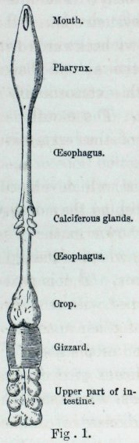

<!-- source-id: C001; original-page: 18 -->
Diagram of the alimentary canal of an earthworm (Lumbricus), copied from Ray Lankester in 'Quart. Journ. of Microscop. Soc.' vol. xv. N.S. pl. vii.

蚯蚓 (Lumbricus) 的消化道图，复制自雷·兰克斯特 (Ray Lankester) 的《夸脱》(Quart)。日记。的显微镜。苏格拉底。”卷。十五.国家统计局pl。七.

<!-- source-id: S030; original-page: 19 -->
which runs in a straight course to the vent at the posterior end of the body. The intestine presents a remarkable structure, the typhosolis, or, as the old anatomists called it, an intestine within an intestine; and Claparède* has shown that this consists of a deep longitudinal involution of the walls of the intestine, by which means an extensive absorbent surface is gained.

它笔直地延伸到身体后端的通风口。肠道呈现出一种非凡的结构，即伤寒杆菌，或者像老解剖学家所说的那样，肠中肠。 Claparède* 表明，这包括肠壁的深度纵向内卷，从而获得广泛的吸收表面。

<!-- source-id: S031; original-page: 19 -->
The circulatory system is well developed. Worms breathe by their skin, as they do not possess any special respiratory organs. The two sexes are united in the same individual, but two individuals pair together. The nervous system is fairly well developed; and the two almost confluent cerebral ganglia are situated very near to the anterior end of the body.

循环系统很发达。蚯蚓通过皮肤呼吸，因为它们没有任何特殊的呼吸器官。两种性别结合在同一个体中，但两个个体则配对在一起。神经系统相当发达；两个几乎汇合的大脑神经节位于非常靠近身体前端的位置。

<!-- source-id: S032; original-page: 19 -->
Senses. —Worms are destitute of eyes, and at first I thought that they were quite insensible to light; for those kept in confinement were repeatedly observed by the aid of a candle, and others out of doors by the aid of a lantern, yet they were rarely alarmed, although extremely timid animals. Other persons have found no difficulty in observing worms at night by the same means.*

感官。 ——蚯蚓没有眼睛，起初我以为它们对光完全不敏感；因为那些被禁闭的人在蜡烛的帮助下被反复观察，而在户外的其他人则在灯笼的帮助下被反复观察，但他们很少受到惊吓，尽管它们是极其胆小的动物。其他人发现用同样的方法在夜间观察蚯蚓没有困难。*

<!-- source-id: N012; original-page: 19 -->
* Histolog. Untersuchungen über die Regenwürmer. 'Zeitschrift für wissenschaft. Zoologie, B. xix., 1869, p. 611.

* 组织学。 Untersuchungen über die Regenwürmer。 'Zeitschrift für wissenschaft'。 《动物学》，B. xix.，1869 年，第 17 页。 611.

<!-- source-id: S033; original-page: 20 -->
Hoffmeister, however, states† that worms, with the exception of a few individuals, are extremely sensitive to light; but he admits that in most cases a certain time is requisite for its action. These statements led me to watch on many successive nights worms kept in pots, which were protected from currents of air by means of glass plates. The pots were approached very gently, in order that no vibration of the floor should be caused. When under these circumstances worms were illuminated by a bull's-eye lantern having slides of dark red and blue glass, which intercepted so much light that they could be seen only with some difficulty, they were not at all affected by this amount of light, however long they were exposed to it. The light, as far as I could judge, was brighter than that from the full moon. Its colour apparently made no difference in the result. When they were illuminated by a candle, or even by a bright paraffin lamp, they were not usually affected at first. Nor were they when the light was alternately admitted and shut off. Sometimes, however, they behaved very differently, for as soon as the light fell on them, they withdrew into their burrows with almost instantaneous rapidity. This occurred perhaps once out of a dozen times. When they did not withdraw instantly, they often raised the anterior tapering ends of their bodies from the ground, as if their attention was aroused or as if surprise was felt; or they moved their bodies from side to side as if feeling for some object. They appeared distressed by the light; but I doubt whether this was really the case, for on two occasions after withdrawing slowly, they remained for a long time with their anterior extremities protruding a little from the mouths of their burrows, in which position they were ready for instant and complete withdrawal.

然而，霍夫迈斯特指出†，除了少数个体之外，蚯蚓对光极其敏感。但他承认，在大多数情况下，其行动需要一定的时间。这些陈述使我连续许多个夜晚观察养在罐子里的蚯蚓，罐子用玻璃板隔开气流。非常轻柔地接近花盆，以免引起地板振动。在这种情况下，当蚯蚓被带有深红色和蓝色玻璃幻灯片的牛眼灯照亮时，这种灯拦截了如此多的光线，以至于很难看到它们，但无论它们暴露在光线下多长时间，它们都不会受到这么多光的影响。据我判断，那光比满月的光还要亮。其颜色显然对结果没有影响。当它们被蜡烛甚至明亮的石蜡灯照亮时，它们一开始通常不会受到影响。当灯交替进入和关闭时，它们也不是。然而，有时它们的行为却大不相同，因为一旦光线照射到它们身上，它们就会以几乎瞬间的速度退回到自己的洞穴中。这种情况可能发生过十多次。当他们没有立即撤退时，他们常常将身体前部逐渐变细的末端从地面上抬起，似乎引起了他们的注意或感到惊讶；或者他们将身体从一边移动到另一边，好像在寻找某种物体。他们看上去因光线而感到痛苦。但我怀疑情况是否真的如此，因为有两次，它们在缓慢退出后，会长时间地保持前肢从洞口伸出一点，这是它们准备好的姿势。即时且完全撤回。

<!-- source-id: N013; original-page: 20 -->
* For instance, Mr. Bridgman and Mr. Newman ('The Zoologist,' vol. vii. 1849, p. 2576), and some friends who observed worms for me.

* 例如，布里奇曼先生和纽曼先生（《动物学家》，第7卷，1849年，第2576页），以及一些为我观察蚯蚓的朋友。

<!-- source-id: N014; original-page: 20 -->
† 'Familie der Regenwürmer,' 1845, p. 18.

† “Familie der Regenwürmer”，1845 年，第 14 页。 18.

<!-- source-id: S034; original-page: 21 -->
When the light from a candle was concentrated by means of a large lens on the anterior extremity, they generally withdrew instantly; but this concentrated light failed to act perhaps once out of half a dozen trials. The light was on one occasion concentrated on a worm lying beneath water in a saucer, and it instantly withdrew into its burrow. In all cases the duration of the light, unless extremely feeble, made a great difference in the result; for worms left exposed before a paraffin lamp or a candle invariably retreated into their burrows within from five to fifteen minutes; and if in the evening the pots were illuminated before the worms had come out of their burrows, they failed to appear.

当蜡烛发出的光被前肢上的一个大透镜聚集时，它们通常会立即撤退；但这种集中的光线在六次试验中也许只有一次未能发挥作用。有一次，光线集中在一只躺在水下碟子里的蚯蚓身上，它立即缩回了洞穴里。在所有情况下，除非光线极其微弱，否则光线的持续时间都会对结果产生很大的影响。因为暴露在石蜡灯或蜡烛前的蚯蚓总是会在五到十五分钟内退回到洞穴中。如果晚上在蚯蚓从洞穴中出来之前将花盆照亮，它们就不会出现。

<!-- source-id: S035; original-page: 22 -->
From the foregoing facts it is evident that light affects worms by its intensity and by its duration. It is only the anterior extremity of the body, where the cerebral ganglia lie, which is affected by light, as Hoffmeister asserts, and as I observed on many occasions. If this part is shaded, other parts of the body may be fully illuminated, and no effect will be produced. As these animals have no eyes, we must suppose that the light passes through their skins, and in some manner excites their cerebral ganglia. It appeared at first probable that the different manner in which they were affected on different occasions might be explained, either by the degree of extension of their skin and its consequent transparency, or by some particular incidence of the light; but I could discover no such relation. One thing was manifest, namely, that when worms were employed in dragging leaves into their burrows or in eating them, and even during the short intervals whilst they rested from their work, they either did not perceive the light or were regardless of it; and this occurred even when the light was concentrated on them through a large lens. So, again, whilst they are paired, they will remain for an hour or two out of their burrows, fully exposed to the morning light; but it appears from what Hoffmeister says that a light will occasionally cause paired individuals to separate.

从上述事实可以明显看出，光通过其强度和持续时间影响蚯蚓。正如霍夫迈斯特所言，正如我在许多场合观察到的那样，只有大脑神经节所在的身体前肢才会受到光的影响。如果这部分被遮蔽，身体的其他部分可能会被完全照亮，并且不会产生任何效果。由于这些动物没有眼睛，我们必须假设光线穿过它们的皮肤，并以某种方式刺激它们的大脑神经节。乍一看，它们在不同场合受到的不同影响可能可以通过它们皮肤的延伸程度及其随之而来的透明度来解释，或者通过某些特定的光入射来解释。但我没有发现这样的关系。有一件事是显而易见的，即当蚯蚓将树叶拖入洞穴或吃掉树叶时，甚至在它们工作休息的短暂时间里，它们要么没有感知到光，要么不理会光；即使光线通过大透镜集中在他们身上，这种情况也会发生。因此，当它们配对时，它们会在洞穴外停留一两个小时，完全暴露在早晨的阳光下；但从霍夫迈斯特的说法来看，光有时会导致配对的个体分开。

<!-- source-id: S036; original-page: 23 -->
When a worm is suddenly illuminated and dashes like a rabbit into its burrow—to use the expression employed by a friend—we are at first led to look at the action as a reflex one. The irritation of the cerebral ganglia appears to cause certain muscles to contract in an inevitable manner, independently of the will or consciousness of the animal, as if it were an automaton. But the different effect which a light produced on different occasions, and especially the fact that a worm when in any way employed and in the intervals of such employment, whatever set of muscles and ganglia may then have been brought into play, is often regardless of light, are opposed to the view of the sudden withdrawal being a simple reflex action. With the higher animals, when close attention to some object leads to the disregard of the impressions which other objects must be producing on them, we attribute this to their attention being then absorbed; and attention implies the presence of a mind. Every sportsman knows that he can approach animals whilst they are grazing, fighting or courting, much more easily than at other times. The state, also, of the nervous system of the higher animals differs much at different times, for instance, a horse is much more readily startled at one time than at another. The comparison here implied between the actions of one of the higher animals and of one so low in the scale as an earth-worm, may appear far- fetched; for we thus attribute to the worm attention and some mental power, nevertheless I can see no reason to doubt the justice of the comparison.

当一条蚯蚓突然被照亮并像兔子一样冲进它的洞穴时——用一位朋友的话说——我们首先会被引导把这个动作视为一种反射动作。大脑神经节的刺激似乎会导致某些肌肉以不可避免的方式收缩，与动物的意志或意识无关，就好像它是一个自动机一样。但是光在不同场合产生的不同效果，尤其是当蚯蚓以任何方式使用时以及在这种使用的时间间隔内，无论当时可能发挥作用的肌肉和神经节组如何，通常与光无关，这一事实与突然退出是简单的反射动作的观点相反。对于高等动物来说，当对某个物体的密切关注导致忽视其他物体必然对它们产生的印象时，我们将其归因于它们的注意力被吸收了；注意力意味着思想的存在。每个运动员都知道，他可以在动物吃草、打斗或求偶时接近它们，比其他时候更容易。高等动物的神经系统状态在不同时间也有很大差异，例如，一匹马在某个时间比另一个时间更容易受到惊吓。这里暗示一种高等动物的行为与像蚯蚓这样的低等动物的行为之间的比较可能显得牵强。因为我们因此将注意力和一定的精神力量归因于蚯蚓，但我认为没有理由怀疑这种比较的公正性。

<!-- source-id: S037; original-page: 25 -->
Although worms cannot be said to possess the power of vision, their sensitiveness to light enables them to distinguish between day and night; and they thus escape extreme danger from the many diurnal animals which prey on them. Their withdrawal into their burrows during the day appears, however, to have become an habitual action; for worms kept in pots covered by glass-plates, over which sheets of black paper were spread, and placed before a north-east window, remained during the day-time in their burrows and came out every night; and they continued thus to act for a week. No doubt a little light may have entered between the sheets of glass and the blackened paper; but we know from the trials with coloured glass, that worms are indifferent to a small amount of light.

虽然蚯蚓不能说拥有视觉能力，但它们对光的敏感度使它们能够区分白天和黑夜；因此，它们逃避了许多捕食它们的昼夜动物的极端危险。然而，它们白天躲进洞穴似乎已经成为一种习惯性行为。因为蚯蚓被养在盖有玻璃板、上面铺有黑纸的罐子里，并放在东北窗户前，白天它们呆在洞穴里，每天晚上才出来。他们就这样继续行动了一个星期。毫无疑问，玻璃板和黑纸之间可能有一点光进入；但我们从有色玻璃的试验中知道，蚯蚓对少量的光无动于衷。

<!-- source-id: S038; original-page: 25 -->
Worms appear to be less sensitive to moderate radiant heat than to a bright light. I judge of this from having held at different times a poker heated to dull redness near some worms, at a distance which caused a very sensible degree of warmth in my hand. One of them took no notice; a second withdrew into its burrow, but not quickly; the third and fourth much more quickly, and the fifth as quickly as possible. The light from a candle, concentrated by a lens and passing through a sheet of glass which would intercept most of the heat-rays, generally caused a much more rapid retreat than did the heated poker. Worms are sensitive to a low temperature, as may be inferred from their not coming out of their burrows during a frost.

蚯蚓似乎对中等辐射热的敏感度不如对强光的敏感度。我通过在不同时间将一根被加热到暗红色的拨火棍靠近一些蚯蚓来判断这一点，距离使我的手产生了非常明显的温暖程度。其中一个没有注意到；另一个则没有注意到。第二只退回到它的洞穴里，但速度不快。第三个和第四个要快得多，第五个要尽可能快。蜡烛发出的光被透镜聚集并穿过一块玻璃，玻璃片会拦截大部分热射线，通常会比加热的扑克产生更快的退却速度。蚯蚓对低温很敏感，这可能是因为它们在霜冻期间不会从洞穴中出来。

<!-- source-id: S039; original-page: 26 -->
Worms do not possess any sense of hearing. They took not the least notice of the shrill notes from a metal whistle, which was repeatedly sounded near them; nor did they of the deepest and loudest tones of a bassoon. They were indifferent to shouts, if care was taken that the breath did not strike them. When placed on a table close to the keys of a piano, which was played as loudly as possible, they remained perfectly quiet.

蚯蚓没有任何听觉。他们丝毫没有注意到在他们附近反复响起的金属哨子发出的刺耳声音。它们也不是巴松管最深沉、最响亮的音调。如果小心不要让呼吸袭到他们身上，他们对喊叫无动于衷。当把它们放在靠近钢琴琴键的桌子上并尽可能大声地弹奏时，它们仍然保持完全安静。

<!-- source-id: S040; original-page: 26 -->
Although they are indifferent to undulations in the air audible by us, they are extremely sensitive to vibrations in any solid object. When the pots containing two worms which had remained quite indifferent to the sound of the piano, were placed on this instrument, and the note C in the bass clef was struck, both instantly retreated into their burrows. After a time they emerged, and when G above the line in the treble clef was struck they again retreated. Under similar circumstances on another night one worm dashed into its burrow on a very high note being struck only once, and the other worm when C in the treble clef was struck. On these occasions the worms were not touching the sides of the pots, which stood in saucers; so that the vibrations, before reaching their bodies, had to pass from the sounding board of the piano, through the saucer, the bottom of the pot and the damp, not very compact earth on which they lay with their tails in their burrows. They often showed their sensitiveness when the pot in which they lived, or the table on which the pot stood, was accidentally and lightly struck; but they appeared less sensitive to such jars than to the vibrations of the piano; and their sensitiveness to jars varied much at different times. It has often been said that if the ground is beaten or otherwise made to tremble, worms believe that they are pursued by a mole and leave their burrows. From one account that I have received, I have no doubt that they do so when pursued by moles; but a gentleman informs me that he lately saw eight or ten worms leaving their burrows and crawling about the grass on some boggy land on which two men had just trampled while setting a trap; and this occurred in a part of Ireland where there were no moles. I beat the ground in many places where worms abounded, but not one emerged. When, however, the ground is dug with a fork and is violently disturbed beneath a worm, it will often crawl quickly out of its burrow.

尽管它们对我们听到的空气波动漠不关心，但它们对任何固体物体的振动都极其敏感。当装着两条对钢琴声音漠不关心的蚯蚓的盆子被放在这件乐器上，敲击低音谱号的C音时，它们立刻就缩回了自己的洞穴里。过了一段时间，他们出现了，当高音谱号线上的G被敲击时，他们再次撤退。另一个晚上，在类似的情况下，一只蚯蚓以很高的音符冲进了洞穴，只被敲击了一次，而另一只蚯蚓则在高音谱号中的C被敲击时冲进了洞穴。在这些情况下，蚯蚓不会接触放在碟子里的花盆的侧面；它们不会接触到花盆的边缘。因此，振动在到达它们的身体之前，必须从钢琴的共鸣板传递，穿过碟子、锅底和潮湿的、不太紧实的泥土，它们躺在上面，尾巴埋在洞穴里。当他们居住的锅或放置锅的桌子被意外地轻轻撞击时，他们常常表现出敏感；但他们对这些罐子的敏感程度似乎不如对钢琴的振动敏感。他们对罐子的敏感度在不同时期也有很大差异。人们常说，如果地面被敲打或以其他方式颤抖，蚯蚓就会相信它们被鼹鼠追赶并离开了洞穴。根据我收到的一份报告，我毫不怀疑他们是在被鼹鼠追赶时这样做的。但一位绅士告诉我，他最近看到八到十只蚯蚓离开了洞穴，在一片沼泽地的草地上爬行，两个人在设置陷阱时刚刚踩踏了这片土地；这件事发生在爱尔兰的一个没有鼹鼠的地方。我在很多地方敲打过地面那里有很多蚯蚓，但一条也没有出现。然而，当用叉子挖地并在蚯蚓下面猛烈地扰动时，它通常会迅速爬出洞穴。

<!-- source-id: S041; original-page: 28 -->
The whole body of a worm is sensitive to contact. A slight puff of air from the mouth causes an instant retreat. The glass plates placed over the pots did not fit closely, and blowing through the very narrow chinks thus left, often sufficed to cause a rapid retreat. They sometimes perceived the eddies in the air caused by quickly removing the glass plates. When a worm first comes out of its burrow, it generally moves the much extended anterior extremity of its body from side to side in all directions, apparently as an organ of touch; and there is some reason to believe, as we shall see in the next chapter, that they are thus enabled to gain a general notion of the form of an object. Of all their senses that of touch, including in this term the perception of a vibration, seems much the most highly developed.

蚯蚓的整个身体对接触都很敏感。从嘴里轻轻吹出一口空气，就会立即后退。放置在罐子上的玻璃板贴合不紧密，吹过由此留下的非常狭窄的缝隙，通常足以导致快速撤退。他们有时会感觉到由于快速移开玻璃板而引起的空气涡流。当蚯蚓第一次从洞穴中出来时，它通常会向各个方向从一侧移动到另一侧，显然是作为触觉器官；正如我们将在下一章中看到的，我们有理由相信，他们因此能够获得物体形式的一般概念。在他们的所有感官中，触觉，包括对振动的感知，似乎是最发达的。

<!-- source-id: S042; original-page: 29 -->
In worms the sense of smell apparently is confined to the perception of certain odours, and is feeble. They were quite indifferent to my breath, as long as I breathed on them very gently. This was tried, because it appeared possible that they might thus be warned of the approach of an enemy. They exhibited the same indifference to my breath whilst I chewed some tobacco, and while a pellet of cotton-wool with a few drops of millefleurs perfume or of acetic acid was kept in my mouth. Pellets of cotton-wool soaked in tobacco juice, and in millefleurs perfume, and in paraffin, were held with pincers and were waved about within two or three inches of several worms, but they took no notice. On one or two occasions, however, when acetic acid had been placed on the pellets, the worms appeared a little uneasy, and this was probably due to the irritation of their skins. The perception of such unnatural odours would be of no service to worms; and as such timid creatures would almost certainly exhibit some signs of any new impression, we may conclude that they did not perceive these odours.

蚯蚓的嗅觉显然仅限于感知某些气味，而且很微弱。他们对我的呼吸相当无动于衷，只要我对他们的呼吸非常轻柔即可。人们尝试了这种做法，因为这样似乎可以警告他们敌人正在逼近。当我咀嚼烟草时，当我嘴里放着一团棉絮和几滴千花香水或醋酸时，他们对我的呼吸表现出同样的冷漠。用钳子夹住浸泡在烟草汁、千花香水和石蜡中的棉球，在几只蚯蚓的两三英寸范围内挥舞，但它们没有注意到。然而，有一两次，当醋酸放在颗粒上时，蚯蚓显得有点不安，这可能是由于它们的皮肤受到刺激。感知到这种不自然的气味对蚯蚓没有任何帮助。由于这些胆怯的生物几乎肯定会表现出任何新印象的一些迹象，因此我们可以得出结论，它们没有感知到这些气味。

<!-- source-id: S043; original-page: 30 -->
The result was different when cabbage-leaves and pieces of onion were employed, both of which are devoured with much relish by worms. Small square pieces of fresh and half-decayed cabbage-leaves and of onion bulbs were on nine occasions buried in my pots, beneath about ¼ of an inch of common garden soil; and they were always discovered by the worms. One bit of cabbage was discovered and removed in the course of two hours; three were removed by the next morning, that is, after a single night; two others after two nights; and the seventh bit after three nights. Two pieces of onion were discovered and removed after three nights. Bits of fresh raw meat, of which worms are very fond, were buried, and were not discovered within forty-eight hours, during which time they had not become putrid. The earth above the various buried objects was generally pressed down only slightly, so as not to prevent the emission of any odour. On two occasions, however, the surface was well watered, and was thus rendered somewhat compact. After the bits of cabbage and onion had been removed, I looked beneath them to see whether the worms had accidentally come up from below, but there was no sign of a burrow; and twice the buried objects were laid on pieces of tin-foil which were not in the least displaced. It is of course possible that the worms whilst moving about on the surface of the ground, with their tails affixed within their burrows, may have poked their heads into the places where the above objects were buried; but I have never seen worms acting in this manner. Some pieces of cabbage-leaf and of onion were twice buried beneath very fine ferruginous sand, which was slightly pressed down and well watered, so as to be rendered very compact, and these pieces were never discovered. On a third occasion the same kind of sand was neither pressed down nor watered, and the pieces of cabbage were discovered and removed after the second night. These several facts indicate that worms possess some power of smell; and that they discover by this means odoriferous and much-coveted kinds of food.

当使用卷心菜叶和洋葱片时，结果有所不同，这两种材料都被蚯蚓津津有味地吃掉。新鲜的、半腐烂的卷心菜叶和洋葱球茎的小方块曾九次被埋在我的花盆里，埋在大约 1/4 英寸的普通花园土壤下面；而且它们总是被蚯蚓发现。两小时内发现并移走了一小块卷心菜；第二天早上，即一个晚上之后，其中三个被移除；两晚后还有另外两个；三晚后的第七位。三晚后发现了​​两片洋葱并被移走。蚯蚓非常喜欢吃的新鲜生肉被埋起来，四十八小时内没有被发现，在此期间它们还没有腐烂。各种埋藏物上方的泥土一般只稍微压实，以免妨碍气味的散发。然而，有两次，表面被充分浇水，因此变得有些致密。把白菜和洋葱的碎片去掉后，我往下面看，看看蚯蚓是不是不小心从下面爬上来的，但没有挖洞的迹象；两次埋藏的物品都放在锡箔片上，锡箔片丝毫没有移位。当然，蚯蚓在地面上移动时，尾巴固定在洞穴内，可能将头伸进了上述物体埋藏的地方；但我从未见过蚯蚓有这样的行为。一些卷心菜叶和洋葱的碎片两次被埋在非常细的铁质沙子下，将其稍微压实并充分浇水，以便变得非常紧凑，但这些碎片从未被发现。在第三个有时，同样的沙子既没有压实，也没有浇水，第二天晚上后，发现了卷心菜片并移走了。这几个事实表明，蚯蚓具有一定的嗅觉能力。他们通过这种方式发现了芳香四溢、令人垂涎的食物。

<!-- source-id: S044; original-page: 32 -->
It may be presumed that all animals which feed on various substances possess the sense of taste, and this is certainly the case with worms. Cabbage-leaves are much liked by worms; and it appears that they can distinguish between different varieties; but this may perhaps be owing to differences in their texture. On eleven occasions pieces of the fresh leaves of a common green variety and of the red variety used for pickling were given them, and they preferred the green, the red being either wholly neglected or much less gnawed. On two other occasions, however, they seemed to prefer the red. Half-decayed leaves of the red variety and fresh leaves of the green were attacked about equally. When leaves of the cabbage, horse-radish (a favourite food) and of the onion were given together, the latter were always and manifestly preferred. Leaves of the cabbage, lime-tree, Ampelopis, parsnip (Pastinaca), and celery (Apium) were likewise given together; and those of the celery were first eaten. But when leaves of cabbage, turnip, beet, celery, wild cherry and carrots were given together, the two latter kinds, especially those of the carrot, were preferred to all the others, including those of celery. It was also manifest after many trials that wild cherry leaves were greatly preferred to those of the lime-tree and hazel (Corylus). According to Mr. Bridgman the half-decayed leaves of Phlox verna are particularly liked by worms.*

可以推测，所有以各种物质为食的动物都具有味觉，蚯蚓无疑是这种情况。蚯蚓很喜欢卷心菜叶。而且它们似乎能够区分不同的品种；但这可能是由于它们的质地不同所致。有十一次，他们得到了常见绿色品种和用于腌制的红色品种的新鲜叶子，他们更喜欢绿色，红色要么完全被忽视，要么很少被啃咬。然而，在另外两个场合，他们似乎更喜欢红色。红色品种半腐烂的叶子和绿色品种的新鲜叶子受到的侵害大致相同。当卷心菜叶、辣根叶（一种人们喜爱的食物）和洋葱叶一起食用时，后者总是明显受到偏爱。卷心菜、椴树、蛇葡萄、欧洲防风草（Pastinaca）和芹菜（Apium）的叶子也同样一起给予。芹菜是最先被吃掉的。但是，当将卷心菜、萝卜、甜菜、芹菜、野樱桃和胡萝卜的叶子放在一起时，后两种叶子，尤其是胡萝卜的叶子，比所有其他叶子（包括芹菜的叶子）更受欢迎。经过多次试验也表明，野樱桃叶比椴树和榛树的叶子更受欢迎。据布里奇曼先生介绍，蚯蚓特别喜欢福禄考半腐烂的叶子。*

<!-- source-id: S045; original-page: 33 -->
Pieces of the leaves of cabbage, turnip, horse-radish and onion were left on the pots during 22 days, and were all attacked and had to be renewed; but during the whole of this time leaves of an Artemisia and of the culinary sage, thyme and mint, mingled with the above leaves, were quite neglected excepting those of the mint, which were occa- sionally and very slightly nibbled. These latter four kinds of leaves do not differ in texture in a manner which could make them disagreeable to worms; they all have a strong taste, but so have the four first mentioned kinds of leaves; and the wide difference in the result must be attributed to a preference by the worms for one taste over another.

卷心菜、萝卜、辣根和洋葱的叶子碎片在盆中放置了22天，全部受到侵蚀，必须更换；但在整个这段时间里，与上述叶子混合在一起的艾蒿和烹饪鼠尾草、百里香和薄荷的叶子都被完全忽视了，除了薄荷的叶子，它们偶尔会被轻微地啃咬。后四种叶子的质地差异不会使蚯蚓感到不舒服；它们都有很浓的味道，但前面提到的四种叶子也是如此。结果的巨大差异一定是由于蚯蚓对一种味道的偏好超过另一种味道。

<!-- source-id: N015; original-page: 33 -->
* 'The Zoologist,' vol. vii. 1849, p. 2576.

*《动物学家》，卷。七. 1849，p。 2576.

<!-- source-id: S046; original-page: 34 -->
Mental Qualities. —There is little to be said on this head. We have seen that worms are timid. It may be doubted whether they suffer as much pain when injured, as they seem to express by their contortions. Judging by their eagerness for certain kinds of food, they must enjoy the pleasure of eating. Their sexual passion is strong enough to overcome for a time their dread of light. They perhaps have a trace of social feeling, for they are not disturbed by crawling over each other's bodies, and they sometimes lie in contact. According to Hoffmeister they pass the winter either singly or rolled up with others into a ball at the bottom of their burrows.* Although worms are so remarkably deficient in the several sense-organs, this does not necessarily preclude intelligence, as we know from such cases as those of Laura Bridgman; and we have seen that when their attention is engaged, they neglect impressions to which they would otherwise have attended; and attention indicates the presence of a mind of some kind. They are also much more easily excited at certain times than at others. They perform a few actions instinctively, that is, all the individuals, including the young, perform such actions in nearly the same fashion. This is shown by the manner in which the species of Perichæta eject their castings, so as to construct towers; also by the manner in which the burrows of the common earth-worm are smoothly lined with fine earth and often with little stones, and the mouths of their burrows with leaves. One of their strongest instincts is the plugging up the mouths of their burrows with various objects; and very young worms act in this manner. But some degree of intelligence appears, as we shall see in the next chapter, to be exhibited in this work,—a result which has surprised me more than anything else in regard to worms.

心理素质。 ——这个问题没什么可说的。我们已经看到，蚯蚓是胆怯的。人们可能会怀疑，他们受伤时所承受的痛苦是否像他们通过扭曲所表达的那样多。从他们对某些食物的渴望来看，他们一定会享受吃饭的乐趣。他们的性欲强烈到足以暂时克服他们对光的恐惧。它们也许有一丝社交感情，因为它们不会因为在彼此身上爬行而受到打扰，有时还会躺着接触。根据霍夫迈斯特的说法，它们要么单独过冬，要么在洞穴底部与其他蠕虫一起卷成一个球。*尽管蚯蚓在几种感觉器官上非常缺乏，但这并不一定妨碍智力，正如我们从劳拉·布里奇曼的案例中知道的那样；我们发现，当他们全神贯注时，他们就会忽视原本会注意的印象。注意力表明某种思想的存在。他们在某些时候也比其他时候更容易兴奋。他们本能地执行一些动作，也就是说，所有个体，包括年轻人，都以几乎相同的方式执行这些动作。这可以从 Perichæta 物种排出蚓粪以建造塔的方式看出。普通蚯蚓的洞穴内光滑地铺有细土，通常还铺有小石头，洞口则铺有树叶。它们最强烈的本能之一就是用各种物体堵住洞口。非常年轻的蚯蚓就是以这种方式行事的。但是，正如我们将在下一章中看到的那样，这部作品中似乎展现了某种程度的智慧——这一结果令人惊讶对于蚯蚓来说，我最重要的是。

<!-- source-id: N016; original-page: 34 -->
* 'Familie der Regenwürmer,' p. 13.

*“Familie der Regenwürmer”，第 14 页13.

<!-- source-id: S047; original-page: 36 -->
Food and Digestion. —Worms are omnivorous. They swallow an enormous quantity of earth, out of which they extract any digestible matter which it may contain; but to this subject I must recur. They also consume a large number of half-decayed leaves of all kinds, excepting a few which have an unpleasant taste or are too tough for them; likewise petioles, peduncles and decayed flowers. But they will also consume fresh leaves, as I have found by repeated trials. According to Morren* they will eat particles of sugar and liquorice; and the worms which I kept drew many bits of dry starch into their burrows, and a large bit had its angles well rounded by the fluid poured out of their mouths. But as they often drag particles of soft stone, such as of chalk, into their burrows, I feel some doubt whether the starch was used as food. Pieces of raw and roasted meat were fixed several times by long pins to the surface of the soil in my pots, and night after night the worms could be seen tugging at them, with the edges of the pieces engulfed in their mouths, so that much was consumed.

食物和消化。 ——蚯蚓是杂食性的。它们吞下大量的泥土，并从中提取其中可能含有的任何可消化的物质；但我必须再说一遍这个话题。它们还吃大量各种半腐烂的叶子，除了少数味道难闻或太硬的叶子；同样，叶柄、花序梗和腐烂的花。但正如我通过反复试验发现的那样，它们也会吃新鲜的叶子。根据莫伦*的说法，它们会吃糖和甘草颗粒；我养的蚯蚓把许多干淀粉吸进洞里，其中一大块的角被从嘴里倒出来的液体弄圆了。但由于它们经常将软石颗粒（例如粉笔）拖入洞穴中，我有些怀疑淀粉是否被用作食物。生肉块和烤肉块被多次用长钉子固定在我盆里的土壤表面，夜复一夜都可以看到蚯蚓在拉着它们，把肉块的边缘吞进嘴里，所以很多都被吃掉了。

<!-- source-id: N017; original-page: 36 -->
* 'De Lumbrici terrestris,' p. 19.

*“De Lumbrici terrestris”，第 14 页。 19.

<!-- source-id: S048; original-page: 37 -->
Raw fat seems to be preferred even to raw meat or to any other substance which was given them, and much was consumed. They are cannibals, for the two halves of a dead worm placed in two of the pots were dragged into the burrows and gnawed; but as far as I could judge, they prefer fresh to putrid meat, and in so far I differ from Hoffmeister.

生脂肪似乎甚至比生肉或任何其他给予它们的物质更受欢迎，并且消耗了很多。他们是食人者，因为将一条死蚯蚓的两半放在两个罐子里，然后被拖进洞穴里啃食。但据我判断，他们更喜欢新鲜的肉而不是腐烂的肉，在这一点上我与霍夫迈斯特不同。

<!-- source-id: S049; original-page: 37 -->
Léon Frédéricq states* that the digestive fluid of worms is of the same nature as the pancreatic secretion of the higher animals; and this conclusion agrees perfectly with the kinds of food which worms consume. Pancreatic juice emulsifies fat, and we have just seen how greedily worms devour fat; it dissolves fibrin, and worms eat raw meat; it converts starch into grape-sugar with wonderful rapidity, and we shall presently show that the digestive fluid of worms acts on starch.† But they live chiefly on half-decayed leaves; and these would be useless to them unless they could digest the cellulose forming the cellwalls; for it is well known that all other nutri- tious substances are almost completely withdrawn from leaves, shortly before they fall off. It has, however, now been ascertained that cellulose, though very little or not at all attacked by the gastric secretion of the higher animals, is acted on by that from the pancreas.*

莱昂·弗雷德里克 (Léon Frédéricq) 指出*，蚯蚓的消化液与高等动物的胰腺分泌物具有相同的性质；这个结论与蚯蚓所吃的食物种类完全一致。胰液乳化脂肪，刚才我们看到了蚯蚓是如何贪婪地吞噬脂肪；它溶解纤维蛋白，蚯蚓吃生肉；它以惊人的速度将淀粉转化为葡萄糖，我们很快就会证明蚯蚓的消化液对淀粉起作用。†但它们主要生活在半腐烂的叶子上；它们主要生活在半腐烂的叶子上。除非它们能够消化形成细胞壁的纤维素，否则这些对它们来说毫无用处；因为众所周知，在叶子脱落前不久，所有其他营养物质几乎完全从叶子中消失。然而，现在已经确定，虽然纤维素很少或根本不会受到高等动物胃分泌物的攻击，但会受到来自胰腺的胃分泌物的作用。 *

<!-- source-id: N018; original-page: 37 -->
* 'Archives de Zoologie, expérimentale,' tom. vii. 1878, p. 394.

*“动物学档案，实验”，汤姆。七. 1878，p。 394.

<!-- source-id: N019; original-page: 37 -->
† On the action of the pancreatic ferment, see 'A Test-Book of Physiology,' by Michael Foster, 2nd edit. pp. 198-203. 1878.

† 关于胰腺发酵的作用，请参阅迈克尔·福斯特（Michael Foster）所著的《生理学测试书》，第二次编辑。第 198-203 页。 1878.

<!-- source-id: S050; original-page: 38 -->
The half-decayed or fresh leaves which worms intend to devour, are dragged into the mouths of their burrows to a depth of from one to three inches, and are then moistened with a secreted fluid. It has been assumed that this fluid serves to hasten their decay; but a large number of leaves were twice pulled out of the burrows of worms and kept for many weeks in a very moist atmosphere under a bell-glass in my study; and the parts which had been moistened by the worms did not decay more quickly in any plain manner than the other parts. When fresh leaves were given in the evening to worms kept in confinement and examined early on the next morning, therefore not many hours after they had been dragged into the burrows, the fluid with which they were moistened, when tested with neutral litmus paper, showed an alkaline reaction. This was repeatedly found to be the case with celery, cabbage and turnip leaves. Parts of the same leaves which had not been moistened by the worms, were pounded with a few drops of distilled water, and the juice thus extracted was not alkaline. Some leaves, however, which had been drawn into burrows out of doors, at an unknown antecedent period, were tried, and though still moist, they rarely exhibited even a trace of alkaline reaction.

蚯蚓想要吞食的半腐烂或新鲜的叶子被拖入洞穴口一到三英寸的深度，然后用分泌的液体润湿。人们认为这种液体可以加速它们的腐烂。但是，大量的叶子被两次从蚯蚓的洞穴中拔出，并在我书房的钟形玻璃下非常潮湿的气氛中保存了好几个星期；被蚯蚓弄湿的部分并没有明显地比其他部分腐烂得更快。当晚上将新鲜叶子喂给圈养的蚯蚓并在第二天一早检查时，因此在它们被拖入洞穴后不久，用中性石蕊试纸测试时，润湿蚯蚓的液体显示出碱性反应。芹菜、卷心菜和萝卜叶也多次出现这种情况。将未被蚯蚓润湿的相同叶子的部分与几滴蒸馏水一起捣碎，这样提取的汁液不是碱性的。然而，有些叶子是在未知的前世时期在户外被拉入洞穴的，尽管仍然潮湿，但它们很少表现出哪怕一丝碱性反应。

<!-- source-id: N020; original-page: 38 -->
* Schmulewitsch, 'Action des Sucs digestifs sur la Cellulose.' Bull. de l'Acad. Imp. de St. Pétersbourg, tom. xxv. p. 549. 1879.

* Schmulewitsch，“纤维素消化液的行动”。公牛。德拉阿卡德。小鬼。圣彼得堡，汤姆。二十五. p。 549. 1879.

<!-- source-id: S051; original-page: 39 -->
The fluid, with which the leaves are bathed, acts on them whilst they are fresh or nearly fresh, in a remarkable manner; for it quickly kills and discolours them. Thus the ends of a fresh carrot-leaf, which had been dragged into a burrow, were found after twelve hours of a dark brown tint. Leaves of celery, turnip, maple, elm, lime, thin leaves of ivy, and occasionally those of the cabbage were similarly acted on. The end of a leaf of Triticum repens , still attached to a growing plant, had been drawn into a burrow, and this part was dark brown and dead, whilst the rest of the leaf was fresh and green. Several leaves of lime and elm removed from burrows out of doors were found affected in different degrees. The first change appears to be that the veins become of a dull reddish-orange. The cells with chlorophyll next lose more or less completely their green colour, and their contents finally become brown. The parts thus affected often appeared almost black by reflected light; but when viewed as a transparent object under the microscope, minute specks of light were transmitted, and this was not the case with the unaffected parts of the same leaves. These effects, however, merely show that the secreted fluid is highly injurious or poisonous to leaves; for nearly the same effects were produced in from one to two days on various kinds of young leaves, not only by artificial pancreatic fluid, prepared with or without thymol, but quickly by a solution of thymol by itself. On one occasion leaves of Corylus were much discoloured by being kept for eighteen hours in pancreatic fluid, without any thymol. With young and tender leaves immersion in human saliva during rather warm weather, acted in the same manner as the pancreatic fluid, but not so quickly. The leaves in all these cases often became infiltrated with the fluid.

沐浴叶子的液体在叶子新鲜或接近新鲜时以一种非凡的方式作用于叶子；因为它很快就会杀死它们并使它们变色。因此，被拖入洞穴的新鲜胡萝卜叶的末端在十二小时后呈深棕色。芹菜、萝卜、枫树、榆树、酸橙、常春藤的薄叶，有时还有卷心菜的叶子也受到类似的作用。一片白小麦叶子的末端，仍然附着在正在生长的植物上，已经被拉进了一个洞穴，这部分是深棕色的，已经死了，而叶子的其余部分却是新鲜的、绿色的。从室外洞穴中取出的几片石灰和榆树叶被发现受到不同程度的影响。第一个变化似乎是静脉变成暗红橙色。接下来，含有叶绿素的细胞或多或少完全失去了绿色，其内容物最终变成棕色。受影响的部分在反射光下通常看起来几乎是黑色的；但当在显微镜下观察为透明物体时，会透射出微小的光点，而同一片叶子未受影响的部分则并非如此。然而，这些影响仅仅表明分泌的液体对叶子有很强的伤害性或毒性；不同种类的幼叶在一到两天内就产生了几乎相同的效果，不仅通过添加或不添加百里酚制备的人工胰液产生，而且通过百里酚本身的溶液也能快速产生。有一次，榛子的叶子在不含任何百里香酚的胰液中保存十八小时后变色严重。在相当温暖的天气里，将幼嫩的叶子浸入人类唾液中，其作用与胰液相同，但速度不那么快。所有这些中的叶子病例经常被液体浸润。

<!-- source-id: S052; original-page: 41 -->
Large leaves from an ivy plant growing on a wall were so tough that they could not be gnawed by worms, but after four days they were affected in a peculiar manner by the secretion poured out of their mouths. The upper surfaces of the leaves, over which the worms had crawled, as was shown by the dirt left on them, were marked in sinuous lines, by either a continuous or broken chain of whitish and often star-shaped dots, about 2 mm. in diameter. The appearance thus presented was curiously like that of a leaf, into which the larva of some minute insect had burrowed. But my son Francis, after making and examining sections, could nowhere find that the cell-walls had been broken down or that the epidermis had been penetrated. When the section passed through the whitish dots, the grains of chlorophyll were seen to be more or less discoloured, and some of the palisade and mesophyll cells contained nothing but broken down granular matter. These effects must be attributed to the trans- udation of the secretion through the epidermis into the cells.

墙上生长的常春藤植物的大叶子非常坚韧，无法被蚯蚓啃咬，但四天后，它们会受到从嘴里涌出的分泌物的特殊影响。蚯蚓在叶子的上表面爬行，从叶子上留下的污垢可以看出，叶子的上表面上有蜿蜒的线条，有连续的或断断续续的白色斑点链，通常是星形的，大约 2 毫米。直径。这样呈现的外观奇怪地像一片叶子，某种微小昆虫的幼虫钻入其中。但我的儿子弗朗西斯在制作和检查切片后，没有发现细胞壁已被破坏或表皮已被穿透。当切片穿过发白的点时，可以看到叶绿素颗粒或多或少变色，一些栅栏和叶肉细胞只含有破碎的颗粒物质。这些作用必须归因于分泌物通过表皮渗出到细胞中。

<!-- source-id: S053; original-page: 42 -->
The secretion with which worms moisten leaves likewise acts on the starch granules within the cells. My son examined some leaves of the ash and many of the lime, which had fallen off the trees and had been partly dragged into worm-burrows. It is known that with fallen leaves the starch-grains are preserved in the guard-cells of the stomata. Now in several cases the starch had partially or wholly disappeared from these cells, in the parts which had been moistened by the secretion; while they were still well preserved in the other parts of the same leaves. Sometimes the starch was dissolved out of only one of the two guard-cells. The nucleus in one case had disappeared, together with the starch-granules. The mere burying of lime-leaves in damp earth for nine days did not cause the destruction of the starch-granules. On the other hand, the immersion of fresh lime and cherry leaves for eighteen hours in artificial pancreatic fluid, led to the dissolution of the starch-granules in the guard-cells as well as in the other cells.

蚯蚓润湿叶子的分泌物同样作用于细胞内的淀粉颗粒。我儿子检查了一些白蜡叶和许多石灰，它们是从树上掉下来的，部分被拖进了蚯蚓洞里。众所周知，落叶后，淀粉粒被保存在气孔的保卫细胞中。现在，在一些情况下，淀粉已部分或全部从这些细胞中消失，在被分泌物润湿的部分中；而它们在同一片叶子的其他部分仍然保存完好。有时，淀粉仅从两个保卫室之一中溶解出来。在一例中，细胞核与淀粉颗粒一起消失了。仅仅将石灰叶埋在潮湿的土壤中九天并不会导致淀粉颗粒的破坏。另一方面，将新鲜的酸橙叶和樱桃叶浸入人造胰液中十八小时，导致保卫细胞以及其他细胞中的淀粉颗粒溶解。

<!-- source-id: S054; original-page: 43 -->
From the secretion with which the leaves are moistened being alkaline, and from its acting both on the starch-granules and on the protoplasmic contents of the cells, we may infer that it resembles in nature not saliva,* but pancreatic secretion; and we know from Frédéricq that a secretion of this kind is found in the intestines of worms. As the leaves which are dragged into the burrows are often dry and shrivelled, it is indispensable for their disintegration by the unarmed mouths of worms that they should first be moistened and softened; and fresh leaves, however soft and tender they may be, are similarly treated, probably from habit. The result is that they are partially digested before they are taken into the alimentary canal. I am not aware of any other case of extra-stomachal digestion having been recorded. The boa-constrictor bathes its prey with saliva, but this is solely for lubricating it. Perhaps the nearest analogy may be found in such plants as Drosera and Dionæa; for here animal matter is digested and con- verted into peptone not within a stomach, but on the surfaces of the leaves.

从润湿叶子的分泌物呈碱性，以及它对淀粉颗粒和细胞原生质内容物的作用，我们可以推断它本质上不是唾液，而是胰腺分泌物。我们从弗雷德里克那里得知，在蚯蚓的肠道中发现了这种分泌物。由于被拖入洞穴的叶子往往是干瘪的，为了让它们被蚯蚓徒手的嘴分解，首先必须将它们弄湿和软化；新鲜的叶子，无论它们多么柔软，也可能是出于习惯而受到类似的处理。结果是它们在进入消化道之前被部分消化。我不知道有任何其他胃外消化的案例被记录。蟒蛇用唾液给猎物洗澡，但这只是为了润滑猎物。也许最接近的类比可以在茅膏菜和捕蝇草等植物中找到。因为在这里，动物物质不是在胃中而是在叶子的表面上被消化并转化为蛋白胨。

<!-- source-id: N021; original-page: 43 -->
* Claparède doubts whether saliva is secreted by worms: see 'Zeitschrift für wissenschaft. Zoologie,' B. xix. 1869, p. 601.

* Claparède 怀疑唾液是否由蚯蚓分泌：参见“Zeitschrift für wissenschaft”。 《动物学》，B. xix。 1869，p。 601.

<!-- source-id: S055; original-page: 44 -->
Calciferous Glands. —These glands (see Fig. 1), judging from their size and from their rich supply of blood-vessels, must be of much importance to the animal. But almost as many theories have been advanced on their use as there have been observers. They consist of three pairs, which in the common earth-worm debouch into the alimentary canal in advance of the gizzard, but posteriorly to it in Urochtæa and some other genera.* The two posterior pairs are formed by lamellæ, which according to Claparède, are diverticula from the œsophagus.† These lamellæ are coated with a pulpy cellular layer, with the outer cells lying free in infinite numbers. If one of these glands is punctured and squeezed, a quantity of white pulpy matter exudes, consisting of these free cells. They are minute, and vary in diameter from 2 to 6 µ. They contain in their centres a little excessively fine granular matter; but they look so like oil globules that Claparède and others at first treated them with ether. This produces no effect; but they are quickly dissolved with effervescence in acetic acid, and when oxalate of ammonia is added to the solution a white precipitate is thrown down. We may therefore conclude that they contain carbonate of lime. If the cells are immersed in a very little acid, they become more transparent, look like ghosts, and are soon lost to view; but if much acid is added, they disappear instantly. After a very large number have been dissolved, a flocculent residue is left, which apparently consists of the delicate ruptured cell-walls. In the two posterior pairs of glands the carbonate of lime contained in the cells occasionally aggregates into small rhombic crystals or into concretions, which lie between the lamellæ; but I have seen only one, and Claparède only a very few such cases.

钙化腺。 ——这些腺体（见图 1），从它们的大小和丰富的血管供应来看，对动物来说一定非常重要。但几乎有多少观察者就提出了多少关于它们的使用的理论。它们由三对组成，在常见的蚯蚓中，它们在砂囊之前进入消化道，但在尾蚴和其他一些属中，它们在消化道的后面。*后两对由薄片形成，根据克拉帕雷德的说法，薄片是来自食道的憩室。†这些薄片涂有浆状细胞层，外部细胞有无限数量的自由分布。如果其中一个腺体被刺穿并挤压，就会渗出大量由这些游离细胞组成的白色浆状物质。它们很微小，直径从 2 µ 到 6 µ 不等。它们的中心含有一些过细的颗粒物质；但它们看起来非常像油球，因此克拉帕雷德和其他人首先用乙醚处理它们。这不会产生任何效果；但它们在乙酸中很快溶解并起泡，当向溶液中添加氨的草酸盐时，会产生白色沉淀。因此我们可以得出结论，它们含有石灰的碳酸盐。如果将细胞浸入极少量的酸中，它们就会变得更加透明，看起来像幽灵一样，很快就会消失不见；但如果加入大量酸，它们就会立即消失。大量溶解后，留下絮状残留物，这显然是由脆弱的破裂的细胞壁组成的。在后两对腺体中，细胞中含有的石灰碳酸盐偶尔聚集成小菱形晶体或结核，位于片层之间；但我只见过一个，而克拉帕雷德也只见过极少数这样的案例。

<!-- source-id: N022; original-page: 44 -->
* Perrier, 'Archives de Zoolog. expér.' July, 1874, pp. 416, 419.

*巴黎水，“动物档案”。经验。” 1874 年 7 月，第 416、419 页。

<!-- source-id: N023; original-page: 44 -->
† 'Zeitschrift für wissenschaft. Zoologie,' B. xix. 1869, pp. 603-606.

† 'Zeitschrift für wissenschaft。 《动物学》，B. xix。 1869 年，第 603-606 页。

<!-- source-id: S056; original-page: 45 -->
The two anterior glands differ a little in shape from the four posterior ones, by being more oval. They differ also conspicuously in generally containing several small, or two or three larger, or a single very large concretion of carbonate of lime, as much as 1½ mm. in diameter. When a gland includes only a few very small concretions, or, as sometimes happens, none at all, it is easily overlooked. The large concretions are round or oval, and exteriorly almost smooth. One was found which filled up not only the whole gland, as is often the case, but its neck; so that it resembled an olive-oil flask in shape. These concretions when broken are seen to be more or less crystalline in structure. How they escape from the gland is a marvel; but that they do escape is certain, for they are often found in the gizzard, intestines, and in the castings of worms, both with those kept in confinement and those in a state of nature.

两个前腺体的形状与四个后腺体的形状略有不同，更呈椭圆形。它们的显着区别还在于，通常含有几个小的、两个或三个较大的、或一个非常大的石灰碳酸盐结核，最大可达 1.5 毫米。直径。当腺体仅包含一些非常小的结核，或者有时根本不包含任何结核时，它很容易被忽视。大型结核呈圆形或椭圆形，表面几乎光滑。人们发现，其中一个不仅填满了整个腺体（通常是这种情况），还填满了颈部。因此它的形状类似于一个橄榄油瓶。这些结核在破碎时或多或少具有晶体结构。它们如何从腺体中逃脱真是一个奇迹。但它们确实会逃脱是肯定的，因为它们经常出现在蚯蚓的砂囊、肠道和蚓粪中，无论是圈养的蚯蚓还是处于自然状态的蚯蚓。

<!-- source-id: S057; original-page: 46 -->
Claparède says very little about the structure of the two anterior glands, and he supposes that the calcareous matter of which the concretions are formed is derived from the four posterior glands. But if an anterior gland which contains only small concretions is placed in acetic acid and afterwards dissected, or if sections are made of such a gland without being treated with acid, lamellæ like those in the posterior glands and coated with cellular matter could be plainly seen, together with a multitude of free calciferous cells readily soluble in acetic acid. When a gland is completely filled with a single large concretion, there are no free cells, as these have been all consumed in forming the concretion. But if such a concretion, or one of only moderately large size is dissolved in acid, much membranous matter is left, which appears to consist of the remains of the formerly active lamellæ. After the formation and expulsion of a large concretion, new lamellæ must be developed in some manner. In one section made by my son, the process had apparently commenced, although the gland contained two rather large concretions, for near the walls several cylindrical and oval pipes were intersected, which were lined with cellular matter and were quite filled with free calciferous cells. A great enlargement in one direction of several oval pipes would give rise to the lamellæ

克拉帕雷德很少提及两个前腺体的结构，他认为形成结核的钙质物质来自四个后腺体。但是，如果将仅含有小结核的前腺体放入乙酸中，然后进行解剖，或者如果在未经酸处理的情况下对这种腺体进行切片，则可以清楚地看到像后腺体中的薄片一样并涂有细胞物质，以及大量易溶于乙酸的游离钙质细胞。当腺体完全充满单个大结核时，就没有游离细胞，因为这些细胞在形成结核时已被全部消耗掉。但是，如果这样的结核，或者只有中等大小的结核溶解在酸中，就会留下许多膜状物质，这些物质似乎由以前活跃的薄片的残余物组成。在大结核形成和排出后，必须以某种方式形成新的片层。在我儿子制作的一个部分中，这一过程显然已经开始，尽管腺体包含两个相当大的结核，因为在壁附近有几根圆柱形和椭圆形管道相交，这些管道内衬有细胞物质，并且充满了游离的钙质细胞。几个椭圆形管在一个方向上的大幅扩大会产生薄片

<!-- source-id: S058; original-page: 47 -->
Besides the free calciferous cells in which no nucleus was visible, other and rather larger free cells were seen on three occasions; and these contained a distinct nucleus and nucleolus. They were only so far acted on by acetic acid that the nucleus was thus rendered more distinct. A very small concretion was removed from between two of the lamellæ within an anterior gland. It was embedded in pulpy cellular matter, with many free calciferous cells, together with a multitude of the larger, free, nucleated cells, and these latter cells were not acted on by acetic acid, while the former were dissolved. From this and other such cases I am led to suspect that the calciferous cells are developed from the larger nucleated ones; but how this is effected was not ascertained.

除了看不到细胞核的游离钙化细胞外，还曾三次看到其他相当大的游离细胞；它们含有独特的细胞核和核仁。到目前为止，它们仅受到乙酸的作用，从而使细胞核变得更加清晰。从前腺内的两个板层之间去除了一个非常小的结核。它包埋在浆状细胞物质中，有许多游离的钙化细胞，以及大量较大的游离有核细胞，后者不被乙酸作用，而前者被溶解。从这个例子和其他类似的例子中，我怀疑钙质细胞是由较大的有核细胞发育而来的。但如何实现这一点尚不清楚。

<!-- source-id: S059; original-page: 48 -->
When an anterior gland contains several minute concretions, some of these are generally angular or crystalline in outline, while the greater number are rounded with an irregular mulberry-like surface. Calciferous cells adhered to many parts of these mulberry-like masses, and their gradual disappearance could be traced while they still remained attached. It was thus evident that the concretions are formed from the lime contained within the free calciferous cells. As the smaller concretions increase in size, they come into contact and unite, thus enclosing the now functionless lamellæ; and by such steps the formation of the largest concretions could be followed. Why the process regularly takes place in the two anterior glands, and only rarely in the four posterior glands, is quite unknown. Morren says that these glands disappear during the winter; and I have seen some instances of this fact, and others in which either the anterior or posterior glands were at this season so shrunk and empty, that they could be distinguished only with much difficulty.

当前腺体含有几个微小的结核时，其中一些的轮廓通常是有角的或晶体状的，而更多的是圆形的，具有不规则的桑葚状表面。钙质细胞粘附在这些桑葚状肿块的许多部分上，当它们仍然附着时，可以追踪到它们逐渐消失。因此，很明显，结核是由游离钙质细胞内所含的石灰形成的。随着较小的结核尺寸增大，它们接触并结合在一起，从而包围了现在不起作用的薄片；通过这些步骤，可以追踪最大结核的形成。为什么这个过程经常发生在两个前腺体中，而很少发生在四个后腺体中，目前尚不清楚。莫伦说，这些腺体在冬天就会消失。我见过一些这样的例子，还有一些例子，在这个季节，前腺体或后腺体都萎缩和空虚，很难区分它们。

<!-- source-id: S060; original-page: 49 -->
With respect to the function of the calciferous glands, it is probable that they primarily serve as organs of excretion, and secondarily as an aid to digestion. Worms consume many fallen leaves; and it is known that lime goes on accumulating in leaves until they drop off the parent-plant, instead of being re-absorbed into the stem or roots, like various other organic and inorganic substances.* The ashes of a leaf of an acacia have been known to contain as much as 72 per cent. of lime. Worms therefore would be liable to become charged with this earth, unless there were some special means for its excretion; and the calciferous glands are well adapted for this purpose. The worms which live in mould close over the chalk, often have their intestines filled with this substance, and their castings are almost white. Here it is evident that the supply of calcareous matter must be superabundant. Nevertheless with several worms collected on such a site, the calciferous glands contained as many free calciferous cells, and fully as many and large concretions, as did the glands of worms which lived where there was little or no lime; and this indicates that the lime is an excretion, and not a secretion poured into the alimentary canal for some special purpose.

就钙质腺的功能而言，它们可能主要充当排泄器官，其次充当消化的辅助器官。蚯蚓吃掉许多落叶；众所周知，石灰会继续在叶子中积累，直到它们从母体植物上脱落，而不是像其他各种有机和无机物质一样被重新吸收到茎或根中。*据了解，金合欢树叶的灰烬中含有高达 72% 的石灰。石灰。因此，除非有某种特殊的排泄方式，否则蚯蚓很容易被泥土充满。钙质腺体非常适合此目的。生活在靠近白垩土的腐殖土中的蚯蚓，它们的肠道通常充满这种物质，它们的蚓粪几乎是白色的。很明显，钙质物质的供应必定是过剩的。然而，在这样一个地点收集了几条蚯蚓，钙质腺体含有与生活在很少或没有石灰的地方的蚯蚓腺体一样多的游离钙质细胞和完全一样多的大结核；这表明石灰是一种排泄物，而不是出于某种特殊目的而倒入消化道的分泌物。

<!-- source-id: N024; original-page: 49 -->
* De Vries, 'Landwirth. Jahrbücher,' 1881, p. 77.

*德弗里斯，“兰德沃斯”。 Jahrbücher，1881 年，第 14 页。 77.

<!-- source-id: S061; original-page: 50 -->
On the other hand, the following considerations render it highly probable that the carbonate of lime, which is excreted by the glands, aids the digestive process under ordinary circumstances. Leaves during their decay generate an abundance of various kinds of acids, which have been grouped together under the term of humus acids. We shall have to recur to this subject in our fifth chapter, and I need here only say that these acids act strongly on carbonate of lime. The half-decayed leaves which are swallowed in such large quantities by worms would, therefore, after they have been moistened and triturated in the alimentary canal, be apt to produce such acids. And in the case of several worms, the contents of the alimentary canal were found to be plainly acid, as shown by litmus paper. This acidity cannot be attributed to the nature of the digestive fluid, for pancreatic fluid is alkaline; and we have seen that the secretion which is poured out of the mouths of worms for the sake of preparing the leaves for consumption, is likewise alkaline. The acidity can hardly be due to uric acid, as the contents of the upper part of the intestine were often acid. In one case the contents of the gizzard were slightly acid, those of the upper intestines being more plainly acid. In another case the contents of the pharynx were not acid, those of the gizzard doubtfully so, while those of the in- testine were distinctly acid at a distance of 5 cm. below the gizzard. Even with the higher herbivorous and omnivorous animals, the contents of the large intestine are acid. "This, however, is not caused by any acid "secretion from the mucous membrane; the "reaction of the intestinal walls in the larger "as in the small intestine is alkaline. It "must therefore arise from acid fermentations "going on in the contents themselves.... "In Carnivora the contents of the coecum "are said to be alkaline, and naturally the "amount of fermentation will depend largely "on the nature of the food."*

另一方面，以下考虑使得腺体排出的石灰碳酸盐很可能在正常情况下有助于消化过程。叶子在腐烂过程中会产生大量的各种酸，这些酸被归为腐殖酸这一术语。我们将不得不在第五章中再次讨论这个主题，在这里我只需说这些酸对石灰的碳酸盐有强烈的作用。因此，被蚯蚓大量吞食的半腐叶在消化道中被润湿和研磨后，很容易产生这种酸。石蕊试纸显示，在几种蚯蚓的情况下，其消化道内容物明显呈酸性。这种酸性不能归因于消化液的性质，因为胰液是碱性的；我们已经看到，为了准备食用叶子而从蚯蚓嘴里流出的分泌物同样是碱性的。酸性很难由尿酸引起，因为肠道上部的内容物通常是酸性的。在一种情况下，砂囊的内容物呈弱酸性，而上肠的内容物则呈明显的酸性。在另一个案例中，咽部的内容物不是酸性的，砂囊的内容物很可能是酸性的，而肠的内容物在5厘米的距离处明显呈酸性。砂囊下方。即使是高等草食性和杂食性动物，大肠的内容物也是酸性的。然而，这并不是由粘膜分泌的任何酸引起的； “大肠壁的反应”与小肠一样是碱性的。因此，它“必须来自酸发酵”“在内容物本身中进行......”在食肉目中，coecum 的内容物“据说是碱性的，自然地，“发酵量将在很大程度上取决于“食物的性质”。*

<!-- source-id: S062; original-page: 52 -->
With worms not only the contents of the intestines, but their ejected matter or the castings, are generally acid. Thirty castings from different places were tested, and with three or four exceptions were found to be acid; and the exceptions may have been due to such castings not having been recently ejected; for some which were at first acid, were on the following morning, after being dried and again moistened, no longer acid; and this probably resulted from the humus acids being, as is known to be the case, easily decomposed. Five fresh castings from worms which lived in mould close over the chalk, were of a whitish colour and abounded with calcareous matter; and these were not in the least acid. This shows how effectually carbonate of lime neutralises the intestinal acids. When worms were kept in pots filled with fine ferruginous sand, it was manifest that the oxide of iron, with which the grains of silex were coated, had been dissolved and removed from them in the castings.

对于蚯蚓来说，不仅肠道内容物，而且它们的排出物或蚓粪通常都是酸性的。对不同地方的30份蚓粪进行检测，除三四份外，均呈酸性；例外情况可能是由于这些蚓粪最近没有被排出；有的一开始是酸的，第二天早上晒干再润湿后就不再酸了。众所周知，这可能是由于腐殖酸很容易分解。五种新鲜的蚓粪，来自生活在白垩附近腐殖土中的蚯蚓，颜色呈白色，富含钙质物质；这些都不是最酸的。这表明石灰碳酸盐如何有效地中和肠酸。当蚯蚓被饲养在装满细铁砂的盆中时，很明显，覆盖硅颗粒的氧化铁已在蚓粪中溶解并去除。

<!-- source-id: N025; original-page: 52 -->
* M. Foster, 'A Text-Book of Physiology,' 2nd edit. 1878, p. 243.

* M. Foster，“生理学教科书”，第二次编辑。 1878，p。 243.

<!-- source-id: S063; original-page: 53 -->
The digestive fluid of worms resembles in its action, as already stated, the pancreatic secretion of the higher animals; and in these latter, "pancreatic digestion is essentially alkaline; the action will not take place unless some alkali be present; and the activity of an alkaline juice is arrested by acidification, and hindered by neutralization."* Therefore it seems highly probable that the innumerable calciferous cells, which are poured from the four posterior glands into the alimentary canal of worms, serve to neutralise more or less completely the acids there generated by the half-decayed leaves. We have seen that these cells are instantly dissolved by a small quantity of acetic acid, and as they do not always suffice to neutralise the contents of even the upper part of the alimentary canal, the lime is perhaps aggregated into concretions in the anterior pair of glands, in order that some may be carried down to the posterior parts of the intestine, where these concretions would be rolled about amongst the acid contents. The concretions found in the intestines and in the castings often have a worn appearance, but whether this is due to some amount of attrition or of chemical corrosion could not be told. Claparéde believes that they are formed for the sake of acting as mill-stones, and of thus aiding in the trituration of the food. They may give some aid in this way; but I fully agree with Perrier that this must be of quite subordinate importance, seeing that the object is already attained by stones being generally present in the gizzards and intestines of worms.

如前所述，蚯蚓的消化液的作用类似于高等动物的胰腺分泌物。在后者中，“胰腺的消化本质上是碱性的；除非存在一些碱，否则消化作用不会发生；碱性汁液的活性被酸化所抑制，并被中和所阻碍。”*因此，从四个后腺体倒入蚯蚓消化道的无数钙质细胞，似乎很可能或多或少完全中和了半腐烂的叶子产生的酸。我们已经看到，这些细胞会立即被少量的乙酸溶解，并且由于它们并不总是足以中和消化道上部的内容物，石灰可能会在前一对腺体中聚集成结核，以便一些可以被带到肠道的后部，在那里这些结核会在酸内容物中滚动。在肠道和蚓粪中发现的结核通常具有磨损的外观，但无法判断这是由于一定程度的磨损还是化学腐蚀所致。克拉帕雷德认为，它们的形成是为了充当磨石，从而帮助研磨食物。他们可以通过这种方式提供一些帮助；但我完全同意巴黎水的观点，即这一定是相当次要的，因为蚯蚓砂囊和肠道中普遍存在的石头已经达到了这个目的。

<!-- source-id: N026; original-page: 53 -->
* M. Foster, Ibid. p. 200.

* M.福斯特，同上。 p。 200.

<!-- source-id: H036; original-page: 55 -->
## CHAPTER II.

第二章

<!-- source-id: S064; original-page: 55 -->
HABITS OF WORMS— continued.

蚯蚓的习性（续）

<!-- source-id: S065; original-page: 55 -->
Manner in which worms seize objects—Their power of suction— The instinct of plugging up the mouths of their burrows—Stones piled over the burrows—The advantages thus gained—Intelligence shown by worms in their manner of plugging up their burrows—Various kinds of leaves and other objects thus used—Triangles of paper—Summary of reasons for believing that worms exhibit some intelligence—Means by which they excavate their burrows, by pushing away the earth and swallowing it—Earth also swallowed for the nutritious matter which it contains—Depth to which worms burrow, and the construction of their burrows—Burrows lined with castings, and in the upper part with leaves—The lowest part paved with little stones or seeds—Manner in which the castings are ejected—The collapse of old burrows—Distribution of worms—Tower-like castings in Bengal—Gigantic castings on the Nilgiri Mountains—Castings ejected in all countries.

蚯蚓抓住物体的方式——它们的吸力——堵塞洞口的本能——在洞上堆放石头——由此获得的优势——蚯蚓堵塞洞穴的方式所表现出的智力——由此使用的各种树叶和其他物体——纸的三角形——相信蚯蚓表现出某种智力的理由概述——它们挖掘洞穴的方式，推开泥土并将其吞噬——地球也吞噬了其中所含的营养物质——蚯蚓挖洞的深度和洞穴的结构——洞穴内衬有蚓粪，上部有树叶——最下面的部分铺有小石头或种子——蚓粪排出的方式——旧洞穴的倒塌——蚯蚓——孟加拉的塔状蚓粪——尼尔吉里山脉的巨型蚓粪——所有国家都排出的蚓粪。

<!-- source-id: S066; original-page: 55 -->
IN the pots in which worms were kept, leaves were pinned down to the soil, and at night the manner in which they were seized could be observed. The worms always endeavoured to drag the leaves towards their burrows; and they tore or sucked off small fragments, whenever the leaves were suffi- ciently tender. They generally seized the thin edge of a leaf with their mouths, between the projecting upper and lower lip; the thick and strong pharynx being at the same time, as Perrier remarks, pushed forward within their bodies, so as to afford a point of resistance for the upper lip. In the case of broad flat objects they acted in a wholly different manner. The pointed anterior extremity of the body, after being brought into contact with an object of this kind, was drawn within the adjoining rings, so that it appeared truncated and became as thick as the rest of the body. This part could then be seen to swell a little; and this, I believe, is due to the pharynx being pushed a little forwards. Then by a slight withdrawal of the pharynx or by its expansion, a vacuum was produced beneath the truncated slimy end of the body whilst in contact with the object; and by this means the two adhered firmly together.* That under these circumstances a vacuum was produced was plainly seen on one occasion, when a large worm lying beneath a flaccid cabbage leaf tried to drag it away; for the surface of the leaf directly over the end of the worm's body became deeply pitted. On another occasion a worm suddenly lost its hold on a flat leaf; and the anterior end of the body was momentarily seen to be cup-formed. Worms can attach themselves to an object beneath water in the same manner; and I saw one thus dragging away a submerged slice of an onion-bulb.

在饲养蚯蚓的盆中，叶子被固定在土壤上，晚上可以观察它们被抓住的方式。蚯蚓总是尽力将树叶拖向洞穴。当叶子足够嫩时，它们就会撕下或吸走小碎片。他们通常用嘴抓住叶子的薄边缘，在突出的上唇和下唇之间；正如巴黎水所说，粗壮的咽部同时在体内向前推进，以便为上唇提供一个阻力点。对于宽而扁平的物体，它们的行为方式完全不同。身体的尖头前肢在与此类物体接触后，被拉入相邻的环内，因此它看起来被截断并变得与身体的其他部分一样厚。然后可以看到该部分稍微膨胀；我相信，这是由于咽部被向前推了一点。然后，通过咽部的轻微缩回或扩张，在与物体接触的同时，在身体的截断的粘液端下方产生真空；通过这种方式，两者牢牢地粘在一起。*有一次，当一只大蚯蚓躺在一片松弛的卷心菜叶子下试图将它拖走时，在这种情况下产生了真空。因为蚯蚓身体末端正上方的叶子表面出现了深深的凹坑。还有一次，一只蚯蚓突然失去了对一片扁平叶子的抓住；身体的前端瞬间呈杯状。蚯蚓可以以同样的方式将自己附着在水下的物体上；我看到一个人正在拖走一片浸在水中的洋葱球。

<!-- source-id: N027; original-page: 56 -->
* Claparède remarks ('Zeitschrift für wissenschaft. Zoolog.' B. 19, 1869, p. 602) that the pharynx appears from its structure to be adapted for suction.

* Claparède 评论（'Zeitschrift für wissenschaft. Zoolog.' B. 19, 1869, p. 602），从其结构来看，咽部似乎适合吸力。

<!-- source-id: S067; original-page: 57 -->
The edges of fresh or nearly fresh leaves affixed to the ground were often nibbled by the worms; and sometimes the epidermis and all the parenchyma on one side was gnawed completely away over a considerable space; the epidermis alone on the opposite side being left quite clean. The veins were never touched, and leaves were thus sometimes partly converted into skeletons. As worms have no teeth and as their mouths consist of very soft tissue, it may be presumed that they consume by means of suction the edges and the parenchyma of fresh leaves, after they have been softened by the digestive fluid. They cannot attack such strong leaves as those of sea-kale or large and thick leaves of ivy; though one of the latter after it had become rotten was reduced in parts to the state of a skeleton.

贴在地上的新鲜或接近新鲜的叶子的边缘经常被蚯蚓啃食；有时，一侧的表皮和所有薄壁组织都被啃掉了相当大的空间。仅对面的表皮非常干净。静脉从未被触及，因此叶子有时会部分转化为骨骼。由于蚯蚓没有牙齿，而且它们的嘴由非常柔软的组织组成，因此可以推测，它们通过吸食新鲜叶子的边缘和薄壁组织，在新鲜叶子被消化液软化后。它们无法攻击像羽衣甘蓝或大而厚的常春藤叶子这样坚固的叶子。后者腐烂后，已部分化为骷髅。

<!-- source-id: S068; original-page: 58 -->
Worms seize leaves and other objects, not only to serve as food, but for plugging up the mouths of their burrows; and this is one of their strongest instincts. They sometimes work so energetically that Mr. D. F. Simpson, who has a small walled garden where worms abound in Bayswater, informs me that on a calm damp evening he there heard so extraordinary a rustling noise from under a tree from which many leaves had fallen, that he went out with a light and discovered that the noise was caused by many worms dragging the dry leaves and squeezing them into the burrows. Not only leaves, but petioles of many kinds, some flower-peduncles, often decayed twigs of trees, bits of paper, feathers, tufts of wool and horse-hairs are dragged into their burrows for this purpose. I have seen as many as seventeen petioles of a Clematis projecting from the mouth of one burrow, and ten from the mouth of another. Some of these objects, such as the petioles just named, feathers, &c., are never gnawed by worms. In a gravel-walk in my garden I found many hundred leaves of a pine-tree ( P. austriaca or nigricans ) drawn by their bases into burrows. The surfaces by which these leaves are articulated to the branches are shaped in as peculiar a manner as is the joint between the leg-bones of a quadruped; and if these surfaces had been in the least gnawed, the fact would have been immediately visible, but there was no trace of gnawing. Of ordinary dicotyledonous leaves, all those which are dragged into burrows are not gnawed. I have seen as many as nine leaves of the lime-tree drawn into the same burrow, and not nearly all of them had been gnawed; but such leaves may serve as a store for future consumption. Where fallen leaves are abundant, many more are sometimes collected over the mouth of a burrow than can be used, so that a small pile of unused leaves is left like a roof over those which have been partly dragged in.

蚯蚓抓住树叶和其他物体，不仅作为食物，而且还用来堵住洞口。这是他们最强烈的本能之一。它们有时工作得非常积极，以至于 D. F. 辛普森先生（他在贝斯沃特有一个小围墙花园，里面有很多蚯蚓）告诉我，在一个平静潮湿的夜晚，他听到一棵树下发出一种非同寻常的沙沙声，许多叶子都掉了，他拿着灯出去，发现这种声音是由许多蚯蚓拖着干树叶并将它们挤进洞穴造成的。为此目的，不仅是树叶，还有许多种类的叶柄、一些花梗、经常腐烂的树枝、纸片、羽毛、一簇羊毛和马毛都被拖进洞穴。我曾看到铁线莲的叶柄从一个洞穴的嘴里伸出来，有多达十七个，从另一个洞穴的嘴里伸出十个。其中一些物体，例如刚才提到的叶柄、羽毛等，从来不会被蚯蚓啃咬。在我花园里的一条碎石路上，我发现数百片松树（奥地利松树或黑松树）的叶子被它们的基部拉入洞穴。这些叶子与树枝相连的表面的形状与四足动物腿骨之间的关节一样奇特。如果这些表面被咬过一点点，事实就会立即显现出来，但没有咬过的痕迹。普通的双子叶植物的叶子，凡是被拖入洞穴的，都不会被啃咬。我曾见过多达九片椴树的叶子被拉进同一个洞穴，但几乎所有的叶子都没有被啃掉。但这些叶子可以作为未来消费的储藏室。在落叶丰富的地方，有时会从嘴里收集更多的落叶。挖洞的数量超过了可用的数量，因此留下了一小堆未使用的叶子，就像屋顶一样，覆盖了部分被拖进去的叶子。

<!-- source-id: S069; original-page: 59 -->
A leaf in being dragged a little way into a cylindrical burrow is necessarily much folded or crumpled. When another leaf is drawn in, this is done exteriorly to the first one, and so on with the succeeding leaves; and finally all become closely folded and pressed together. Sometimes the worm enlarges the mouth of its burrow, or makes a fresh one close by, so as to draw in a still larger number of leaves. They often or generally fill up the interstices between the drawn-in leaves with moist viscid earth ejected from their bodies; and thus the mouths of the burrows are securely plugged. Hundreds of such plugged burrows may be seen in many places, especially during the autumnal and early winter months. But, as will hereafter be shown, leaves are dragged into the burrows not only for plugging them up and for food, but for the sake of lining the upper part or mouth.

一片叶子被拖入圆柱形洞穴一段距离后，必然会被严重折叠或弄皱。当另一片叶子被拉入时，这是在第一片叶子的外部完成的，对于后续的叶子依此类推；最后全部紧密折叠并压在一起。有时，蚯蚓会扩大洞口，或者在附近开一个新洞，以便吸入更多的叶子。它们经常或通常用从它们的身体喷出的潮湿的粘性泥土填充被卷入的叶子之间的空隙。这样，洞口就被牢固地堵住了。在许多地方都可以看到数百个这样的堵塞洞穴，尤其是在秋季和初冬期间。但是，正如下文将要展示的那样，树叶被拖入洞穴不仅是为了堵塞洞穴和获取食物，而且是为了衬里上部或嘴巴。

<!-- source-id: S070; original-page: 60 -->
When worms cannot obtain leaves, petioles, sticks, &c., with which to plug up the mouths of their burrows, they often protect them by little heaps of stones; and such heaps of smooth rounded pebbles may frequently be seen on gravel-walks. Here there can be no question about food. A lady, who was interested in the habits of worms, removed the little heaps of stones from the mouths of several burrows and cleared the surface of the ground for some inches all round. She went out on the following night with a lantern, and saw the worms with their tails fixed in their burrows, dragging the stones inwards by the aid of their mouths, no doubt by suction. "After two nights some of the "holes had 8 or 9 small stones over"them; after four nights one had about "30, and another 34 stones."* One stone which had been dragged over the gravel-walk to the mouth of a burrow weighed two ounces; and this proves how strong worms are. But they show greater strength in sometimes displacing stones in a well-trodden gravel-walk; that they do so, may be inferred from the cavities left by the displaced stones being exactly filled by those lying over the mouths of adjoining burrows, as I have myself observed.

当蚯蚓无法获得树叶、叶柄、木棍等来堵住洞口时，它们通常会用小堆石头来保护它们。在砾石路上经常可以看到这种光滑的圆形鹅卵石堆。在这里，没有关于食物的问题。一位女士对蚯蚓的习性很感兴趣，她把几个洞口的小石堆移走了，并把周围的地面清理了几英寸。第二天晚上，她提着灯笼出去，看到蚯蚓把尾巴固定在洞里，用嘴（毫无疑问是吸力）把石头往里拖。 “两个晚上后，一些洞上有 8 或 9 个小石头；四个晚上后，一个洞上有大约“30 块，另外 34 块石头。”*被拖过碎石路到洞口的一块石头重达两盎司；这证明了蚯蚓的力量有多大。但它们有时在经常踩踏的碎石路中移动石头时表现出更大的力量；它们这样做可以从正如我自己所观察到的那样，流离失所的石头留下的空洞被相邻洞穴口上的石头完全填满了。

<!-- source-id: S071; original-page: 61 -->
Work of this kind is usually performed during the night; but I have occasionally known objects to be drawn into the burrows during the day. What advantage the worms derive from plugging up the mouths of their burrows with leaves, &c., or from piling stones over them, is doubtful. They do not act in this manner at the times when they eject much earth from their burrows; for their castings then serve to cover the mouths. When gardeners wish to kill worms on a lawn, it is necessary first to brush or rake away the castings from the surface, in order that the lime-water may enter the burrows.* It might be inferred from this fact that the mouths are plugged up with leaves, &c., to prevent the entrance of water during heavy rain; but it may be urged against this view that a few, loose, well-rounded stones are ill-adapted to keep out water. I have moreover seen many burrows in the perpendicularly cut turf-edgings to gravel-walks, into which water could hardly flow, as well plugged as burrows on a level surface. It is not probable that the plugs or piles of stones serve to conceal the burrows from scolopendras, which, according to Hoffmeister,* are the bitterest enemies of worms, or from the large species of Carabus which attack them ferociously, for these animals are nocturnal, and the burrows are opened at night. May not worms when the mouth of the burrow is protected be able to remain with safety with their heads close to it, which we know that they like to do, but which costs so many of them their lives? Or may not the plugs check the free ingress, of the lowest stratum of air, when chilled by radiation at night, from the surrounding ground and herbage. I am inclined to believe in this latter view; firstly, because when worms were kept in pots in a room with a fire, in which case cold air could not enter the burrows, they plugged them up in a slovenly manner; and secondarily, because they often coat the upper part of their burrows with leaves, apparently to prevent their bodies from coming into close contact with the cold damp earth. Mr. E. Parfitt has suggested to me that the mouths of the burrows are closed in order that the air within them may be kept thoroughly damp, and this seems the most probable explanation of the habit. But the plugging-up process may serve for all the above purposes.

此类工作通常在夜间进行；但我偶尔会发现白天有物体被拖进洞穴里。蚯蚓用树叶等堵住洞口或在洞上堆石头能获得什么好处，这是值得怀疑的。当它们从洞穴中吐出大量泥土时，它们不会这样做。因为它们的蚓粪可以用来覆盖嘴巴。当园丁想要杀死草坪上的蚯蚓时，必须先用刷子或耙子清除地表的蚓粪，以便石灰水进入洞穴。*由此可以推断，蚯蚓的嘴是用树叶等堵住的，以防止大雨时进水；但有人可能会反对这种观点，即一些松散的圆形石头不适合防水。此外，我还在垂直切割的草皮边缘和碎石路上看到了许多洞穴，水几乎无法流入其中，就像水平表面上的洞穴一样被堵塞。这些塞子或石头堆不太可能是为了躲避蜈蚣，根据霍夫迈斯特的说法，蜈蚣是蚯蚓的死敌，也不太可能是为了躲避猛烈攻击蚯蚓的大型卡拉布斯，因为这些动物是夜间活动的，洞穴在夜间打开。当洞口受到保护时，蚯蚓难道不能安全地把头靠近洞口吗？我们知道它们喜欢这样做，但这让许多蚯蚓付出了生命的代价？或者，当夜间受到辐射冷却时，塞子可能不会检查最低层空气从周围地面和草丛的自由进入。我倾向于相信后一种观点。首先，因为当蚯蚓被放在有火的房间里的盆里时，这种情况下冷空气无法进入洞穴，他们就马虎地把它们堵住了。其次，因为它们经常用树叶覆盖洞穴的上部，显然是为了防止它们的身体与寒冷潮湿的泥土紧密接触。 E.帕菲特先生向我建议，将洞口关闭，以便洞内的空气保持完全湿润，这似乎是对这种习惯的最可能的解释。但堵塞过程可以用于所有上述目的。

<!-- source-id: N028; original-page: 61 -->
* An account of her observations is given in the 'Gardeners' Chronicle,' March 28th, 1868, p. 324.

* 她的观察结果载于《园丁编年史》，1868 年 3 月 28 日，第 17 页。 324.

<!-- source-id: N029; original-page: 62 -->
* Loudon's 'Gard. Mag.' xvii. p. 216, as quoted in the 'Catalogue of the British Museum Worms,' 1865, p. 327.

*劳登的“Gard”。玛格。”十七. p。 216，引自《大英博物馆蚯蚓目录》，1865 年，第 17 页。 327.

<!-- source-id: N030; original-page: 63 -->
* 'Familie der Regenwürmer,' p. 19.

*“Familie der Regenwürmer”，第 14 页19.

<!-- source-id: S072; original-page: 64 -->
Whatever the motive may be, it appears that worms much dislike leaving the mouths of their burrows open. Nevertheless they will reopen them at night, whether or not they can afterwards close them. Numerous open burrows may be seen on recently-dug ground, for in this case the worms eject their castings in cavities left in the ground, or in the old burrows, instead of piling them over the mouths of their burrows, and they cannot collect objects on the surface by which the mouths might be protected. So again on a recently disinterred pavement of a Roman villa at Abinger (hereafter to be described) the worms pertinaciously opened their burrows almost every night, when these had been closed by being trampled on, although they were rarely able to find a few minute stones wherewith to protect them.

无论动机是什么，蚯蚓似乎非常不喜欢让洞口张开。尽管如此，他们还是会在晚上重新打开它们，无论之后是否可以关闭它们。在新挖的地面上可能会看到许多开放的洞穴，因为在这种情况下，蚯蚓将蚓粪排出到地面上留下的空洞或旧洞穴中，而不是将它们堆放在洞穴口上，并且它们无法在地表收集可以保护洞穴口的物体。因此，在阿宾格（Abinger）一栋罗马别墅（下文将进行描述）最近挖掘出的人行道上，蚯蚓几乎每天晚上都顽固地打开它们的洞穴，尽管它们很少能找到几块小石头来保护它们，而这些洞穴已经被践踏关闭了。

<!-- source-id: S073; original-page: 64 -->
Intelligence shown by worms in their manner of plugging up their burrows. —If a man had to plug up a small cylindrical hole, with such objects as leaves, petioles or twigs, he would drag or push them in by their pointed ends; but if these objects were very thin relatively to the size of the hole, he would probably insert some by their thicker or broader ends. The guide in his case would be intelligence. It seemed therefore worth while to observe carefully how worms dragged leaves into their burrows; whether by their tips or bases or middle parts. It seemed more especially desirable to do this in the case of plants not natives to our country; for although the habit of dragging leaves into their burrows is undoubtedly instinctive with worms, yet instinct could not tell them how to act in the case of leaves about which their progenitors knew nothing. If, moreover, worms acted solely through instinct or an unvarying inherited impulse, they would draw all kinds of leaves into their burrows in the same manner. If they have no such definite instinct, we might expect that chance would determine whether the tip, base or middle was seized. If both these alternatives are excluded, intelligence alone is left; unless the worm in each case first tries many different methods, and follows that alone which proves possible or the most easy; but to act in this manner and to try different methods makes a near approach to intelligence.

蚯蚓通过堵塞洞穴的方式表现出智慧。 ——如果一个人必须用树叶、叶柄或树枝之类的物体堵住一个圆柱形的小洞，他会用它们的尖端将它们拖入或推入；但如果这些物体相对于孔的大小来说非常薄，他可能会通过它们较厚或较宽的端部插入一些。对他来说，情报就是指导。因此，仔细观察蚯蚓如何将树叶拖入洞穴似乎是值得的。无论是通过它们的尖端、底座还是中间部分。对于非我国本土植物来说，这样做似乎尤其可取；因为，尽管将树叶拖进洞穴的习惯无疑是蚯蚓的本能，但本能无法告诉它们如何应对祖先对树叶一无所知的情况。此外，如果蚯蚓仅凭本能或不变的遗传冲动行事，它们就会以同样的方式将各种树叶吸进洞穴。如果他们没有这种明确的本能，我们可能会认为机会会决定是否抓住尖端、底部或中部。如果这两种选择都被排除，那么就只剩下智力了。除非蚯蚓在每种情况下首先尝试许多不同的方法，然后仅采用被证明是可能的或最简单的方法；但以这种方式行动并尝试不同的方法可以接近智力。

<!-- source-id: S074; original-page: 66 -->
In the first place 227 withered leaves of various kinds, mostly of English plants, were pulled out of worm-burrows in several places. Of these, 181 had been drawn into the burrows by or near their tips, so that the foot-stalk projected nearly upright from the mouth of the burrow; 20 had been drawn in by their bases, and in this case the tips projected from the burrows; and 26 had been seized near the middle, so that these had been drawn in transversely and were much crumpled. Therefore 80 per cent. (always using the nearest whole number) had been drawn in by the tip, 9 per cent. by the base or foot-stalk, and 11 per cent. transversely or by the middle. This alone is almost sufficient to show that chance does not determine the manner in which leaves are dragged into the burrows.

首先，从几个地方的蚯蚓洞穴中拔出227片各种枯萎的叶子，其中大部分是英国植物。其中，有 181 个是被其尖端或附近拖入洞穴的，因此足柄几乎从洞穴口直立伸出； 20 只被它们的底部吸引住了，在这种情况下，尖端从洞穴中伸出； 26 个是在中间附近被抓获的，因此它们被横向拉入并且皱巴巴的。因此80%。 （总是使用最接近的整数）被小费吸引了，9%。通过基部或足柄，11%。横向或中间。仅此一点就几乎足以表明机会并不能决定叶子被拖入洞穴的方式。

<!-- source-id: S075; original-page: 66 -->
Of the above 227 leaves, 70 consisted of the fallen leaves of the common lime-tree, which is almost certainly not a native of England. These leaves are much acuminated towards the tip, and are very broad at the base with a well-developed foot-stalk. They are thin and quite flexible when half-withered. Of the 70, 79 per cent. had been drawn in by or near the tip; 4 per cent. by or near the base; and 17 per cent. transversely or by the middle. These proportions agree very closely, as far as the tip is concerned, with those before given. But the percentage drawn in by the base is smaller, which may be attributed to the breadth of the basal part of the blade. We here, also, see that the presence of a foot-stalk, which it might have been expected would have tempted the worms as a convenient handle, has little or no influence in determining the manner in which lime leaves are dragged into the burrows. The considerable proportion, viz., 17 per cent., drawn in more or less transversely depends no doubt on the flexibility of these half-decayed leaves. The fact of so many having been drawn in by the middle, and of some few having been drawn in by the base, renders it improbable that the worms first tried to draw in most of the leaves by one or both of these methods, and that they afterwards drew in 79 per cent. by their tips; for it is clear that they would not have failed in drawing them in by the base or middle.

在上述 227 片叶子中，有 70 片是普通椴树的落叶，几乎可以肯定，椴树不是英国本土植物。这些叶子的尖端非常尖，基部非常宽，有发达的叶柄。它们半枯萎时很薄且非常柔韧。 70 人中，79%。被尖端或尖端附近吸引； 4%。靠近基地或基地；和 17%。横向或中间。就小费而言，这些比例与之前给出的比例非常吻合。但由基部拉入的百分比较小，这可能归因于刀片基部的宽度。我们在这里还看到，脚柄的存在，可能会作为方便的把手来吸引蚯蚓，但对于确定石灰叶被拖入洞穴的方式影响很小或没有影响。相当大的比例，即17%，或多或少地横向收缩，无疑取决于这些半腐烂的叶子的灵活性。事实上，这么多的叶子被中间吸引，少数被底部吸引，这使得蚯蚓不可能首先尝试通过这两种方法中的一种或两种方法吸引大部分叶子，然后又吸引了 79%。通过他们的提示；因为很明显，他们一定能成功地从底部或中间吸引他们。

<!-- source-id: S076; original-page: 68 -->
The leaves of a foreign plant were next searched for, the blades of which were not more pointed towards the apex than towards the base. This proved to be the case with those of a laburnum (a hybrid between Cytisus alpinus and laburnum ) for on doubling the terminal over the basal half, they generally fitted exactly; and when there was any difference, the basal half was a little the narrower. It might, therefore, have been expected that an almost equal number of these leaves would have been drawn in by the tip and base, or a slight excess in favour of the latter. But of 73 leaves (not included in the first lot of 227) pulled out of worm-burrows, 63 per cent. had been drawn in by the tip; 27 per cent. by the base, and 10 per cent. transversely. We here see that a far larger proportion, viz., 27 per cent. were drawn in by the base than in the case of lime leaves, the blades of which are very broad at the base, and of which only 4 per cent. had thus been drawn in. We may perhaps account for the fact of a still larger proportion of the laburnum leaves not having been drawn in by the base, by worms having acquired the habit of generally drawing in leaves by their tips and thus avoiding the foot-stalk. For the basal margin of the blade in many kinds of leaves forms a large angle with the foot-stalk; and if such a leaf were drawn in by the foot-stalk, the basal margin would come abruptly into contact with the ground on each side of the burrow, and would render the drawing in of the leaf very difficult.

接下来寻找一种外来植物的叶子，其叶片并不更多地指向顶端而不是指向基部。事实证明，金链花（Cytisus alpinus 和金链花的杂交种）的情况就是如此，因为当末端在基部的一半上加倍时，它们通常会完全吻合；当有任何差异时，基部的一半会更窄一些。因此，可以预期，这些叶子的数量几乎相等，会被尖端和基部吸引，或者稍微多一些，有利于后者。但从蚯蚓洞穴中拔出的 73 片叶子（不包括在第一批 227 片叶子中）占 63%。被尖端吸入； 27%。按基数计算，10%。横向地。我们在这里看到的比例要大得多，即 27%。与椴叶相比，它们被基部吸引，而椴叶的叶片基部非常宽，但只有 4%。我们也许可以解释这样一个事实：仍有更大比例的金链花叶子没有被基部吸引，因为蚯蚓已经养成了通常用尖端吸引叶子的习惯，从而避开了脚柄。由于多种叶的叶片基部边缘与叶柄形成较大角度；如果这样的叶子被足柄吸入，基部边缘会突然与洞穴两侧的地面接触，并且会使叶子吸入变得非常困难。

<!-- source-id: S077; original-page: 69 -->
Nevertheless worms break through their habit of avoiding the foot-stalk, if this part offers them the most convenient means for drawing leaves into their burrows. The leaves of the endless hybridised varieties of the Rhododendron vary much in shape; some are narrowest towards the base and others towards the apex. After they have fallen off, the blade on each side of the midrib often becomes curled up while drying, sometimes along the whole length, sometimes chiefly at the base, sometimes towards the apex. Out of 28 fallen leaves on one bed of peat in my garden, no less than 23 were narrower in the basal quarter than in the terminal quarter of their length; and this narrowness was chiefly due to the curling in of the margins. Out of 36 fallen leaves on another bed, in which different varieties of the Rhododendron grew, only 17 were narrower towards the base than towards the apex. My son William, who first called my attention to this case, picked up 237 fallen leaves in his garden (where the Rhododendron grows in the natural soil) and of these 65 per cent. could have been drawn by worms into their burrows more easily by the base or foot-stalk than by the tip; and this was partly due to the shape of the leaf and in a less degree to the curling in of the margins: 27 per cent. could have been drawn in more easily by the tip than by the base: and 8 per cent. with about equal ease by either end. The shape of a fallen leaf ought to be judged of before one end has been drawn into a burrow, for after this has happened, the free end, whether it be the base or apex, will dry more quickly than the end embedded in the damp ground; and the exposed margins of the free end will consequently tend to become more curled inwards than they were when the leaf was first seized by the worm. My son found 91 leaves which had been dragged by worms into their burrows, though not to a great depth; of these 66 per cent. had been drawn in by the base or foot-stalk; and 34 per cent. by the tip. In this case, therefore, the worms judged with a considerable degree of correctness how best to draw the withered leaves of this foreign plant into their burrows; notwithstanding that they had to depart from their usual habit of avoiding the foot-stalk.

尽管如此，蚯蚓还是打破了避开脚柄的习惯，如果这部分为它们提供了将叶子拉入洞穴的最方便的方法的话。无数杜鹃花杂交品种的叶子形状各异。有些朝向底部最窄，有些朝向顶点最窄。脱落后，中脉两侧的叶片在干燥时常常卷曲，有时沿整个长度卷曲，有时主要在基部，有时向顶端卷曲。在我花园里的一张泥炭床上的 28 片落叶中，不少于 23 片的基部四分之一比末端四分之一窄；这种狭窄主要是由于边缘卷曲造成的。另一张床上生长着不同品种的杜鹃花，在 36 片落叶中，只有 17 片的基部比顶端窄。我的儿子威廉首先引起我对这个案件的注意，他在他的花园（杜鹃花生长在自然土壤中）中捡起了 237 片落叶，其中 65%。蚯蚓通过基部或足柄比通过尖端更容易将其吸入洞穴；这部分是由于叶子的形状造成的，其次是由于边缘卷曲造成的：27%。尖端比底部更容易被吸入：8％。两端都同样轻松。落叶的形状应该在一端被拖入洞穴之前判断，因为在这发生之后，自由端，无论是基部还是顶端，都会比嵌入潮湿地面的一端干燥得更快;因此，与叶子第一次被蚯蚓抓住时相比，自由端的暴露边缘将变得更加向内卷曲。我的儿子发现了91片叶子，它们被蚯蚓拖进了洞穴，虽然深度不深；其中 66%。被底座或脚柄吸引；和 34%。通过尖端。因此，在这种情况下，蚯蚓相当正确地判断了如何最好地将这种外来植物的枯叶吸引到它们的洞穴中。尽管他们不得不改变平时避开脚柄的习惯。

<!-- source-id: S078; original-page: 71 -->
On the gravel-walks in my garden a very large number of leaves of three species of Pinus ( P. austriaca, nigricans and sylvestris ) are regularly drawn into the mouths of worm-burrows. These leaves consist of two needles, which are of considerable length in the two first and short in the last named species, and are united to a common base; and it is by this part that they are almost invariably drawn into the burrows. I have seen only two or at most three exceptions to this rule with worms in a state of nature. As the sharply pointed needles diverge a little, and as several leaves are drawn into the same burrow, each tuft forms a perfect chevaux de frise. On two occasions many of these tufts were pulled up in the evening, but by the following morning fresh leaves had been pulled in, and the burrows were again well protected. These leaves could not be dragged into the burrows to any depth, except by their bases, as a worm cannot seize hold of the two needles at the same time, and if one alone were seized by the apex, the other would be pressed against the ground and would resist the entry of the seized one. This was manifest in the above mentioned two or three exceptional cases. In order, therefore, that worms should do their work well, they must drag pine-leaves into their burrows by their bases, where the two needles are conjoined. But how they are guided in this work is a perplexing question.

在我花园的碎石路上，三种松树（奥地利松、黑松和樟子松）的大量叶子经常被吸入蚯蚓洞穴的嘴里。这些叶子由两片针叶组成，前两个针叶相当长，最后一个物种的针叶较短，并连接到一个共同的基部；正是通过这个部分，它们几乎总是被拉进洞穴。对于自然状态下的蚯蚓，我只见过两个或最多三个例外。当尖尖的针稍微分开，并且当几片叶子被拉入同一个洞穴时，每一簇形成一个完美的 chevaux de frise。有两次，许多丛丛在晚上被拔掉，但到了第二天早上，新鲜的叶子就被拔了出来，洞穴再次得到了很好的保护。这些叶子不能被拖入洞穴任何深度，除了它们的底部，因为蚯蚓不能同时抓住两根针，如果一根针被尖端抓住，另一根就会被压在地上，并会阻止被抓住的一根针进入。这在上面提到的两三个例外情况中就很明显。因此，为了使蚯蚓能够很好地完成工作，它们必须通过两根针相连的基部将松叶拖入洞穴中。但如何指导他们开展这项工作是一个令人困惑的问题。

<!-- source-id: S079; original-page: 72 -->
This difficulty led my son Francis and myself to observe worms in confinement during several nights by the aid of a dim light, while they dragged the leaves of the above named pines into their burrows. They moved the anterior extremities of their bodies about the leaves, and on several occasions when they touched the sharp end of a needle they withdrew suddenly as if pricked. But I doubt whether they were hurt, for they are indifferent to very sharp objects, and will swallow even rose-thorns and small splinters of glass. It may also be doubted, whether the sharp ends of the needles serve to tell them that this is the wrong end to seize; for the points were cut off many leaves for a length of about one inch, and fifty-seven of them thus treated were drawn into the burrows by their bases, and not one by the cut-off ends. The worms in confinement often seized the needles near the middle and drew them towards the mouths of their burrows; and one worm tried in a senseless manner to drag them into the burrow by bending them. They sometimes collected many more leaves over the mouths of their burrows (as in the case formerly mentioned of lime-leaves) than could enter them. On other occasions, however, they behaved very differently; for as soon as they touched the base of a pine-leaf, this was seized, being sometimes completely engulfed in their mouths, or a point very near the base was seized, and the leaf was then quickly dragged or rather jerked into their burrows. It appeared both to my son and myself as if the worms instantly perceived as soon as they had seized a leaf in the proper manner. Nine such cases were observed, but in one of them the worm failed to drag the leaf into its burrow, as it was entangled by other leaves lying near. In another case a leaf stood nearly upright with the points of the needles partly inserted into a burrow, but how placed there was not seen; and then the worm reared itself up and seized the base, which was dragged into the mouth of the burrow by bowing the whole leaf. On the other hand, after a worm had seized the base of a leaf, this was on two occasions relinquished from some unknown motive.

这个困难导致我和我的儿子弗朗西斯在几个晚上借助昏暗的灯光观察了被囚禁的蚯蚓，同时它们将上述松树的叶子拖进了洞穴。他们在叶子周围移动身体的前肢，有几次当他们接触到针的尖端时，他们突然缩回，就像被刺痛一样。但我怀疑它们是否受伤，因为它们对非常锋利的物体漠不关心，甚至会吞下玫瑰刺和小玻璃碎片。人们也可能会怀疑，针的锋利末端是否可以告诉他们抓住的末端是错误的？因为这些尖端被切掉了许多叶子，长度约为一英寸，其中五十七片经过如此处理的叶子被它们的底部拉入洞穴，而没有一片被切掉的末端拉入洞穴。被关在笼子里的蚯蚓经常抓住中间附近的针，把它们拉向洞口。一只蚯蚓毫无意义地试图通过弯曲它们将它们拖入洞穴。有时，它们在洞穴口收集的叶子（如前面提到的椴树叶子的情况）比进入洞穴的叶子多得多。然而，在其他场合，他们的行为却截然不同。因为一旦它们接触到松叶的底部，松叶就会被抓住，有时会被完全吞入嘴里，或者抓住非常靠近底部的一点，然后叶子会被迅速拖入或更确切地说猛拉到它们的洞穴中。在我和我的儿子看来，好像蚯蚓一旦以适当的方式抓住了一片叶子，就会立即感知到。观察到了九个这样的案例，但其中一个案例中，蚯蚓未能将叶子拖入洞穴，因为它被附近的其他叶子缠住了。在另一个例子中，一片叶子几乎站立着直立，针尖部分插入洞穴，但没有看到如何放置在那里；然后蚯蚓直立起来，抓住底部，使整片叶子弯曲，将底部拖入洞口。另一方面，当蚯蚓抓住一片叶子的基部后，它两次因某种未知的动机而放弃。

<!-- source-id: S080; original-page: 74 -->
As already remarked, the habit of plugging up the mouths of the burrows with various objects, is no doubt instinctive in worms; and a very young one, born in one of my pots, dragged for some little distance a Scotch-fir leaf, one needle of which was as long and almost as thick as its own body. No species of pine is endemic in this part of England, it is therefore incredible that the proper manner of dragging pine-leaves into the burrows can be instinctive with our worms. But as the worms on which the above observations were made, were dug up beneath or near some pines, which had been planted there about forty years, it was desirable to prove that their actions were not instinctive. Accordingly, pine-leaves were scattered on the ground in places far removed from any pine-tree, and 90 of them were drawn into the burrows by their bases. Only two were drawn in by the tips of the needles, and these were not real exceptions, as one was drawn in for a very short distance, and the two needles of the other cohered. Other pine-leaves were given to worms kept in pots in a warm room, and here the result was different; for out of 42 leaves drawn into the burrows, no less than 16 were drawn in by the tips of the needles. These worms, however, worked in a careless or slovenly manner; for the leaves were often drawn in to only a small depth; sometimes they were merely heaped over the mouths of the burrows, and sometimes none were drawn in. I believe that this carelessness may be accounted for by the air of the room being warm, and the worms consequently not being anxious to plug up their holes effectually. Pots tenanted by worms and covered with a net which allowed the entrance of cold air, were left out of doors for several nights, and now 72 leaves were all properly drawn in by their bases.

正如已经说过的，用各种物体堵住洞口的习惯无疑是蚯蚓的本能。一只出生在我的花盆里的小家伙，把一片苏格兰冷杉的叶子拖了一小段距离，其中的一根针和它的身体一样长，几乎和它的身体一样粗。在英格兰的这个地区，没有一种松树是特有的，因此令人难以置信的是，我们的蚯蚓本能地把松叶拖进洞穴的正确方式。但是，由于进行上述观察的蚯蚓是在一些已经种植了大约四十年的松树下面或附近挖出来的，所以有必要证明它们的行为不是本能的。因此，松叶散落在地面上远离松树的地方，其中90片松叶被根部吸入洞穴中。只有两根针被针尖吸入，而且这并不是真正的例外，因为一根被吸入很短的距离，而另一根的两根针粘在一起。其他的松叶被喂给放在温暖房间里的盆里的蚯蚓，这里的结果是不同的。在被吸入洞穴的 42 片叶子中，不少于 16 片是被针尖吸入的。然而，这些蚯蚓的工作却是粗心或马虎的。因为叶子常常被拉入很小的深度；有时它们只是堆在洞口上，有时却没有被吸入。我相信，这种粗心可能是因为房间里的空气温暖，因此蚯蚓不急于有效地堵塞它们的洞。养有蚯蚓的花盆，上面盖着网，可以让冷空气进入，在门外放置了几个晚上，现在72片叶子都被适当地吸进去了。他们的基地。

<!-- source-id: S081; original-page: 76 -->
It might perhaps be inferred from the facts as yet given, that worms somehow gain a general notion of the shape or structure of pine-leaves, and perceive that it is necessary for them to seize the base where the two needles are conjoined. But the following cases make this more than doubtful. The tips of a large number of needles of P. austriaca were cemented together with shell-lac dissolved in alcohol, and were kept for some days, until, as I believe, all odour or taste had been lost; and they were then scattered on the ground where no pine-trees grew, near burrows from which the plugging had been removed. Such leaves could have been drawn into the burrows with equal ease by either end; and judging from analogy and more especially from the case presently to be given of the petioles of Clematis montana , I expected that the apex would have been preferred. But the result was that out of 121 leaves with the tips cemented, which were drawn into burrows, 108 were drawn in by their bases, and only 13 by their tips. Thinking that the worms might possibly perceive and dislike the smell or taste of the shell-lac, though this was very improbable, especially after the leaves had been left out during several nights, the tips of the needles of many leaves were tied together with fine thread. Of leaves thus treated 150 were drawn into burrows—123 by the base and 27 by the tied tips; so that between four and five times as many were drawn in by the base as by the tip. It is possible that the short cut-off ends of the thread with which they were tied, may have tempted the worms to drag in a larger proportional number by the tips than when cement was used. Of the leaves with tied and cemented tips taken together (271 in number) 85 per cent. were drawn in by the base and 15 per cent. by the tips. We may therefore infer that it is not the divergence of the two needles which leads worms in a state of nature almost invariably to drag pine-leaves into their burrows by the base. Nor can it be the sharpness of the points of the needles which determines them; for, as we have seen, many leaves with the points cut off were drawn in by their bases. We are thus led to conclude, that with pine-leaves there must be something attractive to worms in the base, notwithstanding that few ordinary leaves are drawn in by the base or foot-stalk.

从目前已知的事实也许可以推断，蚯蚓以某种方式获得了松叶形状或结构的一般概念，并认为它们有必要抓住两根针相连的基部。但以下案例使这一点更加值得怀疑。将大量奥地利紫胶的针尖与溶解在酒精中的紫胶粘在一起，并保存几天，直到我相信所有的气味或味道都消失了；然后，它们被散落在没有松树生长的地面上，靠近已拆除堵塞物的洞穴。这些叶子可以同样轻松地从两端拉入洞穴；从类比来看，尤其是从目前给出的 Clematis montana 叶柄的案例来看，我预计顶端会是首选。但结果是，在 121 片尖端被粘住的叶子被拉入洞穴中，有 108 片被基部拉入，只有 13 片被尖端拉入。考虑到蚯蚓可能感知到并且不喜欢紫胶的气味或味道，尽管这种可能性很小，尤其是在叶子被放置了几个晚上之后，许多叶子的针尖都用细线绑在一起。经过如此处理的叶子中，有 150 片被拉入洞穴，其中 123 片被底部拉入，27 片被绑住的尖端拉入；因此，底部吸入的数量是尖端吸入的数量的四到五倍。与使用水泥时相比，绑线的短切端可能会诱使蚯蚓通过尖端拖动更大的比例。叶尖绑在一起并用胶合在一起的叶子（数量为 271 片）占 85%。被基地吸引了15%。通过提示。因此，我们可以推断，并不是两根针的分歧导致自然状态下的蚯蚓几乎总是将松叶从根部拖入它们的洞穴中。也不是针尖的锋利程度决定了它们；而是由针尖的锋利程度决定的。因为，正如我们所看到的，许多叶尖被切断的叶子都被它们的基部吸引住了。因此我们得出结论，松叶的基部一定有对蚯蚓有吸引力的东西，尽管很少有普通的叶子会被基部或脚柄吸引。

<!-- source-id: S082; original-page: 78 -->
Petioles. —We will now turn to the petioles or foot-stalks of compound leaves, after the leaflets have fallen off. Those from Clematis montana , which grew over a verandah, were dragged early in January in large numbers into the burrows on an adjoining gravel-walk, lawn, and flower-bed. These petioles vary from 2½ to 4½ inches in length, are rigid and of nearly uniform thickness, except close to the base where they thicken rather abruptly, being here about twice as thick as in any other part. The apex is somewhat pointed, but soon withers and is then easily broken off. Of these petioles, 314 were pulled out of burrows in the above specified sites; and it was found that 76 per cent. had been drawn in by their tips, and 24 per cent. by their bases; so that those drawn in by the tip were a little more than thrice as many as those drawn in by the base. Some of those extracted from the well-beaten gravel-walk were kept separate from the others; and of these (59 in number) nearly five times as many had been drawn in by the tip as by the base; whereas of those extracted from the lawn and flower-bed, where from the soil yielding more easily, less care would be necessary in plugging up the burrows, the proportion of those drawn in by the tip (130) to those drawn in by the base (48) was rather less than three to one. That these petioles had been dragged into the burrows for plugging them up, and not for food, was manifest, as neither end, as far as I could see, had been gnawed. As several petioles are used to plug up the same burrow, in one case as many as 10, and in another case as many as 15, the worms may perhaps at first draw in a few by the thicker end so as to save labour; but afterwards a large majority are drawn in by the pointed end, in order to plug up the hole securely.

叶柄。 ——小叶脱落后，我们现在将转向复叶的叶柄或足柄。那些来自蒙大拿铁线莲的植物生长在阳台上，一月初被大量拖入毗邻碎石路、草坪和花坛的洞穴中。这些叶柄的长度从 2.5 英寸到 4.5 英寸不等，坚硬且厚度几乎均匀，除了靠近基部的地方，叶柄突然变厚，这里的厚度大约是其他部分的两倍。顶端稍尖，但很快就会枯萎，然后很容易折断。在这些叶柄中，有 314 个是从上述指定地点的洞穴中拔出的；结果发现，这一比例为 76%。 24%的人是被小费吸引进来的。由他们的基地；因此，被尖端吸引的数量是被底部吸引的数量的三倍多一点。有些人是从磨损严重的碎石路上抽出来的，与其他人分开。其中（59个）被尖端吸引的数量几乎是被底部吸引的数量的五倍；而从草坪和花坛中提取的那些，从土壤中更容易产生，在堵塞洞穴时需要较少的注意，由尖端（130）吸入的那些与由基部（48）吸入的比例相当小于三比一。这些叶柄被拖进洞穴是为了堵塞洞穴，而不是为了食物，这一点很明显，因为据我所知，两端都没有被咬过。由于同一个洞穴需要用数个叶柄来堵塞，有的多达10个，有的多达15个，蚯蚓可能一开始会用较粗的一端吸进一些，以节省劳力；但后来大部分都被尖端吸进去，以堵住洞口安全地。

<!-- source-id: S083; original-page: 79 -->
The fallen petioles of our native ash-tree were next observed, and the rule with most objects, viz., that a large majority are dragged into the burrows by the more pointed end, had not here been followed; and this fact much surprised me at first. These petioles vary in length from 5 to 8½ inches; they are thick and fleshy towards the base, whence they taper gently towards the apex, which is a little enlarged and truncated where the terminal leaflet had been originally attached. Under some ash-trees growing in a grass-field, 229 petioles were pulled out of worm burrows early in January, and of these 51.5 per cent. had been drawn in by the base, and 48.5 per cent. by the apex. This anomaly was however readily explained as soon as the thick basal part was examined; for in 78 out of 103 petioles, this part had been gnawed by worms, just above the horse-shoe shaped articulation. In most cases there could be no mistake about the gnawing; for ungnawed petioles which were examined after being exposed to the weather for eight additional weeks had not become more disintegrated or decayed near the base than elsewhere. It is thus evident that the thick basal end of the petiole is drawn in not solely for the sake of plugging up the mouths of the burrows, but as food. Even the narrow truncated tips of some few petioles had been gnawed; and this was the case in 6 out of 37 which were examined for this purpose. Worms, after having drawn in and gnawed the basal end, often push the petioles out of their burrows; and then drag in fresh ones, either by the base for food, or by the apex for plugging up the mouth more effectually. Thus, out of 37 petioles inserted by their tips, 5 had been previously drawn in by the base, for this part had been gnawed. Again, I collected a handful of petioles lying loose on the ground close to some plugged-up burrows, where the surface was thickly strewed with other petioles which apparently had never been touched by worms; and 14 out of 47 (i.e. nearly one-third), after having had their bases gnawed had been pushed out of the burrows and were now lying on the ground. From these several facts we may conclude that worms draw in some petioles of the ash by the base to serve as food, and others by the tip to plug up the mouths of their burrows in the most efficient manner.

接下来我们观察到了我们本土白蜡树掉落的叶柄，但这里并没有遵循大多数物体的规则，即大多数物体被更尖的一端拖进洞穴；这个事实一开始让我很惊讶。这些叶柄的长度从 5 到 8.5 英寸不等；它们向基部厚实且肉质，从那里向顶端逐渐变细，顶端小叶最初附着的地方稍微扩大和截断。 1月初，草地上的一些白蜡树下，有229个叶柄从蚯蚓洞中拔出，占其中的51.5%。被基地吸引了，48.5%。由顶点。然而，一旦检查了厚厚的基底部分，这种异常现象就很容易得到解释。因为103个叶柄中有78个被蚯蚓啃咬过，就在马蹄形关节的上方。在大多数情况下，啃咬行为不会有任何错误。未啃咬的叶柄在暴露于天气下八周后进行检查，在基部附近并没有比其他地方更加分解或腐烂。因此，很明显，叶柄粗的基端被拉进去不仅是为了堵塞洞口，而且是作为食物。就连少数叶柄的窄截尖也被啃坏了。为此目的进行的 37 项检查中，有 6 项属于这种情况。蚯蚓在吸入并啃咬基端后，常常将叶柄推出洞穴。然后拖入新鲜的，要么从底部拖入食物，要么从顶部拖入以更有效地堵塞嘴巴。因此，在由尖端插入的 37 个叶柄中，有 5 个先前被基部拉入，因为这部分已被啃咬。我再次收集了一些叶柄松散地躺在靠近一些堵塞的洞穴的地面上，那里的表面厚厚地散布着其他叶柄，显然这些叶柄从未被蚯蚓触及过； 47只中，有14只（即近三分之一）的根部被咬坏后，被从洞穴中推出，现在躺在地上。从这几个事实我们可以得出结论，蚯蚓通过基部吸入灰烬的一些叶柄作为食物，而通过尖端吸入其他叶柄，以最有效的方式堵塞洞口。

<!-- source-id: S084; original-page: 81 -->
The petioles of Robinia pseudo-acacia vary from 4 or 5 to nearly 12 inches in length; they are thick close to the base before the softer parts have rotted off, and taper much towards the upper end. They are so flexible that I have seen some few doubled up and thus drawn into the burrows of worms. Unfortunately these petioles were not examined until February, by which time the softer parts had completely rotted off, so that it was im- possible to ascertain whether worms had gnawed the bases, though this is in itself probable. Out of 121 petioles extracted from burrows early in February, 68 were embedded by the base, and 53 by the apex. On February 5 all the petioles which had been drawn into the burrows beneath a Robinia, were pulled up; and after an interval of eleven days, 35 petioles had been again dragged in, 19 by the base, and 16 by the apex. Taking these two lots together, 56 per cent. were drawn in by the base, and 44 per cent. by the apex. As all the softer parts had long ago rotted off, we may feel sure, especially in the latter case, that none had been drawn in as food. At this season, therefore, worms drag these petioles into their burrows indifferently by either end, a slight preference being given to the base. This latter fact may be accounted for by the difficulty of plugging up a burrow with objects so extremely thin as are the upper ends. In support of this view, it may be stated that out of the 16 petioles which had been drawn in by their upper ends, the more attenuated terminal portion of 7 had been previously broken off by some accident.

刺槐的叶柄长度从 4 或 5 英寸到近 12 英寸不等；在较软的部分腐烂之前，它们靠近底部的部分很厚，并且朝上端逐渐变细。它们非常灵活，以至于我看到有一些会弯成一团，从而被拖进蚯蚓的洞穴里。不幸的是，这些叶柄直到二月份才被检查，那时较软的部分已经完全腐烂，因此无法确定是否有蚯蚓啃咬了基部，尽管这本身是可能的。 2 月初从洞穴中取出的 121 个叶柄中，有 68 个嵌入基部，53 个嵌入顶端。 2 月 5 日，所有被拉入刺槐下方洞穴的叶柄都被拔起；间隔十一天后，又有35个叶柄被拖入，其中基部19个，顶端16个。这两块地块加在一起，为 56%。被基地吸引，44%。由顶点。由于所有较软的部分早已腐烂，我们可以确信，特别是在后一种情况下，没有任何部分被作为食物吸入。因此，在这个季节，蚯蚓将这些叶柄从两端无差别地拖入洞穴，稍微偏爱基部。后一个事实可能是由于用像上端这样极薄的物体堵塞洞穴很困难。为了支持这一观点，可以说，在被上端拉入的 16 个叶柄中，7 个叶柄较细的末端部分先前已因某种意外折断。

<!-- source-id: S085; original-page: 83 -->
Triangles of paper. —Elongated triangles were cut out of moderately stiff writing-paper, which was rubbed with raw fat on both sides, so as to prevent their becoming excessively limp when exposed at night to rain and dew. The sides of all the triangles were three inches in length, with the bases of 120 one inch, and of the other 183 half an inch in length. These latter triangles were very narrow or much acuminated.* As a check on the observations presently to be given, similar triangles in a damp state were seized by a very narrow pair of pincers at different points and at all inclinations with reference to the margins, and were then drawn into a short tube of the diameter of a worm-burrow. If seized by the apex, the triangle was drawn straight into the tube, with its margins infolded; if seized at some little distance from the apex, for instance at half an inch, this much was doubled back within the tube. So it was with the base and basal angles, though in this case the triangles offered, as might have been expected, much more resistance to being drawn in. If seized near the middle the triangle was doubled up, with the apex and base left sticking out of the tube. As the sides of the triangles were three inches in length, the result of their being drawn into a tube or into a burrow in different ways, may be conveniently divided into three groups: those drawn in by the apex or within an inch of it; those drawn in by the base or within an inch of it; and those drawn in by any point in the middle inch.

三角形的纸。 ——用硬度适中的书写纸剪出细长的三角形，两面都涂上生油脂，以免夜间暴露在雨露中变得过于柔软。所有三角形的边长均为三英寸，其中 120 个三角形的底边长为一英寸，其余 183 个三角形的底边长为半英寸。后面这些三角形非常窄或非常尖。*作为对当前给出的观察结果的检查，在潮湿状态下用一对非常窄的钳子在不同点和相对于边缘的所有倾斜度上抓住类似的三角形，然后将其拉入一根蚯蚓洞穴直径的短管中。如果抓住顶点，则三角形会被直接拉入管中，其边缘会内折；如果在距离顶点稍远的地方（例如半英寸）抓住，那么这个距离就会在管内加倍。底角和底角也是如此，尽管在这种情况下，正如所预料的那样，三角形提供了更多的阻力来吸引。如果抓住中间附近，三角形就会对折，顶点和底边会伸出管子。由于三角形的边长为三英寸，因此它们以不同方式被拉入管子或洞穴的结果可以方便地分为三组：由顶点或距顶点一英寸内拉入的；由顶点拉入的；由顶点拉入的；由顶点拉入的。那些被底座拉入或距底座一英寸以内的；以及那些被中间英寸中的任何一点拉入的。

<!-- source-id: N031; original-page: 83 -->
* In these narrow triangles the apical angle is 9° 34′, and the basal angles 85° 13′. In the broader triangles the apical angle is 19° 10′ and the basal angles 80° 25′.

* 在这些窄三角形中，顶角为 9° 34′，底角为 85° 13′。在较宽的三角形中，顶角为 19° 10'，底角为 80° 25'。

<!-- source-id: S086; original-page: 84 -->
In order to see how the triangles would be seized by worms, some in a damp state were given to worms kept in confinement. They were seized in three different manners in the case of both the narrow and broad triangles: viz., by the margin; by one of the three angles, which was often completely engulfed in their mouths; and lastly, by suction applied to any part of the flat surface. If lines parallel to the base and an inch apart, are drawn across a triangle with the sides three inches in length, it will be divided into three parts of equal length. Now if worms seized indifferently by chance any part, they would assuredly seize on the basal part or division far oftener than on either of the two other divisions. For the area of the basal to the apical part is as 5 to 1, so that the chance of the former being drawn into a burrow by suction, will be as 5 to 1, compared with the apical part. The base offers two angles and the apex only one, so that the former would have twice as good a chance (independently of the size of the angles) of being engulfed in a worms mouth, as would the apex. It should, however, be stated that the apical angle is not often seized by worms; the margin at a little distance on either side being preferred. I judge of this from having found in 40 out of 46 cases in which triangles had been drawn into burrows by their apical ends, that the tip had been doubled back within the burrow for a length of between 1/20th of an inch and 1 inch. Lastly, the proportion between the margins of the basal and apical parts is as 3 to 2 for the broad, and 2½ to 2 for the narrow triangles. From these several considerations it might certainly have been expected, supposing that worms seized hold of the triangles by chance, that a considerably larger proportion would have been dragged into the burrows by the basal than by the apical part; but we shall immediately see how different was the result.

为了观察蚯蚓如何抓住这些三角形，将一些处于潮湿状态的三角形放入圈养的蚯蚓中。在窄三角形和宽三角形的情况下，它们以三种不同的方式被抓住：即，通过边缘；三个角之一，通常被完全吞入嘴里；最后，通过吸力施加到平坦表面的任何部分。如果在边长为三英寸的三角形上画一条平行于底边且相距一英寸的线，则该三角形将被分成长度相等的三部分。现在，如果蚯蚓偶然抓住任何部分，它们肯定会比抓住其他两个部分更频繁地抓住基部或基部。由于基部与顶端部的面积为5比1，因此基部被吸力吸入洞穴的几率与顶端部相比为5比1。底部有两个角度，而顶部只有一个，因此前者被蚯蚓嘴吞没的机会是顶部的两倍（与角度的大小无关）。然而，应该指出的是，蚯蚓并不经常占据顶角。两侧的边距较佳。我的判断是，在 46 个案例中，有 40 个案例中，三角形的顶端被拉入洞穴，尖端在洞穴内折回，长度在 1/20 英寸到 1 英寸之间。最后，宽三角形的基部和顶端部分的边缘之间的比例为 3 比 2，窄三角形的基部和顶部边缘之间的比例为 2.5 比 2。从这几个考虑因素来看，假设蚯蚓偶然抓住了三角形，那么肯定会有更大的比例被基部拖入洞穴的次数多于被顶端部分拖入的次数；但我们很快就会看到结果有多么不同。

<!-- source-id: S087; original-page: 86 -->
Triangles of the above specified sizes were scattered on the ground in many places and on many successive nights near worm-bur-rows, from which the leaves, petioles, twigs, &c., with which they had been plugged, were removed. Altogether 303 triangles were drawn by worms into their burrows: 12 others were drawn in by both ends, but as it was impossible to judge by which end they had been first seized, these are excluded. Of the 303, 62 per cent. had been drawn in by the apex (using this term for all drawn in by the apical part, one inch ill length); 15 per cent. by the middle; and 23 per cent. by the basal part. If they had been drawn indifferently by any point, the proportion for the apical, middle and basal parts would have been 33.3 per cent. for each; but, as we have just seen, it might have been expected that a much larger proportion would have been drawn in by the basal than by any other part. As the case stands, nearly three times as many were drawn in by the apex as by the base. If we consider the broad triangles by themselves, 59 per cent. were drawn in by the apex, 25 per cent. by the middle, and 16 per cent. by the base. Of the narrow triangles, 65 per cent. were drawn in by the apex, 14 per cent. by the middle, and 21 per cent. by the base; so that here those drawn in by the apex were more than 3 times as many as those drawn in by the base. We may therefore conclude that the manner in which the triangles are drawn into the burrows is not a matter of chance.

上述规定尺寸的三角形散布在地面上的许多地方，并且连续许多个夜晚靠近蚯蚓洞行，从中取出塞住它们的叶子、叶柄、细枝等。总共有 303 个三角形被蚯蚓拉入洞穴，另外 12 个三角形被两端拉入，但由于无法判断它们是由哪一端先被抓住的，所以这些三角形被排除在外。在 303 人中，占 62%。已被顶端拉入（使用此术语表示所有被顶端部分拉入，长度为一英寸）； 15%。由中间；和 23%。由基部部分。如果以任意一点无差别地绘制，则顶端、中部和基部的比例将为33.3%。对于每一个；但是，正如我们刚才所看到的，可以预期，基底所吸收的比例要比其他任何部分都要大得多。就目前的情况而言，被顶部吸引的人数几乎是被底部吸引的人数的三倍。如果我们单独考虑大三角形，则为 59%。被顶点吸引，25%。中间，16%。由基地。窄三角形占 65%。被顶点吸引，14%。居中，21%。由底座；因此，在这里，被顶点吸引的数量是被底部吸引的数量的 3 倍多。因此，我们可以得出结论，三角形被拖入洞穴的方式并不是偶然的。

<!-- source-id: S088; original-page: 87 -->
In eight cases, two triangles had been drawn into the same burrow, and in seven of these cases, one had been drawn in by the apex and the other by the base. This again indicates that the result is not determined by chance. Worms appear sometimes to revolve in the act of drawing in the triangles, for five out of the whole lot had been wound into an irregular spire round the inside of the burrow. Worms kept in a warm room drew 63 triangles into their burrows; but, as in the case of the pine-leaves, they worked in a rather careless manner, for only 44 per cent. were drawn in by the apex, 22 per cent. by the middle, and 33 per cent. by the base. In five cases, two triangles were drawn into the same burrow.

在八个案例中，两个三角形被拉入同一个洞穴，其中七个案例中，一个被顶点拉入，另一个被底部拉入。这再次表明结果不是偶然决定的。蚯蚓有时会在画三角形的过程中旋转，因为整批蚯蚓中有五只在洞穴内部缠绕成不规则的尖顶。放在温暖房间里的蚯蚓会在洞穴中画出 63 个三角形；但是，就像松叶的情况一样，他们的工作方式相当粗心，只达到了 44%。被顶点吸引，22%。居中，占 33%。由基地。在五个案例中，两个三角形被绘制到同一个洞穴中。

<!-- source-id: S089; original-page: 88 -->
It may be suggested with much apparent probability that so large a proportion of the triangles were drawn in by the apex, not from the worms having selected this end as the most convenient for the purpose, but from having first tried in other ways and failed. This notion was countenanced by the manner in which worms in confinement were seen to drag about and drop the triangles; but then they were working carelessly. I did not at first perceive the importance of this subject, but merely noticed that the bases of those triangles which had been drawn in by the apex, were generally clean and not crumpled. The subject was afterwards attended to carefully. In the first place several triangles which had been drawn in by the basal angles, or by the base, or a little above the base, and which were thus much crumpled and dirtied, were left for some hours in water and were then well shaken while immersed; but neither the dirt nor the creases were thus removed. Only slight creases could be obliterated, even by pulling the wet triangles several times through my fingers. Owing to the slime from the worms' bodies, the dirt was not easily washed off. We may therefore conclude that if a triangle, before being dragged in by the apex, had been dragged into a burrow by its base with even a slight degree of force, the basal part would long retain its creases and remain dirty. The condition of 89 triangles (65 narrow and 24 broad ones), which had been drawn in by the apex, was observed; and the bases of only 7 of them were at all creased, being at the same time generally dirty. Of the 82 uncreased triangles, 14 were dirty at the base; but it does not follow from this fact that these had first been dragged towards the burrows by their bases; for the worms sometimes covered large portions of the triangles with slime, and these when dragged by the apexover the ground would be dirtied; and during rainy weather, the triangles were often dirtied over one whole side or over both sides. If the worms had dragged the triangles to the mouths of their burrows by their bases, as often as by their apices, and had then perceived, without actually trying to draw them into the burrow, that the broader end was not well adapted for this purpose—even in this case a large proportion would probably have had their basal ends dirtied. We may therefore infer—improbable as is the inference—that worms are able by some means to judge which is the best end by which to draw triangles of paper into their burrows.

很明显的可能性表明，如此大比例的三角形是由顶点绘制的，不是因为蚯蚓选择了这一端作为最方便的目的，而是因为首先尝试了其他方法但失败了。这种观点得到了限制中的蚯蚓拖拉和掉落三角形的方式的支持。但后来他们工作不小心。我一开始并没有意识到这个主题的重要性，只是注意到那些被顶点拉入的三角形的底边通常是干净的，没有皱巴巴的。随后，该主题得到了仔细关注。首先，将几个被底角、或底面或略高于底面的三角形拉入水中，这些三角形因此变得皱巴巴的和脏兮兮的，将其在水中放置几个​​小时，然后在浸入水中时充分摇动；然后将其放入水中。但污垢和折痕都没有被去除。即使用手指拉动湿三角形几次，也只能消除轻微的折痕。由于蚯蚓身上有粘液，污垢不容易洗掉。因此，我们可以得出这样的结论：如果一个三角形在被顶点拖入之前，用其底部用哪怕是轻微的力量将其拖入洞穴中，那么底部将长期保留其折痕并保持肮脏。观察由顶点绘制的 89 个三角形（65 个窄三角形和 24 个宽三角形）的状况；其中只有7个的底部有折痕，同时通常很脏。在 82 个未缩小的三角形中，有 14 个底部是脏的；但这并不能推断出它们首先是被它们的底部拖向洞穴的。因为蚯蚓有时会覆盖大部分带有粘液的三角形，当它们被顶部拖到地面上时，它们会被弄脏；在下雨天，三角形的一侧或两侧经常被弄脏。如果蚯蚓用它们的基部（就像经常用顶端一样）将三角形拖到洞口，然后在没有真正尝试将它们拉入洞穴的情况下就意识到较宽的一端不太适合此目的——即使在这种情况下，很大一部分蚯蚓的基端可能会被弄脏。因此，我们可以推断——尽管这种推断不太可能——蚯蚓能够通过某种方式判断将三角形的纸拉入洞穴的最佳目的。

<!-- source-id: S090; original-page: 90 -->
The percentage results of the foregoing observations on the manner in which worms draw various kinds of objects into the mouths of their burrows may be abridged as follows:— If we consider these several cases, we can hardly escape from the conclusion that worms show some degree of intelligence in their manner of plugging up their burrows. Each particular object is seized in too uniform a manner, and from causes which we can generally understand, for the result to be attributed to mere chance. That every object has not been drawn in by its pointed end, may be accounted for by labour having been saved through some being inserted by their broader or thicker ends. No doubt worms are led by instinct to plug up their burrows; and it might have been expected that they would have been led by instinct how best to act in each particular case, independently of intelligence. We see how difficult it is to judge whether intelligence comes into play, for even plants might sometimes be thought to be thus directed; for instance when displaced leaves re-direct their upper surfaces towards the light by extremely complicated movements and by the shortest course. With animals, actions appearing due to intelligence may be performed through inherited habit without any intelligence, although aboriginally thus acquired. Or the habit may have been acquired through the preservation and inheritance of beneficial variations of some other habit; and in this case the new habit will have been acquired independently of intelligence throughout the whole course of its development. There is no à priori improbability in worms having acquired special instincts through either of these two latter means. Nevertheless it is incredible that instincts should have been developed in reference to objects, such as the leaves or petioles of foreign plants, wholly unknown to the progenitors of the worms which act in the described manner. Nor are their actions so unvarying or inevitable as are most true instincts.

前面关于蚯蚓将各种物体吸进洞口的方式的观察结果可简述如下：——如果我们考虑这几个例子，我们就难免得出这样的结论：蚯蚓在堵塞洞口的方式上表现出了某种程度的智能。每一个特定的物体都是以过于统一的方式被抓住的，并且其原因是我们通常可以理解的，因此结果只能归因于偶然。每个物体都没有被其尖端拉入，这可能是因为通过将某些物体通过其较宽或较厚的端部插入而节省了劳动力。毫无疑问，蚯蚓会出于本能而堵塞自己的洞穴。人们可能会认为，他们会受到本能的引导，在每种特定情况下如何最好地采取行动，而与智力无关。我们看到，判断智力是否发挥作用是多么困难，因为即使是植物有时也可能被认为是受这种引导的。例如，当移位的叶子通过极其复杂的运动和最短的路线重新将其上表面朝向光线时。对于动物来说，由于智力而出现的行为可能是通过遗传习惯而进行的，没有任何智力，尽管最初是这样获得的。或者，这种习惯可能是通过保存和继承其他习惯的有益变化而获得的；在这种情况下，新习惯的养成将独立于智力的整个发展过程。蚯蚓通过后两种方式获得特殊本能并不是先验的不可能。然而，令人难以置信的是，本能应该是根据物体而发展起来的，例如外来植物的叶子或叶柄，对于以上述方式起作用的蚯蚓的祖先来说是完全未知的。他们的行为也不像大多数真实的本能那样一成不变或不可避免。

<!-- source-id: T001; original-page: 90 -->
<table>
<tr><td colspan="1" rowspan="1">Nature of Object.</td><td colspan="1" rowspan="1">Drawn into the burrows, by or near the apex.</td><td colspan="1" rowspan="1">Drawn in, by or near the middle.</td><td colspan="1" rowspan="1">Drawn in, by or near the base.</td></tr>
<tr><td colspan="1" rowspan="1">Leaves of various kinds . . .</td><td colspan="1" rowspan="1">80</td><td colspan="1" rowspan="1">11</td><td colspan="1" rowspan="1">9</td></tr>
<tr><td colspan="1" rowspan="1">——— of the Lime, basal margin of blade broad, apex acuminated . . . .</td><td colspan="1" rowspan="1">79</td><td colspan="1" rowspan="1">17</td><td colspan="1" rowspan="1">4</td></tr>
<tr><td colspan="1" rowspan="1">——— of a Laburnum, basal part of blade as narrow as, or sometimes little narrower than the apical part. . .</td><td colspan="1" rowspan="1">63</td><td colspan="1" rowspan="1">10</td><td colspan="1" rowspan="1">27</td></tr>
<tr><td colspan="1" rowspan="1">——— of the Rhododendron, basal of blade often narrower than the apical part . .</td><td colspan="1" rowspan="1">34</td><td colspan="1" rowspan="1">..</td><td colspan="1" rowspan="1">66</td></tr>
<tr><td colspan="1" rowspan="1">——— of Pine-trees, consisting of two needles arising from a common base . . .</td><td colspan="1" rowspan="1">..</td><td colspan="1" rowspan="1">..</td><td colspan="1" rowspan="1">100</td></tr>
</table>

<table>
<tr><td colspan="1" rowspan="1">物体种类</td><td colspan="1" rowspan="1">被拉入洞穴的顶端或附近。</td><td colspan="1" rowspan="1">画在中间、中间或附近。</td><td colspan="1" rowspan="1">拉入底座、靠近底座或靠近底座。</td></tr>
<tr><td colspan="1" rowspan="1">各种叶子。 。 。</td><td colspan="1" rowspan="1">80</td><td colspan="1" rowspan="1">11</td><td colspan="1" rowspan="1">9</td></tr>
<tr><td colspan="1" rowspan="1">——— 石灰，叶片基部边缘宽，先端渐尖。 。 。 。</td><td colspan="1" rowspan="1">79</td><td colspan="1" rowspan="1">17</td><td colspan="1" rowspan="1">4</td></tr>
<tr><td colspan="1" rowspan="1">——— 金链花的叶片基部与顶端部分一样窄，有时甚至稍窄一些。 。 。</td><td colspan="1" rowspan="1">63</td><td colspan="1" rowspan="1">10</td><td colspan="1" rowspan="1">27</td></tr>
<tr><td colspan="1" rowspan="1">———杜鹃花的叶片基部往往比顶端部窄。 。</td><td colspan="1" rowspan="1">34</td><td colspan="1" rowspan="1">..</td><td colspan="1" rowspan="1">66</td></tr>
<tr><td colspan="1" rowspan="1">——— 松树，由从一个共同的基部长出的两根针组成。 。 。</td><td colspan="1" rowspan="1">..</td><td colspan="1" rowspan="1">..</td><td colspan="1" rowspan="1">100</td></tr>
</table>

<!-- source-id: T002; original-page: 91 -->
<table>
<tr><td colspan="1" rowspan="1">Nature of Object.</td><td colspan="1" rowspan="1">Drawn into the burrows, by or near the apex.</td><td colspan="1" rowspan="1">Drawn in, by or near the middle.</td><td colspan="1" rowspan="1">Drawn in, by or near the base.</td></tr>
<tr><td colspan="1" rowspan="1">Petioles of a Clematis, somewhat pointed at the apex, and blunt at the base . .</td><td colspan="1" rowspan="1">76</td><td colspan="1" rowspan="1">..</td><td colspan="1" rowspan="1">24</td></tr>
<tr><td colspan="1" rowspan="1">——— of the Ash, the thick basal end often drawn in to serve as food . . . .</td><td colspan="1" rowspan="1">48.5</td><td colspan="1" rowspan="1">..</td><td colspan="1" rowspan="1">51.5</td></tr>
<tr><td colspan="1" rowspan="1">——— of Robinia, extremely thin, especially towards the apex, so as to be ill-fitted for plugging up the burrows .</td><td colspan="1" rowspan="1">44</td><td colspan="1" rowspan="1">..</td><td colspan="1" rowspan="1">56</td></tr>
<tr><td colspan="1" rowspan="1">Triangles of paper, of the two sizes .</td><td colspan="1" rowspan="1">62</td><td colspan="1" rowspan="1">15</td><td colspan="1" rowspan="1">23</td></tr>
<tr><td colspan="1" rowspan="1">——— of the broad ones alone .</td><td colspan="1" rowspan="1">59</td><td colspan="1" rowspan="1">25</td><td colspan="1" rowspan="1">16</td></tr>
<tr><td colspan="1" rowspan="1">——— of the narrow ones alone .</td><td colspan="1" rowspan="1">65</td><td colspan="1" rowspan="1">14</td><td colspan="1" rowspan="1">21</td></tr>
</table>

<table>
<tr><td colspan="1" rowspan="1">物体种类</td><td colspan="1" rowspan="1">被拉入洞穴的顶端或附近。</td><td colspan="1" rowspan="1">画在中间、中间或附近。</td><td colspan="1" rowspan="1">拉入底座、靠近底座或靠近底座。</td></tr>
<tr><td colspan="1" rowspan="1">铁线莲的叶柄，顶端稍尖，基部钝。 。</td><td colspan="1" rowspan="1">76</td><td colspan="1" rowspan="1">..</td><td colspan="1" rowspan="1">24</td></tr>
<tr><td colspan="1" rowspan="1">——— 水曲柳的，粗的基端常被拉进去作为食物。 。 。 。</td><td colspan="1" rowspan="1">48.5</td><td colspan="1" rowspan="1">..</td><td colspan="1" rowspan="1">51.5</td></tr>
<tr><td colspan="1" rowspan="1">——— 刺槐，非常细，尤其是顶端，不适合堵塞洞穴。</td><td colspan="1" rowspan="1">44</td><td colspan="1" rowspan="1">..</td><td colspan="1" rowspan="1">56</td></tr>
<tr><td colspan="1" rowspan="1">纸三角形，有两种尺寸。</td><td colspan="1" rowspan="1">62</td><td colspan="1" rowspan="1">15</td><td colspan="1" rowspan="1">23</td></tr>
<tr><td colspan="1" rowspan="1">——— 唯有广大者。</td><td colspan="1" rowspan="1">59</td><td colspan="1" rowspan="1">25</td><td colspan="1" rowspan="1">16</td></tr>
<tr><td colspan="1" rowspan="1">——— 狭隘的孤独者。</td><td colspan="1" rowspan="1">65</td><td colspan="1" rowspan="1">14</td><td colspan="1" rowspan="1">21</td></tr>
</table>

<!-- source-id: S091; original-page: 93 -->
As worms are not guided by special instincts in each particular case, though possessing a general instinct to plug up their burrows, and as chance is excluded, the next most probable conclusion seems to be that they try in many different ways to draw in objects, and at last succeed in some one way. But it is surprising that an animal so low in the scale as a worm should have the capacity for acting in this manner, as many higher animals have no such capacity. For instance, ants may be seen vainly trying to drag an object transversely to their course, which could be easily drawn longitudinally; though after a time they generally act in a wiser manner. M. Fabre states* that a Sphex—an insect belonging to the same highly-endowed order with ants—stocks its nest with paralysed grasshoppers, which are invariably dragged into the burrow by their antennæ. When these were cut off close to the head, the Sphex seized the palpi; but when these were likewise cut off, the attempt to drag its prey into the burrow was given up in despair. The Sphex had not intelligence enough to seize one of the six legs or the ovipositor of the grasshopper, which, as M. Fabre remarks, would have served equally well. So again, if the paralysed prey with an egg attached to it be taken out of the cell, the Sphex after entering and finding the cell empty, nevertheless closes it up in the usual elaborate manner. Bees will try to escape and go on buzzing for hours on a window, one half of which has been left open. Even a pike continued during three months to dash and bruise itself against the glass sides of an aquarium, in the vain attempt to seize minnows on the opposite side.* A cobrasnake was seen by Mr. Layard † to act much more wisely than either the pike or the Sphex; it had swallowed a toad lying within a hole, and could not withdraw its head; the toad was disgorged, and began to crawl away; it was again swallowed and again disgorged; and now the snake had learnt by experience, for it seized the toad by one of its legs and drew it out of the hole. The instincts of even the higher animals are often followed in a senseless or purposeless manner: the weaver-bird will perseveringly wind threads through the bars of its cage, as if building a nest: a squirrel will pat nuts on a wooden floor, as if he had just buried them in the ground: a beaver will cut up logs of wood and drag them about, though there is no water to dam up; and so in many other cases.

由于蚯蚓在每种特定情况下都不受特殊本能的引导，尽管它们具有堵塞洞穴的一般本能，并且排除了偶然性，因此下一个最可能的结论似乎是它们尝试以多种不同的方式吸引物体，并最终以某种方式取得成功。但令人惊讶的是，像蚯蚓这样低级的动物竟然有这样的能力，因为许多高等动物没有这种能力。例如，蚂蚁可能会徒劳地试图横向拖动一个物体到它们的路线上，而纵向拖动物体很容易；尽管过了一段时间后，他们通常会以更明智的方式行事。法布尔先生指出*，斯菲克斯（Sphex）——一种与蚂蚁属于同一高度赋予目的昆虫——在巢穴中放满了瘫痪的蚱蜢，这些蚱蜢总是被它们的触角拖进洞穴。当它们在靠近头部的地方被砍掉时，斯菲克斯抓住了须肢。但当它们同样被切断时，它就绝望地放弃了将猎物拖进洞穴的尝试。斯菲克斯没有足够的智慧来抓住蚱蜢的六条腿之一或产卵器，正如法布尔先生所说，这同样可以发挥作用。同样，如果将附有卵的瘫痪猎物带出牢房，斯菲克斯在进入并发现牢房空了之后，仍然会以通常精心设计的方式将其关闭。蜜蜂会试图逃跑，并在半开着的窗户上连续嗡嗡叫几个小时。就连梭子鱼也会在三个月内不断地撞击水族箱的玻璃壁，徒劳地试图抓住对面的小鱼。它吞下了一只躺着的蟾蜍钻进洞里，头缩不出来；蟾蜍吐了出来，开始爬走。它又被吞下去，又被吐出来；现在蛇已经吸取了经验，它抓住蟾蜍的一条腿，把它从洞里拉了出来。即使是高等动物的本能也常常以一种毫无意义或无目的的方式被遵循：织布鸟会坚持不懈地把线穿过笼子的栏杆，就像筑巢一样；松鼠会在木地板上拍打坚果，就好像他刚刚把它们埋在地里一样；海狸会砍断木头并将它们拖来拖去，尽管没有水可以拦住；海狸会砍断木头并把它们拖来拖去，尽管没有水可以拦住；鸟会在笼子里不停地缠绕线，就像筑巢一样。在许多其他情况下也是如此。

<!-- source-id: N032; original-page: 93 -->
* See his interesting work, 'Souvenirs entomologiques,' 1879, pp. 168-177.

* 请参阅他有趣的著作“昆虫学纪念品”，1879 年，第 168-177 页。

<!-- source-id: N033; original-page: 94 -->
* Möbius, 'Die Bewegungen der Thiere, &c., 1873, p. 111.

* 莫比乌斯，'Die Bewegungen der Thiere 等，1873 年，第 14 页。 111.

<!-- source-id: N034; original-page: 94 -->
† 'Annals and Mag. of N. History, series ii. vol. ix. 1852, p. 333.

† '年鉴和杂志。 N.历史，系列二。卷。九. 1852，p。 333.

<!-- source-id: S092; original-page: 95 -->
Mr. Romanes, who has specially studied the minds of animals, believes that we can safely infer intelligence, only when we see an individual profiting by its own experience. By this test the cobra showed some intelligence; but this would have been much plainer if on a second occasion he had drawn a toad out of a hole by its leg. The Sphex failed signally in this respect. Now if worms try to drag objects into their burrows first in one way and then in another, until they at last succeed, they profit, at least in each particular instance, by experience.

罗曼内斯先生专门研究了动物的思想，他认为，只有当我们看到一个人从自己的经验中获益时，我们才能安全地推断出智力。通过这次测试，眼镜蛇表现出了一定的智力。但如果他第二次抓住蟾蜍的腿把它从洞里拉出来，事情就会变得更清楚了。 Sphex 在这方面明显失败了。现在，如果蚯蚓试图先以一种方式，然后再以另一种方式将物体拖入洞穴，直到最终成功，它们就会从经验中获益，至少在每一个特定的情况下都是如此。

<!-- source-id: S093; original-page: 96 -->
But evidence has been advanced showing that worms do not habitually try to draw objects into their burrows in many different ways. Thus half-decayed lime-leaves from their flexibility could have been drawn in by their middle or basal parts, and were thus drawn into the burrows in considerable numbers; yet a large majority were drawn in by or near the apex. The petioles of the Clematis could certainly have been drawn in with equal ease by the base and apex; yet three times and in certain cases five times as many were drawn in by the apex as by the base. It might have been thought that the foot-stalks of leaves would have tempted the worms as a convenient handle; yet they are not largely used, except when the base of the blade is narrower than the apex. A large number of the petioles of the ash are drawn in by the base; but this part serves the worms as food. In the case of pine-leaves worms plainly show that they at least do not seize the leaf by chance; but their choice does not appear to be determined by the divergence of the two needles, and the consequent advantage or necessity of drawing them into their burrows by the base. With respect to the triangles of paper, those which had been drawn in by the apex rarely had their bases creased or dirty; and this shows that the worms had not often first tried to drag them in by this end.

但已有证据表明，蚯蚓并不习惯性地尝试以多种不同方式将物体拉入洞穴。因此，半腐烂的椴叶由于其柔韧性而可能被它们的中部或基部吸入，从而大量被吸入洞穴中。然而，绝大多数人都被吸引到了顶点或接近顶点。铁线莲的叶柄当然可以同样轻松地被基部和顶端吸引。然而，被顶部吸引的人数是被底部吸引的人数的三倍，在某些情况下是五倍。人们可能认为叶子的茎可以作为方便的把手来引诱蚯蚓。然而，除非刀片的基部比尖端窄，否则它们并没有被大量使用。大量的白蜡树叶柄被基部吸入；但这部分是给蚯蚓当食物的。就松叶而言，蚯蚓清楚地表明它们至少不会偶然抓住叶子；但它们的选择似乎并不是由两根针的分歧以及由此产生的优势或将它们从根部吸引到洞穴中的必要性决定的。至于纸三角形，那些由顶点拉入的三角形底部很少有折痕或脏污；这表明，蚯蚓并不经常首先试图将它们拖进去。

<!-- source-id: S094; original-page: 97 -->
If worms are able to judge, either before drawing or after having drawn an object close to the mouths of their burrows, how best to drag it in, they must acquire some notion of its general shape. This they probably acquire by touching it in many places with the anterior extremity of their bodies, which serves as a tactile organ. It may be well to remember how perfect the sense of touch becomes in a man when born blind and deaf, as are worms. If worms have the power of acquiring some notion, however rude, of the shape of an object and of their burrows, as seems to be the case, they deserve to be called intelligent; for they then act in nearly the same manner as would a man under similar circumstances.

如果蚯蚓能够在将物体拖入洞穴之前或之后判断如何最好地将其拖入洞口，那么它们必须对其总体形状有一定的了解。他们可能通过用身体的前肢（作为触觉器官）触摸它的许多地方来获得这一点。最好记住，人在生来又瞎又聋时，触觉会变得多么完美，就像蚯蚓一样。如果蚯蚓有能力获得一些关于物体形状和洞穴的概念，无论多么粗鲁，就像事实一样，那么它们就应该被称为聪明的。因为他们的行为方式几乎与人在类似情况下的行为方式相同。

<!-- source-id: S095; original-page: 98 -->
To sum up, as chance does not determine the manner in which objects are drawn into the burrows, and as the existence of specialized instincts for each particular case cannot be admitted, the first and most natural supposition is that worms try all methods until they at last succeed; but many appearances are opposed to such a supposition. One alternative alone is left, namely, that worms, although standing low in the scale of organization, possess some degree of intelligence. This will strike every one as very improbable; but it may be doubted whether we know enough about the nervous system of the lower animals to justify our natural distrust of such a conclusion. With respect to the small size of the cerebral ganglia, we should remember what a mass of inherited knowledge, with some power of adapting means to an end, is crowded into the minute brain of a worker-ant.

总而言之，由于机会并不能决定物体被拖入洞穴的方式，并且不能承认每种特定情况都存在专门的本能，因此第一个也是最自然的假设是，蚯蚓会尝试所有方法，直到最终成功；但许多人都反对这种假设。只剩下一种选择，即蚯蚓虽然在组织规模上地位较低，但具有一定程度的智力。每个人都会觉得这不太可能。但人们可能会怀疑，我们对低等动物神经系统的了解是否足以证明我们对这一结论的自然不信任是合理的。考虑到大脑神经节的尺寸很小，我们应该记住，工蚁的微小大脑中挤满了大量遗传知识，这些知识具有一定的适应能力以达到目的。

<!-- source-id: S096; original-page: 98 -->
Means by which worms excavate their burrows. —This is effected in two ways; by pushing away the earth on all sides, and by swallowing it. In the former case, the worm inserts the stretched out and attenuated anterior extremity of its body into any little crevice, or hole; and then, as Perrier remarks,* the pharynx is pushed forwards into this part, which consequently swells and pushes away the earth on all sides. The anterior extremity thus serves as a wedge. It also serves, as we have before seen, for prehension and suction, and as a tactile organ. A worm was placed on loose mould, and it buried itself in between two and three minutes. On another occasion four worms disappeared in 15 minutes between the sides of the pot and the earth, which had been moderately pressed down. On a third occasion three large worms and a small one were placed on loose mould well mixed with fine sand and firmly pressed down, and they all disappeared, except the tail of one, in 35 minutes. On a fourth occasion six large worms were placed on argillaceous mud mixed with sand firmly pressed down, and they disappeared, except the extreme tips of the tails of two of them, in 40 minutes. In none of these cases, did the worms swallow, as far as could be seen, any earth. They generally entered the ground close to the sides of the pot.

蚯蚓挖掘洞穴的方式。 ——这通过两种方式实现；从四面八方推开地球，然后吞没它。在前一种情况下，蚯蚓将其身体伸展且变细的前肢插入任何小缝隙或孔中；然后，正如 Perrier 所说，*咽部被向前推入该部分，从而膨胀并推开四面八方的地球。因此，前肢充当楔子。正如我们之前所见，它还具有抓握和吸力以及触觉器官的作用。将一条蚯蚓放在松散的腐殖土上，两到三分钟内它就会把自己埋起来。还有一次，15分钟后，4条蚯蚓就消失在被适度压低的锅壁和泥土之间。第三次，将三条大蚯蚓和一条小蚯蚓放在松散的腐殖土上，用细沙拌匀，用力压下去，35分钟后，除了一条蚯蚓的尾巴外，所有蚯蚓都消失了。第四次，将6条大蚯蚓放在混有沙子的泥浆上，用力压实，40分钟后，除了其中两条的尾尖外，它们都消失了。在这些情况下，就所见而言，蚯蚓都没有吞下任何泥土。它们通常进入靠近锅壁的地面。

<!-- source-id: N035; original-page: 99 -->
* 'Archives de Zoolog. expér. tom. iii. 1874, p. 405.

*“动物档案馆”。经验。汤姆。三. 1874，p。 405.

<!-- source-id: S097; original-page: 100 -->
A pot was next filled with very fine ferruginous sand, which was pressed down, well watered, and thus rendered extremely compact. A large worm left on the surface did not succeed in penetrating it for some hours, and did not bury itself completely until 25 hrs. 40 min. had elapsed. This was effected by the sand being swallowed, as was evident by the large quantity ejected from the vent, long before the whole body had disappeared. Castings of a similar nature continued to be ejected from the burrow during the whole of the following day.

接下来，在一个盆中装满非常细的铁质沙子，将其压实，浇足水，从而变得极其紧凑。留在表面的大蚯蚓好几个小时都没有成功穿透，直到25小时才完全埋没。 40分钟已经过去了。这是由于沙子被吞咽而造成的，早在整个身体消失之前，从通风口喷出的大量沙子就证明了这一点。第二天一整天，类似性质的蚓粪继续从洞穴中排出。

<!-- source-id: S098; original-page: 100 -->
As doubts have been expressed by some writers whether worms ever swallow earth solely for the sake of making their burrows, some additional cases may be given. A mass of fine reddish sand, 23 inches in thickness, left on the ground for nearly two years, had been penetrated in many places by worms; and their castings consisted partly of the reddish sand and partly of black earth brought up from beneath the mass. This sand had been dug up from a considerable depth, and was of so poor a nature that weeds could not grow on it. It is therefore highly improbable that it should have been swallowed by the worms as food. Again in a field near my house the castings frequently consist of almost pure chalk, which lies at only a little depth beneath the surface; and here again it is very improbable that the chalk should have been swallowed for the sake of the very little organic matter which could have percolated into it from the poor overlying pasture. Lastly, a casting thrown up through the concrete and decayed mortar between the tiles, with which the now ruined aisle of Beaulieu Abbey had formerly been paved, was washed, so that the coarser matter alone was left. This consisted of grains of quartz, micaceous slate, other rocks, and bricks or tiles, many of them from 1/20 to 1/10 inch in diameter. No one will suppose that these grains were swallowed as food, yet they formed more than half of the casting, for they weighed 19 grains, the whole casting having weighed 33 grains. Whenever a worm burrows to a depth of some feet in undisturbed compact ground, it must form its passage by swallowing the earth; for it is incredible that the ground could yield on all sides to the pressure of the pharynx when pushed forwards within the worms body.

由于一些作者对蚯蚓是否仅仅为了挖洞而吞下泥土表示怀疑，因此可能会提供一些额外的案例。一团23英寸厚的细红色沙子在地面上搁置了近两年，很多地方都被蚯蚓钻了进去；它们的蚓粪部分由微红色的沙子组成，部分由从团块下面带出的黑土组成。这些沙子是从很深的地方挖出来的，质地很差，上面长不出杂草。因此，它不太可能作为食物被蚯蚓吞下。同样，在我家附近的一块田地里，蚯蚓的粪便经常由几乎纯白垩组成，仅位于地表以下一点深度；在这里，白垩不太可能被吞下，因为有机物质极少，有机物质可能从贫瘠的覆盖草场渗入其中。最后，从瓷砖之间的混凝土和腐烂的砂浆中抛出的蚓粪被清洗，而现在已被毁的博利厄修道院的过道以前是用这些粪便铺成的，这样就留下了较粗的物质。它由石英颗粒、云母板岩、其他岩石以及砖块或瓷砖组成，其中许多直径为 1/20 至 1/10 英寸。没有人会认为这些颗粒是作为食物被吞下的，但它们却占了蚓粪的一半以上，因为它们重达十九粒，整个蚓粪重达三十三粒。每当蚯蚓在未受干扰的致密地面中挖到几英尺深时，它就必须通过吞噬泥土来形成通道；因为令人难以置信的是，当蚯蚓体内向前推进时，地面会因咽部的压力而在各个方向屈服。

<!-- source-id: S099; original-page: 102 -->
That worms swallow a larger quantity of earth for the sake of extracting any nutritious matter which it may contain than for making their burrows, appears to me certain. But as this old belief has been doubted by so high an authority as Claparède, evidence in its favour must be given in some detail. There is no á priori improbability in such a belief; for besides other annelids, especially the Arenicola marina, which throws up such a profusion of castings on our tidal sands, and which it is believed thus subsists, there are animals belonging to the most distinct classes, which do not burrow, but habitually swallow large quantities of sand; namely, the molluscan Onchidium and many Echinoderms.*

在我看来，蚯蚓吞下更多的泥土是为了提取其中可能含有的营养物质，而不是为了挖洞。但由于这一古老的信念受到了克拉帕雷德这样的权威人士的怀疑，因此必须提供支持其的证据。这种信念并不存在先验的不可能性。因为除了其他环节动物，特别是沙仁科动物，它们在我们的潮汐沙上吐出大量的蚓粪，据信它们因此而存在，还有一些属于最独特的纲的动物，它们不挖洞，但习惯性地吞下大量沙子；即软体动物 Onchidium 和许多棘皮动物。*

<!-- source-id: S100; original-page: 102 -->
If earth were swallowed only when worms deepened their burrows or made new ones, castings would be thrown up only occasionally; but in many places fresh castings may be seen every morning, and the amount of earth ejected from the same burrow on successive days is large. Yet worms do not burrow to a great depth, except when the weather is very dry or intensely cold. On my lawn the black vegetable mould or humus is only about 5 inches in thickness, and overlies lightcoloured or reddish clayey soil: now when castings are thrown up in the greatest profusion, only a small proportion are light coloured, and it is incredible that the worms should daily make fresh burrows in every direction in the thin superficial layer of dark-coloured mould, unless they obtained nutriment of some kind from it. I have observed a strictly analogous case in a field near my house where bright red clay lay close beneath the surface. Again on one part of the Downs near Winchester the vegetable mould overlying the chalk was found to be only from 3 to 4 inches in thickness; and the many castings here ejected were as black as ink and did not effervesce with acids; so that the worms must have confined themselves to this thin superficial layer of mould, of which large quantities were daily swallowed. In another place at no great distance the castings were white; and why the worms should have burrowed into the chalk in some places and not in others, I am unable to conjecture.

如果只有当蚯蚓加深洞穴或挖新洞穴时才吞咽泥土，那么蚓粪只会偶尔被吐出来；但在许多地方，每天早上都能看到新鲜的蚓粪，而且连续几天从同一个洞穴中排出的土量很大。然而，除非天气非常干燥或非常寒冷，否则蚯蚓不会挖得很深。在我的草坪上，黑色腐殖土或腐殖质的厚度只有约5英寸，上面覆盖着浅色或微红色的粘土：现在，当蚯蚓排泄物大量排出时，只有一小部分是浅色的，令人难以置信的是，蚯蚓每天都会在深色腐殖土的薄薄的表层中从各个方向打出新的洞穴，除非它们从中获得某种营养。我在我家附近的一块田地里观察到了一个完全类似的情况，那里的明亮红色粘土紧贴地表以下。同样，在温彻斯特附近的唐斯地区，白垩土上覆盖的腐殖土的厚度也只有 3 到 4 英寸。这里喷出的许多蚓粪，漆黑如墨，并没有酸泡。因此，蚯蚓一定将自己限制在这层薄薄的腐殖土表层中，每天都会吞下大量的腐殖土。在不远处的另一个地方，蚯蚓的粪便呈白色。我无法推测为什么蚯蚓会在某些地方钻入粉笔，而在其他地方却没有。

<!-- source-id: N036; original-page: 102 -->
* I state this on the authority of Semper, 'Reisen im Archipel der Philippinen," Th. ii. 1877, p. 30.

* 我根据 Semper 的权威声明，“Reisen im Archipel der Philippinen”，Th. ii. 1877，第 30 页。

<!-- source-id: S101; original-page: 104 -->
Two great piles of leaves had been left to decay in my grounds, and months after their removal, the bare surface, several yards in diameter, was so thickly covered during several months with castings that they formed an almost continuous layer; and the large number of worms which lived here must have subsisted during these months on nutritious matter contained in the black earth.

两大堆树叶被留在我的土地上腐烂，在它们被移走几个月后，直径几码的裸露表面在几个月内被蚓粪覆盖得如此之厚，以至于它们形成了几乎连续的层；生活在这里的大量蚯蚓在这几个月里一定是靠黑土中含有的营养物质生存的。

<!-- source-id: S102; original-page: 104 -->
The lowest layer from another pile of decayed leaves mixed with some earth was examined under a high power, and the number of spores of various shapes and sizes which it contained was astonishingly great; and these crushed in the gizzards of worms may largely aid in supporting them. Whenever castings are thrown up in the greatest number, few or no leaves are drawn into the burrows; for instance the turf along a hedgerow, about 200 yards in length, was daily observed in the autumn during several weeks, and every morning many fresh castings were seen; but not a single leaf was drawn into these burrows. These castings from their blackness and from the nature of the subsoil could not have been brought up from a greater depth than 6 or 8 inches. On what could these worms have subsisted during this whole time, if not on matter contained in the black earth? On the other hand, whenever a large number of leaves are drawn into the burrows, the worms seem to subsist chiefly on them, for few earth-castings are then ejected on the surface. This difference in the behaviour of worms at different times, perhaps explains a statement by Claparède, namely, that triturated leaves and earth are always found in distinct parts of their intestines.

在高倍镜下检查另一堆腐叶与泥土的最下层，里面含有各种形状和大小的孢子，数量惊人。这些被压碎在蚯蚓砂囊中的物质可能在很大程度上有助于支撑它们。当蚯蚓吐出的粪便数量最多时，很少或根本没有叶子被吸入洞穴；例如，在秋季的几周内，人们每天都会观察到长约200码的树篱沿线的草皮，每天早上都会看到许多新鲜的蚓粪；但没有一片叶子被拉进这些洞穴里。这些蚓粪因其黑色和底土的性质而无法从超过 6 或 8 英寸的深度中被带出。如果不是黑土中的物质，这些蚯蚓能在这段时间里靠什么生存呢？另一方面，当大量叶子被吸入洞穴时，蚯蚓似乎主要以它们为生，因为很少有蚓粪被排出到地表。蚯蚓在不同时间的行为差​​异也许可以解释克拉帕雷德的说法，即研磨的叶子和泥土总是在它们肠道的不同部位发现。

<!-- source-id: S103; original-page: 105 -->
Worms sometimes abound in places where they can rarely or never obtain dead or living leaves; for instance, beneath the pavement in well-swept courtyards, into which leaves are only occasionally blown. My son Horace examined a house, one corner of which had subsided; and he found here in the cellar, which was extremely damp, many small worm-castings thrown up between the stones with which the cellar was paved; and in this case it is improbable that the worms could ever have obtained leaves.

有时，蚯蚓在它们很少或永远无法获得死叶或活叶的地方大量繁殖；例如，在打扫得很干净的庭院的人行道下面，树叶偶尔会被吹到里面。我的儿子霍勒斯检查了一所房子，它的一个角已经塌陷了。他在极其潮湿的地窖里发现了许多小蚯蚓的粪便，堆在地窖铺的石头之间。在这种情况下，蚯蚓不可能获得叶子。

<!-- source-id: S104; original-page: 106 -->
But the best evidence, known to me, of worms subsisting for at least considerable periods of time solely on the organic matter contained in earth, is afforded by some facts communicated to me by Dr. King. Near Nice large castings abound in extraordinary numbers, so that 5 or 6 were often found within the space of a square foot. They consist of fine, pale-coloured earth, containing calcareous matter, which after having passed through the bodies of worms and being dried, coheres with considerable force. I have reason to believe that these castings had been formed by species of Perichæta, which have been naturalised here from the East.* They rise like towers (see Fig. 2), with their summits often a little broader than their bases, sometimes to a height of above 3 and often to a height of 2½ inches. The tallest of those

但据我所知，蚯蚓至少在相当长的一段时间内仅依靠土壤中所含的有机物生存的最佳证据是由金博士向我传达的一些事实提供的。尼斯附近的大型蚓粪数量惊人，在一平方英尺的空间内经常发现五到六个。它们由细而浅色的泥土组成，含有钙质物质，这些物质在穿过蚯蚓的身体并干燥后，具有相当大的粘合力。我有理由相信，这些蚓粪是由 Perichæta 物种形成的，它们是从东方归化到这里的。*它们像塔一样升起（见图 2），其顶部通常比底部宽一些，有时高度超过 3 英寸，通常高度为 2.5 英寸。其中最高的

<!-- source-id: N037; original-page: 106 -->
* Dr. King gave me some worms collected near Nice, which, as he believes, had constructed these castings. They were sent to M. Perrier, who with great kindness examined and named them for me: they consisted of Perichæta affinis , a native of Cochin China and of the Philippines; P. Luzonica , a native of Luzon in the Philippines; and P. Houlleti, which lives near Calcutta. M. Perrier informs me that species of Perichæta have been naturalized in the gardens near Montpellier and in Algiers. Before I had any reason to suspect that the tower-like castings from Nice had been formed by worms not endemic in the country, I was

* 金博士给了我一些在尼斯附近收集的蚯蚓，他相信这些蚓粪是由尼斯建造的。它们被送到了 Perrier 先生那里，他非常友善地为我检查并命名了它们：它们包括 Perichæta affinis，土生土长的交趾支那和菲律宾； P. Luzonica，菲律宾吕宋岛人；住在加尔各答附近的 P. Houlleti。 M. Perrier 告诉我，Perichæta 物种已在蒙彼利埃附近和阿尔及尔的花园中归化。在我有任何理由怀疑尼斯的塔状蚓粪是由非该国特有的蚯蚓形成之前，我

<!-- source-id: F002; original-page: 107 -->
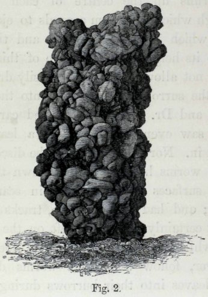

<!-- source-id: C002; original-page: 107 -->
Fig. 2.

图 2。

<!-- source-id: C003; original-page: 107 -->
Tower-like casting from near Nice, constructed of earth, voided probably by a species of Perichæta: of natural size, copied from a photograph.

尼斯附近排出的塔状蚓粪，由泥土构成，可能是由一种 Perichæta 造成的：自然大小，复制自照片。

<!-- source-id: S105; original-page: 107 -->
greatly surprised to see how closely they resembled castings sent to me from near Calcutta, where it is known that species of Perichæta abound.

令我惊讶的是，它们与从加尔各答附近寄来的蚓粪非常相似，众所周知，那里有大量的蚯蚓。

<!-- source-id: S106; original-page: 108 -->
which were measured was 3.3 inch in height and 1 in diameter. A small cylindrical passage runs up the centre of each tower, through which the worm ascends to eject the earth which it has swallowed, and thus to add to its height. A structure of this kind would not allow leaves being easily dragged from the surrounding ground into the burrows; and Dr. King, who looked carefully, never saw even a fragment of a leaf thus drawn in. Nor could any trace be discovered of the worms having crawled down the exterior surfaces of the towers in search of leaves; and had they done so, tracks would almost certainly have been left on the upper part whilst it remained soft. It does not, however, follow that these worms do not draw leaves into their burrows during some other season of the year, at which time they would not build up their towers.

测量的高度为 3.3 英寸，直径为 1 英寸。每座塔的中心都有一个圆柱形的小通道，蚯蚓通过该通道上升，排出它所吞下的泥土，从而增加了塔的高度。这种结构不允许树叶轻易地从周围的地面拖入洞穴；金博士仔细观察，却连一片叶子的碎片都没有被拉进去。也没有发现任何蚯蚓沿着塔的外表面爬行寻找叶子的痕迹。如果他们这样做了，几乎肯定会在上部保持柔软的状态下留下痕迹。然而，这并不意味着这些蚯蚓在一年中的其他季节不会将树叶吸进洞穴，而在那时它们也不会建造自己的塔。

<!-- source-id: S107; original-page: 108 -->
From the several foregoing cases, it can hardly be doubted that worms swallow earth, not only for the sake of making their burrows, but for obtaining food. Hensen, however, concludes from his analyses of mould that worms probably could not live on ordinary vegetable mould, though he admits that they might be nourished to some extent by leaf-mould.* But we have seen that worms eagerly devour raw meat, fat, and dead worms; and ordinary mould can hardly fail to contain many ova, larvæ, and small living or dead creatures, spores of cryptogamic plants, and micrococci, such as those which give rise to saltpetre. These various organisms, together with some cellulose from any leaves and roots not utterly decayed, might well account for such large quantities of mould being swallowed by worms. It may be worth while here to recall the fact that certain species of Utricularia, which grow in damp places in the tropics, possess bladders beautifully constructed for catching minute subterranean animals; and these traps would not have been developed unless many small animals inhabited such soil.

从以上几个例子可以看出，蚯蚓吞土不仅是为了打洞，而且是为了获取食物。然而，亨森从他对腐殖土的分析中得出结论，蚯蚓可能无法在普通的腐殖土上生存，尽管他承认它们可能在某种程度上受到叶腐殖土的滋养。*但我们已经看到，蚯蚓急切地吞食生肉、脂肪和死去的蚯蚓；普通的腐殖土几乎不可能不含有许多卵、幼虫、小型活体或死体、隐花植物的孢子和微球菌，例如那些产生硝石的微生物。这些不同的生物体，加上未完全腐烂的叶子和根部的一些纤维素，很可能解释了为什么蚯蚓吞食了如此大量的腐殖土。在这里也许值得回顾一下这样一个事实：某些生长在热带潮湿地区的狸藻具有构造精美的膀胱，可以捕捉微小的地下动物；如果没有许多小动物栖息在这样的土壤中，这些陷阱就不会被开发出来。

<!-- source-id: S108; original-page: 109 -->
The depth to which worms penetrate, and the construction of their burrows .— Although worms usually live near the surface, yet they burrow to a considerable depth during long- continued dry weather and severe cold. In Scandinavia, according to Eisen, and in Scotland, according to Mr. Lindsay Carnagie, the burrows run down to a depth of from 7 to 8 feet; in North Germany, according to Hoff-meister, from 6 to 8 feet, but Hensen says, from 3 to 6 feet. This latter observer has seen worms frozen at a depth of 1½ feet beneath the surface. I have not myself had many opportunities for observation, but I have often met with worms at depths of 3 to 4 feet. In a bed of fine sand overlying the chalk, which had never been disturbed, a worm was cut into two at 55 inches, and another was found here in December at the bottom of its burrow, at 61 inches beneath the surface. Lastly, in earth near an old Roman Villa, which had not been disturbed for many centuries, a worm was met with at a depth of 66 inches; and this was in the middle of August.

蚯蚓钻入的深度及其洞穴的结构。尽管蚯蚓通常生活在地表附近，但在长期持续干燥和严寒的天气中，它们会挖到相当深的深度。根据艾森的说法，在斯堪的纳维亚半岛，以及根据林赛·卡纳吉先生的说法，在苏格兰，洞穴的深度为 7 至 8 英尺；在德国北部，根据 Hoff-meister 的说法，从 6 到 8 英尺，但 Hensen 说，从 3 到 6 英尺。后者观察者看到蚯蚓被冻结在地表以下 1.5 英尺的深度。我自己没有太多观察的机会，但我经常在3到4英尺的深处遇到蚯蚓。在白垩层上从未被扰动过的细沙床上，一条蚯蚓在 55 英寸处被切成两半，12 月在地表以下 61 英寸处的洞穴底部发现了另一条蚯蚓。最后，在一座古老的罗马别墅附近的土地上，该别墅已经许多世纪没有受到干扰，在 66 英寸深的地方遇到了一条蚯蚓；那是在八月中旬。

<!-- source-id: N038; original-page: 109 -->
* 'Zeitschrift für wissenschaft. Zoolog. B. xxviii. 1877, p. 364.

*《Zeitschrift für wissenschaft》。动物学。 B.二十八。 1877，p。 364.

<!-- source-id: S109; original-page: 110 -->
The burrows run down perpendicularly, or more commonly a little obliquely. They are said sometimes to branch, but as far as I have seen this does not occur, except in recently dug ground and near the surface. They are generally, or as I believe invariably, lined with a thin layer of fine, dark-coloured earth voided by the worms; so that they must at first be made a little wider than their ultimate diameter. I have seen several burrows in undisturbed sand thus lined at a depth of 4 ft. 6 in.; and others close to the surface thus lined in recently dug ground. The walls of fresh burrows are often dotted with little globular pellets of voided earth, still soft and viscid; and these, as it appears, are spread out on all sides by the worm as it travels up or down its burrow. The lining thus formed becomes very compact and smooth when nearly dry, and closely fits the worm's body. The minute reflexed bristles which project in rows on all sides from the body, thus have excellent points of support; and the burrow is rendered well adapted for the rapid movement of the animal. The lining appears also to strengthen the walls, and perhaps saves the worm's body from being scratched. I think so because several burrows which passed through a layer of sifted coal-cinders, spread over turf to a thickness of 1½ inch, had been thus lined to an unusual thickness. In this case the worms, judging from the castings, had pushed the cinders away on all sides and had not swallowed any of them. In another place, burrows similarly lined, passed through a layer of coarse coal-cinders, 3½ inches in thickness. We thus see that the burrows are not mere excavations, but may rather be compared with tunnels lined with cement.

洞穴垂直向下，或更常见的是稍微倾斜。据说它们有时会分枝，但据我所知，这种情况不会发生，除非是在最近挖掘的地面和靠近地表的地方。它们一般都衬有一层薄薄的、被蚯蚓排空的深色细土，或者我认为总是如此。因此，首先必须将它们制造得比其最终直径稍宽。我曾在未受干扰的沙子中看到过几个洞穴，排列在 4 英尺 6 英寸的深度；和其他靠近地表的区域排列在最近挖掘的地面上。新洞穴的墙壁上经常点缀着一些由空洞土组成的小球状颗粒，它们仍然柔软而粘稠。看起来，当蚯蚓在洞穴中上下移动时，它们会向四面八方散开。这样形成的内膜在接近干燥时变得非常致密、光滑，与蚯蚓的身体紧密贴合。微小的反折刷毛从身体的各个侧面成排突出，因此具有出色的支撑点；并且洞穴非常适合动物的快速移动。衬里似乎还可以加固墙壁，也许可以防止蚯蚓的身体被划伤。我认为是这样，因为几个洞穴穿过一层筛过的煤渣，铺在草皮上，厚度为 1.5 英寸，因此排列成异常的厚度。在这种情况下，从蚓粪来看，蚯蚓将四面八方的煤渣推开，没有吞下任何煤渣。在另一个地方，洞穴也有类似的排列，穿过一层厚达 3.5 英寸的粗煤渣层。由此可见，这些洞穴不仅仅是挖掘，而可以与水泥衬砌的隧道进行比较。

<!-- source-id: S110; original-page: 112 -->
The mouths of the burrow are in addition often lined with leaves; and this is an instinct distinct from that of plugging them up, and does not appear to have been hitherto noticed. Many leaves of the Scotch-fir or pine ( Pinus sylvestris ) were given to worms kept in confinement in two pots; and when after several weeks the earth was carefully broken up, the upper parts of three oblique burrows were found surrounded for lengths of 7, 4, and 3½ inches with pine-leaves, together with fragments of other leaves which had been given the worms as food. Glass beads and bits of tile, which had been strewed on the surface of the soil, were stuck into the interstices between the pine-leaves; and these interstices were likewise plastered with the viscid castings voided by the worms. The structures thus formed cohered so well, that I succeeded in removing one with only a little earth adhering to it. It consisted of a slightly curved cylindrical case, the interior of which could be seen through holes in the sides and at either end. The pine-leaves had all been drawn in by their bases; and the sharp points of the needles had been pressed into the lining of voided earth. Had this not been effectually done, the sharp points would have prevented the retreat of the worms into their burrows; and these structures would have resembled traps armed with converging points of wire, rendering the ingress of an animal easy and its egress difficult or impossible. The skill shown by these worms is noteworthy and is the more remarkable, as the Scotch pine is not a native of this district.

此外，洞口通常铺有树叶。这是一种与堵住它们的本能不同的本能，迄今为止似乎还没有被注意到。许多樟子松或松树（Pinus sylvestris）的叶子被用来喂养蚯蚓，这些蚯蚓被限制在两个盆中；几周后，当地球被小心地打碎时，发现三个倾斜洞穴的上部被松树叶包围，长度分别为 7、4 和 3.5 英寸，以及作为蚯蚓食物的其他树叶碎片。松叶的缝隙里塞满了撒在土壤表面的玻璃珠和瓦片。这些缝隙里同样布满了蚯蚓排出的粘稠粪便。这样形成的结构粘合得非常好，以至于我成功地移除了一个只粘附了一点泥土的结构。它由一个略微弯曲的圆柱形外壳组成，通过侧面和两端的孔可以看到其内部。松叶全都被它们的根部吸住了。针尖已被压入虚空泥土的内衬中。如果没有有效地做到这一点，尖锐的尖端就会阻止蚯蚓退回到洞穴中。这些结构类似于配备了金属丝汇聚点的陷阱，使动物很容易进入，而其出口则困难或不可能。这些蚯蚓所表现出的技能值得注意，而且更加引人注目，因为樟子松不是该地区的原生植物。

<!-- source-id: S111; original-page: 113 -->
After having examined these burrows made by worms in confinement, I looked at those in a flower-bed near some Scotch pines. These had all been plugged up in the ordinary manner with the leaves of this tree, drawn in for a length of from 1 to 1½ inch; but the mouths of many of them were likewise lined with them, mingled with fragments of other kinds of leaves, drawn in to a depth of 4 or 5 inches. Worms often remain, as formerly stated, for a long time close to the mouths of their burrows, apparently for warmth; and the basket-like structures formed of leaves would keep their bodies from coming into close contact with the cold damp earth. That they habitually rested on the pine-leaves, was rendered probable by their clean and almost polished surfaces.

在检查了这些由蚯蚓在圈闭中形成的洞穴后，我又观察了一些樟子松附近花坛中的洞穴。这些都以普通方式用这棵树的叶子塞住，长度从 1 到 1.5 英寸不等；但他们中的许多人的嘴里也同样布满了它们，与其他种类的树叶碎片混合在一起，被拉入四五英寸的深度。如前所述，蚯蚓通常会在靠近洞口的地方停留很长时间，显然是为了取暖。而由树叶组成的篮子结构可以防止它们的身体与寒冷潮湿的土地紧密接触。它们习惯性地栖息在松叶上，这从它们干净且几乎抛光的表面来看是可能的。

<!-- source-id: S112; original-page: 114 -->
The burrows which run far down into the ground, generally, or at least often, terminate in a little enlargement or chamber. Here, according to Hoffmeister, one or several worms pass the winter rolled up into a ball. Mr. Lindsay Carnagie informed me (1838) that he had examined many burrows over a stonequarry in Scotland, where the overlying boulder-clay and mould had recently been cleared away, and a little vertical cliff thus left. In several cases the same burrow was a little enlarged at two or three points one beneath the other; and all the burrows terminated in a rather large chamber, at a depth of 7 or 8 feet from the surface. These cham- bers contained many small sharp bits of stone and husks of flax-seeds. They must also have contained living seeds, for on the following spring Mr. Carnagie saw grass-plants sprouting out of some of the intersected chambers. I found at Abinger in Surrey two burrows terminating in similar chambers at a depth of 36 and 41 inches, and these were lined or paved with little pebbles, about as large as mustard seeds; and in one of the chambers there was a decayed oat-grain, with its husk. Hensen likewise states that the bottoms of the burrows are lined with little stones; and where these could not be procured, seeds, apparently of the pear, had been used, as many as fifteen having been carried down into a single burrow, one of which had germinated.* We thus see how easily a botanist might be deceived who wished to learn how long deeply buried seeds remained alive, if he were to collect earth from a considerable depth, on the supposition that it could contain only seeds which had long lain buried. It is probable that the little stones, as well as the seeds, are carried down from the surface by being swallowed; for a surprising number of glass beads, bits of tile and of glass were certainly thus carried down by worms kept in pots; but some may have been carried down within their mouths. The sole conjecture which I can form why worms line their winter-quarters with little stones and seeds, is to prevent their closely coiled-up bodies from coming into close contact with the surrounding cold soil; and such contact would perhaps interfere with their respiration which is effected by the skin alone.

通常，或者至少经常，深入地下的洞穴终止于一个小的扩大部分或房间。根据霍夫迈斯特的说法，在这里，一条或几条蚯蚓卷成一个球来过冬。林赛·卡纳基先生 (Lindsay Carnagie) 告诉我（1838 年），他检查了苏格兰一个采石场上的许多洞穴，那里的上覆巨石粘土和腐殖土最近被清除了，因此留下了一点垂直的悬崖。在一些情况下，同一个洞穴在两三个点上稍稍扩大，一个在另一个下。所有的洞穴都终止于一个相当大的房间，距离地表七八英尺深。这些房间里有许多锋利的小石头和亚麻籽壳。它们肯定还含有活的种子，因为第二年春天，卡纳基先生看到草类植物从一些相交的房间里发芽了。我在萨里的阿宾格发现了两个洞穴，它们的尽头是类似的洞穴，深度分别为 36 英寸和 41 英寸，这些洞穴内衬或铺有小卵石，大约和芥菜籽一样大；其中一个房间里有一颗腐烂的燕麦粒和它的外壳。亨森同样指出，洞穴的底部排列着小石头；在无法获得这些种子的地方，就使用了显然是梨子的种子，多达十五颗种子被带入一个洞穴，其中一颗已经发芽。*因此，我们看到，如果植物学家想要知道深埋的种子还能存活多久，如果他从相当深的地方收集泥土，并假设泥土中只能含有长期埋藏的种子，那么他是多么容易被欺骗。这些小石头和种子很可能是被吞下而从地表带下来的。对于数量惊人的玻璃珠、瓷砖和玻璃碎片肯定是被盆里的蚯蚓带下来的。但有些可能已经被含在嘴里了。我能想到的唯一猜想是，为什么蚯蚓在冬季的住所里铺满了小石头和种子，是为了防止它们紧密盘绕的身体与周围寒冷的土壤紧密接触。这种接触可能会干扰它们仅由皮肤影响的呼吸。

<!-- source-id: N039; original-page: 115 -->
* 'Zeitschrift für wissenschaft. Zoolog.' B. xxviii. 1877, p. 356.

*《Zeitschrift für wissenschaft》。动物学。” B.二十八。 1877，p。 356.

<!-- source-id: S113; original-page: 116 -->
A worm after swallowing earth, whether for making its burrow or for food, soon comes to the surface to empty its body. The ejected earth is thoroughly mingled with the intestinal secretions, and is thus rendered viscid. After being dried it sets hard. I have watched worms during the act of ejection, and when the earth was in a very liquid state it was ejected in little spurts, and when not so liquid by a slow peristaltic movement. It is not cast indifferently on any side, but with some care, first on one and then on another side; the tail being used almost like a trowel.

蚯蚓吞下泥土后，无论是为了打洞还是为了食物，很快就会回到地面来清空它的身体。喷出的泥土与肠道分泌物充分混合，从而变得粘稠。干燥后会变硬。我观察过蚯蚓在喷射过程中的情况，当地球处于非常液态的状态时，它会以小的喷射方式喷射出来，而当地球不那么液态时，它会通过缓慢的蠕动运动喷射出来。它不是漠不关心地投向任何一侧，而是小心翼翼地先投向一侧，然后投向另一侧；尾巴的使用几乎就像抹刀一样。

<!-- source-id: S114; original-page: 117 -->
As soon as a little heap is formed, the worm apparently avoids, for the sake of safety, protruding its tail; and the earthy matter is forced up through the previously deposited soft mass. The mouth of the same burrow is used for this purpose for a considerable time. In the case of the tower-like castings (see Fig. 2) near Nice, and of the similar but still taller towers from Bengal (hereafter to be described and figured) a considerable degree of skill is exhibited in their construction. Dr. King also observed that the passage up these towers hardly ever ran in the same exact line with the underlying burrow, so that a thin cylindrical object such as a haulm of grass, could not be passed down the tower into the burrow; and this change of direction probably serves in some manner as a protection. When a worm comes to the surface to eject earth, the tail protrudes, but when it collects leaves its head must protrude. Worms therefore must have the power of turning round in their closely-fitting burrows; and this, as it appears to us, would be a difficult feat.

一旦形成一个小堆，为了安全起见，蚯蚓显然会避免伸出尾巴。土质物质被迫向上穿过先前沉积的软物质。同一洞穴的口在相当长的时间内用于此目的。尼斯附近的塔状蚓粪（见图 2）以及来自孟加拉的类似但更高的塔（下文将进行描述和图示）在其建造过程中展现了相当高的技术水平。金博士还观察到，这些塔楼上的通道几乎不会与下面的洞穴在同一直线上，因此诸如草捆之类的细圆柱形物体无法从塔楼进入洞穴。这种方向的改变可能在某种程度上起到了保护作用。当蚯蚓来到地表吐土时，尾巴会伸出来，但当它收集叶子时，它的头必须伸出。因此，蚯蚓必须具有在其紧密配合的洞穴中转动的能力。在我们看来，这将是一项艰巨的任务。

<!-- source-id: S115; original-page: 117 -->
Worms do not always eject their castings on the surface of the ground. When they can find any cavity, as when burrowing in newly turned-up earth, or between the stems of banked-up plants, they deposit their castings in such places. So again any hollow beneath a large stone lying on the surface of the ground, is soon filled up with their castings. According to Hensen, old burrows are habitually used for this purpose; but as far as my experience serves, this is not the case, excepting with those near the surface in recently dug ground. I think that Hensen may have been deceived by the walls of old burrows, lined with black earth, having sunk in or collapsed; for black streaks are thus left, and these are conspicuous when passing through light-coloured soil, and might be mistaken for completely filled-up burrows.

蚯蚓并不总是将蚓粪排出到地面上。当它们发现任何空洞时，例如在新翻出的泥土中或在堆积的植物茎之间挖洞时，它们会将蚓粪沉积在这些地方。因此，地面上的大石头下面的任何空洞很快就会被蚯蚓的粪便填满。根据汉森的说法，古老的洞穴通常被用于此目的。但就我的经验而言，情况并非如此，除了那些在最近挖掘的地面附近的地方。我认为汉森可能被那些古老洞穴的墙壁所欺骗，这些洞穴的墙壁内衬着黑土，已经陷入或倒塌了；因为这样留下了黑色条纹，当穿过浅色土壤时，这些条纹很明显，可能会被误认为是完全填满的洞穴。

<!-- source-id: S116; original-page: 118 -->
It is certain that old burrows collapse in the course of time; for as we shall see in the next chapter, the fine earth voided by worms, if spread out uniformly, would form in many places in the course of a year a layer 1/5 of an inch in thickness; so that at any rate this large amount is not deposited within the old unused burrows. If the burrows did not collapse, the whole ground would be first thickly riddled with holes to a depth of about ten inches, and in fifty years a hollow unsupported space, ten inches in depth, would be left. The holes left by the decay of successively formed roots of trees and plants must likewise collapse in the course of time.

可以肯定的是，随着时间的推移，旧的洞穴会崩溃。因为正如我们将在下一章中看到的那样，蚯蚓排出的细土如果均匀分布，一年之内就会在许多地方形成一层 1/5 英寸厚的层。因此无论如何，这么大的数量不会沉积在旧的未使用的洞穴中。如果洞穴不塌陷，整个地面首先会布满深达十英寸左右的厚厚的洞，五十年后，就会留下一个深达十英寸的中空无支撑空间。随着时间的推移，树木和植物相继形成的根腐烂所留下的洞也必然会塌陷。

<!-- source-id: S117; original-page: 119 -->
The burrows of worms run down perpendicularly or a little obliquely, and where the soil is at all argillaceous, there is no difficulty in believing that the walls would slowly flow or slide inwards during very wet weather When, however, the soil is sandy or mingled with many small stones, it can hardly be viscous enough to flow inwards during even the wettest weather; but another agency may here come into play. After much rain the ground swells, and as it cannot expand laterally, the surface rises; during dry weather it sinks again. For instance, a large flat stone laid on the surface of a field sank 3.33 mm. whilst the weather was dry between May 9th and June 13th, and rose 1.91 mm. between September 7th and 19th, much rain having fallen during the latter part of this time. During frosts and thaws the movements were twice as great. These observations were made by my son Horace, who will hereafter publish an account of the movements of this stone during successive wet and dry seasons, and of the effects of its being undermined by worms. Now when the ground swells, if it be penetrated by cylindrical holes, such as worm-burrows, their walls will tend to yield and be pressed inwards; and the yielding will be greater in the deeper parts (supposing the whole to be equally moistened) from the greater weight of the superincumbent soil which has to be raised, than in the parts near the surface. When the ground dries, the walls will shrink a little and the burrows will be a little enlarged. Their enlargement, however, through the lateral contraction of the ground, will not be favoured, but rather opposed, by the weight of the superincumbent soil.

蚯蚓的洞穴垂直或稍微倾斜地向下延伸，在土壤完全是泥质的地方，不难相信，在非常潮湿的天气里，洞壁会慢慢地向内流动或滑动。然而，当土壤是沙质的或混有许多小石块时，即使在最潮湿的天气里，它也很难粘到向内流动的程度；但另一个机构可能会在这里发挥作用。大量降雨后，地面会隆起，由于无法横向扩展，所以地表会上升。天气干燥时，它会再次下沉。例如，一块平放在田野表面的大石头下沉了 3.33 毫米。 5月9日至6月13日期间天气干燥，上升了1.91毫米。 9月7日至19日期间，后期降雨较多。在霜冻和解冻期间，运动量是原来的两倍。这些观察是由我的儿子霍勒斯（Horace）进行的，他将在以后发表关于这块石头在连续的雨季和旱季期间的运动的报告，以及它被蚯蚓破坏的影响。现在，当地面膨胀时，如果它被圆柱形的孔洞（例如蚯蚓洞）穿透，那么它们的壁就会屈服并被向内挤压；与靠近地表的部分相比，由于必须抬高的上层土壤的重量更大，较深的部分（假设整体被同等地湿润）的产量会更大。当地面干燥时，墙壁会缩小一点，洞穴会扩大一点。然而，由于地面的横向收缩，它们的扩大不会受到上层土壤重量的有利，反而会受到阻碍。

<!-- source-id: S118; original-page: 120 -->
Distribution of Worms. —Earth-worms are found in all parts of the world, and some of the genera have an enormous range.* They inhabit the most isolated islands; they abound in Iceland, and are known to exist in the West Indies, St. Helena, Madagascar, New Caledonia and Tahiti. In the Antarctic regions, worms from Kerguelen Land have been described by Ray Lankester; and I found them in the Falkland Islands. How they reach such isolated islands is at present quite unknown. They are easily killed by salt-water, and it does not appear probable that young worms or their egg-capsules could be carried in earth adhering to the feet or beaks of land-birds. Moreover Kerguelen Land is not now inhabited by any land-bird.

蚯蚓的分布。 —蚯蚓在世界各地都有发现，有些属的分布范围很广。*它们栖息在最偏僻的岛屿上；它们在冰岛大量存在，并且已知存在于西印度群岛、圣赫勒拿岛、马达加斯加、新喀里多尼亚和塔希提岛。在南极地区，雷·兰克斯特（Ray Lankester）描述了来自凯尔盖朗地区的蚯蚓；我在福克兰群岛找到了它们。目前尚不清楚它们如何到达这些孤立的岛屿。它们很容易被盐水杀死，而且幼年蚯蚓或它们的卵囊似乎不可能被附着在陆地鸟类的脚或喙上的泥土中携带。此外，凯尔盖朗土地上现在没有任何陆地鸟类栖息。

<!-- source-id: N040; original-page: 120 -->
* Perrier, 'Archives de Zoolog. expér.' tom. 3, p. 378, 1874.

*巴黎水，“动物档案”。经验。”汤姆。 3，第 3 页。 378、1874。

<!-- source-id: S119; original-page: 121 -->
In this volume we are chiefly concerned with the earth cast up by worms, and I have gleaned a few facts on this subject with respect to distant lands. Worms throw up plenty of castings in the United States. In Venezuela, castings, probably ejected by species of Urochæta, are common in the gardens and fields, but not in the forests, as I hear from Dr. Ernst of Caracas. He collected 156 castings from the court-yard of his house, having an area of 200 square yards. They varied in bulk from half a cubic centimeter to five cubic centimeters, and were on an average three cubic centimeters. They were, therefore, of small size in comparison with those often found in England; for six large castings from a field near my house averaged 16 cubic centimeters. Several species of earth-worms are common in St. Catharina in South Brazil, and Fritz Müller informs me "that in most parts of the forests and pasture-lands, the whole soil, to a depth of a quarter of a metre, looks as if it had passed repeatedly through the intestines of earth-worms, even where hardly any castings are to be seen on the surface." A gigantic but very rare species is found there, the burrows of which are sometimes even two centimeters or nearly 4/5 of an inch in diameter, and which apparently penetrate the ground to a great depth.

在本书中，我们主要关注的是蚯蚓吐出的泥土，我已经收集了一些有关遥远土地的事实。在美国，蚯蚓会吐出大量的蚓粪。据我从加拉加斯的恩斯特博士那里得知，在委内瑞拉，蚯蚓的粪便（可能是由乌线螨排出的）在花园和田野中很常见，但在森林中却不常见。他在自家200平方米的院子里收集了156个蚓粪。它们的体积从半立方厘米到五立方厘米不等，平均为三立方厘米。因此，与英格兰常见的那些相比，它们的尺寸较小。我家附近田地里有六只大蚯蚓，其粪便平均有 16 立方厘米。在巴西南部的圣凯瑟琳娜，几种蚯蚓很常见，弗里茨·穆勒告诉我，“在森林和牧场的大部分地区，四分之一米深的整个土壤看起来好像已经反复穿过蚯蚓的肠道，即使在表面上几乎看不到任何蚓粪的地方。”那里发现了一种巨大但非常稀有的物种，其洞穴的直径有时甚至达到两厘米或近 4/5 英寸，并且显然穿透地面很深。

<!-- source-id: S120; original-page: 122 -->
In the dry climate of New South Wales, I hardly expected that worms would be common; but Dr. G. Krefft of Sydney, to whom I applied, after making enquiries from gardeners and others, and from his own observations, informs me that their castings abound. He sent me some collected after heavy rain, and they consisted of little pellets, about .15 inch in diameter; and the blackened sandy earth of which they were formed still cohered with considerable tenacity.

在气候干燥的新南威尔士州，我几乎没想到蚯蚓会如此普遍。但我向园丁和其他人询问并根据他自己的观察后，我向悉尼的 G. Krefft 博士提出了申请，他告诉我，他们的蚓粪比比皆是。他寄给我一些大雨后收集的东西，它们由小颗粒组成，直径约为 0.15 英寸；形成它们的黑色沙土仍然具有相当大的韧性。

<!-- source-id: S121; original-page: 123 -->
The late Mr. John Scott of the Botanic Gardens near Calcutta made many observations for me on worms living under the hot and humid climate of Bengal. The castings abound almost everywhere, in jungles and in the open ground, to a greater degree, as he thinks, than in England. After the water has subsided from the flooded rice-fields, the whole surface very soon becomes studded with castings—a fact which much surprised Mr. Scott, as he did not know how long worms could survive beneath water. They cause much trouble in the Botanic garden, "for "some of the finest of our lawns can be kept "in anything like order only by being almost "daily rolled; if left undisturbed for a few days "they become studded with large castings." These closely resemble those described as abounding near Nice; and they are probably the work of a species of Perichæta. They stand up like towers, with an open passage in the centre.

加尔各答附近植物园的已故约翰·斯科特先生为我对生活在孟加拉炎热潮湿气候下的蚯蚓进行了许多观察。蚓粪几乎随处可见，无论是在丛林中还是在空地上，正如他认为的那样，其程度比英国还要严重。当水从被淹没的稻田消退后，整个地表很快就布满了蚯蚓的粪便——这一事实让斯科特先生非常惊讶，因为他不知道蚯蚓在水下能存活多久。它们给植物园带来了很多麻烦，“因为”我们的一些最好的草坪只有通过几乎“每天都要打滚”才能保持“井然有序”；如果几天不被打扰，“它们就会布满大蚓粪。”这些与尼斯附近所描述的非常相似。它们可能是 Perichæta 物种的杰作。它们像塔一样矗立着，中心有一条开放的通道。

<!-- source-id: S122; original-page: 123 -->
A figure of one of these castings from a photograph is here given (Fig. 3). The largest received by me was 3½ inches in height and 1.35 inch in diameter; another was only ¾ inch in diameter and 2¾ in height.

这里给出了其中一张蚓粪的照片（图 3）。我收到的最大的一个高 3.5 英寸，直径 1.35 英寸；另一个直径仅为 3/4 英寸，高度为 2 3/4 英寸。

<!-- source-id: F003; original-page: 124 -->
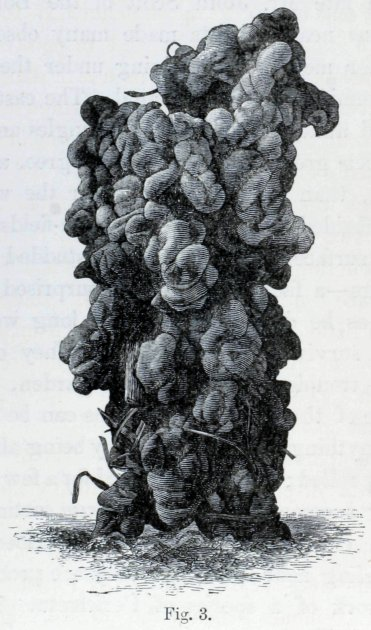

<!-- source-id: C004; original-page: 124 -->
Fig. 3.

图 3。

<!-- source-id: C005; original-page: 124 -->
A tower-like casting, probably ejected by a species of Perichæta from the Botanic Garden, Calcutta: of natural size, engraved from a photograph.

塔状蚓粪，可能是加尔各答植物园的一种蠕虫排出的粪便：自然大小，刻在一张照片上。

<!-- source-id: S123; original-page: 125 -->
In the following year, Mr. Scott measured several of the largest; one was 6 inches in height and nearly 1½ in diameter: two others were 5 inches in height and respectively 2 and rather more than 2½ inches in diameter. The average weight of the 22 castings sent to me was 35 grammes (1¼ oz.); and one of them weighed 44.8 grammes (or 2 oz.). All these castings were thrown up either in one night or in two. Where the ground in Bengal is dry, as under large trees, castings of a different kind are found in vast numbers: these consist of little oval or conical bodies, from about the 1/20 to rather above 1/10 of an inch in length. They are obviously voided by a distinct species of worms.

第二年，斯科特先生测量了其中几个最大的。其中一个高 6 英寸，直径接近 1.5 英寸；另外两个高 5 英寸，直径分别为 2 英寸和 2.5 英寸以上。寄给我的 22 份蚓粪平均重量为 35 克（1¼ 盎司）；其中一颗重 44.8 克（或 2 盎司）。所有这些蚓粪不是一晚上就是两晚上就吐出来的。在孟加拉，地面干燥的地方，如大树下，会发现大量不同类型的蚓粪：这些粪便由椭圆形或圆锥形的小体组成，长度从约 1/20 英寸到 1/10 英寸以上。它们显然是由一种不同种类的蚯蚓排空的。

<!-- source-id: S124; original-page: 125 -->
The period during which worms near Calcutta display such extraordinary activity lasts for only a little over two months, namely, during the cool season after the rains. At this time they are generally found within about 10 inches beneath the surface. During the hot season they burrow to a greater depth, and are then found coiled up and apparently hybernating. Mr. Scott has never seen them at a greater depth than 2½ feet, but has heard of their having been found at 4 feet. Within the forests, fresh castings may be found even during the hot season. The worms in the Botanic garden, during the cool and dry season, draw many leaves and little sticks into the mouths of their burrows, like our English worms; but they rarely act in this manner during the rainy season.

加尔各答附近的蚯蚓表现出如此非凡的活动的时期仅持续两个多月，即雨后的凉爽季节。此时，它们通常被发现在地表以下约 10 英寸的范围内。在炎热的季节，它们会挖得更深，然后被发现盘绕着，显然正在冬眠。 Scott 先生从未在超过 2.5 英尺的深度见过它们，但听说有人在 4 英尺处发现过它们。在森林里，即使在炎热的季节也可能发现新鲜的蚓粪。植物园里的蚯蚓，在凉爽干燥的季节，会像我们的英国蚯蚓一样，把许多叶子和小木棍吸入它们的洞口；但在雨季，他们很少有这样的行为。

<!-- source-id: S125; original-page: 126 -->
Mr. Scott saw worm-castings on the lofty mountains of Sikkim in North India. In South India Dr. King found in one place, on the plateau of the Nilgiris, at an elevation of 7000 feet, "a good many castings," which are interesting for their great size. The worms which eject them are seen only during the wet season, and are reported to be from 12 to 15 inches in length, and as thick as a man's little finger. These castings were collected by Dr. King after a period of 110 days without any rain; and they must have been ejected either during the north-east or more probably during the previous south-west monsoon; for their surfaces had suffered some disintegration and they were penetrated by many fine roots. A drawing is here given (Fig. 4) of one which seems to have best retained its original size and appearance. Notwithstanding some loss from disintegration, five of the largest of these castings (after having been well sun-dried) weighed each on an average 89.5 grammes, or above 3 oz.; and the largest weighed 123.14 grammes, or 4 1/3 oz. —that is above a quarter of a pound! The largest convolutions were rather more than one inch in diameter; but it is probable that they had subsided a little

斯科特先生在印度北部锡金的高山上看到了蚯蚓-蚯蚓的粪便。在印度南部的尼尔吉里斯高原上，金博士在海拔 7000 英尺的一个地方发现了“大量的蚓粪”，它们的大小非常有趣。吐出蚯蚓的蚯蚓只有在雨季才能见到，据报道它们的长度为 12 至 15 英寸，粗如一个人的小指。这些蚓粪是在110天没有下雨的情况下由金博士收集的；它们肯定是在东北季风期间或更可能是在之前的西南季风期间被喷射出来的；因为它们的表面已经发生了一些崩解，并且被许多细根穿透。这里给出了一张图（图 4），该图似乎最好地保留了其原始尺寸和外观。尽管因崩解而造成一些损失，但这些蚓粪中最大的五个（经过充分晒干后）的平均重量为 89.5 克，即超过 3 盎司；最大的重 123.14 克，即 4 1/3 盎司。 ——超过四分之一磅！最大的回旋直径超过一英寸；但它们很可能已经消退了一点

<!-- source-id: F004; original-page: 127 -->
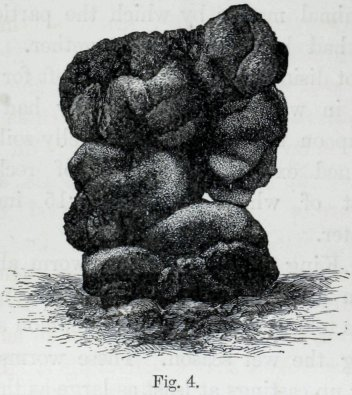

<!-- source-id: C006; original-page: 127 -->
Fig. 4.

图 4。

<!-- source-id: C007; original-page: 127 -->
A casting from the Nilgiri Mountains in South India; of natural size, engraved from a photograph.

来自印度南部尼尔吉里山脉的蚓粪；自然尺寸，根据照片雕刻而成。

<!-- source-id: S126; original-page: 128 -->
whilst soft, and that their diameters had thus been increased. Some had flowed so much that they now consisted of a pile of almost flat confluent cakes. All were formed of fine, rather light-coloured earth, and were surprisingly hard and compact, owing no doubt to the animal matter by which the particles of earth had been cemented together. They did not disintegrate, even when left for some hours in water. Although they had been cast up on the surface of gravelly soil, they contained extremely few bits of rock, the largest of which was only .15 inch in diameter.

同时柔软，并且它们的直径因此增加。有些已经流得太多了，现在变成了一堆几乎平坦的汇合蛋糕。所有这些都是由细而浅色的泥土制成的，而且出奇地坚硬和致密，这无疑是由于将泥土颗粒粘合在一起的动物物质造成的。即使在水中放置几个​​小时，它们也不会分解。虽然它们是在砾石土表面铸造的，但其中的岩石碎片极少，其中最大的直径仅为 0.15 英寸。

<!-- source-id: S127; original-page: 128 -->
Dr. King saw in Ceylon a worm about 2 feet in length and ½ inch in diameter; and he was told that it was a very common species during the wet season. These worms must throw up castings at least as large as those on the Nilgiri Mountains; but Dr. King saw none during his short visit to Ceylon. Sufficient facts have now been given, showing that worms do much work in bringing up fine earth to the surface in most or all parts of the world, and under the most different climates.

金博士在锡兰看到了一条长约 2 英尺、直径约 1/2 英寸的蚯蚓；他被告知这是雨季非常常见的物种。这些蚯蚓吐出的蚓粪至少与尼尔吉里山脉上的蚓粪一样大；但金博士在短暂访问锡兰期间却什么也没看到。现在已经有足够的事实表明，在世界上大部分或所有地区，在最不同的气候下，蚯蚓在将细土带到地表方面做了很多工作。

<!-- source-id: H037; original-page: 129 -->
## CHAPTER III.

第三章

<!-- source-id: H038; original-page: 129 -->
### THE AMOUNT OF FINE EARTH BROUGHT UP BY WORMS TO THE SURFACE.

蚯蚓带出地表的细土量。

<!-- source-id: S128; original-page: 129 -->
Rate at which various objects strewed on the surface of grass-fields are covered up by the castings of worms—The burial of a paved path—The slow subsidence of great stones left on the surface—The number of worms which live within a given space—The weight of earth ejected from a burrow, and from all the burrows within a given space—The thickness of the layer of mould which the castings on a given space would form within a given time if uniformly spread out—The slow rate at which mould can increase to a great thickness—Conclusion.

散布在草地表面的各种物体被蚓粪覆盖的比率——铺好的道路的掩埋——留在地表的大石头的缓慢沉降——生活在给定空间内的蚯蚓的数量——从一个洞穴以及给定空间内的所有洞穴中喷出的土的重量——蚓粪在给定空间上撒下的腐殖土层的厚度如果均匀分布的话，会在给定的时间内形成——腐殖土增加到很大厚度的缓慢速度——结论。

<!-- source-id: S129; original-page: 129 -->
WE now come to the more immediate subject of this volume, namely, the amount of earth which is brought up by worms from beneath the surface, and is afterwards spread out more or less completely by the rain and wind. The amount can be judged of by two methods,—by the rate at which objects left on the surface are buried, and more accurately by weighing the quantity brought up within a given time. We will begin with the first method, as it was first followed.

现在我们来讨论本卷更直接的主题，即由蚯蚓从地表以下带起并随后或多或少完全被雨和风散开的泥土量。可以通过两种方法来判断数量：根据留在地表的物体被掩埋的速度，以及更准确地通过称量在给定时间内挖出的数量来判断。我们将从第一种方法开始，因为它是首先遵循的。

<!-- source-id: S130; original-page: 130 -->
Near Maer Hall in Staffordshire, quick-lime had been spread about the year 1827 thickly over a field of good pasture-land, which had not since been ploughed. Some square holes were dug in this field in the beginning of October 1837; and the sections showed a layer of turf, formed by the matted roots of the grasses, ½ inch in thickness, beneath which, at a depth of 2½ inches (or 3 inches from the surface), a layer of the lime in powder or in small lumps could be distinctly seen running all round the vertical sides of the holes. The soil beneath the layer of lime was either gravelly or of a coarse sandy nature, and differed considerably in appearance from the overlying dark-coloured fine mould. Coal-cinders had been spread over a part of this same field either in the year 1833 or 1834; and when the above holes were dug, that is after an interval of 3 or 4 years, the cinders formed a line of black spots round the holes, at a depth of 1 inch beneath the surface, parallel to and above the white layer of lime. Over another part of this field cinders had been strewed, only about half-a-year before, and these either still lay on the surface or were entangled among the roots of the grasses; and I here saw the commencement of the burying process, for worm-castings had been heaped on several of the smaller fragments. After an interval of 4¾ years this field was re-examined, and now the two layers of lime and cinders were found almost everywhere at a greater depth than before by nearly 1 inch, we will say by ¾ of an inch. Therefore mould to an average thickness of .22 of an inch had been annually brought up by the worms, and had been spread over the surface of this field

大约在 1827 年，斯塔福德郡的马尔霍尔附近，生石灰被厚厚地撒在一片优质牧场上，此后一直没有耕耘过。 1837 年 10 月初，在这片土地上挖了一些方洞；这些剖面显示了一层草皮，由草丛的根部形成，厚度为 1/2 英寸，在草皮下面 2.5 英寸（或距表面 3 英寸）的深度处，可以清楚地看到一层粉末状或小块状的石灰在孔的垂直侧面上流动。石灰层下面的土壤要么是砾石，要么是粗沙性质的，并且在外观上与上面的深色细腐殖土有很大不同。 1833 年或 1834 年，煤渣曾散布在这片土地的一部分上；挖上述洞时，即间隔三四年后，煤渣在洞周围形成一排黑点，深度为地表以下一英寸，与白色石灰层平行并位于其上方。这片田地的另一部分还撒着煤渣，大约是半年前的事，这些煤渣要么还躺在地表上，要么缠在草根里；我在这里看到了掩埋过程的开始，因为蚯蚓-蚯蚓的粪便堆在几个较小的碎片上。每隔 4.75 年，对这片土地进行了重新检查，现在几乎到处都发现了两层石灰和煤渣，其深度比以前深了近 1 英寸，我们可以说是 3/4 英寸。因此，每年蚯蚓都会带出平均厚度为 0.22 英寸的腐殖土，并将其铺展在这片田地的表面上。

<!-- source-id: S131; original-page: 131 -->
Coal-cinders had been strewed over another field, at a date which could not be positively ascertained, so thickly that they formed (October, 1837) a layer, 1 inch in thickness at a depth of about 3 inches from the surface. The layer was so continuous that the overlying dark vegetable mould was connected with the sub-soil of red clay only by the roots of the grasses; and when these were broken the mould and the red clay fell apart. In a third field, on which coal-cinders and burnt marl had been strewed several times at unknown dates, holes were dug in 1842; and a layer of cinders could be traced at a depth of 3½ inches, beneath which at a depth of 9½ inches from the surface there was a line of cinders together with burnt marl. On the sides of one hole there were two layers of cinders, at 2 and 3½ inches beneath the surface; and below them at a depth in parts of 9½, and in other parts of 10½ inches there were fragments of burnt marl. In a fourth field two layers of lime, one above the other, could be distinctly traced, and beneath them a layer of cinders and burnt marl at a depth of from 10 to 12 inches below the surface.

煤渣被撒在另一块田地上，具体日期无法确定，煤渣太厚，以至于在距地表约 3 英寸的深度（1837 年 10 月）形成了一层 1 英寸厚的煤渣。该层非常连续，以至于上面的深色腐殖土仅通过草根与红粘土下层土壤相连；当这些被破坏时，腐殖土和红粘土就会分解。第三块田地于 1842 年挖了洞，煤渣和烧焦的泥灰已多次撒在地上，具体日期不详。在 3.5 英寸深的地方可以看到一层煤渣，在其下面距地表 9.5 英寸深的地方有一条煤渣和烧焦的泥灰岩。一个洞的两侧有两层煤渣，分别位于地表以下 2 英寸和 3.5 英寸处。在它们下面，部分深度为 9.5 英寸，其他部分为 10.5 英寸，有烧焦的泥灰碎片。在第四块区域中，可以清楚地看到两层石灰，一层在另一层之上，在它们下面是一层煤渣和烧焦的泥灰岩，深度为地表以下 10 至 12 英寸。

<!-- source-id: S132; original-page: 132 -->
A piece of waste, swampy land was enclosed, drained, ploughed, harrowed and thickly covered in the year 1822 with burnt marl and cinders. It was sowed with grass seeds, and now supports a tolerably good but coarse pasture. Holes were dug in this field in 1837, or 15 years after its reclamation, and we see in the accompanying diagram (Fig. 5), reduced to half of the natural scale, that the turf was ½ inch thick, beneath which there was a layer of vegetable mould 2½ inches thick. This layer did not contain fragments of any kind; but beneath it there was a layer of mould, 1½ inch in thickness, full of fragments of burnt marl, conspicuous from their red colour, one of which near the bottom was an

1822 年，一块废弃的沼泽地被围起来，排水，犁地，耙地，并用烧焦的泥灰和煤渣厚厚地覆盖。那里播下了草籽，现在成了一片还算不错但粗糙的牧场。 1837 年，也就是填海 15 年后，人们在这片土地上挖了洞，我们在附图（图 5）中看到，缩小到自然比例的一半，草皮有 1/2 英寸厚，下面有一层 2.5 英寸厚的腐殖土。该层不包含任何类型的碎片；但在它下面有一层腐殖土，厚度为 1.5 英寸，充满了烧焦的泥灰岩碎片，其红色很明显，其中靠近底部的一层是

<!-- source-id: F005; original-page: 133 -->
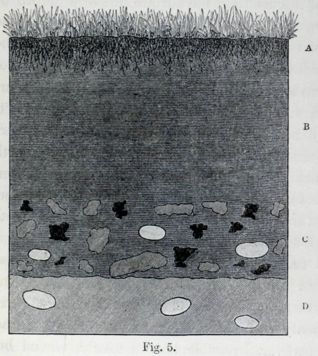

<!-- source-id: C008; original-page: 133 -->
Fig. 5.

图 5。

<!-- source-id: C009; original-page: 133 -->
Section, reduced to half the natural scale, of the vegetable mould in a field, drained and reclaimed fifteen years previously; A, turf; B, vegetable mould without any stones; C, mould with fragments of burnt marl, coal-cinders and quartz pebbles; D, sub-soil of black, peaty sand with quartz pebbles.

十五年前排干并开垦的田地腐殖土的剖面图，缩小到自然规模的一半； A、草坪； B、没有任何石块的腐殖土； C、含有烧焦泥灰、煤渣和石英卵石碎片的腐殖土； D、底土为黑色、泥炭砂和石英卵石。

<!-- source-id: S133; original-page: 134 -->
inch in length; and other fragments of coal-cinders together with a few white quartz pebbles. Beneath this layer and at a depth of 4½ inches from the surface, the original black, peaty, sandy soil with a few quartz pebbles was encountered. Here therefore the fragments of burnt marl and cinders had been covered in the course of 15 years by a layer of fine vegetable mould, only 2½ inches in thickness, excluding the turf. Six and a half years subsequently this field was re-examined, and the fragments were now found at from 4 to 5 inches beneath the surface. So that in this interval of 6½ years, about 1½ inch of mould had been added to the superficial layer. I am surprised that a greater quantity had not been brought up during the whole 21½ years, for in the closely underlying black, peaty soil there were many worms. It is, however, probable that formerly, whilst the land remained poor, worms were scanty; and the mould would then have accumulated slowly. The average annual increase of thickness for the whole period is .19 of an inch.

英寸长；和其他煤渣碎片以及一些白色石英卵石。在该层之下，距离地表 4.5 英寸的深度，是原始的黑色泥炭沙土，上面有一些石英卵石。因此，这里的烧焦泥灰和煤渣碎片在 15 年的时间里被一层细腐殖土覆盖，除了草皮外，厚度仅为 2.5 英寸。六年半后，该区域被重新检查，现在在地表以下 4 至 5 英寸处发现了碎片。因此，在这 6.5 年的时间间隔内，大约 1.5 英寸的腐殖土已添加到表层。令我惊讶的是，在整整 21.5 年里，并没有培育出更多的蚯蚓，因为在紧密的黑色泥炭土中，有很多蚯蚓。然而，很可能以前，虽然土地仍然贫瘠，但蚯蚓却很少。然后腐殖土就会慢慢积累。整个时期厚度年均增加0.19英寸。

<!-- source-id: S134; original-page: 134 -->
Two other cases are worth recording. In the spring of 1835, a field, which had long existed as poor pasture and was so swampy that it trembled slightly when stamped on, was thickly covered with red sand so that the whole surface appeared at first bright red. When holes were dug in this field after an interval of about 2½ years, the sand formed a layer at a depth of ¾ in. beneath the surface. In 1842 (i.e., 7 years after the sand had been laid on) fresh holes were dug, and now the red sand formed a distinct layer, 2 inches beneath the surface, or 1½ inch beneath the turf; so that on an average, .21 inches of mould had been annually brought to the surface. Immediately beneath the layer of red sand, the original substratum of black sandy peat extended.

另外两个案例值得记录。 1835年春天，一片原本是贫瘠牧场、沼泽地踩上去微微颤抖的田野，被厚厚的红沙覆盖，整个地表乍一看呈现出鲜红色。大约间隔 2.5 年之后，在这片土地上挖洞时，沙子在地表以下 3/4 英寸的深度形成了一层沙子。 1842 年（即铺沙 7 年后），人们又挖了新的洞，现在红沙形成了一层明显的层，位于地表以下 2 英寸处，即草皮下方 1.5 英寸处；因此，平均每年有 0.21 英寸的腐殖土被带到地表。紧接着红沙层的下方，是原来的黑色沙质泥炭地层。

<!-- source-id: S135; original-page: 135 -->
A grass field, likewise not far from Maer Hall, had formerly been thickly covered with marl, and was then left for several years as pasture; it was afterwards ploughed. A friend had three trenches dug in this field 28 years after the application of the marl,* and a layer of the marl fragments could be traced at a depth, carefully measured, of 12 inches in some parts, and of 14 inches in other parts. This difference in depth depended on the layer being horizontal, whilst the surface consisted of ridges and furrows from the field having been ploughed. The tenant assured me that it had never been turned up to a greater depth than from 6 to 8 inches; and as the fragments formed an unbroken horizontal layer from 12 to 14 inches beneath the surface, these must have been buried by the worms whilst the land was in pasture before it was ploughed, for otherwise they would have been indiscriminately scattered by the plough throughout the whole thickness of the soil. Four-and-a-half years afterwards I had three holes dug in this field, in which potatoes had been lately planted, and the layer of marl-fragments was now found 13 inches beneath the bottoms of the furrows, and therefore probably 15 inches

离马尔霍尔不远的一块草地，以前也被厚厚的泥灰覆盖，后来被留作牧场好几年了。后来被犁过。一位朋友在使用泥灰岩 28 年后，在这片土地上挖了三条沟渠*，经过仔细测量，可以发现一层泥灰岩碎片，其深度在某些部分为 12 英寸，在其他部分为 14 英寸。这种深度差异取决于水平层，而表面由犁过的田地的山脊和犁沟组成。房客向我保证，它从未被翻过超过 6 至 8 英寸的深度；由于这些碎片在地表以下 12 至 14 英寸处形成了一个完整的水平层，因此这些碎片一定是在犁耕之前土地还是牧场时被蚯蚓埋葬的，否则它们会被犁不加区别地撒在整个土壤厚度上。四年半后，我在这块地里挖了三个洞，里面最近种了土豆，现在在犁沟底部 13 英寸处发现了一层泥灰碎片，因此可能是 15 英寸

<!-- source-id: N041; original-page: 135 -->
* This case is given in a postscript to my paper in the 'Transact. Geolog. Soc. (Vol. v. p. 505), and contains a serious error, as in the account received I mistook the figure 30 for 80. The tenant, moreover, formerly said that he had marled the field thirty years before, but was now positive that this was done in

* 这个案例在我的论文《交易》的后记中给出。地质学。苏克。 （卷 v. 第 505 页），并且包含一个严重错误，因为在收到的帐户中，我将数字 30 误认为是 80。此外，租户以前说他三十年前曾在这块土地上弄脏过，但现在确信这是在

<!-- source-id: S136; original-page: 136 -->
1809, that is twenty-eight years before the first examination of the field by my friend. The error, as far as the figure 80 is concerned, was corrected in an article by me, in the 'Gardeners Chronicle, 1844, p. 218.

1809 年，距离我的朋友第一次考察这个领域还有 28 年。就数字 80 而言，这个错误已在我的一篇文章中得到纠正，该文章位于《园丁编年史》，1844 年，第 17 页。 218.

<!-- source-id: S137; original-page: 137 -->
beneath the general level of the field. It should, however, be observed that the thickness of the blackish sandy soil, which had been thrown up by the worms above the marl-fragments in the course of 32½ years, would have measured less than 15 inches, if the field had always remained as pasture, for the soil would in this case have been much more compact. The fragments of marl almost rested on an undisturbed sub-stratum of white sand with quartz pebbles; and as this would be little attractive to worms, the mould would hereafter be very slowly increased by their action.

低于该领域的一般水平。然而，应该注意的是，如果这块田地一直保持为牧场，那么在 32.5 年的时间里，由蚯蚓在泥灰岩碎片上方抛起的黑色沙土的厚度将小于 15 英寸，因为在这种情况下，土壤会更加致密。泥灰岩碎片几乎停留在未受干扰的白色沙子地层上，上面有石英卵石。由于这对蚯蚓几乎没有吸引力，因此腐殖土此后将通过它们的作用非常缓慢地增加。

<!-- source-id: S138; original-page: 137 -->
We will now give some cases of the action of worms, on land differing widely from the dry sandy or the swampy pastures just described. The chalk formation extends all round my house in Kent; and its surface, from having been exposed during an immense period to the dissolving action of rain-water, is extremely irregular, being abruptly festooned and penetrated by many deep well-like cavities.* During the dissolution of the chalk, the insoluble matter, including a vast number of unrolled flints of all sizes, has

现在我们将给出一些蚯蚓在与刚才描述的干燥沙地或沼泽牧场有很大不同的陆地上活动的例子。粉笔阵遍布我在肯特郡的房子周围；由于长期暴露在雨水的溶解作用下，它的表面极其不规则，突然被许多深井状的空洞装饰和渗透。*在粉笔溶解过程中，不溶性物质，包括大量展开的各种尺寸的燧石，

<!-- source-id: N042; original-page: 137 -->
* These pits or pipes are still in process of formation. During the last forty years I have seen or heard of five cases, in which a

* 这些坑或管道仍在形成过程中。在过去的四十年里，我见过或听说过五个案例，其中

<!-- source-id: S139; original-page: 138 -->
circular space, several feet in diameter, suddenly fell in, leaving on the field an open hole with perpendicular sides, some feet in depth. This occurred in one of my own fields, whilst it was being rolled, and the hinder quarters of the shaft horse fell in; two or three cart-loads of rubbish were required to fill up the hole. The subsidence occurred where there was a broad depression, as if the surface had fallen in at several former periods. I heard of a hole which must have been suddenly formed at the bottom of a small shallow pool, where sheep had been washed during many years, and into which a man thus occupied fell to his great terror. The rain-water over this whole district sinks perpendicularly into the ground, but the chalk is more porous in certain places than in others. Thus the drainage from the overlying clay is directed to certain points, where a greater amount of calcareous matter is dissolved than elsewhere. Even narrow open channels are sometimes formed in the solid chalk. As the chalk is slowly dissolved over the whole country, but more in some parts than in others, the undissolved residue—that is the overlying mass of red clay with flints,—likewise sinks slowly down, and tends to fill up the pipes or cavities. But the upper part of the red clay holds together, aided probably by the roots of plants, for a longer time than the lower parts, and thus forms a roof, which sooner or later falls in, as in the above mentioned five cases. The downward movement of the clay may be compared with that of a glacier, but is incomparably slower; and this movement accounts for a singular fact, namely, that the much elongated flints which are embedded in the chalk in a nearly horizontal position, are commonly found standing nearly or quite upright in the red clay. This fact is so common that the workmen assured me that this was their natural position. I roughly measured one which stood vertically, and it was of the same length and of the same relative thickness as one of my arms. These elongated flints must get placed in their upright position, been left on the surface and forms a bed of stiff red clay, full of flints, and generally from 6 to 14 feet in thickness. Over the red clay, wherever the land has long remained as pasture, there is a layer a few inches in thickness, of dark-coloured vegetable mould.

直径数英尺的圆形空间突然陷落，在场地上留下一个边垂直、深度数英尺的空洞。这件事发生在我自己的一块田地里，当它被滚动时，辕马的后躯掉了下来；需要两到三车垃圾才能填满这个洞。下沉发生在有宽阔洼地的地方，就好像地表在前几个时期曾陷过一样。我听说在一个小浅水池的底部突然形成了一个洞，那里的羊已经被洗了很多年了，一个这样居住的人掉进了洞里，感到非常恐惧。整个地区的雨水垂直沉入地下，但某些地方的白垩比其他地方的孔隙更多。因此，上覆粘土的排水被引导到某些点，在那里比其他地方溶解更多的钙质物质。实心白垩有时甚至会形成狭窄的开放通道。随着白垩在整个国家慢慢溶解，但在某些地方比其他地方溶解得更多，未溶解的残留物（即上面覆盖的带有燧石的红粘土块）也会慢慢下沉，并往往会填满管道或空腔。但红粘土的上部可能在植物根部的帮助下比下部更长时间地结合在一起，从而形成一个屋顶，该屋顶迟早会塌陷，如上述五种情况。粘土的向下运动可以与冰川相比，但速度却慢得多。这一运动解释了一个奇特的事实，即以接近水平的位置嵌入粉笔中的细长燧石通常在红粘土中几乎或完全直立。这个事实如此普遍，工人们向我保证，这是他们自然的立场。我粗略地量了一下垂直站立的一根，它的长度和相对厚度与我的一只手臂相同。这些细长的燧石必须直立放置，留在表面，形成坚硬的红粘土床，充满燧石，厚度通常为 6 至 14 英尺。在红粘土上，凡是长期保留为牧场的土地上，都有一层几英寸厚的深色腐殖土。

<!-- source-id: S140; original-page: 139 -->
A quantity of broken chalk was spread, on December 20, 1842, over a part of a field near my house, which had existed as pasture certainly for 30, probably for twice or thrice as many years. The chalk was laid on the land for the sake of observing at some future period to what depth it would become buried. At the end of November, 1871, that is after an interval of 29 years, a trench was dug across this part of the field; and a line of white nodules could be traced on both sides of the trench, at a depth of 7 inches from the surface. The mould, therefore, (excluding the turf) had

1842 年 12 月 20 日，我家附近的一块田野上撒满了一些碎粉笔，这片田野已经作为牧场存在了 30 年，可能是两倍或三倍。将粉笔放在土地上是为了观察在未来的某个时期它会被掩埋的深度。 1871 年 11 月底，也就是时隔 29 年之后，在这片土地上挖了一条沟渠；在距离地表7英寸深度的沟渠两侧，可以看到一排白色结节。因此，腐殖土（不包括草皮）具有

<!-- source-id: S141; original-page: 139 -->
on the same principle that a trunk of a tree left on a glacier assumes a position parallel to the line of motion. The flints in the clay which form almost half its bulk, are very often broken, though not rolled or abraded; and this may be accounted for by their mutual pressure, whilst the whole mass is subsiding. I may add that the chalk here appears to have been originally covered in parts by a thin bed of fine sand with some perfectly rounded flint pebbles, probably of Tertiary age; for such sand often partly fills up the deeper pits or cavities in the chalk here been thrown up at an average rate of .22 inches per year. Beneath the line of chalk nodules there was in parts hardly any fine earth free of flints, while in other parts there was a layer, 2¼ inches in thickness. In this latter case the mould was altogether 9¼ inches thick; and in one such spot a nodule of chalk and a smooth flint pebble, both of which must have been left at some former time on the surface, were found at this depth. At from 11 to 12 inches beneath the surface, the undisturbed reddish clay, full of flints, extended. The appearance of the above nodules of chalk surprised me much at first, as they closely resembled water-worn pebbles, whereas the freshly-broken fragments had been angular. But on examining the nodules with a lens, they no longer appeared water-worn, for their surfaces were pitted through unequal corrosion, and minute, sharp points, formed of broken fossil shells, projected from them. It was evident that the corners of the original fragments of chalk had been wholly dissolved, from presenting a large surface to the carbonic acid dissolved in the rain-water and to that gener- ated in soil containing vegetable matter, as well as to the humus-acids.* The projecting corners would also, relatively to the other parts, have been embraced by a larger number of living rootlets; and these have the power of even attacking marble, as Sachs has shown. Thus, in the course of 29 years, buried angular fragments of chalk had been converted into well-rounded nodules.

与留在冰川上的树干的位置与运动线平行的原理相同。粘土中的燧石几乎占粘土体积的一半，尽管没有被滚压或磨损，但经常会破裂。这可能是由于它们之间的相互压力造成的，同时整个质量正在下沉。我可以补充一点，这里的白垩似乎最初被一层薄薄的细沙覆盖，上面有一些完美圆形的燧石卵石，可能是第三纪的；因为这些沙子通常会部分填充粉笔中较深的坑或空腔，这里的沙子以平均每年 0.22 英寸的速度被抛起。在白垩结核线下方，有些地方几乎没有不含燧石的细土，而另一些地方则有一层 2.5 英寸厚的层。在后一种情况下，腐殖土总共有 9.4 英寸厚；在一个这样的地方，在这个深度发现了一个白垩结节和一个光滑的燧石卵石，这两者一定是以前留在表面上的。在地表以下 11 至 12 英寸处，未受干扰的、充满燧石的红色粘土不断延伸。起初，上述粉笔结节的外观让我感到非常惊讶，因为它们与水磨过的卵石非常相似，而新破碎的碎片却是有棱角的。但用镜头检查这些结核时，它们不再被水磨损，因为它们的表面因不均匀的腐蚀而出现凹坑，并且由破碎的化石壳形成的微小而尖锐的点从它们中突出。很明显，原来的粉笔碎片的角已经完全溶解，从呈现出大的表面到溶解在雨水中的碳酸，再到含有植物物质的土壤中产生的碳酸，以及腐殖酸。*突出的角将而且，相对于其他部分，被更多数量的活根所包围；正如萨克斯所证明的那样，它们甚至具有攻击大理石的能力。因此，在 29 年的时间里，埋在地下的粉笔角碎片已经转变为圆形的结节。

<!-- source-id: S142; original-page: 141 -->
Another part of this same field was mossy, and as it was thought that sifted coat-cinders would improve the pasture, a thick layer was spread over this part either in 1842 or 1843, and another layer some years afterwards. In 1871 a trench was here dug, and many cinders lay in a line at a depth of 7 inches beneath the surface, with another line at a depth of 5½ inches parallel to the one beneath. In another part of this field, which had formerly existed as a separate one, and which it was believed had been pasture-land for more than a century, trenches were dug to see how thick the vegetable mould was. By chance the first trench was made at a spot where at some former period, certainly more than forty years before, a large hole had been filled up with coarse red clay, flints, fragments of chalk, and gravel; and here the fine vegetable mould was only from 4⅛ to 4⅜ inches in thickness. In another and undisturbed place, the mould varied much in thickness, namely, from 6½ to 8½ inches; beneath which a few small fragments of brick were found in one place. From these several cases, it would appear that during the last 29 years mould has been heaped on the surface at an average annual rate of from .2 to .22 of an inch. But in this district when a ploughed field is first laid down in grass, the mould accumulates at a much slower rate. The rate, also, must become very much slower after a bed of mould, several inches in thickness, has been formed; for the worms then live chiefly near the surface, and burrow down to a greater depth so as to bring up fresh earth from below, only during the winter when the weather is very cold (at which time worms were found in this field at a depth of 26 inches) and during summer, when the weather is very dry.

这块田地的另一部分长满了苔藓，人们认为筛过的外套灰烬可以改善牧场，因此在 1842 年或 1843 年在这部分覆盖了厚厚的一层，几年后又覆盖了另一层。 1871 年，这里挖了一条沟渠，许多煤渣在地表以下 7 英寸深的地方排成一排，另一排煤渣在 5.5 英寸深的地方与下面的煤渣平行。在这片田地的另一部分，以前是作为一个单独的田地存在的，据信已经有一个多世纪的牧场了，人们挖了沟渠来看看腐殖土有多厚。偶然地，第一条沟渠是在某个地点开凿的，在以前的某个时期，肯定是四十多年前，这里有一个大洞，里面填满了粗糙的红粘土、燧石、粉笔碎片和砾石。这里的细腐殖土厚度只有 4⅛ 到 4⅜ 英寸。在另一个未受干扰的地方，腐殖土的厚度变化很大，从 6.5 英寸到 8.5 英寸不等。在其下面的一处发现了一些小砖块碎片。从这几个案例可以看出，在过去 29 年里，腐殖土以年均 0.2 至 0.22 英寸的速度堆积在地表上。但在这个地区，当犁过的田地第一次铺上草时，腐殖土的积累速度要慢得多。而且，在几英寸厚的腐殖土床形成之后，该速率也必定会变得非常慢。因为蚯蚓主要生活在地表附近，只有在天气非常寒冷的冬季（此时在26英寸深的田地里发现了蚯蚓）和天气非常干燥的夏季，它们才会挖到更深的地方，以便从下面挖出新鲜的泥土。

<!-- source-id: N043; original-page: 141 -->
* S. W. Johnson, 'How Crops Feed,' 1870, p. 139.

* S. W. Johnson，《农作物如何喂养》，1870 年，第 14 页。 139.

<!-- source-id: S143; original-page: 143 -->
A field, which adjoins the one just described, slopes in one part rather steeply (viz., at from 10° to 15°); this part was last ploughed in 1841, was then harrowed and left to become pasture-land. For several years it was clothed with an extremely scant vegetation, and was so thickly covered with small and large flints (some of them half as large as a child's head) that the field was always called by my sons "the stony field." When they ran down the slope the stones clattered together. I remember doubting whether I should live to see these larger flints covered with vegetable mould and turf. But the smaller stones disappeared before many years had elapsed, as did every one of the larger ones after a time; so that after thirty years (1871) a horse could gallop over the compact turf from one end of the field to the other, and not strike a single stone with his shoes. To anyone who remembered the appearance of the field in 1842, the transformation was wonderful. This was certainly the work of the worms, for though castings were not frequent for several years, yet some were thrown up month after month, and these gradually increased in numbers as the pasture improved. In the year 1871 a trench was dug on the above slope, and the blades of grass were cut off close to the roots, so that the thickness of the turf and of the vegetable mould could be measured accurately. The turf was rather less than half an inch, and the mould, which did not contain any stones, 2½ inches in thickness. Beneath this lay coarse clayey earth full of flints, like that in any of the neighbouring ploughed fields. This coarse earth easily fell apart from the overlying mould when a spit was lifted up. The average rate of accumulation of the mould during the whole thirty years was only .083 inch per year (i.e., nearly one inch in twelve years); but the rate must have been much slower at first, and afterwards considerably quicker.

与刚刚描述的区域相邻的一块区域，其一部分倾斜得相当陡（即 10° 到 15°）；这部分土地最后一次犁耕是在 1841 年，随后被耙平，成为牧场。几年来，这里的植被极其稀少，而且厚厚地覆盖着大大小小的燧石（有些燧石有孩子头的一半大），所以我的儿子们总是称这片田为“石田”。当他们跑下斜坡时，石头碰撞在一起。我记得我曾怀疑自己是否应该活着看到这些较大的燧石被腐殖土和草皮覆盖。但在许多年后，较小的石头就消失了，每一个较大的石头在一段时间后也消失了。三十年后（1871年），一匹马可以在致密的草皮上从场地的一端驰骋到另一端，而鞋子不会撞到一块石头。对于任何记得 1842 年球场面貌的人来说，这种转变是美妙的。这当然是蚯蚓的功劳，虽然几年来蚯蚓排泄物并不频繁，但每月都会吐出一些，而且随着草场的改善，数量也逐渐增多。 1871年，在上面的斜坡上挖了一条沟，并在靠近根部的地方剪掉草叶，以便准确测量草皮和腐殖土的厚度。草皮不到半英寸，不含任何石头的腐殖土厚度为 2.5 英寸。下面是充满燧石的粗糙粘土，就像附近任何犁过的田地一样。当举起烤叉时，这种粗糙的泥土很容易与上面的腐殖土分离。整个三十年腐殖土的平均积累速度仅为每年0.083英寸（即，十二年接近一英寸）；但速度一开始肯定要慢得多，后来就快得多了。

<!-- source-id: S144; original-page: 144 -->
The transformation in the appearance of this field, which had been effected beneath my eyes, was afterwards rendered the more striking, when I examined in Knole Park a dense forest of lofty beech-trees, beneath which nothing grew. Here the ground was thickly strewed with large naked stones, and worm-castings were almost wholly absent. Obscure lines and irregularities on the surface indicated that the land had been cultivated some centuries ago. It is probable that a thick wood of young beech-trees sprung up so quickly, that time enough was not allowed for worms to cover up the stones with their castings, before the site became unfitted for their existence. Anyhow the contrast between the state of the now miscalled "stony field," well stocked with worms, and the present state of the ground beneath the old beech-trees in Knole Park, where worms appeared to be absent, was striking.

这片田野的面貌发生在我眼前的变化，后来当我在诺尔公园检查一片茂密的高大山毛榉树林时，这种变化变得更加引人注目，下面什么也没有生长。这里的地面上厚厚地散布着裸露的大石头，几乎完全没有蚯蚓-蚯蚓的粪便。表面上模糊的线条和不规则的地方表明这片土地在几个世纪前就已经被耕种过。很可能，茂密的山毛榉树幼苗长得如此之快，以至于没有足够的时间让蚯蚓用蚓粪覆盖石头，直到该地点不再适合它们的生存。无论如何，现在被误称为“石田”的状态与诺尔公园老山毛榉树下的地面状态（那里似乎没有蚯蚓）之间的对比是惊人的，现在被误称为“石田”，那里有大量的蚯蚓。

<!-- source-id: S145; original-page: 145 -->
A narrow path running across part of my lawn was paved in 1843 with small flagstones, set edgeways; but worms threw up many castings and weeds grew thickly between them. During several years the path was weeded and swept; but ultimately the weeds and worms prevailed, and the gardener ceased to sweep, merely mowing off the weeds, as often as the lawn was mowed. The path soon became almost covered up, and after several years no trace of it was left. On removing, in 1877, the thin overlying layer of turf, the small flag-stones, all in their proper places, were found covered by an inch of fine mould.

1843 年，我家草坪上有一条狭窄的小路，边缘铺有小石板。但蚯蚓吐出许多蚓粪，粪便之间杂草丛生。几年来，这条路被除草并打扫过。但最终杂草和蚯蚓占了上风，园丁不再打扫，只是把杂草割掉，就像割草坪一样。这条路很快就几乎被掩盖了，几年后就没有留下任何痕迹了。 1877 年，在拆除时，人们发现覆盖在上面的薄薄一层草皮和小石板都在适当的位置，上面覆盖着一英寸厚的细腐殖土。

<!-- source-id: S146; original-page: 146 -->
Two recently published accounts of substances strewed on the surface of pasture-land, having become buried through the action of worms, may be here noticed. The Rev. H. C. Key had a ditch cut in a field, over which coal-ashes had been spread, as it was believed, eighteen years before; and on the clean-cut perpendicular sides of the ditch, at a depth of at least seven inches, there could be seen, for a length of 60 yards, "a distinct, very "even, narrow line of coal-ashes, mixed with "small coal, perfectly parallel with the top-"sward."* This parallelism and the length of the section give interest to the case. Secondly, Mr. Dancer states† that crushed bones had been thickly strewed over a field; and "some years "afterwards"these were found "several inches "below the surface, at a uniform depth."

最近发表的两篇报道称，散布在牧场表面的物质由于蚯蚓的作用而被掩埋，在这里可能会引起人们的注意。 H.C. 基牧师在田里挖了一条沟渠，据信十八年前就在沟渠上撒了煤灰。在沟渠干净利落的垂直两侧，在至少七英寸深的地方，可以看到长达 60 码的“一条明显的、非常“均匀”的窄线煤灰，与“小煤，与顶部草丛完全平行。”* 这种平行度和剖面的长度使案件变得有趣。其次，丹瑟先生指出†，碎骨已厚厚地散布在田野上；并且“有些年“后来”在“地表以下几英寸的地方，均匀的深度”发现了这些东西。

<!-- source-id: S147; original-page: 146 -->
The Rev. Mr. Zincke informs me that he has lately had an orchard dug to the unusual depth of 4 feet. The upper 18 inches consisted of dark-coloured vegetable mould, and the next 18 inches of sandy loam, containing in the lower part many rolled pieces of sandstone, with some bits of brick and tile, probably of Roman origin, as remains of this period have been found close by. The sandy loam rested on an indurated ferruginous pan of yellow clay, on the surface of which two perfect celts were found. If, as seems probable, the celts were originally left on the surface of the land, they have since been covered up with earth 3 feet in thickness, all of which has probably passed through the bodies of worms, excepting the stones which may have been scattered on the surface at different times, together with manure or by other means. It is difficult otherwise to understand the source of the 18 inches of sandy loam, which differed from the overlying dark vegetable mould, after both had been burnt, only in being of a brighter red colour, and in not being quite so fine-grained. But on this view we must suppose that the carbon in vegetable mould, when it lies at some little depth beneath the surface and does not continually receive decaying vegetable matter from above, loses its dark colour in the course of centuries; but whether this is probable I do not know.

Zincke 牧师先生告诉我，他最近挖了一个果园，深度达到了 4 英尺的不同寻常的深度。上部 18 英寸由深色腐殖土组成，接下来的 18 英寸由沙壤土组成，下部包含许多卷起的砂岩块，以及一些砖块和瓦片，可能源自罗马，因为附近发现了这一时期的遗迹。沙质壤土位于坚硬的铁黄色粘土盘上，在其表面发现了两个完美的凯尔特。如果凯尔特人最初被留在陆地表面，那么凯尔特人后来就被3英尺厚的泥土覆盖，所有这些泥土都可能穿过了蚯蚓的身体，除了可能在不同时间与粪便或其他方式撒在地表的石头除外。否则很难理解这 18 英寸厚的沙壤土的来源，它与上面覆盖的深色腐殖土不同，两者都经过燃烧，只是颜色更亮红色，而且颗粒不那么细。但根据这种观点，我们必须假设腐殖土中的碳，当它位于地表以下某个深度并且没有不断地从上面接收腐烂的植物物质时，会在几个世纪的过程中失去其深色；但我不知道这是否可能。

<!-- source-id: N044; original-page: 146 -->
* 'Nature,' November 1877, p. 28.

*《自然》，1877 年 11 月，第 14 页。 28.

<!-- source-id: N045; original-page: 146 -->
† 'Proc. Phil. Soc.' of Manchester, 1877, p. 247.

† '程序。菲尔.苏格拉底。”曼彻斯特，1877 年，p。 247.

<!-- source-id: S148; original-page: 148 -->
Worms appear to act in the same manner in New Zealand as in Europe; for Professor J. von Haast has described* a section near the coast, consisting of mica-schist, "covered by "5 or 6 feet of loess, above which about 12 "inches of vegetable soil had accumulated." Between the loess and the mould there was a layer from 3 to 6 inches in thickness, consisting of "cores, implements, flakes, and "chips, all manufactured from hard basaltic "rock." It is therefore probable that the aborigines, at some former period, had left these objects on the surface, and that they had afterwards been slowly covered up by the castings of worms.

新西兰的蚯蚓的行为方式似乎与欧洲相同； J. von Haast 教授描述*了海岸附近的一个区域，由云母片岩组成，“被“5或6英尺厚的黄土覆盖，上面积聚了大约12英寸的蔬菜土壤”。在黄土和腐殖土之间有一层 3 到 6 英寸厚的层，由“核心、工具、薄片和“碎片”组成，全部由坚硬的玄武岩“岩石”制成。因此，原住民很可能在以前的某个时期将这些物体留在了地表，后来它们慢慢地被蚯蚓的粪便所覆盖。

<!-- source-id: S149; original-page: 148 -->
Farmers in England are well aware that objects of all kinds, left on the surface of pasture-land, after a time disappear, or, as they say, work themselves downwards. How powdered lime, cinders, and heavy stones, can work down, and at the same rate, through the matted roots of a grass-covered surface, is a question which has probably never occurred to them.*

英国的农民很清楚，留在牧场表面的各种物体，一段时间后就会消失，或者，正如他们所说，会自行下降。石灰粉、煤渣和重石如何能够以同样的速度通过草覆盖的表面的缠结根部向下流动，这是他们可能从未想过的问题。*

<!-- source-id: N046; original-page: 148 -->
* 'Trans. of the New Zealand Institute,' vol. xii., 1880, p.152.

* '翻译。新西兰研究所，卷。第十二章，1880 年，第 152 页。

<!-- source-id: S150; original-page: 149 -->
The Sinking of great Stones through the Action of Worms .—When a stone of large size and of irregular shape is left on the surface of the ground, it rests, of course, on the more protuberant parts; but worms soon fill up with their castings all the hollow spaces on the lower side; for, as Hensen remarks, they like the shelter of stones. As soon as the hollows are filled up, the worms eject the earth which they have swallowed beyond the circumference of the stones; and thus the surface of the ground is raised all round the stone. As the burrows excavated directly beneath the stone after a time collapse, the stone sinks a little.† Hence it is, that boulders which at some ancient period have rolled down from a rocky mountain or cliff on to a meadow at its base, are always somewhat embedded in the soil; and, when removed, leave an exact impression of their lower surfaces in the underlying fine mould. If, however, a boulder is of such huge dimensions, that the earth beneath is kept dry, such earth will not be inhabited by worms, and the boulder will not sink into the ground.

通过蚯蚓的作用使大石头下沉。——当一块大尺寸且形状不规则的石头留在地面上时，它当然会落在较突出的部分上；但蚯蚓很快就被蚯蚓的粪便填满了，下面所有的空洞都被蚯蚓填满了。因为，正如亨森所说，他们喜欢石头的庇护所。一旦空洞被填满，蚯蚓就会将它们吞下的泥土排出到石头周围。因此，石头周围的地面都升高了。随着时间的推移，在石头正下方挖掘的洞穴会塌陷，石头会稍微下沉。† 因此，在古代的某个时期，从岩石山或悬崖上滚落到其底部草地上的巨石，总是在某种程度上嵌入土壤中；并且，当移除时，在下面的细腐殖土中留下其下表面的精确印记。然而，如果一块巨石的尺寸如此之大，以致其下面的土地保持干燥，那么这样的土地就不会居住有蚯蚓，巨石也不会沉入地下。

<!-- source-id: N047; original-page: 149 -->
* Mr. Lindsay Carnagie, in a letter (June 1838) to Sir C. Lyell, remarks that Scotch farmers are afraid of putting lime on ploughed land until just before it is laid down for pasture, from a belief that it has some tendency to sink. He adds: "Some years since, in autumn, I laid lime on an oat-stubble and ploughed it down; thus bringing it into immediate contact with the dead vegetable matter, and securing its thorough mixture through the means of all the subsequent operations of fallow. In consequence of the above prejudice, I was considered to have committed a great fault; but the result was eminently successful, and the practice was partially followed. By means of Mr. Darwin's observations, I think the prejudice will be removed."

* Lindsay Carnagie 先生在给 C. Lyell 爵士的一封信（1838 年 6 月）中指出，苏格兰农民害怕在耕地放牧之前将石灰撒在耕地上，因为他们相信石灰有一定的下沉倾向。他补充道：“几年后，在秋天，我把石灰撒在燕麦茬上，然后将其犁倒；从而使之与死去的植物物质立即接触，并通过所有随后的休耕操作确保其彻底混合。由于上述偏见，我被认为犯了一个很大的错误；但结果非常成功，这种做法得到了部分遵循。通过达尔文先生的观察，我认为这种偏见将是正确的。”删除了。”

<!-- source-id: N048; original-page: 149 -->
† This conclusion, which, as we shall immediately see, is fully

† 正如我们立即看到的，这个结论是完全正确的

<!-- source-id: S151; original-page: 150 -->
A lime-kiln formerly stood in a grass-field near Leith Hill Place in Surrey, and was pulled down 35 years before my visit; all the loose rubbish had been carted away, excepting three large stones of quartzose sandstone, which it was thought might hereafter be of some use. An old workman remembered that they had been left on a bare surface of broken bricks and mortar, close to the foundations of the kiln; but the whole surrounding surface is now covered with turf and mould. The two largest of these stones

萨里利斯山广场 (Leith Hill Place) 附近的草地上曾经矗立着一座石灰窑，在我访问前 35 年被拆除。除了三块大石英砂岩外，所有散落的垃圾都被运走了，人们认为这块石头以后可能会有用处。一位老工人记得，它们被留在了靠近窑炉地基的、由碎砖和灰浆组成的光秃秃的表面上；但整个周围的表面现在都覆盖着草皮和腐殖土。这些石头中最大的两块

<!-- source-id: S152; original-page: 150 -->
justified, is of some little importance, as the so-called bench-stones, which surveyors fix in the ground as a record of their levels, may in time become false standards. My son Horace intends at some future period to ascertain how far this has occurred.

合理性并不重要，因为测量员固定在地下作为水平记录的所谓的长凳石可能最终会成为错误的标准。我的儿子霍勒斯打算在未来某个时期查明这种情况已经发生到什么程度。

<!-- source-id: S153; original-page: 151 -->
had never since been moved; nor could this easily have been done, as, when I had them removed, it was the work of two men with levers. One of these stones, and not the I largest, was 64 inches long, 17 inches broad, and from 9 to 10 inches in thickness. Its lower surface was somewhat protuberant in the middle; and this part still rested on broken bricks and mortar, showing the truth of the old workman's account. Beneath the brick rubbish the natural sandy soil, full of fragments of sandstone was found; and this could have yielded very little, if at all, to the weight of the stone, as might have been expected if the sub-soil had been clay. The surface of the field, for a distance of about 9 inches round the stone, gradually sloped up to it, and close to the stone stood in most places about 4 inches above the surrounding ground. The base of the stone was buried from 1 to 2 inches beneath the general level, and the upper surface projected about 8 inches above this level, or about 4 inches above the sloping border of turf. After the removal of the stone it became evident that one of its pointed ends must at first have stood clear above the ground by some inches, but its upper surface was now on a level with the surrounding turf. When the stone was removed, an exact cast of its lower side, forming a shallow crateriform hollow, was left, the inner surface of which consisted of fine black mould, excepting where the more protuberant parts rested on the brick-rubbish. A transverse section of this stone, together with its bed, drawn from measurements made after it had been displaced, is here given on a scale of ½ inch to a foot (Fig. 6). The turf-covered border which sloped up to the stone, consisted of fine vegetable mould, in one part 7 inches in thickness. This evidently consisted of worm-castings, several of which had been recently ejected. The whole stone had sunk in the

从那以后就再也没有被移动过；这也不容易完成，因为当我把它们拆下来时，这是两个拿着杠杆的人的工作。其中一块石头长 64 英寸，宽 17 英寸，厚 9 至 10 英寸，但不是最大的。它的下表面中部有些凸起，而这部分仍然搁在残破的砖块和灰浆上，说明了老工人的叙述是真实的。在砖块垃圾下面发现了天然沙土，里面充满了砂岩碎片；如果底土是粘土的话，这对石头的重量来说，即使有作用，也只能产生很小的作用。距离石头大约9英寸的场地表面逐渐向石头倾斜，靠近石头的大部分地方都高出周围地面大约4英寸。石头的底部埋在一般水平面以下 1 至 2 英寸处，上表面突出于该水平面上方约 8 英寸，或者高于草皮倾斜边缘约 4 英寸。移走石头后，很明显，它的一个尖端一开始肯定高出地面几英寸，但它的上表面现在与周围的草皮处于同一水平面。当石头被移走时，留下了其下侧的精确铸件，形成了一个浅的火山口状空洞，其内表面由细小的黑色腐殖土组成，除了砖块垃圾上更突出的部分之外。这块石头及其床的横截面是根据其移动后的测量结果绘制的，比例为 1/2 英寸到 1 英尺（图 6）。草皮覆盖的边界一直延伸到石头，由细腐殖土组成，一部分厚达 7 英寸。这显然由蚯蚓-蚓粪组成，其中一些是最近被排出的。整块石头都沉入水中了

<!-- source-id: F006; original-page: 152 -->
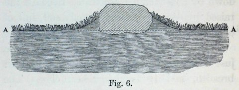

<!-- source-id: C010; original-page: 152 -->
Fig. 6.

图 6。

<!-- source-id: C011; original-page: 152 -->
Transverse section across a large stone, which had lain on a grass-field for 35 years. A A, general level of the field. The underlying brick rubbish has not been represented. Scale ½ inch to one foot.

一块大石头的横截面，这块石头已经在草地上躺了 35 年了。 A A，该领域的一般水平。底层的砖块垃圾尚未呈现。将 ½ 英寸缩放至一英尺。

<!-- source-id: S154; original-page: 153 -->
thirty-five years, as far as I could judge, about 1½ inch; and this must have been due to the brick-rubbish beneath the more protuberant parts having been undermined by worms. At this rate the upper surface of the stone, if it had been left undisturbed, would have sunk to the general level of the field in 247 years; but before this could have occurred, some earth would have been washed down by heavy rain from the castings on the raised border of turf over the upper surface of the stone.

据我判断，三十五年，大约 1.5 英寸；这肯定是由于较突出部分下面的砖块垃圾被蚯蚓破坏了。按照这个速度，如果不受到干扰，石头的上表面将在 247 年内下沉到地面的一般水平；但在此之前，石头上表面凸起的草皮边缘上的蚓粪可能会被大雨冲刷掉一些泥土。

<!-- source-id: S155; original-page: 153 -->
The second stone was larger than the one just described, viz., 67 inches in length, 39 in breadth, and 15 in thickness. The lower surface was nearly flat, so that the worms must soon have been compelled to eject their castings beyond its circumference. The stone as a whole had sunk about 2 inches into the ground. At this rate it would have required 262 years for its upper surface to have sunk to the general level of the field. The upwardly sloping, turf-covered border round the stone was broader than in the last case, viz., from 14 to 16 inches; and why this should be so, I could see no reason. In most parts this border was not so high as in the last case, viz., from 2 to 2½ inches, but in one place it was as much as 5½. Its average height close to the stone was probably about 3 inches, and it thinned out to nothing. If so, a layer of fine earth, 15 inches in breadth and 1½ inch in average thickness, of sufficient length to surround the whole of the much elongated slab, must have been brought up by the worms in chief part from beneath the stone in the course of 35 years. This amount would be amply sufficient to account for its having sunk about 2 inches into the ground; more especially if we bear in mind that a good deal of the finest earth would have been washed by heavy rain from the castings ejected on the sloping border down to the level of the field. Some fresh castings were seen close to the stone. Nevertheless, on digging a large hole to a depth of 18 inches where the stone had lain, only two worms and a few burrows were seen, although the soil was damp and seemed favourable for worms. There were some large colonies of ants beneath the stone, and possibly since their establishment the worms had decreased in number.

第二块石头比刚才描述的那块大，即长 67 英寸，宽 39 英寸，厚 15 英寸。下表面几乎是平坦的，所以蚯蚓一定很快就被迫将蚓粪排出到其圆周之外。整块石头已经沉入地下约2英寸。按照这个速度，它的上表面需要 262 年才能下沉到磁场的一般水平。石头周围向上倾斜、覆盖着草皮的边界比前一种情况更宽，即从 14 英寸到 16 英寸；为什么会这样，我看不出有什么理由。在大多数地方，这个边界并不像最后一种情况那么高，即 2 到 2.5 英寸，但在一个地方它高达 5.5 英寸。它靠近石头的平均高度大概有三英寸左右，然后就变得稀疏了。如果是这样，那么一层宽 15 英寸、平均厚 1.5 英寸、长度足以包围整个细长石板的细土，一定是蚯蚓在 35 年的时间里从石头下面挖出来的。这个数量足以解释它沉入地下约 2 英寸的情况；更特别的是，如果我们记住，大量最好的土壤会被倾盆大雨冲刷掉，这些粪便是从倾斜的边界上排出到田地水平的蚓粪。在石头附近发现了一些新鲜的蚓粪。然而，在石头所在的地方挖了一个18英寸深的大洞，只看到了两条蚯蚓和几个洞穴，尽管土壤潮湿，似乎有利于蚯蚓生长。石头下面有一些大群的蚂蚁，可能自从它们建立以来，蚯蚓的数量就减少了。

<!-- source-id: S156; original-page: 154 -->
The third stone was only about half as large as the others; and two strong boys could together have rolled it over. I have no doubt that it had been rolled over at a moderately recent time, for it now lay at some distance from the two other stones at the bottom of a little adjoining slope. It rested also on fine earth, instead of partly on brick-rubbish. In agreement with this conclusion, the raised surrounding border of turf was only 1 inch high in some parts, and 2 inches in other parts. There were no colonies of ants beneath this stone, and on digging a hole where it had lain, several burrows and worms were found.

第三块石头只有其他石头的一半大；两个强壮的男孩一起就能把它翻过去。我毫不怀疑它是在最近一段时间被翻滚的，因为它现在与相邻小斜坡底部的另外两块石头有一定距离。它也建立在细土上，而不是部分地建立在砖块垃圾上。与这一结论相一致的是，草皮周围凸起的边缘在某些部分仅1英寸高，而在其他部分则为2英寸。这块石头下面没有蚂蚁群，在石头所在的地方挖了一个洞，发现了几个洞穴和蚯蚓。

<!-- source-id: S157; original-page: 155 -->
At Stonehenge, some of the outer Druidical stones are now prostrate, having fallen at a remote but unknown period; and these have become buried to a moderate depth in the ground. They are surrounded by sloping borders of turf, on which recent castings were seen. Close to one of these fallen stones, which was 17 ft. long, 6 ft. broad, and 28½ inches thick, a hole was dug; and here the vegetable mould was at least 9½ inches in thickness. At this depth a flint was found, and a little higher up on one side of the hole a fragment of glass. The base of the stone lay about 9½ inches beneath the level of the surrounding ground, and its upper surface 19 inches above the ground.

在巨石阵，一些外部的德鲁伊石块现已倒塌，它们是在遥远但未知的时期掉落的。这些已被埋入地下中等深度。它们周围是倾斜的草皮边界，上面可以看到最近的蚓粪。在其中一颗长 17 英尺、宽 6 英尺、厚 28.5 英寸的石头附近挖了一个洞；这里的腐殖土厚度至少为 9.5 英寸。在这个深度处发现了一块燧石，在洞的一侧稍高一点的地方发现了一块玻璃碎片。石头的底部距周围地面约 9.5 英寸，其上表面距地面 19 英寸。

<!-- source-id: S158; original-page: 156 -->
A hole was also dug close to a second huge stone, which in falling had broken into two pieces; and this must have happened long ago, judging from the weathered aspect of the fractured ends. The base was buried to a depth of 10 inches, as was ascertained by driving an iron skewer horizontally into the ground beneath it. The vegetable mould forming the turf-covered sloping border round the stone, on which many castings had recently been ejected, was 10 inches in thickness; and most of this mould must have been brought up by worms from beneath its base. At a distance of 8 yards from the stone, the mould was only 5½ inches in thickness (with a piece of tobacco pipe at a depth of 4 inches), and this rested on broken flint and chalk which could not have easily yielded to the pressure or weight of the stone.

在第二块大石头附近也挖了一个洞，这块石头在掉落时碎成了两块；从断裂端部的风化程度来看，这肯定是很久以前发生的事情了。底座埋深 10 英寸，这是通过将一根铁串水平插入其下方的地面来确定的。腐殖土形成了石头周围覆盖着草皮的倾斜边界，上面最近排出了许多蚓粪，厚度为 10 英寸；大部分腐殖土肯定是由蚯蚓从其底部下方带出的。距离石头 8 码处，腐殖土厚度仅为 5.5 英寸（一根烟斗深度为 4 英寸），而腐殖土则放置在破碎的燧石和白垩上，而这些碎石和白垩不易屈服于石头的压力或重量。

<!-- source-id: S159; original-page: 156 -->
A straight rod was fixed horizontally (by the aid of a spirit-level) across a third fallen stone, which was 7 feet 9 inches long; and the contour of the projecting parts and of the adjoining ground, which was not quite level, was thus ascertained, as shown in the accompanying diagram (Fig. 7) on a scale of ½ inch to a foot. The turf-covered border sloped up to the stone on one side to a height of 4 inches, and on the opposite side to only 2½ inches above the general level. A hole was dug on the eastern side, and the base of the stone was here found to lie at a depth of 4 inches beneath the general level of the ground, and of 8 inches beneath the top of the sloping turf-covered border.

将一根直杆水平固定在第三块落下的石头上（借助水平仪），该石头长 7 英尺 9 英寸；因此，突出部分和毗邻地面的轮廓（不太水平）得以确定，如附图（图 7）所示，比例尺为 1/2 英寸到英尺。草皮覆盖的边界一侧向石头倾斜，高度为 4 英寸，另一侧仅比总体水平高出 2.5 英寸。在东侧挖了一个洞，发现石头的底部位于地面总体水平以下 4 英寸的深度，以及倾斜的草皮覆盖的边界顶部以下 8 英寸的深度。

<!-- source-id: F007; original-page: 157 -->
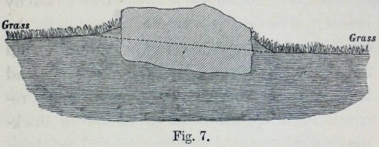

<!-- source-id: C012; original-page: 157 -->
Fig. 7.

图 7。

<!-- source-id: C013; original-page: 157 -->
Section through one of the fallen Druidical stones at Stonehenge, showing how much it had sunk into the ground. Scale ½ inch to 1 foot.

巨石阵中一颗掉落的德鲁伊石头的剖面图，显示了它沉入地下的程度。刻度为 1/2 英寸至 1 英尺。

<!-- source-id: S160; original-page: 157 -->
Sufficient evidence has now been given showing that small objects left on the surface of the land where worms abound soon get buried, and that large stones sink slowly downwards through the same means. Every step of the process could be followed, from the accidental deposition of a single casting on a small object lying loose on the surface, to its being entangled amidst the matted roots of the turf, and lastly to its being embedded in the mould at various depths beneath the surface. When the same field was re-examined after the interval of a few years, such objects were found at a greater depth than before. The straightness and regularity of the lines formed by the embedded objects, and their parallelism with the surface of the land, are the most striking features of the case; for this parallelism shows how equably the worms must have worked; the result being, however, partly the effect of the washing down of the fresh castings by rain. The specific gravity of the objects does not affect their rate of sinking, as could be seen by porous cinders, burnt marl, chalk and quartz pebbles, having all sunk to the same depth within the same time. Considering the nature of the substratum, which at Leith Hill Place was sandy soil including many bits of rock, and at Stonehenge, chalk-rubble with broken flints; considering, also, the presence of the turf-covered sloping border of mould round the great fragments of stone at both these places, their sinking does not appear to have been sensibly aided by their weight, though this was considerable.*

现在已经有足够的证据表明，留在蚯蚓丰富的土地表面上的小物体很快就会被掩埋，而大石头也会通过同样的方式慢慢地向下沉。这个过程的每一步都可以追踪，从一条蚓粪偶然沉积在松散地表面的小物体上，到它被缠在草皮的缠结根中，最后到它被嵌入地表以下不同深度的腐殖土中。当几年后重新检查同一领域时，在比以前更深的地方发现了这些物体。嵌入物体所形成的线条的笔直和规则性，以及它们与地面的平行度，是该案子最显着的特征；因为这种平行性表明了蚯蚓的工作一定是多么均匀。然而，其结果部分是由于雨水冲刷了新鲜的蚓粪。物体的比重不会影响它们的下沉速度，从多孔煤渣、烧焦的泥灰、白垩和石英卵石可以看出，它们在相同的时间内都下沉到相同的深度。考虑到地层的性质，利斯山广场的地层是沙土，其中有许多岩石碎片，而巨石阵的地层是带有破碎燧石的白垩瓦砾；还考虑到这两个地方的大石头碎片周围都存在覆盖着草皮的腐殖土倾斜边界，它们的下沉似乎并没有明显地受到它们的重量的帮助，尽管重量相当大。

<!-- source-id: S161; original-page: 159 -->
On the number of worms which live within a given space.— We will now show, firstly, what a vast number of worms live unseen by us beneath our feet, and, secondly, the actual weight of the earth which they bring up to the surface within a given space and within a given time. Hensen, who has published so full and interesting an account of the habits of worms,† calculates, from the number which he found in a measured space, that there must exist 133,000 living worms in a hectare of land, or 53,767 in an acre. This latter number of worms would weigh 356 pounds, taking Hensen's standard of the weight of a single worm, namely, one gram. It should, however, be noted that this calculation is founded on the numbers found in a garden, and Hensen believes that worms are here twice as numerous as in corn-fields. The above result, astonishing though it be, seems to me credible, judging from the number of worms which I have sometimes seen, and from the number daily destroyed by birds without the species being exterminated. Some barrels of bad ale were left on Mr. Miller's land,* in the hope of making vinegar, but the vinegar proved bad, and the barrels were upset. It should be premised that acetic acid is so deadly a poison to worms that Perrier found that a glass rod dipped into this acid and then into a considerable body of water in which worms were immersed, invariably killed them quickly. On the morning after the barrels had been upset, "the "heaps of worms which lay dead on the "ground were so amazing, that if Mr. Miller "had not seen them, he could not have "thought it possible for such numbers to "have existed in the space." As further evidence of the large number of worms which live in the ground, Hensen states that he found in a garden sixty-four open burrows in a space of 14½ square feet, that is, nine in 2 square feet. But the burrows are sometimes much more numerous, for when digging in a grass-field near Maer Hall, I found a cake of dry earth, as large as my two open hands, which was penetrated by seven burrows, as large as goose-quills.

关于生活在给定空间内的蚯蚓的数量——我们现在将首先展示我们脚下看不见的大量蚯蚓，其次展示它们在给定空间和给定时间内带到地面的地球的实际重量。汉森发表了关于蚯蚓习性的完整而有趣的描述，†根据他在测量的空间中发现的数量计算出，一公顷土地中必须存在 133,000 只活蚯蚓，或者一英亩中存在 53,767 只活蚯蚓。后一数量的蚯蚓重达 356 磅，采用汉森单条蚯蚓重量的标准，即 1 克。然而，应该指出的是，这一计算是基于花园中发现的数量，亨森认为这里的蚯蚓数量是玉米地里的两倍。上述结果虽然令人惊讶，但从我有时看到的蚯蚓数量以及每天被鸟类消灭但物种没有灭绝的数量来看，似乎是可信的。米勒先生的土地上留下了一些桶装的劣质麦芽酒，*希望用来制作醋，但事实证明醋变质了，桶也被打乱了。前提是醋酸对蚯蚓来说是一种致命的毒药，以至于巴黎水发现将一根玻璃棒浸入这种酸中，然后放入大量的水中浸泡蚯蚓，总是会很快杀死它们。桶被打翻后的第二天早上，“地上躺着的成堆的蚯蚓尸体实在是太惊人了，如果米勒先生“没有看到它们，他就不可能“认为如此数量的蚯蚓可能“存在于太空中”。”作为大量生活在地下的蚯蚓的进一步证据，亨森说，他在一个花园里发现了 64 个开放的洞穴，空间为14½ 平方英尺，即 2 平方英尺中有 9 平方英尺。但有时洞穴的数量要多得多，因为我在马尔霍尔附近的草地上挖掘时，发现了一块像我张开的手掌那么大的干燥土饼，里面有七个鹅毛大的洞穴。

<!-- source-id: N049; original-page: 159 -->
* Mr. R. Mallet remarks ('Quarterly Journal of Geolog. Soc.' vol. xxxiii., 1877, p. 745) that "the extent to which the ground beneath the foundations of ponderous architectural structures, such as cathedral towers, has been known to become compressed, is as remarkable as it is instructive and curious. The amount of depression in some cases may be measured by feet." He instances the Tower of Pisa, but adds that it was founded on "dense clay."

* R. Mallet 先生评论道（《地质学会季刊》第 xxxiii 卷，1877 年，第 745 页）“已知大教堂塔楼等笨重建筑结构地基下的地面被压缩的程度，既引人注目，又具有启发性和好奇性。在某些情况下，凹陷的程度可以用英尺来衡量。”他以比萨斜塔为例，但补充说它是建立在“致密的粘土”上的。

<!-- source-id: N050; original-page: 159 -->
† 'Zeitschrift für wissensch. Zoolog.' Bd. xxviii., 1877, p. 354.

† 'Zeitschrift für wissensch。动物学。” BD。第二十八页，1877 年，第 17 页。 354.

<!-- source-id: N051; original-page: 160 -->
* See Mr. Dancer's paper in 'Proc. Phil. Soc. of Manchester,'1877, p. 248.

* 请参阅《Proc.》中 Dancer 先生的论文。菲尔.苏克。曼彻斯特，'1877，p。 248.

<!-- source-id: S162; original-page: 161 -->
Weight of the earth ejected from a single burrow, and from all the burrows within a given space. —With respect to the weight of the earth daily ejected by worms, Hensen found that it amounted, in the case of some worms which he kept in confinement, and which he appears to have fed with leaves, to only 0.5 gram, or less than 8 grains per diem. But a very much larger amount must be ejected by worms in their natural state, at the periods when they consume earth as food instead of leaves, and when they are making deep burrows. This is rendered almost certain by the following weights of the castings thrown up at the mouths of single burrows; the whole of which appeared to have been ejected within no long time, as was certainly the case in several instances. The castings were dried (excepting in one specified instance) by exposure during many days to the sun or before a hot fire.

从单个洞穴以及给定空间内的所有洞穴中喷射出的地球重量。 ——关于蚯蚓每天排出的泥土重量，亨森发现，对于他圈养的一些蚯蚓来说，他似乎用树叶喂食，其重量仅为 0.5 克，即每天少于 8 粒。但是，在自然状态下，当蚯蚓以泥土而不是树叶为食物时，以及当它们挖很深的洞穴时，蚯蚓必须排出大量的物质。通过下列在单个洞穴口吐出的蚓粪的重量，这一点几乎可以肯定：整个装置似乎在很短的时间内就被弹出了，在一些情况下确实如此。通过将蚓粪暴露在阳光下或在热火前多日来干燥（除特定情况外）。

<!-- source-id: H039; original-page: 162 -->
### WEIGHT OF THE CASTINGS ACCUMULATED AT THE MOUTH OF A SINGLE BURROW.

蚓粪的重量在单个洞穴的口处累积。

<!-- source-id: T003; original-page: 162 -->
<table>
<tr><td colspan="1" rowspan="1"></td><td colspan="1" rowspan="1">Ounces.</td></tr>
<tr><td colspan="1" rowspan="1">(1.) Down, Kent (sub-soil red clay, full of flints, overlying the chalk). The largest casting which I could find on the flanks of a steep valley, the sub-soil being here shallow. In this one case, the casting was not well dried .. .. .. ..</td><td colspan="1" rowspan="1">3.98</td></tr>
<tr><td colspan="1" rowspan="1">(2.) Down.—Largest casting which I could find (consisting chiefly of calcareous matter), on extremely poor pasture land at the bottom of the valley mentioned under (1.) .. .. .. ..</td><td colspan="1" rowspan="1">3.87</td></tr>
<tr><td colspan="1" rowspan="1">(3.) Down.—A large casting, but not of unusual size, from a nearly level field, poor pasture, laid down in grass about 35 years before .. .. .. ..</td><td colspan="1" rowspan="1">1.22</td></tr>
<tr><td colspan="1" rowspan="1">(4.) Down.—Average weight of 11 not large castings ejected on a sloping surface on my lawn, after they had suffered some loss of weight from being exposed during a considerable length of time to rain ..</td><td colspan="1" rowspan="1">0.7</td></tr>
<tr><td colspan="1" rowspan="1">(5.) Near Nice in France.—Average weight of 12 castings of ordinary dimensions, collected by Dr. King on land which had not been mown for a long time and where worms a bounded, viz., a lawn protected by shrubberies, near the sea; soil sandy and calcareous; these castings had been exposed for some time to rain, before being collected, and must have lost some weight by disintegration, but they still retained their form .. .. .. .. ..</td><td colspan="1" rowspan="1">1.37</td></tr>
<tr><td colspan="1" rowspan="1">(6.) The heaviest of the above twelve castings ..</td><td colspan="1" rowspan="1">1.76</td></tr>
<tr><td colspan="1" rowspan="1">(7.) Lower Bengal.—Average weight of 22 castings, collected by Mr. J. Scott, and stated by him to have been thrown up in the course of one or two nights</td><td colspan="1" rowspan="1">1.24</td></tr>
<tr><td colspan="1" rowspan="1">(8.) The heaviest of the above 22 castings .. ..</td><td colspan="1" rowspan="1">2.09</td></tr>
<tr><td colspan="1" rowspan="1">(9.) Nilgiri Mountains, S. India; average weight of the 5 largest castings collected by Dr. King. They had been exposed to the rain of the last monsoon, and must have lost some weight .. .. ..</td><td colspan="1" rowspan="1">3.15</td></tr>
<tr><td colspan="1" rowspan="1">(10.) The heaviest of the above 5 castings .. ..</td><td colspan="1" rowspan="1">4.34</td></tr>
</table>

<table>
<tr><td colspan="1" rowspan="1"></td><td colspan="1" rowspan="1">盎司</td></tr>
<tr><td colspan="1" rowspan="1">(1.) 肯特郡（下土红粘土，充满燧石，覆盖着粉笔）。我在陡峭山谷的侧面发现了最大的蚓粪，这里的底土很浅。在这一个案例中，蚓粪没有充分干燥......</td><td colspan="1" rowspan="1">3.98</td></tr>
<tr><td colspan="1" rowspan="1">（2.）向下——我能找到的最大的蚓粪（主要由石灰质物质组成），位于（1.）提到的山谷底部极其贫瘠的牧场上.. .. .. ..</td><td colspan="1" rowspan="1">3.87</td></tr>
<tr><td colspan="1" rowspan="1">(3.) 下——一大块蚓粪，但大小不寻常，来自一块几乎平坦的田地，贫瘠的牧场，大约 35 年前在草地上躺下。</td><td colspan="1" rowspan="1">1.22</td></tr>
<tr><td colspan="1" rowspan="1">(4.) 向下。——11 条不大的蚯蚓排泄物的平均重量，在我的草坪的倾斜表面上排出，因为它们在相当长的时间内暴露在雨中而遭受了一些重量损失。</td><td colspan="1" rowspan="1">0.7</td></tr>
<tr><td colspan="1" rowspan="1">(5.) 法国尼斯附近。——金博士在长期未割草且蚯蚓活动范围有限的土地上（即靠近海边、有灌木丛保护的草坪）收集了 12 个普通尺寸的蚓粪的平均重量；沙质和钙质土壤；这些蚓粪在被收集之前已经暴露在雨水中一段时间，并且肯定因分解而失去了一些重量，但它们仍然保留了它们的形状......</td><td colspan="1" rowspan="1">1.37</td></tr>
<tr><td colspan="1" rowspan="1">(6.) 以上十二种蚓粪中最重的..</td><td colspan="1" rowspan="1">1.76</td></tr>
<tr><td colspan="1" rowspan="1">(7.) 下孟加拉 — J. Scott 先生收集的 22 个蚓粪的平均重量，据他说是在一两个晚上内吐出来的</td><td colspan="1" rowspan="1">1.24</td></tr>
<tr><td colspan="1" rowspan="1">(8.) 以上 22 种蚓粪中最重的.. ..</td><td colspan="1" rowspan="1">2.09</td></tr>
<tr><td colspan="1" rowspan="1">(9.) 尼尔吉里山脉，印度南部； King 博士收集的 5 种最大的蚓粪的平均重量。他们受了上一次季风的雨淋，体重肯定减轻了一些……</td><td colspan="1" rowspan="1">3.15</td></tr>
<tr><td colspan="1" rowspan="1">(10.) 以上 5 种蚓粪中最重的.. ..</td><td colspan="1" rowspan="1">4.34</td></tr>
</table>

<!-- source-id: S163; original-page: 162 -->
In this table we see that castings which had been ejected at the mouth of the same burrow, and which in most cases appeared fresh and always retained their vermiform configuration, generally exceeded an ounce in weight after being dried, and sometimes nearly equalled a quarter of a pound. On the Nilgiri mountains one casting even exceeded this latter weight. The largest castings in England were found on extremely poor pasture-land; and these, as far as I have seen, are generally larger than those on land producing a rich vegetation. It would appear that worms have to swallow a greater amount of earth on poor than on rich land, in order to obtain sufficient nutriment.

在该表中，我们看到从同一洞穴口排出的蚓粪，在大多数情况下看起来是新鲜的，并且始终保持其蠕虫状结构，干燥后的重量通常超过一盎司，有时接近四分之一磅。在尼尔吉里山上，一种蚓粪的重量甚至超过了后者。英国最大的蚓粪是在极其贫瘠的牧场上发现的；据我所知，这些植物通常比植被丰富的陆地上的植物要大。看来，在贫瘠的土地上，蚯蚓必须比在肥沃的土地上吞咽更多的泥土，才能获得足够的营养。

<!-- source-id: S164; original-page: 163 -->
With respect to the tower-like castings near Nice (Nos. 5 and 6 in the above table), Dr. King often found five or six of them on a square foot of surface; and these, judging from their average weight, would have weighed together 7½ ounces; so that the weight of those on a square yard would have been 4 lb. 3½ oz. Dr. King collected, near the close of the year 1872, all the castings which still retained their vermiform shape, whether broken down or not, from a square foot, in a place abounding with worms, on the summit of a bank, where no castings could have rolled down from above. These castings must have been ejected, as he judged from their appearance in reference to the rainy and dry periods near Nice, within the previous five or six months; they weighed 9½ oz., or 5 lb. 5½ oz. per square yard. After an interval of four months, Dr. King collected all the castings subsequently ejected on the same square foot of surface, and they weighed 2½ oz., or 1 lb. 6½ oz. per square yard. Therefore within about ten months, or we will say for safety's sake within a year, 12 oz. of castings were thrown up on this one square foot, or 6.75 pounds on the square yard; and this would give 14.58 tons per acre.

对于尼斯附近的塔状蚓粪（上表中的第5号和第6号），金博士经常在一平方英尺的表面上发现五到六个；从平均重量来看，这些东西总共重 7.5 盎司；这样一来，每平方码的重量就是 4 磅 3.5 盎司。金博士在 1872 年接近年底时，在河岸顶部一个充满蚯蚓的地方，从一平方英尺的地方收集了所有仍保持蠕虫形状的蚓粪，无论是否分解，任何蚓粪都不会从上面滚下来。这些蚓粪一定是在过去五六个月内被排出的，根据尼斯附近雨季和旱季的外观判断；它们重 9.5 盎司，或 5 磅 5.5 盎司。每平方码。间隔四个月后，金博士收集了随后排出到同一平方英尺表面的所有蚓粪，它们重 2.5 盎司，即 1 磅 6.5 盎司。每平方码。因此，大约十个月内，或者为了安全起见，我们会说一年内，12盎司。一平方英尺上吐出了 6.75 磅的蚓粪，每平方码重达 6.75 磅；每英亩产量为 14.58 吨。

<!-- source-id: S165; original-page: 164 -->
In a field at the bottom of a valley in the chalk (see No. 2 in the foregoing table), a square yard was measured at a spot where very large castings abounded; they appeared, however, almost equally numerous in a few other places. These castings, which retained perfectly their vermiform shape, were collected; and they weighed when partially dried, 1 lb. 13½ oz. This field had been rolled with a heavy agricultural roller fifty-two days before, and this would certainly have flattened every single casting on the land. The weather had been very dry for two or three weeks before the day of collection, so that not one casting appeared fresh or had been recently ejected. We may therefore assume that those which were weighed had been ejected within, we will say, forty days from the time when the field was rolled,— that is, twelve days short of the whole intervening period. I had examined the same part of the field shortly before it was rolled, and it then abounded with fresh castings. Worms do not work in dry weather, during the summer, or in winter during severe frosts. If we assume that they work for only half the year—though this is too low an estimate—then the worms in this field would eject during the year, 8.387 pounds per square yard; or 18.12 tons per acre, assuming the whole surface to be equally productive in castings.

在粉笔谷底的一块田地里（见上表中的No.2），在大量大量蚓粪的地方测量了一平方码；然而，在其他一些地方，他们的数量几乎同样多。这些蚓粪被收集起来，它们完美地保留了蠕虫的形状。部分干燥后的重量为 1 磅 13.5 盎司。这片田地是五十二天前用重型农用压路机碾压过的，这肯定会把撒在土地上的每一条蚓粪压扁。在收集之前的两三周内，天气一直非常干燥，因此没有一根蚓粪是新鲜的或最近被排出的。因此，我们可以假设，那些被称重的东西是在从场地滚动之日起四十天内被弹出的，也就是说，比整个干预期少了十二天。在土地被碾压之前不久，我曾检查过这块田地的同一部分，然后发现那里充满了新鲜的蚓粪。蚯蚓在干燥的天气、夏季或冬季严重霜冻时不起作用。如果我们假设它们只工作半年（尽管这个估计太低），那么该田地里的蚯蚓在这一年中会排出，每平方码 8.387 磅；或每英亩 18.12 吨，假设整个表面的蚓粪产量相同。

<!-- source-id: S166; original-page: 165 -->
In the foregoing cases some of the necessary data had to be estimated, but in the two following cases the results are much more trustworthy. A lady, on whose ac- curacy I can implicitly rely, offered to collect during a year all the castings thrown up on two separate square yards, near Leith Hill Place, in Surrey. The amount collected was, however, somewhat less than that originally ejected by the worms; for, as I have repeatedly observed, a good deal of the finest earth is washed away, whenever castings are thrown up during or shortly before heavy rain. Small portions also adhered to the surrounding blades of grass, and it required too much time to detach every one of them. On sandy soil, as in the present instance, castings are liable to crumble after dry weather, and particles were thus often lost. The lady also occasionally left home for a week or two, and at such times the castings must have suffered still greater loss from exposure to the weather. These losses were, however, compensated to some extent by the collections having been made on one of the squares for four days, and on the other square for two days more than the year.

在上述情况下，必须估计一些必要的数据，但在以下两种情况下，结果更值得信赖。一位女士的准确性我绝对可以信赖，她提出在一年内收集萨里利斯希尔广场附近两个独立平方码上的所有蚓粪。不过，收集到的量比蚯蚓最初排出的量要少一些；因为，正如我多次观察到的，每当大雨期间或大雨来临前不久，蚓粪被抛起时，大量最细的泥土就会被冲走。小部分还粘附在周围的草叶上，需要很长时间才能将它们全部分离。在沙质土壤上，如本例，蚓粪在干燥天气后容易破碎，因此颗粒经常丢失。这位女士偶尔也会离开家一两周，此时蚓粪因暴露在外的天气而遭受的损失肯定更大。然而，这些损失在一定程度上得到了补偿，因为其中一个广场的收集工作比一年多了四天，而另一个广场的收集工作比一年多了两天。

<!-- source-id: S167; original-page: 166 -->
A space was selected (October 9th, 1870) on a broad, grass-covered terrace, which had been mowed and swept during many years. It faced the south, but was shaded during part of the day by trees. It had been formed at least a century ago by a great accumulation of small and large fragments of sandstone, together with some sandy earth, rammed down level. It is probable that it was at first protected by being covered with turf. This terrace, judging from the number of castings on it, was rather unfavourable for the existence of worms, in comparison with the neighbouring fields and an upper terrace. It was indeed surprising that as many worms could live here as were seen; for on digging a hole in this terrace, the black vegetable mould together with the turf was only four inches in thickness, beneath which lay the level surface of light-coloured sandy soil, with many fragments of sandstone. Before any castings were collected all the previously existing ones were carefully removed. The last day's collection was on October 14th, 1871. The castings were then well dried before a fire; and they weighed exactly 3½ lbs. This would give for an acre of similar land 7.56 tons of dry earth annually ejected by worms.

1870 年 10 月 9 日，我们在一个宽阔的、长满青草的露台上选择了一个空间，这个露台已经被修剪和打扫了很多年。它朝南，但白天的部分时间有树木遮荫。它是至少一个世纪前由大小不一的砂岩碎片和一些沙土堆积而成，夯实而成的。它很可能最初是通过覆盖草皮来保护的。从该梯田上蚓粪的数量来看，与邻近的田地和上层梯田相比，该梯田对蚯蚓的生存相当不利。确实令人惊讶的是，这里竟然有如此多的蚯蚓。因为在这个梯田上挖洞时，黑色腐殖土连同草皮只有四英寸厚，下面是浅色沙土的平坦表面，上面有许多砂岩碎片。在收集任何蚓粪之前，所有先前存在的粪便都被小心地清除。最后一天的收集是在 1871 年 10 月 14 日。蚓粪在火前充分干燥；它们的重量正好是 3.5 磅。对于一英亩类似的土地，蚯蚓每年会排出 7.56 吨干土。

<!-- source-id: S168; original-page: 167 -->
The second square was marked on un- enclosed common land, at a height of about 700 ft. above the sea, at some little distance from Leith Hill Tower. The surface was clothed with short, fine turf, and had never been disturbed by the hand of man. The spot selected appeared neither particularly favourable nor the reverse for worms; but I have often noticed that castings are especially abundant on common land, and this may, perhaps, be attributed to the poorness of the soil. The vegetable mould was here between three and four inches in thickness. As this spot was at some distance from the house where the lady lived, the castings were not collected at such short intervals of time as those on the terrace; consequently the loss of fine earth during rainy weather must have been greater in this than in the last case. The castings moreover were more sandy, and in collecting them during dry weather they sometimes crumbled into dust, and much was thus lost. Therefore it is certain that the worms brought up to the surface considerably more earth than that which was collected. The last collection was made on October 27th, 1871; i.e., 367 days after the square had been marked out and the surface cleared of all pre-existing castings. The collected castings, after being well dried, weighed 7.453 pounds; and this would give, for an acre of the same kind of land, 16.1 tons of annually ejected dry earth.

第二个广场位于未封闭的公共土地上，海拔约 700 英尺，距利斯希尔塔 (Leith Hill Tower) 不远。地面覆盖着短而细的草皮，从未被人类的双手破坏过。所选择的地点对蚯蚓来说既不是特别有利，也不是特别有利。但我经常注意到，在普通土地上，蚯蚓的排泄物特别多，这也许是由于土壤贫瘠所致。这里的腐殖土厚度在三到四英寸之间。由于该地点距离女士所住的房子有一段距离，因此收集蚓粪的时间间隔不像露台上那样短。因此，在下雨天气期间，细土的损失一定比前一种情况更大。此外，蚓粪的沙质较多，在干燥天气收集时有时会碎成灰尘，因此损失了很多。因此，可以肯定的是，蚯蚓带到地表的泥土比收集到的泥土多得多。最后一次收集于 1871 年 10 月 27 日；即，在广场被划出并清除表面所有先前存在的蚓粪后 367 天。收集到的蚓粪干燥后重达 7.453 磅；对于一英亩的同类土地来说，每年将喷出 16.1 吨干土。

<!-- source-id: H040; original-page: 169 -->
### SUMMARY OF THE FOUR FOREGOING CASES.

上述四个案例的摘要。

<!-- source-id: S169; original-page: 169 -->
(1.) Castings ejected near Nice within about a year, collected by Dr. King on a square foot of surface, calculated to yield per acre 14.58 tons.

(1.) 尼斯附近约一年内排出的蚓粪，由 King 博士收集在一平方英尺的表面上，计算出每英亩产量为 14.58 吨。

<!-- source-id: S170; original-page: 169 -->
(2.) Castings ejected during about 45 days on a square yard, in a field of poor pasture at the bottom of a large valley in the Chalk, calculated to yield annually per acre 18.12 tons.

(2.) 蚓粪在大约 45 天的时间内排出在 Chalk 一个大山谷底部贫瘠牧场的一平方码土地上，计算出每英亩每年产量为 18.12 吨。

<!-- source-id: S171; original-page: 169 -->
(3.) Castings collected from a square yard on an old terrace at Leith Hill Place, during 369 days, calculated to yield annually per acre 7.56 tons.

(3.) 在 369 天的时间里，从 Leith Hill Place 旧露台上的一平方码收集蚓粪，计算出每英亩每年产量为 7.56 吨。

<!-- source-id: S172; original-page: 169 -->
(4.) Castings collected from a square yard on Leith Hill Common during 367 days, calculated to yield annually per acre 16.1 tons.

(4.) 367天内从Leith Hill Common一平方码收集的蚓粪，经计算每英亩每年产量为16.1吨。

<!-- source-id: S173; original-page: 169 -->
The thickness of the layer of mould, which castings ejected during a year would form if uniformly spread out. —As we know from the two last cases in the above summary, the weight of the dried castings ejected by worms during a year on a square yard of surface, I wished to learn how thick a layer of ordinary mould this amount would form if spread uniformly over a square yard. The dry castings were therefore broken into small particles, and whilst being placed in a measure were well shaken and pressed down. Those collected on the Terrace amounted to 124.77 cubic inches; and this amount, if spread out over a square yard, would make a layer .09612 inch in thickness. Those collected on the Common amounted to 197.56 cubic inches, and would make a similar layer .1524 inch in thickness.

蚯蚓排泄物一年中排出的腐殖土层如果均匀铺展的话会形成的厚度。 ——从上面总结的最后两个案例中我们知道，一年中蚯蚓排出的干蚓粪在一平方码的表面上的重量，我想知道如果将这一量均匀地铺在一平方码的表面上，会形成一层多厚的普通腐殖土。因此，将干燥的蚓粪打碎成小颗粒，并在放入量具中的同时充分摇动并压实。露台上收集的垃圾总量为 124.77 立方英寸；如果将这个数量铺展在一平方码上，则将形成 0.09612 英寸厚的一层。在 Common 上收集到的物质总计 197.56 立方英寸，并且可以形成类似的厚度为 0.1524 英寸的层。

<!-- source-id: S174; original-page: 170 -->
These thicknesses must, however, be corrected, for the triturated castings, after being well shaken down and pressed, did not make nearly so compact a mass as vegetable mould, though each separate particle was very compact. Yet mould is far from being compact, as is shown by the number of air-bubbles which rise up when the surface is flooded with water. It is moreover penetrated by many fine roots. To ascertain approximately by how much ordinary vegetable mould would be increased in bulk by being broken up into small particles and then dried, a thin oblong block of somewhat argillaceous mould (with the turf pared off) was measured before being broken up, was well dried and again measured. The drying caused it to shrink by 1/7 of its original bulk, judging from exterior measurements alone. It was then triturated and partly reduced to powder, in the same manner as the castings had been treated, and its bulk now exceeded (notwithstanding shrinkage from drying) by 1/16 that of the original block of damp mould. Therefore the above calculated thickness of the layer, formed by the castings from the Terrace, after being damped and spread over a square yard, would have to be reduced by 1/16; and this will reduce the layer to .09 of an inch, so that a layer .9 inch in thickness would be formed in the course of ten years. On the same principle the castings from the Common would make in the course of a single year a layer .1429 inch, or in the course of 10 years 1.429 inch, in thickness. We may say in round numbers that the thickness in the former case would amount to nearly 1 inch, and in the second case to nearly 1½ inch in 10 years.

然而，必须校正这些厚度，因为研磨的蚓粪在充分摇匀和压制后，并没有形成像腐殖土那样紧密的团块，尽管每个单独的颗粒都非常紧密。然而，腐殖土远非致密，当表面被水淹没时上升的气泡数量就表明了这一点。此外，它还被许多细根穿透。为了大致确定通过破碎成小颗粒然后干燥后普通腐殖土的体积会增加多少，在破碎之前测量了一块薄长方形的有点泥质的腐殖土（将草皮削掉），充分干燥并再次测量。仅从外部尺寸来看，干燥导致其体积缩小了原来体积的 1/7。然后将其研磨并部分粉碎成粉末，与处理蚓粪的方式相同，其体积现在超过（尽管因干燥而收缩）原始湿腐殖土块的 1/16。因此，上面计算的露台上蚓粪形成的层的厚度，在受潮并铺满一平方码后，必须减少 1/16；这会将层减少到 0.09 英寸，因此在十年内将形成 0.9 英寸厚的层。根据同样的原理，普通蚯蚓的粪便在一年内会形成一层 0.1429 英寸的厚度，或者在十年内形成 1.429 英寸的厚度。我们可以用整数表示，在 10 年内，前一种情况的厚度将接近 1 英寸，而第二种情况则接近 1.5 英寸。

<!-- source-id: S175; original-page: 171 -->
In order to compare these results with those deduced from the rates at which small objects left on the surfaces of grass-fields become buried (as described in the early part of this chapter), we will give the following summary:—

为了将这些结果与根据留在草地表面的小物体被掩埋的比率推算的结果（如本章前面部分所述）进行比较，我们将给出以下总结：

<!-- source-id: S176; original-page: 172 -->
SUMMARY OF THE THICKNESS OF THE MOULD ACCUMULATED OVER OBJECTS LEFT STREWED ON THE SURFACE, IN THE COURSE OF TEN YEARS.

十年来，地面上散布的物体所积累的腐殖土厚度的总结。

<!-- source-id: S177; original-page: 172 -->
The accumulation of mould during 14¾ years on the surface of a dry, sandy, grass-field near Maer Hall, amounted to 2.2 inches in 10 years.

马尔霍尔附近干燥的沙质草地表面的腐殖土在 14.75 年间的积累量在 10 年内达到了 2.2 英寸。

<!-- source-id: S178; original-page: 172 -->
The accumulation during 21½ years on a swampy field near Maer Hall, amounted to nearly 1.9 inch in 10 years.

马尔霍尔附近的一片沼泽地在 21.5 年间积累了 10 年近 1.9 英寸的积水。

<!-- source-id: S179; original-page: 172 -->
The accumulation during 7 years on a very swampy field near Maer Hall amounted to 2.1 inches in 10 years.

马尔霍尔附近一片非常沼泽的土地上，7 年的累积量在 10 年内达到了 2.1 英寸。

<!-- source-id: S180; original-page: 172 -->
The accumulation during 29 years, on good, argillaceous pasture-land over the Chalk at Down, amounted to 2.2 inches in 10 years.

在唐恩地区白垩河上方的优质泥质牧场上，29 年来的积累量在 10 年内达到了 2.2 英寸。

<!-- source-id: S181; original-page: 172 -->
The accumulation during 30 years on the side of a valley over the Chalk at Down, the soil being argillaceous, very poor, and only just converted into pasture (so that it was for some years unfavourable for worms), amounted to 0.83 inches in 10 years.

唐恩白垩河谷一侧的土壤是泥质的，非常贫瘠，而且刚刚转变为牧场（因此有几年不利于蚯蚓），30年来的积累在10年内达到了0.83英寸。

<!-- source-id: S182; original-page: 172 -->
In these cases (excepting the last) it may be seen that the amount of earth brought to the surface during 10 years is somewhat greater than that calculated from the castings which were actually weighed. This excess may be partly accounted for by the loss which the weighed castings had previously undergone through being washed by rain, by the adhesion of particles to the blades of the surrounding grass, and by their crumbling when dry. Nor must we overlook other agencies which in all ordinary cases add to the amount of mould, and which would not be included in the castings that were collected, namely, the fine earth brought up to the surface by burrowing larvæ and insects, especially by ants. The earth brought up by moles generally has a somewhat different appearance from vegetable mould; but after a time would not be distinguishable from it. In dry countries, moreover, the wind plays an important part in carrying dust from one place to another, and even in England it must add to the mould on fields near great roads. But in our country these latter several agencies appear to be of quite subordinate importance in comparison with the action of worms.

在这些情况下（最后一个除外），可以看出 10 年内带到地表的土量略大于根据实际称重的蚓粪计算得出的值。这种过量的部分原因可能是由于已称重的蚓粪先前因雨水冲刷、颗粒粘附在周围草叶上以及干燥时破碎而造成的损失。我们也不能忽视其他因素，这些因素在所有普通情况下都会增加腐殖土的数量，并且不会包含在收集的蚓粪中，即由挖洞幼虫和昆虫（尤其是蚂蚁）带到地表的细土。鼹鼠带出的土壤通常与腐殖土的外观有些不同；但过了一段时间后就无法区分了。此外，在干燥的国家，风在将灰尘从一个地方带到另一个地方的过程中发挥着重要作用，即使在英国，风也必须增加主要道路附近田地的腐殖土。但在我国，与蚯蚓的作用相比，后几个机构的重要性显得相当次要。

<!-- source-id: S183; original-page: 173 -->
We have no means of judging how great a weight of earth a single full-sized worm ejects during a year. Hensen estimates that 53,767 worms exist in an acre of land; but this is founded on the number found in gardens, and he believes that only about half as many live in corn-fields. How many live in old pasture land is unknown; but if we assume that half the above number, or 26,886 worms live on such land, then taking from the previous summary 15 tons as the weight of the castings annually thrown up on an acre of land, each worm must annually eject 20 ounces. A full-sized casting at the mouth of a single burrow often exceeds, as we have seen, an ounce in weight; and it is probable that worms eject more than 20 full-sized castings during a year. If they eject annually more than 20 ounces, we may infer that the worms which live in an acre of pasture land must be less than 26,886 in number.

我们无法判断一条全尺寸的蚯蚓一年内排出的泥土重量有多大。 Hensen 估计一英亩土地上有 53,767 条蚯蚓；但这是建立在花园里发现的数量的基础上的，他认为只有大约一半的人生活在玉米地里。有多少人生活在古老的牧场上尚不得而知；但如果我们假设上述数量的一半，即 26,886 只蚯蚓生活在这片土地上，那么根据之前的汇总，每英亩土地上每年排出的蚓粪重量为 15 吨，每只蚯蚓每年必须排出 20 盎司。正如我们所见，在单个洞穴口排出的全尺寸蚓粪的重量通常超过一盎司；蚯蚓一年内可能会排出 20 多个完整大小的蚓粪。如果每年排出的蚯蚓超过20盎司，我们可以推断，一英亩牧场上生活的蚯蚓数量一定少于26,886条。

<!-- source-id: S184; original-page: 174 -->
Worms live chiefly in the superficial mould, which is usually from 4 or 5 to 10 and even 12 inches in thickness; and it is this mould which passes over and over again through their bodies and is brought to the surface. But worms occasionally burrow into the subsoil to a much greater depth, and on such occasions they bring up earth from this greater depth; and this process has gone on for countless ages. Therefore the superficial layer of mould would ultimately attain, though at a slower and slower rate, a thickness equal to the depth to which worms ever burrow, were there not other opposing agencies at work which carry away to a lower level some of the finest earth which is continually being brought to the surface by worms. How great a thickness vegetable mould ever attains, I have not had good opportunities for observing; but in the next chapter, when we consider the burial of ancient buildings, some facts will be given on this head. In the two last chapters we shall see that the soil is actually increased, though only to a small degree, through the agency of worms; but their chief work is to sift the finer from the coarser particles, to mingle the whole with vegetable débris, and to saturate it with their intestinal secretions.

蚯蚓主要生活在表层腐殖土中，其厚度通常为4或5至10甚至12英寸；正是这种腐殖土一遍又一遍地穿过他们的身体并被带到地表。但蚯蚓有时会钻入地下更深的地方，在这种情况下，它们会从更深的地方把土带出来。这个过程已经持续了无数个世纪。因此，腐殖土的表层最终将达到（尽管速度越来越慢）厚度等于蚯蚓挖洞的深度，如果没有其他相反的机构在起作用，将一些最细的土壤带走到较低的水平，而这些土壤不断地被蚯蚓带到地表。腐殖土到底有多厚，我还没有很好的观察机会。但在下一章中，当我们考虑古建筑的埋葬时，我们将给出一些关于这一点的事实。在最后两章中，我们将看到通过蚯蚓的作用，土壤实际上得到了增加，尽管只是很小的程度。但它们的主要工作是从较粗的颗粒中筛选出较细的颗粒，将其与蔬菜残渣混合，并用肠道分泌物浸透其中。

<!-- source-id: S185; original-page: 175 -->
Finally, no one who considers the facts given in this chapter—on the burying of small objects and on the sinking of great stones left on the surface—on the vast number of worms which live within a moderate extent of ground—on the weight of the castings ejected from the mouth of the same burrow—on the weight of all the castings ejected within a known time on a measured space—will hereafter, as I believe, doubt that worms play an important part in nature.

最后，我认为，考虑到本章中给出的事实——关于小物体的掩埋和留在地表的大石头的下沉——关于生活在中等范围内的大量蚯蚓——关于从同一个洞口喷出的蚓粪的重量——关于在已知时间内在测量的空间内喷出的所有蚓粪的重量——以后，我相信，没有人会怀疑蚯蚓发挥了重要作用。在大自然中。

<!-- source-id: H041; original-page: 176 -->
## CHAPTER IV.

第四章

<!-- source-id: H042; original-page: 176 -->
### THE PART WHICH WORMS HAVE PLAYED IN THE BURIAL OF ANCIENT BUILDINGS.

蚯蚓在古建筑埋葬中所扮演的角色。

<!-- source-id: S186; original-page: 176 -->
The accumulation of rubbish on the sites of great cities independent of the action of worms—The burial of a Roman villa at Abinger—The floors and walls penetrated by worms—Subsidence of a modern pavement—The buried pavement at Beaulieu Abbey—Roman villas at Chedworth and Brading—The remains of the Roman town at Silchester—The nature of the débris by which the remains are covered—The penetration of the tesselated floors and walls by worms—Subsidence of the floors—Thickness of the mould—The old Roman city of Wroxeter—Thickness of the mould—Depth of the foundations of some of the Buildings—Conclusion.

大城市遗址上垃圾的堆积，与蚯蚓的作用无关——阿宾格罗马别墅的埋葬——蚯蚓穿透的地板和墙壁——现代人行道的沉降——博利厄修道院的埋人行道——切德沃斯和布雷丁的罗马别墅——西尔切斯特的罗马城镇遗迹——覆盖遗迹的残骸的性质——棋盘格地板和墙壁的渗透由蚯蚓引起——地板沉降——腐殖土的厚度——古罗马城市罗克塞特——腐殖土的厚度——一些建筑物地基的深度——结论。

<!-- source-id: S187; original-page: 176 -->
ARCHÆOLOGISTS are probably not aware how much they owe to worms for the preservation of many ancient objects. Coins, gold ornaments, stone implements, &c., if dropped on the surface of the ground, will infallibly be buried by the castings of worms in a few years, and will thus be safely preserved, until the land at some future time is turned up. For instance, many years ago a grass-field was ploughed on the northern side of the Severn, not far from Shrewsbury; and a surprising number of iron arrow-heads were found at the bottom of the furrows, which, as Mr. Blakeway, a local antiquary, believed, were relics of the battle of Shrewsbury in the year 1403, and no doubt had been originally left strewed on the battle-field. In the present chapter I shall show that not only implements, &c., are thus preserved, but that the floors and the remains of many ancient buildings in England have been buried so effectually, in large part through the action of worms, that they have been discovered in recent times solely through various accidents. The enormous beds of rubbish, several yards in thickness, which underlie many cities, such as Rome, Paris, and London, the lower ones being of great antiquity, are not here referred to, as they have not been in any way acted on by worms. When we consider how much matter is daily brought into a great city for building, fuel, clothing and food, and that in old times when the roads were bad and the work of the scavenger was neglected, a comparatively small amount was carried away, we may agree with Élie de Beaumont, who, in discussing this subject, says, "pour une voiture de matériaux "qui en sort, on y en fait entrer cent."* Nor should we overlook the effects of fires, the demolition of old buildings, and the removal of rubbish to the nearest vacant space.

考古学家可能并没有意识到，许多古代物体的保存要归功于蚯蚓。钱币、金饰、石器等，如果掉在地表，几年之内，一定会被蚯蚓的粪便所掩埋，从而安全地保存下来，直到将来某个时候的土地翻过来。例如，许多年前，距离什鲁斯伯里不远的塞文河北岸有一片草地被犁过；犁沟底部发现了数量惊人的铁箭头，当地古董商布莱克威先生认为，这些铁箭头是1403年什鲁斯伯里战役的遗物，毫无疑问最初是散落在战场上的。在本章中，我将表明，不仅工具等被如此保存下来，而且英国许多古建筑的地板和遗迹也被有效地掩埋了，很大程度上是通过蚯蚓的作用，以至于最近它们只是通过各种意外才被发现。罗马、巴黎和伦敦等许多城市下面都有几码厚的巨大垃圾床，下面的垃圾床历史悠久，这里没有提及，因为它们没有受到蚯蚓的任何作用。当我们考虑到每天有多少物质被带入一座大城市用于建筑、燃料、衣服和食物，而在过去，当道路状况不佳且拾荒者的工作被忽视时，只有相对少量的物质被带走，我们可能会同意埃利·德·博蒙特的观点，她在讨论这个主题时说，“pour une voiture de matériaux“qui en sort，on y en fait entr cent。”*我们也不应该忽视火灾、拆除旧建筑以及将垃圾移至就近空闲空间。

<!-- source-id: S188; original-page: 178 -->
Abinger, Surrey. —Late in the autumn of 1876, the ground in an old farm-yard at this place was dug to a depth of 2 to 2½ feet, and the workmen found various ancient remains. This led Mr. T. H. Farrer of Abinger Hall to have an adjoining ploughed field searched. On a trench being dug, a layer of concrete, still partly covered with tessertæ (small red tiles), and surrounded on two sides by brokendown walls, was soon discovered. It is believed † that this room formed part of the atrium or reception-room of a Roman villa. The walls of two or three other small rooms were afterwards discovered. Many fragments of pottery, other objects, and coins of several Roman emperors, dating from 133 to 361, and perhaps to 375 A.D., were likewise found. Also a half-penny of George I., 1715. The presence of this latter coin seems an anomaly; but no doubt it was dropped on the ground during the last century, and since then there has been ample time for its burial under a considerable depth of the castings of worms. From the different dates of the Roman coins we may infer that the building was long inhabited. It was probably ruined and deserted 1400 or 1500 years ago.

阿宾格，萨里。 ——1876年深秋，这里的一个古老农家院子的地面被挖到了2到2.5英尺的深度，工人们发现了各种古代遗迹。这导致 Abinger Hall 的 T. H. Farrer 先生对毗邻的耕地进行了搜查。在一条正在挖的沟渠上，很快就发现了一层混凝土，部分仍覆盖着tessertæ（小红瓦），两侧被破损的墙壁包围。据信，这个房间是罗马别墅中庭或接待室的一部分。后来又发现了另外两三个小房间的墙壁。同样还发现了多位罗马皇帝的陶器碎片、其他物品和硬币，其年代可追溯至公元 133 年至 361 年，或许可追溯至公元 375 年。还有乔治一世的半便士，1715 年。后一枚硬币的存在似乎是一种反常现象。但毫无疑问，它是在上个世纪被扔到地上的，从那时起，它就有了足够的时间被埋在相当深的蚓粪下。从罗马硬币的不同日期我们可以推断这座建筑长期有人居住。它可能在1400或1500年前就被毁坏和废弃了。

<!-- source-id: N052; original-page: 178 -->
* 'Leçons de Géologie pratique, 1845, p. 142.

*《Leçons de Géologie pratique》，1845 年，第 17 页。 142.

<!-- source-id: N053; original-page: 178 -->
† A short account of this discovery was published in 'The Times of January 2, 1878; and a fuller account in 'The Builder, January 5, 1878.

† 1878 年 1 月 2 日的《泰晤士报》上发表了对这一发现的简短描述；以及 1878 年 1 月 5 日《建造者》中更完整的描述。

<!-- source-id: S189; original-page: 179 -->
I was present during the commencement of the excavations (August 20, 1877) and Mr. Farrer had two deep trenches dug at opposite ends of the atrium, so that I might examine the nature of the soil near the remains. The field sloped from east to west at an angle of about 7°; and one of the two trenches, shown in the accompanying section (Fig. 8) was at the upper or eastern end. The diagram is on a scale of 1/20 of an inch to an inch; but the trench, which was between 4 and 5 feet broad, and in parts above 5 feet deep, has necessarily been reduced out of all proportion. The fine mould over the floor

挖掘开始时（1877 年 8 月 20 日）我在场，法雷尔先生在中庭的两端挖了两条深沟，以便我可以检查遗迹附近土壤的性质。场地由东向西倾斜约7°；随附剖面图（图 8）所示的两条战壕之一位于上端或东端。该图的比例为 1/20 英寸到 1 英寸；但这条宽 4 至 5 英尺、部分深度超过 5 英尺的壕沟必然被不成比例地缩小。地板上的细腐殖土

<!-- source-id: F008; original-page: 180 -->
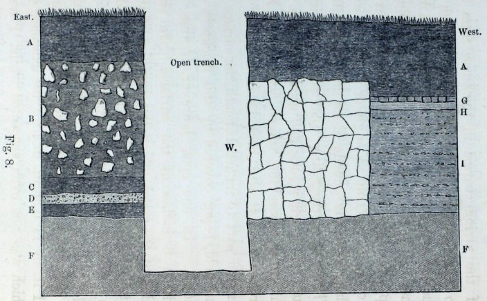

<!-- source-id: C014; original-page: 180 -->
Fig. 8.

图 8。

<!-- source-id: C015; original-page: 180 -->
Section through the foundations of a buried Roman villa at Abinger. A A, vegetable mould; B, dark earth full of stones, 13 inches in thickness; C, black mould; D, broken mortar; E. black mould; F F, undisturbed sub-soil; G, tesseræ H. concrete; I, nature unknown; W, buried wall.

位于阿宾格 (Abinger) 一座埋藏的罗马别墅地基剖面图。 A A，腐殖土； B、布满石头的暗土，厚13英寸； C、黑色腐殖土； D、破碎砂浆； E.黑色腐殖土； F F，未受干扰的地下土； G、镶嵌 H.混凝土；我，本性不明； W，埋墙。

<!-- source-id: S190; original-page: 181 -->
of the atrium varied in thickness from 11 to 16 inches; and on the side of the trench in the section was a little over 13 inches. After the mould had been removed, the floor appeared as a whole moderately level; but it sloped in parts at an angle of 1°, and in one place near the outside at as much as 8° 30'. The wall surrounding the pavement was built of rough stones, and was 23 inches in thickness where the trench was dug. Its broken summit was here 13 inches, but in another part 15 inches, beneath the surface of the field, being covered by this thickness of mould. In one spot, however, it rose to within 6 inches of the surface. On two sides of the room, where the junction of the concrete floor with the bounding walls could be carefully examined, there was no crack or separation. This trench afterwards proved to have been dug within an adjoining room (11 ft. by 11 ft. 6 in. in size), the existence of which was not even suspected whilst I was present.

中庭的厚度从 11 英寸到 16 英寸不等；沟槽一侧的截面略多于 13 英寸。除去腐殖土后，地面整体呈现中等水平；但它的部分倾斜角为 1°，靠近外侧的一处倾斜角高达 8°30'。人行道周围的墙是用粗糙的石头砌成的，挖沟的地方厚23英寸。破碎的山顶在这里 13 英寸，但在另一部分 15 英寸，在田野表面以下，被这么厚的腐殖土覆盖。然而，在一个地方，它上升到距表面 6 英寸以内。在房间的两侧，可以仔细检查混凝土地板与围墙的连接处，没有裂缝或分离。后来证明这条沟渠是在毗邻的房间内挖掘的（尺寸为 11 英尺 x 11 英尺 6 英寸），当我在场时，甚至没有人怀疑它的存在。

<!-- source-id: S191; original-page: 181 -->
On the side of the trench farthest from the buried wall (W), the mould varied from 9 to 14 inches in thickness; it rested on a mass (B) 23 inches thick of blackish earth, including many large stones. Beneath this was a thin bed of very black mould (C), then a layer of earth full of fragments of mortar (D), and then another thin bed (about 3 inches thick) (F) of very black mould, which rested on the undisturbed subsoil (F) of firm, yellowish, argillaceous sand. The 23-inch bed (B) was probably made ground, as this would have brought up the floor of the room to a level with that of the atrium. The two thin beds of black mould at the bottom of the trench evidently marked two former land-surfaces. Outside the walls of the northern room, many bones, ashes, oyster-shells, broken pottery and an entire pot were subsequently found at a depth of 16 inches beneath the surface.

在距埋墙 (W) 最远的沟渠一侧，腐殖土的厚度从 9 到 14 英寸不等；它坐落在一块 23 英寸厚的黑色泥土上 (B)，其中包括许多大石头。下面是一层很黑的腐殖土薄层 (C)，然后是一层充满砂浆碎片的土层 (D)，然后是另一层很黑的腐殖土薄层（约 3 英寸厚）(F)，它位于未受干扰的坚硬、淡黄色、泥质沙子的底土 (F) 上。 23 英寸的床 (B) 可能是地面的，因为这会使房间的地板与中庭的地板齐平。沟渠底部的两层薄薄的黑色腐殖土显然标志着两个以前的陆地表面。随后，在北屋墙外 16 英寸深的地方发现了许多骨头、骨灰、牡蛎壳、破碎的陶器和整个罐子。

<!-- source-id: S192; original-page: 182 -->
The second trench was dug on the western or lower side of the villa: the mould was here only 6½ inches in thickness, and it rested on a mass of fine earth full of stones, broken tiles and fragments of mortar, 34 inches in thickness, beneath which was the undisturbed sand. Most of this earth had probably been washed down from the upper part of the field, and the fragments of stones, tiles, &c., must have come from the immediately adjoining ruins.

第二条沟渠是在别墅的西侧或下侧挖的：这里的腐殖土只有 6.5 英寸厚，它坐落在一块充满石头、碎瓦和砂浆碎片的细土上，厚度为 34 英寸，下面是未受干扰的沙子。这片土地的大部分可能是从田野的上部被冲下来的，石头、瓷砖等的碎片一定来自紧邻的废墟。

<!-- source-id: S193; original-page: 183 -->
It appears at first sight a surprising fact that this field of light sandy soil should have been cultivated and ploughed during many years, and that not a vestige of these buildings should have been discovered. No one even suspected that the remains of a Roman villa lay hidden close beneath the surface. But the fact is less surprising when it is known that the field, as the bailiff believed, had never been ploughed to a greater depth than 4 inches. It is certain that when the land was first ploughed, the pavement and the surrounding broken walls must have been covered by at least 4 inches of soil, for otherwise the rotten concrete floor would have been scored by the ploughshare, the tesseræ torn up, and the tops of the old walls knocked down.

乍一看，这似乎是一个令人惊讶的事实，这片轻质沙土应该已经被耕种和犁过很多年了，而且这些建筑物的遗迹应该没有被发现。甚至没有人怀疑一座罗马别墅的遗迹就隐藏在地表之下。但事实并不令人惊讶，因为正如执行官所认为的那样，这片土地从未被犁过超过 4 英寸的深度。可以肯定的是，在第一次犁地时，人行道和周围的断墙必须被至少4英寸厚的土壤覆盖，否则腐烂的混凝土地板就会被犁铧划伤，镶嵌物会被撕裂，旧墙的顶部也会被撞倒。

<!-- source-id: S194; original-page: 183 -->
When the concrete and tesseræ were first cleared over a space of 14 by 9 ft., the floor which was coated with trodden-down earth exhibited no signs of having been penetrated by worms; and although the overlying fine mould closely resembled that which in many places has certainly been accumulated by worms, yet it seemed hardly possible that this mould could have been brought up by worms from beneath the apparently sound floor. It seemed also extremely improbable that the thick walls, surrounding the room and still united to the concrete, had been undermined by worms, and had thus been caused to sink, being afterwards covered up by their castings. I therefore at first concluded that all the fine mould above the ruins had been washed down from the upper parts of the field; but we shall soon see that this conclusion was certainly erroneous, though much fine earth is known to be washed down from the upper part of the field in its present ploughed state during heavy rains.

当第一次清理 14 x 9 英尺的空间中的混凝土和镶嵌物时，覆盖着被踩过的泥土的地板没有显示出被蚯蚓穿透的迹象；虽然上面覆盖的细腐殖土与许多地方肯定是由蚯蚓积累的土壤非常相似，但这种腐殖土似乎不太可能是由蚯蚓从表面上坚固的地板下面带上来的。房间周围仍然与混凝土结合在一起的厚墙似乎也极不可能被蚯蚓破坏，因此导致下沉，然后被蚓粪覆盖。因此，我首先得出的结论是，废墟上方的所有细腐殖土都已从田地的上部被冲刷下来。但我们很快就会发现，这个结论肯定是错误的，尽管众所周知，在大雨期间，在目前犁过的状态下，许多细土会从田地的上部被冲走。

<!-- source-id: S195; original-page: 184 -->
Although the concrete floor did not at first appear to have been anywhere penetrated by worms, yet by the next morning little cakes of the trodden-down earth had been lifted up by worms over the mouths of seven burrows, which passed through the softer parts of the naked concrete, or between the interstices of the tesseræ On the third morning twenty-five burrows were counted; and by suddenly lifting up the little cakes of earth, four worms were seen in the act of quickly retreating, Two castings were thrown up during the third night on the floor, and these were of large size. The season was not favourable for the full activity of worms, and the weather had lately been hot and dry, so that most of the worms now lived at a considerable depth. In digging the two trenches many open burrows and some worms were encountered at between 30 and 40 inches beneath the surface; but at a greater depth they became rare. One worm, however, was cut through at 48½, and another at 51½ inches beneath the surface. A fresh humus-lined burrow was also met with at a depth of 57 and another at 65½ inches. At greater depths than this, neither burrows nor worms were seen.

虽然混凝土地板一开始似乎没有被蚯蚓穿透的地方，但到了第二天早上，被践踏的泥土的小饼已经被蚯蚓抬起到七个洞穴的嘴上，这些洞穴穿过裸露的混凝土的较软部分，或镶嵌物的间隙之间。 第三天早上，我们统计了二十五个洞穴；突然掀起小土饼，看见四只蚯蚓正在快速后退。第三天晚上，地板上吐出了两条蚓粪，而且尺寸很大。这个季节不利于蚯蚓充分活动，加上最近天气又热又干，大部分蚯蚓现在都生活在相当深的地方。在挖掘两条沟渠时，在地表以下 30 至 40 英寸处发现了许多开放的洞穴和一些蚯蚓；但在更深处，它们就变得稀少了。然而，一条蚯蚓在地表以下 48.5 英寸处被切穿，另一条则在地表以下 51.5 英寸处被切穿。在深度 57 和 65.5 英寸处还发现了一个新鲜的腐殖质洞穴。在比这更深的地方，既没有看到洞穴，也没有看到蚯蚓。

<!-- source-id: S196; original-page: 185 -->
As I wished to learn how many worms lived beneath the floor of the atrium—a space of about 14 by 9 feet—Mr. Farrer was so kind as to make observations for me, during the next seven weeks, by which time the worms in the surrounding country were in full activity, and were work- ing near the surface. It is very improbable that worms should have migrated from the adjoining field into the small space of the atrium, after the superficial mould in which they prefer to live, had been removed. We may therefore conclude that the burrows and the castings which were seen here during the ensuing seven weeks were the work of the former inhabitants of the space. I will now give a few extracts from Mr. Farrers notes.

当我想知道中庭地板下（大约 14 乘 9 英尺的空间）下生活着多少只蚯蚓时，法雷尔非常友善，在接下来的七个星期里为我进行了观察，那时周围地区的蚯蚓已经完全活跃起来，并且在地表附近工作。在蚯蚓喜欢生活的表层腐殖土被清除后，蚯蚓不太可能从邻近的田地迁移到中庭的狭小空间中。因此，我们可以得出结论，在接下来的七周内在这里看到的洞穴和蚓粪是该空间的前居民的作品。现在我将摘录法勒斯先生笔记中的一些内容。

<!-- source-id: S197; original-page: 186 -->
Aug. 26th, 1877; that is, five days after the floor had been cleared. On the previous night there had been some heavy rain, which washed the surface clean, and now the mouths of forty burrows were counted. Parts of the concrete were seen to be solid, and had never been penetrated by worms, and here the rainwater lodged.

1877 年 8 月 26 日；也就是说，地板清理完毕五天后。前一天晚上下了一场大雨，把地表冲刷干净，现在数起来有四十个洞口。部分混凝土看起来是坚固的，从未被蚯蚓渗透过，雨水就滞留在了这里。

<!-- source-id: S198; original-page: 186 -->
Sept. 5th.—Tracks of worms, made during the previous night, could be seen on the surface of the floor, and five or six vermiform castings had been thrown up. These were defaced.

9月5日——地板表面可见昨晚留下的蚯蚓足迹，并吐出五六块蠕虫状的蚯蚓粪。这些都被污损了。

<!-- source-id: S199; original-page: 186 -->
Sept. 12th.—During the last six days, the worms have not been active, though many castings have been ejected in the neighbour- ing fields; but on this day the earth was a little raised over the mouths of the burrows, or castings were ejected, at ten fresh points. These were defaced. It should be understood that when a fresh burrow is spoken of, this generally means only that an old burrow has been re-opened. Mr. Farrer was repeatedly struck with the pertinacity with which the worms re-opened their old burrows, even when no earth was ejected from them. I have often observed the same fact, and generally the mouths of the burrows are protected by an accumulation of pebbles, sticks or leaves. Mr. Farrer likewise observed that the worms living beneath the floor of the atrium often collected coarse grains of sand, and such little stones as they could find, round the mouths of their burrows.

9 月 12 日——在过去的六天里，虽然许多蚓粪被排出到附近的田地里，但蚯蚓并没有活跃；但在这一天，地面稍微抬高到洞穴口上方，或者在十个新点处排出蚓粪。这些都被污损了。应当理解，当谈到新的洞穴时，这通常仅意味着旧的洞穴已被重新打开。法雷尔先生多次对蚯蚓重新打开旧洞穴的执着感到震惊，即使它们没有吐出泥土。我经常观察到同样的事实，通常情况下，洞穴的开口受到鹅卵石、树枝或树叶的堆积的保护。法雷尔先生同样观察到，生活在中庭地板下的蚯蚓经常在洞穴口周围收集粗沙粒和它们能找到的小石头。

<!-- source-id: S200; original-page: 187 -->
Sept. 13th; soft wet weather. The mouths of the burrows were re-opened, or castings were ejected, at 31 points; these were all defaced.

9月13日；柔软潮湿的天气。洞穴口被重新打开，或者蚓粪被排出，有31个点；这些都被污损了。

<!-- source-id: S201; original-page: 187 -->
Sept. 14th; 34 fresh holes or castings; all defaced.

9月14日； 34个新鲜洞或蚯蚓粪管型；全部被污损。

<!-- source-id: S202; original-page: 187 -->
Sept. 15th; 44 fresh holes, only 5 castings; all defaced.

9月15日； 44个新鲜孔，仅5个蚓粪；全部被污损。

<!-- source-id: S203; original-page: 188 -->
Sept. 18th; 43 fresh holes, 8 castings; all defaced.

9月18日；新鲜孔43个，蚯蚓粪管8个；全部被污损。

<!-- source-id: S204; original-page: 188 -->
The number of castings on the surrounding fields was now very large.

周围田地里的蚓粪数量现在已经非常多了。

<!-- source-id: S205; original-page: 188 -->
Sept. 19th; 40 holes, 8 castings; all defaced.

9月19日； 40个孔，8个蚓粪；全部被污损。

<!-- source-id: S206; original-page: 188 -->
Sept. 22nd; 43 holes, only a few fresh castings; all defaced.

9月22日； 43个孔，仅有少量新鲜蚓粪；全部被污损。

<!-- source-id: S207; original-page: 188 -->
Sept. 23rd; 44 holes, 8 castings.

9月23日； 44个孔，8个蚓粪。

<!-- source-id: S208; original-page: 188 -->
Sept. 25th; 50 holes, no record of the number of castings.

9月25日； 50个孔，无蚯蚓粪管数量记录。

<!-- source-id: S209; original-page: 188 -->
Oct. 13th; 61 holes, no record of the number of castings.

10 月 13 日； 61个孔，无蚯蚓粪管数量记录。

<!-- source-id: S210; original-page: 188 -->
After an interval of three years, Mr. Farrer, at my request, again looked at the concrete floor, and found the worms still at work.

时隔三年，法雷尔先生应我的要求，再次查看水泥地面，发现蚯蚓仍在活动。

<!-- source-id: S211; original-page: 188 -->
Knowing what great muscular power worms possess, and seeing how soft the concrete was in many parts, I was not surprised at its having been penetrated by their burrows; but it is a more surprising fact that the mortar between the rough stones of the thick walls, surrounding the rooms, was found by Mr. Farrer to have been penetrated by worms. On August 26th, that is, five days after the ruins had been exposed, he observed four open burrows on the broken summit of the eastern wall (W in Fig. 8); and, on September 15th, other burrows similarly situated were seen. It should also be noted that in the perpendicular side of the trench (which was much deeper than is represented in Fig. 8) three recent burrows were seen, which ran obliquely far down beneath the base of the old wall.

我知道蚯蚓拥有多么强大的肌肉力量，也看到混凝土的许多部分是多么柔软，所以我对它被它们的洞穴穿透并不感到惊讶;但更令人惊讶的事实是，法雷尔先生发现房间周围厚墙的粗糙石头之间的灰浆已被蚯蚓穿透。 8月26日，即遗址暴露后5天，他在东墙残破的山顶（图8中的W）上观察到有4个敞开的洞穴； 9 月 15 日，人们还发现了其他位置类似的洞穴。还应该指出的是，在沟渠的垂直一侧（比图 8 中所示的深得多），可以看到三个最近的洞穴，它们在旧墙的底部倾斜地向下延伸很远。

<!-- source-id: S212; original-page: 189 -->
We thus see that many worms lived beneath the floor and the walls of the atrium at the time when the excavations were made; and that they afterwards almost daily brought up earth to the surface from a considerable depth. There is not the slightest reason to doubt that worms have acted in this manner ever since the period when the concrete was sufficiently decayed to allow them to penetrate it; and even before that period they would have lived beneath the floor, as soon as it became pervious to rain, so that the soil beneath was kept damp. The floor and the walls must therefore have been continually undermined; and fine earth must have been heaped on them during many centuries, perhaps for a thousand years. If the burrows beneath the floor and walls, which it is probable were formerly as numerous as they now are, had not collapsed in the course of time in the manner formerly explained, the underlying earth would have been riddled with passages like a sponge; and as this was not the case, we may feel sure that they have collapsed. The inevitable result of such collapsing during successive centuries, will have been the slow subsidence of the floor and of the walls, and their burial beneath the accumulated worm-castings. The subsidence of a floor, whilst it still remains nearly horizontal, may at first appear improbable; but the case presents no more real difficulty than that of loose objects strewed on the surface of a field, which, as we have seen, become buried several inches beneath the surface in the course of a few years, though still forming a horizontal layer parallel to the surface. The burial of the paved and level path on my lawn, which took place under my own observation, is an analogous case. Even those parts of the concrete floor which the worms could not penetrate would almost certainly have been undermined, and would have sunk, like the great stones at Leith Hill Place and Stonehenge, for the soil would have been damp beneath them. But the rate of sinking of the different parts would not have been quite equal, and the floor was not quite level. The foundations of the boundary walls lie, as shown in the section, at a very small depth beneath the surface; they would therefore have tended to subside at nearly the same rate as the floor. But this would not have occurred if the foundations had been deep, as in the case of some other Roman ruins presently to be described.

因此，我们看到，在进行挖掘时，许多蚯蚓生活在中庭的地板和墙壁下；此后，他们几乎每天都将地球从相当深的地方打捞到地表。没有丝毫理由怀疑，自从混凝土充分腐烂以允许蚯蚓穿透混凝土以来，蚯蚓就以这种方式活动。甚至在那个时期之前，一旦雨水渗透，他们就会住在地板下面，这样下面的土壤就会保持潮湿。因此，地板和墙壁必定不断受到破坏；它们上面肯定已经堆满了好几个世纪，也许一千年。如果地板和墙壁下面的洞穴以前可能和现在一样多，但随着时间的推移，没有像以前解释的那样塌陷，那么下面的地球就会像海绵一样布满通道；由于事实并非如此，我们可以确信它们已经崩溃了。在接下来的几个世纪里，这种倒塌的不可避免的结果将是地板和墙壁的缓慢下沉，并将它们埋在积累的蚓粪之下。地板下沉虽然仍然接近水平，但乍一看似乎不太可能；但这种情况并不比散布在田地表面上的松散物体更实际的困难，正如我们所见，在几年的时间里，这些物体被埋在地表以下几英寸处，尽管仍然形成与地表平行的水平层。在我自己的观察下，我的草坪上铺好的平坦小路的埋葬是一个类似的案例。甚至是那些蚯蚓无法爬行的水泥地面部分穿透力几乎肯定会被破坏，并且会下沉，就像利斯山广场和巨石阵的巨石一样，因为它们下面的土壤是潮湿的。但不同部分的下沉速度并不完全相等，而且地板也不太水平。如剖面图所示，边界墙的基础位于地表以下很小的深度处；因此，它们的沉降速度往往与地板的沉降速度几乎相同。但如果地基很深的话，就不会发生这种情况，就像我们即将描述的其他一些罗马废墟的情况一样。

<!-- source-id: S213; original-page: 191 -->
Finally, we may infer that a large part of the fine vegetable mould, which covered the floor and the broken-down walls of this villa, in some places to a thickness of 16 inches, was brought up from below by worms. From facts hereafter to be given there can be no doubt that some of the finest earth thus brought up will have been washed down the sloping surface of the field during every heavy shower of rain. If this had not occurred a greater amount of mould would have accumulated over the ruins than that now present. But beside the castings of worms and some earth brought up by insects, and some accumulation of dust, much fine earth will have been washed over the ruins from the upper parts of the field, since it has been under cultivation; and from over the ruins to the lower parts of the slope; the present thickness of the mould being the resultant of these several agencies.

最后，我们可以推断，覆盖在这座别墅的地板和残破墙壁上的细腐殖土，有的地方厚达16英寸，很大一部分是由蚯蚓从下面带上来的。从下文给出的事实来看，毫无疑问，在每次大雨期间，由此带来的一些最好的泥土将被冲刷到田野的倾斜表面上。如果没有发生这种情况，废墟上积聚的腐殖土将比现在更多。但是，除了蚯蚓的粪便和昆虫带起的一些泥土，以及一些灰尘的积累之外，由于一直在耕种，许多细土会从田地的上部冲刷到废墟上；从废墟上方到斜坡的下部；目前腐殖土的厚度是这几个因素的结果。

<!-- source-id: S214; original-page: 192 -->
I may here append a modern instance of the sinking of a pavement, communicated to me in 1871 by Mr. Ramsay, Director of the Geological Survey of England. A passage without a roof, 7 feet in length by 3 feet 2 inches in width, led from his house into the garden, and was paved with slabs of Portland stone. Several of these slabs were 16 inches square, others larger, and some a little smaller. This pavement had subsided about 3 inches along the middle of the passage, and two inches on each side, as could be seen by the lines of cement by which the slabs had been originally joined to the walls. The pavement had thus become slightly concave along the middle; but there was no subsidence at the end close to the house. Mr. Ramsay could not account for this sinking, until he observed that castings of black mould were frequently ejected along the lines of junction between the slabs; and these castings were regularly swept away. The several lines of junction, including those with the lateral walls, were altogether 39 feet 2 inches in length. The pavement did not present the appearance of ever having been renewed, and the house was believed to have been built about eighty-seven years ago. Considering all these circumstances, Mr. Ramsay does not doubt that the earth brought up by the worms since the pavement was first laid down, or rather since the decay of the mortar allowed the worms to burrow through it, and therefore within a much shorter time than the eighty-seven years, has sufficed to cause the sinking of the pavement to the above amount, except close to the house, where the ground beneath would have been kept nearly dry.

我可以在这里附上一个现代人行道下沉的例子，这是 1871 年英国地质调查局局长拉姆齐先生告诉我的。一条没有屋顶的通道，长 7 英尺，宽 3 英尺 2 英寸，从他的房子通向花园，并用波特兰石板铺成。其中一些石板的尺寸为 16 英寸见方，有些较大，有些较小。这条人行道沿通道中部下沉了约 3 英寸，每侧下沉了 2 英寸，从最初将石板连接到墙壁上的水泥线可以看出。因此，人行道的中间部分变得稍微凹了一些。但靠近房子的一端没有出现下沉。拉姆齐先生无法解释这种下沉的原因，直到他观察到黑色腐殖土中的蚓粪经常沿着板之间的连接线喷出；这些蚯蚓的粪便会定期被清除。几条连接线，包括与侧壁的连接线，总共长 39 英尺 2 英寸。路面看上去从未翻新过，据信这所房子是大约八十七年前建造的。考虑到所有这些情况，拉姆齐先生毫不怀疑，自从铺设人行道以来，或者更确切地说，自从灰浆的腐烂使蚯蚓可以在其中挖洞以来，因此在比八十七年短得多的时间内，蚯蚓带起的泥土就足以使人行道下沉到上述程度，除了靠近房屋的地方，因为那里的地面几乎保持干燥。

<!-- source-id: S215; original-page: 193 -->
Beaulieu Abbey, Hampshire. —This abbey was destroyed by Henry VIII., and there now remains only a portion of the southern aisle-wall. It is believed that the king had most of the stones carried away for building a castle; and it is certain that they have been removed. The position of the nave-transept was ascertained not long ago by the foundations having been found; and the place is now marked by stones let into the ground. Where the abbey formerly stood, there now extends a smooth grass-covered surface, which resembles in all respects the rest of the field. The guardian, a very old man, said the surface had never been levelled in his time. In the year 1853, the Duke of Buccleuch had three holes dug in the turf within a few yards of one another, at the western end of the nave; and the old tesselated pavement of the abbey was thus discovered. These holes were afterwards surrounded by brickwork, and protected by trap-doors, so that the pavement might be readily inspected and preserved. When my son William examined the place on January 5, 1872, he found that the pavement in the three holes lay at depths of 6¾, 10 and 11½ inches beneath the surrounding turf-covered surface. The old guardian asserted that he was often forced to remove worm-castings from the pavement; and that he had done so about six months before. My son collected all from one of the holes, the area of which was 5.32 square feet, and they weighed 7.97 ounces. Assuming that this amount had accumulated in six months, the accumulation during a year on a square yard would be 1.68 pounds, which, though a large amount, is very small compared with what, as we have seen, is often ejected on fields and commons. When I visited the abbey on June 22, 1877, the old man said that he had cleared out the holes about a month before, but a good many castings had since been ejected. I suspect that he imagined that he swept the pavements oftener than he really did, for the conditions were in several respects very unfavourable for the accumulation of even a moderate amount of castings. The tiles are rather large, viz., about 5½ inches square, and the mortar between them was in most places sound, so that the worms were able to bring up earth from below only at certain points. The tiles rested on a bed of concrete, and the castings in consequence consisted in large part (viz., in the proportion of 19 to 33) of particles of mortar, grains of sand, little fragments of rock, bricks or tile; and such substances could hardly be agreeable, and certainly not nutritious, to worms.

汉普郡博利厄修道院。 ——这座修道院被亨利八世摧毁，现在只剩下南侧过道墙的一部分。据信，国王将大部分石头运走用于建造城堡；可以肯定的是，它们已被删除。不久前，通过发现地基，确定了中殿耳堂的位置。现在这个地方已经被埋入地下的石头标记了。修道院原来所在的地方，现在有一片光滑的草地，在各方面都与田野的其他地方相似。监护人是一位非常年长的老人，他说在他那个时代，地面从未被平整过。 1853 年，巴克卢公爵 (Duke of Buccleuch) 在教堂中殿西端的草坪上挖了三个彼此相距几码的洞；修道院古老的棋盘格路面就这样被发现了。这些洞后来用砖墙包围，并用活板门保护，以便可以轻松检查和保存人行道。 1872 年 1 月 5 日，当我的儿子威廉检查这个地方时，他发现三个洞中的路面位于周围草皮覆盖的表面下方 6.75、10 和 11.5 英寸的深度。老监护人声称，他经常被迫清除人行道上的蚓粪；他是在大约六个月前这样做的。我儿子从其中一个洞里收集了所有的东西，该洞的面积为 5.32 平方英尺，重 7.97 盎司。假设这个数量是在六个月内积累起来的，那么一年内每平方码的积累量将是 1.68 磅，虽然这个数字很大，但与我们所看到的经常被扔到田野和公地的东西相比，这是非常小的。 1877 年 6 月 22 日我参观修道院时，老人说他已经清理了有关一个月前，但此后已经排出了很多蚓粪。我怀疑他想象中的清扫人行道的频率比实际情况要多，因为从几个方面来看，条件非常不利于积累哪怕是适量的蚓粪。瓷砖相当大，即大约 5.5 英寸见方，而且瓷砖之间的灰浆在大多数地方都是坚固的，因此蚯蚓只能在某些地方从下面带起泥土。瓷砖放在混凝土床上，蚓粪大部分（即比例为 19 至 33）由砂浆颗粒、沙粒、岩石、砖块或瓦片的小碎片组成；这些物质对蚯蚓来说很难接受，而且肯定没有营养。

<!-- source-id: S216; original-page: 196 -->
My son dug holes in several places within the former walls of the abbey, at a distance of several yards from the above described bricked squares. He did not find any tiles, though these are known to occur in some other parts, but he came in one spot to concrete on which tiles had once rested. The fine mould beneath the turf on the sides of the several holes, varied in thickness from only 2 to 2¾ inches, and this rested on a layer from 8¾ to above 11 inches in thickness, consisting of fragments of mortar and stone-rubbish with the interstices compactly filled up with black mould. In the surrounding field, at a distance of 20 yards from the abbey, the fine vegetable mould was 11 inches thick.

我儿子在修道院的旧围墙内的几个地方挖了洞，距离上述砖砌广场几码远。他没有找到任何瓷砖，尽管已知这些瓷砖出现在其他一些地方，但他来到了一个地方，发现了曾经放置过瓷砖的混凝土。几个洞两侧草皮下方的细腐殖土，厚度从 2 至 2 3/4 英寸不等，而这层土壤的厚度从 8 3/4 英寸到 11 英寸以上，由砂浆和石头垃圾碎片组成，其间隙紧密地填充有黑色腐殖土。距离修道院 20 码的周围田地里，细腐殖土有 11 英寸厚。

<!-- source-id: S217; original-page: 196 -->
We may conclude from these facts that when the abbey was destroyed and the stones removed, a layer of rubbish was left over the whole surface, and that as soon as the worms were able to penetrate the decayed concrete and the joints between the tiles, they slowly filled up the interstices in the overlying rubbish with their castings, which were after-wards accumulated to a thickness of nearly three inches over the whole surface. If we add to this latter amount the mould between the fragments of stones, some five or six inches of mould must have been brought up from beneath the concrete or tiles. The concrete or tiles will consequently have subsided to nearly this amount. The bases of the columns of the aisles are now buried beneath mould and turf. It is not probable that they can have been undermined by worms, for their foundations would no doubt have been laid at a considerable depth. If they have not subsided, the stones of which the columns were constructed must have been removed from beneath the former level of the floor.

从这些事实我们可以得出结论，当修道院被毁，石头被移走时，整个表面留下了一层垃圾，当蚯蚓能够穿透腐烂的混凝土和瓷砖之间的接缝时，它们慢慢地用蚓粪填满了上层垃圾的空隙，随后在整个表面上积累了近三英寸的厚度。如果我们将石块之间的腐殖土添加到后一个量中，那么一定会从混凝土或瓷砖下面带出大约五六英寸厚的腐殖土。因此，混凝土或瓷砖将沉降到接近这个量。过道的柱子底部现在埋在腐殖土和草皮下面。它们不太可能被蚯蚓破坏，因为它们的地基无疑已经打得很深了。如果它们没有消退，那么建造柱子的石头一定已经从原来的地板下面移走了。

<!-- source-id: S218; original-page: 197 -->
Chedworth, Gloucestershire. —The remains of a large Roman villa were discovered here in 1866, on ground which had been covered with wood from time immemorial. No suspicion seems ever to have been entertained that ancient buildings lay buried here, until a gamekeeper, in digging for rabbits, encountered some remains.* But subsequently the tops of some stone walls were detected in parts of the wood, projecting a little above the surface of the ground. Most of the coins found here belonged to Constans (who died 350 A.D.) and the Constantine family. My sons Francis and Horace visited the place in November 1877, for the sake of ascertaining what part worms may have played in the burial of these extensive remains. But the circumstances were not favourable for this object, as the ruins are surrounded on three sides by rather steep banks, down which earth is washed during rainy weather. Moreover most of the old rooms have been covered with roofs, for the protection of the elegant tesselated pavements.

格洛斯特郡切德沃斯。 —1866 年，人们在此处发现了一座大型罗马别墅的遗迹，其地面自远古以来就被木材覆盖。似乎从来没有人怀疑这里埋有古建筑，直到一位猎场看守人在挖掘兔子时发现了一些遗骸。*但随后在部分木材中发现了一些石墙的顶部，略高于地面。这里发现的大部分硬币属于君士坦斯（死于公元 350 年）和君士坦丁家族。我的儿子弗朗西斯和霍勒斯于 1877 年 11 月访问了这个地方，目的是为了确定蚯蚓在埋葬这些大量遗骸的过程中可能扮演的角色。但当时的环境并不利于这个目标，因为废墟的三侧都被相当陡峭的河岸包围，在雨天，泥土会被冲刷下来。此外，大多数旧房间都覆盖了屋顶，以保护优雅的棋盘式路面。

<!-- source-id: S219; original-page: 198 -->
A few facts may, however, be given on the thickness of the soil over these ruins. Close outside the northern rooms there is a broken wall, the summit of which was covered by 5 inches of black mould; and in a hole dug on the outer side of this wall, where the ground had never before been disturbed, black mould, full of stones, 26 inches in thickness, was found, resting on the undisturbed sub-soil of yellow clay. At a depth of 22 inches from the surface a pig's jaw and a fragment of a tile were found. When the excavations were first made, some large trees grew over the ruins; and the stump of one has been left directly over a party-wall near the bath room, for the sake of showing the thickness of the superincumbent soil, which was here 38 inches. In one small room, which, after being cleared out, had not been roofed over, my sons observed the hole of a worm passing through the rotten concrete, and a living worm was found within the concrete. In another open room worm-castings were seen on the floor, over which some earth had by this means been deposited, and here grass now grew.

然而，可以提供一些关于这些废墟上土壤厚度的事实。紧靠北房外有一堵断墙，墙顶覆盖着五英寸厚的黑色腐殖土；在这堵墙外侧挖的一个洞里，地面以前从未被扰动过，在未扰动的黄粘土下层土上发现了黑色的腐殖土，里面充满了石头，厚度为 26 英寸。在距地表 22 英寸的深度处发现了猪的下巴和一块瓷砖碎片。刚开始挖掘时，废墟上长满了一些大树。其中一个树桩被直接留在浴室附近的一面墙上，以显示上面的土壤的厚度，这里的土壤厚度为 38 英寸。在一间清理后还没有盖屋顶的小房间里，儿子们观察到一条蚯蚓穿过腐烂的混凝土的洞，结果在混凝土里发现了一条活的蚯蚓。在另一间开放的房间里，地板上发现了蚯蚓的粪便，上面沉积了一些泥土，现在这里长出了草。

<!-- source-id: N054; original-page: 198 -->
* Several accounts of these ruins have been published; the best is by Mr. James Farrer in 'Proc. Soc. of Antiquaries of Scotland,' vol. vi., Part II., 1867, p. 278. Also J. W. Grover, 'Journal of the British Arch. Assoc.' June 1866. Professor Buckman has likewise published a pamphlet, 'Notes on the Roman Villa at Chedworth,' 2nd edit. 1873: Cirencester.

* 关于这些废墟的一些记载已经出版；最好的是 James Farrer 先生在《Proc.》中的作品。苏克。苏格兰古物收藏，卷。第六部分，第二部分，1867 年，第 17 页。 278. 另见 J. W. Grover，“英国拱门杂志”。副教授。 1866 年 6 月。巴克曼教授同样出版了一本小册子，“切德沃斯罗马别墅笔记”第二次编辑。 1873 年：赛伦塞斯特。

<!-- source-id: S220; original-page: 199 -->
Brading, Isle of Wight. —A fine Roman villa was discovered here in 1880; and by the end of October no less than 18 chambers had been more or less cleared. A coin dated 337 A.D. was found. My son William visited the place before the excavations were completed; and he informs me that most of the floors were at first covered with much rubbish and fallen stones, having their interstices completely filled up with mould, abounding, as the workmen said, with worms, above which there was mould without any stones. The whole mass was in most places from 3 to above 4 ft. in thickness. In one very large room the overlying earth was only 2 ft. 6 in. thick; and after this had been removed, so many castings were thrown up between the tiles that the surface had to be almost daily swept. Most of the floors were fairly level. The tops of the brokendown walls were covered in some places by only 4 or 5 inches of soil, so that they were occasionally struck by the plough, but in other places they were covered by from 13 to 18 inches of soil. It is not probable that these walls could have been undermined by worms and subsided, as they rested on a foundation of very hard red sand, into which worms could hardly burrow. The mortar, however, between the stones of the walls of a hypocaust was found by my son to have been penetrated by many worm-burrows. The remains of this villa stand on land which slopes at an angle of about 3°; and the land appears to have been long cultivated. Therefore no doubt a considerable quantity of fine earth has been washed down from the upper parts of the field, and has largely aided in the burial of these remains.

怀特岛布雷丁。 ——1880年在这里发现了一栋精美的罗马别墅；到 10 月底，不少于 18 个房间已被或多或少地清理干净。发现了一枚公元 337 年的硬币。我的儿子威廉在挖掘完成之前参观了这个地方；他告诉我，大部分地板一开始都覆盖着大量垃圾和落下的石头，其空隙完全被腐殖土填满，正如工人们所说，里面充满了蚯蚓，上面是腐殖土，没有任何石头。大多数地方整个物体的厚度为 3 到 4 英尺以上。在一间非常大的房间里，上面的泥土只有 2 英尺 6 英寸厚；清除后，瓷砖之间堆满了大量蚓粪，几乎每天都必须清扫表面。大多数地板都相当水平。倒塌的墙顶有的地方只覆盖了4、5英寸厚的土，所以偶尔会被犁犁到，但也有一些地方覆盖了13到18英寸厚的土。这些墙壁不太可能被蚯蚓破坏并下沉，因为它们建立在非常坚硬的红沙基础上，蚯蚓几乎无法在其中挖洞。然而，我儿子发现火炕墙的石头之间的灰浆已被许多蚯蚓洞穿透。这座别墅的遗迹矗立在倾斜约3°的土地上；而且这片土地似乎已经被耕种了很长时间。因此，毫无疑问，相当数量的细土已从田地上部被冲刷下来，并在很大程度上有助于埋葬这些遗骸。

<!-- source-id: S221; original-page: 201 -->
Silchester, Hampshire. —The ruins of this small Roman town have been better preserved than any other remains of the kind in England. A broken wall, in most parts from 15 to 18 feet in height and about 1½ mile in compass, now surrounds a space of about 100 acres of cultivated land, on which a farm-house and a church stand.* Formerly, when the weather was dry, the lines of the buried walls could be traced by the appearance of the crops; and recently very extensive excavations have been undertaken by the Duke of Wellington, under the superintendence of the late Rev. J. G. Joyce, by which means many large buildings have been discovered. Mr. Joyce made careful coloured sections, and measured the thickness of each bed of rubbish, whilst the excavations were in progress; and he has had the kindness to send me copies of several of them. When my sons Francis and Horace visited these ruins, he accompanied them, and added his notes to theirs.

汉普郡锡尔切斯特。 ——这座罗马小镇的废墟比英格兰任何其他同类遗迹都保存得更好。断墙大部分高 15 至 18 英尺，方圆约 1.5 英里，现在环绕着约 100 英亩的耕地，耕地上矗立着一座农舍和一座教堂。*以前，当天气干燥时，埋在地下的墙的线条可以通过庄稼的外观来追踪；而现在，当天气干燥时，埋在地下的墙的线条可以通过庄稼的外观来追踪；而现在，当天气干燥时，埋在地下的墙的线条可以通过农作物的外观来追踪。最近，威灵顿公爵在已故牧师 J. G. 乔伊斯 (J. G. Joyce) 的监督下进行了非常广泛的发掘，这意味着发现了许多大型建筑物。乔伊斯先生在挖掘过程中仔细制作了彩色剖面图，并测量了每层垃圾的厚度。他还好心地寄给我其中几本。当我的儿子弗朗西斯和贺拉斯参观这些废墟时，他陪伴着他们，并在他们的笔记中添加了他的笔记。

<!-- source-id: N055; original-page: 201 -->
* These details are taken from the 'Penny Encyclopædia, article, Hampshire.

* 这些详细信息取自《便士百科全书》，文章，汉普郡。

<!-- source-id: S222; original-page: 202 -->
Mr. Joyce estimates that the town was inhabited by the Romans for about three centuries; and no doubt much matter must have accumulated within the walls during this long period. It appears to have been destroyed by fire, and most of the stones used in the buildings have since been carried away. These circumstances are unfavourable for ascertaining the part which worms have played in the burial of the ruins; but as careful sections of the rubbish overlying an ancient town have seldom or never before been made in England, I will give copies of the most characteristic portions of some of those made by Mr. Joyce. They are of too great length to be here introduced entire.

乔伊斯先生估计，罗马人在该镇居住了大约三个世纪。毫无疑问，在这段漫长的时期里，城墙内一定积累了很多物质。它似乎被火烧毁了，建筑物中使用的大部分石头都被运走了。这些情况不利于确定蚯蚓在遗址埋葬过程中所起的作用；但是，由于英国以前很少或从未对古镇上的垃圾进行仔细的部分制作，因此我将提供乔伊斯先生制作的其中一些最具特色的部分的副本。它们的篇幅太长，无法在此全部介绍。

<!-- source-id: S223; original-page: 202 -->
An east and west section, 30 ft. in length, was made across a room in the Basilica, now called the Hall of the Merchants (Fig. 9). The hard concrete floor, still covered here and there with tesseræ, was found at 3 ft.

东西两段长 30 英尺，横跨大教堂的一个房间，现在称为商人大厅（图 9）。在 3 英尺处发现了坚硬的混凝土地板，到处仍然覆盖着镶嵌物。

<!-- source-id: F009; original-page: 203 -->
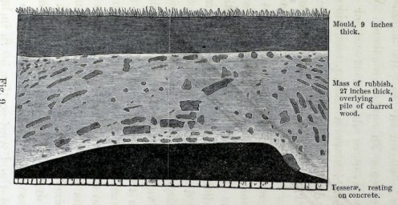

<!-- source-id: C016; original-page: 203 -->
Fig. 9.

图 9。

<!-- source-id: C017; original-page: 203 -->
Section within a room in the Basilica at Silchester. Scale 1/18.

锡尔切斯特大教堂的一个房间内的剖面图。比例 1/18。

<!-- source-id: S224; original-page: 204 -->
beneath the surface of the field, which was here level. On the floor there were two large piles of charred wood, one alone of which is shown in the part of the section here given. This pile was covered by a thin white layer of decayed stucco or plaster, above which was a mass, presenting a singularly disturbed appearance, of broken tiles, mortar, rubbish and fine gravel, together 27 inches in thickness. Mr. Joyce believes that the gravel was used in making the mortar or concrete, which has since decayed, some of the lime probably having been dissolved. The disturbed state of the rubbish may have been due to its having been searched for building stones. This bed was capped by fine vegetable mould, 9 inches in thickness. From these facts we may conclude that the Hall was burnt down, and that much rubbish fell on the floor, through and from which the worms slowly brought up the mould, now forming the surface of the level field.

在地表之下，这里是水平的。地板上有两堆烧焦的木头，此处给出的部分仅显示了其中的一个。这堆东西上覆盖着一层薄薄的白色腐烂的灰泥或灰泥，上面是一大堆破碎的瓷砖、砂浆、垃圾和细砾石，呈现出异常混乱的外观，总共有 27 英寸厚。乔伊斯先生认为，砾石被用来制造砂浆或混凝土，但后来已经腐烂，一些石灰可能已经溶解。垃圾的混乱状况可能是由于在其中寻找建筑石材所致。该床覆盖有9英寸厚的细腐殖土。从这些事实我们可以得出结论，大厅被烧毁了，大量垃圾掉在地板上，蚯蚓慢慢地从垃圾中带出腐殖土，现在形成了平坦的地面。

<!-- source-id: S225; original-page: 204 -->
A section across the middle of another hall in the Basilica, 32 feet 6 inches in length, called the Œvarium, is shown in Fig. 10. It appears that we have here evidence of two fires, separated by an interval of time, during which the 6 inches of "mortar and concrete

大教堂另一个大厅中间的一个剖面，长 32 英尺 6 英寸，称为“Œvarium”，如图 10 所示。 看来我们在这里有两起火灾的证据，相隔一段时间，在此期间，6 英寸的“砂浆和混凝土”被烧毁。

<!-- source-id: F010; original-page: 205 -->
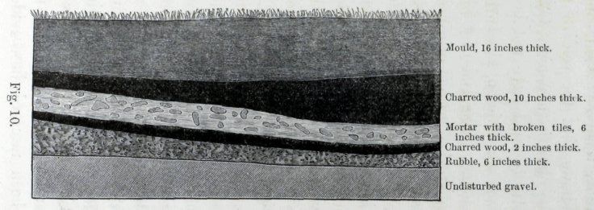

<!-- source-id: C018; original-page: 205 -->
Fig. 10.

图 10。

<!-- source-id: C019; original-page: 205 -->
Section within a hall in the Basilica at Silchester. Scale 1/32

锡尔切斯特大教堂大厅内的剖面图。比例 1/32

<!-- source-id: S226; original-page: 206 -->
with broken tiles" was accumulated. Beneath one of the layers of charred wood, a valuable relic, a bronze eagle, was found: and this shows that the soldiers must have deserted the place in a panic. Owing to the death of Mr. Joyce, I have not been able to ascertain beneath which of the two layers the eagle was found. The bed of rubble overlying the undisturbed gravel originally formed, as I suppose, the floor, for it stands on a level with that of a corridor, outside the walls of the Hall; but the corridor is not shown in the section as here given. The vegetable mould was 16 inches thick in the thickest part; and the depth from the surface of the field, clothed with herbage, to the undisturbed gravel, was 40 inches.

与破碎的瓦片”被积累起来。在一层烧焦的木头下，发现了一件珍贵的文物，一只青铜鹰：这表明士兵们一定是惊慌失措地逃离了这个地方。由于乔伊斯先生的去世，我无法确定这只鹰是在这两层的哪一层下面发现的。我猜想，覆盖在未受干扰的砾石上的碎石床最初形成了地板，因为它与大厅墙外的走廊水平。但走廊未在此处给出的部分中显示。腐殖土最厚处有16英寸厚；从长满牧草的田地表面到未受干扰的砾石的深度为 40 英寸。

<!-- source-id: S227; original-page: 206 -->
The section shown in Fig. 11 represents an excavation made in the middle of the town, and is here introduced because the bed of "rich "mould" attained, according to Mr. Joyce, the unusual thickness of 20 inches. Gravel lay at the depth of 48 inches from the surface; but it was not ascertained whether this was in its natural state, or had been brought here and had been rammed down, as occurs in some other places.

图 11 所示的剖面代表了在城镇中部进行的一次挖掘，之所以在此进行介绍，是因为根据乔伊斯先生的说法，“丰富的“腐殖土”床达到了 20 英寸的不寻常厚度。砾石位于距地表 48 英寸的深度；但无法确定这是否处于自然状态，或者是被带到这里并被夯实的，就像在其他一些地方发生的那样。

<!-- source-id: S228; original-page: 207 -->
The section shown in Fig. 12 was taken in the centre of the Basilica, and though it was 5 feet in depth, the natural sub-soil was not reached. The bed marked "concrete" was probably at one time a floor; and the beds beneath seem to be the remnants of more ancient buildings. The vegetable mould was

图 12 所示的剖面是在大教堂的中心拍摄的，虽然深度有 5 英尺，但没有到达天然的地下土壤。标有“混凝土”的床可能曾经是地板；下面的床似乎是更古老的建筑的遗迹。腐殖土是

<!-- source-id: F011; original-page: 207 -->
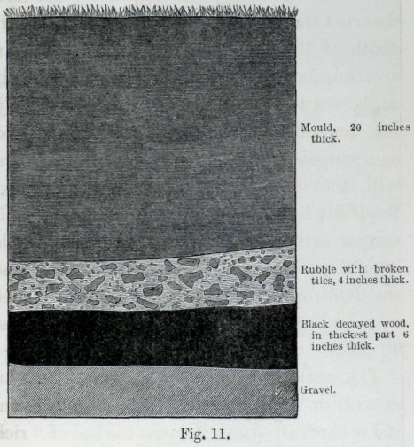

<!-- source-id: C020; original-page: 207 -->
Fig. 11.

图 11。

<!-- source-id: C021; original-page: 207 -->
Section in a block of buildings in the middle of the town of Silchester.

锡尔切斯特镇中心的一栋建筑的剖面图。

<!-- source-id: S229; original-page: 208 -->
here only 9 inches thick. In some other sections, not copied, we likewise have evidence of buildings having been erected over the ruins of older ones. In one case

这里只有 9 英寸厚。在其他一些未复制的部分中，我们同样有证据表明在较旧的废墟上建造了建筑物。在一种情况下

<!-- source-id: F012; original-page: 208 -->
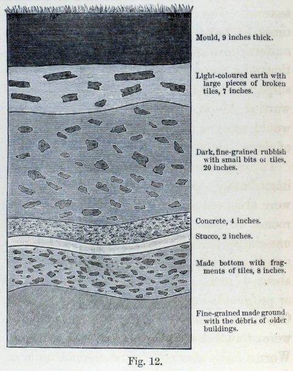

<!-- source-id: C022; original-page: 208 -->
Fig. 12.

图 12。

<!-- source-id: C023; original-page: 208 -->
Section in the centre of the Basilica at Silchester.

锡尔切斯特大教堂中心部分。

<!-- source-id: S230; original-page: 209 -->
there was a layer of yellow clay of very unequal thickness between two beds of débris, the lower one of which rested on a floor with tesseræ. The old broken walls appear sometimes to have been roughly cut down to a uniform level, so as to serve as the foundations of a temporary building; and Mr. Joyce suspects that some of these buildings were wattled sheds, plastered with clay, which would account for the above-mentioned layer of clay.

在两层碎片之间有一层厚度非常不均的黄色粘土，其中较低的一层放置在铺有镶嵌物的地板上。旧的断墙有时似乎被粗略地砍伐成统一的水平，以作为临时建筑的地基；乔伊斯先生怀疑其中一些建筑物是用垂饰覆盖的棚屋，上面涂满了粘土，这就是上述粘土层的原因。

<!-- source-id: S231; original-page: 209 -->
Turning now to the points which more immediately concern us. Worm-castings were observed on the floors of several of the rooms, in one of which the tesselation was unusually perfect. The tesseræ here consisted of little cubes of hard sandstone of about 1 inch, several of which were loose or projected slightly above the general level. One or occasionally two open worm-burrows were found beneath all the loose tesseræ. Worms have also penetrated the old walls of these ruins. A wall, which had just been exposed to view during the excavations then in progress, was examined; it was built of large flints, and was 18 inches in thickness.

现在转向我们更直接关心的问题。在几个房间的地板上观察到了蚯蚓-蚯蚓的粪便，其中一个房间的镶嵌异常完美。这里的镶嵌物由约 1 英寸的硬砂岩小立方体组成，其中一些是松散的或略高于总体水平的。在所有松散的镶嵌物下面都发现了一个或偶尔两个开放的蚯蚓洞穴。蚯蚓也侵入了这些废墟的旧墙。对一堵墙进行了检查，这堵墙在挖掘过程中刚刚暴露出来。它是用大燧石制成的，厚度为 18 英寸。

<!-- source-id: S232; original-page: 210 -->
It appeared sound, but when the soil was removed from beneath, the mortar in the lower part was found to be so much decayed that the flints fell apart from their own weight. Here, in the middle of the wall, at a depth of 29 inches beneath the old floor and of 49½ inches beneath the surface of the field, a living worm was found, and the mortar was penetrated by several burrows.

它看起来很完好，但是当从下面的土壤被移走时，人们发现下部的砂浆已经腐烂了很多，以至于燧石因自身重量而散落开来。在这里，在墙的中间，旧地板下 29 英寸的深度和田地表面下 49.5 英寸的深度，发现了一条活蚯蚓，灰浆被几个洞穴穿透。

<!-- source-id: S233; original-page: 210 -->
A second wall was exposed to view for the first time, and an open burrow was seen on its broken summit. By separating the flints this burrow was traced far down in the interior of the wall; but as some of the flints cohered firmly, the whole mass was disturbed in pulling down the wall, and the burrow could not be traced to the bottom. The foundations of a third wall, which appeared quite sound, lay at a depth of 4 feet beneath one of the floors, and of course at a considerably greater depth beneath the level of the ground. A large flint was wrenched out of the wall at about a foot from the base, and this required much force, as the mortar was sound; but behind the flint in the middle of the wall, the mortar was friable, and here there were worm-burrows. Mr. Joyce and my sons were surprised at the blackness of the mortar in this and in several other cases, and at the presence of mould in the interior of the walls. Some may have been placed there by the old builders instead of mortar; but we should remember that worms line their burrows with black humus. Moreover open spaces would almost certainly have been occasionally left between the large irregular flints; and these spaces, we may feel sure, would be filled up by the worms with their castings, as soon as they were able to penetrate the wall. Rain-water, oozing down the burrows would also carry fine dark-coloured particles into every crevice. Mr. Joyce was at first very sceptical about the amount of work which I attributed to worms; but he ends his notes with reference to the last-mentioned wall by saying, "This case caused me more surprise and brought "more conviction to me than any other. I "should have said, and did say, that it was "quite impossible such a wall could have been "penetrated by earth-worms."

第二堵墙首次暴露在人们的视野中，在其破碎的山顶上看到了一个开放的洞穴。通过分离燧石，这个洞穴被追踪到墙内深处。但由于一些燧石牢固地粘在一起，整个团块在推倒墙壁时受到干扰，洞穴无法追溯到底部。第三堵墙的地基看起来相当坚固，位于其中一层下方 4 英尺深的地方，当然，在地面下方的深度要大得多。一块大燧石被从距离底座大约一英尺的墙上撬出来，这需要很大的力量，因为迫击炮是坚固的；但墙中间的燧石后面，灰浆很易碎，这里有蚯蚓的洞穴。乔伊斯先生和我的儿子们对这起案件和其他几起案件中灰浆的黑色以及墙壁内部存在腐殖土感到惊讶。有些可能是老建筑工人放置在那里的，而不是砂浆；但我们应该记住，蚯蚓的洞穴里布满了黑色腐殖质。此外，几乎可以肯定的是，在巨大的不规则燧石之间偶尔会留下一些开放的空间。我们可以肯定，一旦蚯蚓能够穿透墙壁，这些空间就会被蚯蚓的粪便填满。从洞穴中渗出的雨水也会将细小的深色颗粒带入每个缝隙。乔伊斯先生起初对我归因于蚯蚓的工作量非常怀疑。但他在笔记的结尾提到了最后提到的那堵墙，他说：“这个案例让我更加惊讶，并且比任何其他案例都给我带来了更多的信念。”我“应该说，而且确实说过，这样的墙“完全不可能被蚯蚓穿透”。

<!-- source-id: S234; original-page: 211 -->
In almost all the rooms the pavement has

几乎所有的房间都有人行道

<!-- source-id: F013; original-page: 212 -->
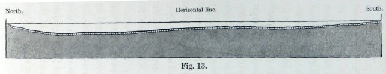

<!-- source-id: C024; original-page: 212 -->
Fig. 13.

图 13。

<!-- source-id: C025; original-page: 212 -->
Section of the subsided floor of a room, paved with tesseræ, at Silchester. Scale 1/40.

锡尔切斯特一间房间的沉降地板的一部分，铺有镶嵌物。比例 1/40。

<!-- source-id: S235; original-page: 212 -->
sunk considerably, especially towards the middle; and this is shown in the three following sections. The measurements were made by stretching a string tightly and horizontally over the floor. The section, Fig. 13, was taken from north to south across a room, 18 feet 4 inches in length, with a nearly perfect pavement, next to the "Red Wooden Hut." In the northern half, the subsidence amounted to 5¾ inches beneath the level of the floor as it now stands close to the walls; and it was greater in the northern than in the southern half; but, according to Mr. Joyce, the entire pavement has obviously subsided. In several places, the tesseræ appeared as if drawn a little away from the walls; whilst in other places they were still in close contact with them.

明显下沉，尤其是向中间；这将在以下三个部分中显示。测量是通过在地板上水平拉紧一根绳子来进行的。图 13 的剖面图是从北向南穿过一个房间拍摄的，房间长 18 英尺 4 英寸，路面近乎完美，位于“红木小屋”旁边。在北半部，由于现在靠近墙壁，地面下沉达 5.75 英寸；北半部比南半部更大。但是，根据乔伊斯先生的说法，整个人行道显然已经下陷了。在一些地方，镶嵌物看起来好像离墙壁有点远。而在其他地方，他们仍然与他们保持密切联系。

<!-- source-id: S236; original-page: 213 -->
In Fig. 14, we see a section across the paved floor of the southern corridor or ambulatory of a quadrangle, in an excavation made near "The Spring." The floor is 7 feet 9 inches wide, and the broken-down walls now project only ¾ of an inch above its level. The field, which was in pasture, here sloped from north to south, at an angle of 3° 40′. The nature of the ground on each side of the corridor is shown in the section. It consisted of earth full of stones and other débris, capped with dark vegetable mould which was thicker on the lower or southern than on the northern side. The pavement was nearly level along lines parallel to the side-walls, but had sunk in the middle as much as 7¾ inches.

在图 14 中，我们在“泉水”附近的一次挖掘中看到了四合院南部走廊或回廊铺砌地板的剖面图。地板宽 7 英尺 9 英寸，破损的墙壁现在仅高出地面 3/4 英寸。这里的田野是牧场，从北向南倾斜，倾斜角为3°40′。剖面图显示了走廊两侧地面的性质。它由充满石头和其他碎片的泥土组成，上面覆盖着深色腐殖土，其下部或南部比北部更厚。人行道沿着与侧壁平行的线几乎是水平的，但中间下沉了 7.75 英寸。

<!-- source-id: S237; original-page: 213 -->
A small room at no great distance from that represented in Fig. 13, had been enlarged by the Roman occupier on the southern side, by an addition of 5 feet 4 inches in breadth. For this purpose the southern wall of the house had been pulled down, but the foundations of the old wall had been left buried at a little depth

距离图 13 所示房间不远的一个小房间已被南侧的罗马占领者扩大，宽度增加了 5 英尺 4 英寸。为此，房屋的南墙已被推倒，但旧墙的地基已埋得较深

<!-- source-id: F014; original-page: 214 -->
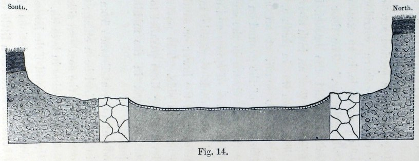

<!-- source-id: C026; original-page: 214 -->
Fig. 14.

图 14。

<!-- source-id: C027; original-page: 214 -->
A north and south section through the subsided floor of a corridor, paved with tesseræ. Outside the broken-down bounding walls, the excavated ground on each side is shown for a short space. Nature of the ground beneath the tesseræ unknown. Silchester. Scale 1/36.

南北两部分穿过走廊的沉降地板，铺有镶嵌物。在破碎的围墙之外，每侧的挖掘地面都显示出一小段空间。镶嵌物下方的地面性质未知。西尔切斯特。比例 1/36。

<!-- source-id: S238; original-page: 215 -->
beneath the pavement of the enlarged room. Mr. Joyce believes that this buried wall must have been built before the reign of Claudius II., who died 270 A.D. We see in the accompanying section, Fig. 15, that the tesselated pavement has subsided to a less degree over the buried wall than elsewhere; so that a slight convexity or protuberance here stretched in a straight line across the room. This led to a hole being dug, and the buried wall was thus discovered.

在扩大房间的人行道下面。乔伊斯先生认为，这堵埋墙一定是在克劳迪斯二世统治之前建造的，克劳迪斯二世去世于公元 270 年。我们在附图 15 中看到，埋墙上方的棋盘格路面下沉的程度比其他地方要小；因此，这里有一个轻微的凸面或突起，沿直线延伸到整个房间。这导致挖了一个洞，从而发现了埋在地下的墙。

<!-- source-id: S239; original-page: 215 -->
We see in these three sections, and in several others not given, that the old pavements have sunk or sagged considerably. Mr. Joyce formerly attributed this sinking solely to the slow settling of the ground. That there has been some settling is highly probable, and it may be seen in section 15 that the pavement for a width of 5 feet over the southern enlargement of the room, which must have been built on fresh ground, has sunk a little more than on the old northern side. But this sinking may possibly have had no connection with the enlargement of the room, for in Fig. 13, one half of the pavement has subsided more

我们在这三个部分以及其他几个未给出的部分中看到，旧的人行道已经相当大地下沉或下垂。乔伊斯先生此前将这次下沉完全归因于地面的缓慢沉降。极有可能发生了一些沉降，从第 15 节中可以看出，房间南侧扩建部分的 5 英尺宽的人行道肯定是建在新的地面上，比旧的北侧下沉得更多一些。但这种下沉可能与房间的扩大无关，因为在图13中，路面的一半下沉得更多

<!-- source-id: F015; original-page: 216 -->
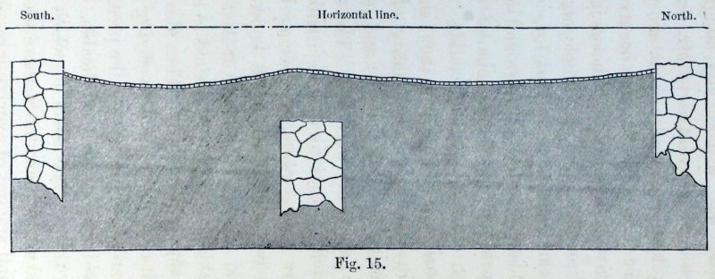

<!-- source-id: C028; original-page: 216 -->
Fig. 15.

图 15。

<!-- source-id: C029; original-page: 216 -->
Section through the subsided floor, paved with tesseræ, and of the broken-down bounding walls of a room at Silchester, which had been formerly enlarged, with the foundations of the old wall left buried. Scale 1/40.

下沉的地板，铺有镶嵌物，以及西尔切斯特一间房间的破损围墙的剖面图，该房间以前曾被扩大过，旧墙的地基被埋在地下。比例 1/40。

<!-- source-id: S240; original-page: 217 -->
than the other half without any assignable cause. In a bricked passage to Mr. Joyce's own house, laid down only about six years ago, the same kind of sinking has occurred as in the ancient buildings. Nevertheless it does not appear probable that the whole amount of sinking can be thus accounted for. The Roman builders excavated the ground to an unusual depth for the foundations of their walls, which were thick and solid; it is therefore hardly credible that they should have been careless about the solidity of the bed on which their tesselated and often ornamented pavements were laid. The sinking must, as it appears to me, be attributed in chief part to the pavement having been undermined by worms, which we know are still at work. Even Mr. Joyce at last admitted that this could not have failed to have produced a considerable effect. Thus also the large quantity of fine mould overlying the pavements can be accounted for, the presence of which would otherwise be inexplicable. My sons noticed that in one room in which the pavement had sagged very little, there was an unusually small amount of overlying mould.

比另一半没有任何明显的原因。通往乔伊斯先生自己房屋的一条砖砌通道大约六年前才铺设，与古建筑一样，也发生了同样的下沉现象。然而，似乎不可能以此来解释全部下沉量。罗马建筑者为城墙的地基挖掘了不同寻常的深度，城墙又厚又坚固。因此，令人难以置信的是，他们竟然对铺有棋盘格且经常装饰的人行道的床的坚固性不关心。在我看来，下沉的主要原因肯定是路面被蚯蚓破坏了，而我们知道蚯蚓仍在发挥作用。就连乔伊斯先生最后也承认，这不可能没有产生相当大的效果。因此，也可以解释人行道上覆盖的大量细腐殖土，否则将无法解释其存在。我的儿子们注意到，在一个人行道下陷很少的房间里，上面覆盖着异常少量的腐殖土。

<!-- source-id: S241; original-page: 218 -->
As the foundations of the walls generally lie at a considerable depth, they will either have not subsided at all through the undermining action of worms, or they will have subsided much less than the floor. This latter result would follow from worms not often working deep down beneath the foundations; but more especially from the walls not yielding when penetrated by worms, whereas the successively formed burrows in a mass of earth, equal to one of the walls in depth and thickness, would have collapsed many times since the desertion of the ruins, and would consequently have shrunk or subsided. As the walls cannot have sunk much or at all, the immediately adjoining pavement from adhering to them will have been prevented from subsiding; and thus the present curvature of the pavement is intelligible.

由于墙壁的地基通常位于相当深的地方，它们要么根本没有通过蚯蚓的破坏作用下沉，要么下沉得比地板少得多。后一种结果是由于蚯蚓不经常在地基深处工作而产生的。但更特别的是，当蚯蚓穿透时，墙壁不会屈服，而在大量泥土中相继形成的洞穴，其深度和厚度与其中一堵墙壁相同，自废墟废弃以来，会多次倒塌，因此会缩小或下陷。由于墙壁不会下沉太多或根本不会下沉，因此可以防止紧邻的人行道粘附在墙壁上下沉；因此路面当前的曲率是可以理解的。

<!-- source-id: S242; original-page: 218 -->
The circumstance which has surprised me most with respect to Silchester is that during the many centuries which have elapsed since the old buildings were deserted, the vegetable mould has not accumulated over them to a greater thickness than that here observed. In most places it is only about 9 inches in thickness, but in some places 12 or even more inches. In Fig. 11, it is given as 20 inches, but this section was drawn by Mr. Joyce before his attention was particularly called to this subject. The land enclosed within the old walls is described as sloping slightly to the south; but there are parts which, according to Mr. Joyce, are nearly level, and it appears that the mould is here generally thicker than elsewhere. The surface slopes in other parts from west to east, and Mr. Joyce describes one floor as covered at the western end by rubbish and mould to a thickness of 28½ inches, and at the eastern end by a thickness of only 11½ inches. A very slight slope suffices to cause recent castings to flow downwards during heavy rain, and thus much earth will ultimately reach the neighbouring rills and streams and be carried away. By this means, the absence of very thick beds of mould over these ancient ruins may, as I believe, be explained. Moreover most of the land here has long been ploughed, and this would greatly aid the washing away of the finer earth during rainy weather.

关于西尔切斯特，最让我惊讶的情况是，自从老建筑被废弃以来的许多世纪里，腐殖土在它们上面积累的厚度并没有比这里观察到的更厚。在大多数地方，它的厚度只有大约 9 英寸，但在某些地方，厚度达到 12 英寸甚至更多。在图11中，它被给出为20英寸，但是这个部分是由Joyce先生在他特别引起注意这个主题之前绘制的。旧城墙内的土地被描述为稍微向南倾斜；但根据乔伊斯先生的说法，有些地方几乎是水平的，而且这里的腐殖土似乎比其他地方普遍更厚。其他部分的地表从西向东倾斜，乔伊斯先生描述说，一层的西端被垃圾和腐殖土覆盖，厚度为 28.5 英寸，而东端的厚度仅为 11.5 英寸。一个很小的坡度就足以在大雨期间使最近的蚓粪向下流动，从而使大量泥土最终到达邻近的溪流并被带走。我相信，通过这种方式，可以解释这些古代遗址上没有很厚的腐殖土层。而且这里的大部分土地都早已被犁过，这对于雨天冲刷细土有很大帮助。

<!-- source-id: S243; original-page: 220 -->
The nature of the beds immediately beneath the vegetable mould in some of the sections is rather perplexing. We see, for instance, in the section of an excavation in a grass meadow (Fig. 14), which sloped from north to south at an angle of 3° 40′, that the mould on the upper side is only six inches and on the lower side nine inches in thickness. But this mould lies on a mass (25½ inches in thickness on the upper side) "of "dark brown mould," as described by Mr. Joyce, "thickly interspersed with small "pebbles and bits of tiles, which present a "corroded or worn appearance." The state of this dark-coloured earth is like that of a field which has long been ploughed, for the earth thus becomes intermingled with stones and fragments of all kinds which have been much exposed to the weather. If during the course of many centuries this grass meadow and the other now cultivated fields have been at times ploughed, and at other times left as pasture, the nature of the ground in the above section is rendered intelligible. For worms will continually have brought up fine earth from below, which will have been stirred up by the plough whenever the land was cultivated. But after a time a greater thickness of fine earth will thus have been accumulated than could be reached by the plough; and a bed like the 25½-inch mass, in Fig. 14, will have been formed beneath the superficial mould, which latter will have been brought to the surface within more recent times, and have been well sifted by the worms.

在某些部分，腐殖土正下方的床层性质相当令人困惑。例如，我们看到，在一片草甸的开挖断面（图14）中，从北向南倾斜3°40′，上面的腐殖土只有六英寸厚，下面的腐殖土厚九英寸。但是，这种腐殖土位于一团（上侧厚度为 25.5 英寸）“深棕色腐殖土”上，正如乔伊斯先生所描述的那样，“厚厚地散布着小”卵石和瓷砖碎片，呈现出“腐蚀或磨损的外观”。这种深色土壤的状态就像长期耕耘过的田地一样，因为土壤因此与暴露在外的各种石头和碎片混合在一起。如果在许多世纪的过程中，这片草地和其他现在耕种的土地有时被犁过，有时被留作牧场，那么上面的土地的性质就变得可以理解了，因为每当耕种土地时，蚯蚓就会不断地从下面挖出细土，但过了一段时间，就会积累比犁所能到达的更厚的细土。如图 14 所示，在表层腐殖土下方将形成 25.5 英寸的物质，后者将在最近的时间内被带到地表，并已被蚯蚓很好地筛分。

<!-- source-id: S244; original-page: 221 -->
Wroxeter, Shropshire. —The old Roman city of Uriconium was founded in the early part of the second century, if not before this date; and it was destroyed, according to Mr. Wright, probably between the middle of the fourth and fifth century. The inhabitants were massacred, and skeletons of women were found in the hypocausts. Before the year 1859, the sole remnant of the city above ground, was a portion of a massive wall about 20 ft. in height. The surrounding land undulates slightly, and has long been under cultivation. It had been noticed that the corn-crops ripened prematurely in certain narrow lines, and that the snow remained unmelted in certain places longer than in others.

什罗普郡罗克塞特。 ——古罗马城市乌里科尼姆 (Uricium) 始建于二世纪初，甚至更早于这个日期；据赖特先生说，它可能在四世纪中叶到五世纪中叶被毁。居民被屠杀，在火葬场中发现了妇女的骸骨。 1859 年之前，这座城市在地面上的唯一遗迹是一堵高约 20 英尺的巨大城墙的一部分。周围的土地微微起伏，早已被开垦过。人们注意到，某些狭窄行列中的玉米作物过早成熟，某些地方的积雪未融化的时间比其他地方长。

<!-- source-id: S245; original-page: 222 -->
These appearances led, as I was informed, to extensive excavations being undertaken. The foundations of many large buildings and several streets have thus been exposed to view. The space enclosed within the old walls is an irregular oval, about 1¾ mile in length. Many of the stones or bricks used in the buildings must have been carried away; but the hypocausts, baths, and other underground buildings were found tolerably perfect, being filled with stones, broken tiles, rubbish and soil. The old floors of various rooms were covered with rubble. As I was anxious to know how thick the mantle of mould and rubbish was, which had so long concealed these ruins, I applied to Dr. H. Johnson, who had superintended the excavations; and he, with the greatest kindness, twice visited the place to examine it in reference to my questions, and had many trenches dug in four fields which had hitherto been undisturbed. The results of his observations are given in the following Table. He also sent me specimens of the mould, and answered, as far as he could, all my questions.

据我所知，这些现象导致了大规模的挖掘工作正在进行。许多大型建筑物和几条街道的地基因此暴露在人们的视野中。旧城墙围成的空间是一个不规则的椭圆形，长约 1.5 英里。建筑物中使用的许多石头或砖块肯定已被运走；但火葬场、浴室和其他地下建筑却相当完美，里面充满了石头、碎瓦、垃圾和泥土。各个房间的旧地板上都布满了瓦砾。由于我急于想知道长期以来隐藏着这些废墟的腐殖土和垃圾的地幔有多厚，所以我向负责挖掘工作的 H. 约翰逊博士提出了申请；他非常仁慈地两次来到这个地方，针对我的问题进行检查，并在迄今为止未受干扰的四块田地上挖了许多战壕。他的观察结果如下表所示。他还给我寄了腐殖土的样本，并尽可能回答了我的所有问题。

<!-- source-id: S246; original-page: 223 -->
MEASUREMENTS BY DR. H. JOHNSON OF THE THICKNESS OF THE VEGETABLE MOULD OVER THE ROMAN RUINS AT WROXETER.

博士的测量结果H. 约翰逊 (H. Johnson) 描述了罗克塞特罗马废墟上腐殖土的厚度。

<!-- source-id: S247; original-page: 223 -->
Trenches dug in a field called "Old Works."

战壕是在一个叫做“旧工程”的地方挖的。

<!-- source-id: T004; original-page: 223 -->
<table>
<tr><td colspan="1" rowspan="1"></td><td colspan="1" rowspan="1"></td><td colspan="1" rowspan="1">Thickness of mould in inches.</td></tr>
<tr><td colspan="1" rowspan="1">1.</td><td colspan="1" rowspan="1">At a depth of 36 inches undisturbed sand was reached .. .. .. .. ..</td><td colspan="1" rowspan="1">20</td></tr>
<tr><td colspan="1" rowspan="1">2.</td><td colspan="1" rowspan="1">At a depth of 33 inches concrete was reached</td><td colspan="1" rowspan="1">21</td></tr>
<tr><td colspan="1" rowspan="1">3.</td><td colspan="1" rowspan="1">At a depth of 9 inches concrete was reached</td><td colspan="1" rowspan="1">9</td></tr>
</table>

<table>
<tr><td colspan="1" rowspan="1"></td><td colspan="1" rowspan="1"></td><td colspan="1" rowspan="1">腐殖土厚度（英寸）</td></tr>
<tr><td colspan="1" rowspan="1">1.</td><td colspan="1" rowspan="1">在 36 英寸深度处，到达未受干扰的沙子......</td><td colspan="1" rowspan="1">20</td></tr>
<tr><td colspan="1" rowspan="1">2.</td><td colspan="1" rowspan="1">混凝土深度达到 33 英寸</td><td colspan="1" rowspan="1">21</td></tr>
<tr><td colspan="1" rowspan="1">3.</td><td colspan="1" rowspan="1">混凝土深度达到 9 英寸</td><td colspan="1" rowspan="1">9</td></tr>
</table>

<!-- source-id: S248; original-page: 223 -->
Trenches dug in a field called "Shop "Leasows;" this is the highest field within the old walls, and slopes down from a sub-central point on all sides at about an angle of 2°.

在一块名为“Leasows 商店”的场地上挖了战壕；这是旧城墙内最高的场地，从四面的次中心点以大约 2° 的角度向下倾斜。

<!-- source-id: T005; original-page: 223 -->
<table>
<tr><td colspan="1" rowspan="1"></td><td colspan="1" rowspan="1"></td><td colspan="1" rowspan="1">Thickness of mould in inches.</td></tr>
<tr><td colspan="1" rowspan="1">4.</td><td colspan="1" rowspan="1">Summit of field, trench 45 inches deep ..</td><td colspan="1" rowspan="1">40</td></tr>
<tr><td colspan="1" rowspan="1">5.</td><td colspan="1" rowspan="1">Close to summit of field, trench 36 inches deep</td><td colspan="1" rowspan="1">26</td></tr>
<tr><td colspan="1" rowspan="1">6.</td><td colspan="1" rowspan="1">Close to summit of field, trench 28 inches deep</td><td colspan="1" rowspan="1">28</td></tr>
<tr><td colspan="1" rowspan="1">7.</td><td colspan="1" rowspan="1">Near summit of field, trench 36 inches deep</td><td colspan="1" rowspan="1">24</td></tr>
<tr><td colspan="1" rowspan="1">8.</td><td colspan="1" rowspan="1">Near summit of field, trench at one end 39 inches deep; the mould here graduated into the underlying undisturbed sand, and its thickness is somewhat arbitrary. At the other end of the trench, a causeway was encountered at a depth of only 7 inches, and the mould was here only 7 inches thick ..</td><td colspan="1" rowspan="1">24</td></tr>
<tr><td colspan="1" rowspan="1">9.</td><td colspan="1" rowspan="1">Trench close to the last, 28 inches in depth ..</td><td colspan="1" rowspan="1">15</td></tr>
<tr><td colspan="1" rowspan="1">10.</td><td colspan="1" rowspan="1">Lower part of same field, trench 30 inches deep</td><td colspan="1" rowspan="1">15</td></tr>
<tr><td colspan="1" rowspan="1">11.</td><td colspan="1" rowspan="1">Lower part of same field, trench 31 inches deep</td><td colspan="1" rowspan="1">17</td></tr>
<tr><td colspan="1" rowspan="1">12.</td><td colspan="1" rowspan="1">Lower part of same field, trench 36 inches deep, at which depth undisturbed sand was reached</td><td colspan="1" rowspan="1">28</td></tr>
</table>

<table>
<tr><td colspan="1" rowspan="1"></td><td colspan="1" rowspan="1"></td><td colspan="1" rowspan="1">腐殖土厚度（英寸）</td></tr>
<tr><td colspan="1" rowspan="1">4.</td><td colspan="1" rowspan="1">田野顶峰，沟渠深 45 英寸..</td><td colspan="1" rowspan="1">40</td></tr>
<tr><td colspan="1" rowspan="1">5.</td><td colspan="1" rowspan="1">靠近田野顶部，沟渠深 36 英寸</td><td colspan="1" rowspan="1">26</td></tr>
<tr><td colspan="1" rowspan="1">6.</td><td colspan="1" rowspan="1">靠近田野顶部，沟渠深 28 英寸</td><td colspan="1" rowspan="1">28</td></tr>
<tr><td colspan="1" rowspan="1">7.</td><td colspan="1" rowspan="1">靠近田野顶部，沟渠深 36 英寸</td><td colspan="1" rowspan="1">24</td></tr>
<tr><td colspan="1" rowspan="1">8.</td><td colspan="1" rowspan="1">靠近场地顶部，一端的沟渠深 39 英寸；这里的腐殖土逐渐融入下面的原状沙子中，其厚度有些随意。在沟渠的另一端，遇到了一条深度只有7英寸的堤道，而这里的腐殖土只有7英寸厚。</td><td colspan="1" rowspan="1">24</td></tr>
<tr><td colspan="1" rowspan="1">9.</td><td colspan="1" rowspan="1">接近最后一个的沟渠，28英寸深..</td><td colspan="1" rowspan="1">15</td></tr>
<tr><td colspan="1" rowspan="1">10.</td><td colspan="1" rowspan="1">同一场地下部，沟渠深 30 英寸</td><td colspan="1" rowspan="1">15</td></tr>
<tr><td colspan="1" rowspan="1">11.</td><td colspan="1" rowspan="1">同一场地下部，沟渠深 31 英寸</td><td colspan="1" rowspan="1">17</td></tr>
<tr><td colspan="1" rowspan="1">12.</td><td colspan="1" rowspan="1">同一场地的下部，沟渠深 36 英寸，达到未受干扰沙子的深度</td><td colspan="1" rowspan="1">28</td></tr>
</table>

<!-- source-id: T006; original-page: 224 -->
<table>
<tr><td colspan="1" rowspan="1"></td><td colspan="1" rowspan="1"></td><td colspan="1" rowspan="1">Thickness of mould in inches.</td></tr>
<tr><td colspan="1" rowspan="1">13.</td><td colspan="1" rowspan="1">In another part of same field, trench 9½ inches deep, stopped by concrete .. .. ..</td><td colspan="1" rowspan="1">9½</td></tr>
<tr><td colspan="1" rowspan="1">14.</td><td colspan="1" rowspan="1">In another part of same field, trench 9 inches deep, stopped by concrete .. .. ..</td><td colspan="1" rowspan="1">9</td></tr>
<tr><td colspan="1" rowspan="1">15.</td><td colspan="1" rowspan="1">In another part of the same field, trench 24 inches deep, when sand was reached ..</td><td colspan="1" rowspan="1">16</td></tr>
<tr><td colspan="1" rowspan="1">16.</td><td colspan="1" rowspan="1">In another part of same field, trench 30 inches deep, when stones were reached; at one end of the trench mould 12 inches, at the other end 14 inches thick .. .. .. ..</td><td colspan="1" rowspan="1">13</td></tr>
</table>

<table>
<tr><td colspan="1" rowspan="1"></td><td colspan="1" rowspan="1"></td><td colspan="1" rowspan="1">腐殖土厚度（英寸）</td></tr>
<tr><td colspan="1" rowspan="1">13.</td><td colspan="1" rowspan="1">在同一场地的另一部分，沟渠深 9.5 英寸，被混凝土挡住......</td><td colspan="1" rowspan="1">9½</td></tr>
<tr><td colspan="1" rowspan="1">14.</td><td colspan="1" rowspan="1">在同一场地的另一部分，沟渠深 9 英寸，被混凝土挡住......</td><td colspan="1" rowspan="1">9</td></tr>
<tr><td colspan="1" rowspan="1">15.</td><td colspan="1" rowspan="1">在同一场地的另一部分，沟渠深 24 英寸，当到达沙子时..</td><td colspan="1" rowspan="1">16</td></tr>
<tr><td colspan="1" rowspan="1">16.</td><td colspan="1" rowspan="1">在同一块田地的另一部分，当到达石头时，沟渠深 30 英寸；沟渠一端腐殖土 12 英寸，另一端 14 英寸厚.. .. .. . .</td><td colspan="1" rowspan="1">13</td></tr>
</table>

<!-- source-id: S249; original-page: 224 -->
Small field between "Old Works" and "Shop Leasows," I believe nearly as high as the upper part of the latter field.

“Old Works”和“Shop Leasows”之间的小场地，我相信几乎与后者场地的上部一样高。

<!-- source-id: T007; original-page: 224 -->
<table>
<tr><td colspan="1" rowspan="1"></td><td colspan="1" rowspan="1"></td><td colspan="1" rowspan="1">Thickness of mould in inches.</td></tr>
<tr><td colspan="1" rowspan="1">17.</td><td colspan="1" rowspan="1">Trench 26 inches deep .. .. ..</td><td colspan="1" rowspan="1">24</td></tr>
<tr><td colspan="1" rowspan="1">18.</td><td colspan="1" rowspan="1">Trench 10 inches deep, and then came upon a causeway .. .. .. .. ..</td><td colspan="1" rowspan="1">10</td></tr>
<tr><td colspan="1" rowspan="1">19.</td><td colspan="1" rowspan="1">Trench 34 inches deep .. .. ..</td><td colspan="1" rowspan="1">30</td></tr>
<tr><td colspan="1" rowspan="1">20.</td><td colspan="1" rowspan="1">Trench 31 inches deep .. .. .. ..</td><td colspan="1" rowspan="1">31</td></tr>
</table>

<table>
<tr><td colspan="1" rowspan="1"></td><td colspan="1" rowspan="1"></td><td colspan="1" rowspan="1">腐殖土厚度（英寸）</td></tr>
<tr><td colspan="1" rowspan="1">17.</td><td colspan="1" rowspan="1">沟渠26英寸深......</td><td colspan="1" rowspan="1">24</td></tr>
<tr><td colspan="1" rowspan="1">18.</td><td colspan="1" rowspan="1">挖10英寸深的壕沟，然后来到一条堤道......</td><td colspan="1" rowspan="1">10</td></tr>
<tr><td colspan="1" rowspan="1">19.</td><td colspan="1" rowspan="1">沟渠深 34 英寸......</td><td colspan="1" rowspan="1">30</td></tr>
<tr><td colspan="1" rowspan="1">20.</td><td colspan="1" rowspan="1">沟渠深 31 英寸......</td><td colspan="1" rowspan="1">31</td></tr>
</table>

<!-- source-id: S250; original-page: 224 -->
Field on the western side of the space enclosed within the old walls.

场地位于旧墙内封闭空间的西侧。

<!-- source-id: T008; original-page: 224 -->
<table>
<tr><td colspan="1" rowspan="1"></td><td colspan="1" rowspan="1"></td><td colspan="1" rowspan="1">Thickness of mould in inches.</td></tr>
<tr><td colspan="1" rowspan="1">21.</td><td colspan="1" rowspan="1">Trench 28 inches deep, when undisturbed sand was reached .. .. .. .. ..</td><td colspan="1" rowspan="1">16</td></tr>
<tr><td colspan="1" rowspan="1">22.</td><td colspan="1" rowspan="1">Trench 29 inches deep, when undisturbed sand was reached .. .. .. .. ..</td><td colspan="1" rowspan="1">15</td></tr>
<tr><td colspan="1" rowspan="1">23.</td><td colspan="1" rowspan="1">Trench 14 inches deep, and then came upon a building .. .. .. .. ..</td><td colspan="1" rowspan="1">14</td></tr>
</table>

<table>
<tr><td colspan="1" rowspan="1"></td><td colspan="1" rowspan="1"></td><td colspan="1" rowspan="1">腐殖土厚度（英寸）</td></tr>
<tr><td colspan="1" rowspan="1">21.</td><td colspan="1" rowspan="1">沟渠深 28 英寸，到达未受干扰的沙子时.. .. .. .. . .</td><td colspan="1" rowspan="1">16</td></tr>
<tr><td colspan="1" rowspan="1">22.</td><td colspan="1" rowspan="1">沟渠深 29 英寸，到达未受干扰的沙子时.. .. .. .. . . .</td><td colspan="1" rowspan="1">15</td></tr>
<tr><td colspan="1" rowspan="1">23.</td><td colspan="1" rowspan="1">挖14英寸深的壕沟，然后来到一座建筑物上......</td><td colspan="1" rowspan="1">14</td></tr>
</table>

<!-- source-id: S251; original-page: 224 -->
Dr. Johnson distinguished as mould the earth which differed, more or less abruptly, in its dark colour and in its texture from the underlying sand or rubble. In the specimens sent to me, the mould resembled that which lies immediately beneath the turf in old pasture-land, excepting that it often contained small stones, too large to have passed through the bodies of worms. But the trenches above described were dug in fields, none of which were in pasture; and all had been long cultivated. Bearing in mind the remarks made in reference to Silchester on the effects of long-continued culture, combined with the action of worms in bringing up the finer particles to the surface, the mould, as so designated by Dr. Johnson, seems fairly well to deserve its name. Its thickness, where there was no causeway, floor or walls beneath, was greater than has been elsewhere observed, namely, in many places above 2 ft., and in one spot above 3 ft. The mould was thickest on and close to the nearly level summit of the field called "Shop Leasows," and in a small adjoining field, which, as I believe, is of nearly the same height. One side of the former field slopes at an angle of rather above 2°, and I should have expected that the mould, from being washed down during heavy rain, would have been thicker in the lower than in the upper part; but this was not the case in two out of the three trenches here dug.

约翰逊博士将腐殖土区分为腐殖土，其深色和质地与下面的沙子或碎石或多或少有些突然不同。在寄给我的样本中，腐殖土类似于古老牧场草皮正下方的土壤，不同之处在于它经常含有小石块，这些石块太大而无法穿过蚯蚓的身体。但上面描述的战壕是在田野里挖的，没有一个是在牧场上的。一切都是经过长期培育的。考虑到西尔切斯特关于长期持续培养的影响的评论，再加上蚯蚓将更细的颗粒带到表面的作用，约翰逊博士如此指定的腐殖土似乎相当名副其实。在下面没有堤道、地板或墙壁的地方，它的厚度比在其他地方观察到的要大，即在许多地方超过 2 英尺，有一个地方超过 3 英尺。腐殖土在称为“Shop Leasows”的几乎水平的山顶上和附近最厚，而在毗邻的一小块田地中，我相信它的高度几乎相同。原来田地的一侧倾斜了2°以上，我本应预料到，大雨冲刷下来的腐殖质，下部会比上部厚；但这里挖的三条战壕中有两处并非如此。

<!-- source-id: S252; original-page: 226 -->
In many places, where streets ran beneath the surface, or where old buildings stood, the mould was only 8 inches in thickness; and Dr. Johnson was surprised that in ploughing the land, the ruins had never been struck by the plough as far as he had heard. He thinks that when the land was first cultivated the old walls were perhaps intentionally pulled down, and that hollow places were filled up. This may have been the case; but if after the desertion of the city the land was left for many centuries uncultivated, worms would have brought up enough fine earth to have covered the ruins completely; that is if they had subsided from having been undermined. The foundations of some of the walls, for instance those of the portion still standing about 20 feet above the ground, and those of the market-place, lie at the extraordinary depth of 14 feet; but it is highly improbable that the foundations were gener- ally so deep. The mortar employed in the buildings must have been excellent, for it is still in parts extremely hard. Wherever walls of any height have been exposed to view, they are, as Dr. Johnson believes, still perpendicular. The walls with such deep foundations cannot have been undermined by worms, and therefore cannot have subsided, as appears to have occurred at Abinger and Silchester. Hence it is very difficult to account for their being now completely covered with earth; but how much of this covering consists of vegetable mould and how much of rubble I do not know. The market-place, with the foundations at a depth of 14 feet, was covered up, as Dr. Johnson believes, by between 6 and 24 inches of earth. The tops of the broken-down walls of a caldarium or bath, 9 feet in depth, were likewise covered up with nearly 2 feet of earth. The summit of an arch, leading into an ash-pit 7 feet in depth, was covered up with not more than 8 inches of earth. Whenever a building which has not subsided is covered with earth, we must suppose, either that the upper layers of stone have been at some time carried away by man, or that earth has since been washed down during heavy rain, or blown down during storms, from the adjoining land; and this would be especially apt to occur where the land has long been cultivated. In the above cases the adjoining land is somewhat higher than the three specified sites, as far as I can judge by maps and from information given me by Dr. Johnson. If, however, a great pile of broken stones mortar, plaster, timber and ashes fell over the remains of any building, their disintegration in the course of time, and the sifting action of worms, would ultimately conceal the whole beneath fine earth.

在许多地方，街道在地表下延伸，或者古老建筑矗立的地方，腐殖土的厚度只有 8 英寸；约翰逊博士感到惊讶的是，据他所知，在犁地时，废墟从未被犁犁过。他认为，最初开垦土地时，旧墙可能被故意拆除，空洞的地方被填平。情况可能确实如此；但如果这座城市被遗弃后，这片土地在数个世纪里无人耕种，蚯蚓就会挖出足够的细土来完全覆盖废墟。也就是说，如果它们因受到破坏而平息的话。一些城墙的地基，例如仍然高出地面约 20 英尺的部分的地基，以及市场的地基，位于 14 英尺的非凡深度；但地基一般不太可能这么深。建筑物中使用的砂浆一定非常好，因为它的某些部分仍然非常坚硬。正如约翰逊博士所认为的，无论任何高度的墙壁暴露在外，它们仍然是垂直的。地基如此深的城墙不可能被蚯蚓破坏，因此不可能像阿宾格和西尔切斯特发生的那样发生下沉。因此，很难解释它们现在完全被泥土覆盖的原因。但我不知道这层覆盖物有多少是腐殖土，有多少是碎石。约翰逊博士认为，市场的地基深度为 14 英尺，被 6 至 24 英寸厚的泥土覆盖。 9 英尺深的高温浴室或浴室的破损墙壁的顶部同样覆盖着近 2 英尺的泥土。拱门的顶端，通向一个7英尺深的灰坑，上面覆盖着不超过8英寸的泥土。每当一座尚未塌陷的建筑物上覆盖着泥土时，我们必须假设，要么是上层石头在某个时候被人类带走了，要么是泥土在大雨中被冲刷下来，或者在暴风雨中从邻近的土地上被吹倒了；这种情况在长期耕种的土地上尤其容易发生。据我通过地图和约翰逊博士提供的信息判断，在上述情况下，毗邻的土地略高于指定的三个地点。然而，如果一大堆碎石、砂浆、灰泥、木材和灰烬落在任何建筑物的废墟上，随着时间的推移，它们的崩解和蚯蚓的筛分作用，最终会将整个建筑物隐藏在细土之下。

<!-- source-id: S253; original-page: 228 -->
Conclusion. —The cases given in this chapter show that worms have played a considerable part in the burial and concealment of several Roman and other old buildings in England; but no doubt the washing down of soil from the neighbouring higher lands, and the deposition of dust, have together aided largely in the work of concealment. Dust would be apt to accumulate wherever old broken-down walls projected a little above the then exist- ing surface and thus afforded some shelter. The floors of the old rooms, halls and passages have generally sunk, partly from the settling of the ground, but chiefly from having been undermined by worms; and the sinking has commonly been greater in the middle than near the walls. The walls themselves, whenever their foundations do not lie at a great depth, have been penetrated and undermined by worms, and have consequently subsided. The unequal subsidence thus caused, probably explains the great cracks which may be seen in many ancient walls, as well as their inclination from the perpendicular.

结论。 ——本章给出的案例表明，蚯蚓在英国几处罗马和其他古老建筑的掩埋和隐藏中发挥了相当大的作用；但毫无疑问，邻近高地的土壤冲刷和灰尘的沉积，在很大程度上有助于隐藏工作。旧的破墙突出到当时存在的表面上方一点点，从而提供了一些庇护所，灰尘就很容易积聚。旧房间、大厅和通道的地板普遍下沉，部分是由于地面沉降，但主要是由于蚯蚓的侵蚀；中间的下沉通常比靠近墙壁的下沉更大。墙壁本身，只要其地基不深，就会被蚯蚓穿透和破坏，从而下沉。由此引起的不均匀沉降，可能解释了许多古老墙壁上可见的巨大裂缝，以及它们与垂直方向的倾斜。

<!-- source-id: H043; original-page: 230 -->
## CHAPTER V.

第五章

<!-- source-id: H044; original-page: 230 -->
### THE ACTION OF WORMS IN THE DENUDATION OF THE LAND.

蚯蚓在土地剥蚀中的作用。

<!-- source-id: S254; original-page: 230 -->
Evidence of the amount of denudation which the land has undergone—Sub-aerial denudation—The deposition of dust—Vegetable mould, its dark colour and fine texture largely due to the action of worms—The disintegration of rocks by the humus-acids—Similar acids apparently generated within the bodies of worms—The action of these acids facilitated by the continued movement of the particles of earth—A thick bed of mould checks the disintegration of the underlying soil and rocks. Particles of stone worn or triturated in the gizzards of worms—Swallowed stones serve as mill-stones—The levigated state of the castings—Fragments of brick in the castings over ancient buildings well rounded. The triturating power of worms not quite insignificant under a geological point of view.

土地遭受剥蚀程度的证据——地下剥蚀——灰尘的沉积——腐殖土，其深色和细腻的质地主要是由于蚯蚓的作用——腐殖酸对岩石的分解——显然在蚯蚓体内产生了类似的酸——地球颗粒的持续运动促进了这些酸的作用——厚厚的腐殖土床检查了下面的土壤和岩石的分解。蚯蚓砂囊中磨损或磨碎的石头颗粒——被吞下的石头充当磨石——蚓粪的研磨状态——古建筑上的蚓粪中的砖块碎片，呈圆形。从地质学的角度来看，蚯蚓的研磨能力并非微不足道。

<!-- source-id: S255; original-page: 230 -->
No one doubts that our world at one time consisted of crystalline rocks, and that it is to their disintegration through the action of air, water, changes of temperature, rivers, waves of the sea, earthquakes and volcanic outbursts, that we owe our sedimentary formations. These after being consolidated and sometimes recrystallized, have often been again disintegrated. Denudation means the removal of such disintegrated matter to a lower level. Of the many striking results due to the modern progress of geology there are hardly any more striking than those which relate to denudation. It was long ago seen that there must have been an immense amount of denudation; but until the successive formations were carefully mapped and measured, no one fully realised how great was the amount. One of the first and most remarkable memoirs ever published on this subject was that by Ramsay,* who in 1846 showed that in Wales from 9000 to 11,000 feet in thickness of solid rock had been stripped off large tracks of country. Perhaps the plainest evidence of great denudation is afforded by faults or cracks, which extend for many miles across certain districts, with the strata on one side raised even ten thousand feet above the corresponding strata on the opposite side; and yet there is not a vestige of this gigantic displacement visible on the surface of the land. A huge pile of rock has been planed away on one side and not a remnant left.

没有人怀疑我们的世界曾经是由结晶岩石组成的，正是由于它们通过空气、水、温度变化、河流、海浪、地震和火山爆发的作用而分解，我们才形成了沉积物。这些在固结并且有时再结晶之后，通常会再次分解。剥蚀是指将这种分解的物质去除到较低的水平。现代地质学的进步带来了许多引人注目的结果，其中几乎没有比与剥蚀有关的结果更引人注目的了。很久以前就看出这里一定有大量的剥蚀；但在仔细绘制和测量连续的地层之前，没有人完全意识到其数量有多大。拉姆齐 (Ramsay)* 在 1846 年出版了有关这一主题的第一本也是最引人注目的回忆录之一，他在 1846 年指出，在威尔士，厚达 9000 至 11,000 英尺的坚固岩石已从大片乡村轨道上被剥离。也许大剥蚀最明显的证据是断层或裂缝，这些断层或裂缝在某些地区延伸数英里，一侧的地层比另一侧的相应地层高出甚至一万英尺；然而，在陆地表面却看不到这种巨大位移的痕迹。一侧的一大堆岩石已被刨平，没有留下任何残余物。

<!-- source-id: N056; original-page: 231 -->
* "On the denudation of South wales," &c., 'Memoirs of the Geological Survey of Great Britain,' vol. i., p. 297, 1846.

*“论南威尔士的剥蚀”等，“大不列颠地质调查回忆录”，卷。 i.，p. 297, 1846.

<!-- source-id: S256; original-page: 232 -->
Until the last twenty or thirty years, most geologists thought that the waves of the sea were the chief agents in the work of denudation; but we may now feel sure that air and rain, aided by streams and rivers, are much more powerful agents,—that is if we consider the whole area of the land. The long lines of escarpment which stretch across several parts of England were formerlỳ considered to be undoubtedly ancient coast-lines; but we now know that they stand up above the general surface merely from resisting air, rain and frost better than the adjoining formations. It has rarely been the good fortune of a geologist to bring conviction to the minds of his fellow-workers on a disputed point by a single memoir; but Mr. Whitaker, of the Geological Survey of England, was so fortunate when, in 1867, he published his paper "On sub-aerial Denudation, and on Cliffs and Escarpments of the Chalk."* Before this paper appeared, Mr. A. Tylor had adduced important evidence on sub-aerial denudation, by showing that the amount of matter brought down by rivers must infallibly lower the level of their drainage-basins by many feet in no immense lapse of time. This line of argument has since been followed up in the most interesting manner by Archibald Geikie, Croll and others, in a series of valuable memoirs.* For the sake of those who have never attended to this subject, a single instance may be here given, namely, that of the Mississippi, which is chosen because the amount of sediment brought down by this great river has been investigated with especial care by order of the United States Government. The result is, as Mr. Croll shows, that the mean level of its enormous area of drainage must be lowered 1/4566 of a foot annually, or 1 foot in 4566 years. Consequently, taking the best estimate of the mean height of the North American continent, viz. 748 feet, and looking to the future, the whole of the great Mississippi basin will be washed away, and "brought down to the sea-"level in less than 4,500,000 years, if no "elevation of the land takes place." Some rivers carry down much more sediment relatively to their size, and some much less than the Mississippi.

直到最近二十或三十年，大多数地质学家都认为海浪是剥蚀作用的主要推动者。但我们现在可以确信，在溪流和河流的帮助下，空气和雨水是更强大的力量——如果我们考虑整个土地面积的话。横跨英格兰多个地区的长长的悬崖线以前被认为无疑是古老的海岸线；但我们现在知道，它们之所以矗立在地面之上，仅仅是因为它们比邻近的地层更好地抵御空气、雨水和霜冻。地质学家很少有幸能够通过一本回忆录让他的同事们就一个有争议的观点确信无疑。但英国地质调查局的惠特克先生非常幸运，他于 1867 年发表了论文《论地下剥蚀，以及白垩的悬崖和悬崖》*。在这篇论文发表之前，A. 泰勒先生已经引用了关于地下剥蚀的重要证据，他表明，河流冲刷下来的物质量必定会在任何时间内使流域盆地的水位降低许多英尺。巨大的时间流逝。此后，阿奇博尔德·盖基（Archibald Geikie）、克罗尔（Croll）等人在一系列有价值的回忆录中以最有趣的方式跟进了这一论点。*为了那些从未关注过这个主题的人，这里可以举一个例子，即密西西比河的例子，之所以选择密西西比河，是因为美国政府下令对这条大河带来的沉积物量进行了特别仔细的调查。正如克罗尔先生所表明的那样，其巨大排水区域的平均水位每年必须降低 1/4566 英尺，即 4566 年降低 1 英尺。因此，采取最好的北美大陆平均高度的估计，即。 748 英尺，展望未来，如果没有“陆地抬升”，整个密西西比盆地将被冲走，并在不到 4,500,000 年内“降至海平面”。有些河流携带的沉积物与其规模相比要多得多，有些河流则比密西西比河携带的沉积物少得多。

<!-- source-id: N057; original-page: 232 -->
* 'Geological Magazine,' October and November, 1867, vol. iv. pp. 447 and 483. Copious references on the subject are given in this remarkable memoir.

*《地质杂志》，1867 年 10 月和 11 月，第 1 卷。四.第 447 和 483 页。这本非凡的回忆录提供了有关该主题的大量参考资料。

<!-- source-id: N058; original-page: 233 -->
* A. Tylor "On changes of the sea-level," &c., 'Philosophical Mag.' (Ser. 4th) vol. v., 1853, p. 258. Archibald Geikie, Transactions Geolog. Soc. of Glasgow, vol. iii., p. 153 (read March, 1868). Croll "On Geological Time," 'Philosophical Mag.', May, August, and November, 1868. See also Croll, 'Climate and Time,' 1875, Chap. XX. For some recent information on the amount of sediment brought down by rivers, see 'Nature,' Sept. 23rd, 1880. Mr. T. Mellard Reade has published some interesting articles on the astonishing amount of matter brought down in solution by rivers. See Address, Geolog. Soc., Liverpool, 1876-77.

* A. Tylor“论海平面的变化”等，“哲学杂志” （第 4 辑）卷。 v.，1853，p。 258. Archibald Geikie，《地质学汇刊》。苏克。格拉斯哥，卷。三、p. 153（阅读 1868 年 3 月）。克罗尔《论地质时间》，《哲学杂志》，1868 年 5 月、8 月和 11 月。另见克罗尔，《气候与时间》，1875 年，第 1 章。 XX。有关河流带来的沉积物数量的一些最新信息，请参阅《自然》，1880 年 9 月 23 日。T. Mellard Reade 先生发表了一些关于河流在溶液中带来的惊人数量的物质的有趣文章。参见地址、地质。利物浦协会，1876-77 年。

<!-- source-id: S257; original-page: 234 -->
Disintegrated matter is carried away by the wind as well as by running water. During volcanic outbursts much rock is triturated and is thus widely dispersed; and in all arid countries the wind plays an important part in the removal of such matter. Wind-driven sand also wears down the hardest rocks. I have shown* that during four months of the year a large quantity of dust is blown from the north-western shores of Africa, and falls on the Atlantic over a space of 1600 miles in latitude, and for a distance of from 300 to 600 miles from the coast. But dust has been seen to fall at a distance of 1030 miles from the shores of Africa. During a stay of three weeks at St. Jago in the Cape Verde Archipelago, the atmosphere was almost always hazy, and extremely fine dust coming from Africa was continually falling. In some of this dust which fell in the open ocean at a distance of between 330 and 380 miles from the African coast, there were many particles of stone, about 1/1000 of an inch square. Nearer to the coast the water has been seen to be so much discoloured by the falling dust, that a sailing vessel left a track behind her. In countries, like the Cape Verde Archipelago, where it seldom rains and there are no frosts, the solid rock nevertheless disintegrates; and in conformity with the views lately advanced by a distinguished Belgian geologist, De Koninck, such disintegration may be attributed in chief part to the action of the carbonic and nitric acids, together with the nitrates and nitrites of ammonia, dissolved in the dew.

分解的物质被风和流水带走。在火山爆发期间，许多岩石被粉碎并因此广泛分散。在所有干旱国家，风在清除此类物质方面发挥着重要作用。风吹沙也会磨损最坚硬的岩石。我已经证明*，在一年中的四个月里，大量的沙尘从非洲西北海岸吹来，落在大西洋上，纬度为 1600 英里，距海岸 300 至 600 英里。但在距非洲海岸 1030 英里的地方发现有沙尘落下。在佛得角群岛圣雅戈逗留的三个星期里，空气几乎总是朦胧的，来自非洲的极细灰尘不断落下。落在距离非洲海岸 330 至 380 英里的开阔海洋中的一些尘埃中，有许多石粒，大小约为 1/1000 平方英寸。靠近海岸的地方，海水因落下的灰尘而变色，一艘帆船在她身后留下了痕迹。在像佛得角群岛这样的国家，很少下雨，也没有霜冻，坚硬的岩石仍然会分解；根据著名的比利时地质学家德科宁克最近提出的观点，这种分解可能主要归因于溶解在露水中的碳酸和硝酸以及氨的硝酸盐和亚硝酸盐的作用。

<!-- source-id: N059; original-page: 234 -->
* "An account of the fine dust which often falls on Vessels in the Atlantic Ocean," Proc. Geolog. Soc. of London, June 4th, 1845.

*“对经常落在大西洋船只上的细尘的描述”，Proc。地质学。苏克。 1845 年 6 月 4 日，伦敦。

<!-- source-id: S258; original-page: 235 -->
In all humid, even moderately humid, countries, worms aid in the work of denudation in several ways. The vegetable mould which covers, as with a mantle, the surface of the land, has all passed many times through their bodies. Mould differs in appearance from the subsoil only in its dark colour, and in the absence of fragments or particles of stone (when such are present in the subsoil), larger than those which can pass through the alimentary canal of a worm. This sifting of the soil is aided, as has already been remarked, by burrowing animals of many kinds, especially by ants. In countries where the summer is long and dry, the mould in protected places must be largely increased by dust blown from other and more exposed places. For instance, the quantity of dust sometimes blown over the plains of La Plata, where there are no solid rocks, is so great, that during the "gran seco," 1827 to 1830, the appearance of the land, which is here unenclosed, was so completely changed that the inhabitants could not recognise the limits of their own estates, and endless lawsuits arose. Immense quantities of dust are likewise blown about in Egypt and in the south of France. In China, as Richthofen maintains, beds appearing like fine sediment, several hundred feet in thickness and extending over an enormous area, owe their origin to dust blown from the high lands of central Asia.* In humid countries like Great Britain, as long as the land remains in its natural state clothed with vegetation, the mould in any one place can hardly be much increased by dust; but in its present condition, the fields near high roads, where there is much traffic, must receive a considerable amount of dust, and when fields are harrowed during dry and windy weather, clouds of dust may be seen to be blown away. But in all these cases the surface-soil is merely transported from one place to another. The dust which falls so thickly within our houses con- sists largely of organic matter, and if spread over the land would in time decay and disappear almost entirely. It appears, however, from recent observations on the snow-fields of the Arctic regions, that some little meteoric dust of extra mundane origin is continually falling.

在所有潮湿，甚至是中等潮湿的国家，蚯蚓以多种方式帮助剥蚀工作。腐殖土就像地幔一样覆盖着大地表面，都已经多次穿过他们的身体。腐殖土在外观上与底土的不同之处仅在于其深色，并且在没有石头碎片或颗粒（当底土中存在此类物质时）的情况下，腐殖土比可以通过蚯蚓消化道的那些大。正如已经指出的，多种穴居动物，特别是蚂蚁，有助于土壤的筛选。在夏季漫长而干燥的国家，受保护的地方的腐殖土必须因其他更暴露的地方吹来的灰尘而大大增加。例如，拉普拉塔平原上没有坚硬的岩石，有时吹来的灰尘量非常大，以至于在1827年至1830年的“gran seco”期间，这里未封闭的土地的面貌发生了如此彻底的变化，以至于居民无法认识到自己庄园的界限，并产生了无休止的诉讼。埃及和法国南部也同样扬起大量灰尘。正如里希特霍芬所言，在中国，像细小的沉积物一样厚达数百英尺、面积广阔的河床，其根源在于从中亚高地吹来的灰尘。但就目前情况而言，交通繁忙的公路附近的田地必定会受到大量灰尘的影响，在干燥多风的天气里耙田时，可能会看到灰尘被吹走。但在所有这些情况下，表层土壤只是从一个地方转移到另一个地方。我们房屋内如此厚厚的灰尘主要由有机物组成，如果散布到整个土地上，随着时间的推移，灰尘会几乎完全消失。然而，从最近对北极地区雪原的观察来看，一些来自超凡脱俗的流星尘埃正在不断落下。

<!-- source-id: N060; original-page: 237 -->
* For La Plata, see my 'Journal of Researches,' during the voyage of the Beagle, 1845, p. 133. Élie de Beaumont has given ('Leçons de Géolog. pratique,' tom. l. 1845, p. 183) an excellent account of the enormous quantity of dust which is transported in some countries. I cannot but think that Mr. Proctor has somewhat exaggerated ('Pleasant Ways in Science,' 1879, p. 379) the agency of dust in a humid country like Great Britain. James Geikie has given ('Prehistoric Europe,' 1880, p. 165) a full abstract of Richthofen's views, which, however, he disputes.

* 对于拉普拉塔，请参阅我的《小猎犬号航行期间的研究杂志》，1845 年，第 17 页。 133. Élie de Beaumont ('Leçons de Géolog. pratique,' tom. l. 1845, p. 183) 很好地描述了一些国家输送的大量灰尘。我不得不认为，普罗克特先生有点夸大了（“科学中的愉快方式”，1879 年，第 379 页）灰尘在英国这样潮湿的国家中的作用。詹姆斯·盖基 (James Geikie) 给出了里希特霍芬观点的完整摘要（《史前欧洲》，1880 年，第 165 页），但他对此提出了异议。

<!-- source-id: S259; original-page: 238 -->
The dark colour of ordinary mould is obviously due to the presence of decaying organic matter, which, however, is present in but small quantities. The loss of weight which mould suffers when heated to redness seems to be in large part due to water in combination being dispelled. In one sample of fertile mould the amount of organic matter was ascertained to be only 1.76 per cent.; in some artificially prepared soil it was as much as 5.5 per cent., and in the famous black soil of Russia from 5 to even 12 per cent.* In leaf-mould formed exclusively by the decay of leaves the amount is much greater, and in peat the carbon alone sometimes amounts to 64 per cent.; but with these latter cases we are not here concerned. The carbon in the soil tends gradually to oxidise and to disappear, except where water accumulates and the climate is cool;* so that in the oldest pasture-land there is no great excess of organic matter, notwithstanding the continued decay of the roots and the underground stems of plants, and the occasional addition of manure. The disappearance of the organic matter from mould is probably much aided by its being brought again and again to the surface in the castings of worms.

普通腐殖土的深色显然是由于腐烂有机物的存在造成的，但腐烂有机物的数量很少。腐殖土在加热至红色时所遭受的重量损失似乎在很大程度上是由于水的结合被驱散。在一份肥沃的腐殖土样本中，有机质含量经确定仅为 1.76%；在一些人工配制的土壤中，碳含量高达 5.5%，而在俄罗斯著名的黑土中，这一比例为 5% 到 12%。*在完全由树叶腐烂形成的叶腐殖土中，碳含量要高得多，而在泥炭中，碳含量有时高达 64%。但我们在这里不关心后一种情况。土壤中的碳会逐渐氧化并消失，除非有水积聚和气候凉爽的地方；*因此，在最古老的牧场上，尽管植物的根和地下茎持续腐烂，并且偶尔添加肥料，但并没有大量过量的有机物。有机质从腐殖土中消失可能很大程度上是因为有机质在蚓粪中一次又一次地被带到地表。

<!-- source-id: N061; original-page: 238 -->
* These statements are taken from Von Hensen in 'Zeitschrift für wissenschaft. Zoologie,' Bd. xxviii., 1877, p. 360. Those with respect to peat are taken from Mr. A. A. Julien in 'Proc. American Assoc. Science,' 1879, p. 314.

* 这些陈述摘自 Von Hensen 在《Zeitschrift für wissenschaft》中。动物学，Bd。第二十八页，1877 年，第 17 页。 360. 有关泥炭的内容摘自 A. A. Julien 先生在《Proc.》中的内容。美国协会。科学，1879 年，第 14 页。 314.

<!-- source-id: S260; original-page: 239 -->
Worms, on the other hand, add largely to the organic matter in the soil by the astonishing number of half-decayed leaves which they draw into their burrows to a depth of 2 or 3 inches. They do this chiefly for obtaining food, but partly for closing the mouths of their burrows and for lining the upper part. The leaves which they consume are moistened, torn into small shreds, partially digested, and intimately commingled with earth; and it is this process which gives to vegetable mould its uniform dark tint. It is known that various kinds of acids are generated by the decay of vegetable matter; and from the contents of the intestines of worms and from their castings being acid, it seems probable that the process of digestion induces an analogous chemical change in the swallowed, triturated, and half-decayed leaves. The large quantity of carbonate of lime secreted by the calciferous glands apparently serves to neutralise the acids thus generated; for the digestive fluid of worms will not act unless it be alkaline. As the contents of the upper part of their intestines are acid, the acidity can hardly be due to the presence of uric acid. We may therefore conclude that the acids in the alimentary canal of worms are formed during the digestive process; and that probably they are nearly of the same nature as those in ordinary mould or humus. The latter are well known to have the power of de-oxidising or dissolving per-oxide of iron, as may be seen wherever peat overlies red sand, or where a rotten root penetrates such sand. Now I kept some worms in a pot filled with very fine reddish sand, consisting of minute particles of silex coated with the red oxide of iron; and the burrows, which the worms made through this sand, were lined or coated in the usual manner with their castings, formed of the sand mingled with their intestinal secretions and the refuse of the digested leaves; and this sand had almost wholly lost its red colour. When small portions of it were placed under the microscope, most of the grains were seen to be transparent and colourless, owing to the dissolution of the oxide; whilst almost all the grains taken from other parts of the pot were coated with the oxide. Acetic acid produced hardly any effect on this sand; and even hydrochloric, nitric and sulphuric acids, diluted as in the Pharmacopœia, produced less effect than did the acids in the intestines of the worms.

另一方面，蚯蚓则通过将数量惊人的半腐烂的叶子拖入洞穴中，深度达到 2 或 3 英寸来增加土壤中的有机物。它们这样做主要是为了获取食物，但部分是为了封闭洞口并衬里上部。它们吃的叶子被弄湿，撕成小碎片，部分消化，并与泥土紧密混合；正是这个过程使腐殖土呈现出均匀的深色。众所周知，植物物质腐烂时会产生各种酸；从蚯蚓肠道的内容物和蚓粪呈酸性来看，消化过程很可能会在吞下的、磨碎的和半腐烂的叶子中引起类似的化学变化。钙质腺体分泌的大量石灰碳酸盐显然可以中和由此产生的酸。因为蚯蚓的消化液只有呈碱性才起作用。由于它们肠道上部的内容物是酸性的，所以这种酸性很难是由于尿酸的存在而造成的。因此，我们可以得出结论，蚯蚓消化道中的酸是在消化过程中形成的。它们的性质可能与普通腐殖土或腐殖质中的几乎相同。众所周知，后者具有脱氧或溶解铁过氧化物的能力，无论在泥炭覆盖红沙的地方，还是在腐烂的树根穿透这些沙子的地方都可以看到这一点。现在，我在一个装满非常细的微红色沙子的锅里养了一些蚯蚓，沙子由涂有红色氧化铁的硅树脂微小颗粒组成。蚯蚓用这些沙子挖出的洞穴，按照通常的方式用它们的方式排列或覆盖。蚯蚓的粪便，由沙子与其肠道分泌物和消化后的叶子的废物混合而成；这些沙子几乎完全失去了红色。当将其一小部分放在显微镜下时，由于氧化物的溶解，大部分颗粒呈透明无色；而几乎所有从锅的其他部分取出的颗粒都涂有氧化物。醋酸对这种沙子几乎没有任何影响；即使是按药典稀释的盐酸、硝酸和硫酸，产生的效果也比蚯蚓肠内的酸要小。

<!-- source-id: N062; original-page: 239 -->
* I have given some facts on the climate necessary or favourable for the formation of peat, in my 'Journal of Researches,' 1845, p. 287.

* 我在我的《研究杂志》，1845 年，第 17 页中给出了一些关于泥炭形成所必需或有利的气候的事实。 287.

<!-- source-id: S261; original-page: 241 -->
Mr. A. A. Julien has lately collected all the extant information about the acids generated in humus, which, according to some chemists, amount to more than a dozen different kinds. These acids, as well as their acid salts (i.e., in combination with potash, soda, and ammonia), act energetically on carbonate of lime and on the oxides of iron. It is, also, known that some of these acids, which were called long ago by Thénard azohumic, are enabled to dissolve colloid silica in proportion to the nitrogen which they contain.* In the formation of these latter acids worms probably afford some aid, for Dr. H. Johnson informs me that by Nesslers test he found 0.018 per cent. of ammonia in their castings.

A. A. Julien 先生最近收集了有关腐殖质中产生的酸的所有现有信息，根据一些化学家的说法，这些酸的种类多达十几种。这些酸及其酸盐（即与钾、苏打和氨结合）对石灰碳酸盐和铁氧化物产生强烈作用。人们还知道，其中一些酸，很久以前被泰纳德称为氮腐酸，能够按照其所含氮的比例溶解胶体二氧化硅。*在这些酸的形成中，蚯蚓可能提供了一些帮助，因为 H.约翰逊博士告诉我，通过奈斯勒的测试，他发现了 0.018％。蚓粪中含有氨。

<!-- source-id: S262; original-page: 242 -->
The several humus-acids, which appear, as we have just seen, to be generated within the bodies of worms during the digestive process, and their acid salts, play a highly important part, according to the recent observations of Mr. Julien, in the disintegration of various kinds of rocks. It has long been known that the carbonic acid, and no doubt nitric and nitrous acids, which are present in rain-water, act in like manner. There is, also, a great excess of carbonic acid in all soils, especially in rich soils, and this is dissolved by the water in the ground. The living roots of plants, moreover, as Sachs and others have shown, quickly corrode and leave their impressions on polished slabs of marble, dolomite and phosphate of lime. They will attack even basalt and sandstone.* But we are not here concerned with agencies which are wholly independent of the action of worms.

正如我们刚才所看到的，几种腐殖酸及其酸性盐在消化过程中在蚯蚓体内产生，根据朱利安先生最近的观察，它们在各种岩石的崩解中发挥着非常重要的作用。人们早就知道，雨水中存在的碳酸，毫无疑问还有硝酸和亚硝酸，也具有类似的作用。所有土壤中，尤其是肥沃的土壤中，都含有大量过量的碳酸，并且会被地下的水溶解。此外，正如萨克斯和其他人所证明的那样，植物的活根会迅速腐蚀，并在抛光的大理石、白云石和磷酸盐石灰板上留下痕迹。它们甚至会攻击玄武岩和砂岩。*但我们在这里并不关心完全独立于蚯蚓活动的机构。

<!-- source-id: N063; original-page: 242 -->
* A. A. Julien "On the Geological action of the Humus-acids," 'Proc. American Assoc. Science, vol. xxviii., 1879, p. 311. Also on "Chemical erosion on Mountain Summits;" 'New York Academy of Sciences, Oct. 14, 1878, as quoted in the 'American Naturalist. See also, on this subject, S. W. Johnson, "How Crops Feed," 1870, p. 138.

* A. A. Julien“关于腐殖酸的地质作用”，'Proc。美国协会。科学，卷。第二十八页，1879 年，第 17 页。 311. 又关于“山顶的化学侵蚀”；纽约科学院，1878 年 10 月 14 日，引自《美国博物学家》。关于这个主题，另请参见 S. W. Johnson，“How Crops Feed”，1870 年，第 17 页。 138.

<!-- source-id: S263; original-page: 243 -->
The combination of any acid with a base is much facilitated by agitation, as fresh surfaces are thus continually brought into contact. This will be thoroughly effected with the particles of stone and earth in the intestines of worms, during the digestive process; and it should be remembered that the entire mass of the mould over every field, passes, in the course of a few years, through their alimentary canals. Moreover as the old burrows slowly collapse, and as fresh castings are continually brought to the surface, the whole superficial layer of mould slowly revolves or circulates; and the friction of the particles one with another will rub off the finest films of disintegrated matter as soon as they are formed. Through these several means, minute fragments of rocks of many kinds and mere particles in the soil will be continually exposed to chemical decomposition; and thus the amount of soil will tend to increase.

搅拌可以大大促进任何酸与碱的结合，因为新鲜的表面因此不断接触。在消化过程中，这将与蚯蚓肠内的石子和泥土颗粒彻底作用；应该记住，每块田地的全部腐殖土都会在几年内通过它们的消化道。此外，随着旧洞穴慢慢塌陷，新鲜的蚓粪不断地被带到地表，整个表层腐殖土慢慢地旋转或循环；颗粒之间的摩擦一旦形成，就会磨掉最细的分解物质薄膜。通过这几种方式，各种岩石的微小碎片和土壤中的微小颗粒将不断受到化学分解；因此土壤的数量将会增加。

<!-- source-id: N064; original-page: 243 -->
* See, for references on this subject, S. W. Johnson, "How Crops Feed," 1870, p. 326.

* 有关此主题的参考文献，请参阅 S. W. Johnson，“How Crops Feed”，1870 年，第 14 页。 326.

<!-- source-id: S264; original-page: 244 -->
As worms line their burrows with their castings, and as the burrows penetrate to a depth of 5 or 6, or even more feet, some small amount of the humus-acids will be carried far down, and will there act on the underlying rocks and fragments of rock. Thus the thickness of the soil, if none be removed from the surface, will steadily though slowly tend to increase; but the accumulation will after a time delay the disintegration of the underlying rocks and of the more deeply seated particles. For the humus-acids which are generated chiefly in the upper layer of vegetable mould, are extremely unstable compounds, and are liable to decomposition before they reach any considerable depth.* A thick bed of overlying soil will also check the downward extension of great fluctuations of temperature, and in cold countries will check the powerful action of frost. The free access of air will likewise be excluded. From these several causes disintegration would be almost arrested, if the overlying mould were to increase much in thickness, owing to none or little being removed from the surface.* In my own immediate neighbourhood we have a curious proof how effectually a few feet of clay checks some change which goes on in flints, lying freely exposed; for the large ones which have lain for some time on the surface of ploughed fields cannot be used for building; they will not cleave properly and are said by the workmen to be rotten.† It is therefore necessary to obtain flints for building purposes from the bed of red clay overlying the chalk (the residue of its dissolution by rain-water) or from the chalk itself.

当蚯蚓用蚓粪排列在洞穴中时，当洞穴渗透到 5 或 6 英尺甚至更多英尺的深度时，一些少量的腐殖酸将被带到很远的地方，并作用于下面的岩石和岩石碎片。因此，如果不从表面去除土壤的厚度，土壤的厚度将会稳定而缓慢地增加；但一段时间后，积累会延迟下面的岩石和更深的颗粒的分解。因为腐殖酸主要在腐殖土的上层产生，是极不稳定的化合物，在到达相当大的深度之前很容易分解。*厚厚的覆盖土层也会抑制温度大幅波动的向下延伸，在寒冷的国家也会抑制霜冻的强大作用。空气的自由进入也将被排除。由于这几个原因，如果覆盖的腐殖土的厚度增加很多，由于没有或很少从表面去除，那么崩解几乎会被阻止。*在我自己的附近，我们有一个奇怪的证据，如何有效地阻止几英尺的粘土发生在自由暴露的燧石中发生的一些变化；因为大的在犁过的田地里躺了一段时间就不能用于建筑了；它们无法正确劈开，工人们说它们已经腐烂了。†因此，有必要从白垩上覆盖的红粘土床（雨水溶解的残留物）或白垩本身中获取用于建筑目的的燧石。

<!-- source-id: N065; original-page: 244 -->
* This statement is taken from Mr. Julien, 'Proc. American Assoc. Science, vol. xxviii., 1879, p. 330.

* 本声明摘自 Julien 先生，'Proc。美国协会。科学，卷。第二十八页，1879 年，第 17 页。 330.

<!-- source-id: N066; original-page: 245 -->
* The preservative power of a layer of mould and turf is often shown by the perfect state of the glacial scratches on rocks when first uncovered. Mr. J. Geikie maintains, in his last very interesting work ('Prehistoric Europe, 1881), that the more perfect scratches are probably due to the last access of cold and increase of ice, during the long-continued, intermittent glacial period.

* 腐殖土和草皮层的防腐能力通常通过岩石上首次暴露时冰川划痕的完美状态来体现。 J. Geikie 先生在他最后一部非常有趣的著作（《史前欧洲》，1881 年）中坚持认为，更完美的划痕可能是由于在长期持续、间歇性的冰川时期最后一次寒冷的进入和冰的增加造成的。

<!-- source-id: N067; original-page: 245 -->
† Many geologists have felt much surprise at the complete disappearance of flints over wide and nearly level areas, from which the chalk has been removed by subaerial denudation. But the surface of every flint is coated by an opaque modified layer, which will just yield to a steel point, whilst the freshly-fractured, translucent surface will not thus yield. The removal by atmospheric agencies of the outer modified surfaces of freely exposed flints, though no doubt excessively slow, together with the modification travelling inwards, will, as may be suspected, ultimately lead to their complete disintegration, notwithstanding that they appear to be so extremely durable.

† 许多地质学家对在广阔且几乎平坦的区域中燧石完全消失感到非常惊讶，这些区域的白垩已被地面剥蚀去除。但每块燧石的表面都涂有一层不透明的改性层，它只会屈服于钢点，而刚刚破裂的半透明表面则不会屈服。大气机构对自由暴露的燧石外改性表面的去除，虽然无疑过于缓慢，但随着改性向内传播，正如人们可能怀疑的那样，最终将导致它们完全解体，尽管它们看起来非常耐用。

<!-- source-id: S265; original-page: 246 -->
Not only do worms aid indirectly in the chemical disintegration of rocks, but there is good reason to believe that they likewise act in a direct and mechanical manner on the smaller particles. All the species which swallow earth are furnished with gizzards; and these are lined with so thick a chitinous membrane, that Perrier speaks of it,* as "une véritable armature." The gizzard is surrounded by powerful transverse muscles, which, according to Claparède, are about ten times as thick as the longitudinal ones; and Perrier saw them contracting energetically. Worms belonging to one genus, Digaster, have two distinct but quite similar gizzards; and in another genus, Moniligaster, the second gizzard consists of four pouches, one succeeding the other, so that it may almost be said to have five gizzards.† In the same manner as gallinaceous and struthious birds swallow stones to aid in the trituration of their food, so it appears to be with terricolous worms. The gizzards of thirty-eight of our common worms were opened, and in twenty-five of them small stones or grains of sand, sometimes together with the hard calcareous concretions formed within the anterior calciferous glands, were found, and in two others concretions alone. In the gizzards of the remaining worms there were no stones; but some of these were not real exceptions, as the gizzards were opened late in the autumn, when the worms had ceased to feed and their gizzards were quite empty.*

蚯蚓不仅间接帮助岩石的化学分解，而且有充分的理由相信它们同样以直接和机械的方式作用于较小的颗粒。所有吞食泥土的物种都长有砂囊。这些细胞内衬有一层厚厚的几丁质膜，巴黎水将其称为“真正的骨架”。砂囊被强大的横向肌肉包围，根据克拉帕雷德的说法，横向肌肉的厚度约为纵向肌肉的十倍；巴黎水看到它们剧烈地收缩。属于 Digaster 属的蚯蚓有两个不同但非常相似的砂囊。在另一个属中，Moniligaster，第二个砂囊由四个囊组成，一个接一个，所以几乎可以说它有五个砂囊。† 就像鸡科和健壮的鸟类吞咽石头以帮助磨碎食物一样，土毛蚯蚓也是如此。打开我们常见的三十八条蚯蚓的砂囊，在其中二十五条中发现了小石头或沙粒，有时还发现了前部钙质腺内形成的坚硬的钙质结核，而在另外两种中则仅发现了结核。剩下的蚯蚓的砂囊里没有石头，没有石头。但其中一些并不是真正的例外，因为砂囊是在深秋打开的，那时蚯蚓已经停止进食，它们的砂囊已经空了。

<!-- source-id: N068; original-page: 246 -->
* 'Archives de Zoolog. expér. tom. iii. 1874, p. 409.

*“动物档案馆”。经验。汤姆。三. 1874，p。 409.

<!-- source-id: N069; original-page: 246 -->
† 'Nouvelles Archives du Muséum, tons. viii. 1872, p. 95, 131.

† 博物馆新档案馆，吨。八. 1872，p。 95、131。

<!-- source-id: S266; original-page: 247 -->
When worms make their burrows through earth abounding with little stones, no doubt many will be unavoidably swallowed; but it must not be supposed that this fact accounts for the frequency with which stones and sand are found in their gizzards. For beads of glass and fragments of brick and of hard tiles were scattered over the surface of the earth, in pots in which worms were kept and had already made their burrows; and very many of these beads and fragments were picked up and swallowed by the worms, for they were found in their castings, intestines, and gizzards. They even swallowed the coarse red dust, formed by the pounding of the tiles. Nor can it be supposed that they mistook the beads and fragments for food; for we have seen that their taste is delicate enough to distinguish between different kinds of leaves. It is therefore manifest that they swallow hard objects, such as bits of stone, beads of glass and angular fragments of bricks or tiles for some special purpose; and it can hardly be doubted that this is to aid their gizzards in crushing and grinding the earth, which they so largely consume. That such hard objects are not necessary for crushing leaves, may be inferred from the fact that certain species, which live in mud or water and feed on dead or living vegetable matter, but which do not swallow earth, are not provided with gizzards,* and therefore cannot have the power of utilising stones.

当蚯蚓在充满小石头的土地上打洞时，毫无疑问，许多蚯蚓将不可避免地被吞掉。但我们不能认为这个事实解释了在它们的砂囊中经常发现石头和沙子的原因。因为玻璃珠、砖块和硬瓦片散落在地表上，盆里养着蚯蚓，而且它们已经挖了洞。许多珠子和碎片都被蚯蚓捡起并吞下，因为它们存在于蚯蚓的粪便、肠子和砂囊中。他们甚至吞下了瓦片敲打时形成的粗红色灰尘。也不能认为他们将珠子和碎片误认为是食物；因为我们已经看到它们的味道很细腻，足以区分不同种类的叶子。因此，很明显，它们会吞下坚硬的物体，例如出于某种特殊目的的石块、玻璃珠和砖块或瓷砖的棱角碎片；毫无疑问，这是为了帮助它们的砂囊压碎和研磨它们大量消耗的地球。压碎叶子不需要这些坚硬的物体，这可以从以下事实推断出来：某些生活在泥土或水中、以死的或活的植物物质为食、但不吞土的物种没有砂囊*，因此不具备利用石头的能力。

<!-- source-id: N070; original-page: 247 -->
* Morren, in speaking of the earth in the alimentary canals of worms, says, "præsepè cum lapillis commixtam vidi:" 'De Lumbrici terrestris," &c., 1829, p. 16.

* Morren 在谈到蚯蚓消化道中的地球时说道，“præsepè cum lapillis commixtam vidi:” 'De Lumbrici terrestris," &c., 1829, p. 16。

<!-- source-id: N071; original-page: 248 -->
* Perrier, 'Archives de Zoolog. expér.' tom, iii. 1874, p. 419.

*巴黎水，“动物档案”。经验。”汤姆，三世。 1874，p。 419.

<!-- source-id: S267; original-page: 249 -->
During the grinding process, the particles of earth must be rubbed against one another, and between the stones and the tough lining membrane of the gizzard. The softer particles will thus suffer some attrition, and will perhaps even be crushed. This conclusion is supported by the appearance of freshly ejected castings, for these often reminded me of the appearance of paint which has just been ground by a workman between two flat stones. Morren remarks that the intestinal canal is "impleta tenuissimâ terrâ, veluti in pulverem redactâ."* Perrier also speaks of "létat de pâte excessivement fine à laquelle est réduite la terre quils rejettent," &c.†

在研磨过程中，土粒必须相互摩擦，并在石头和砂囊坚韧的衬膜之间进行摩擦。因此，较软的颗粒将受到一些磨损，甚至可能被压碎。刚排出的蚓粪铸型的出现也支持了这个结论，因为这些铸型经常让我想起工人刚刚在两块扁平石头之间研磨的油漆的外观。莫伦 (Morren) 评论道，肠道是“impleta tenuissimâ terrâ, veluti in pulverem redactâ”。* Perrier 还谈到“létat de pâte excessionfine à laquelle est réduite la terre quils rejettent”，等等。†

<!-- source-id: S268; original-page: 249 -->
As the amount of trituration which the particles of earth undergo in the gizzards of worms possesses some interest (as we shall hereafter see), I endeavoured to obtain evidence on this head by carefully examining many of the fragments which had passed through their alimentary canals. With worms living in a state of nature, it is of course impossible to know how much the fragments may have been worn before they were swallowed. It is, however, clear that worms do not habitually select already rounded particles, for sharply angular bits of flint and of other hard rocks were often found in their gizzards or intestines. On three occasions sharp spines from the stems of rose-bushes were thus found. Worms kept in confinement repeatedly swallowed angular fragments of hard tile, coal, cinders, and even the sharpest fragments of glass. Gallinaceous and struthious birds retain the same stones in their gizzards for a long time, which thus become well rounded; but this does not appear to be the case with worms, judging from the large number of the fragments of tiles, glass beads, stones, &c., commonly found in their castings and intestines. So that unless the same fragments were to pass repeatedly through their gizzards, visible signs of attrition in the fragments could hardly be expected, except perhaps in the case of very soft stones.

由于地球颗粒在蚯蚓砂囊中所经历的研磨量引起了一些兴趣（正如我们将在下文中看到的），我试图通过仔细检查许多通过其消化道的碎片来获得这方面的证据。由于蚯蚓生活在自然状态下，当然不可能知道这些碎片在被吞下之前可能已经磨损了多少。然而，很明显，蚯蚓不会习惯性地选择已经圆形的颗粒，因为在它们的砂囊或肠道中经常发现锐角的燧石和其他硬石碎片。因此，人们曾三次在玫瑰丛的茎上发现锋利的刺。被关在笼子里的蚯蚓会反复吞食硬瓷砖、煤炭、煤渣的棱角碎片，甚至是最锋利的玻璃碎片。鸡类和强壮的鸟类的砂囊中长期保留着相同的石头，因此砂囊变得很圆。但蚯蚓的情况似乎并非如此，从蚓粪和肠道中常见的大量瓷砖、玻璃珠、石头等碎片来看。因此，除非相同的碎片反复穿过砂囊，否则很难预期碎片中会出现明显的磨损迹象，除非是非常软的石头。

<!-- source-id: N072; original-page: 249 -->
* Morren, 'De Lumbrici terrestris, &c., p. 16.

* Morren，“De Lumbrici terrestris”等，第 14 页。 16.

<!-- source-id: N073; original-page: 249 -->
† 'Archives de Zoolog. Expér. tom, iii. 1874, p. 418.

† '动物档案馆。经验。汤姆，三世。 1874，p。 418.

<!-- source-id: S269; original-page: 251 -->
I will now give such evidence of attrition as I have been able to collect. In the gizzards of some worms dug out of a thin bed of mould over the chalk, there were many well-rounded small fragments of chalk, and two fragments of the shells of a land-mollusc (as ascertained by their microscopical structure), which latter were not only rounded but somewhat polished. The calcareous concretions formed in the calciferous glands, which are often found in their gizzards, intestines, and occasionally in their castings, when of large size, sometimes appeared to have been rounded; but with all calcareous bodies the rounded appearance may be partly or wholly due to their corrosion by carbonic acid and the humus-acids. In the gizzards of several worms collected in my kitchen garden near a hothouse, eight little fragments of cinders were found, and of these, six appeared more or less rounded, as were two bits of brick; but some other bits were not at all rounded. A. farm-road near Abinger Hall had been covered seven years before with brick-rubbish to the depth of about 6 inches; turf had grown over this rubbish on both sides of the road for a width of 18 inches, and on this turf there were innumerable castings. Some of them were coloured of a uniform red owing to the presence of much brick-dust, and they contained many particles of brick and of hard mortar from 1 to 3 mm. in diameter, most of which were plainly rounded; but all these particles may have been rounded before they were protected by the turf and were swallowed, like those on the bare parts of the road which were much worn. A hole in a pasture-field had been filled up with brick-rubbish at the same time, viz., seven years ago, and was now covered with turf; and here the castings contained very many particles of brick, all more or less rounded; and this brick-rubbish, after being shot into the hole, could not have undergone any attrition. Again, old bricks very little broken, together with fragments of mortar, were laid down to form walks, and were then covered with from 4 to 6 inches of gravel; six little fragments of brick were extracted from castings collected on these walks, three of which were plainly worn.

我现在将提供我所收集到的消耗证据。一些蚯蚓从白垩土上的一层薄薄的腐殖土中挖出的砂囊中，有许多圆形的小白垩碎片，以及两块陆地软体动物的贝壳碎片（通过其微观结构确定），后者不仅是圆形的，而且有些抛光。钙质腺体中形成的钙质结核，常见于砂囊、肠内，偶尔见于蚓粪中，尺寸较大时，有时呈圆形；但对于所有钙质物体，其圆形外观可能部分或全部归因于碳酸和腐殖酸的腐蚀。在我温室附近的菜园里收集的几条蚯蚓的砂囊中，发现了八块煤渣小碎片，其中六块或多或少呈圆形，两块砖块也是如此；但其他一些位根本没有四舍五入。阿宾格庄园附近的一条农场道路七年前就被砖块垃圾覆盖，深度约为 6 英寸；道路两边的垃圾上长出了十八英寸宽的草皮，草皮上有无数的蚓粪。其中一些由于存在大量砖灰而呈均匀的红色，并且含有许多1至3毫米的砖块和硬砂浆颗粒。直径，其中大部分是明显的圆形；但所有这些颗粒可能在受到草皮保护并被吞没之前就已经变圆了，就像那些磨损严重的裸露道路上的颗粒一样。牧场上的一个洞在七年前同时被砖块垃圾填满，现在又被草皮覆盖了；这里的蚓粪中含有很多砖块颗粒，或多或少呈圆形；而这些砖块垃圾，在被射入洞中之后，不可能受到任何磨损。再次，将几乎没有破碎的旧砖与砂浆碎片一起铺成步道，然后覆盖 4 至 6 英寸厚的砾石；从这些步道上收集的蚓粪中提取了六块小砖块，其中三块已经明显磨损。

<!-- source-id: S270; original-page: 253 -->
There were also very many particles of hard mortar, about half of which were well rounded; and it is not credible that these could have suffered so much corrosion from the action of carbonic acid in the course of only seven years.

还有很多硬砂浆颗粒，其中大约一半是圆形的；令人难以置信的是，这些东西在短短七年的时间里就因碳酸的作用而遭受了如此严重的腐蚀。

<!-- source-id: S271; original-page: 253 -->
Much better evidence of the attrition of hard objects in the gizzards of worms, is afforded by the state of the small fragments of tiles or bricks, and of concrete in the castings thrown up where ancient buildings once stood. As all the mould covering a field passes every few years through the bodies of worms, the same small fragments will probably be swallowed and brought to the surface many times in the course of centuries. It should be premised that in the several following cases, the finer matter was first washed away from the castings, and then all the particles of bricks, tiles and concrete were collected without any selection, and were afterwards examined. Now in the castings ejected between the tesseræ on one of the buried floors of the Roman villa at Abinger, there were many particles (from ½ to 2 mm. in diameter) of tiles and concrete, which it was impossible to look at with the naked eye or through a strong lens, and doubt for a moment that they had almost all undergone much attrition. I speak thus after having examined small water-worn pebbles, formed from Roman bricks, which M. Henri de Saussure had the kindness to send me, and which he had extracted from sand and gravel beds, deposited on the shores of the Lake of Geneva, at a former period when the water stood at about two metres above its present level. The smallest of these water-worn pebbles of brick from Geneva resembled closely many of those extracted from the gizzards of worms, but the larger ones were somewhat smoother.

瓷砖或砖块的小碎片以及古建筑曾经矗立的地方的蚓粪中的混凝土的状态提供了更好的证据，证明了蚯蚓砂囊中硬物的磨损。由于覆盖田地的所有腐殖土每隔几年就会通过蚯蚓的身体，因此在几个世纪的过程中，相同的小碎片可能会被吞噬并多次带到地表。前提是，在以下几种情况下，首先将蚓粪中的较细物质洗掉，然后将砖瓦和混凝土的所有颗粒不经任何选择地收集起来，然后进行检查。现在，在阿宾格罗马别墅的一处地下地板上，在镶嵌物之间排出的蚓粪中，有许多瓷砖和混凝土的颗粒（直径从 1/2 到 2 毫米），肉眼或通过强光镜无法看到这些颗粒，有一瞬间怀疑它们几乎都经过了很大的磨损。我是在检查了由罗马砖块制成的水磨小卵石之后说出这些话的，这些卵石是亨利·德·索绪尔先生好心送给我的，是他从日内瓦湖岸上的沙子和砾石床上提取出来的，当时日内瓦湖的水位比现在的水位高出大约两米。这些来自日内瓦的水磨石砖中最小的一块与从蚯蚓砂囊中提取的许多石块非常相似，但较大的则更光滑一些。

<!-- source-id: S272; original-page: 254 -->
Four castings found on the recently uncovered, tesselated floor of the great room in the Roman villa at Brading, contained many particles of tile or brick, of mortar, and of hard white cement; and the majority of these appeared plainly worn. The particles of mortar, however, seemed to have suffered more corrosion than attrition, for grains of silex often projected from their surfaces. Castings from within the nave of Beaulieu Abbey, which was destroyed by Henry VIII., were collected from a level expanse of turf, overlying the buried tesselated pavement, through which worm-burrows passed; and these castings contained innumerable particles of tiles and bricks, of concrete and cement, the majority of which had manifestly undergone some or much attrition. There were also many minute flakes of a micaceous slate, the points of which were rounded. If the above supposition, that in all these cases the same minute fragments have passed several times through the gizzards of worms, be rejected, notwithstanding its inherent probability, we must then assume that in all the above cases the many rounded fragments found in the castings had all accidentally undergone much attrition before they were swallowed; and this is highly improbable.

在布雷丁罗马别墅的大房间的棋盘格地板上最近发现了四个蚓粪，其中含有许多瓷砖或砖块、砂浆和坚硬的白色水泥颗粒；其中大部分看起来都已经磨损了。然而，砂浆颗粒似乎遭受的腐蚀多于磨损，因为硅颗粒经常从其表面突出。被亨利八世摧毁的博利厄修道院中殿内的蚓粪是从一片平坦的草皮上收集的，草皮覆盖着埋藏的棋盘格路面，蚯蚓的洞穴就穿过这些路面；这些蚓粪中含有无数的瓷砖、砖块、混凝土和水泥颗粒，其中大部分显然已经受到了一定程度的磨损。还有许多云母板岩的微小薄片，其尖端是圆形的。如果上述假设，即在所有这些情况下，相同的微小碎片已经多次穿过蚯蚓砂囊，尽管其固有概率被拒绝，那么我们必须假设，在所有上述情况下，在蚓粪中发现的许多圆形碎片在被吞咽之前都意外地经历了多次磨损；这是极不可能的。

<!-- source-id: S273; original-page: 255 -->
On the other hand it must be stated that fragments of ornamental tiles, somewhat harder than common tiles or bricks, which had been swallowed only once by worms kept in confinement, were with the doubtful exception of one or two of the smallest grains, not at all rounded. Nevertheless some of them appeared a little worn, though not rounded. Notwithstanding these cases, if we consider the evidence above given, there can be little doubt that the fragments, which serve as millstones in the gizzards of worms, suffer, when of a not very hard texture, some amount of attrition; and that the smaller particles in the earth, which is habitually swallowed in such astonishingly large quantities by worms, are ground together and are thus levigated. If this be the case, the "terra tenuissima,"—the "pâte excessivement fine," —of which the castings largely consist, is in part due to the mechanical action of the gizzard;* and this fine matter, as we shall see in the next chapter, is that which is chiefly washed away from the innumerable castings on every field during each heavy shower of rain. If the softer stones yield at all, the harder ones will suffer some slight amount of wear and tear.

另一方面，必须指出的是，装饰瓷砖的碎片比普通瓷砖或砖块稍硬，仅被圈养的蚯蚓吞噬过一次，除了一两颗最小的颗粒外，它们根本不是圆形的。然而，其中一些看起来有点磨损，尽管不是圆形的。尽管有这些情况，如果我们考虑上面给出的证据，毫无疑问，作为蚯蚓砂囊中的磨石的碎片，当其质地不是很硬时，会遭受一定程度的磨损；泥土中的较小颗粒通常会被蚯蚓吞下，数量惊人，这些颗粒被一起磨碎，从而磨细。如果情况确实如此，那么“terra tenuissima”——“过量的细泥”——是蚓粪的主要成分，部分是由于砂囊的机械作用造成的；而正如我们将在下一章中看到的，这种细小的物质主要是在每次大雨期间从每块田地里无数的蚓粪中被冲走的物质。如果较软的宝石完全屈服，则较硬的宝石会受到轻微的磨损。

<!-- source-id: N074; original-page: 256 -->
* This conclusion reminds me of the vast amount of extremely fine chalky mud which is found within the lagoons of many atolls, where the sea is tranquil and waves cannot triturate the blocks of coral. This mud must, as I believe ('The Structure and Distribution of Coral-Reefs,' 2nd edit. 1874, p. 19), be attributed to the innumerable annelids and other animals which burrow into the dead coral, and to the fishes, Holothurians, &c., which browse on the living corals.

* 这个结论让我想起许多环礁泻湖中发现的大量极其细小的白垩泥，那里的海水很平静，海浪无法粉碎珊瑚块。正如我所相信的那样（《珊瑚礁的结构和分布》，第 2 版，1874 年，第 19 页），这种泥浆一定是由无数的环节动物和其他在死珊瑚中挖洞的动物以及以活珊瑚为食的鱼类、海参等造成的。

<!-- source-id: S274; original-page: 257 -->
The trituration of small particles of stone in the gizzards of worms is of more importance under a geological point of view than may at first appear to be the case; for Mr. Sorby has clearly shown that the ordinary means of disintegration, namely, running water and the waves of the sea, act with less and less power on fragments of rock the smaller they are. "Hence," as he remarks, "even making no allowance for the extra buoying up of very minute particles by a current of water, depending on surface cohesion, the effects of wearing on the form of the grains must vary directly as their diameter or thereabouts. If so, a grain 1/10 of an inch in diameter would be worn ten times as much as one 1/100 of an inch in diameter, and at least a hundred times as much as one 1/1000 of an inch in diameter. Perhaps, then, we may conclude that a grain 1/10 of an inch in diameter would be worn as much or more in drifting a mile as a grain 1/1000 of an inch in being drifted 100 miles. On the same principle a pebble one inch in diameter would be worn relatively more by being drifted only a few "hundred yards."* Nor should we forget, in considering the power which worms exert in triturating particles of rock, that there is good evidence that on each of acre of land, which is sufficiently damp and not too sandy, gravelly or rocky for worms to inhabit, a weight of more than ten tons of earth annually passes through their bodies and is brought to the surface. The result for a country of the size of Great Britain, within a period not very long in a geological sense, such as a million years, cannot be insignificant; for the ten tons of earth has to be multiplied first by the above number of years, and then by the number of acres fully stocked with worms; and in England, together with Scotland, the land which is cultivated and is well fitted for these animals, has been estimated at above 32 million acres. The product is 320 million million tons of earth.

从地质学的角度来看，蚯蚓砂囊中小石粒的研磨比乍看起来更为重要。因为索比先生清楚地表明，普通的崩解手段，即流水和海浪，对岩石碎片的作用力越小，它们的作用力就越小。 “因此，”正如他所说，“即使不考虑水流对非常微小颗粒的额外浮力，根据表面凝聚力，磨损对颗粒形状的影响也必须直接随着颗粒直径或直径的变化而变化。如果是这样，直径为 1/10 英寸的颗粒的磨损量将是直径 1/100 英寸的十倍，至少是 1/1000 英寸的一百倍。那么，也许我们可以得出结论，直径为 1/10 英寸的颗粒在漂流一英里时所磨损的程度与直径为 1/1000 英寸的颗粒在漂流 100 英里时磨损的程度相同或更多。根据同样的原理，直径为 1 英寸的卵石仅漂流几百码就会磨损得相对更多。有证据表明，在每英亩足够潮湿且沙质、砾石或岩石不太适合蚯蚓栖息的土地上，每年有超过十吨的泥土通过它们的身体并被带到地表。对于一个像大不列颠这样大的国家来说，在地质意义上不算很长的一段时间内，例如一百万年，其结果不可能是微不足道的；因为十吨泥土必须先乘以上述年数，然后再乘以英亩数。在英格兰和苏格兰，都养满了蚯蚓；适合这些动物耕种的土地估计超过3200万英亩。产品为3.2亿吨土。

<!-- source-id: N075; original-page: 258 -->
*Anniversary Address: "The Quarterly Journal of the Geological Soc." May 1880, p. 59.

*周年纪念演讲：《地质学会季刊》。 1880 年 5 月，第 14 页。 59.

<!-- source-id: H045; original-page: 259 -->
## CHAPTER VI.

第六章

<!-- source-id: S275; original-page: 259 -->
THE DENUDATION OF THE LAND— continued.

土地的剥削——仍在继续。

<!-- source-id: S276; original-page: 259 -->
Denudation aided by recently ejected castings flowing down inclined grass-covered surfaces—The amount of earth which annually flows downwards—The effect of tropical rain on worm castings—The finest particles of earth washed completely away from castings—The disintegration of dried castings into pellets, and their rolling down inclined surfaces—The formation of little ledges on hill-sides, in part due to the accumulation of disintegrated castings—Castings blown to leeward over level land—An attempt to estimate the amount thus blown—The degradation of ancient encampments and tumuli—The preservation of the crowns and furrows on land anciently ploughed—The formation and amount of mould over the Chalk formation.

最近排出的蚓粪流下倾斜的草覆盖表面，导致剥蚀作用——每年向下流动的泥土量——热带降雨对蚓粪的影响——蚓粪中最细的泥土颗粒被完全冲走——干燥的蚓粪分解成颗粒，并从倾斜的表面滚下——山坡上小壁架的形成，部分原因是分解的蚯蚓的积累粪便——蚓粪被吹到平地上的下风处——试图估计被吹走的数量——古代营地和古墓的退化——古代耕作的土地上的树冠和犁沟的保存——白垩地层上腐殖土的形成和数量。

<!-- source-id: S277; original-page: 259 -->
WE are now prepared to consider the more direct part which worms take in the denudation of the land. When reflecting on sub-aerial denudation, it formerly appeared to me, as it has to others, that a nearly level or very gently inclined surface, covered with turf, could suffer no loss during even a long lapse of time. It may, however, be urged that at long intervals, debacles of rain or water-spouts would remove all the mould from a very gentle slope; but when examining the steep, turf-covered slopes in Glen Roy, I was struck with the fact how rarely any such event could have happened since the Glacial period, as was plain from the well-preserved state of the three successive "roads" or lake-margins. But the difficulty in believing that earth in any appreciable quantity can be removed from a gently inclined surface, covered with vegetation and matted with roots, is removed through the agency of worms. For the many castings which are thrown up during rain, and those thrown up some little time before heavy rain, flow for a short distance down an inclined surface. Moreover much of the finest levigated earth is washed completely away from the castings. During dry weather castings often disintegrate into small rounded pellets, and these from their weight often roll down any slope. This is more especially apt to occur when they are started by the wind, and probably when started by the touch of an animal, however small. We shall also see that a strong wind blows all the castings, even on a level field, to leeward, whilst they are soft; and in like manner the pellets when they are dry. If the wind blows in nearly the direction of an inclined surface, the flowing down of the castings is much aided.

我们现在准备考虑蚯蚓在土地退化中所起的更直接的作用。在反思地下剥蚀时，我以前和其他人一样认为，覆盖有草皮的几乎水平或非常轻微倾斜的表面即使在很长一段时间内也不会遭受任何损失。然而，有人可能会敦促，在很长一段时间内，雨水或龙卷的崩溃会带走非常平缓的斜坡上的所有腐殖土；但当我检查格伦罗伊陡峭的、覆盖着草皮的斜坡时，我惊讶地发现，自冰川时期以来，此类事件很少发生，这从三条连续的“道路”或湖边保存完好的状态中可以明显看出。但是，相信可以通过蚯蚓的作用，从覆盖着植被和根系的平缓倾斜的表面上移走任何可观数量的泥土，这一困难已经被消除了。因为许多蚯蚓的粪便在下雨时和大雨前不久吐出的粪便会沿着倾斜的表面流下一小段距离。此外，许多最细的研磨土被完全从蚓粪中冲走。在干燥的天气里，蚯蚓的粪便经常分解成小圆形颗粒，这些颗粒由于自身的重量经常滚下任何斜坡。当它们被风启动时，并且可能是由动物的触摸（无论多么小）启动时，这种情况尤其容易发生。我们还会看到，即使在平坦的田野上，强风也会将所有蚓粪吹向下风方向，而它们却是软的；干燥后的颗粒也以同样的方式进行。如果风向接近倾斜面的方向吹，则更有利于蚓粪的流下。

<!-- source-id: S278; original-page: 261 -->
The observations on which these several statements are founded must now be given in some detail. Castings when first ejected are viscid and soft; during rain, at which time worms apparently prefer to eject them, they are still softer; so that I have sometimes thought that worms must swallow much water at such times. However this may be, rain, even when not very heavy, if long continued, renders recently-ejected castings semi-fluid; and on level ground they then spread out into thin, circular, flat discs, exactly as would so much honey or very soft mortar, with all traces of their vermiform structure lost. This latter fact was sometimes made evident, when a worm had subsequently bored through a flat circular disc of this kind, and heaped up a fresh vermiform mass in the centre. These flat subsided discs have been repeatedly seen by me after heavy rain, in many places on land of all kinds.

现在必须详细地给出这几项陈述所依据的观察结果。蚯蚓第一次排出的粪便是粘稠的、软的；下雨时，蚯蚓显然更喜欢将它们排出体外，但它们仍然比较柔软；所以我有时会想，蚯蚓在这种时候一定会吞下很多水。不管怎样，即使雨量不大，如果持续时间较长，蚯蚓刚排出的粪便也会变成半流体；然后在水平地面上，它们展开成薄薄的圆形扁平圆盘，就像蜂蜜或非常软的砂浆一样，蠕虫状结构的所有痕迹都消失了。后一个事实有时会变得很明显，当一条蚯蚓随后钻穿这种扁平的圆盘，并在中心堆积起新鲜的蠕虫状物质时。大雨过后，我在各种陆地上的许多地方多次看到这些平坦的下沉圆盘。

<!-- source-id: S279; original-page: 262 -->
On the flowing of wet castings, and the rolling of dry disintegrated castings down inclined surfaces. —When castings are ejected on an inclined surface during or shortly before heavy rain, they cannot fail to flow a little down the slope. Thus, on some steep slopes in Knole Park, which were covered with coarse grass and had apparently existed in this state from time immemorial, I found (Oct. 22, 1872) after several wet days that almost all the many castings were considerably elongated in the line of the slope; and that they now consisted of smooth, only slightly conical masses. Whenever the mouths of the burrows could be found from which the earth had been ejected, there was more earth below than above them. After some heavy storms of rain (Jan. 25, 1872) two rather steeply inclined fields near Down, which had formerly been ploughed and were now rather sparsely clothed with poor grass, were visited, and many castings extended down the slopes for a length of 5 inches, which was twice or thrice the usual diameter of the castings thrown up on the level parts of these same fields. On some fine grassy slopes in Holwood Park, inclined at angles between 8° and 11° 30′ with the horizon, where the surface apparently had never been disturbed by the hand of man, castings abounded in extraordinary numbers: and a space 16 inches in length transversely to the slope and (6 inches in the line of the slope, was completely coated, between the blades of grass, with a uniform sheet of confluent and subsided castings. Here also in many places the castings had flowed down the slope, and now formed smooth narrow patches of earth, 6, 7, and 7½ inches in length. Some of these consisted of two castings, one above the other, which had become so completely confluent that they could hardly be distinguished. On my lawn, clothed with very fine grass, most of the castings are black, but some are yellowish from earth having been brought up from a greater depth than usual, and the flowing-down of these yellow castings after heavy rain, could be clearly seen where the slope was 5°; and where it was less than 1° some evidence of their flowing down could still be detected. On another occasion, after rain which was never heavy, but which lasted for 18 hours, all the castings on this same gently inclined lawn had lost their vermiform structure; and they had flowed, so that fully two-thirds of the ejected earth lay below the mouths of the burrows.

湿的蚯蚓排泄物的流动，以及干的、分解的蚯蚓排泄物的滚动沿着斜面倾泻。 —当大雨期间或大雨来临前不久，蚓粪被抛到倾斜的表面上时，它们必然会沿着斜坡向下流动一点。因此，在诺尔公园的一些陡峭的斜坡上，这些斜坡上覆盖着粗草，显然从远古以来就一直处于这种状态，我发现（1872年10月22日）经过几天的潮湿天气后，几乎所有的蚓粪都在斜坡上显着拉长；它们现在由光滑的、略带圆锥形的物体组成。每当能找到土被喷出的洞口时，下面的土就比上面多。一场大雨之后（1872 年 1 月 25 日），人们参观了唐恩附近的两块倾斜度较高的田地，这些田地以前曾被犁过，现在已经稀疏地长满了贫瘠的草，许多蚓粪沿着斜坡向下延伸了 5 英寸长，这是这些田地水平部分上的蚓粪通常直径的两倍或三倍。在霍尔伍德公园的一些细草坡上，与地平线成 8° 至 11° 30′ 的角度倾斜，表面显然从未受到人类的手扰动，蚓粪数量丰富：横向于斜坡 16 英寸长的空间（沿斜坡线 6 英寸）完全覆盖在草叶之间，由一层均匀的汇合和下沉的蚓粪覆盖。许多地方的蚓粪已经顺着斜坡流下来，现在形成了光滑而狭窄的土块，长度为 6、7 和 7.5 英寸，其中一些由两个蚓粪组成，一个在另一个上面，它们已经完全融合在一起，几乎无法融合。杰出的。我家的草坪上，草很细，大部分的蚯蚓粪都是黑色的，但也有一些是淡黄色的，是从比平常更深的土里带上来的，这些黄色的蚯蚓粪在大雨后流下来，在坡度5°的地方可以清楚地看到；在低于 1° 的地方，仍然可以检测到一些它们向下流动的证据。还有一次，雨虽然不大，但持续了18个小时，这片缓坡草坪上的所有蚓粪都失去了蠕虫状的结构；它们已经流动，因此弹出的泥土的三分之二都位于洞口下方。

<!-- source-id: S280; original-page: 264 -->
These observations led me to make others with more care. Eight castings were found on my lawn, where the grass-blades are fine and close together, and three others on a field with coarse grass. The inclination of the surface at the eleven places where these castings were collected varied between 4° 30′ and 17° 30′; the mean of the eleven inclinations being 9° 26′. The length of the castings in the direction of the slope was first measured with as much accuracy as their irregularities would permit. It was found possible to make these measurements within about ⅛ of an inch, but one of the castings was too irregular to admit of measurement. The average length in the direction of the slope of the remaining ten castings was 2.03 inches. The castings were then divided with a knife into two parts along a horizontal line passing through the mouth of the burrow, which was discovered by slicing off the turf; and all the ejected earth was separately collected, namely, the part above the hole and the part below. Afterwards these two parts were weighed. In every case there was much more earth below than above; the mean weight of that above being 103 grains, and of that below 205 grains; so that the latter was very nearly double the former. As on level ground castings are commonly thrown up almost equally round the mouths of the burrows, this difference in weight indicates the amount of ejected earth which had flowed down the slope. But very many more observations would be requisite to arrive at any general result; for the nature of the vegetation and other accidental circumstances, such as the heaviness of the rain, the direction and force of the wind, &c., appear to be more important in determining the quantity of the earth which flows down a slope than its angle. Thus with four castings on my lawn (included in the above eleven) where the mean slope was 7° 19′, the difference in the amount of earth above and below the burrows was greater than with three other castings on the same lawn where the mean slope was 12° 5′.

这些观察使我更加关心他人。在我的草坪上发现了八个蚓粪，那里的草叶细密且紧密相连，另外三个则在一片草粗的田地里。收集这些蚓粪的11个地点的表面倾斜度在4°30′至17°30′之间变化；十一个倾角的平均值为 9° 26′。首先，在其不规则性允许的范围内，尽可能准确地测量蚓粪在斜坡方向上的长度。人们发现可以在大约 1/8 英寸的范围内进行这些测量，但其中一个蚓粪太不规则，无法进行测量。剩余10个蚓粪沿斜坡方向的平均长度为2.03英寸。然后用刀沿着穿过洞口的水平线将蚓粪分成两部分，这是通过切掉草皮发现的；将所有喷出的土分别收集起来，即洞上方的部分和洞下方的部分。然后对这两部分进行称重。在任何情况下，下面的泥土都比上面多得多。平均重量以上为103粒，以下为205粒；因此后者几乎是前者的两倍。由于在平地上，蚯蚓的粪便通常几乎均匀地抛到洞口周围，这种重量差异表明了沿着斜坡流下的排出土的量。但要得出任何一般性的结果，还需要进行更多的观察。因为植被的性质和其他偶然情况，例如雨的强度、风的方向和力量等，在确定从斜坡上流下的土的数量时似乎比其角度更重要。因此有四个我的草坪（包括上述十一个）上的蚓粪，其平均坡度为 7° 19'，洞穴上方和下方的泥土量差异大于同一草坪上的其他三个蚓粪，平均坡度为 12° 5'。

<!-- source-id: S281; original-page: 266 -->
We may, however, take the above eleven cases, which are accurate as far as they go, and calculate the weight of the ejected earth which annually flows down a slope having a mean inclination of 9° 26′. This was done by my son George. It has been shown that almost exactly two-thirds of the ejected earth is found below the mouth of the burrow and one-third above it. Now if the two-thirds which is below the hole be divided into two equal parts, the upper half of this two-thirds exactly counterbalances the one-third which is above the hole, so that as far as regards the one-third above and the upper half of the two-thirds below, there is no flow of earth down the hill-side. The earth constituting the lower half of the two-thirds is, however, displaced through distances which are different for every part of it, but which may be represented by the distance between the middle point of the lower half of the two-thirds and the hole. So that the average distance of displacement is a half of the whole length of the worm-casting. Now the average length of ten out of the above eleven castings was 2.03 inches, and half of this we may take as being one inch. It may therefore be concluded that one-third of the whole earth brought to the surface was in these cases carried down the slope through one inch.

然而，我们可以采用上述十一种尽可能准确的情况，计算出每年沿着平均倾角为 9°26′ 的斜坡流下的抛射土的重量。这是我儿子乔治做的。研究表明，几乎三分之二的喷射土位于洞口下方，三分之一位于洞口上方。现在，如果将洞下方的三分之二分成两等份，那么这三分之二的上半部分正好与洞上方的三分之一相平衡，这样，就上方的三分之一和下方的三分之二的上半部分而言，土就不会流下山坡了。然而，构成三分之二的下半部分的地球的位移距离对于每个部分来说都是不同的，但是可以用三分之二的下半部分的中点与洞之间的距离来表示。使得平均位移距离为蚯蚓-蚯蚓粪铸件全长的一半。现在，上述11条蚓粪中的10条平均长度为2.03英寸，其中一半我们可以认为是一英寸。因此可以得出结论，在这些情况下，带到地面的整个地球的三分之一是沿着斜坡向下一英寸的。

<!-- source-id: S282; original-page: 267 -->
It was shown in the third chapter that on Leith Hill Common, dry earth weighing at least 7.453 lbs. was brought up by worms to the surface on a square yard in the course of a year. If a square yard be drawn on a hill-side with two of its sides horizontal, then it is clear that only 1/36 part of the earth brought up on that square yard would be near enough to its lower side to cross it, supposing the displacement of the earth to be through one inch. But it appears that only ⅓ of the earth brought up can be considered to flow downwards; hence ⅓ of 1/36 or 1/108 of 7.453 lbs. will cross the lower side of our square yard in a year. Now 1/108 of 7.453 lbs. is 1.1 oz. Therefore 1.1 oz. of dry earth will annually cross each linear yard running horizontally along a slope having the above inclination; or very nearly 7 lbs. will annually cross a horizontal line, 100 yards in length, on a hill-side having this inclination.

第三章显示，在利斯山公地上，干土重至少 7.453 磅。在一年的时间里，它被蚯蚓带到了一个平方码的表面。如果在山坡上画一个平方码，其两侧是水平的，那么很明显，假设地球的位移为一英寸，那么在该平方码上拉起的地球只有 1/36 部分足够靠近其下侧以穿过它。但似乎只有 1/3 的土被带上来才可以被认为是向下流动的；因此是 1/36 的 1/3 或 7.453 磅的 1/108。一年后将穿过我们广场的下侧。现在 7.453 磅的 1/108。是 1.1 盎司。因此 1.1 盎司。干土每年将穿过沿着具有上述倾斜度的斜坡水平延伸的每个线性码；或接近 7 磅。每年都会在具有这种倾斜度的山坡上穿过一条长 100 码的水平线。

<!-- source-id: S283; original-page: 268 -->
A more accurate, though still very rough, calculation can be made of the bulk of earth, which in its natural damp state annually flows down the same slope over a yard-line drawn horizontally across it. From the several cases given in the third chapter, it is known that the castings annually brought to the surface on a square yard, if uniformly spread out would form a layer .2 of an inch in thickness: it therefore follows by a calculation similar to the one already given, that ⅓ of .2 × 36, or 2.4 cubic inches of damp earth will annually cross a horizontal line one yard in length on a hill-side with the above inclination. This bulk of damp castings was found to weigh 1.85 oz. Therefore 11.56 lbs. of damp earth, instead of 7 lbs. of dry earth as by the former calculation, would annually cross a line 100 yards in length on our inclined surface.

可以对土体的体积进行更准确（尽管仍然很粗略）的计算，在自然潮湿的状态下，土体每年沿着水平穿过其的码线沿着同一斜坡流下。从第三章给出的几个例子可知，每年一平方码的蚓粪，如果均匀地铺开，会形成一层厚为0.2英寸的层：因此，通过与已经给出的类似的计算，每年有1/3的0.2×36，即2.4立方英寸的湿土将穿过具有上述倾斜度的山坡上一码长的水平线。发现这块潮湿的蚓粪重 1.85 盎司。因此 11.56 磅。潮湿的泥土，而不是 7 磅。按照之前的计算，每年干燥的泥土将在我们的倾斜表面上穿过一条 100 码长的线。

<!-- source-id: S284; original-page: 268 -->
In these calculations it has been assumed that the castings flow a short distance downwards during the whole year, but this occurs only with those ejected during or shortly before rain; so that the above results are thus far exaggerated. On the other hand, during rain much of the finest earth is washed to a considerable distance from the castings, even where the slope is an extremely gentle one, and is thus wholly lost as far as the above calculations are concerned. Castings ejected during dry weather and which have set hard, lose in the same manner a considerable quantity of fine earth. Dried castings, moreover, are apt to disintegrate into little pellets, which often roll or are blown down any inclined surface. Therefore the above result, namely, that 2.4 cubic inches of earth (weighing 1.85 oz. whilst damp) annually crosses a yard-line of the specified kind, is probably not much if at all exaggerated.

在这些计算中，假设蚓粪在全年中都会向下流动一小段距离，但这仅发生在下雨期间或雨前不久排出的粪便中；因此，到目前为止，上述结果被夸大了。另一方面，在下雨期间，即使坡度非常平缓，大部分最细的泥土也会被冲到距蚓粪相当远的地方，因此就上述计算而言，它们完全消失了。蚯蚓在干燥天气中排出的粪便已经凝固，同样会损失大量的细土。此外，干燥的蚓粪很容易分解成小球，这些小球经常滚动或被吹下任何倾斜的表面。因此，上述结果，即每年 2.4 立方英寸的泥土（潮湿时重 1.85 盎司）穿过指定类型的码线，即使有夸大的成分，也可能不算多。

<!-- source-id: S285; original-page: 269 -->
This amount is small; but we should bear in mind how many branching valleys intersect most countries, the whole length of which must be very great; and that earth is steadily travelling down both turf-covered sides of each valley. For every 100 yards in length in a valley with sides sloping as in the foregoing cases, 480 cubic inches of damp earth, weighing above 23 pounds, will annually reach the bottom. Here a thick bed of alluvium will accumulate, ready to be washed away in the course of centuries, as the stream in the middle meanders from side to side.

这个数额很小；但我们应该记住，大多数国家都有多少条分支山谷，其总长度一定很长；地球正沿着每个山谷的草皮覆盖的两侧稳定地移动。在上述情况下，在侧面倾斜的山谷中，每长 100 码，每年将有 480 立方英寸、重量超过 23 磅的湿土到达底部。这里会堆积一层厚厚的冲积层，随着中间的溪流从一边蜿蜒到另一边，在几个世纪的时间里就会被冲走。

<!-- source-id: S286; original-page: 270 -->
If it could be shown that worms generally excavate their burrows at right angles to an inclined surface, and this would be their shortest course for bringing up earth from beneath, then as the old burrows collapsed from the weight of the superincumbent soil, the collapsing would inevitably cause the whole bed of vegetable mould to sink or slide slowly down the inclined surface. But to ascertain the direction of many burrows was found too difficult and trouble-some. A straight piece of wire was, however, pushed into twenty-five burrows on several sloping fields, and in eight cases the burrows were nearly at right angles to the slope; whilst in the remaining cases they were indifferently directed at various angles, either upwards or downwards with respect to the slope.

如果可以证明，蚯蚓通常以与倾斜表面成直角的方式挖掘洞穴，这将是它们从下面带起泥土的最短路径，那么当旧洞穴因上层土壤的重量而塌陷时，塌陷将不可避免地导致整个腐殖土床下沉或沿着倾斜表面缓慢滑动。但要确定许多洞穴的方向实在是太困难和麻烦了。然而，一根直的铁丝被推入几个斜坡上的二十五个洞穴中，其中八个洞穴几乎与斜坡成直角；而在其余情况下，它们冷漠地指向不同的角度，相对于斜坡向上或向下。

<!-- source-id: S287; original-page: 270 -->
In countries where the rain is very heavy, as in the tropics, the castings appear, as might have been expected, to be washed down in a greater degree than in England. Mr. Scott informs me that near Calcutta the tall columnar castings (previously described), the diameter of which is usually between 1 and 1½ inch, subside on a level surface, after heavy rain, into almost circular, thin, flat discs, between 3 and 4 and sometimes 5 inches in diameter. Three fresh castings, which had been ejected in the Botanic Gardens "on a slightly inclined, grass-"covered, artificial bank of loamy clay," were carefully measured, and had a mean height of 2.17, and a mean diameter of 1.43 inches; these after heavy rain, formed elongated patches of earth, with a mean length in the direction of the slope of 5.83 inches. As the earth had spread very little up the slope, a large part, judging from the original diameter of these castings, must have flowed bodily downwards about 4 inches. Moreover some of the finest earth of which they were composed must have been washed completely away to a still greater distance. In drier sites near Calcutta, a species of worm ejects its castings, not in vermiform masses, but in little pellets of varying sizes: these are very numerous in some places, and Mr. Scott says that they "are washed away by every"shower."

在降雨量很大的国家，如热带地区，正如人们所预料的那样，蚓粪被冲走的程度似乎比英国更大。斯科特先生告诉我，在加尔各答附近，高大的柱状蚓粪（之前描述过），其直径通常在 1 至 1.5 英寸之间，在大雨过后，在水平面上沉降成几乎圆形、薄而扁平的圆盘，直径在 3 至 4 英寸之间，有时为 5 英寸。三个新鲜的蚓粪被排出在植物园“一个稍微倾斜的、草覆盖的、粘土质的人工堤岸上”，经过仔细测量，平均高度为 2.17 英寸，平均直径为 1.43 英寸；大雨过后，这些粪便形成细长的土块，在斜坡方向上的平均长度为 5.83 英寸。从这些蚓粪的原始直径来看，它们的粪便一定向下流动了大约 4 英寸，此外，在加尔各答附近较干燥的地方，一种蚯蚓排出的粪便不是蠕虫状的，而是大小不一的小颗粒：在某些地方，这些粪便数量非常多，斯科特先生说，它们“被冲走”。每次“淋浴”。

<!-- source-id: S288; original-page: 272 -->
I was led to believe that a considerable quantity of fine earth is washed quite away from castings during rain, from the surfaces I of old ones being often studded with coarse particles. Accordingly a little fine precipitated chalk, moistened with saliva or gumwater, so as to be slightly viscid and of the same consistence as a fresh casting, was placed on the summits of several castings and gently mixed with them. These castings were then watered through a very fine rose, the drops from which were closer together than those of rain, but not nearly so large as those in a thunder-storm; nor did they strike the ground with nearly so much force as drops during heavy rain. A casting thus treated subsided with surprising slowness, owing as I suppose to its viscidity. It did not flow bodily down the grass-covered surface of the lawn, which was here inclined at an angle of 16° 20′; nevertheless many par- ticles of the chalk were found three inches below the casting. The experiment was repeated on three other castings on different parts of the lawn, which sloped at 2° 30′, 3° and 6°; and particles of chalk could be seen between 4 and 5 inches below the casting; and after the surface had become dry, particles were found in two cases at a distance of 5 and 6 inches. Several other castings with precipitated chalk placed on their summits were left to the natural action of the rain. In one case, after rain which was not heavy, the casting was longitudinally streaked with white. In two other cases the surface of the ground was rendered somewhat white for a distance of one inch from the casting; and some soil collected at a distance of 2½ inches, where the slope was 7°, effervesced slightly when placed in acid. After one or two weeks, the chalk was wholly or almost wholly washed away from all the castings on which it had been placed, and these had recovered their natural colour.

我被引导相信，大量细土在雨水中被从蚓粪中冲走，旧蚓粪的表面常常布满粗颗粒。因此，将一点细小的沉淀白垩用唾液或口香糖水润湿，使其稍微粘稠并且与新鲜的蚓粪管型具有相同的稠度，将其放置在几个蚓粪管型的顶部并与它们轻轻地混合。然后用一朵非常细的玫瑰浇灌这些蚓粪，玫瑰的水滴比雨滴更紧密，但不像雷暴雨中的水滴那么大。它们撞击地面的力量也不如大雨中的水滴那么大。经过如此处理的蚓粪消退的速度令人惊讶地缓慢，我认为这是由于其粘性。它并没有沿着草坪的草皮表面流下来，这里的草坪倾斜了 16°20′ 的角度；尽管如此，在蚓粪下方三英寸处仍发现了许多粉笔颗粒。在草坪不同部位的另外三种蚓粪上重复了该实验，坡度分别为2°30′、3°和6°；在蚓粪下方 4 至 5 英寸处可以看到粉笔颗粒；表面干燥后，在 5 英寸和 6 英寸距离处发现了两处颗粒。其他一些蚓粪的顶端有沉淀的白垩，是在雨水的自然作用下留下的。其中一例，雨后不大，蚓粪呈纵向白色条纹。在另外两个案例中，距离蚓粪一英寸的地面呈现出某种程度的白色。一些在 2.5 英寸距离（坡度为 7°）处收集的土壤在放入酸中时会轻微起泡。一两周后，粉笔全部或几乎全部被冲走来自所有被放置的蚓粪，这些粪便已经恢复了自然颜色。

<!-- source-id: S289; original-page: 273 -->
It may be here remarked that after very heavy rain shallow pools may be seen on level or nearly level fields, where the soil is not very porous, and the water in them is often slightly muddy; when such little pools have dried, the leaves and blades of grass at their bottoms are generally coated with a thin layer of mud. This mud I believe is derived in large part from recently ejected castings.

这里可能要指出的是，大雨过后，在水平或接近水平的田野上可能会看到浅水池，这些地方的土壤不是很多孔，而且池中的水往往略显浑浊；当这些小水池干了之后，底部的叶子和草叶通常会覆盖一层薄薄的泥土。我相信这种泥大部分来自最近排出的蚓粪。

<!-- source-id: S290; original-page: 274 -->
Dr. King informs me that the majority of the before described gigantic castings, which he found on a fully exposed, bare, gravelly knoll on the Nilgiri Mountains in India, had been more or less weathered by the previous north-east monsoon; and most of them presented a subsided appearance. The worms here eject their castings only during the rainy season; and at the time of Dr. Kings visit no rain had fallen for 110 days. He carefully examined the ground between the place where these huge castings lay, and a little water-course at the base of the knoll, and nowhere was there any accumulation of fine earth, such as would necessarily have been left by the disintegration of the castings if they had not been wholly removed. He therefore has no hesitation in asserting that the whole of these huge castings are annually washed during the two monsoons (when about 100 inches of rain fall) into the little water-course, and thence into the plains lying below at a depth of 3000 or 4000 feet.

金博士告诉我，他在印度尼尔吉里山脉的一个完全暴露、裸露的砾石小山丘上发现了之前描述的巨大蚓粪，其中大部分都或多或少地受到了之前的东北季风的风化；大多数都呈现出消退的样子。这里的蚯蚓只有在雨季才会排出蚯蚓粪。在 King 博士来访时，已经 110 天没有下雨了。他仔细检查了这些巨大的蚓粪所在的地方和山丘底部的一条小水道之间的地面，没有发现任何细土的堆积，如果不完全清除的话，这些细土必然是蚓粪分解后留下的。因此，他毫不犹豫地断言，每年两次季风期间（降雨量约为 100 英寸），所有这些巨大的蚓粪都会被冲入小水道，然后流入下面 3000 或 4000 英尺深处的平原。

<!-- source-id: S291; original-page: 275 -->
Castings ejected before or during dry weather become hard, sometimes surprisingly hard, from the particles of earth having been cemented together by the intestinal secretions. Frost seems to be less effective in their disintegration than might have been expected. Nevertheless they readily disintegrate into small pellets, after being alternately moistened with rain and again dried. Those which have flowed during rain down a slope, disintegrate in the same manner. Such pellets often roll a little down any sloping surface; their descent being sometimes much aided by the wind. The whole bottom of a broad dry ditch in my grounds, where there were very few fresh castings, was completely covered with these pellets or disintegrated castings, which had rolled down the steep sides, inclined at an angle of 27°.

在干燥天气之前或期间，蚯蚓排出的粪便变得坚硬，有时坚硬得令人惊讶，因为泥土颗粒被肠道分泌物粘合在一起。弗罗斯特在分解它们方面似乎不如预期那么有效。然而，在被雨水交替润湿和再次干燥后，它们很容易分解成小颗粒。那些在雨中从斜坡上流下来的物质也会以同样的方式分解。这种颗粒通常会在任何倾斜的表面上滚动一点；他们的下降有时会受到风的帮助。我家地里一条宽阔的旱沟，几乎没有新鲜的蚓粪，整个底部都被这些颗粒或分解的蚓粪覆盖，这些粪便从陡峭的斜坡上滚下来，倾斜角为27°。

<!-- source-id: S292; original-page: 275 -->
Near Nice, in places where the great cylindrical castings, previously described, abound, the soil consists of very fine arenaceo-calcareous loam; and Dr. King informs me that these castings are extremely liable to crumble during dry weather into small fragments, which are soon acted on by rain, and then sink down so as to be no longer distinguishable from the surrounding soil. He sent me a mass of such disintegrated castings, collected on the top of a bank, where none could have rolled down from above. They must have been ejected within the previous five or six months, but they now consisted of more or less rounded fragments of all sizes, from ¾ of an inch in diameter to minute grains and mere dust. Dr. King witnessed the crumbling process whilst drying some perfect castings, which he afterwards sent me. Mr. Scott also remarks on the crumbling of the castings near Calcutta and on the mountains of Sikkim during the hot and dry season.

尼斯附近，在前面描述过的大量圆柱形蚯蚓排泄物大量存在的地方，土壤由非常细的沙土钙质壤土组成。金博士告诉我，这些蚓粪在干燥的天气里极易碎成小碎片，很快就会受到雨水的作用，然后下沉，不再与周围的土壤区分开来。他给我寄来了一大堆分解的蚓粪，这些粪便收集在河岸的顶部，那里没有任何东西可以从上面滚下来。它们一定是在过去五六个月内被喷射出来的，但现在它们或多或少由各种尺寸的圆形碎片组成，从直径 3/4 英寸到微小颗粒和灰尘。金博士在干燥一些完美的蚓粪时目睹了破碎的过程，后来他把这些粪便寄给了我。斯科特先生还谈到了加尔各答附近和锡金山区在炎热干燥的季节里蚓粪的破碎情况。

<!-- source-id: S293; original-page: 276 -->
When the castings near Nice had been ejected on an inclined surface, the disintegrated fragments rolled downwards, without losing their distinctive shape; and in some places could "be collected in basketfuls." Dr. King observed a striking instance of this fact on the Corniche road, where a drain, about 2½ feet wide and 9 inches deep, had been made to catch the surface drainage from the adjoining hill-side. The bottom of this drain was covered for a distance of several hundred yards, to a depth of from 1½ to 3 inches, by a layer of broken castings, still retaining their characteristic shape. Nearly all these innumerable fragments had rolled down from above, for extremely few castings had been ejected in the drain itself. The hill-side was steep, but varied much in inclination, which Dr. King estimated at from 30° to 60° with the horizon. He climbed up the slope, and "found every here and there little "embankments, formed by fragments of the castings "that had been arrested in their downward "progress by irregularities of the surface, "by stones, twigs, &c. One little group of "plants of Anemone hortensis had acted in this "manner, and quite a small bank of soil had "collected round it. Much of this soil had "crumbled down, but a great deal of it still "retained the form of castings." Dr. King dug up this plant, and was struck with the thickness of the soil which must have recently accumulated over the crown of the rhizoma, as shown by the length of the bleached petioles, in comparison with those of other plants of the same kind, where there had been no such accumulation. The earth thus accumulated had no doubt been secured (as I have everywhere seen) by the smaller roots of the plants. After describing this and other analogous cases, Dr. King concludes: "I can have no doubt that worms "help greatly in the process of denudation."

当尼斯附近的蚓粪被喷射到倾斜的表面上时，分解的碎片向下滚动，但没有失去其独特的形状；在某些地方可以“一篮子地收集”。金博士在滨海路发现了一个引人注目的例子，那里修建了一条约 2.5 英尺宽、9 英寸深的排水沟，用于收集邻近山坡的地表排水。排水沟的底部覆盖着一层破碎的蚓粪，覆盖了数百码的距离，深度为 1.5 至 3 英寸，仍然保持着其特有的形状。几乎所有这些无数的碎片都是从上面滚下来的，因为只有极少数的蚓粪被排出到排水沟中。山坡很陡，但倾斜度变化很大，金博士估计与地平线的夹角在 30° 到 60° 之间。他爬上斜坡，“到处都发现了一些小”堤坝，这些堤坝是由蚓粪碎片形成的，“这些粪便在向下“前进时被表面的不规则性所阻止”，并被石头、树枝等阻止。一小群“银莲花植物”以这种方式发挥了作用，并且在其周围聚集了相当小的土壤堤。这些土壤的大部分已经“崩溃了，但其中很大一部分仍然“保留了蚓粪的形状。”金博士挖出了这种植物，并惊讶地发现，与其他同类植物相比，这些土壤一定是最近在根茎冠上积累的，从漂白的叶柄的长度可以看出，与其他同类植物相比，没有这种积累。如此积累的土壤无疑是由在描述了这个和其他类似的案例之后，金博士得出结论：“我不能有怀疑蚯蚓“在剥蚀过程中起了很大作用”。

<!-- source-id: S294; original-page: 278 -->
Ledges of earth on steep hill-sides. —Little horizontal ledges, one above another, have been observed on steep grassy slopes in many parts of the world. Their formation has been attributed to animals travelling repeatedly along the slope in the same horizontal lines while grazing, and that they do thus move and use the ledges is certain; but Professor Henslow (a most careful observer) told Sir J. Hooker that he was convinced that this was not the sole cause of their formation. Sir J. Hooker saw such ledges on the Himalayan and Atlas ranges, where there were no domesticated animals and not many wild ones; but these latter would, it is probable, use the ledges at night while grazing like our domesticated animals. A friend observed for me the ledges on the Alps of Switzerland, and states that they ran at 3 or 4 ft. one above the other, and were about a foot in breadth. They had been deeply pitted by the feet of grazing cows. Similar ledges were observed by the same friend on our Chalk downs, and on an old talus of chalk-fragments (thrown out of a quarry) which had become clothed with turf.

陡峭山坡上的土崖。 ——在世界许多地方的陡峭草坡上都观察到了一层一层的水平小壁架。它们的形成归因于动物在吃草时沿着同一水平线反复沿着斜坡移动，并且它们确实因此移动和使用壁架是肯定的；但亨斯洛教授（一位最细心的观察者）告诉胡克爵士，他确信这并不是它们形成的唯一原因。 J.胡克爵士在喜马拉雅山脉和阿特拉斯山脉看到了这样的岩架，那里没有驯养动物，也没有很多野生动物；但后者很可能会像我们家养的动物一样，在夜间使用壁架吃草。一位朋友帮我观察了瑞士阿尔卑斯山的岩架，并说它们高出 3 或 4 英尺，宽度约为 1 英尺。它们是被吃草的牛的脚踩出的深深的坑。同一个朋友在我们的粉笔丘陵上和一个由粉笔碎片（从采石场扔出来的）组成的旧距骨上观察到了类似的壁架，这些碎骨已经覆盖了草皮。

<!-- source-id: S295; original-page: 279 -->
My son Francis examined a Chalk escarpment near Lewes; and here on a part which was very steep, sloping at 40° with the horizon, about 30 flat ledges extended horizontally for more than 100 yards, at an average distance of about 20 inches, one beneath the other. They were from 9 to 10 inches in breadth. When viewed from a distance they presented a striking appearance, owing to their parallelism; but when examined closely, they were seen to be somewhat sinuous, and one often ran into another, giving the appearance of the lodge having forked into two. They are formed of light-coloured earth, which on the outside, where thickest, was in one case 9 inches, and in another case between 6 and 7 inches in thickness. Above the ledges, the thickness of the earth over the chalk was in the former case 4 and in the latter only 3 inches. The grass grew more vigorously on the outer edges of the ledges than on any other part of the slope, and here formed a tufted fringe. Their middle part was bare, but whether this had been caused by the trampling of sheep, which sometimes frequent the ledges, my son could not ascertain. Nor could he feel sure how much of the earth on the middle and bare parts, consisted of disintegrated worm-castings which had rolled down from above; but he felt convinced that some had thus originated; and it was manifest that the ledges with their grass-fringed edges would arrest any small object rolling down from above.

我的儿子弗朗西斯检查了刘易斯附近的白垩悬崖；这里的地势非常陡峭，与地平线成 40° 角，大约有 30 个平坦的壁架，水平延伸超过 100 码，平均距离约为 20 英寸，一个在另一个之下。它们的宽度为 9 至 10 英寸。从远处看，由于它们的平行性，它们呈现出引人注目的外观。但仔细一看，却发现它们有些蜿蜒，经常会撞上另一只，看上去就像小屋一分为二。它们由浅色泥土制成，外部最厚的地方有 9 英寸，另一种情况为 6 至 7 英寸。在壁架上方，粉笔上方的泥土厚度在前一种情况下为 4 英寸，而在后一种情况下仅为 3 英寸。壁架外缘的草比斜坡上的任何其他部分都长得更茂盛，在这里形成了簇状的边缘。它们的中间部分是光秃秃的，但这是否是由有时经常出现在壁架上的羊群踩踏造成的，我儿子无法确定。他也无法确定中间和裸露部分的土地有多少是由从上面滚下来的分解的蚓粪组成的；但他确信有些是这样起源的；很明显，边缘长满草的壁架可以阻止任何从上面滚下来的小物体。

<!-- source-id: S296; original-page: 280 -->
At one end or side of the bank bearing these ledges, the surface consisted in parts of bare chalk, and here the ledges were very irregular. At the other end of the bank, the slope suddenly became less steep, and here the ledges ceased rather abruptly; but little embankments only a foot or two in length were still present. The slope became steeper lower down the hill, and the regular ledges then reappeared. Another of my sons observed, on the inland side of Beachy Head, where the surface sloped at about 25°, many short little embankments like those just mentioned. They extended horizontally and were from a few inches to two or three feet in length. They supported tufts of grass growing vigorously. The average thickness of the mould of which they were formed, taken from nine measurements, was 4.5 inches; while that of the mould above and beneath them was on an average only 3.2 inches, and on each side, on the same level, 3.1 inches. On the upper parts of the slope, these embankments showed no signs of having been trampled on by sheep, but in the lower parts such signs were fairly plain. No long continuous ledges had here been formed.

在带有这些壁架的河岸的一端或一侧，表面由部分裸露的白垩组成，这里的壁架非常不规则。到了河岸的另一端，斜坡突然变得不那么陡了，这里的岩架也突然停止了。但只有一两英尺长的小堤坝仍然存在。越往山下坡度越陡，规则的壁架又重新出现。我的另一个儿子观察到，在比奇角的内陆一侧，地表倾斜约 25°，有许多像刚才提到的那样的短小堤坝。它们水平延伸，长度从几英寸到两三英尺不等。它们支撑着一丛丛正在蓬勃生长的小草。通过九次测量，形成它们的腐殖土的平均厚度为 4.5 英寸；而其上方和下方的腐殖土平均厚度仅为 3.2 英寸，而同一水平面两侧的腐殖土厚度平均为 3.1 英寸。在斜坡的上部，这些路堤没有被羊踩过的迹象，但在下部，这些迹象就相当明显了。这里没有形成长长的、连续的岩架。

<!-- source-id: S297; original-page: 281 -->
If the little embankments above the Corniche road, which Dr. King saw in the act of formation by the accumulation of disintegrated and rolled worm-castings, were to become confluent along horizontal lines, ledges would be formed. Each embankment would tend to extend laterally by the lateral extension of the arrested castings; and animals grazing on a steep slope would almost certainly make use of every prominence at nearly the same level, and would indent the turf between them; and such intermediate indentations would again arrest the castings. An irregular ledge when once formed would also tend to become more regular and horizontal by some of the castings rolling laterally from the higher to the lower parts, which would thus be raised. Any projection beneath a ledge would not afterwards receive distintegrated matter from above, and would tend to be obliterated by rain and other atmospheric agencies. There is some analogy between the formation, as here supposed, of these ledges, and that of the ripples of wind-drifted sand as described by Lyell.*

金博士看到，滨海路上方的小路堤是由分解和滚动的蚓粪积而成的，如果这些路堤沿水平线汇合，就会形成壁架。每条堤坝都会随着被捕获的蚓粪的横向延伸而横向延伸；在陡峭的斜坡上吃草的动物几乎肯定会利用几乎同一水平面上的每一个突出物，并将它们之间的草皮缩进；这种中间的凹痕会再次阻止蚯蚓的粪便。不规则的壁架一旦形成，也会由于一些蚓粪从较高部分横向滚动到较低部分而变得更加规则和水平，从而升高。壁架下方的任何投射物随后都不会接收来自上方的分解物质，并且往往会被雨水和其他大气机构消除。正如这里所假设的，这些壁架的形成与莱尔所描述的风吹沙的波纹的形成之间有一些相似之处。 *

<!-- source-id: S298; original-page: 282 -->
The steep, grass-covered sides of a mountainous valley in Westmoreland, called Grisedale, was marked in many places with innumerable, almost horizontal, little ledges, to rather lines of miniature cliffs. Their formation was in no way connected with the action of worms, for castings could not anywhere be seen (and their absence is an inexplicable fact) although the turf lay in many places over a considerable thickness of boulder-clay and moraine rubbish. Nor, as far as I could judge, was the formation of these little cliffs at all closely connected with the trampling of cows or sheep. It appeared as if the whole superficial, somewhat argillaceous earth, while partially held together by the roots of the grasses, had slided a little way down the mountain sides; and in thus sliding, had yielded and cracked in horizontal lines, transversely to the slope.

威斯特摩兰一个名叫格里斯代尔的山谷陡峭、长满青草，许多地方都有无数几乎水平的小岩架，甚至是一排排微型悬崖。它们的形成与蚯蚓的活动毫无关系，因为在任何地方都看不到蚓粪（而且它们的缺失是一个令人费解的事实），尽管许多地方的草皮覆盖在相当厚的巨石粘土和冰碛垃圾上。据我判断，这些小悬崖的形成也与牛羊的践踏没有密切关系。看起来好像整个浅表的、有点泥质的土地，虽然部分被草根固定在一起，但已经从山坡上滑下来了一点。在这样的滑动过程中，在横向于斜坡的水平线上产生了屈服和裂缝。

<!-- source-id: N076; original-page: 282 -->
* 'Elements of Geology, 1865, p. 20.

*《地质学原理》，1865 年，第 17 页。 20.

<!-- source-id: S299; original-page: 283 -->
Castings blown to leeward by the wind .—We have seen that moist castings flow, and that disintegrated castings roll down any inclined surface; and we shall now see that castings, recently ejected on level grass-covered surfaces, are blown during gales of wind accompanied by rain to leeward. This has been observed by me many times on many fields during several successive years. After such gales, the castings present a gently inclined and smooth, or sometimes furrowed, surface to windward, while they are steeply inclined or precipitous to leeward, so that they resemble on a miniature scale glacier-ground hillocks of rock. They are often cavernous on the leeward side, from the upper part having curled over the lower part. During one unusually heavy south-west gale with torrents of rain, many castings were wholly blown to leeward, so that the mouths of the burrows were left naked and exposed on the windward side. Recent castings naturally flow down an inclined surface, but on a grassy field, which sloped between 10° and 15°, several were found after a heavy gale blown up the slope. This likewise occurred on another occasion on a part of my lawn where the slope was somewhat less. On a third occasion, the castings on the steep, grass-covered sides of a valley, down which a gale had blown, were directed obliquely instead of straight down the slope; and this was obviously due to the combined action of the wind and gravity. Four castings on my lawn, where the downward inclination was 0° 45′, 1°, 3° and 3° 30′ (mean 2° 45′) towards the north-east, after a heavy south-west gale with rain, were divided across the mouths of the burrows and weighed in the manner formerly described. The mean weight of the earth below the mouths of burrows and to leeward, was to that above the mouths and on the windward side as 2¾ to 1; whereas we have seen that with several castings which had flowed down slopes having a mean inclination of 9° 26′, and with three castings where the inclination was above 12°, the proportional weight of the earth below to that above the burrows was as only 2 to 1. These several cases show how efficiently gales of wind accompanied by rain act in displacing recently-ejected castings. We may therefore conclude that even a moderately strong wind will produce some slight effect on them.

蚓粪被风吹到下风方向。——我们看到潮湿的蚓粪流动，分解的蚓粪从任何倾斜的表面滚落；现在我们将看到，蚯蚓的粪便最近被排出到平坦的草覆盖的表面上，在大风和雨中被吹向下风方向。我连续几年在许多领域多次观察到这一点。在这样的大风过后，蚯蚓的粪便向迎风面呈现出轻微倾斜、光滑、有时甚至有皱纹的表面，而向背风面则陡峭地倾斜或陡峭，因此它们类似于微型冰川地面的岩石小丘。它们通常在背风侧呈海绵状，从上部开始卷曲到下部。一场异常猛烈的西南大风伴随着倾盆大雨，许多蚓粪全部被吹到了下风面，洞口裸露在迎风面。最近的蚓粪自然地沿着倾斜的表面流下，但在倾斜度在10°至15°之间的草地上，在大风吹上斜坡后发现了一些。这种情况也发生在我草坪的另一处，那里的坡度稍小。第三次，蚓粪被抛在山谷陡峭、长满草的一侧，大风吹过山谷，蚓粪倾斜地而不是直接沿着斜坡流下；这显然是由于风和重力的共同作用造成的。我的草坪上有四个蚓粪，在一场大西南大风和降雨之后，向下倾斜度为 0° 45'、1°、3° 和 3° 30'（平均 2° 45'），朝东北方向，被分成在洞穴口，并按照前面描述的方式进行称重。洞口以下和背风方向的平均泥土重量是洞口以上的平均泥土重量迎风面为 2 3/4 比 1；然而我们看到，有几只蚓粪从平均倾角为9°26′的斜坡上流下来，而有3个蚓粪的倾角在12°以上，洞穴下方与上方泥土的重量比例仅为2比1。这几个案例表明，大风伴随着雨水如何有效地移动了最近排出的蚓粪。因此我们可以得出结论，即使是中等强度的风也会对它们产生一些轻微的影响。

<!-- source-id: S300; original-page: 285 -->
Dry and indurated castings, after their disintegration into small fragments or pellets, are sometimes, probably often, blown by a strong wind to leeward. This was observed on four occasions, but I did not sufficiently attend to this point. One old casting on a gently sloping bank was blown quite away by a strong south-west wind. Dr. King believes that the wind removes the greater part of the old crumbling castings near Nice. Several old castings on my lawn were marked with pins and protected from any disturbance. They were examined after an interval of 10 weeks, during which time the weather had been alternately dry and rainy. Some, which were of a yellowish colour had been washed almost completely away, as could be seen by the colour of the surrounding ground. Others had completely disappeared, and these no doubt had been blown away. Lastly, others still remained and would long remain, as blades of grass had grown through them. On poor pasture land, which has never been rolled and has not been much trampled on by animals, the whole surface is sometimes dotted with little pimples, through and on which grass grows; and these pimples consist of old worm-castings.

干燥、硬化的蚓粪在分解成小碎片或颗粒后，有时（可能经常）被强风吹到下风方向。这种现象曾四次被观察到，但我没有充分注意这一点。一条老蚯蚓的粪便被抛在缓坡的河岸上，被强劲的西南风吹走了。金博士认为，风带走了尼斯附近大部分旧的、破碎的蚓粪。我的草坪上有几块旧蚓粪，上面用大头针做了标记，防止受到任何干扰。间隔10周后对他们进行检查，期间天气交替干燥和多雨。从周围地面的颜色可以看出，有些淡黄色的东西几乎被完全冲走了。其他人都彻底消失了，而这些无疑也被吹走了。最后，其他人仍然留下来，并将长期留下来，因为草叶已经从他们身上长出来了。贫瘠的牧场，从来没有被碾过，也没有被动物践踏过，有时整个表面都布满了小疙瘩，小疙瘩里长着草。这些丘疹是由老蚯蚓-蚓粪组成的。

<!-- source-id: S301; original-page: 286 -->
In all the many observed cases of soft castings blown to leeward, this had been effected by strong winds accompanied by rain. As such winds in England generally blow from the south and south-west, earth must on the whole tend to travel over our fields in a north and north-east direction. This fact is interesting, because it might be thought that none could be removed from a level, grass-covered surface by any means. In thick and level woods, protected from the wind, castings will never be removed as long as the wood lasts; and mould will here tend to accumulate to the depth at which worms can work. I tried to procure evidence as to how much mould is blown, whilst in the state of castings, by our wet southern gales to the northeast, over open and flat land, by looking to the level of the surface on opposite sides of old trees and hedge-rows; but I failed owing to the unequal growth of the roots of trees and to most pasture-land having been formerly ploughed.

在所有观察到的软蚓粪被吹向下风方向的案例中，都是由强风和降雨造成的。由于英格兰的风通常从南方和西南方向吹来，因此地球总体上必定倾向于向北方和东北方向吹过我们的田地。这个事实很有趣，因为人们可能认为任何方法都无法将任何东西从水平的、草覆盖的表面上移除。在茂密而平坦的树林中，不受风的影响，只要树林存在，蚯蚓的粪便就永远不会被清除。腐殖土在这里往往会积累到蚯蚓可以工作的深度。我试图通过观察老树和树篱两侧的地表水平来获取证据，以了解在蚯蚓排泄物状态下，东北部潮湿的南方大风在开阔平坦的土地上吹动了多少腐殖土；但我失败了，因为树根生长不均匀，而且大多数牧场以前都被犁过。

<!-- source-id: S302; original-page: 287 -->
On an open plain near Stonehenge, there exist shallow circular trenches, with a low embankment outside, surrounding level spaces 50 yards in diameter. These rings appear very ancient, and are believed to be contemporaneous with the Druidical stones. Castings ejected within these circular spaces, if blown to the north-east by south-west winds would form a layer of mould within the trench, thicker on the north-eastern than on any other side. But the site was not favourable for the action of worms, for the mould over the surrounding Chalk formation with flints, was only 3.37 inches in thickness, from a mean of six observations made at a distance of 10 yards outside the embankment. The thickness of the mould within two of the circular trenches was measured every 5 yards all round, on the inner sides near the bottom. My son Horace protracted these measurements on paper; and though the curved line representing the thickness of the mould was extremely irregular, yet in both diagrams it could be seen to be thicker on the north-eastern side than elsewhere. When a mean of all the measurements in both the trenches was laid down and the line smoothed, it was obvious that the mould was thickest in the quarter of the circle between north-west and north-east; and thinnest in the quarter between south-east and south-west, especially at this latter point. Besides the foregoing measurements, six others were taken near together in one of the circular trenches, on the north-east side; and the mould here had a mean thickness of 2.29 inches; while the mean of six other measurements on the south-west side was only 1.46 inches. These observations indicate that the castings had been blown by the south-west winds from the circular enclosed space into the trench on the north-east side; but many more measurements in other analogous cases would be requisite for a trustworthy result.

在巨石阵附近的一片开阔平原上，有浅圆形沟渠，外面有低矮的路堤，周围的平坦空间直径为50码。这些戒指看起来非常古老，据信与德鲁伊石是同时代的。在这些圆形空间内排出的蚓粪，如果被西南风吹向东北，就会在沟渠内形成一层腐殖土，东北侧比其他任何一侧都厚。但该地点不利于蚯蚓的活动，因为根据在路堤外 10 码距离处进行的 6 次观测的平均值，周围白垩地层上的腐殖土厚度仅为 3.37 英寸。在靠近底部的内侧，每隔 5 码测量两个圆形沟槽内腐殖土的厚度。我的儿子霍勒斯（Horace）将这些测量结果绘制在纸上；尽管代表腐殖土厚度的曲线极不规则，但在两幅图中都可以看出东北侧的腐殖土比其他地方更厚。当对两个沟渠中的所有测量值进行平均并且使线平滑时，很明显，西北和东北之间的四分之一圆中的腐殖土最厚；东南部和西南部之间的区域最薄，特别是在后一点。除了上述测量之外，还在东北侧的一个圆形战壕中靠近一起进行了另外六次测量；这里的腐殖土平均厚度为 2.29 英寸；而西南侧其他六次测量的平均值仅为 1.46 英寸。这些观察结果表明，蚓粪被西南风从圆形封闭空间吹入东北侧的沟渠中；但很多为了获得可靠的结果，需要在其他类似情况下进行更多测量。

<!-- source-id: S303; original-page: 289 -->
The amount of fine earth brought to the surface under the form of castings, and afterwards transported by the winds accompanied by rain, or that which flows and rolls down an inclined surface, no doubt is small in the course of a few scores of years; for otherwise all the inequalities in our pasture fields would be smoothed within a much shorter period than appears to be the case. But the amount which is thus transported in the course of thousands of years cannot fail to be considerable and deserves attention. É. de Beaumont looks at the vegetable mould which everywhere covers the land as a fixed line, from which the amount of denudation may be measured.* He ignores the continued formation of fresh mould by the disintegration of the underlying rocks and fragments of rock; and it is curious to find how much more philosophical were the views, main- tained long ago, by Playfair, who, in 1802, wrote, "in the permanence of a coat of vegetable mould on the surface of the earth, we have a demonstrative proof of the continued destruction of the rocks."*

细土以蚓粪的形式带到地表，然后被风和雨吹走，或从斜面流下滚落，在几十年的时间里，无疑是很少的。否则的话，我们牧场上的所有不平等都会在比看上去更短的时间内得到消除。但数千年来如此迁移的数量必定是相当可观的，值得关注。 É。德·博蒙特将遍布土地的腐殖土视为一条固定线，从中可以测量剥蚀量。*他忽略了由于下层岩石和岩石碎片的崩解而不断形成的新鲜腐殖土；令人好奇的是，普莱费尔很久以前所坚持的观点更具哲学性，他在 1802 年写道：“在地球表面永久存在一层腐殖土的过程中，我们有证据证明岩石正在持续遭到破坏。”*

<!-- source-id: N077; original-page: 289 -->
* 'Leçons de Géologie pratique, 1845; cinquième Leçon. All Élie de Beaumonts arguments are admirably controverted by Prof. A. Geikie in his essay in Transact. Geolog. Soc. of Glasgow, vol. iii. p. 153, 1868.

*《Leçons de Géologie pratique》，1845 年； cinquième Leçon。 A. Geikie 教授在 Transact 上的文章中对 Élie de Beaumont 的所有论点进行了令人钦佩的反驳。地质学。苏克。格拉斯哥，卷。三. p。 153、1868。

<!-- source-id: S304; original-page: 290 -->
Ancient encampments and tumuli .—É. de Beaumont adduces the present state of many ancient encampments and tumuli and of old ploughed fields, as evidence that the surface of the land undergoes hardly any degradation. But it does not appear that he ever examined the thickness of the mould over different parts of such old remains. He relies chiefly on indirect, but apparently trustworthy, evidence that the slopes of the old embankments are the same as they originally were; and it is obvious that he could know nothing about their original heights. In Knole Park a mound had been thrown up behind the rifle-targets, which. appeared to have been formed of earth originally supported by square blocks of turf. The sides sloped, as nearly as I could estimate them, at an angle of 45° or 50° with the horizon, and they were covered, especially on the northern side, with long coarse grass, beneath which many worm-castings were found. These had flowed bodily downwards, and others had rolled down as pellets. Hence it is certain that as long as a mound of this kind is tenanted by worms, its height will be continually lowered. The fine earth which flows or rolls down the sides of such a mound accumulates at its base in the form of a talus. A bed, even a very thin bed, of fine earth is eminently favourable for worms; so that a greater number of castings would tend to be ejected on a talus thus formed than elsewhere; and these would be partially washed away by every heavy shower and be spread over the adjoining level ground. The final result would be the lowering of the whole mound, whilst the inclination of the sides would not be greatly lessened. The same result would assuredly follow with ancient embankments and tumuli; except where they had been formed of gravel or of nearly pure sand, as such matter is unfavourable for worms. Many old fortifications and tumuli are believed to be at least 2000 years old; and we should bear in mind that in many places about one inch of mould is brought to the surface in 5 years or two inches in 10 years. Therefore in so long a period as 2000 years, a large amount of earth will have been repeatedly brought to the surface on most old embankments and tumuli, especially on the talus round their bases, and much of this earth will have been washed completely away. We may therefore conclude that all ancient mounds, when not formed of materials unfavourable to worms, will have been somewhat lowered in the course of centuries, although their inclinations may not have been greatly changed.

古代营地和古墓。—É。德·博蒙特列举了许多古代营地、古墓和旧犁田的现状，作为土地表面几乎没有发生任何退化的证据。但他似乎从未检查过这些古老遗迹不同部分的腐殖土的厚度。他主要依靠间接但明显可信的证据来证明旧路堤的坡度与原来相同。显然他对他们原来的身高一无所知。在诺尔公园，步枪靶子后面堆起了一个土堆。似乎是由最初由方形草皮支撑的泥土形成的。据我估计，两侧是倾斜的，与地平线成45°或50°角，而且它们特别是在北侧，覆盖着长长的粗草，在草下发现了许多蚓粪。这些物质都向下流动，而另一些则像颗粒一样滚落下来。因此可以肯定的是，只要这种土丘有蚯蚓居住，它的高度就会不断降低。沿着这样的土丘两侧流动或滚落的细土以堆积物的形式堆积在土丘的底部。细土床，即使是非常薄的床，也非常有利于蚯蚓的生长。因此，与其他地方相比，在如此形成的距骨上往往会排出更多数量的蚓粪；每次大阵雨都会将这些部分冲走并散布到邻近的平地上。最终的结果是整个土丘下降，而两侧的倾斜度却不会大幅减小。同样的结果肯定会出现在古老的堤坝和古墓上。除非它们是由砾石或几乎纯净的沙子形成的，因为这样的物质对蚯蚓不利。许多古老的防御工事和古墓据信至少有 2000 年的历史；我们应该记住，在许多地方，大约一英寸的腐殖土会在 5 年内浮出地表，或者在 10 年内浮出两英寸。因此，在长达2000年的时间里，大多数旧堤坝和古坟上，特别是其基座周围的距骨上，都会有大量的土被反复冲出地表，而大部分土会被完全冲走。因此，我们可以得出结论，所有古代土丘，如果不是由不利于蚯蚓生长的材料形成的，在几个世纪的过程中都会有所降低，尽管它们的倾向可能没有发生很大的改变。

<!-- source-id: N078; original-page: 290 -->
* 'Illustrations of the Huttonian Theory of the Earth,' p. 107.

*“赫顿地球理论的例证”，第 14 页。 107.

<!-- source-id: S305; original-page: 292 -->
Fields formerly ploughed .—From a very remote period and in many countries, land has been ploughed, so that convex beds, called crowns or ridges, usually about 8 feet across and separated by furrows, have been thrown up. The furrows are directed so as to carry off the surface water. In my attempts to ascertain how long a time these crowns and furrows last, when ploughed land has been converted into pasture, obstacles of many kinds were encountered. It is rarely known when a field was last ploughed; and some fields which were thought to have been in pasture from time immemorial were after- wards discovered to have been ploughed only 50 or 60 years before. During the early part of the present century, when the price of corn was very high, land of all kinds seems to have been ploughed in Britain. There is, however, no reason to doubt that in many cases the old crowns and furrows have been preserved from a very ancient period.* That they should have been preserved for very unequal lengths of time would naturally follow from the crowns, when first thrown up, having differed much in height in different districts, as is now the case with recently ploughed land.

以前犁过的田地。——从很遥远的时期开始，在许多国家，土地就被犁过，从而形成了称为“冠”或“脊”的凸形床，通常宽约 8 英尺，中间有犁沟。犁沟的方向是为了带走地表水。当我试图确定当耕地变成牧场时，这些树冠和犁沟能持续多久时，我遇到了多种障碍。很少有人知道最后一次犁田是什么时候；有些田地被认为自古以来就是牧场，后来却发现仅仅在 50 或 60 年前才被耕种过。本世纪初，当玉米价格非常高时，英国的各种土地似乎都被耕种过。然而，没有理由怀疑，在许多情况下，旧的冠和犁沟从非常古老的时期就被保存下来。*它们应该保存非常不平等的时间长度，这自然是从冠第一次被抛出时，不同地区的高度差异很大，就像现在新耕过的土地的情况一样。

<!-- source-id: S306; original-page: 293 -->
In old pasture fields, the mould, wherever measurements were made, was found to be from ½ to 2 inches thicker in the furrows than on the crowns; but this would naturally follow from the finer earth having been washed from the crowns into the furrows before the land was well clothed with turf; and it is impossible to tell what part worms may have played in the work. Nevertheless from what we have seen, castings would certainly tend to flow and to be washed during heavy rain from the crowns into the furrows. But as soon as a bed of fine earth had by any means been accumulated in the furrows, it would be more favourable for worms than the other parts, and a greater number of castings would be thrown up here than elsewhere; and as the furrows on sloping land are usually directed so as to carry off the surface water, some of the finest earth would be washed from the castings which had been here ejected and be carried completely away. The result would be that the furrows would be filled up very slowly, while the crowns would be lowered perhaps still more slowly by the flowing and rolling of the castings down their gentle inclinations into the furrows.

在古老的牧场中，无论在哪里进行测量，都发现犁沟中的腐殖土比树冠上的腐殖土厚 0.5 至 2 英寸；但这自然是由于在土地铺上草皮之前，较细的泥土已从树冠冲入犁沟中。而且无法判断蚯蚓在这项工作中发挥了什么作用。然而，从我们所看到的情况来看，蚯蚓的粪便肯定会在大雨中从树冠流到犁沟中并被冲走。但是，一旦犁沟里积聚了一层细土，它就会比其他地方更有利于蚯蚓生长，而且这里吐出的蚓粪也会比其他地方多。由于坡地上的犁沟通常是为了带走地表水，一些最细的泥土会从蚓粪中被冲走，并被完全带走。结果是，犁沟会非常缓慢地被填满，而由于蚓粪的流动和滚动，冠部可能会更缓慢地下降，而蚯蚓排泄物则缓慢地倾入犁沟中。

<!-- source-id: N079; original-page: 293 -->
* Mr. E. Tylor in his Presidential address ('Journal of the Anthropological Institute,' May 1880, p. 451) remarks:"It appears from several papers of the Berlin Society as to the German 'high-fields' or 'heathen-fields' (Hochäcker, and Heidenäcker) that they correspond much in their situation on hills and wastes with the 'elf-furrows' of Scotland, which popular mythology accounts for by the story of the fields having been put under a Papal interdict, so that people took to cultivating the hills. There seems reason to suppose that, like the tilled plots in the Swedish forests which tradition ascribes to the old 'hackers,' the German heathen-fields represent tillage by an ancient and barbaric population."

* E.泰勒先生在其总统致辞中（《人类学研究所杂志》，1880年5月，第451页）评论道：“从柏林学会的几篇论文看来，德国的‘高地’或‘异教徒之地’（Hochäcker和Heidenäcker）在山丘和荒地上的情况与苏格兰的‘精灵犁沟’非常相似，这是流行神话中的描述因为根据教皇的禁令，人们开始在山上耕种的故事，似乎有理由认为，就像传统上归因于古老“黑客”的瑞典森林中的耕地一样，德国异教徒的土地代表着古老而野蛮的人口的耕作。

<!-- source-id: S307; original-page: 294 -->
Nevertheless it might be expected that old furrows, especially those on a sloping surface, would in the course of time be filled up and disappear. Some careful observers, however, who examined fields for me in Gloucestershire and Staffordshire, could not detect any difference in the state of the furrows in the upper and lower parts of sloping fields, supposed to have been long in pasture; and they came to the conclusion that the crowns and furrows would last for an almost endless number of centuries. On the other hand the process of obliteration seems to have commenced in some places. Thus in a grass field in North Wales, known to have been ploughed about 65 years ago, which sloped at an angle of 15° to the north-east, the depth of the furrows (only 7 feet apart) was carefully measured, and was found to be about 4½ inches in the upper part of the slope, and only 1 inch near the base, where they could be traced with difficulty. On another field sloping at about the same angle to the south-west, the furrows were scarcely perceptible in the lower part; although these same furrows when followed on to some adjoining level ground were from 2½ to 3½ inches in depth. A third and closely similar case was observed. In a fourth case, the mould in a furrow in the upper part of a sloping field was 2½ inches, and in the lower part 4½ inches in thickness.

然而，可以预期的是，旧的犁沟，尤其是那些位于倾斜表面上的犁沟，随着时间的推移会被填平并消失。然而，一些细心的观察者为我检查了格洛斯特郡和斯塔福德郡的田地，并没有发现倾斜田地上部和下部的犁沟状况有什么不同，这些斜坡田地应该是长期放牧的；他们得出的结论是，树冠和犁沟将持续几乎无穷无尽的世纪。另一方面，抹杀的过程似乎已经在某些地方开始了。因此，在北威尔士的一片草地上，已知大约65年前就已经犁过，该草地向东北倾斜15°，仔细测量了犁沟的深度（仅相距7英尺），发现斜坡上部的犁沟深度约为4.5英寸，而靠近底部的地方只有1英寸，很难追踪到。在另一块向西南方向倾斜大致相同角度的田野上，下部的犁沟几乎看不见；尽管这些相同的犁沟在延伸到一些毗邻的平地上时深度为 2.5 至 3.5 英寸。观察到第三个非常相似的案例。在第四个案例中，坡地上部沟渠中的腐殖土厚度为 2.5 英寸，下部沟渠厚度为 4.5 英寸。

<!-- source-id: S308; original-page: 296 -->
On the Chalk Downs at about a mile distance from Stonehenge, my son William examined a grass-covered, furrowed surface, sloping at from 8° to 10°, which an old shepherd said had not been ploughed within the memory of man. The depth of one furrow was measured at 16 points in a length of 68 paces, and was found to be deeper where the slope was greatest and where less earth would naturally tend to accumulate, and at the base it almost dsappeared. The thickness of the mould in this furrow in the upper part was 2½ inches, which increased to 5 inches a little above the steepest part of the slope; and at the base, in the middle of the narrow valley, at a point which the furrow if continued would have struck, it amounted to 7 inches. On the opposite side of the valley, there were very faint, almost obliterated, traces of furrows. Another analogous but not so decided a case was observed at a few miles distance from Stonehenge. On the whole it appears that the crowns and furrows on land formerly ploughed, but now covered with grass, tend slowly to disappear when the surface is inclined; and this is probably in large part due to the action of worms; but that the crowns and furrows last for a very long time when the surface is nearly level.

在距巨石阵约一英里的查克丘陵上，我的儿子威廉检查了一片长满青草、布满皱纹的表面，倾斜度为 8° 到 10°，一位老牧羊人说，在人类的记忆中，这里还没有被犁过。在 68 步长的 16 个点上测量了一条犁沟的深度，发现坡度最大的地方更深，自然堆积的土也较少，而在底部几乎消失了。上部沟渠的腐殖土厚度为 2.5 英寸，在坡度最陡处稍上方增加至 5 英寸；在底部，在狭窄山谷的中间，如果犁沟继续延伸，就会到达一个点，深度达 7 英寸。山谷的另一边，有非常微弱、几乎消失的犁沟痕迹。在距离巨石阵几英里的地方观察到了另一个类似但尚未确定的案例。总体而言，当地面倾斜时，以前耕过但现在覆盖着草的土地上的树冠和犁沟往往会慢慢消失；这很可能在很大程度上是由于蚯蚓的作用；但当表面接近水平时，冠和沟会持续很长时间。

<!-- source-id: S309; original-page: 297 -->
Formation and amount of mould over the Chalk Formation. —Worm-castings are often ejected in extraordinary numbers on steep, grass-covered slopes, where the Chalk comes close to the surface, as my son William observed near Winchester and elsewhere. If such castings are largely washed away during heavy rains, it is difficult to understand at first how any mould can still remain on our Downs, as there does not appear any evident means for supplying the loss. There is, moreover, another cause of loss, namely, in the percolation of the finer particles of earth into the fissures in the chalk and into the chalk itself. These considerations led me to doubt for a time whether I had not exaggerated the amount of fine earth which flows or rolls down grass-covered slopes under the form of castings; and I sought for additional information. In some places, the castings on Chalk Downs consist largely of calcareous matter, and here the supply is of course unlimited. But in other places, for instance on a part of Teg Down near Winchester, the castings were all black and did not effervesce with acids. The mould over the chalk was here only from 3 to 4 inches in thickness. So again on the plain near Stonehenge, the mould, apparently free from calcareous matter, averaged rather less than 3½ inches in thickness. Why worms should penetrate and bring up chalk in some places and not in others I do not know.

白垩地层上腐殖土的形成和数量。 ——正如我儿子威廉在温彻斯特附近和其他地方观察到的那样，蚯蚓-蚯蚓的粪便经常在陡峭的、长满草的斜坡上喷射出大量的粪便，在那里白垩接近地表。如果这些蚓粪在大雨期间大部分被冲走，那么一开始就很难理解为什么腐殖土仍然留在我们的唐斯上，因为没有任何明显的方法来弥补损失。此外，还有另一个造成损失的原因，即较细的泥土颗粒渗入粉笔的裂缝和粉笔本身。这些考虑使我一度怀疑我是否夸大了以蚓粪形式从草覆盖的山坡上流下或滚下的细土的数量；我寻求更多信息。在某些地方，粉笔丘陵上的蚓粪主要由钙质物质组成，这里的供应当然是无限的。但在其他地方，例如温彻斯特附近泰格当的一部分，蚓粪全是黑色的，并且不会因酸而起泡。这里白垩土上的腐殖土厚度只有 3 到 4 英寸。同样，在巨石阵附近的平原上，腐殖土显然不含钙质物质，平均厚度不到 3.5 英寸。我不知道为什么蚯蚓会在某些地方穿透并带出粉笔，而在其他地方却不能。

<!-- source-id: S310; original-page: 298 -->
In many districts where the land is nearly level, a bed several feet in thickness of red clay full of unworn flints overlies the Upper Chalk. This overlying matter, the surface of which has been converted into mould, consists of the undissolved residue from the chalk. It may be well here to recall the case of the fragments of chalk buried beneath worm-castings on one of my fields, the angles of which were so completely rounded in the course of 29 years that the fragments now resembled water-worn pebbles. This must have been effected by the carbonic acid in the rain and in the ground, by the humus-acids, and by the corroding power of living roots. Why a thick mass of residue has not been left on the Chalk, wherever the land is nearly level, may perhaps be accounted for by the percolation of the fine particles into the fissures, which are often present in the chalk and are either open or are filled up with impure chalk, or into the solid chalk itself. That such percolation occurs can hardly be doubted. My son collected some powdered and fragmentary chalk beneath the turf near Winchester; the former was found by Colonel Parsons, R.E., to contain 10 per cent., and the fragments 8 per cent. of earthy matter. On the flanks of the escarpment near Abinger in Surrey, some chalk close beneath a layer of flints, 2 inches in thickness and covered by 8 inches of mould, yielded a residue of 3.7 per cent. of earthy matter. On the other hand the Upper Chalk properly contains, as I was informed by the late David Forbes who had made many analyses, only from 1 to 2 per cent. of earthy matter; and two samples from pits near my house con- tained 1.3 and 0.6 per cent. I mention these latter cases because, from the thickness of the overlying bed of red clay with flints, I had imagined that the underlying chalk might here be less pure than elsewhere. The cause of the residue accumulating more in some places than in others, may be attributed to a layer of argillaceous matter having been left at an early period on the chalk, and this would check the subsequent percolation of earthy matter into it.

在许多土地几乎平坦的地区，上白垩上覆盖着一层几英尺厚的红粘土床，里面充满了未磨损的燧石。这种覆盖物的表面已转化为腐殖土，由白垩中未溶解的残留物组成。在这里，我们不妨回想一下我的一块田地里埋在蚓粪下的粉笔碎片，这些碎片的角度在 29 年的时间里已经完全变圆，以至于现在的碎片就像是被水磨过的鹅卵石。这一定是受到雨水和地下的碳酸、腐殖酸以及活根的腐蚀力的影响。为什么在地面几乎平坦的地方，粉笔上没有留下厚厚的残留物，这可能是由于细颗粒渗入裂缝中，这些裂缝通常存在于粉笔中，并且要么是开放的，要么被不纯的粉笔填满，或者渗入了固体粉笔本身。这种渗透的发生是不容置疑的。我儿子在温彻斯特附近的草皮下收集了一些粉笔粉和碎片；帕森斯上校发现前者含有 10%，碎片含有 8%。土质物质。在萨里阿宾格附近的悬崖侧面，一些白垩紧贴在一层 2 英寸厚的燧石下面，上面覆盖着 8 英寸的腐殖土，产生了 3.7% 的残留物。土质物质。另一方面，正如已故的大卫·福布斯（David Forbes）所做的许多分析告诉我的那样，上粉笔只包含 1% 到 2%。土质物质；我家附近矿坑的两个样本含有 1.3% 和 0.6%。我提到后一种情况是因为，从覆盖的带有燧石的红粘土床的厚度来看，我曾想象过这里的底层粉笔可能不如其他地方那么纯净。残留物在某些地方比其他地方积累更多的原因可能是由于早期在白垩上留下了一层泥质物质，这将阻止随后的土质物质渗入其中。

<!-- source-id: S311; original-page: 300 -->
From the facts now given we may conclude that castings ejected on our Chalk Downs suffer some loss by the percolation of their finer matter into the chalk. But such impure superficial chalk, when dissolved, would leave a larger supply of earthy matter to be added to the mould than in the case of pure chalk. Besides the loss caused by percolation, some fine earth is certainly washed down the sloping grass-covered surfaces of our Downs. The washing-down process, however, will be checked in the course of time; for although I do not know how thin a layer of mould suffices to support worms, yet a limit must at last be reached; and then their cast- ings would cease to be ejected or would become scanty.

根据现在给出的事实，我们可以得出结论，在我们的粉笔丘上排出的蚓粪由于其较细的物质渗入粉笔而遭受了一些损失。但是，这种不纯的浅层白垩在溶解后，会比纯白垩的情况留下更多的泥土物质添加到腐殖土中。除了渗透造成的损失之外，一些细土肯定会被冲刷到我们唐斯的草覆盖的倾斜表面上。然而，冲洗过程将随着时间的推移进行检查；因为虽然我不知道一层腐殖土到底要多薄才能养活蚯蚓，但总归是要达到一个限度的。然后他们的铸件将不再被弹出或变得稀少。

<!-- source-id: S312; original-page: 301 -->
The following cases show that a considerable quantity of fine earth is washed down. The thickness of the mould was measured at points 12 yards apart across a small valley in the Chalk near Winchester. The sides sloped gently at first; then became inclined at about 20°; then more gently to near the bottom, which transversely was almost level and about 50 yards across. In the bottom, the mean thickness of the mould from five measurements was 8.3 inches; whilst on the sides of the valley, where the inclination varied between 14° and 20°, its mean thickness was rather less than 3.5 inches. As the turf-covered bottom of the valley sloped at an angle of only between 2° and 3°, it is probable that most of the 8.3-inch layer of mould had been washed down from the flanks of the valley, and not from the upper part. But as a shepherd said that he had seen water flowing in this valley after the sudden thawing of snow, it is possible that some earth may have been brought down from the upper part; or, on the other hand, that some may have been carried further down the valley. Closely similar results, with respect to the thickness of the mould, were obtained in a neighbouring valley.

以下案例表明，相当数量的细土被冲刷下来。腐殖土的厚度是在温彻斯特附近的白垩河小山谷中相距 12 码的点处测量的。起初，两侧的坡度是平缓的，后来逐渐倾斜。然后倾斜约20°；然后更轻柔地接近底部，底部横向几乎是水平的，宽约 50 码。在底部，五次测量的腐殖土平均厚度为 8.3 英寸；而在山谷两侧，倾斜度在 14° 到 20° 之间变化，其平均厚度不到 3.5 英寸。由于谷底覆盖着草皮，倾斜角度仅在 2° 至 3° 之间，因此 8.3 英寸厚的腐殖土的大部分很可能是从山谷侧面而不是上部冲刷下来的。但正如一位牧羊人所说，他曾在雪突然融化后看到山谷中有水流，因此很可能有一些泥土从上部被带下来；或者，另一方面，有些可能已经被带到了山谷的更深处。在腐殖土的厚度方面，在邻近的山谷中也获得了非常相似的结果。

<!-- source-id: S313; original-page: 302 -->
St. Catherine's Hill, near Winchester, is 327 feet in height, and consists of a steep cone of chalk about ¼ of a mile in diameter. The upper part was converted by the Romans, or, as some think, by the ancient Britons, into an encampment, by the excavation of a deep and broad ditch all round it. Most of the chalk removed during the work was thrown upwards, by which a projecting bank was formed; and this effectually prevents worm-castings (which are numerous in parts), stones, and other objects from being washed or rolled into the ditch. The mould on the upper and fortified part of the hill was found to be in most places only from 2½ to 3½ inches in thickness; whereas it had accumulated at the foot of the embankment above the ditch to a thickness in most places of from 8 to 9½ inches. On the embankment itself the mould was only 1 to 1½ inch in thickness; and within the ditch at the bottom it varied from 2½ to 3½, but was in one spot 6 inches in thickness. On the north-west side of the hill, either no embankment had ever been thrown up above the ditch, or it had subsequently been removed; so that here there was nothing to prevent worm-castings, earth and stones being washed into the ditch, at the bottom of which the mould formed a layer from 11 to 22 inches in thickness. It should however be stated that here and on other parts of the slope, the bed of mould often contained fragments of chalk and flint which had obviously rolled down at different times from above. The interstices in the underlying fragmentary chalk were also filled up with mould.

温彻斯特附近的圣凯瑟琳山高 327 英尺，由一个直径约 1/4 英里的陡峭圆锥体组成。罗马人（或者有些人认为是古代英国人）将上部区域改建为营地，在其周围挖掘了一条又深又宽的沟渠。施工过程中清除的大部分粉笔都被向上抛起，形成了一个突出的堤岸；这有效地防止了蚓粪（数量较多）、石头和其他物体被冲入或滚入沟渠。山丘上部和强化部分的腐殖土在大多数地方的厚度仅为 2.5 至 3.5 英寸；而在沟渠上方的路堤底部，大部分地方的厚度为 8 至 9.5 英寸。路堤本身的腐殖土厚度仅为 1 至 1.5 英寸；沟渠底部的厚度从 2.5 到 3.5 不等，但有一处厚度为 6 英寸。在山的西北侧，要么没有在沟渠上方筑起堤坝，要么后来被拆除了。因此，这里没有任何东西可以阻止蚓粪、泥土和石头被冲进沟里，沟底的腐殖土形成了一层11至22英寸厚的层。然而，应该指出的是，这里和斜坡的其他部分，腐殖土床经常含有白垩和燧石碎片，这些碎片显然是在不同时间从上面滚下来的。下面的粉笔碎片的空隙也被腐殖土填满。

<!-- source-id: S314; original-page: 303 -->
My son examined the surface of this hill to its base in a south-west direction. Beneath the great ditch, where the slope was about 24°, the mould was very thin, namely, from 1½ to 2½ inches; whilst near the base, where the slope was only 3° to 4°, it increased to between 8 and 9 inches in thickness. We may therefore conclude that on this artificially modified hill, as well as in the natural valleys of the neighbouring Chalk Downs, some fine earth, probably derived in large part from worm-castings, is washed down, and accumulates in the lower parts, notwithstanding the percolation of an unknown quantity into the underlying chalk; a supply of fresh earthy matter being afforded by the dissolution of the chalk through atmospheric and other agencies.

我儿子从西南方向检查了这座山的表面及其底部。大沟下面的坡度约为24°，腐殖土很薄，只有1.5英寸到2.5英寸；而在靠近底部的地方，坡度只有 3° 到 4°，它的厚度增加到 8 到 9 英寸之间。因此，我们可以得出结论，在这座人工改造的山上，以及邻近的白垩丘陵的自然山谷中，一些细土（可能大部分来自蚯蚓-蚯蚓的粪便）被冲刷下来，并积聚在较低的部分，尽管有未知数量的渗透到下面的白垩中；通过大气和其他机构溶解白垩而提供新鲜的泥土物质。

<!-- source-id: H046; original-page: 305 -->
## CHAPTER VII.

第七章

<!-- source-id: H047; original-page: 305 -->
### CONCLUSION.

结论

<!-- source-id: S315; original-page: 305 -->
Summary of the part which worms have played in the history of the world—Their aid in the disintegration of rocks—In the denudation of the land—In the preservation of ancient remains—In the preparation of the soil for the growth of plants—Mental powers of worms—Conclusion.

总结蚯蚓在世界历史中所扮演的角色——它们帮助分解岩石——侵蚀土地——保存古代遗迹——为植物生长准备土壤——蚯蚓的精神力量——结论。

<!-- source-id: S316; original-page: 305 -->
WORMS have played a more important part in the history of the world than most persons would at first suppose. In almost all humid countries they are extraordinarily numerous, and for their size possess great muscular power. In many parts of England a weight of more than ten tons (10,516 kilogrammes) of dry earth annually passes through their bodies and is brought to the surface on each acre of land; so that the whole superficial bed of vegetable mould passes through their bodies in the course of every few years. From the collapsing of the old burrows the mould is in constant though slow movement, and the particles composing it are thus rubbed together. By these means fresh surfaces are continually exposed to the action of the carbonic acid in the soil, and of the humus-acids which appear to be still more efficient in the decomposition of rocks. The generation of the humus-acids is probably hastened during the digestion of the many half-decayed leaves which worms consume. Thus the particles of earth, forming the superficial mould, are subjected to conditions eminently favourable for their decomposition and disintegration. Moreover, the particles of the softer rocks suffer some amount of mechanical trituration in the muscular gizzards of worms, in which small stones serve as mill-stones.

蚯蚓在世界历史上所扮演的重要角色比大多数人最初想象的还要重要。在几乎所有潮湿的国家，它们的数量都非常多，而且它们的体型也拥有强大的肌肉力量。在英格兰的许多地方，每年有超过十吨（10,516公斤）的干土通过他们的身体并被带到每英亩土地的表面；因此，每隔几年，整个表层腐殖土就会穿过他们的身体。由于旧洞穴的倒塌，腐殖土持续缓慢地运动，并且组成它的颗粒因此被摩擦在一起。通过这些方式，新鲜的表面不断地暴露于土壤中的碳酸和腐殖酸的作用下，腐殖酸在岩石的分解方面似乎更加有效。腐殖酸的产生可能在蚯蚓消化许多半腐烂的叶子的过程中加速。因此，形成表层腐殖土的地球颗粒处于非常有利于其分解和崩解的条件下。此外，较软的岩石颗粒在蚯蚓的肌肉砂囊中受到一定程度的机械研磨，其中小石头充当磨石。

<!-- source-id: S317; original-page: 306 -->
The finely levigated castings, when brought to the surface in a moist condition, flow during rainy weather down any moderate slope; and the smaller particles are washed far down even a gently inclined surface. Castings when dry often crumble into small pellets and these are apt to roll down any sloping surface. Where the land is quite level and is covered with herbage, and where the climate is humid so that much dust cannot be blown away, it appears at first sight impossible that there should be any appreciable amount of sub-aerial denudation; but worm-castings are blown, especially whilst moist and viscid, in one uniform direction by the prevalent winds which are accompanied by rain. By these several means the superficial mould is prevented from accumulating to a great thickness; and a thick bed of mould checks in many ways the disintegration of the underlying rocks and fragments of rock.

细磨的蚓粪在潮湿的条件下被带到地表，在雨天会沿着任何缓和的斜坡流动；即使是轻微倾斜的表面，较小的颗粒也会被冲到很远的地方。蚓粪干燥后通常会碎成小球，这些小球很容易从任何倾斜的表面上滚下来。在土地相当平坦、长满牧草、气候潮湿而无法吹走大量灰尘的地方，乍一看似乎不可能存在任何明显数量的地下剥蚀；但蚯蚓-蚯蚓的粪便会被盛行的风（伴随着雨水）吹向一个统一的方向，尤其是在潮湿和粘稠的时候。通过这几种方法可以防止表层腐殖土积聚太厚；厚厚的腐殖土在很多方面都可以阻止下面的岩石和岩石碎片的崩解。

<!-- source-id: S318; original-page: 307 -->
The removal of worm-castings by the above means leads to results which are far from insignificant. It has been shown that a layer of earth, .2 of an inch in thickness, is in many places annually brought to the surface per acre; and if a small part of this amount flows, or rolls, or is washed, even for a short distance down every inclined surface, or is repeatedly blown in one direction, a great effect will be produced in the course of ages. It was found by measurements and calculations that on a surface with a mean inclination of 9° 26′, 2.4 cubic inches of earth which had been ejected by worms crossed, in the course of a year, a horizontal line one yard in length; so that 240 cubic inches would cross a line 100 yards in length. This latter amount in a damp state would weigh 11½ pounds. Thus a considerable weight of earth is continually moving down each side of every valley, and will in time reach its bed. Finally this earth will be transported by the streams flowing in the valleys into the ocean, the great receptacle for all matter denuded from the land. It is known from the amount of sediment annually delivered into the sea by the Mississippi, that its enormous drainage-area must on an average be lowered .00263 of an inch each year; and this would suffice in four and half million years to lower the whole drainage-area to the level of the sea-shore. So that, if a small fraction of the layer of fine earth, .2 of an inch in thickness, which is annually brought to the surface by worms, is carried away, a great result cannot fail to be produced within a period which no geologist considers extremely long.

通过上述方法去除蚯蚓-蚓粪所带来的结果绝非微不足道。事实证明，许多地方每年每英亩地表都会有一层 0.2 英寸厚的土层；如果其中的一小部分流动、滚动或被冲刷，即使是沿着每个倾斜表面的一小段距离，或者在一个方向上反复吹动，随着时间的推移，也会产生很大的效果。通过测量和计算发现，在平均倾角为9°26′的表面上，蚯蚓喷出的2.4立方英寸的土，在一年的时间里越过一条长一码的水平线；因此 240 立方英寸可以穿过 100 码长的线。后者在潮湿状态下重 11.5 磅。因此，相当大的泥土重量不断地沿着每个山谷的两侧移动，并最终到达其底部。最后，这个地球将被山谷中流动的溪流输送到海洋中，海洋是所有从陆地上剥离出来的物质的伟大容器。从密西西比河每年流入大海的泥沙量可知，其巨大的流域面积每年平均要减少 0.00263 英寸；这足以在四百五十万年内将整个流域降低到海岸的高度。因此，如果每年被蚯蚓带到地表的细土层（0.2英寸厚）的一小部分被带走，那么在任何地质学家认为非常长的时期内，一定会产生伟大的成果。

<!-- source-id: S319; original-page: 308 -->
Archæologists ought to be grateful to worms, as they protect and preserve for an indefinitely long period every object, not liable to decay, which is dropped on the surface of the land, by burying it beneath their castings. Thus, also, many elegant and curious tesselated pavements and other ancient remains have been preserved; though no doubt the worms have in these cases been largely aided by earth washed and blown from the adjoining land, especially when cultivated. The old tesselated pavements have, however, often suffered by having subsided unequally from being unequally undermined by the worms. Even old massive walls may be undermined and subside; and no building is in this respect safe, unless the foundations lie 6 or 7 feet beneath the surface, at a depth at which worms cannot work. It is probable that many monoliths and some old walls have fallen down from having been undermined by worms.

考古学家应该感谢蚯蚓，因为它们通过将掉落在土地表面的每一个物体埋在蚓粪下，无限期地保护和保存每一个不易腐烂的物体。因此，许多优雅而奇特的棋盘格人行道和其他古代遗迹也得以保存下来。尽管毫无疑问，在这些情况下，蚯蚓很大程度上受到了邻近土地冲刷和吹走的泥土的帮助，尤其是在耕种时。然而，旧的棋盘形路面经常因蚯蚓的不均匀破坏而不均匀下沉。即使是古老的厚墙也可能被破坏和塌陷；从这方面来说，没有任何建筑物是安全的，除非地基位于地表以下 6 或 7 英尺处，而该深度是蚯蚓无法工作的。许多巨石和一些旧墙可能因蚯蚓的侵蚀而倒塌。

<!-- source-id: S320; original-page: 309 -->
Worms prepare the ground in an excellent manner for the growth of fibrous-rooted plants and for seedlings of all kinds. They periodically expose the mould to the air, and sift it so that no stones larger than the par- ticles which they can swallow are left in it. They mingle the whole intimately together, like a gardener who prepares fine soil for his choicest plants. In this state it is well fitted to retain moisture and to absorb all soluble substances, as well as for the process of nitrification. The bones of dead animals, the harder parts of insects, the shells of landmolluscs, leaves, twigs, &c., are before long all buried beneath the accumulated castings of worms, and are thus brought in a more or less decayed state within reach of the roots of plants. Worms likewise drag an infinite number of dead leaves and other parts of plants into their burrows, partly for the sake of plugging them up and partly as food.

蚯蚓为须根植物和各种幼苗的生长提供了良好的土壤。它们定期将腐殖土暴露在空气中，并对其进行筛分，以确保其中不留有比它们可以吞咽的颗粒更大的石头。它们将整体紧密地融合在一起，就像园丁为他精选的植物准备好土壤一样。在这种状态下，它非常适合保留水分并吸收所有可溶性物质，以及硝化过程。死去的动物的骨头、昆虫较硬的部分、软体动物的壳、树叶、树枝等等，很快就全部埋在蚯蚓堆积的蚓粪下面，从而在植物根部所能到达的地方或多或少地处于腐烂状态。蚯蚓同样会将无数的枯叶和植物的其他部分拖入洞穴，部分是为了堵塞它们，部分是为了食物。

<!-- source-id: S321; original-page: 310 -->
The leaves which are dragged into the burrows as food, after being torn into the finest shreds, partially digested, and saturated with the intestinal and urinary secretions, are commingled with much earth. This earth forms the dark coloured, rich humus which almost everywhere covers the surface of the land with a fairly well-defined layer or mantle. Von Hensen* placed two worms in a vessel 18 inches in diameter, which was filled with sand, on which fallen leaves were strewed; and these were soon dragged into their burrows to a depth of 3 inches. After about 6 weeks an almost uniform layer of sand, a centimeter (.4 inch) in thickness, was converted into humus by having passed through the alimentary canals of these two worms. It is believed by some persons that wormburrows, which often penetrate the ground almost perpendicularly to a depth of 5 or 6 feet, materially aid in its drainage; notwithstanding that the viscid castings piled over the mouths of the burrows prevent or check the rain-water directly entering them. They allow the air to penetrate deeply into the ground. They also greatly facilitate the downward passage of roots of moderate size; and these will be nourished by the humus with which the burrows are lined. Many seeds owe their germination to having been covered by castings; and others buried to a considerable depth beneath accumulated castings lie dormant, until at some future time they are accidentally uncovered and germinate.

被拖入洞穴作为食物的叶子，被撕成最细的碎片，部分消化，并被肠道和尿液分泌物浸透后，与大量泥土混合在一起。这片土地形成了深色、丰富的腐殖质，几乎到处都覆盖着相当清晰的地层或地幔。 Von Hensen* 将两条蚯蚓放入直径 18 英寸的容器中，容器中装满沙子，上面撒有落叶；这些很快就被拖进了三英寸深的洞穴里。大约六周后，一厘米（0.4英寸）厚的几乎均匀的沙层通过这两条蚯蚓的消化道转化为腐殖质。有些人相信，虫洞通常几乎垂直地穿透地面达 5 或 6 英尺的深度，对排水有实质性帮助；尽管蚯蚓的粘性粪便堆积在洞穴口上，可以防止或阻止雨水直接进入洞穴。它们让空气深入地下。它们还极大地促进了中等大小的根的向下通道；这些将受到洞穴内的腐殖质的滋养。许多种子的发芽归功于蚓粪的覆盖。还有一些埋在蚓粪积聚的相当深的地方，处于休眠状态，直到将来的某个时候它们被意外地暴露出来并发芽。

<!-- source-id: N080; original-page: 310 -->
* 'Zeitschrift für wissenschaft. Zoolog. B. xxviii. 1877, p. 360.

*《科学动物学杂志》（Zeitschrift für wissenschaftliche Zoologie），第 xxviii 卷，1877 年，第 360 页。

<!-- source-id: S322; original-page: 312 -->
Worms are poorly provided with senseorgans, for they cannot be said to see, although they can just distinguish between light and darkness; they are completely deaf, and have only a feeble power of smell; the sense of touch alone is well developed. They can therefore learn little about the outside world, and it is surprising that they should exhibit some skill in lining their burrows with their castings and with leaves, and in the case of some species in piling up their castings into tower-like constructions. But it is far more surprising that they should apparently exhibit some degree of intelligence instead of a mere blind instinctive impulse, in their manner of plugging up the mouths of their burrows. They act in nearly the same manner as would a man, who had to close a cylindrical tube with different kinds of leaves, petioles, triangles of paper, &c., for they commonly seize such objects by their pointed ends. But with thin objects a certain number are drawn in by their broader ends. They do not act in the same unvarying manner in all cases, as do most of the lower animals; for instance, they do not drag in leaves by their foot-stalks, unless the basal part of the blade is as narrow as the apex, or narrower than it.

蚯蚓的感觉器官很差，因为它们不能说有“看见”，尽管它们只能区分光明和黑暗。他们完全失聪，只有微弱的嗅觉；仅触觉就很发达。因此，它们对外部世界知之甚少，令人惊讶的是，它们竟然表现出了一些用蚓粪和树叶来衬砌洞穴的技巧，以及某些物种将蚓粪积成塔状结构的技巧。但更令人惊讶的是，它们在堵住洞穴口的方式中显然表现出了某种程度的智慧，而不仅仅是盲目的本能冲动。它们的行为方式几乎与人类相同，人类必须用不同种类的叶子、叶柄、三角形纸等封闭圆柱形管，因为它们通常通过尖端抓住这些物体。但对于薄的物体，一定数量的人会被其较宽的末端吸引。它们并不像大多数低等动物那样在所有情况下都以同样不变的方式行事。例如，它们不会用脚柄拖拽叶子，除非叶片的基部与顶端一样窄，或者比顶端更窄。

<!-- source-id: S323; original-page: 313 -->
When we behold a wide, turf-covered expanse, we should remember that its smoothness, on which so much of its beauty depends, is mainly due to all the inequalities having been slowly levelled by worms. It is a marvellous reflection that the whole of the superficial mould over any such expanse has passed, and will again pass, every few years through the bodies of worms. The plough is one of the most ancient and most valuable of mans inventions; but long before he existed the land was in fact regularly ploughed, and still continues to be thus ploughed by earth-worms. It may be doubted whether there are many other animals which have played so important a part in the history of the world, as have these lowly organised creatures. Some other animals, however, still more lowly organised, namely corals, have done far more conspicuous work in having constructed innumerable reefs and islands in the great oceans; but these are almost confined to the tropical zones.

当我们望着一片广阔、覆有草皮的土地时，应当记住：那平整的表面——它的美在很大程度上有赖于此——主要是蚯蚓缓慢地整平了一切高低不平之处的结果。想到这样一片土地上的全部表层腐殖土，每隔几年就已经经过、并且还将再次经过蚯蚓的身体，实在令人惊叹。犁是人类最古老、最有价值的发明之一；但在人类出现很久以前，土地实际上就已被定期耕耘，而且至今仍由蚯蚓继续这样耕耘着。我们可以怀疑，是否还有许多其他动物，在世界历史中发挥过这些构造低等的生物那样重要的作用。不过，另一些构造更低等的动物，也就是珊瑚，通过在大洋中建造无数礁体和岛屿，完成了更加显眼的工作；但它们几乎仅限于热带地区。

<!-- source-id: H048; original-page: 315 -->
## INDEX.

索引

<!-- source-id: S324; original-page: 315 -->
Abinger, Roman villa at, 178

Abinger，罗马别墅，178 号

<!-- source-id: S325; original-page: 315 -->
——— castings from Roman villa, with rounded particles, 253

——— 罗马别墅的蚓粪，颗粒呈圆形，253

<!-- source-id: S326; original-page: 315 -->
Acids of humus, action on rocks, 240

腐殖质的酸，对岩石的作用，240

<!-- source-id: S327; original-page: 315 -->
Africa, dust from, 235

非洲，灰尘，235

<!-- source-id: S328; original-page: 315 -->
Air, currents of, worms sensitive to, 28

空气、水流、蚯蚓敏感，28

<!-- source-id: S329; original-page: 315 -->
Amount of earth brought to the surface by worms, 129

蚯蚓带到地表的泥土量，129

<!-- source-id: S330; original-page: 315 -->
Ants, intelligence of, 93

蚂蚁的智力，93

<!-- source-id: S331; original-page: 315 -->
Archiac, D, criticisms on my views, 4

Archiac，D，对我观点的批评，4

<!-- source-id: S332; original-page: 315 -->
Artemisia, leaves of, not eaten by worms, 33

艾蒿，叶子，不被蚯蚓吃，33

<!-- source-id: S333; original-page: 315 -->
Ash-tree, petioles of, 79

白蜡树，叶柄，79

<!-- source-id: S334; original-page: 315 -->
Beaulieu Abbey, burial of the old pavement, 193

Beaulieu 修道院，旧人行道的埋葬，193

<!-- source-id: S335; original-page: 315 -->
————— castings from, with rounded particles, 255

————— 蚓粪，颗粒呈圆形，255

<!-- source-id: S336; original-page: 315 -->
Beaumont, Élie de, on vegetable mould, 2

博蒙特，埃利德，腐殖土，2

<!-- source-id: S337; original-page: 315 -->
————— the rubbish underlying great cities, 178

—————大城市底层的垃圾，178

<!-- source-id: S338; original-page: 315 -->
————— the transport of dust, 237

————灰尘的输送，237

<!-- source-id: S339; original-page: 315 -->
————— the permanence of mould, 289

—————腐殖土的永久性，289

<!-- source-id: S340; original-page: 315 -->
————— the permanence of ancient tumuli, 290

————古坟的永恒，290

<!-- source-id: S341; original-page: 315 -->
Beech-forests, stones not buried under by castings, 144

山毛榉森林、未被蚓粪埋没的石头，144

<!-- source-id: S342; original-page: 315 -->
Bengal, worms of, 123

孟加拉，蚯蚓，123

<!-- source-id: S343; original-page: 315 -->
Bones, crushed, burial of, under castings, 146

骨头，压碎，埋在蚓粪下，146

<!-- source-id: S344; original-page: 315 -->
Brading, Roman villa at, 199

布雷丁，罗马别墅，199

<!-- source-id: S345; original-page: 315 -->
———, castings from, with rounded particles, 254

———，蚓粪，带有圆形颗粒，254

<!-- source-id: S346; original-page: 316 -->
Bridgman, Mr., on worms eating leaves of a Phlox, 33

布里奇曼先生，论蚯蚓吃福禄考的叶子，33

<!-- source-id: S347; original-page: 316 -->
Buckman, on grasses profiting by being rolled, 10

巴克曼，通过滚动获利的草，10

<!-- source-id: S348; original-page: 316 -->
Burial of the remains of ancient buildings by worms, 176

蚯蚓埋葬古建筑遗迹，176

<!-- source-id: S349; original-page: 316 -->
Burrows, depth of, 109

洞穴，深度，109

<!-- source-id: S350; original-page: 316 -->
——— direction of, on a slope, 270

——— 方向，在斜坡上，270

<!-- source-id: S351; original-page: 316 -->
——— excavation of, 98

——— 发掘，98

<!-- source-id: S352; original-page: 316 -->
——— lined with black earth, 111

——— 内衬黑土，111

<!-- source-id: S353; original-page: 316 -->
——— lined with leaves, 112

——— 衬有树叶，112

<!-- source-id: S354; original-page: 316 -->
——— mouths of, worms lie motionless near, 15

——— 蚯蚓的嘴一动不动地躺在附近，15

<!-- source-id: S355; original-page: 316 -->
——— old, their collapse, 118

——— 老了，他们崩溃了，118

<!-- source-id: S356; original-page: 316 -->
——— plugged up, 58

——— 堵住了，58

<!-- source-id: S357; original-page: 316 -->
——— terminating in a small chamber, often lined with stones or seeds, 114

——— 终止于一个小房间，通常排列着石头或种子，114

<!-- source-id: S358; original-page: 316 -->
Calciferous glands, 17, 44

钙质腺体, 17, 44

<!-- source-id: S359; original-page: 316 -->
Cannibal worms, 37

食人蚯蚓，37

<!-- source-id: S360; original-page: 316 -->
Carnagie, Mr., depth of burrows, 114

卡纳基先生，洞穴深度，114

<!-- source-id: S361; original-page: 316 -->
Castings, acid, 52

蚓粪，酸性，52

<!-- source-id: S362; original-page: 316 -->
——— from Beaulieu, 101

——— 来自蟠龙，101

<!-- source-id: S363; original-page: 316 -->
——— tower-like, near Nice, 106

——— 塔状，靠近尼斯，106

<!-- source-id: S364; original-page: 316 -->
——— ejection of, 116

——— 弹射，116

<!-- source-id: S365; original-page: 316 -->
——— tower-like, from near Calcutta, 123

——— 塔状，来自加尔各答附近，123

<!-- source-id: S366; original-page: 316 -->
——— of great size on the Nilgiri Mountains, 126

——— 尼尔吉里山脉上的巨大建筑，126

<!-- source-id: S367; original-page: 316 -->
——— weight of, from a single burrow and from a given area, 161

——— 来自单个洞穴和给定区域的重量，161

<!-- source-id: S368; original-page: 316 -->
——— thickness of layer formed from, during a year, 169

——— 一年内形成的层厚度 169

<!-- source-id: S369; original-page: 316 -->
——— ejected over ancient buildings, 253

——— 被弹射到古建筑上空，253

<!-- source-id: S370; original-page: 316 -->
——— flowing down slopes, 261

——— 顺着斜坡流下来，261

<!-- source-id: S371; original-page: 316 -->
——— washed away, 272

——— 被冲走，272

<!-- source-id: S372; original-page: 316 -->
——— dry, disintegration of, 275

———干燥、崩解、275

<!-- source-id: S373; original-page: 316 -->
——— blown to leeward, 283

——— 吹向下风，283

<!-- source-id: S374; original-page: 316 -->
Cells, free, with calcareous matter in the calciferous glands, 47

细胞，游离，钙质腺中含有钙质物质，47

<!-- source-id: S375; original-page: 316 -->
Cellulose, digestion of, 37

纤维素，消化，37

<!-- source-id: S376; original-page: 317 -->
Chalk-formation, surface of, much denuded, 137

白垩地层，表面，大量裸露，137

<!-- source-id: S377; original-page: 317 -->
Chalk, residue of, forming a superficial deposit, 138

粉笔，残留物，形成表面沉积物，138

<!-- source-id: S378; original-page: 317 -->
——— fragments of, soon buried and corroded, 139

——— 碎片，很快被掩埋和腐蚀，139

<!-- source-id: S379; original-page: 317 -->
——— formation of mould over, 297

——— 腐殖土的形成，297

<!-- source-id: S380; original-page: 317 -->
Chedworth, Roman villa of, 197

切德沃斯，罗马别墅，197

<!-- source-id: S381; original-page: 317 -->
Circular trenches near Stonehenge, 287

巨石阵附近的圆形战壕，287

<!-- source-id: S382; original-page: 317 -->
Claparède, structure of the intestines of worms, 19

Claparède，蚯蚓肠道的结构，19

<!-- source-id: S383; original-page: 317 -->
——— on the salivary glands of worms, 43

———关于蚯蚓的唾液腺，43

<!-- source-id: S384; original-page: 317 -->
——— on the calciferous glands, 44

——— 关于钙质腺，44

<!-- source-id: S385; original-page: 317 -->
——— the pharynx adapted for suction, 56

——— 适合吸力的咽部，56

<!-- source-id: S386; original-page: 317 -->
——— doubts whether earth serves worms as food, 102, 105

——— 怀疑地球是否把蚯蚓当作食物，102、105

<!-- source-id: S387; original-page: 317 -->
——— on the gizzards of worms, 246

——— 论蚯蚓的砂囊，246

<!-- source-id: S388; original-page: 317 -->
Clematis, petioles of, used in plugging up burrows, 58, 78

铁线莲，叶柄，用于堵塞洞穴，58, 78

<!-- source-id: S389; original-page: 317 -->
Cobra-snake, intelligence of, 94

眼镜蛇，智力，94

<!-- source-id: S390; original-page: 317 -->
Collapsing of old burrows, 118

旧洞穴的倒塌，118

<!-- source-id: S391; original-page: 317 -->
Concluding remarks, 305

结束语，305

<!-- source-id: S392; original-page: 317 -->
Concretions of lime in the anterior calciferous glands, 46

前钙质腺中的石灰结核，46

<!-- source-id: S393; original-page: 317 -->
————— calcareous, use of, 54

—————— 钙质，用途，54

<!-- source-id: S394; original-page: 317 -->
Corals, mud derived from, 256

珊瑚，源自泥浆，256

<!-- source-id: S395; original-page: 317 -->
Corniche Road, disintegrated castings on, 276, 281

滨海路，分解的蚓粪，276、281

<!-- source-id: S396; original-page: 317 -->
Croll, Mr., on denudation, 233

克罗尔先生，关于剥削，233

<!-- source-id: S397; original-page: 317 -->
Crowns or ridges on old ploughed fields, 292

旧犁田上的树冠或山脊，292

<!-- source-id: S398; original-page: 317 -->
Currents of air, worms sensitive to, 28

空气流，蚯蚓敏感，28

<!-- source-id: S399; original-page: 317 -->
Dancer, Mr., on the action and number of worms, 146, 160

舞者先生，论蚯蚓的动作和数量，146、160

<!-- source-id: S400; original-page: 317 -->
Deafness of worms, 26

蚯蚓耳聋，26

<!-- source-id: S401; original-page: 317 -->
Débris, over the Roman remains at Silchester, 201

碎片，位于锡尔切斯特的罗马遗迹上方，201

<!-- source-id: S402; original-page: 317 -->
Decay of leaves not hastened by the secretion with which they are bathed, 38

沐浴叶子的分泌物不会加速叶子的腐烂，38

<!-- source-id: S403; original-page: 317 -->
Denudation of the land, 230

土地被剥削，230

<!-- source-id: S404; original-page: 317 -->
Depth to which worms burrow, 109

蚯蚓挖洞的深度，109

<!-- source-id: S405; original-page: 317 -->
Digaster, 246

消化机，246

<!-- source-id: S406; original-page: 318 -->
Digestion of worms, 37

蚯蚓的消化，37

<!-- source-id: S407; original-page: 318 -->
——— extra-stomachal, 43

——— 胃外，43

<!-- source-id: S408; original-page: 318 -->
Disintegration of rocks, aided by worms, 240

在蚯蚓的帮助下，岩石崩解，240

<!-- source-id: S409; original-page: 318 -->
Distribution of worms, 120

蚯蚓的分布，120

<!-- source-id: S410; original-page: 318 -->
Down, amount of earth here brought annually to the surface, 137

向下，这里每年带到地表的土量，137

<!-- source-id: S411; original-page: 318 -->
Downs near Winchester, valleys in, 301

温彻斯特附近的丘陵，山谷，301

<!-- source-id: S412; original-page: 318 -->
Dust, distance transported, 235-237

灰尘，传输距离，235-237

<!-- source-id: S413; original-page: 318 -->
Earth, amount of, brought to the surface by worms, 129

地球，由蚯蚓带到地表的数量，129

<!-- source-id: S414; original-page: 318 -->
——— amount of, which flows down a given slope, 266

——— 沿着给定坡度流下的量，266

<!-- source-id: S415; original-page: 318 -->
——— swallowed as food, 100

——— 作为食物吞咽，100

<!-- source-id: S416; original-page: 318 -->
——— weight of, ejected from a single burrow, 161

——— 重量，从单个洞穴中弹出，161

<!-- source-id: S417; original-page: 318 -->
Eisen, number of species of worms, 9

Eisen, 蚯蚓种类数, 9

<!-- source-id: S418; original-page: 318 -->
——— depth of burrows, 110

——— 洞穴深度，110

<!-- source-id: S419; original-page: 318 -->
Ejection of castings, 116

排出蚓粪，116

<!-- source-id: S420; original-page: 318 -->
Embankments on hill-sides, 278, 282

山坡堤坝, 278, 282

<!-- source-id: S421; original-page: 318 -->
Encampments, ancient, 290

古代营地，290

<!-- source-id: S422; original-page: 318 -->
Ernst, Dr., on worms at Caracas, 121

恩斯特博士，关于加拉加斯的蚯蚓，121

<!-- source-id: S423; original-page: 318 -->
Excavation of the burrows, 98

挖掘洞穴，98

<!-- source-id: S424; original-page: 318 -->
Fabre, M., on the instincts of Sphex, 93

Fabre, M.，关于 Sphex 的本能，93

<!-- source-id: S425; original-page: 318 -->
Farrer, Mr. T. H., on the Roman villa at Abinger, 178-188

Farrer, T. H. 先生，论阿宾格的罗马别墅，178-188 年

<!-- source-id: S426; original-page: 318 -->
Fat eaten by worms, 37

蚯蚓吃的脂肪，37

<!-- source-id: S427; original-page: 318 -->
Fields formerly ploughed, 292

以前耕过的田地，292

<!-- source-id: S428; original-page: 318 -->
Fish, Mr., criticisms on my views, 6

菲什先生，对我观点的批评，6

<!-- source-id: S429; original-page: 318 -->
Flints, standing vertically in the residue over the chalk, 138

燧石，垂直立在粉笔上方的残留物中，138

<!-- source-id: S430; original-page: 318 -->
——— acted on externally and internally by atmospheric agencies, 245

——— 大气机构对外部和内部的作用，245

<!-- source-id: S431; original-page: 318 -->
Flowing down of castings, 261

蚓粪流下，261

<!-- source-id: S432; original-page: 318 -->
Fluid, digestive, of worms, 37

蚯蚓消化液，37

<!-- source-id: S433; original-page: 319 -->
Food of worms, leaves, 36

蚯蚓的食物，叶子，36

<!-- source-id: S434; original-page: 319 -->
————— earth, 100

—————— 地球，100

<!-- source-id: S435; original-page: 319 -->
Foster, Michael, on the pancreatic ferment, 37

福斯特，迈克尔，关于胰腺发酵，37

<!-- source-id: S436; original-page: 319 -->
————— on the acidity of the contents of the intestines, 52

————关于肠道内容物的酸度，52

<!-- source-id: S437; original-page: 319 -->
Foundations, deep, of the Roman buildings at Wroxeter, 227

罗克斯特罗马建筑的深层地基，227

<!-- source-id: S438; original-page: 319 -->
Furrows on old ploughed fields, 292

旧耕田上的犁沟，292

<!-- source-id: S439; original-page: 319 -->
Galton, Mr., on the number of dead worms, 14

高尔顿先生，关于死亡蚯蚓的数量，14

<!-- source-id: S440; original-page: 319 -->
Geikie, Archibald, on Denudation, 233

Geikie，阿奇博尔德，《剥削》，233

<!-- source-id: S441; original-page: 319 -->
————— controverts É. de Beaumonts views on Denudation, 289

—————— 争议É。德博蒙特对剥削的看法，289

<!-- source-id: S442; original-page: 319 -->
———, James, controverts Richthofens views, 237

———，詹姆斯，争议里希霍芬的观点，237

<!-- source-id: S443; original-page: 319 -->
————— on glaciated rocks, 245

————在冰川岩石上，245

<!-- source-id: S444; original-page: 319 -->
Geographical distribution of worms, 120

蚯蚓的地理分布，120

<!-- source-id: S445; original-page: 319 -->
Gizzards of worms, 246

蚯蚓砂囊，246

<!-- source-id: S446; original-page: 319 -->
Glands, calciferous, 17, 44

腺体，钙质，17, 44

<!-- source-id: S447; original-page: 319 -->
————— function of, 49

—————— 的功能，49

<!-- source-id: S448; original-page: 319 -->
Glen Roy, evidence of rarity of debacles, 260

格伦·罗伊，失败罕见的证据，260

<!-- source-id: S449; original-page: 319 -->
Haast, Von, on aboriginal instruments in New Zealand found buried, 148

冯·哈斯特 (Haast, Von) 论新西兰埋藏的土著乐器，148

<!-- source-id: S450; original-page: 319 -->
Hearing, sense of, 26

听觉，感觉，26

<!-- source-id: S451; original-page: 319 -->
Heat, perception of, 25

热感，25

<!-- source-id: S452; original-page: 319 -->
Heaths, inhabited by few worms, except where paths cross them, 10

石南荒地，除了小路交叉的地方外，几乎没有蚯蚓栖息，10

<!-- source-id: S453; original-page: 319 -->
Hensen on the number of worms in gardens, 5

Hensen 论花园中蚯蚓的数量，5

<!-- source-id: S454; original-page: 319 -->
——— on worms not subsisting on earth, 108

——— 关于地球上不存在的蚯蚓，108

<!-- source-id: S455; original-page: 319 -->
——— depth of burrows, 110

——— 洞穴深度，110

<!-- source-id: S456; original-page: 319 -->
——— on number of worms living in a given area, 159

——— 某一地区生活的蚯蚓数量，159

<!-- source-id: S457; original-page: 319 -->
——— on the composition of mould, 238

———关于腐殖土的成分，238

<!-- source-id: S458; original-page: 319 -->
——— on the amount of humus formed by two worms, 310

———关于两条蚯蚓形成的腐殖质的量，310

<!-- source-id: S459; original-page: 320 -->
Henslow, Prof., on ledges on hill-sides, 278

亨斯洛教授，在山坡上的壁架上，278

<!-- source-id: S460; original-page: 320 -->
Hoffmeister, number of species of worms, 9

Hoffmeister，蚯蚓种类数，9

<!-- source-id: S461; original-page: 320 -->
——— on worms hybernating in company, 34

——— 论蚯蚓在公司里冬眠，34

<!-- source-id: S462; original-page: 320 -->
——— perception of light by worms, 20, 22

——— 蚯蚓对光的感知, 20, 22

<!-- source-id: S463; original-page: 320 -->
——— on the enemies of worms, 63

———论蚯蚓的天敌，63

<!-- source-id: S464; original-page: 320 -->
——— depth of burrows, 110

——— 洞穴深度，110

<!-- source-id: S465; original-page: 320 -->
——— on hybernation of worms, 114

———论蚯蚓的冬眠，114

<!-- source-id: S466; original-page: 320 -->
Hooker, Sir J., on ledges of earth on the Himalaya, 278

J. 胡克爵士，在喜马拉雅山的地球边缘，278

<!-- source-id: S467; original-page: 320 -->
Humus acids, action of on rocks, 240, 244

腐殖酸，对岩石的作用，240, 244

<!-- source-id: S468; original-page: 320 -->
Instinct of worms, 35

蚯蚓的本能，35

<!-- source-id: S469; original-page: 320 -->
Intelligence of worms, 35, 64

蚯蚓的智力, 35, 64

<!-- source-id: S470; original-page: 320 -->
Intestines of worms, their contents acid, 51

蚯蚓的肠子，其内容物呈酸性，51

<!-- source-id: S471; original-page: 320 -->
Islands, inhabited by worms, 120

蚯蚓栖息的岛屿，120

<!-- source-id: S472; original-page: 320 -->
Johnson, Dr. H., on the Roman remains at Wroxeter, 222–228

Johnson, H. 博士，论罗克塞特的罗马遗迹，222–228

<!-- source-id: S473; original-page: 320 -->
——— on ammonia in worm-castings, 242

———关于蚓粪中的氨，242

<!-- source-id: S474; original-page: 320 -->
Johnson, S. W., 'How Crops Feed,' 242

约翰逊，S.W.，“农作物如何喂养”，242

<!-- source-id: S475; original-page: 320 -->
Joyce, Rev. J. G., on the Roman remains at Silchester, 201

乔伊斯牧师 J. G. 论西尔切斯特的罗马遗迹，201

<!-- source-id: S476; original-page: 320 -->
Julien, Mr. A. A., on the composition of peat, 238

Julien，A.A. 先生，关于泥炭的成分，238

<!-- source-id: S477; original-page: 320 -->
——— on the humus-acids, 240, 244

——— 关于腐殖酸，240, 244

<!-- source-id: S478; original-page: 320 -->
Key, Rev. H., on the burial of cinders by worms, 146

Key，Rev. H.，论蚯蚓掩埋煤渣，146

<!-- source-id: S479; original-page: 320 -->
King, Dr., on the formation of mould in forests in France, 5

King 博士，关于法国森林中腐殖土的形成，5

<!-- source-id: S480; original-page: 320 -->
——— on castings near Nice, 106, 117

——— 尼斯附近的蚓粪，106, 117

<!-- source-id: S481; original-page: 320 -->
——— on great castings on the Nilgiri Mountains and in Ceylon, 126

——— 尼尔吉里山脉和锡兰的大蚓粪，126

<!-- source-id: S482; original-page: 320 -->
——— weight of castings near Nice, 163

——— 尼斯附近蚓粪的重量，163

<!-- source-id: S483; original-page: 320 -->
——— on disintegrated castings on the Corniche road, 276, 281

——— 滨海路上分解的蚓粪，276、281

<!-- source-id: S484; original-page: 320 -->
——— on the washing away of the castings on the Nilgiri Mountains, 274

———关于尼尔吉里山脉蚓粪的冲刷，274

<!-- source-id: S485; original-page: 321 -->
Knole Park, beech-woods, worms absent, 12

诺尔公园，山毛榉树林，没有蚯蚓，12

<!-- source-id: S486; original-page: 321 -->
Koninck, De, on the disintegration of rocks, 235

Koninck，De，关于岩石的崩解，235

<!-- source-id: S487; original-page: 321 -->
Laburnum leaves, 68

金链花叶，68

<!-- source-id: S488; original-page: 321 -->
Land, denudation of, 230

土地，剥削，230

<!-- source-id: S489; original-page: 321 -->
Lankester, Ray, on the structure of worms, 18

兰克斯特，雷，关于蚯蚓的结构，18

<!-- source-id: S490; original-page: 321 -->
——— on worms from Kerguelen Land, 121

——— 关于凯尔盖朗地区的蚯蚓，121

<!-- source-id: S491; original-page: 321 -->
La Plata, dust storms of, 236

拉普拉塔，沙尘暴，236

<!-- source-id: S492; original-page: 321 -->
Layard, Mr., on the habits of the cobra, 94

莱亚德先生，关于眼镜蛇的习性，94

<!-- source-id: S493; original-page: 321 -->
Leaves, worms distinguish the taste of different kinds, 32

叶子、蚯蚓区分不同种类的味道，32

<!-- source-id: S494; original-page: 321 -->
——— consumed by worms, 36

——— 被蚯蚓吃掉，36

<!-- source-id: S495; original-page: 321 -->
——— their decay not hastened by the alkaline secretion with which they are bathed, 38

——— 沐浴时的碱性分泌物不会加速它们的腐烂，38

<!-- source-id: S496; original-page: 321 -->
——— decayed, generate acids, 51

——— 腐烂，产生酸，51

<!-- source-id: S497; original-page: 321 -->
——— used in plugging up burrows, 65

——— 用于堵塞洞穴，65

<!-- source-id: S498; original-page: 321 -->
——— used to line burrows, 112

——— 用于给洞穴划线，112

<!-- source-id: S499; original-page: 321 -->
Ledges of earth on hill-sides, 278

山坡上的土台，278

<!-- source-id: S500; original-page: 321 -->
Léon, F., on the digestive fluid of worms, 37

Léon, F.，关于蚯蚓的消化液，37

<!-- source-id: S501; original-page: 321 -->
Light, perception of, by worms, 20

蚯蚓对光的感知，20

<!-- source-id: S502; original-page: 321 -->
Lime, carbonate, concretions of, 45

石灰，碳酸盐，结核，45

<!-- source-id: S503; original-page: 321 -->
Maer Hall, amount of earth brought to surface, 130

Maer Hall，带到地表的土量，130

<!-- source-id: S504; original-page: 321 -->
Mallett, Mr., on the sinking of the ground under great buildings, 159

马利特先生，论伟大建筑下的地面下沉，159

<!-- source-id: S505; original-page: 321 -->
Meat, raw, eaten by worms, 36

肉，生的，被蚯蚓吃掉，36

<!-- source-id: S506; original-page: 321 -->
Mental qualities of worms, 34

蚯蚓的心理素质，34

<!-- source-id: S507; original-page: 321 -->
Mint, leaves of, only nibbled, 34

薄荷叶，仅咬一口，34

<!-- source-id: S508; original-page: 321 -->
Mississippi, drainage area of, 233

密西西比州，流域面积，233

<!-- source-id: S509; original-page: 321 -->
Moles pursuing worms, 28

鼹鼠追逐蚯蚓，28

<!-- source-id: S510; original-page: 321 -->
Möbius on the habits of a pike, 94

莫比乌斯论梭子鱼的习性，94

<!-- source-id: S511; original-page: 321 -->
Moniligaster, 246

莫尼利加斯特, 246

<!-- source-id: S512; original-page: 321 -->
Morren on worms surviving long immersion, 13

莫伦 (Morren) 论长期浸泡在水中的蚯蚓，13

<!-- source-id: S513; original-page: 321 -->
——— on worms lying motionless near mouths of their burrows, 15

——— 在靠近洞口一动不动地躺着的蚯蚓上，15

<!-- source-id: S514; original-page: 321 -->
Y

是

<!-- source-id: S515; original-page: 322 -->
Morren on worms eating sugar, 36

莫伦谈蚯蚓吃糖，36

<!-- source-id: S516; original-page: 322 -->
——— on the disappearance of the calciferous glands during winter, 49

———论冬季钙质腺体的消失，49

<!-- source-id: S517; original-page: 322 -->
——— on stones in the gizzards of worms, 247, 249

——— 蚯蚓砂囊中的石头，247, 249

<!-- source-id: S518; original-page: 322 -->
Mould, thickness of, annually ejected by worms, 169

腐殖土，厚度，每年由蚯蚓排出，169

<!-- source-id: S519; original-page: 322 -->
——— thickness of, over Roman remains at Chedworth, 199

——— 切德沃斯罗马遗迹的厚度，199

<!-- source-id: S520; original-page: 322 -->
——— nature and thickness of, over the Roman remains at Silchester, 218

——— 锡尔切斯特罗马遗迹的性质和厚度，218

<!-- source-id: S521; original-page: 322 -->
——— thickness of, at Wroxeter, 223

——— 厚度，在 Wroxeter，223

<!-- source-id: S522; original-page: 322 -->
——— formation and thickness of, over the chalk, 297

——— 的形成和厚度，在粉笔上，297

<!-- source-id: S523; original-page: 322 -->
Mountains, worms absent from, 12

山上，没有蚯蚓，12

<!-- source-id: S524; original-page: 322 -->
Müller, Fritz, on the worms in South Brazil, 121

Müller，Fritz，关于巴西南部的蚯蚓，121

<!-- source-id: S525; original-page: 322 -->
Nice, castings near, 106

不错，附近有蚯蚓粪，106

<!-- source-id: S526; original-page: 322 -->
—— disintegrated castings near, 276

——附近分解的蚓粪，276

<!-- source-id: S527; original-page: 322 -->
Night, worms leave their burrows, 14

夜晚，蚯蚓离开洞穴，14

<!-- source-id: S528; original-page: 322 -->
Nilgiri Mountains, castings on, 126

尼尔吉里山脉，蚓粪，126

<!-- source-id: S529; original-page: 322 -->
Objects strewed on the surface soon buried under castings, 130

撒在地表的物体很快就被埋在蚓粪下，130

<!-- source-id: S530; original-page: 322 -->
Obliteration of old furrows on ploughed land, 292

消除耕地上的旧犁沟，292

<!-- source-id: S531; original-page: 322 -->
Odours, degree of sensitiveness to, by worms, 29

蚯蚓对气味的敏感程度，29

<!-- source-id: S532; original-page: 322 -->
Pancreatic secretion, 37

胰腺分泌，37

<!-- source-id: S533; original-page: 322 -->
——— not acid, 53

——— 不酸，53

<!-- source-id: S534; original-page: 322 -->
Paper, triangles of, 83

纸，三角形，83

<!-- source-id: S535; original-page: 322 -->
Parfitt, Mr., on the closing of the mouths of burrows, 63

帕菲特先生，论洞穴之口的关闭，63

<!-- source-id: S536; original-page: 322 -->
Path, paved, burial of, by worm-castings, 145

由蚯蚓-蚓粪铺成的道路，145

<!-- source-id: S537; original-page: 322 -->
Paths inhabited by worms, 10

蚯蚓栖息的路径，10

<!-- source-id: S538; original-page: 322 -->
Pavement, modern, undermined by worms, 192

现代人行道，被蚯蚓破坏，192

<!-- source-id: S539; original-page: 322 -->
Pavements, ancient, subsidence of, at Silchester, 212

锡尔切斯特的古代人行道下沉，212

<!-- source-id: S540; original-page: 322 -->
Peat, formation of, 239

泥炭，形成，239

<!-- source-id: S541; original-page: 322 -->
Percolation of earth into the chalk, 297

将泥土渗透到粉笔中，297

<!-- source-id: S542; original-page: 323 -->
Perichæta, naturalized near Nice, 106

Perichæta，在尼斯附近归化，106

<!-- source-id: S543; original-page: 323 -->
Perrier, worms surviving long immersion, 13

Perrier，长期浸泡后存活的蚯蚓，13

<!-- source-id: S544; original-page: 323 -->
——— on the calciferous glands, 44

——— 关于钙质腺，44

<!-- source-id: S545; original-page: 323 -->
——— on the action of the pharynx, 56

———关于咽部的作用，56

<!-- source-id: S546; original-page: 323 -->
——— on the burrowing power of worms, 99

———论蚯蚓的挖洞能力，99

<!-- source-id: S547; original-page: 323 -->
——— on naturalized worms, 106

——— 关于归化蚯蚓，106

<!-- source-id: S548; original-page: 323 -->
——— on worms killed by acetic acid, 160

——— 关于被醋酸杀死的蚯蚓，160

<!-- source-id: S549; original-page: 323 -->
——— on the gizzards of worms, 246, 249

——— 论蚯蚓的砂囊，246, 249

<!-- source-id: S550; original-page: 323 -->
Petioles of Clematis, 78

铁线莲叶柄，78

<!-- source-id: S551; original-page: 323 -->
——— of the ash, 79

——— 灰之，79

<!-- source-id: S552; original-page: 323 -->
Pharynx, action of, 56

咽，动作，56

<!-- source-id: S553; original-page: 323 -->
Pike, stupidity of, 94

派克，愚蠢的，94

<!-- source-id: S554; original-page: 323 -->
Pine-leaves used in plugging up burrows, 59, 71

用于堵塞洞穴的松叶，59、71

<!-- source-id: S555; original-page: 323 -->
——— lining burrows, 112

——— 衬里洞穴，112

<!-- source-id: S556; original-page: 323 -->
Pipes, formation of, in the chalk, 137

管道，粉笔中的形成，137

<!-- source-id: S557; original-page: 323 -->
Playfair on Denudation, 290

普莱费尔关于剥削，290

<!-- source-id: S558; original-page: 323 -->
Ploughed fields, old, 292

犁过的田地，旧的，292

<!-- source-id: S559; original-page: 323 -->
Plugging up of the burrows, 58

堵塞洞穴，58

<!-- source-id: S560; original-page: 323 -->
——— use of the process, 62

——— 使用过程，62

<!-- source-id: S561; original-page: 323 -->
Prehension, power of, by worms, 56

蚯蚓的抓获力，56

<!-- source-id: S562; original-page: 323 -->
Qualities, mental, of worms, 34

蚯蚓的精神品质，34

<!-- source-id: S563; original-page: 323 -->
Ramsay, Mr., on the sinking of a pavement undermined by worms, 192

拉姆齐先生，关于被蚯蚓破坏的人行道下沉，192

<!-- source-id: S564; original-page: 323 -->
——— on Denudation, 231

———论剥削，231

<!-- source-id: S565; original-page: 323 -->
Remains, ancient, buried by worms, 176

古代遗迹，被蚯蚓掩埋，176

<!-- source-id: S566; original-page: 323 -->
Rhododendron leaves, 69

杜鹃花叶，69

<!-- source-id: S567; original-page: 323 -->
Richthofen on dust deposits in China, 237

李希特霍芬论中国粉尘堆积，237

<!-- source-id: S568; original-page: 323 -->
Robinia, petioles of, 81

刺槐，叶柄，81

<!-- source-id: S569; original-page: 323 -->
Rocks, disintegration of, aided by worms, 240

岩石，在蚯蚓的帮助下崩解，240

<!-- source-id: S570; original-page: 323 -->
——— triturated in the gizzards of worms, 249

——— 在蚯蚓砂囊中研磨，249

<!-- source-id: S571; original-page: 323 -->
Rolling down of dry castings, 275

滚下干蚓粪，275

<!-- source-id: S572; original-page: 323 -->
Romanes, Mr., on the intelligence of animals, 95

罗曼内斯先生，论动物的智力，95

<!-- source-id: S573; original-page: 324 -->
Sachs on living roots corroding rocks, 243

萨克斯在腐蚀岩石的活根上，243

<!-- source-id: S574; original-page: 324 -->
Sage, leaves of, not eaten by worms, 33

鼠尾草，叶子，不被蚯蚓吃，33

<!-- source-id: S575; original-page: 324 -->
Saliva, doubtful whether any secreted by worms, 43

唾液，怀疑是否是蚯蚓分泌的，43

<!-- source-id: S576; original-page: 324 -->
Saussure, H. De, on brick-pebbles, 254

索绪尔，H. De，《砖石卵石》，254

<!-- source-id: S577; original-page: 324 -->
Schmulewitsch on the digestion of cellulose, 38

Schmulewitch 关于纤维素的消化，38

<!-- source-id: S578; original-page: 324 -->
Scott, Mr. J., on worms near Calcutta, 123

Scott, J. 先生，关于加尔各答附近的蚯蚓，123

<!-- source-id: S579; original-page: 324 -->
Seeds preserved in the burrows of worms, 115

保存在蚯蚓洞穴中的种子，115

<!-- source-id: S580; original-page: 324 -->
Semper on various animals swallowing sand, 102

Semper 论各种吞沙子的动物，102

<!-- source-id: S581; original-page: 324 -->
Senses of worms, 19

蚯蚓的感觉，19

<!-- source-id: S582; original-page: 324 -->
Silchester, old Roman town, 201

西尔切斯特，古罗马城镇，201

<!-- source-id: S583; original-page: 324 -->
Silica, colloid, acted on by the humus-acids, 242

二氧化硅，胶体，受到腐殖酸的作用，242

<!-- source-id: S584; original-page: 324 -->
Simpson, Mr., on worms dragging leaves, 58

辛普森先生，论蚯蚓拖动树叶，58 岁

<!-- source-id: S585; original-page: 324 -->
Sinking of the pavements at Silchester, 212

锡尔切斯特人行道下沉，212

<!-- source-id: S586; original-page: 324 -->
Sites inhabited by worms, 9

蚯蚓栖息地，9

<!-- source-id: S587; original-page: 324 -->
Smell, sense of, 29

嗅觉，感觉，29

<!-- source-id: S588; original-page: 324 -->
Social feelings of worms, 34

蚯蚓的社会感受，34

<!-- source-id: S589; original-page: 324 -->
Sorby, Mr., on the trituration of small particles of rock, 257

Sorby 先生，关于岩石小颗粒的研磨，257

<!-- source-id: S590; original-page: 324 -->
Starch eaten by worms, 36

蚯蚓吃的淀粉，36

<!-- source-id: S591; original-page: 324 -->
——— digestion of the granules in the cells of leaves, 42

——— 叶子细胞中颗粒的消化，42

<!-- source-id: S592; original-page: 324 -->
St. Catherine's Hill, near Winchester, 302

圣凯瑟琳山，温彻斯特附近，302

<!-- source-id: S593; original-page: 324 -->
Stones, great, undermined by worms at Leith Hill and at Stonehenge, 149

利斯山和巨石阵的石头，巨大，被蚯蚓破坏，149

<!-- source-id: S594; original-page: 324 -->
——— small, heaped over burrows, 61

——— 小，堆在洞穴里，61

<!-- source-id: S595; original-page: 324 -->
——— small, in the gizzards of worms, 247

——— 小，在蚯蚓的砂囊里，247

<!-- source-id: S596; original-page: 324 -->
——— rounded in the gizzards of worms, 249

——— 蚯蚓砂囊中的圆形，249

<!-- source-id: S597; original-page: 324 -->
Stonehenge, great stones of, undermined by worms, 155

巨石阵，巨大的石头，被蚯蚓破坏，155

<!-- source-id: S598; original-page: 324 -->
——— circular trenches near, 287

——— 附近的圆形战壕，287

<!-- source-id: S599; original-page: 324 -->
Structure of worms, 16

蚯蚓的结构，16

<!-- source-id: S600; original-page: 324 -->
Subsidence of the pavements at Silchester, 212

锡尔切斯特的人行道沉降，212

<!-- source-id: S601; original-page: 324 -->
Suction, power of, 56

吸力，功率，56

<!-- source-id: S602; original-page: 324 -->
Sugar eaten by worms, 36

蚯蚓吃的糖，36

<!-- source-id: S603; original-page: 324 -->
Summary of whole book, 305

全书概要，305

<!-- source-id: S604; original-page: 324 -->
Surface, objects strewed on, buried under castings, 130

表面，散布物体，埋在蚓粪下，130

<!-- source-id: S605; original-page: 325 -->
Taste, power of, 32

味道，力量，32

<!-- source-id: S606; original-page: 325 -->
Thickness of the layer of mould annually ejected by worms, 169

每年蚯蚓排出的腐殖土层厚度，169

<!-- source-id: S607; original-page: 325 -->
——— of the mould over the remains at Chedworth, 199

——— 切德沃斯遗迹上的腐殖土，199

<!-- source-id: S608; original-page: 325 -->
——— of the mould over the remains at Silchester, 218

——— 锡尔切斯特遗迹上的腐殖土，218

<!-- source-id: S609; original-page: 325 -->
——— of the mould over the Roman remains at Wroxeter, 223

——— 罗克塞特罗马遗迹上的腐殖土，223

<!-- source-id: S610; original-page: 325 -->
Thyme, leaves of, not eaten by worms, 33

百里香，叶子，不被蚯蚓吃，33

<!-- source-id: S611; original-page: 325 -->
Touch, worms highly sensitive to, 29

触觉，蚯蚓高度敏感，29

<!-- source-id: S612; original-page: 325 -->
Triangles of paper, 83

三角形纸，83

<!-- source-id: S613; original-page: 325 -->
Trituration of particles of rock in the gizzards of worms, 249

蚯蚓砂囊中岩石颗粒的研磨，249

<!-- source-id: S614; original-page: 325 -->
Tumuli, ancient, 290

古墓，古代，290

<!-- source-id: S615; original-page: 325 -->
Tylor, Mr. A., on Denudation, 233

泰勒，A. 先生，《剥削》，233

<!-- source-id: S616; original-page: 325 -->
Tylor, Mr. E., on anciently ploughed land, 293

泰勒，E 先生，在古老耕种的土地上，293

<!-- source-id: S617; original-page: 325 -->
Typhosolis, 19

伤寒杆菌，19

<!-- source-id: S618; original-page: 325 -->
Utricularia, bladders of, 109

狸藻，膀胱，109

<!-- source-id: S619; original-page: 325 -->
Vibrations, worms sensitive to, 27

振动，蚯蚓敏感，27

<!-- source-id: S620; original-page: 325 -->
Vision, power of, in worms, 20

蚯蚓的视力，力量，20

<!-- source-id: S621; original-page: 325 -->
Walls, ancient, at Abinger, penetrated by worms, 188

阿宾格的古代墙壁，被蚯蚓穿透，188

<!-- source-id: S622; original-page: 325 -->
——— penetrated by worms at Silchester, 209

——— 在锡尔切斯特被蚯蚓穿透，209

<!-- source-id: S623; original-page: 325 -->
Washing away of castings, 272

洗掉蚓粪，272

<!-- source-id: S624; original-page: 325 -->
Wedgwood, Mr., on the formation of mould, 3

韦奇伍德先生，关于腐殖土的形成，3

<!-- source-id: S625; original-page: 325 -->
Weight of earth ejected from a single burrow, 161

从单个洞穴中喷出的泥土重量，161

<!-- source-id: S626; original-page: 325 -->
Whitaker, Mr., on Denudation, 232

惠特克先生，论剥削，232

<!-- source-id: S627; original-page: 325 -->
White, on worms leaving their burrows at night, 14

白色，关于夜间离开洞穴的蚯蚓，14

<!-- source-id: S628; original-page: 325 -->
Winchester, chalk formation near, 301

温彻斯特，附近的粉笔地层，301

<!-- source-id: S629; original-page: 325 -->
Wind, action of, on castings, 283

风对蚓粪的作用，283

<!-- source-id: S630; original-page: 325 -->
Worms, nocturnal, 13

蚯蚓，夜间活动，13

<!-- source-id: S631; original-page: 325 -->
——— large numbers occasionally die, 14

———偶尔会有大量死亡，14

<!-- source-id: S632; original-page: 325 -->
——— dead eaten by other worms, 37

——— 被其他蚯蚓吃死，37

<!-- source-id: S633; original-page: 326 -->
Worms, contents of intestines, acid, 51

蚯蚓，肠内容物，酸，51

<!-- source-id: S634; original-page: 326 -->
——— their castings, acid, 52

———他们的蚓粪，酸，52

<!-- source-id: S635; original-page: 326 -->
——— power of suction, 56

——— 吸力，56

<!-- source-id: S636; original-page: 326 -->
——— plugging up their burrows, 58

———堵住他们的洞穴，58

<!-- source-id: S637; original-page: 326 -->
——— intelligence of, 64

———智力之，64

<!-- source-id: S638; original-page: 326 -->
——— formation of their burrows, 98

——— 洞穴的形成，98

<!-- source-id: S639; original-page: 326 -->
——— number of, living in a given area, 159

——— 居住在特定区域的人数，159

<!-- source-id: S640; original-page: 326 -->
——— penetrating ancient walls, 188, 209

——— 穿透古城墙、188、209

<!-- source-id: S641; original-page: 326 -->
——— gizzards of, and the trituration of the contained stones, 246

——— 砂囊和所含石头的研磨，246

<!-- source-id: S642; original-page: 326 -->
——— prefer to live in fine earth, 291

——— 宁愿生活在美好的土地上，291

<!-- source-id: S643; original-page: 326 -->
Wright, Mr., on the age of Wroxeter, 221

赖特先生，罗克塞特，221 岁

<!-- source-id: S644; original-page: 326 -->
Wroxeter, old Roman town of, 221

罗克塞特，古罗马城镇，221

<!-- source-id: S645; original-page: 326 -->
Zincke, Rev. F. B., on celts found at a depth of three feet, 146.

Zincke，Rev. F. B.，关于在三英尺深处发现的凯尔特人，146。
