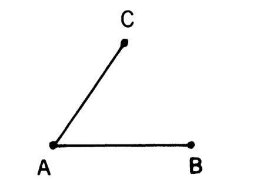
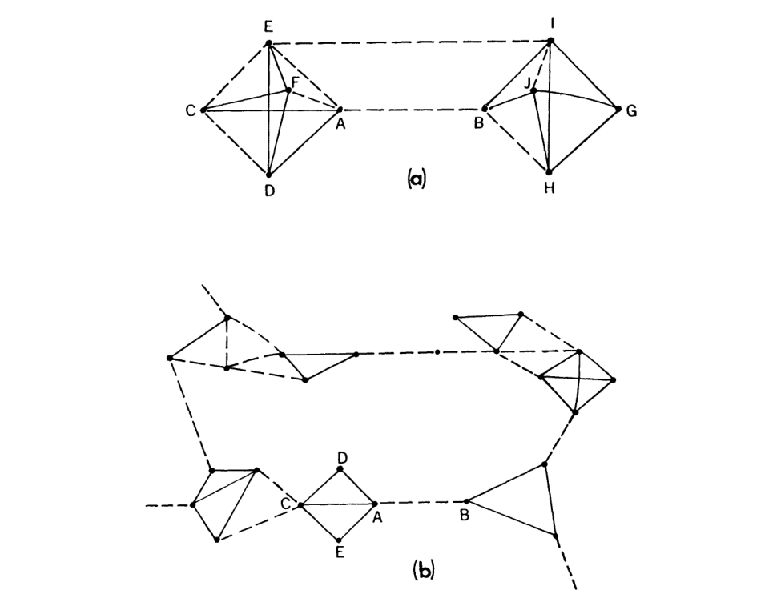

# The Strength of Weak Ties / 弱关系的力量

Mark S. Granovetter · 1973

## 章节索引

- [THE STRENGTH OF TIES](#H001)
- [WEAK TIES IN DIFFUSION PROCESSES](#H002)
- [WEAK TIES IN EGOCENTRIC NETWORKS](#H003)
- [WEAK TIES AND COMMUNITY ORGANIZATION](#H004)
- [MICRO AND MACRO NETWORK MODELS](#H005)
- [CONCLUSION](#H006)
- [REFERENCES](#H007)
- [Notes](#H-notes)

## 正文

**Source:** p.2 S001

**Original:** Analysis of social networks is suggested as a tool for linking micro and macro levels of sociological theory. The procedure is illustrated by elaboration of the macro implications of one aspect of small-scale interaction: the strength of dyadic ties. It is argued that the degree of overlap of two individuals’friendship networks varies directly with the strength of their tie to one another. The impact of this principle on diffusion of influence and information, mobility opportunity, and community organization is explored. Stress is laid on the cohesive power of weak ties. Most network models deal, implicitly, with strong ties, thus confining their applicability to small, well-defined groups. Emphasis on weak ties lends itself to discussion of relations between groups and to analysis of segments of social structure not easily defined in terms of primary groups.

**中文:** 本文提出以社会网络分析作为连接社会学理论微观与宏观层面的工具，并通过阐明小规模互动的一个方面——二元关系的强度——在宏观层面的含义，来说明这一方法。本文认为，两个人的友谊网络有多大程度的重叠，与他们彼此之间关系的强度成正比，并探讨这一原则对影响力与信息的扩散、流动机会以及社区组织的作用。文章着重指出弱关系的凝聚作用。多数网络模型隐含地以强关系为研究对象，从而将自身的适用范围限制在界限清晰的小群体。关注弱关系，则有助于讨论群体之间的关系，并分析那些难以用初级群体来界定的社会结构部分。

**Source:** p.2 S002

**Original:** A fundamental weakness of current sociological theory is that it does not relate micro-level interactions to macro-level patterns in any convincing way. Large-scale statistical, as well as qualitative, studies offer a good deal of insight into such macro phenomena as social mobility, community organization, and political structure. At the micro level, a large and increasing body of data and theory offers useful and illuminating ideas about what transpires within the confines of the small group. But how interaction in small groups aggregates to form large-scale patterns eludes us in most cases.

**中文:** 当前社会学理论的一个根本弱点，是未能令人信服地把微观层面的互动与宏观层面的格局联系起来。大规模统计研究和定性研究，使我们对社会流动、社区组织和政治结构等宏观现象有了不少认识。在微观层面，日益丰富的资料和理论，则为理解小群体内部发生的事情提供了有用而富有启发性的思路。但是，小群体中的互动究竟如何汇聚成大规模的格局，在多数情况下仍然不清楚。

**Source:** p.2 S003

**Original:** I will argue, in this paper, that the analysis of processes in interpersonal networks provides the most fruitful micro-macro bridge. In one way or another,it is through these networks that small-scale interaction becomes translated into large-scale patterns, and that these, in turn, feed back into small groups.

**中文:** 在本文中，我认为对人际网络过程的分析提供了最富有成效的微观与宏观桥梁。无论怎样，正是通过这些网络，小规模的互动转化为大规模的模式，而这些模式又反过来反馈到小群体中。

**Source:** p.2,3 S004

**Original:** Sociometry, the precursor of network analysis, has always been curiously peripheral——-invisible, really—in sociological theory. This is partly because it has usually been studied and applied only as a branch of social psych ology;itis also because of the inherent complexities of precise network analysis.We have had neither the theory nor the measurement and sampling techniques to move sociometry from the usual small-group level to that of larger structures. While a number of stimulating and suggestive studies have recently moved in this direction (Bott 1957;Mayer 1961; Milgram 1967;Boissevain 1968; Mitchell 1969),they do not treat structural issues in much theoretical detail. Studies which do so usually involve a level of technical complexity appropriate to such forbidding sources as the Bulletin of Mathematical Biophysics, where the original motivation for the study of networks was that of developing a theory of neural, rather than social,interaction(see the useful review of this literature by Coleman [1960]; also Rapoport [1963]).

**中文:** 社会计量学作为网络分析的先驱，在社会学理论中一直处于边缘地位——实际上是不可见的。这部分是因为它通常只作为社会心理学的一个分支来研究和应用；这也是因为精确网络分析固有的复杂性。我们既没有理论，也没有测量和抽样技术来将社会计量学从通常的小群体层面转移到更大的结构层面。虽然最近有一些刺激性和启发性的研究朝着这个方向发展（Bott 1957；Mayer 1961；Milgram 1967；Boissevain 1968；Mitchell 1969），但它们并没有在理论细节上处理结构性问题。这样做的研究通常涉及一定程度的技术复杂性，适合《数学生物物理学公报》等令人生畏的来源，其中网络研究的最初动机是发展神经交互理论，而不是社会交互理论（参见 Coleman [1960] 对这篇文献的有用评论；还有 Rapoport [1963]）。

**Source:** p.3 S006

**Original:** The strategy of the present paper is to choose a rather limited aspect of small-scale interaction--the strength of interpersonal ties—and to show, in some detail,how the use of network analysis can relate this aspect to such varied macro phenomena as diffusion, social mobility, political organiz ation, and social cohesion in general. While the analysis is essentially qualitative, a mathematically inclined reader will recognize the potential for models; mathematical arguments, leads, and references are suggested mostly in footnotes.

**中文:** 本文的策略是选择小规模互动的一个相当有限的方面——人际关系的强度——并详细地展示网络分析的使用如何将这一方面与诸如扩散、社会流动性、政治组织和一般社会凝聚力等不同的宏观现象联系起来。虽然分析本质上是定性的，但有数学倾向的读者会认识到模型的潜力；数学论证、线索和参考文献主要在脚注中建议。

**Source:** p.3 H001

## THE STRENGTH OF TIES / 关系的强度

**Source:** p.3 S007

**Original:** Most intuitive notions of the “strength' of an interpersonal tie should be satisfied by the following definition: the strength of a tie is a (probably linear） combination of the amount of time, the emotional intensity,the intimacy (mutual confiding), and the reciprocal services which characterize the tie.2 Each of these is somewhat independent of the other,though the set is obviously highly intra correlated.Discussion of operational measures of and weights attaching to each of the four elements is postponed to future empirical studies.3 It is sufficient for the present purpose if most of us can agree, on a rough intuitive basis, whether a given tie is strong, weak, or absent.4

**中文:** 人际关系“强度”的最直观概念应该通过以下定义来满足：关系的强度是时间量、情感强度、亲密程度（相互信任）和表征关系的互惠服务的（可能是线性的）组合。2尽管这组显然是高度内部相关的，但其中每一个都在一定程度上相互独立。对四个要素中每个要素的操作措施和权重的讨论被推迟到未来实证研究。3 如果我们大多数人都能在粗略的直觉基础上就某个给定的联系是强、弱还是不存在达成一致，那么对于目前的目的来说就足够了。4

**Source:** p.4 S008

**Original:** Consider, now, any two arbitrarily selected individuals—-call them A and B-—-and the set, S' = C, D,E, ..., of all persons with ties to either or both of them.5 The hypothesis which enables us to relate dyadic ties to larger structures is:the stronger the tie between A and B,the larger the proportion of individuals in S to whom they will both be tied, that is, connected by a weak or strong tie. This overlap in their friendship circles is predicted to be least when their tie is absent, most when it is strong, and intermediate when it is weak.

**中文:** 现在，考虑任意两个任意选择的个体——称他们为 A 和 B——以及与其中一个或两个都有联系的所有人的集合 S' = C、D、E……。 5 使我们能够将二元联系与更大结构联系起来的假设是：A 和 B 之间的联系越强，S 中与他们都联系在一起的个体比例就越大，即通过弱或强关系连接。当他们的关系不存在时，他们的友谊圈中的这种重叠预计最少，当关系牢固时，重叠最多，当关系较弱时，重叠程度介于中间。

**Source:** p.4 S009

**Original:** The proposed relationship results, first, from the tendency (by definition) of stronger ties to involve larger time commitments. If A-B and A-C ties exist, then the amount of time C spends with B depends (in part) on the amount A spends with B and C, respectively. (If the events “A is with B" and “A is with C" were independent, then the event “"C is with A and B" would have probability equal to the product of their probabilities. For example, if A and B are together 60% of the time, and A and C 40%, then C, A, and B would be together 24% of the time. Such independence would be less likely after than before B and C became acquainted.） If C and B have no relationship, common strong ties to A will probably bring them into interaction and generate one. Implicit here is Homans's idea that "the more frequently persons interact with one another, the stronger their sentiments of friendship for one another are apt to be’ (1950, p. 133).

**中文:** 所提议的关系首先是由于（根据定义）更强的关系倾向于涉及更多的时间承诺。如果存在 A-B 和 A-C 关系，则 C 与 B 相处的时间（部分）分别取决​​于 A 与 B 和 C 相处的时间。 （如果事件“A 与 B”和“A 与 C”是独立的，那么“C 与 A 和 B 一起”事件的概率等于它们概率的乘积。例如，如果 A 和 B 在一起的时间为 60%，A 和 C 为 40%，则 C、A 和 B 在一起的时间为 24%。这种独立性在 B 和 C 认识之前比之前更不可能。） 如果 C 和 B 没有关系，则共同与 A 的紧密联系可能会让他们产生互动并产生一种互动，这里隐含的是霍曼斯的观点，即“人们彼此互动越频繁，他们对彼此的友谊就越强烈”（1950，第 133 页）。

**Source:** p.4 S010

**Original:** The hypothesis is made plausible also by empirical evidence that the stronger the tie connecting two individuals, the more similar they are, in various ways (Be rsc heid and Walst er 1969, pp. 69-91; Bramel 1969, pp. 9-16; Brown 1965, pp. 71-90; Lau mann 1968; Newcomb 1961, chap. 5; Pre cker 1952). Thus, if strong ties connect A to B and A to C, both C and B, being similar to A,are probably similar to one another, increasing the likelihood of a friendship once they have met. Applied in reverse, these two factors——time and similarity-indicate why weaker A-B and A-C ties make a C-B tie less likely than strong ones: C and B are less likely to interact and less likely to be compatible if they do.

**中文:** 经验证据表明，两个个体之间的联系越紧密，他们在各种方面就越相似（Be rsc heid and Walst er 1969，第 69-91 页；Bramel 1969，第 9-16 页；Brown 1965，第 71-90 页；Lau mann 1968；Newcomb 1961，第 5 章；Pre克尔1952）。因此，如果 A 与 B 以及 A 与 C 之间存在强关系，则与 A 相似的 C 和 B 很可能彼此相似，从而增加了他们见面后成为友谊的可能性。反过来，这两个因素——时间和相似性——表明了为什么较弱的 A-B 和 A-C 关系比强关系更不可能产生 C-B 关系：C 和 B 相互作用的可能性较小，如果相互作用，则不太可能兼容。

**Source:** p.4 S011

**Original:** The theory of cognitive balance, as formulated by Heider (1958） and especially by Newcomb (1961, pp. 4-23), also predicts this result. If strong ties A-B and A-C' exist,and if B and C are aware of one another,anything short of a positive tie would introduce a “psychological strain" into the situation since C' will want his own feelings tobe congruent with those of his good friend, A, and similarly, for B and his friend, A. Where the ties are weak, however, such consistency is psychologically less crucial. (On this point see also Homans [1950, p. 255] and Davis [1963,p. 448].)

**中文:** Heider (1958)、尤其是 Newcomb (1961, pp. 4-23) 提出的认知平衡理论也预测了这一结果。如果 A-B 和 A-C' 存在强关系，并且 B 和 C 彼此了解，任何缺乏积极关系的行为都会给这种情况带来“心理压力”，因为 C' 会希望自己的感受与他的好朋友 A 的感受一致，对于 B 也同样如此。然而，在关系较弱的地方，这种一致性在心理上就不那么重要了（这一点另请参见Homans [1950，p.255]和Davis [1963，p.448]。）

**Source:** p.4 S012

**Original:** Some direct evidence for the basic hypothesis exists (Kap fe rer 1969, p. 229 n.; Lau mann and Schuman 1967; Rapoport and Horvath 1961;

**中文:** 存在一些支持基本假说的直接证据（Kap fer rer 1969，第 229 页；Lau mann 和 Schuman 1967；Rapoport 和 Horvath 1961；

**Source:** p.5 S013

**Original:** Rapoport 1963).6 This evidence is less comprehensive than one might hope. In addition, however, certain inferences from the hypothesis have received empirical support.Description of these inferences will suggest some of the substantive implications of the above argument.

**中文:** Rapoport 1963).6 这一证据并不像人们希望的那样全面。然而，此外，该假设的某些推论也得到了实证支持。对这些推论的描述将暗示上述论点的一些实质性含义。

**Source:** p.5 H002

## WEAK TIES IN DIFFUSION PROCESSES / 扩散过程中的弱关系

**Source:** p.5 S014

**Original:** To derive implications for large networks of relations,it is necessary to frame the basic hypothesis more precisely. This can be done by invest ig ating the possible triads consisting of strong, weak, or absent ties among A, B, and any arbitrarily chosen friend of either or both (i.e., some member of the set S, described above). A thorough mathematical model would do this in some detail, suggesting probabilities for various types. This analysis becomes rather involved, however, and it is sufficient for my purpose in this paper to say that the triad which is most unlikely to occur, under the hypothesis stated above,is that in which A and B are strongly linked,A has a strong tie to some friend C, but the tie between C and B is absent. This triad is shown in figure 1. To see the consequences of this assertion,

**中文:** 为了得出对大型关系网络的影响，有必要更精确地构建基本假设。这可以通过调查可能的三元组来完成，该三元组由 A、B 以及其中一个或两个任意选择的朋友（即上述集合 S 的某个成员）之间的强、弱或缺席关系组成。一个彻底的数学模型会在一些细节上做到这一点，建议各种类型的概率。然而，这种分析变得相当复杂，并且足以满足我在本文中的目的，即在上述假设下，最不可能出现的三元组是，其中A和B紧密相连，A与某个朋友C有很强的联系，但C和B之间不存在联系。这个三元组如图 1 所示。要查看此断言的结果，

**Source:** p.5 F001

**Original:** Fig. 1. Forbidden triad.

**中文:** 图 1．被排除的三元组。

**Source:** p.5 S015

**Original:** I will exaggerate it in what follows by supposing that the triad shown never occurs-that is,that the B-C tie is always present (whether weak or strong), given the other two strong ties. Whatever results are inferred from this supposition should tend to occur in the degree that the triad in question tends to be absent.

**中文:** 在接下来的内容中，我将通过假设所显示的三元组从未发生来夸大这一点，即，考虑到其他两个强关系，B-C 联系始终存在（无论是弱还是强）。无论从这个假设中推断出什么结果，都应该以所讨论的三元组往往不存在的程度发生。

**Source:** p.6 S016

**Original:** Some evidence exists for this absence. Analyzing 651 socio grams, Davis (1970,p. 845) found that in 90% of them triads consisting of two mutual choices and one non choice occurred less than the expected random number of times.If we assume that mutual choice indicates a strong tie,this is

**中文:** 存在一些证据证明这种缺席。 Davis (1970, p. 845) 分析了 651 个社会图谱，发现其中 90% 的三元组由两个相互选择和一个不选择组成，出现的随机次数少于预期的随机次数。如果我们假设相互选择表示强关系，则为

**Source:** p.6 S017

**Original:** ssa n s ( attraction,” the configuration of three strong ties became increasingly frequent as people knew one another longer and better; the frequency of the triad pictured in figure 1 is not analyzed, but it is implied that processes of cognitive balance tended to eliminate it.

**中文:** ssa n s（吸引力），随着人们彼此了解的时间越来越长和加深，三个强关系的配置变得越来越频繁；图1中所示的三元组的频率没有被分析，但它暗示认知平衡的过程倾向于消除它。

**Source:** p.6 S018

**Original:** The significance of this triad's absence can be shown by using the concept of a “bridge"; this is a line in a network which provides the only path between two points (Harary, Norman, and Cartwright 1965, p. 198). Since, in general, each person has a great many contacts, a bridge between A and B provides the only route along which information or infuence can flow from any contact of A to any contact of B, and, consequently, from anyone connected indirectly to A to anyone connected indirectly to B. Thus, in the study of diffusion, we can expect bridges to assume an important role.

**中文:** 这个三元组缺席的重要性可以用“桥”的概念来表示；这是网络中的一条线，提供了两点之间的唯一路径（Harary、Norman 和 Cartwright 1965，第 198 页）。由于一般来说，每个人都有很多联系人，A和B之间的桥梁提供了信息或影响可以从A的任何联系人流向B的任何联系人，以及因此从与A有间接联系的任何人流向与B有间接联系的任何人的唯一途径。因此，在扩散研究中，我们可以预期桥梁将发挥重要作用。

**Source:** p.6 S019

**Original:** Now, if the stipulated triad is absent, it follows that, except under unlikely conditions, no strong tie is a bridge. Consider the strong tie A-B: if A has another strong tie to C, then forbidding the triad of figure 1 implies that a tie exists between C and B, so that the path A-C-B exists between A and B; hence, A-B is not a bridge. A strong tie can be a bridge, therefore, only if neither party to it has any other strong ties, unlikely in a social network of any size (though possible in a small group). Weak ties suffer no such restriction, though they are certainly not automatically bridges. What is important, rather, is that all bridges are weak ties.

**中文:** 现在，如果不存在规定的三元组，那么除非在不太可能的情况下，否则任何牢固的联系都不是桥梁。考虑强关系A-B：如果A与C还有另一个强关系，那么禁止图1的三元组意味着C和B之间存在联系，因此A和B之间存在路径A-C-B；因此，A-B 不是一座桥。因此，只有当双方都没有任何其他强关系时，强关系才能成为桥梁，这在任何规模的社交网络中都不太可能（尽管在小团体中可能）。弱关系不会受到这样的限制，尽管它们肯定不会自动成为桥梁。相反，重要的是所有桥梁都是弱关系。

**Source:** p.6 S020

**Original:** In large networks it probably happens only rarely, in practice, that a specific tie provides the only path between two points. The bridging function may nevertheless be served locally. In figure 2a, for example, the tie A-B is not strictly a bridge, since one can construct the path A-E-I-B (and others). Yet, A-B is the shortest route to B for F, D, and C. This function is clearer in figure 2b. Here, A-B is, for C, D, and others, not only a local bridge to B, but, in most real instances of diffusion, a much more likely , [length of path] beyond which it is not feasible for u to communicate with

**中文:** 在大型网络中，实际上，特定的联系提供了两点之间的唯一路径，这种情况可能很少发生。然而，桥接功能可以在本地提供。例如，在图 2a 中，连接 A-B 严格来说并不是一座桥，因为可以构建路径 A-E-I-B（以及其他路径）。然而，A-B 是 F、D 和 C 到 B 的最短路径。这个函数在图 2b 中更加清晰。这里，对于 C、D 和其他人来说，A-B 不仅是通往 B 的本地桥梁，而且在大多数真实的扩散实例中，更有可能的是 [路径长度]，超过该长度，u 就无法与

**Source:** p.6 S021

**Original:** 7 This assumption is suggested by one of Davis's models (1970, p. 846) and made explicitly by Mazur (1971).It is not obvious,however.In a free-choice sociometric test or afixed-choice one with a large number of choices,most strong ties would probably result in mutual choice,but some weak ones might aswell.With a small, fixed number of choices, most mutual choices should be strong ties, but some strong ties might show up as asymmetric.For a general discussion of the biases introduced by sociometric procedures, see Holland and Leinhardt (1971b).

**中文:** 7 这一假设是由 Davis 模型之一提出的 (1970, p. 846)，并由 Mazur (1971) 明确提出。然而，这一假设并不明显。在自由选择社会计量测试或有大量选择的固定选择测试中，大多数强关系可能会导致相互选择，但一些弱关系也可能会导致相互选择。在选择数量较少且固定的情况下，大多数相互选择应该是强关系，但可能会出现一些强关系。有关社会计量程序引入的偏差的一般讨论，请参见 Holland 和 Leinhardt (1971b)。

**Source:** p.7 F002

**Original:** Fig. 2. Local bridges. (a) Degree 3; (b) Degree 13. Solid lines indicate strong ties; dashed lines indicate weak ties.

**中文:** 图 2．局部桥。（a）阶数为 3；（b）阶数为 13。实线表示强关系，虚线表示弱关系。

**Source:** p.7 S022

**Original:** vbecause of costs or distortions entailed in each act of transmission.If v does not lie within this critical distance, then he will not receive messages originating with u" (1965, p. 159). I will refer to a tie as a “local bridge of degree n" if n represents the shortest path between its two points (other than itself), and n > 2. In figure 2a, A-B is a local bridge of degree 3, in 2b, of degree 13. As with bridges in a highway system, a local bridge in a social network will be more significant as a connection between two sectors to the extent that it is the only alternative for many people that is, as its degree increases. A bridge in the absolute sense is a local one of infinite degree. By the same logic used above, only weak ties may be local bridges.

**中文:** v 因为每个传输行为所带来的成本或扭曲。如果 v 不在这个临界距离内，那么他将不会收到源自 u 的消息”（1965 年，第 159 页）。如果 n 表示其两点（除了自身之外）之间的最短路径，并且 n > 2，我将把领带称为“n 级本地桥”。在图 2a 中，A-B 是 3 级本地桥，在 2b 中是 13 级本地桥。与高速公路系统中的桥梁一样，社交网络中的局部桥作为两个部门之间的连接将变得更加重要，因为它是许多人的唯一选择，也就是说，随着其程度的增加，桥梁在绝对意义上是无限程度的局部桥，按照上面使用的相同逻辑，只有弱关系可能是局部桥。

**Source:** p.7,8 S023

**Original:** Suppose, now, that we adopt Davis's suggestion that “in interpersonal flows of most any sort the probability that ‘whatever it is’ will flow from person i to person jis (a) directly proportional to the number of all-positive (friendship) paths connecting i and j; and (b) inversely proportional to the length of such paths’ (1969, p. 549).8 The significance of weak ties, then, would be that those which are local bridges create more, and shorter, paths. Any given tie may, hypothetically, be removed from a network; the number of paths broken and the changes in average path length resulting between arbitrary pairs of points (with some limitation on length of path considered) can then be computed. The contention here is that removal of the average weak tie would do more “damage”to transmission probabilities than would that of the average strong one.9

**中文:** 现在，假设我们采用戴维斯的建议，“在大多数类型的人际流动中，‘无论它是什么’将从人 i 流向人 ji 的概率 (a) 与连接 i 和 j 的全正（友谊）路径的数量成正比；(b) 与此类路径的长度成反比。”（1969，第 549 页）。8 那么，弱关系的重要性在于，那些本地桥梁会创造更多、更短的关系。假设，任何给定的连接都可以从网络中删除；然后可以计算任意点对之间的平均路径长度变化（考虑到路径长度的一些限制），这里的争论是，删除平均弱连接比删除平均强连接对传输概率造成更大的“损害”。

**Source:** p.8 S025

**Original:** Intuitively speaking, this means that whatever is to be diffused can reach a larger number of people, and traverse greater social distance (i.e., path length),1o when passed through weak ties rather than strong. If one tells a rumor to all his close friends, and they do likewise, many will hear the rumor a second and third time, since those linked by strong ties tend to share friends.If the motivation to spread the rumor is dampened a bit on each wave of retelling, then the rumor moving through strong ties is much more likely to be limited to a few cliques than that going via weak ones; bridges will not be crossed.11

**中文:** 直观地说，这意味着无论要传播的是什么，当通过弱关系而不是强关系传播时，都可以到达更多的人，并穿越更大的社会距离（即路径长度）1o。如果一个人向他所有的亲密朋友讲述一个谣言，而他们也这样做，那么许多人会第二次、第三次听到这个谣言，因为那些有强关系的人往往有共同的朋友。如果传播谣言的动机在每一波重述中都受到一点抑制，那么通过强关系传播的谣言更有可能局限于少数派系，而不是通过弱关系派系传播；桥梁不会被跨越。11

**Source:** p.8 S026

**Original:** Since sociologists and anthropologists have carried out many hundreds of diffusion studies—-Rogers's 1962 review dealt with 506-—-one might suppose that the above claims could easily be put to test. But this is not so,for several reasons. To begin with, though most diffusion studies find that personal contacts are crucial, many undertake no sociometric investigation. (Rogers [1962]discusses this point.）When sociometric techniques are used, they tend to discourage the naming of those weakly tied to the respondent by sharply limiting the numbers of choices allowed.Hence, the proposed importance of weak ties in diffusion is not measured. Even when more socio metric information is collected there is almost never an attempt to directly retrace the exact interpersonal paths traversed by an (idea, rumor,or）innovation.More commonly,the time when each individual adopted the innovation is recorded,as is the number of sociometric choices he received from others in the study. Those receiving many choices are characterized as “central, those with few as “marginal'; this variable is then correlated with time of adoption and inferences made about what paths were probably followed by the innovation.

**中文:** 由于社会学家和人类学家已经进行了数百项扩散研究——罗杰斯 1962 年的评论涉及了 506 项——人们可能会认为上述说法很容易得到检验。但事实并非如此，原因有几个。首先，尽管大多数传播研究发现个人接触至关重要，但许多研究并未进行社会计量调查。 （Rogers [1962]讨论了这一点。）当使用社会计量技术时，它们倾向于通过严格限制允许的选择数量来阻止那些与受访者弱关系的人的命名。因此，没有测量弱关系在扩散中的重要性。即使收集了更多的社会计量信息，也几乎从未尝试直接追溯（想法、谣言或）创新所经历的确切人际路径。更常见的是，每个人采用的时间记录了创新，以及他从研究中其他人那里收到的社会测量选择的数量，这些选择被描述为“核心”，那些选择很少的被描述为“边缘”；然后，该变量与采用时间以及对创新可能遵循的路径进行的推断相关。

**Source:** p.9 S027

**Original:** One point of controversy in diffusion studies can be related to my argument. Some have indicated that early innovators are marginal, that

**中文:** 扩散研究中的一个争议点可能与我的论点有关。一些人指出，早期的创新者是边缘化的，

**Source:** p.9 S028

**Original:** as highly deviant" (Rogers 1962, p. 197). Others (e.g., Coleman, Katz, and Menzel [1966] on the adoption of a new drug by doctors）find that those named more frequently adopt an innovation substantially earlier. Becker (197o）tries to resolve the question of whether early innovators s a, e, , of a given innovation." His study of public health innovations shows that when a new program is thought relatively safe and uncontroversial (as with the drug of Coleman et al.), central figures lead in its adoption; otherwise, marginal ones do (p. 273). He explains the difference in terms of a greater desire of “central" figures to protect their professional reputation.

**中文:** “高度异常”（Rogers 1962，p. 197）。其他人（例如，Coleman、Katz 和 Menzel [1966] 关于医生采用新药的情况）发现，那些更频繁地被提及的人更早地采用了一项创新。Becker（197o）试图解决早期创新者是否对某一特定创新感兴趣的问题。”他对公共卫生创新的研究表明，当一种新药物被采用时，计划被认为相对安全且没有争议（就像科尔曼等人的药物一样），核心人物会带头采用该计划；否则，边缘人物会主导采用（第 273 页）。

**Source:** p.9 S029

**Original:** Kerckhoff, Back, and Miller (1965） reach a similar conclusion in a S, ss x s n ter ical contagion": a few, then more and more workers, claiming bites from a mysterious “insect,”" became nauseous, numb, and weak, leading to a plant shutdown. When the affected workers were asked to name their three best friends, many named one another, but the very earliest to be stricken were social isolates, receiving almost no choices. An explanation, compatible with Becker's, is offered: since the symptoms might be thought odd, early “adopters" were likely to be found among the marginal, those less subject to social pressures. Later, “it is increasingly likely that some persons who are socially integrated will be affected. ... The contagion enters social networks and is disseminated with increasing rapidity" (p. 13). This is consistent with Rogers's comment that while the first adopters of innovations are marginal, the next group, “early adopters, “are a more integrated part of the local social system than the innovators’ (1962, p. 183).

**中文:** Kerckhoff、Back 和 Miller (1965) 在《S, ss x s n ter ical contagion》中得出了类似的结论：少数工人，然后是越来越多的工人，声称被一种神秘的“昆虫”叮咬，变得恶心、麻木和虚弱，导致工厂关闭。当受影响的工人被要求说出他们的三个最好的朋友时，许多人互相指名道姓，但最早受到影响的是社会孤立者，几乎没有选择。与贝克尔的观点一致的解释是：由于这些症状可能被认为很奇怪，早期的“采用者”很可能是边缘群体，即那些较少受到社会压力的人。后来，“一些融入社会的人越来越有可能受到影响……这种传染病进入社交网络，并以越来越快的速度传播”（第13页），这与罗杰斯的评论一致，即虽然创新的第一批采用者是边缘的，但下一个群体是“早期的”。采用者“比创新者更能融入当地社会体系”（1962，第 183 页）。

**Source:** p.9 S030

**Original:** "Central'" and “marginal' individuals may well be motivated as claimed; but if the marginal are genuinely so, it is diff cult to see how they can ever spread innovations successfully.We may surmise that since the resistance to a risky or deviant activity is greater than to a safe or normal one, a larger number of people will have tobe exposed toit and adopt it,in the early stages, before it will spread in a chain reaction. Individuals with many weak ties are, by my arguments, best placed to diffuse such a difficult innovation, since some of those ties will be local bridges.12 An initially un-

**中文:** “中心”和“边缘”个人很可能像所声称的那样受到激励；但如果边缘确实如此，那么很难看到他们如何能够成功地传播创新。我们可以推测，由于对危险或异常活动的阻力大于对安全或正常活动的阻力，因此在早期阶段，在它以连锁反应传播之前，必须有更多的人接触它并采用它。根据我的观点，拥有许多弱关系的个人是最好的由于其中一些纽带将成为当地的桥梁，因此，这些纽带将被放置来传播如此困难的创新。 12

**Source:** p.10 S032

**Original:** That the “marginal' innovators of diffusion studies might actually be rich in weak ties is possible, given the usual sociometric technique, but in most cases this is purely speculative. Kerckhoff and Back, however, in a later more detailed analysis of the hysteria incident, indicate that besides asking about one's “three best friends,’ they also asked with whom workers ate, worked, shared car pools, etc. They report that five of the six workers earliest affected “are social isolates when friendship choices are used as the basis of analysis. Only 1 of the 6 is mentioned as a friend by anyone in our sample. This is made even more striking when we note that these 6 women are mentioned with considerable frequency when other bases for choice are used. In fact, they are chosen more frequently on a ‘non-friendship' basis than are the women in any of the other categories’ (1968, p.112).

**中文:** 考虑到通常的社会测量技术，扩散研究的“边缘”创新者实际上可能富含弱关系，这是可能的，但在大多数情况下，这纯粹是推测。然而，Kerckhoff 和 Back 在后来对歇斯底里事件的更详细分析中表明，除了询问一个人的“三个最好的朋友”之外，他们还询问工人与谁一起吃饭、工作、共用汽车等。他们报告说，最早受影响的六名工人中的五名“在使用友谊选择时是社会孤立的”作为分析的基础。在我们的样本中，只有 1 个人被提及为朋友。当我们注意到，当使用其他选择基础时，这 6 名女性被提及的频率相当高。事实上，她们比任何其他类别中的女性更频繁地被选择为“非友谊””（1968 年，第 112 页）。

**Source:** p.10 S033

**Original:** This finding lends credence to the weak-tie argument, but is inconclusive. A somewhat different kind of diffusion study offers more direct support: the “small-world' investigations of Milgram and his associates. The name of these studies stems from the typical comment of newly introduced individuals who discover some common acquaintance; this situation is genera liz ed in an attempt to measure, for arbitrarily chosen pairs of individuals in the United States, how long a path of personal contacts would be needed to connect them. A booklet is given to randomly designated senders who are asked to forward it toward some named target person, via someone the sender knows personally who would be more likely than himself to know the target.The new recipient then advances the booklet similarly;eventually it reaches the target or someone fails to send it on. The proportion of such chains completed has ranged from 12%to 33%in different studies, and the number of links in completed chains has ranged from twoto 10, averaging between five and eight (Milgram 1967; Travers and Milgram 1969; Korte and Milgram 1970).

**中文:** 这一发现为弱关系论点提供了证据，但尚无定论。一种有些不同的扩散研究提供了更直接的支持：米尔格拉姆及其同事的“小世界”调查。这些研究的名称源于新认识的个人发现一些共同熟人的典型评论；这种情况被概括为试图测量，对于在美国任意选择的一对个人，需要多长时间的个人联系路径才能将他们联系起来。将一本小册子发给随机指定的发送者，要求他们将其转发给某个指定的目标人，然后，新的接收者以类似的方式推进小册子；最终它到达目标，或者有人无法发送。在不同的研究中，完成的此类链的比例范围为 12% 到 33%，完成的链中的链接数量范围为 2 到 10，平均为 5 到 8 个（Milgram 1967；Travers 和 Milgram 1969；Korte 和）。米尔格拉姆 1970）。

**Source:** p.10 S034

**Original:** Each time someone forwards a booklet he also sends a postcard to the researchers, indicating, among other things, the relationship between himself and the next receiver. Two of the categories which can be chosen are “"friend" and “acquaintance."’ I will assume that this corresponds to "strong” and “weak" ties. In one of the studies, white senders were asked to forward the booklet to a target who was Negro. In such chains, a crucial point was the first sending of the booklet from a white to a Negro. In 50%

**中文:** 每次有人转发一本小册子时，他都会向研究人员寄一张明信片，其中注明他与下一个接收者之间的关系。可以选择的两个类别是“朋友”和“熟人”。我假设这对应于“强”和“弱”关系。在一项研究中，白人发送者被要求将小册子转发给黑人目标。在这样的链条中，关键点是第一次将小册子从白人发送给黑人。在 50% 的情况下

**Source:** p.10,11 S035

**Original:** bridges,the concept of local liaisons could be developed.In a more microscopically oriented discussion I would devote more time to the liaison role.For now,I only point out that,under the present assumptions, one can be a liaison between two network sectors only if all his ties into one or both are weak. of the instances where the white described this Negro as an “acquaintance," the chain was ultimately completed; completion rate fell to 26%, however, when the white sent the booklet to a Negro “friend."” (My computation, based on unpublished data kindly supplied by Charles Korte. See Korte [1967] and Korte and Milgram [1970].) Thus, weaker interracial ties can be seen to be more effective in bridging social distance.

**中文:** 桥梁，可以发展本地联络的概念。在更微观的讨论中，我会花更多的时间来讨论联络角色。现在，我只指出，在目前的假设下，只有当一个人与一个或两个网络部门的所有联系都很弱时，他才能成为两个网络部门之间的联络人。在白人将这个黑人描述为“熟人”的例子中，这条链条最终完成了；然而，当白人将小册子寄给黑人“朋友”时，完成率下降到 26%。（我的计算基于 Charles Korte 善意提供的未发表数据。参见 Korte [1967] 以及 Korte 和 Milgram [1970]。）因此，较弱的跨种族联系可以更有效地弥合社会距离。

**Source:** p.11 S036

**Original:** Another relevant study, by Rapoport and Horvath (1961), is not exactly one of diffusion but is closely related in that it traces out paths along which diffusion could take place. They asked each individual in a Michigan junior high school (N = 851） to list his eight best friends in order of preference. Then, taking a number of random samples from the group (sample size, an arbitrary number, was nine), they traced out, for each sample, and averaged over all the samples, the total number of people reached by following along the network of first and second choices.That is,the first and second choices of each sample member were tabulated,then the first and second choices of these people were added in, etc., counting, at each remove, only names not previously chosen, and continuing until no new people were reached. The same procedure was followed using second and third choices, third and fourth, etc., up to seventh and eighth. (The theoretical connection of this tracing procedure to diffusion is discussed by Rapoport [1953a, 1953b,and especially 1954].)

**中文:** Rapoport 和 Horvath (1961) 的另一项相关研究并不完全是扩散的研究，但密切相关，因为它追踪了扩散发生的路径。他们要求密歇根一所初中的每个人（N = 851）按偏好顺序列出他的八个最好的朋友。然后，从该组中随机抽取一些样本（样本量，任意数量为9），对每个样本进行追踪，并对所有样本进行平均，沿着第一和第二选择的网络到达的总人数。即将每个样本成员的第一和第二选择制成表格，然后将这些人的第一和第二选择添加进去，等等，每次删除时只计算之前未选择的名字，并继续使用第二个和第三个选择，第三个和第四个，等等，直到第七个和第八个（Rapoport [1953a，1953b，尤其是 1954] 讨论了这种追踪过程与扩散的理论联系。）

**Source:** p.11 S037

**Original:** The smallest total number of people were reached through the networks generated by first and second choices-—presumably the strongest ties-—-and the largest number through seventh and eighth choices. This corresponds to my assertion that more people can be reached through weak ties.A parameter in their mathematical model of the socio gram, designed to measure, approximately, the overlap of acquaintance circles, declined mo not onically with increasing rank order of friends.13

**中文:** 通过第一个和第二个选择（可能是最强的联系）生成的网络接触到的人数最少，而通过第七个和第八个选择接触到的人数最多。这符合我的主张，即通过弱关系可以接触到更多的人。他们的社会图数学模型中的一个参数，旨在近似测量熟人圈子的重叠程度，随着朋友排名顺序的增加而单调下降。 13

**Source:** p.11 H003

## WEAK TIES IN EGOCENTRIC NETWORKS / 自我中心网络中的弱关系

**Source:** p.11 S038

**Original:** In this section and the next, I want to discuss the general significance of the above findings and arguments at two levels: first that of individuals, then that of communities. These discussions make no pretense of being comprehensive; they are meant only to illustrate possible applications.

**中文:** 在本节和下一节中，我想从两个层面讨论上述发现和论点的一般意义：首先是个人层面，然后是社区层面。这些讨论并不假装是全面的；它们仅用于说明可能的应用。

**Source:** p.11 S039

**Original:** In recent years, a great deal of literature has appeared analyzing the impact on the behavior of individuals of the social networks in which they are imbedded. Some of the studies have emphasized the ways in which

**中文:** 近年来，出现了大量文献，分析了嵌入的社交网络对个人行为的影响。一些研究强调了

**Source:** p.12 S041

**Original:** Epstein (1969) points out, however, that different parts of ego's network may have different density. He calls those with whom one “interacts most intensely and most regularly,and who are therefore also likely to come to know one another,"’ the “effective network"; the “remainder constitute the extended network' (pp. 110-11). This is close to saying, in my terms, that one's strong ties form a dense network,one's weak ties a less dense one. I would add that one's weak ties which are not local bridges might as well be counted with the strong ties, to maximize separation of the dense from the less dense network sectors.

**中文:** 然而，Epstein（1969）指出，自我网络的不同部分可能具有不同的密度。他将那些“与之互动最频繁、最频繁，因此也有可能相互了解”的人称为“有效网络”； “其余部分构成扩展网络”（第 110-11 页）。用我的话来说，这几乎是说，一个人的强关系形成一个密集的网络，一个人的弱关系形成一个较不密集的网络。我想补充一点，一个人的弱关系（不是本地桥）也可以与强关系一起计算，以最大限度地分离密集网络部分和不太密集的网络部分。

**Source:** p.12,13 S042

**Original:** One point on which there is no general agreement is whether ego's network should be treated as composed only of those to whom he is tied directly, or should include the contacts of his contacts, and/or others. Analyses stressing encapsulation of an individual by his network tend to take the former position, those stressing manipulation of networks, the latter, since information or favors available through direct contacts may depend on who their contacts are. I would argue that by dividing ego's network into that part made up of strong and non bridging weak ties on the one hand, and that of bridging weak ties on the other, both orientations can be dealt with.Ties in the former part should tend to be to people who not only know one another, but who also have few contacts not tied to ego as well.In the“weak” sector,however, not only will ego's contacts not be tied to one another, but they will be tied to individuals not tied to ego. Indirect contacts are thus typically reached through ties in this sector; such ties are then of importance not only in ego's manipulation of networks, but also in that they are the channels through which ideas,influences,or contacts onehas the more encapsulated he will be in terms of knowledge of the world beyond his own friendship circle; thus, bridging weak ties (and the consequent indirect contacts) are important in both ways.

**中文:** 没有达成普遍共识的一点是，自我的网络是否应该被视为仅由那些与他直接联系的人组成，或者应该包括他的联系人的联系人和/或其他人。强调网络对个人的封装的分析倾向于采取前一种立场，那些强调网络操纵的分析倾向于采取后者，因为通过直接接触获得的信息或好处可能取决于他们的联系人是谁。我认为，通过将自我的网络划分为一方面由强关系和非桥接的弱关系组成的部分，另一方面由桥接的弱关系组成的部分，这两种方向都可以得到解决。前一部分的关系应该倾向于那些不仅彼此认识，而且也很少有不与自我联系的联系人的人。然而，在“弱”部分，自我的联系不仅不会相互联系，而且会被联系在一起。与不受自我束缚的个人有关。因此，间接接触通常是通过该部门的联系实现的；这样的联系不仅在自我操纵网络方面很重要，而且还因为它们是一个人的思想、影响或联系的渠道，通过这些联系，一个人对自己朋友圈之外的世界的了解更加深入。因此，弥合弱关系（以及随之而来的间接接触）在两个方面都很重要。

**Source:** p.13 S044

**Original:** s s a market study I have recently completed. Labor economists have long been aware that American blue-collar workers find out about new jobs more through personal contacts than by any other method. (Many studies are reviewed by Parnes 1954, chap. 5.) Recent studies suggest that this is also true for those in professional, technical, and managerial positions (Shape ro, Howell, and Tombaugh 1965; Brown 1967; Granovetter 1970). My study of this question laid special emphasis on the nature of the tie between the job changer and the contact person who provided the necessary information.

**中文:** 这是我最近完成的一项市场研究。劳工经济学家早就意识到，美国蓝领工人更多地通过个人接触而不是任何其他方式来寻找新工作。 （Parnes 1954，第 5 章回顾了许多研究。）最近的研究表明，对于专业、技术和管理职位的人来说也是如此（Shape ro、Howell 和 Tombaugh 1965；Brown 1967；Granovetter 1970）。我对这个问题的研究特别强调了换工作者和提供必要信息的联系人之间联系的性质。

**Source:** p.13 S045

**Original:** In a random sample of recent professional, technical, and managerial job changers living in a Boston suburb,I asked those who found a new job through contact show often they saw the contact around the time that he passed on job information to them. I will use this as a measure of tie strength.15 A natural a priori idea is that those with whom one has strong ties are more motivated to help with job information. Opposed to this greater motivation are the structural arguments I have been making:those to whom we are weakly tied are more likely to move in circles different from our own and will thus have access to information different from that which we receive.

**中文:** 在最近居住在波士顿郊区的专业、技术和管理工作变动者的随机样本中，我询问了那些通过联系人找到新工作的人，他们经常在他向他们传递工作信息时看到联系人。我将用它来衡量关系强度。15 一个自然的先验想法是，那些与某人有牢固关系的人更有动力帮助提供工作信息。与这种更大的动机相反的是我一直在提出的结构性论点：那些与我们联系较弱的人更有可能在与我们不同的圈子中活动，从而获得与我们收到的信息不同的信息。

**Source:** p.13 S046

**Original:** I have used the following categories for frequency of contact: often = at least twice a week; occasionally = more than once a year but less than twice a week; rarely = once a year or less. Of those finding a job through contacts, 16.7% reported that they saw their contact often at the time, 55.6% said occasionally, and 27.8% rarely (N = 54).16 The skew is clearly to the weak end of the continuum, suggesting the primacy of structure over motivation.

**中文:** 我使用以下类别来表示联系频率：经常=每周至少两次；偶尔=每年一次以上但每周少于两次；很少=一年一次或更少。在那些通过联系人找到工作的人中，16.7% 的人表示他们当时经常见到联系人，55.6% 的人表示偶尔见到联系人，27.8% 的人很少见到联系人（N = 54）。 16 这种倾向显然偏向连续体的弱端，这表明结构比动机更重要。

**Source:** p.13 S047

**Original:** In many cases, the contact was someone only marginally included in the current network of contacts, such as an old college friend or a former workmate or employer, with whom sporadic contact had been maintained

**中文:** 在许多情况下，联系人只是当前联系人网络中的边缘人物，例如大学老朋友或前同事或雇主，与他们保持着零星的联系

**Source:** p.14 S049

**Original:** I also asked respondents where their contacts got the information they transmitted. In most cases, I traced the information to its initial source. I had expected that, as in the diffusion of rumors or diseases, long paths would be involved.Butin39.1%of the cases information came directly from the prospective employer, whom the respondent already knew; 45.3% said that there was one intermediary between himself and the employer; 12.5% reported two; and 3.1% more than two $N = 64$. This suggests that for some important purposes it may be sufficient to discuss, as I have, the egocentric network made up of ego, his contacts, and their contacts. Had long information paths been involved, large numbers might have found out about any given job, and no particular tie would have been crucial. Such a model of job-information flow actually does correspond to the economists’model of a“perfect"labor market.But those few whodid acquire information through paths with more than one intermediary tended to be young and under the threat of unemployment; influence was much less likely to have been exerted by their contact on their behalf. These respondents were,in fact,more similar to those using formal intermediaries (agencies, advertisements) than to those hearing through short paths: both of the former are badly placed and dissatisfied in the labor market, and both receive information without influence.Just as reading about a job in the newspaper affords one no recommendation in applying for it, neither does it to have heard about it fifth hand.

**中文:** 我还询问受访者，他们的联系人从哪里获得他们传输的信息。在大多数情况下，我都会追踪信息的最初来源。我预料到，就像谣言或疾病的传播一样，会涉及很长的路径。但39.1%的案例信息直接来自受访者已经认识的未来雇主； 45.3%表示自己与雇主之间有一名中间人； 12.5% 的人报告了两次；超过 2 人的比例为 3.1% $N = 64$。这表明，对于某些重要的目的，像我一样，讨论由自我、他的联系人以及他们的联系人组成的以自我为中心的网络可能就足够了。如果涉及很长的信息路径，大量的人可能会发现任何特定的工作，并且没有特定的关系是至关重要的。这样的就业信息流模型实际上确实符合经济学家的“完美”劳动力市场模型。但那些通过多个中介途径获取信息的少数人往往是年轻人，面临失业的威胁；代表他们的接触所产生的影响力要小得多。事实上，这些受访者更类似于那些使用正式中介机构（代理机构、广告）的人，而不是那些通过短途途径听到的人：前者都在劳动力市场上处境不佳且不满意，并且都在没有影响力的情况下接收信息。正如在报纸上读到一份工作不会给人们提供申请该工作的建议一样，第五手消息也不会提供该工作的建议。

**Source:** p.14,15 S050

**Original:** The usual dichotomy between “formal' or mass procedures and diffusion through personal contacts may thus be invalid in some cases where, instead, the former may be seen as a limiting case of long diffusion chains. This is especially likely where information of instrumental significance is involved. Such information is most valuable when earmarked for one person.

**中文:** 因此，在某些情况下，“正式”或大规模程序与通过个人接触进行传播之间通常的二分法可能是无效的，相反，前者可能被视为长扩散链的限制情况。在涉及具有工具意义的信息时尤其可能如此。当指定给一个人时，此类信息是最有价值的。

**Source:** p.15 S052

**Original:** From the individual's point of view, then, weak ties are an important resource in making possible mobility opportunity. Seen from a more macro-scopic vantage, weak ties play a role in effecting social cohesion. When a man changes jobs, he is not only moving from one network of ties to another, but also establishing a link between these. Such a link is often of the same kind which facilitated his own movement. Especially within profess ional and technical specialties which are well defined and limited in size, this mobility sets up elaborate structures of bridging weak ties between the more coherent clusters that constitute operative networks in particular locations. Information and ideas thus flow more easily through the spe-

**中文:** 从个人的角度来看，弱关系是创造流动机会的重要资源。从更宏观的角度来看，弱关系在影响社会凝聚力方面发挥着作用。当一个人换工作时，他不仅从一种关系网络转移到另一种关系网络，而且还在这些关系网络之间建立了一种联系。这种联系往往与促进他自己的行动是同一类型的。特别是在定义明确且规模有限的专业和技术领域内，这种流动性建立了复杂的结构，在构成特定位置的运作网络的更连贯的集群之间架起弱关系。因此，信息和想法更容易通过特定的渠道流动。

**Source:** p.15 S053

**Original:** conventions. Maintenance of weak ties may well be the most important consequence of such meetings.

**中文:** 惯例。维持弱关系很可能是此类会议最重要的结果。

**Source:** p.15 H004

## WEAK TIES AND COMMUNITY ORGANIZATION / 弱关系与社区组织

**Source:** p.15 S054

**Original:** These comments about sense of community may remind us that in many cases it is desirable to deal with a unit of analysis larger than a single individual. I would like to develop my argument further by analyzing, in this section, why some communities organize for common goals easily and effectively whereas others seem unable to mobilize resources, even against dire threats. The Italian community of Boston's West End, for example, was unable to even form an organization to fight against the “urban renewal'’ which ultimately destroyed it. This seems especially anomalous in view of Gans's description of West End social structure as cohesive(1962).

**中文:** 这些关于社区意识的评论可能提醒我们，在许多情况下，需要处理比单个个体更大的分析单元。在本节中，我想通过分析为什么一些社区能够轻松有效地组织起来实现共同目标，而另一些社区似乎无法调动资源，甚至无法应对可怕的威胁，从而进一步阐述我的论点。例如，波士顿西区的意大利社区甚至无法组建一个组织来对抗最终摧毁了它的“城市更新”。鉴于甘斯将西区社会结构描述为具有凝聚力（1962），这似乎尤其反常。

**Source:** p.15 S055

**Original:** Variations in culture and personality are often cited to explain such . Cma lies. Gans contrasts “lower"-, “working"-, and “middle"-class subcultures,concluding that only the last provides suf fci ent trust in leaders and practice in working toward common goals to enable formation of an effective organization. Thus, the working-class West End could not resist urban renewal (pp. 229-304). Yet, numerous well-documented cases show that some working-class communities have mobilized quite successfully against comparable or lesser threats (Dahl 1961, pp. 192-99; Keyes 1969; Davies 1966, chap. 4).19 I would suggest, as a sharper analytical tool, examination of the network of ties comprising a community to see whether aspects of its structure might facilitate or block organization.

**中文:** 文化和个性的差异常常被用来解释这一点。 Cma撒谎了。甘斯对比了“下层”、“工人”和“中层”亚文化，得出的结论是，只有最后一种亚文化才能对领导者和实践提供足够的信任，努力实现共同目标，从而形成有效的组织。因此，工人阶级西区无法抗拒城市更新（第229-304页）。然而，许多有据可查的案例表明，一些工人阶级社区已经相当成功地动员起来应对类似或较小的威胁（Dahl 1961，第 192-99 页；Keyes 1969；Davies 1966，第 4 章）。 19 我建议，作为一种更尖锐的分析工具，检查组成社区的联系网络，看看其结构的各个方面是否会促进或阻碍组织。

**Source:** p.15 S056

**Original:** Imagine, to begin with, a community completely partitioned into cliques, such that each person is tied to every other in his clique and to none outside. Community organization would be severely inhibited. Leafletting, radio announcements,or other methods could insure that everyone was aware of

**中文:** 首先想象一下，一个社区完全划分为派系，每个人都与派系中的其他人联系在一起，而与派系之外的任何人都没有联系。社区组织将受到严重抑制。发传单、广播公告或其他方法可以确保每个人都知道

**Source:** p.15,16 S057

**Original:** 19 This point was brought to my attention by Richard Wolfe. some nascent organization;but studies of diffusion and mass com mu nication have shown that people rarely act on mass-media information unless it is also transmitted through personal ties (Katz and Lazarsfeld 1955; Rogers 1962); otherwise one has no particular reason to think that an advertised product or an organization should be taken seriously. Enthusiasm for an organization in one clique, then, would not spread to others but would have to develop independently in each one to insure success.

**中文:** 19 理查德·沃尔夫 (Richard Wolfe) 提请我注意这一点。但对传播和大众传播的研究表明，人们很少对大众媒体信息采取行动，除非它也通过个人关系传播（Katz and Lazarsfeld 1955；Rogers 1962）；否则，人们没有特别的理由认为应该认真对待广告中的产品或组织。因此，对某个派系中的组织的热情不会传播到其他派系，而必须在每个派系中独立发展以确保成功。

**Source:** p.16 S058

**Original:** The problem of trust is closely related. I would propose that whether a person trusts a given leader depends heavily on whether there exist interme diary personal contacts who can, from their own knowledge, assure him that the leader is trustworthy, and who can, if necessary, intercede with the leader or his lieutenants on his behalf. Trust in leaders is integral ly related to the capacity to predict and affect their behavior. Leaders, for their part, have little motivation to be responsive or even trustworthy toward those to whom they have no direct or indirect connection. Thus, network fragmentation, by reducing drastically the number of paths from any leader to his potential followers, would inhibit trust in such leaders. This inhibition, furthermore, would not be entirely irrational.

**中文:** 信任问题密切相关。我认为，一个人是否信任某个领导者在很大程度上取决于是否存在中间的个人联系人，这些人可以根据自己的了解向他保证该领导者是值得信赖的，并且在必要时可以代表他与领导者或其副手进行调解。对领导者的信任与预测和影响其行为的能力密切相关。就领导者而言，他们没有动力对那些与他们没有直接或间接联系的人做出回应，甚至信任他们。因此，网络碎片化会大幅减少从任何领导者到其潜在追随者的路径数量，从而抑制对此类领导者的信任。此外，这种抑制也并非完全不合理。

**Source:** p.16 S059

**Original:** Could the West End's social structure really have been of this kind? Note first that while the structure hypothesized is, by definition, extremely , s view” of the network. The local phenomenon is cohesion.(Davis [1967] also noted this paradox, in a related context.) An analyst studying such a group by participant observation might never see the extent of fragment ation, especially if the cliques were not earmarked by ethnic, cultural, or other visible differences.In the nature of participant observation,one is likely to get caught up in a fairly restricted circle; a few useful contacts are acquired and relied on for introduction to others.The“problem of entry into West End society was particularly vexing,’ Gans writes. But eventually,he and his wife“were welcomed by one of our neighbors and became friends with them.As a result they invited us to many of their evening gatherings and introduced us to other neighbors, relatives and friends. ... As time went on ... other West Enders .. . introduced me to relatives and friends, although most of the social gatherings at which I participated were those of our first contact and their circle’(1962, pp. 340- 41; emphasis supplied). Thus, his account of cohesive groups is not inconsistentwithoverallfragmentation.

**中文:** 西区的社会结构真的是这样吗？首先请注意，虽然根据定义，假设的结构是对网络的极端“看法”。局部现象是凝聚力。（Davis [1967]也在相关背景下指出了这个悖论。）通过参与观察研究这样一个群体的分析师可能永远不会看到分裂的程度，特别是如果这些派系没有被种族、文化或其他明显的差异所指定。从参与观察的本质来看，一个人很可能陷入一个相当有限的圈子；甘斯写道，“进入西区社会的问题尤其令人烦恼”。但最终，他和他的妻子“受到了我们的一位邻居的欢迎，并与他们成为了朋友。结果，他们邀请我们参加他们的许多晚间聚会，并将我们介绍给其他邻居、亲戚和朋友。……随着时间的推移……其他西区人……把我介绍给亲戚和朋友，尽管我参加的大多数社交聚会都是我们第一次接触和他们的圈子的聚会”（1962年，第340-41页；强调）。因此，他的叙述具有凝聚力的群体的存在与整体的分裂并不矛盾。

**Source:** p.16 S060

**Original:** Now, suppose that all ties in the West End were either strong or absent,

**中文:** 现在，假设西区的所有联系要么牢固，要么不存在，

**Source:** p.16,17 S061

**Original:** friends were friends of one another, and all their friends were ego's friends as well. Unless each person was strongly tied to all others in the community, network structure did indeed break down into the isolated cliques posited above.(In terms of Davis's mathematical treatment, the overall network was “cluster able, with unique clusters [1967, p. 186].) Since it is unlikely that anyone could sustain more than a few dozen strong ties, this would, in fact,have been the result.

**中文:** 朋友是彼此的朋友，他们所有的朋友也是自我的朋友。除非每个人都与社区中的所有其他人紧密联系在一起，否则网络结构确实会分解为上述孤立的派系。（根据戴维斯的数学处理，整个网络是“可聚类的，具有独特的聚类[1967，第186页]。）由于任何人都不可能维持超过几十个强关系，所以事实上，这就是结果。

**Source:** p.17 S062

**Original:** Did strong ties take up enough of the West Enders' social time to make this analysis even approximately applicable? Gans reported that “soci a bility is a routinized gathering of a relatively unchanging peer group of family members and friends that takes place several times a week." Some “participate in informal cliques and in clubs made up of unrelated people. .. In number, and in the amount of time devoted to them, however, these groups are much less important than the family circle' (1962, pp. 74, 80). Moreover, two common sources of weak ties, formal organizations and work settings, did not provide them for the West End; organization member ship was almost nil (pp. 104-7) and few worked within the area itself, so that ties formed at work were not relevant to the community (p.122).

**中文:** 牢固的联系是否占据了西区人足够的社交时间，使这一分析几乎适用？甘斯报告说，“社交是由家庭成员和朋友组成的相对不变的同龄群体的例行聚会，每周举行几次。”有些人“参加由不相关的人组成的非正式小集团和俱乐部……然而，从数量和投入时间来看，这些团体的重要性远不如家庭圈子”（1962年，第74页，第80页）。此外，两个常见的弱关系来源，正式组织和工作环境，并没有为西区提供它们；组织成员几乎为零（第104-7页），很少有人在家庭圈子中工作。领域本身，因此工作中形成的联系与社区无关（第 122 页）。

**Source:** p.17 S063

**Original:** Nevertheless, in a community marked by geographic immobility and lifelong friendships (p. 19) it strains credulity to suppose that each person P e n some weak ties. The question is whether such ties were bridges.2o If none were, then the community would be fragmented in exactly the same way as described above, except that the cliques would then contain weak as well as strong ties. (This follows, again, from Davis's analysis of “clusterability," with strong and weak ties called “positive" and absent ones ("negative" [1967].) Such a pattern is made plausible by the lack of ways in the West End to develop weak ties other than by meeting friends of friends (where “friend’ includes relatives)——in which case the new tie is automatically not a bridge. It is suggested, then, that for a community to have many weak ties which bridge, there must be several distinct ways or contexts in which people may form them. The case of Charlestown, a working-class community which successfully organized against the urban renewal plan of the same city (Boston） against which the West End was powerless, is instructive in this respect: unlike the West End, it had a rich organizational life, and most male residents worked within the area (Keyes 1969, chap.4).

**中文:** 然而，在一个以地理上的固定性和终生友谊为特征的社区中（第 19 页），假设每个人都存在一些薄弱的联系是令人难以置信的。问题是这样的联系是否是桥梁。2o 如果不是，那么社区将以与上述完全相同的方式分裂，只不过派系将包含弱关系和强关系。 （这又源自戴维斯对“聚集性”的分析，其中强关系和弱关系被称为“积极”，缺席的关系被称为“消极”[1967]。）这种模式之所以合理，是因为西区除了会见朋友的朋友（其中“朋友”包括亲戚）之外，缺乏其他方式发展弱关系——在这种情况下，新的关系自然就不是一座桥梁。那么，有人建议，对于一个拥有许多桥梁的弱关系的社区来说，必须有查尔斯敦是一个工人阶级社区，它成功地组织起来反对同城（波士顿）的城市更新计划，而西区对此却无能为力，查尔斯敦的案例在这方面具有启发意义：与西区不同，它有丰富的组织生活，大多数男性居民在该地区工作（Keyes 1969，第4章）。

**Source:** p.17,18 S064

**Original:** In the absence of actual network data, all this is speculation. The hard information needed toshow either that the West End was fragmented or that communities which organized successfully were not, and that both patterns were due to the strategic role of weak ties, is not at hand and would not have been simple to collect. Nor has comparable information been collected in any context. But a theoretical framework has, at least, been suggested, with which one could not only carry out analyses post hoc, but also predict differential capacity of communities to act toward common 20 See Jane Jacobs's excellent, intuitive, discussion of bridging ties ("hop-skip links") in community organization (1961, chap.6.) goals.A rough principle with which to begin such an investigation might be: the more local bridges (per person?) in a community and the greater their degree, the more cohesive the community and the more capable of acting in concert.Study of the origins and nature(strength and content, for example） of such bridging ties would then offer unusual insight into the social dynamics of the community.

**中文:** 在没有实际网络数据的情况下，这一切都是猜测。需要证明西区是支离破碎的，或者成功组织的社区没有支离破碎，以及这两种模式都是由于弱关系的战略作用而产生的硬信息，目前还没有，也不容易收集。也没有在任何情况下收集过类似的信息。但至少已经提出了一个理论框架，通过该框架，人们不仅可以进行事后分析，还可以预测社区实现共同目标的不同能力。 20参见 Jane Jacobs 对社区组织目标中的桥接关系（“跳跳链接”）的出色、直观的讨论（1961，第 6 章）。开始此类调查的一个粗略原则可能是：社区中的本地桥梁（每人？）越多，其程度越大，社区中的本地桥梁就越多。研究这种桥梁纽带的起源和性质（例如强度和内容）将为了解社区的社会动态提供不同寻常的见解。

**Source:** p.18 H005

## MICRO AND MACRO NETWORK MODELS / 微观与宏观网络模型

**Source:** p.18 S065

**Original:** Unlike most models of interpersonal networks, the one presented here is not meant primarily for application to small,face-to-face groups or to groups in confined institutional or organizational settings. Rather, it is meant for linkage of such small-scale levels with one another and with larger, more amorphous ones. This is why emphasis here has been placed more on weak ties than on strong. Weak ties are more likely to link members of diferent small groups than are strong ones, which tend to be concentrated within particular groups.

**中文:** 与大多数人际网络模型不同，这里提出的模型并不主要适用于小型、面对面的群体或有限的机构或组织环境中的群体。相反，它的目的是将这些小规模水平相互联系起来，并与更大、更无定形的水平联系起来。这就是为什么这里更多地强调弱关系而不是强关系。弱关系比强关系更有可能将不同小群体的成员联系起来，而强关系往往集中在特定群体内。

**Source:** p.18 S066

**Original:** For this reason, my discussion does not lend itself to elucidation of the internal structure of small groups. This point can be made more clearly by contrasting the model of this paper to one with which it shares many similarities, that of James Davis, Paul Holland, and Samuel Leinhardt (hereafter, the DHL model) (Davis 1970; Davis and Leinhardt 1971; Holland and Leinhardt 1970, 1971a, 1971b; Davis, Holland, and Leinhardt 1971; Leinhardt 1972). The authors, inspired by certain propositions in George Homans's The Human Group (1950), argue that “the central propos it ion in structural sociometry is this: Interpersonal choices tend to be transitive—if P chooses O and O chooses X, then P is likely to choose X" (Davis et al. 1971, p. 309). When this is true without exception, a sociogram can be divided into cliques in which every individual chooses every other; any asymmetric choices or non choices are between such cliques, and asymmetry, if present, runs only in one direction. A partial ordering of cliques may thus be inferred. If mutual choice implies equal, and assymmetric choice unequal, status, then this ordering reflects the stratification structure of the group (Holland and Leinhardt 1971a, pp. 107-14).

**中文:** 因此，我的讨论并不适合阐明小团体的内部结构。通过将本文的模型与 James Davis、Paul Holland 和 Samuel Leinhardt 的模型（以下简称 DHL 模型）进行对比，可以更清楚地阐明这一点（Davis 1970；Davis 和 Leinhardt 1971；Holland 和 Leinhardt 1970、1971a、1971b；Davis、Holland 和 Leinhardt 1971；莱因哈特 1972）。作者受到乔治·霍曼斯（George Homans）的《人类群体》（The Human Group，1950）中某些命题的启发，认为“结构社会计量学的中心命题是：人际选择往往是传递性的——如果 P 选择 O，O 选择 X，那么 P 很可能选择 X”（Davis 等人，1971 年，第 309 页）。当这一点无一例外地成立时，社会关系图就可以分为派系，其中每个人都选择其他人；任何不对称的选择或非选择都发生在这些派系之间，并且如果存在不对称，也只朝一个方向发展。因此可以推断出派系的部分排序。如果相互选择意味着平等，而不对称选择意味着不平等，那么这种排序就反映了群体的分层结构（Holland and Leinhardt 1971a，第 107-14 页）。

**Source:** p.18 S067

**Original:** One immediate difference between this model and mine is that it is cast in terms of“choices"rather than ties.Most sociometric tests ask people whom they like best or would prefer to do something with, rather than with whom they actually spend time. If transitivity is built more into our cognitive than our social structure, this method might overstate its prevalence. But since the DHL model could recast in terms of ties,this is not a conclusive difference.

**中文:** 这个模型和我的模型之间的一个直接区别是，它是根据“选择”而不是联系来构建的。大多数社会计量测试询问人们他们最喜欢谁或更愿意与谁一起做某事，而不是他们实际花时间与谁在一起。如果及物性更多地融入我们的认知而不是我们的社会结构，那么这种方法可能会夸大其普遍性。但由于 DHL 模型可以根据关系进行重塑，因此这并不是决定性的差异。

**Source:** p.18,19 S068

**Original:** More significant is the difference in the application of my argument to transitivity.Let P choose O and O choose X (or equivalently, let X choose ) s I :( o P)—is most likely when both ties-P-O and O-X—are strong, least likely when both are weak, and of intermediate probability if one is strong and one weak. Transitivity, then, is claimed to be a function of the strength of ties, rather than a general feature of social structure.

**中文:** 更重要的是我的论点在传递性的应用中的差异。让 P 选择 O，O 选择 X（或者等效地，让 X 选择 ）s I :( o P)——当 P-O 和 O-X 关系都很强时，最有可能；当两者都很弱时，可能性最小；如果一个强，一个弱，则概率中等。那么，传递性被认为是联系强度的函数，而不是社会结构的一般特征。

**Source:** p.19 S069

**Original:** The justification of this assertion is, in part, identical with that offered earlier for the triad designated A-B-C.In addition,it is important to point out here that the DHL model was designed for small groups, and with increasing size of the group considered the rationale for transitivity weakens.If P chooses O and O chooses X,P should choose X out of consistency; but if P does not know or barely knows X,non choice implies no inconsistency. For the logic of transitivity to apply, a group must be small enough so that any person knows enough about every other person to be able to decide whether to “choose' him, and encounters him often enough that he feels the need for such a decision. Including weak ties in my model, then,lessens the expectation of transitivity and permits analysis of intergroup relationships and also of amorphous chunks of social structure which an analyst may ferret out as being of interest, but which are not easily defined in terms of face-to-face groups. Anthropologists have recently referred to such chunks as “quasi-groups" (Mayer 1966; Boissevain 1968).

**中文:** 这个断言的理由在某种程度上与之前为指定的 A-B-C 三元组提供的理由相同。此外，这里需要指出的是，DHL 模型是为小群体设计的，并且随着群体规模的增加，传递性的基本原理被认为减弱。如果 P 选择 O，O 选择 X，则 P 应出于一致性而选择 X；否则，P 应该选择 X。但如果 P 不知道或几乎不知道 X，则不选择意味着不存在不一致。为了应用传递性逻辑，一个群体必须足够小，以便任何人都足够了解其他人，以便能够决定是否“选择”他，并且经常遇到他，以至于他觉得有必要做出这样的决定。然后，在我的模型中包括弱关系，减少了对传递性的期望，并允许分析群体间关系以及无定形的社会结构块，分析师可能会发现这些关系是感兴趣的，但不容易用面对面的群体来定义。人类学家最近将此类组块称为“准群体”（Mayer 1966；Boissevain 1968）。

**Source:** p.19 S070

**Original:** Since, as I have argued above, weak ties are poorly represented in sociograms, there is little in the DHL empirical studies--which apply statistical n s tivity. One finding does lend itself to speculation, however. Leinhardt (1972） shows that the socio grams of schoolchildren conform more and more closely to the transitive model as they become older,sixth graders being the oldest tested. He interprets this as reflecting cognitive development—increasing capacity to make use of transitive logic. If my assertion is correct,an alternative possibility would be that children develop stronger ties with increasing age. This is consistent with some theories of child development (see especially Sullivan 1953, chap. 16） and would imply,on my argument, greater transitivity of structure. Some support for this expla nation comes from Leinhardt's finding that proportion of choices which were mutual was positively correlated with both grade level and degree of transitivity. In these socio grams, with an average of only about four choices per child, it seems likely that most mutual choices reflected strong ties (see n. 7, above).

**中文:** 正如我上面所指出的，由于弱关系在社会图谱中的表现很差，因此 DHL 的实证研究几乎没有应用统计的显着性。然而，一项发现确实值得猜测。 Leinhardt (1972)表明，随着年龄的增长，学童的社会图谱越来越符合及物模型，六年级学生是接受测试的年龄最大的学生。他将此解释为反映了认知发展——使用及物逻辑能力的增强。如果我的断言正确，另一种可能性是儿童随着年龄的增长而发展出更牢固的联系。这与一些儿童发展理论是一致的（特别参见 Sullivan 1953，第 16 章）根据我的论点，这种解释的某些支持来自于莱因哈特的发现，相互选择的比例与年级水平和传递性程度呈正相关，在这些社会图中，每个孩子平均只有大约四个选择，似乎大多数相互选择反映了很强的联系（见上文第7条）。

**Source:** p.19 H006

## CONCLUSION / 结论

**Source:** p.19,20 S071

**Original:** S d e s ence of individuals is closely bound up with larger-scale aspects of social structure,well beyond the purview or control of particular individuals. Linkage of micro and macro levels is thus no luxury but of central importance to the development of sociological theory. Such linkage generates paradoxes:weak ties,often denounced as generative of alienation(Wirth 1938）are here seenas indispensable to individuals’opportunities andto their integration into communities; strong ties, breeding local cohesion, lead to overall fragmentation.Paradoxes are a welcome antidote to theories which explain everything all too neatly.

**中文:** 个人的生存与社会结构的更大规模方面密切相关，远远超出了特定个人的权限或控制范围。因此，微观和宏观层面的联系并非奢侈，而是对社会学理论的发展至关重要。这种联系产生了悖论：弱关系常常被指责为异化的产生（Wirth 1938），在这里被视为对于个人的机会和融入社区不可或缺的；强关系，滋生局部凝聚力，导致整体分裂。悖论是对那些解释一切过于简洁的理论的受欢迎的解毒剂。

**Source:** p.20 S072

**Original:** The model offered here is a very limited step in the linking of levels; it is a fragment of a theory. Treating only the strength of ties ignores, for instance, all the important issues involving their content. What is the relation between strength and degree of specialization of ties, or between strength and hierarchical structure? How can“negative’ties be handled? n developmental sequence of network structure overtime?

**中文:** 这里提供的模型是级别链接中非常有限的一步；它是一个理论的一个片段。例如，仅处理关系的强度会忽略涉及其内容的所有重要问题。关系的强度和专业化程度之间，或者强度和等级结构之间的关系是什么？网络结构的发展顺序如何处理“负”关系？

**Source:** p.20 S073

**Original:** As such questions are resolved, others will arise. Demography, coalition structure,and mobility are just a few of the variables which would be of special importance in developing micro-macro linkage with the help of network analysis;how these are related to the present discussion needs specification. My contribution here is mainly, then, exploratory and programmatic, its primary purpose being to generate interest in the proposed program of theory and research.

**中文:** 当这些问题得到解决后，其他问题就会出现。人口统计、联盟结构和流动性只是在网络分析的帮助下发展微观宏观联系中特别重要的几个变量；这些变量与当前讨论的关系如何需要具体说明。那么，我在这里的贡献主要是探索性和纲领性的，其主要目的是引起人们对拟议的理论和研究计划的兴趣。

**Source:** p.20 H007

## REFERENCES / 参考文献

**Source:** p.20 R001

**Original:** Barnes,J.A.1969.“"Networks and Political Process."In Social Networks in Urban Situations,edited by J. C. Mitchell. Manchester: Manchester University Press.

**中文:** Barnes, J.A.1969.“网络和政治进程。”《城市情境中的社交网络》，J. C. Mitchell 编辑。曼彻斯特：曼彻斯特大学出版社。

**Source:** p.20 R002

**Original:** Becker,Marshall.197o.“Sociometric Location and Innovative ness."American Sociological Review 35 (April):267-82.

**中文:** Becker, Marshall.197o.“社会计量定位与创新性”。《美国社会学评论》35（四月）：267-82。

**Source:** p.20 R003

**Original:** Be rsc heid, E., and E. Walst er. 1969. Interpersonal Attraction. Reading, Mass.: Addison- Wesley.

**中文:** 是 rsc heid, E. 和 E. Walst er。 1969.人际吸引力。马萨诸塞州雷丁市：艾迪生-韦斯利。

**Source:** p.20 R004

**Original:** Boissevain, J. 1968. “The Place of Non-Groups in the Social Sciences." Man 3 (December):542-56.

**中文:** Boissevain, J. 1968。“非群体在社会科学中的地位”。男人 3（12 月）：542-56。

**Source:** p.20 R005

**Original:** Bott,Elizabeth.1957.Family and Social Network.London:Tavistock.

**中文:** 伊丽莎白·博特.1957.《家庭与社交网络》。伦敦：塔维斯托克。

**Source:** p.20 R006

**Original:** Bramel,D.1969.“Interpersonal Attraction,Hostility and Perception."In Experimental Social Psychology,edited by Judson Mills. New York: Macmillan.

**中文:** Bramel，D.1969。“人际吸引力、敌意和感知”。《实验社会心理学》，贾德森·米尔斯编辑。纽约：麦克米伦。

**Source:** p.20 R007

**Original:** Brown, David. 1967. The Mobile Professors. Washington, D.C.: American Council on Education.

**中文:** 布朗、大卫. 1967. 流动教授。华盛顿特区：美国教育委员会。

**Source:** p.20 R008

**Original:** Brown,Roger.1965.Social Psychology.New York:Free Press.

**中文:** Brown, Roger.1965.《社会心理学》。纽约：自由出版社。

**Source:** p.20 R009

**Original:** Coleman, J.S.1960.“The Mathematical Study of Small Groups." In Mathematical Thinking in the Measurement of Behavior,edited by H. Solomon. Glencoe: Free Press.

**中文:** Coleman，J.S.1960。“小群的数学研究”。行为测量中的数学思维，H. Solomon 编辑。格伦科：新闻自由。

**Source:** p.20 R010

**Original:** Coleman,J. S.,E.Katz,and H. Menzel. 1966.Medical Innovation: A Di fusion Study. Indianapolis: Bobbs-Merrill.

**中文:** 科尔曼，J. S.、E.卡茨和H.门泽尔。 1966.医疗创新：扩散研究。印第安纳波利斯：鲍布斯-梅里尔。

**Source:** p.20 R011

**Original:** Dahl, Robert. 1961. Who Governs? New Haven, Conn.: Yale University Press.

**中文:** 达尔、罗伯特. 1961. 谁统治？康涅狄格州纽黑文：耶鲁大学出版社。

**Source:** p.20 R012

**Original:** Davies,J.C.1966.Neighborhood Groups and Urban Renewal.New York:Columbia University Press.

**中文:** 戴维斯，J.C.1966。邻里团体和城市更新。纽约：哥伦比亚大学出版社。

**Source:** p.20 R013

**Original:** Davis,James A.1963.“Structural Balance,Mechanical Solidarity and Interpersonal Relations."American Journal of Sociology 68 (January):444-62.

**中文:** Davis, James A.1963。“结构平衡、机械团结和人际关系。”美国社会学杂志 68（一月）：444-62。

**Source:** p.20,21 R014

**Original:** -. 1967. “"Clustering and Structural Balance in Graphs." Human Relations 20 (May): 181-87. -.1969.“Social Structures and Cognitive Structures."In R.P.Abelson et al., Theories of Cognitive Consistency.Chicago:Rand Mc Nally. .197o.“Clustering and Hierarchy in Interpersonal Relations."American Sociological Review 35(October):843-52.

**中文:** -. 1967.“图表中的聚类和结构平衡。”人类关系 20（5 月）：181-87。-.1969。“社会结构和认知结构。”R.P.Abelson 等人，认知一致性理论。芝加哥：Rand Mc Nally。.197o.“人际关系中的聚类和层次结构。”美国社会学评论 35（十月）：843-52。

**Source:** p.21 R015

**Original:** Davis, James A.,P.Holland,and S.Leinhardt.1971.“Comment." American Sociological Review 36 (April): 309-11.

**中文:** Davis、James A.、P.Holland 和 S.Leinhardt.1971。“评论”。 《美国社会学评论》36（四月）：309-11。

**Source:** p.21 R016

**Original:** Davis, James A., and S. Leinhardt. 1971.“The Structure of Positive Interpersonal Relations in Small Groups."In Sociological Theories in Progress.Vol.2,edited by J.Berger,M. Zelditch,and B.Anderson. Boston: Houghton-Miff lin.

**中文:** 戴维斯、詹姆斯 A. 和 S. 莱因哈特。 1971.“小团体中积极人际关系的结构”，《进展中的社会学理论》，第 2 卷，J.Berger，M. 编辑。泽尔迪奇和 B.安德森。波士顿：霍顿-米夫林。

**Source:** p.21 R017

**Original:** Epstein,A.1969.“The Network and Urban Social Organization."In Social Networks in Urban Situations, edited by J. C. Mitchell. Manchester: Manchester University Press.

**中文:** Epstein，A.1969。“网络和城市社会组织”。《城市情境中的社交网络》，J. C. Mitchell 编辑。曼彻斯特：曼彻斯特大学出版社。

**Source:** p.21 R018

**Original:** Frankenberg,R.1965.Communities in Britain.Baltimore:Penguin.

**中文:** Frankenberg，R.1965。英国社区。巴尔的摩：企鹅。

**Source:** p.21 R019

**Original:** Gans,Herbert.1962.The Urban Villagers.New York:Free Press.

**中文:** 甘斯，赫伯特。1962。城市村民。纽约：自由新闻社。

**Source:** p.21 R020

**Original:** Granovetter,M.S.197o.“Changing Jobs:Channels of Mobility Information in a Suburban Community."Doctoral dissertation,Harvard University.

**中文:** Granovetter，M.S.197o。“换工作：郊区社区的流动信息渠道”。博士论文，哈佛大学。

**Source:** p.21 R021

**Original:** Harary,F.1965.“Graph Theory and Group Structure.”In Readings in Mathematical Psychology. Vol. 2, edited by R. Luce, R. Bush, and E. Galanter. New York: Wiley.

**中文:** Harary，F.1965。“图论和群结构”。数学心理学读物。卷。 2，由 R. Luce、R. Bush 和 E. Galanter 编辑。纽约：威利。

**Source:** p.21 R022

**Original:** Harary, F., R. Norman, and D. Cartwright. 1965. Structural Models. New York: Wiley.

**中文:** Harary, F.、R. Norman 和 D. Cartwright。 1965.结构模型。纽约：威利。

**Source:** p.21 R023

**Original:** Heider,F.1958.The Psychology of Interpersonal Relations.New York:Wiley.

**中文:** Heider，F.1958。《人际关系心理学》。纽约：Wiley。

**Source:** p.21 R024

**Original:** Holland, Paul, and S. Leinhardt. 1970. “Detecting Structure in Sociometric Data." American Journal of Sociology 76(November):492-513. .1971a.“Transitivity in Structural Models of Small Groups."Comparative Group Studies2:107-24. -.197ib.“Masking: The Structural Implications of Measurement Error in Sociometry." Mimeographed. Pittsburgh: Carnegie-Mellon University.

**中文:** 霍兰德、保罗和 S.莱因哈特。 1970.“检测社会计量数据中的结构。” 《美国社会学杂志》76（十一月）：492-513。 .1971a.“小群体结构模型中的传递性”。比较群体研究2：107-24。 -.197ib.“掩蔽：社会计量学中测量误差的结构影响。”油印。匹兹堡：卡内基梅隆大学。

**Source:** p.21 R025

**Original:** Homans, George.1950.The Human Group. New York: Harcourt, Brace & World.

**中文:** 乔治·霍曼斯，1950 年，《人类群体》。纽约：哈考特、布雷斯和世界。

**Source:** p.21 R026

**Original:** Jacobs,Jane.1961.The Death and Life of Great American Cities.New York:Random House.

**中文:** 雅各布斯，简。1961。《美国大城市的死与生》。纽约：兰登书屋。

**Source:** p.21 R027

**Original:** Kap fe rer,B. 1969. “Norms and the Manipulation of Relationships in a Work Context."In Social Networks in Urban Situations, edited by J.C.Mitchell.Manchester: Manchester University Press.

**中文:** 卡普费雷尔，B. 1969.“工作环境中关系的规范和操纵”。《城市情况下的社交网络》，J.C.Mitchell 编辑。曼彻斯特：曼彻斯特大学出版社。

**Source:** p.21 R028

**Original:** Katz,E.,and P. Lazarsfeld. 1955. Personal Influence. New York: Free Press.

**中文:** 卡茨，E.，和 P.拉扎斯菲尔德。 1955.个人影响力。纽约：新闻自由。

**Source:** p.21 R029

**Original:** Kerckhoff,A.,and K.Back.1968.The June Bug: A Study of Hysterical Contagion. New York:Appleton-Century-Crofts.

**中文:** Kerckhoff,A. 和 K.Back.1968。六月虫：歇斯底里传染的研究。纽约：阿普尔顿世纪克罗夫茨。

**Source:** p.21 R030

**Original:** Kerckhoff, A., K. Back, and N. Miller. 1965. “Sociometric Patterns in Hysterical Contagion." Sociometry 28 (March): 2-15.

**中文:** Kerckhoff，A.，K. Back，和 N. Miller。 1965.“歇斯底里传染中的社会计量模式。”社会计量学 28（三月）：2-15。

**Source:** p.21 R031

**Original:** Keyes, L. C. 1969. The Rehabilitation Planning Game. Cambridge, Mass.: M.I.T. Press.

**中文:** Keyes, L.C. 1969。康复规划游戏。马萨诸塞州剑桥：M.I.T.按。

**Source:** p.21 R032

**Original:** Korte,Charles.1967.“Small-World Study (Los Angeles):Data Analysis."Mimeographed. Poughkeepsie, N.Y.: Vassar College.

**中文:** Korte, Charles.1967。“小世界研究（洛杉矶）：数据分析。”油印。纽约州波基普西：瓦萨学院。

**Source:** p.21 R033

**Original:** Korte,Charles,and Stanley Milgram.197o.“Acquaintance Networks between Racial Groups."Journal of Personality and Social Psychology 15(June):101-8.

**中文:** Korte, Charles, and Stanley Milgram.197o.“种族群体之间的熟人网络”。《人格与社会心理学杂志》15（六月）：101-8。

**Source:** p.21 R034

**Original:** Lau mann,Edward.1968.“Interlocking and Radial Friendship Networks:A Crosssectional Analysis.” Mimeographed. Ann Arbor: University of Michigan.

**中文:** Lau mann,Edward.1968。“连锁和放射状友谊网络：横断面分析。”油印。安娜堡：密歇根大学。

**Source:** p.21 R035

**Original:** Lau mann,Edward, and H. Schuman.1967.“Open and Closed Structures." Paper prepared for the 1967 ASA meeting. Mimeographed.

**中文:** Lau mann、Edward 和 H. Schuman.1967。“开放式和封闭式结构”。为 1967 年 ASA 会议准备的论文。油印。

**Source:** p.21 R036

**Original:** Leinhardt, Samuel. 1972.“Developmental Change in the Sentiment Structure of Childrens’Groups."American Sociological Review 37(April):202-12.

**中文:** 莱因哈特、塞缪尔. 1972.“儿童群体情感结构的发展变化”。《美国社会学评论》37（四月）：202-12。

**Source:** p.21 R037

**Original:** Mayer, Adrian.1966.“The Significance of Quasi-Groups in the Study of Complex Societies."In The Social Anthropology of Complex Societies,edited by M.Banton. New York: Pra eger.

**中文:** Mayer, Adrian.1966。“准群体在复杂社会研究中的意义”。《复杂社会的社会人类学》，M.Banton 编辑。纽约：普拉埃格。

**Source:** p.21 R038

**Original:** Mayer, Phillip. 1961. Townsmen or Tribesmen? Capetown: Oxford.

**中文:** 梅耶尔、菲利普. 1961. 城镇居民还是部落居民？开普敦：牛津。

**Source:** p.21 R039

**Original:** Mazur,B.1971.“Comment." American Sociological Review 36 (April): 308-9.

**中文:** Mazur，B.1971。“评论”。 《美国社会学评论》36（四月）：308-9。

**Source:** p.21 R040

**Original:** Milgram, Stanley. 1967.“The Small-World Problem." Psychology Today 1 (May): 62-67.

**中文:** 米尔格拉姆、斯坦利. 1967，“小世界问题”。今日心理学 1（五月）：62-67。

**Source:** p.21,22 R041

**Original:** Mitchell,J.Clyde.1969.Social Networks in Urban Situations.Manchester:Manchester University Press. Newcomb,T.M. 1961. The Acquaintance Process.New York: Holt, Rinehart & Winston.

**中文:** Mitchell, J.Clyde.1969。城市情况中的社交网络。曼彻斯特：曼彻斯特大学出版社。纽科姆，T.M. 1961.《相识过程》。纽约：Holt、Rinehart & Winston。

**Source:** p.22 R042

**Original:** Parnes,Herbert.1954.Research on Labor Mobility.New York:Social Science Research Council.

**中文:** Parnes, Herbert.1954.《劳动力流动性研究》。纽约：社会科学研究委员会。

**Source:** p.22 R043

**Original:** Pre cker, Joseph. 1952. “Similarity of Valuings as a Factor in Selection of Peers and Near-Authority Figures."’Journal of Abnormal and Social Psychology 47,suppl. (April):406-14.

**中文:** 普雷克，约瑟夫。 1952.“价值观的相似性作为选择同侪和接近权威人物的一个因素。”《异常与社会心理学杂志》47，增刊。 （四月）：406-14。

**Source:** p.22 R044

**Original:** Rapoport,Anatol. 1953a.“Spread of Information through a Population with Socio- Structural Bias. I. Assumption of Transitivity." Bulletin of Mathematical Biophysics 15 (December):523-33. -.1953b.“Spread of Information through a Population with Socio-Structural Bias.II.Various Models with Partial Transitivity."’ Bulletin of Mathematical Biophysics 15(December):535-46. -.1954.“Spread of Information through a Population with Socio-Structural Bias.III. Suggested Experimental Procedures."Bulletin of Mathematical Biophysics 16 (March):75-81. -.1963.“Mathematical Models of Social Interaction."In Handbook of Mathemat ical Psychology.Vol. 2, edited by R. Luce,R.Bush,and E. Galanter. New York: Wiley.

**中文:** 拉波波特，阿纳托尔。 1953a.“通过具有社会结构偏见的人群传播信息。I.传递性假设。”数学生物物理学通报 15（12 月）：523-33。 -.1953b.“通过具有社会结构偏见的人群传播信息。II.具有部分传递性的各种模型。”数学生物物理学公报 15（12 月）：535-46。 -.1954.“通过具有社会结构偏见的人群传播信息。III.建议的实验程序。”数学生物物理学通报 16（三月）：75-81。 -.1963.“社会互动的数学模型”，《数学心理学手册》卷。 2，由 R. Luce、R. Bush 和 E. Galanter 编辑。纽约：威利。

**Source:** p.22 R045

**Original:** Rapoport,A.,and W.Horvath.1961.“A Study of a Large Socio gram." Behavioral Science 6:279-91.

**中文:** Rapoport,A. 和 W.Horvath.1961。“大型社会图谱的研究”。行为科学 6：279-91。

**Source:** p.22 R046

**Original:** Rogers,Everett.1962.Di fusion of Innovations. New York: Free Press.

**中文:** Rogers,Everett.1962.创新的融合。纽约：新闻自由。

**Source:** p.22 R047

**Original:** Shape ro, Albert, Richard Howell, _and James Tombaugh. 1965. The Structure and Dynamics of the Defense R & D Industry.Menlo Park,Calif.:Stanford Research Institute.

**中文:** 塑造 ro、阿尔伯特、理查德·豪威尔和詹姆斯·汤博。 1965 年。国防研发工业的结构和动态。加利福尼亚州门洛帕克：斯坦福研究所。

**Source:** p.22 R048

**Original:** Simmel,Georg.1950.The Sociology of Georg Simmel. New York:Free Press.

**中文:** Simmel,Georg.1950。Georg Simmel 的社会学。纽约：新闻自由。

**Source:** p.22 R049

**Original:** Solomon off, Ray, and A.Rapoport.1951. “"Connectivity of Random Nets."Bulletin of Mathematical Biophysics 13(June):107-17.

**中文:** 所罗门·奥夫 (Solomon Off)、雷 (Ray) 和 A.Rapoport.1951。 ““随机网络的连通性”。《数学生物物理学通报》13（六月）：107-17。

**Source:** p.22 R050

**Original:** Sullivan, Harry Stack. 1953. The Interpersonal Theory of Psychiatry. New York: Norton.

**中文:** 沙利文，哈利·斯塔克。 1953.精神病学的人际关系理论。纽约：诺顿。

**Source:** p.22 R051

**Original:** Tilly, Charles. 1969. “Community:City:Urbanization." Mimeographed. Ann Arbor: University of Michigan.

**中文:** 蒂莉、查尔斯. 1969。“社区：城市：城市化。”油印。安娜堡：密歇根大学。

**Source:** p.22 R052

**Original:** Travers, Jeffrey,and S.Milgram. 1969.“An Experimental Study of the ‘Small-World’ Problem."Sociometry 32 (December):425-43.

**中文:** 特拉弗斯、杰弗里和 S.米尔格拉姆。 1969.“‘小世界’问题的实验研究。”社会计量学 32（12 月）：425-43。

**Source:** p.22 R053

**Original:** Wirth,Louis.1938.“Urbanism as a Way of Life."American Journal of Sociology 44 (July): 1-24.

**中文:** Wirth, Louis.1938。“城市主义作为一种生活方式”。《美国社会学杂志》44（7 月）：1-24。

**Source:** p. H-notes

## Notes / 注释

**Source:** p.2 N001

**Original:** 1 This paper originated in discussions with Harrison White, to whom I am indebted for many suggestions and ideas. Earlier drafts were read by Ivan Chase, James Davis, William Michelson, Nancy Lee,Peter Rossi, Charles Tilly, and an anonymous referee; their criticisms resulted in significant improvements.

**中文:** 1 本文源自与 Harrison White 的讨论，我感谢他提供的许多建议和想法。早期的草稿由 Ivan Chase、James Davis、William Michelson、Nancy Lee、Peter Rossi、Charles Tilly 和一位匿名审稿人宣读；他们的批评带来了重大改进。

**Source:** p.3 N002

**Original:** 2 Ties discussed in this paper are assumed to be positive and symmetric; a comprehen sive theory might require discussion of negative and/or asymmetric ties, but this would add unnecessary complexity to the present, exploratory comments.

**中文:** 2 本文讨论的关系假设为正且对称；一个全面的理论可能需要讨论消极和/或不对称关系，但这会给目前的探索性评论增加不必要的复杂性。

**Source:** p.3 N003

**Original:** 3 Some anthropologists suggest “multiplexity,” that is, multiple contents in a relationship, as indicating a strong tie (Kap fe rer 1969,p. 213).While this may be accurate in some circumstances, ties with only one content or with diffuse content may be strong as well (Simmel 1950, pp. 317-29). The present definition would show most multiplex ties to be strong but also allow for other possibilities.

**中文:** 3 一些人类学家提出“多重性”，即关系中存在多种内容，表明关系密切（Kap ferer 1969，第 213 页）。虽然这在某些情况下可能是准确的，但只有一种内容或分散内容的联系也可能很强（Simmel 1950，第 317-29 页）。目前的定义表明大多数多重联系都很牢固，但也允许其他可能性。

**Source:** p.3 N004

**Original:** 4 Included in “absent" are both the lack of any relationship and ties without subst anti al significance, such as a “nodding" relationship between people living on the same street,or the“tie’to the vendor from whom one customarily buys a morning newspaper.That two people“know”each other by name need not move their relation outof this category if their interaction is negligible.In some contexts,however (disasters,for example),such “negligible” ties might usefully be distinguished from the absence of one. This is an ambiguity caused by substitution,for convenience of exposition,of discrete values for an underlying continuous variable.

**中文:** 4“缺席”既包括缺乏任何关系，也包括没有实质意义的联系，例如住在同一条街上的人们之间的“点头”关系，或者与通常购买早报的供应商的“联系”。如果两个人的互动可以忽略不计，那么彼此“认识”彼此的名字并不需要将他们的关系移出这一类别。然而，在某些情况下（例如灾难），这种“可忽略的”联系可能会有效地与缺乏这一点区分开来，这是由于为了便于说明而用离散值替换基础连续变量而引起的歧义。

**Source:** p.4 N005

**Original:** 5 In Barnes's terminology, the union of their respective primary stars (1969, p. 58).

**中文:** 5 用巴恩斯的术语来说，是各自主星的结合（1969 年，第 58 页）。

**Source:** p.5 N006

**Original:** 6 The models and experiments of Rapoport and his associates have been a major stimulus to this paper.In 1954 he commented on the “well-known fact that the likely contacts of two individuals who are closely acquainted tend to be more overlapping than those of two arbitrarily selected individuals"(p.75).His and Horvath's 1961 hypothesis is even closer to mine:“one would expect the friendship relations, and therefore the overlap bias of the acquaintance circles, to become less tight with increasing numerical rank-order"(p. 290).(I.e.,best friend, second-best friend, thirdbest, etc.) Their development of this hypothesis, however, is quite different, subst antively and mathematically, from mine (Rapoport 1953a, 1953b,1954,1963; Rapoport and Horvath 1961).

**中文:** 6 Rapoport 及其同事的模型和实验是本文的主要推动力。1954 年，他评论了“众所周知的事实，即两个非常熟悉的个体的可能接触往往比两个任意选择的个体的接触更加重叠”（第 75 页）。他和 Horvath 1961 年的假设甚至更接近我的：“人们会期望友谊关系，因此熟人的重叠偏差圈，随着数字排名顺序的增加而变得不那么紧密”（第290页）。（即，最好的朋友，第二好的朋友，第三好的，等等）然而，他们对这一假设的发展在本质上和数学上与我的有很大不同（Rapoport 1953a，1953b，1954，1963；Rapoport和Horvath 1961）。

**Source:** p.7 N007

**Original:** 8 Though this assumption seems plausible, it is by no means self-evident. Surprisingly little empirical evidence exists to support or refute it.

**中文:** 8 尽管这个假设似乎有道理，但它绝不是不证自明的。令人惊讶的是，几乎没有经验证据来支持或反驳它。

**Source:** p.8 N008

**Original:** 9 In a more comprehensive treatment it would be useful to consider to what extent a set of weak ties may be considered to have bridging functions. This generalization requires a long, complex discussion and is not attempted here (see Harary et al. 1965, pp.211-16).

**中文:** 9 在更全面的处理中，考虑一组弱关系在多大程度上可以被认为具有桥接功能是有用的。这种概括需要长期、复杂的讨论，这里不做尝试（参见 Harary et al. 1965, pp.211-16）。

**Source:** p.8 N009

**Original:** 10 We may define the “social distance” between two individuals in a network as the number of lines in the shortest path from one to another. This is the same as the definition of “distance" between points in graph theory (Harary et al. 1965, pp. 32-33, 138-41). The exact role of this quantity in diffusion and epidemic theory is discussed by Solomon off and Rapoport (1951).

**中文:** 10 我们可以将网络中两个人之间的“社交距离”定义为从一个人到另一个人的最短路径中的线路数。这与图论中点之间“距离”的定义相同（Harary et al. 1965, pp. 32-33, 138-41）。 Solomon off 和 Rapoport (1951) 讨论了这个量在扩散和流行理论中的确切作用。

**Source:** p.8 N010

**Original:** 11 If a damping effect is not specified, the whole population would hear the rumor after a sufficiently large number of retellings, since few real networks include totally self-contained cliques. The effective difference between using weak and strong ties, then,is one of people reached per unit of (ordinal） time.This could be called "velocity"of transmission.I am indebted to Scott Fe ld for this point.

**中文:** 11 如果没有指定阻尼效应，那么在足够多的复述之后，全体民众都会听到谣言，因为很少有真正的网络包含完全独立的派系。那么，使用弱关系和强关系之间的有效区别是每单位（顺序）时间到达的人数。这可以称为传播的“速度”。这一点我要感谢斯科特·费尔德。

**Source:** p.12 N011

**Original:** 14 But if the crucial question is really whether ego's friends know each other,this measure should probably be computed after ego and his ties have been subtracted from the network;distortions caused by failure to do so will be especially great in small networks. It is important to note,also,that in non egocentric networks,there is no simple correspondence between density and any“average’measure of the extent to which the various egos have friends who know one another.“Density,”"as used here, should not be confused with the“axone density”of Rapoport's models-the number of choices issuing from each node of a network.

**中文:** 14 但是，如果关键问题确实是自我的朋友是否互相认识，那么这个衡量标准可能应该在自我及其联系从网络中减去之后计算；不这样做所造成的扭曲在小型网络中尤其严重。还需要注意的是，在非自我中心网络中，密度与衡量不同自我拥有彼此朋友的程度的任何“平均”衡量标准之间不存在简单的对应关系。此处使用的“密度”不应与拉波波特模型的“轴突密度”（从网络的每个节点发出的选择数量）相混淆。

**Source:** p.14 N012

**Original:** 17 Often when I asked respondents whether a friend had told them about their current job,they said,“Not a friend,an acquaintance."It was the frequency of this comment which suggested this section of the paper to me.

**中文:** 17 通常当我问受访者是否有朋友告诉过他们目前的工作时，他们说：“不是朋友，是熟人。”正是这种评论的频率向我推荐了本文的这一部分。

**Source:** p.14 N013

**Original:** 18 Donald Light has suggested to me an alternative reason to expect predominance of weak ties in transfer of job information.He reasons that most of any given person's ties are weak,so that we should expect,on a “random”model,that most ties through which job information flows should be weak.Since baseline data on acquaintance networks are lacking, this objection remains inconclusive.Even if the premise were correct, however,one might still expect that greater motivation of close friends would overcome their being outnumbered.Different assumptions yield different "random’models; it is not clear which one should be accepted as a starting point.One plausible such model would expect information to flow through ties in proportion to the time expended in interaction;this model would predict much more information via strong ties than one which merely counted all ties equally.

**中文:** 18 唐纳德·莱特（Donald Light）向我提出了另一个理由，即预期弱关系在工作信息传递中占主导地位。他认为大多数人的关系都是弱的，因此我们应该预期，在“随机”模型上，工作信息流动所通过的大多数关系应该是弱的。由于缺乏熟人网络的基线数据，这种反对意见仍然没有结论。然而，即使前提是正确的，人们仍然可能期望亲密朋友的更大动机会克服他们的动机不同的假设产生不同的“随机”模型；尚不清楚应该接受哪一个作为起点。一种看似合理的模型预计信息在关系中的流动与交互所花费的时间成比例；该模型将通过强关系预测比仅仅平等计算所有关系的模型更多的信息。

**Source:** p.9,10 S031

**Original:** 12 These individuals are what is often called, in organizational analysis, “liaison persons, though their role here is different from the one usually discussed.(Cf. the concept in graph theory of a“cut point"--one which,if removed from a graph,disconnects one part from another [Harary 1965].） In general, a bridge has one liaison person on each side,but the existence of a liaison person does not imply that of a bridge. For local popular innovation spread by those with few weak ties is more likely to be confined to a few cliques, thus being stillborn and never finding its way into a diffusion study.

**中文:** 12 这些人在组织分析中通常被称为“联络人”，尽管他们在这里的角色与通常讨论的角色不同。（参见图论中“切点”的概念——如果将其从图中移除，则将一个部分与另一个部分断开[Harary 1965]。）一般来说，一座桥的每一侧都有一个联络人，但联络人的存在并不意味着桥梁的存在。少数弱关系更有可能局限于少数派系，从而胎死腹中，永远无法进入扩散研究。

**Source:** p.11,12 S040

**Original:** 13 This parameter, 0, measures such overlap in the fol owing sense: it is zero in a random net-—one in which individuals choose others at random--and is one in a net madeup entirely of cliques disconnected each from every other.Intermediate values of 0,however,do not have a good intuitive interpretation in terms of individuals, but only with reference to the particular mathematical model defining the parameter;thus it does not correspond precisely to my arguments about friendship overlap. behavior is shaped and constrained by one's network(Bott 1957;Mayer 1961; Frankenberg 1965),others the ways in which individuals can manipulate these networks to achieve specific goals(Mayer 1966;Boissevain 1968; Kap fe rer 1969). Both facets are generally supposed to be affected by the structure of one's network. Bott argued that the crucial variable is that of whether one's friends tend toknow one another(“closeknit" network) or not ("loose-knit" network). Barnes makes this dichotomy into a continuous variable by counting the number of ties observed in the network formed by ego and his friends and dividing it by the ratio of possible ones; this then corresponds to what is often called network "density" (Barnes 1969; Tilly 1969).14

**中文:** 13 这个参数 0 在以下意义上衡量这种重叠：在随机网络中它为零——其中个体随机选择其他人——并且在完全由相互断开的派系组成的网络中为 1。然而，中间值 0 对于个体而言没有很好的直观解释，而只能参考定义参数的特定数学模型；因此它并不完全符合我关于友谊重叠的论点。行为是由一个人的网络塑造和约束的（Bott 1957；Mayer 1961；Frankenberg 1965），其他人可以操纵这些网络以实现特定目标的方式（Mayer 1966；Boissevain 1968；Kap ferer 1969）。这两个方面通常都应该受到网络结构的影响。博特认为，关键变量是一个人的朋友是否倾向于相互了解（“紧密结合”网络）或不（“松散结合”网络）。巴恩斯通过计算在自我和他的朋友形成的网络中观察到的联系数量，并将其除以可能联系的比例，将这种二分法变成了一个连续变量；这对应于通常所说的网络“密度”（Barnes 1969；Tilly 1969）14

**Source:** p.13,14 S048

**Original:** 15 Although this corresponds only to the frst of the four dimensions in my definition, supplementary anecdotal evidence from interviews makes it likely that, in this case, the entire definition is satisfied by this measure.At the timeof research,it had not occurred to me that tie strength would be a useful variable. 16 The numbers reported are small because they represent a random sub sample of 100, who were interviewed personally,of the total sample of 282. The personal interview allowed more detailed questioning.Comparisons between the mail sample andthe interview sample on the large number of items which were put to both show almost no significant differences; this suggests that results observed in the smaller sample on those items put to it alone would not be much different in the mail sample. (Granovetter 1970, pp. 76-80). Usually such ties had not even been very strong when first forged. For work-related ties, respondents almost invariably said that they never saw the person in a non work context.17 Chance meetings or mutual friends operated to reactivate such ties. It is remarkable that people receive crucial information from individuals whose very existence they have forgotten.18

**中文:** 15 虽然这仅对应于我的定义中的四个维度中的第一个，但来自访谈的补充轶事证据表明，在这种情况下，整个定义很可能通过该测量得到满足。在研究时，我没有想到领带强度将是一个有用的变量。 16 报告的数字很小，因为它们代表了 282 名总样本中 100 人的随机子样本，这些人接受了个人访谈。个人访谈允许进行更详细的提问。邮件样本和访谈样本之间对大量项目的比较表明，两者几乎没有显着差异；这表明，在较小的样本中观察到的结果与邮件样本中单独放置的那些物品不会有太大不同。 （Granovetter 1970，第 76-80 页）。通常，这种联系在最初建立时甚至不是很牢固。对于与工作相关的关系，受访者几乎无一例外地表示，他们从未在非工作环境中见过此人。17 偶然的会面或共同的朋友可以重新激活这种关系。值得注意的是，人们从他们忘记了其存在的个人那里获得了重要信息。 18

## 术语表

| English | 中文 |
| --- | --- |
| weak ties | 弱关系 |
| strong ties | 强关系 |
| dyadic ties | 二元关系 |
| triad | 三元组 |
| local bridge | 局部桥 |
| egocentric network | 自我中心网络 |
| sociometry | 社会计量学 |
| transitivity | 传递性 |
