# On the Origin of Mitosing Cells / 有丝分裂细胞的起源

Lynn Sagan (Lynn Margulis) · 1967

## 章节索引

- [1. Introduction](#H001)
- [2. Hypothetical Origin of Eukaryotic Cells](#H002)
- [2.1. THE EVOLUTION OF PROKARYOTIC CELLS IN THE REDUCING ATMOSPHERE](#H003)
- [2.2. THE EVOLUTION OF PORPHYRIN SYNTHETIC PATHWAYS, PHOTOSYNTHESIS, AND RESPIRATION IN PROKARYOTIC CELLS](#H004)
- [2.3. THE EVOLUTION OF EUKARYOTIC CELLS FROM PROKARYOTIC CELLS BY SYMBIOSIS](#H005)
- [2.4. THE EVOLUTION OF MITOSIS IN AMOEBOFLAGELLATES](#H006)
- [2.5 STEPS IN THE EVOLUTION OF EUMITOSIS](#H007)
- [2.5.1. (9+2) Homologue as basal body for flagella only](#H008)
- [2.5.2. (9+2) Homologue incorporated into the nucleus for division center, no flagella](#H009)
- [2.5.3. (9+2) Homologue used both as intranuclear division center and as flagellar basal body](#H010)
- [2.5.4. (9+2) Homologues used as basal bodies to flagella and other (9+2) homologues permanently differentiated as intranuclear division centers](#H011)
- [2.5.5. (9+2) Homologue used both as basal body to flagella and as extranuclear "division center"](#H012)
- [2.5.6. (9+2) Homologues used as basal bodies to flagella and other (9+2) homologues permanently differentiated as extranuclear division centers (centrioles)](#H013)
- [2.6. THE EVOLUTION OF EUKARYOTIC PLANTS FROM VARIOUS LINES OF PROTOZOANS WHICH ACQUIRED SYMBIOTIC PROKARYOTIC ALGAE](#H014)
- [3. Evidence from the Literature](#H015)
- [3.1. ON CRITERIA FOR A NATURAL MICROBIAL PHYLOGENY](#H016)
- [3.2. SOLUTION OF SOME TAXONOMIC PROBLEMS](#H017)
- [3.3. GENERAL PROPERTIES OF SYMBIOSIS](#H018)
- [3.4. ANCIENT ANAEROBIOSIS AND MICROBIAL PHOTOSYNTHESIS](#H019)
- [3.5. ATMOSPHERE OXYGEN AND THE ORIGIN OF AEROBES](#H020)
- [3.6. THE REPRODUCING MITOCHONDRION](#H021)
- [3.7. THE REPRODUCING (9+2) HOMOLOGUES AND THEIR RELATIONSHIP TO THE NUCLEUS](#H022)
- [3.8. THE REPRODUCING CHLOROPLAST](#H023)
- [4. Some Predictions](#H024)
- [REFERENCES](#H025)
- [Notes](#H-notes)

## 正文

**Source:** p.1 S001

**Original:** A theory of the origin of eukaryotic cells ("higher" cells which divide by classical mitosis) is presented. By hypothesis, three fundamental organelles: the mitochondria, the photosynthetic plastids and the (9+2) basal bodies of flagella were themselves once free-living (prokaryotic) cells. The evolution of photosynthesis under the anaerobic conditions of the early atmosphere to form anaerobic bacteria, photosynthetic bacteria and eventually blue-green algae (and protoplastids) is described. The subsequent evolution of aerobic metabolism in prokaryotes to form aerobic bacteria (protoflagella and protomitochondria) presumably occurred during the transition to the oxidizing atmosphere. Classical mitosis evolved in protozoan-type cells millions of years after the evolution of photosynthesis. A plausible scheme for the origin of classical mitosis in primitive amoeboflagellates is presented. During the course of the evolution of mitosis, photosynthetic plastids (themselves derived from prokaryotes) were symbiotically acquired by some of these protozoans to form the eukaryotic algae and the green plants.

**中文:** 本文提出一种关于真核细胞——通过典型有丝分裂进行分裂的“高等”细胞——起源的理论。该假说认为，三种基本细胞器，即线粒体、光合质体和鞭毛的（9+2）基体，曾经都是自由生活的原核细胞。文中描述了早期大气厌氧条件下光合作用的演化，以及由此形成厌氧细菌、光合细菌，最终形成蓝绿藻和原始质体的过程。原核生物中有氧代谢的后续演化，产生了需氧细菌（原始鞭毛和原始线粒体），这一过程推测发生在大气向氧化性状态转变的时期。典型有丝分裂在光合作用出现数百万年之后，才在原生动物型细胞中演化形成。本文给出了原始变形鞭毛虫中典型有丝分裂起源的一种合理方案。在有丝分裂演化的过程中，一些原生动物通过共生获得了光合质体——这些质体本身源自原核生物——从而形成真核藻类和绿色植物。

**Source:** p.1 S002

**Original:** The cytological, biochemical and paleontological evidence for this theory is presented, along with suggestions for further possible experimental verification. The implications of this scheme for the systematics of the lower organisms is discussed.

**中文:** 本文提出支持这一理论的细胞学、生物化学和古生物学证据，并建议开展进一步的实验验证。同时讨论这一演化方案对低等生物系统分类的意义。

**Source:** p.1 H001

## 1. Introduction / 1．引言

**Source:** p.1 S003

**Original:** All free-living organisms are cells or are made of cells. There are two basic cell types: prokaryotic and eukaryotic. Prokaryotic cells include the eubacteria, the blue-green algae, the gliding bacteria, the budding bacteria, the pleuropneumonia-like organisms, the spirochaetes and rickettsias, etc. Eukaryotic cells, of course, are the familiar components of plants and animals, molds and protozoans, and all other "higher" organisms. They contain subcellular organelles such as mitochondria and membrane-bounded nuclei and have many other features in common.

**中文:** 所有自由生活的有机体都是细胞或由细胞组成。有两种基本细胞类型：原核细胞和真核细胞。原核细胞包括真细菌、蓝绿藻、滑行细菌、出芽细菌、类胸膜肺炎生物、螺旋体和立克次体等。当然，真核细胞是植物和动物、霉菌和原生动物以及所有其他“高等”生物的常见组成部分。它们含有线粒体和膜界核等亚细胞器，并具有许多其他共同特征。

**Source:** p.1,2 S004

**Original:** "The numerous and fundamental differences between the eukaryotic and prokaryotic cell which have been described in this chapter have been fully recognized only in the past few years. In fact, this basic divergence in cellular structure which separates the bacteria and blue-green algae from all other cellular organisms, probably represents the greatest single evolutionary discontinuity to be found in the present-day living world" (Stanier, Douderoff & Adelberg, 1963).

**中文:** “本章中描述的真核细胞和原核细胞之间的众多根本差异直到最近几年才被充分认识。事实上，这种将细菌和蓝绿藻与所有其他细胞生物区分开的细胞结构的基本差异可能代表了当今生物世界中发现的最大的单一进化不连续性”（Stanier，Douderoff＆Adelberg，1963）。

**Source:** p.2 S005

**Original:** This paper presents a theory of the origin of this discontinuity between eukaryotic (mitosing or "higher") and prokaryotic cells. Specifically, the mitochondria, the (9 + 2) basal bodies of the flagella, and the photosynthetic plastids can all be considered to have derived from free-living cells, and the eukaryotic cell is the result of the evolution of ancient symbioses. Although these ideas are not new [Merechowsky (1910) & Minchin (1915)in Wilson (1925), Wallin (1927), Lederberg (1952), Haldane (1954), Ris & Plaut (1962)], t in this paper they have been synthesized in such a way as to be consistent with recent data on the biochemistry and cytology of subcellular organelles. In accord with both the fossil record and this theory, the lower eukaryotes (protozoans, eukaryotic algae and fungi) can now be included on a single phylogenetic tree (Fig. 1). In contrast to previous thought on the subject (Cronquist, 1960; Dougherty & Allen, 1960; Fritsch, 1935), many aspects of this theory are verifiable by modern techniques of molecular biology.

**中文:** 本文提出了真核细胞（有丝分裂或“高级”）和原核细胞之间这种不连续性的起源理论。具体来说，线粒体、鞭毛的（9+2）基体、光合质体都可以认为来源于自由生活的细胞，而真核细胞则是古代共生体进化的结果。尽管这些想法并不新鲜[Merechowsky (1910) & Minchin (1915) in Wilson (1925), Wallin (1927), Lederberg (1952), Haldane (1954), Ris & Plaut (1962)]，但在本文中，它们的合成方式与亚细胞细胞器的生物化学和细胞学的最新数据一致。根据化石记录和这一理论，低等真核生物（原生动物、真核藻类和真菌）现在可以包含在一个系统发生树中（图 1）。与之前关于该主题的想法（Cronquist，1960；Dougherty & Allen，1960；Fritsch，1935）相反，该理论的许多方面都可以通过现代分子生物学技术来验证。

**Source:** p.5,6,7,8 F001

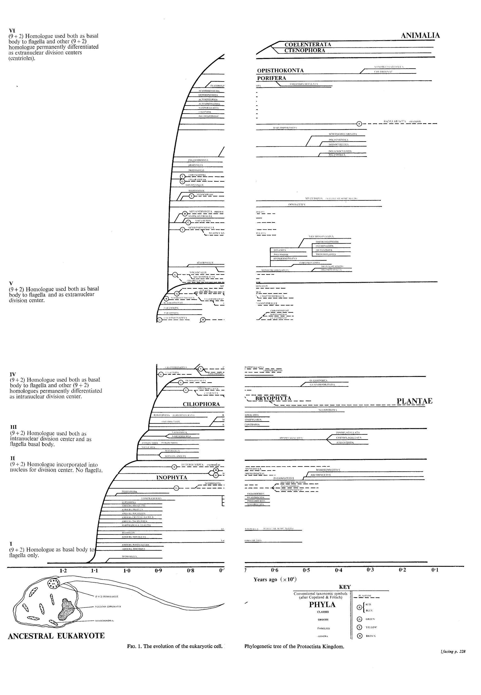

**Original:** Fig. 1. The evolution of the eukaryotic cell; phylogenetic tree of the Protoctista Kingdom.

**中文:** 图 1．真核细胞的演化与原生生物界的系统发生树。左侧示意（9+2）同源结构从鞭毛基体向细胞分裂中心演化的各阶段，右侧显示各生物类群及时间尺度。

**Source:** p.2 S006

**Original:** In defending the idea that the eukaryotic cell arose by a specific series of endosymbioses, a plausible scheme for the origin of mitosis itself emerges. ("Mitosis" is meant only in the classical sense; the analogous equal distribution of genes to daughter cells in prokaryotes is not relevant here.)

**中文:** 在捍卫真核细胞由一系列特定的内共生产生的观点时，出现了有丝分裂本身起源的合理方案。 （“有丝分裂”仅指经典意义上的；原核生物中基因向子细胞的类似均等分配与此无关。）

**Source:** p.2 S007

**Original:** The paper is organized into three parts. The first presents the theory of the origin of the eukaryotic cell. The second part is a compilation of the scientific literature in support of the sequences presented first. The last section suggests some experimental results which can be predicted from the theory.

**中文:** 本文分为三个部分。第一个提出了真核细胞起源的理论。第二部分是支持首先提出的序列的科学文献汇编。最后一部分提出了一些可以从理论预测的实验结果。

**Source:** p.2 H002

## 2. Hypothetical Origin of Eukaryotic Cells / 2．真核细胞起源的假说

**Source:** p.2 H003

## 2.1. THE EVOLUTION OF PROKARYOTIC CELLS IN THE REDUCING ATMOSPHERE / 2.1．还原性大气中原核细胞的演化

**Source:** p.2,3 S008

**Original:** Prokaryotic cells containing DNA, synthesizing protein on ribosomes, and using messenger RNA as intermediate between DNA and protein, are ancestral to all extant cellular life. Such cells arose under reducing conditions of the primitive terrestrial atmosphere (4.5-2.7 x 10 9 years ago). All earlier events leading to the origin of a population of free-living entities upon which natural selection could act (i.e. cells) are outside the province of this discussion, in other words they occurred prior to the events described herein (Bernal, 1957).

**中文:** 原核细胞含有 DNA，在核糖体上合成蛋白质，并使用信使 RNA 作为 DNA 和蛋白质之间的中间体，是所有现存细胞生命的祖先。这些细胞是在原始陆地大气的还原条件下（4.5-2.7 x 10 9 年前）产生的。所有导致自然选择可以作用的自由生活实体（即细胞）群体起源的早期事件都不在本次讨论的范围之内，换句话说，它们发生在本文描述的事件之前（Bernal，1957）。

**Source:** p.3 H004

## 2.2. THE EVOLUTION OF PORPHYRIN SYNTHETIC PATHWAYS, PHOTOSYNTHESIS, AND RESPIRATION IN PROKARYOTIC CELLS / 2.2．原核细胞中卟啉合成途径、光合作用和呼吸作用的演化

**Source:** p.3 S010

**Original:** Early in the history of prokaryotic cells, nucleotide sequences (genes) which coded for porphyrin syntheses, evolved. The following is considered to be a plausible historical sequence: photodisassociation of water vapor in the upper atmosphere resulted in the escape of free hydrogen which led to the production of molecular oxygen. This threatened the highly reduced nucleic acid of early self-replicating cellular systems. Associated metalchelated porphyrins protected these systems from oxidation. Genes coding for the pathways involved in the syntheses of such chelated porphyrins (e.g. the coenzymes of peroxidase and catalase) were selected for and retained under this continuing threat of naturally produced oxidizing agents. The incidental fact that such antimutagenic compounds preferentially absorb visible light was put to evolutionary advantage: cells eventually evolved containing mechanisms to produce ATP (and the other nucleotides) utilizing visible solar energy absorbed by chlorophyll-like porphyrins. These cells, now photosynthetic, replaced earlier ones in which ATP was synthesized by direct ultraviolet absorption. With energy released from photoproduced ATP, H atoms from atmospheric hydrogen and hydrogen sulfide were used in the reduction of CO2 for cell material.

**中文:** 在原核细胞历史的早期，编码卟啉合成的核苷酸序列（基因）就进化了。以下被认为是一个合理的历史顺序：高层大气中水蒸气的光解导致游离氢逸出，从而产生分子氧。这威胁到早期自我复制细胞系统的高度减少的核酸。相关的金属螯合卟啉保护这些系统免受氧化。在天然产生的氧化剂的持续威胁下，选择并保留了编码参与此类螯合卟啉（例如过氧化物酶和过氧化氢酶的辅酶）合成途径的基因。这种抗突变化合物优先吸收可见光的偶然事实被赋予了进化优势：细胞最终进化出了利用叶绿素样卟啉吸收的可见光太阳能产生 ATP（和其他核苷酸）的机制。这些细胞现在可以进行光合作用，取代了早期通过直接吸收紫外线合成 ATP 的细胞。利用光产生的 ATP 释放的能量，大气中的氢和硫化氢中的 H 原子被用于还原电池材料的 CO2。

**Source:** p.3 S011

**Original:** In other populations of heterotrophic microbes dependent upon fermentation of sugars and amino acids for ATP production, cells which used their porphyrins for more efficient oxidation of carbohydrates were eventually selected for. This resulted in microbes capable of cytochrome-mediated production of ATP via electron transport systems (e.g. anaerobic respirers: nitrate and sulfate reducers, etc.).

**中文:** 在依赖糖和氨基酸发酵产生 ATP 的其他异养微生物群体中，最终选择了使用卟啉更有效地氧化碳水化合物的细胞。这导致微生物能够通过电子传递系统（例如厌氧呼吸器：硝酸盐和硫酸盐还原剂等）进行细胞色素介导的 ATP 生产。

**Source:** p.3 S012

**Original:** Eventually, among the primitive phototrophs, a population of cells arose using photoproduced ATP with water as the source of hydrogen atoms in the reduction of CO2 for the production of cell material. This led to the formation of gaseous oxygen as a by-product of photosynthesis. Such oxygen elimination by microbial photosynthesizers increased the partial pressure of oxygen in the atmosphere. In the anaerobic respirers, the abundance, at least in some locations, of free oxygen led to the evolution of the final and aerobic step in respiration, i.e. the complete oxidation of carbohydrate via the cytochrome system with the elimination of CO2 and H20.

**中文:** 最终，在原始光养生物中，利用光生 ATP 和水作为氢原子来源，还原 CO2 来生产细胞材料，出现了一群细胞。这导致作为光合作用副产品的气态氧的形成。微生物光合作用的这种氧消除增加了大气中的氧分压。在无氧呼吸器中，至少在某些位置，丰富的游离氧导致了呼吸最终有氧步骤的演变，即碳水化合物通过细胞色素系统完全氧化，消除了CO2和H20。

**Source:** p.3,4 S013

**Original:** Among autotrophic microbes which used porphyrins in anaerobic photosynthesis in the light, mutants which could use these same porphyrins for aerobic respiration in the absence of light were eventually selected for. This resulted in the evolution of prokaryotic algae ancestral to extant blue-greens --with both photosynthetic and respiratory mechanisms for ATP production. These versatile prokaryotes represented a large step in cellular efficiency. They continued to eliminate gaseous oxygen in photosynthesis and further accelerated the transition to the oxidizing atmosphere. Thus, some time after the origin of the earth and before the deposition of oxidized rocks and micro-fossils--a period of about 2400 million years--populations of prokaryotes with the major photosynthetic and respiratory metabolic capabilities evolved (4.5-2.1 x 109 years ago).

**中文:** 在光下使用卟啉进行无氧光合作用的自养微生物中，最终选择了能够在没有光的情况下使用这些相同的卟啉进行有氧呼吸的突变体。这导致了原核藻类进化为现存的蓝绿藻——具有产生 ATP 的光合作用和呼吸机制。这些多功能的原核生物代表了细胞效率的一大进步。他们继续消除光合作用中的气态氧，并进一步加速向氧化气氛的转变。因此，在地球起源之后的一段时间，在氧化岩石和微化石沉积之前——大约24亿年——具有主要光合作用和呼吸代谢能力的原核生物种群进化了（4.5-2.1 x 109年前）。

**Source:** p.4 H005

## 2.3. THE EVOLUTION OF EUKARYOTIC CELLS FROM PROKARYOTIC CELLS BY SYMBIOSIS / 2.3．原核细胞通过共生演化为真核细胞

**Source:** p.4 S014

**Original:** The continued production of free oxygen as a by-product of photosynthesis resulted in a crisis: all cells had to adapt to an atmosphere containing oxygen, or they had to survive in a specialized anaerobic environment. The geological evidence indicates oxygen was present in the atmosphere as early as 2.7 x 109 years ago and became relatively abundant 1"2 x 109 years ago (Cloud, 1965). By this time, then, all production of abiogenic organic matter must have come to a halt; not only was its source of energy removed by ozone absorption of ultraviolet light in the upper atmosphere, but such organic matter, if it were produced, would have been rapidly oxidized (Abelson, 1963). Therefore all terrestrial life became dependent, either directly or indirectly, upon cellular photosynthesis before 1.2x 109 years ago. To insure replication of their nucleic acids, heterotrophs were forced to eat organic matter produced by photosynthetic or chemoautotrophic processes.

**中文:** 作为光合作用副产品的游离氧的持续产生导致了一场危机：所有细胞都必须适应含氧大气，或者它们必须在专门的厌氧环境中生存。地质证据表明，早在 2.7 x 109 年前，大气中就存在氧气，并在 1"2 x 109 年前变得相对丰富（Cloud，1965）。那么，到了这个时候，所有非生物有机物的产生必定都停止了；不仅其能量来源因臭氧吸收高层大气中的紫外线而被消除，而且这种有机物如果产生，也会被迅速氧化（Abelson， 1963）因此，在 1.2x 109 年前，所有陆地生命都直接或间接依赖于细胞光合作用，为了确保其核酸的复制，异养生物被迫吃光合作用或化学自养过程产生的有机物。

**Source:** p.4 S015

**Original:** It is suggested that the first step in the origin of eukaryotes from prokaryotes was related to survival in the new oxygen-containing atmosphere: an aerobic prokaryotic microbe (i.e. the protomitochondrion) was ingested into the cytoplasm of a heterotrophic anaerobe. This endosymbiosis became obligate and resulted in the evolution of the first aerobic amitotic amoeboid organisms.

**中文:** 有人认为，原核生物起源于真核生物的第一步与在新的含氧大气中的生存有关：需氧原核微生物（即原线粒体）被摄入异养厌氧生物的细胞质中。这种内共生成为专性的，并导致第一个需氧无丝分裂变形虫生物的进化。

**Source:** p.4 S016

**Original:** By hypothesis, some of these amoeboids ingested certain motile prokaryotes. Eventually these, too, became symbiotic in their hosts. The association of the motile prokaryote with the amoeboid formed primitive amoeboflagellates. In these heterotrophic amoeboflagellates classical mitosis evolved.

**中文:** 根据假设，其中一些变形虫摄入了某些能动的原核生物。最终，它们也与宿主共生。能动的原核生物与变形虫结合形成了原始变形鞭毛虫。在这些异养变形鞭毛虫中进化出了经典的有丝分裂。

**Source:** p.4,9 S017

**Original:** The evolution of mitosis, insuring an even distribution of large amounts of nucleic acid (i.e. host chromosomes containing host genes) at each cell division, must have taken millions of years. It most likely occurred after the transition to the oxidizing atmosphere, since all eukaryotic organisms contain mitochondria and are fundamentally aerobic. Based on the abundance of fossil eukaryotes, it must have occurred before the dawn of the Cambrian. Hence, the most likely period for the evolution of mitosis is between 1.2--0.6 x 109 years ago--a period of about 600 million years.

**中文:** 有丝分裂的进化必须花费数百万年的时间，以确保每次细胞分裂时大量核酸（即含有宿主基因的宿主染色体）的均匀分布。它最有可能发生在过渡到氧化气氛之后，因为所有真核生物都含有线粒体并且基本上是需氧的。根据丰富的真核生物化石，它一定发生在寒武纪黎明之前。因此，有丝分裂进化最有可能的时期是在1.2--0.6 x 109年前之间——大约6亿年的时期。

**Source:** p.9 S018

**Original:** The first symbiotic acquisition, that of the protomitochondrion, produced cells with the typical eukaryotic carbohydrate oxidative pathways. The anaerobic breakdown of glucose to pyruvate along the Embden-Myerhof pathway occurred in the soluble cytoplasm under the direction of the host genome. Further oxidation of glucose using molecular okygen via the Krebs cycle (H atoms from organic acids combine with DPN, FAD, and cytochromes; ATP is generated; and water is eliminated) occurred only in the symbiotic mitochondrion under the direction of its own genes.

**中文:** 第一个共生获得，即原线粒体，产生了具有典型真核碳水化合物氧化途径的细胞。在宿主基因组的指导下，葡萄糖沿着 Embden-Myerhof 途径厌氧分解为丙酮酸，发生在可溶性细胞质中。使用分子氧通过克雷布斯循环（有机酸中的氢原子与 DPN、FAD 和细胞色素结合；生成 ATP；并消除水）对葡萄糖的进一步氧化仅发生在共生线粒体中，在其自身基因的指导下。

**Source:** p.9 S019

**Original:** This mitochondrial-host symbiosis may have resulted in the typical eukaryotic phospholipid membrane and steroid synthesis and, in particular, the formation of a nuclear membrane and endoplasmic reticulum. The greater amounts of energy available after the incorporation of the mitochondrion resulted in large cells with amoeboid and cyclotic movement. However, the diversity in types and amounts of proteins such cells could make would have been limited by the amount of DNA available to administer protein synthesis. Hence, in the absence of any efficient mechanism to insure the equal distribution of newly synthesized DNA, the size of the amoeboids host cell must have been limited. Multinuclearity and duplicated cistrons or entire genomes (polyploidy) may have been early mechanisms to distribute greater amounts of DNA evenly to daughter cells, since multiple copies greatly increase the probability that each daughter will get at least one copy of the genome. However, the inefficiency of polyploidy and the selective advantage of linkage groups over polyploidy have been demonstrated (Gabriel, 1960). The problem of equal segregation of the daughter linkage groups remained.

**中文:** 这种线粒体-宿主共生可能导致了典型的真核磷脂膜和类固醇的合成，特别是核膜和内质网的形成。线粒体掺入后可用的能量更大，导致细胞变得更大，具有变形虫和环状运动。然而，这些细胞可以产生的蛋白质类型和数量的多样性将受到可用于蛋白质合成的 DNA 数量的限制。因此，在缺乏任何有效机制来确保新合成DNA均匀分布的情况下，变形虫宿主细胞的大小必定受到限制。多核性和重复的顺反子或整个基因组（多倍体）可能是将大量 DNA 均匀分配给子细胞的早期机制，因为多个拷贝大大增加了每个子细胞获得至少一个基因组拷贝的可能性。然而，多倍体的低效性和连锁基团相对于多倍体的选择性优势已被证明（Gabriel，1960）。子代连锁群体的平等隔离问题仍然存在。

**Source:** p.9 H006

## 2.4. THE EVOLUTION OF MITOSIS IN AMOEBOFLAGELLATES / 2.4．变形鞭毛虫中有丝分裂的演化

**Source:** p.9 S020

**Original:** How did the efficient mitotic mechanism which equally segregates daughter linkage groups evolve? The dividing nuclei of the lower eukaryotes themselves suggest a plausible evolutionary sequence for mitosis.

**中文:** 平等分离子连锁群的有效有丝分裂机制是如何进化的？低等真核生物的分裂核本身暗示了有丝分裂的合理进化顺序。

**Source:** p.9 S021

**Original:** It is likely that the large size and heterotrophic habits of the amoeboids led to the ingestion of all kinds of small prokaryotes (Trager, 1964). Among these, it is hypothesized that some ancestral amoeboid acquired a motile parasite, perhaps spirochaete-like, by ingestion. The genes of the parasite, of course, coded for its characteristic morphology, (9 +2) fibrils in cross section. Amoeboid host cells which retained their endosymbionts had the

**中文:** 变形虫的大体型和异养习性很可能导致其摄入各种小型原核生物（Trager，1964）。其中，据推测，一些祖先变形虫通过摄入获得了一种能运动的寄生虫，可能是螺旋体样的。当然，寄生虫的基因编码了其特征形态，即横截面中的 (9 +2) 原纤维。保留内共生体的变形虫宿主细胞具有

**Source:** p.10 F002

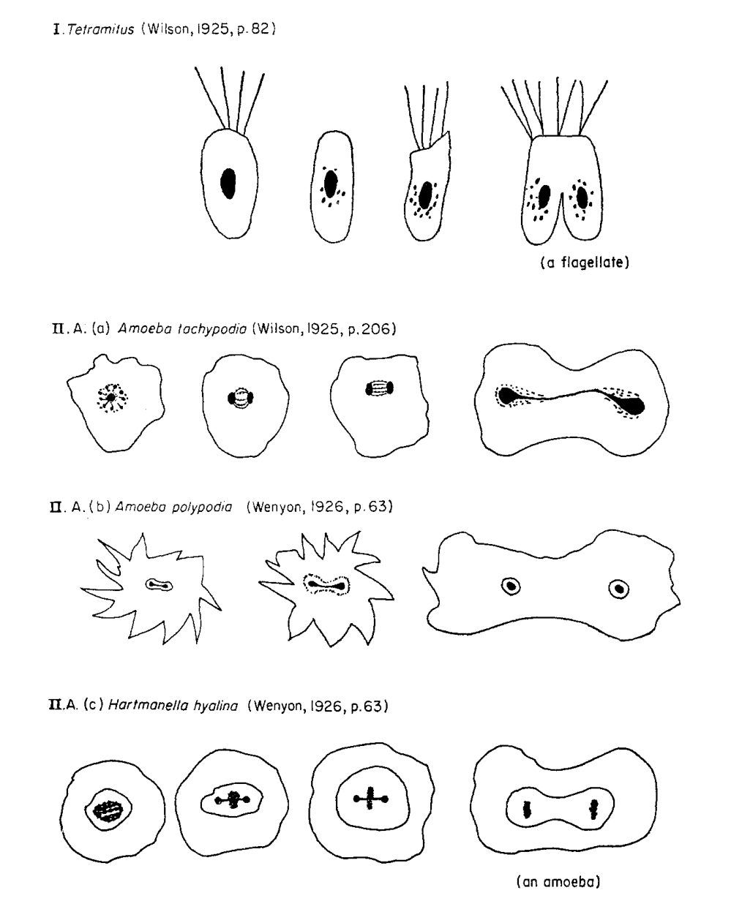

**Original:** Fig. 2. Mitotic figures of some representative eukaryotes.

**中文:** 图 2．部分代表性真核生物的有丝分裂图。

**Source:** p.10 C001

**Original:** FIG. 2. Mitotic figures of some representative eukaryotes. These figures were adapted from the illustrations which may be found in the references cited. The names of the organisms given are generic. The name in parenthesis indicates the larger group in which the organism can be found in Fig. 1, the phylogenetic tree. A common description is given for some of the more obscure genera. The Roman numeral groups correspond to branches on the phylogenetic tree as discussed in sections 2.5.1 to 2.5.6 of the text. The organisms in groups I, III and V are thought to be premitotic. In groups II, IV and VI the subgroupings A and B refer to "premitotic" and "eumitotic", respectively. [The lower ease letters (a), (b)... are simply included for reference.]

**中文:** 如图。 2.一些代表性真核生物的有丝分裂图。这些图改编自引用的参考文献中的插图。给出的生物体名称是通用的。括号中的名称表示该生物体可在图 1（系统发生树）中找到的较大类群。对一些较晦涩的属给出了常见的描述。罗马数字组对应于系统发生树上的分支，如文本第 2.5.1 至 2.5.6 节中所述。 I、III和V组中的生物体被认为是有丝分裂前的。在组II、IV和VI中，亚组A和B分别指“有丝分裂前”和“有丝分​​裂”。 [较低的缓和字母 (a)、(b)...仅供参考。]

**Source:** p.11 S022

**Original:** immense selective advantage of motility long before mitosis evolved; they could actively pursue their food.

**中文:** 早在有丝分裂进化之前就具有巨大的运动选择优势；他们可以积极地追求食物。

**Source:** p.11 S023

**Original:** By hypothesis, the motile prokaryotic endosymbiont itself is the ancestor of the complex flagellum of eukaryotic ceils. The replicating nucleic acid of the endosymbiont genes (which determines its characteristic (9+2) substructure) was eventually utilized to form the chromosomal centromeres and centrioles of eukaryotic eumitosis and to distribute newly synthesized host nuclear chromatin to host daughters.

**中文:** 根据假设，能动的原核内共生体本身就是真核细胞复杂鞭毛的祖先。内共生基因的复制核酸（决定其特征性的（9+2）亚结构）最终被用来形成真核细胞有丝分裂的染色体着丝粒和中心粒，并将新合成的宿主核染色质分配给宿主子代。

**Source:** p.11 S024

**Original:** How did endosymbiont nucleic acid differentiate into chromosomal centromeres and centrioles ? At least two serieg of mutational steps were required: one leading to the development of some attraction between nucleic acid of the host and that of the symbiont, and eventually, to permanent connections of daughter endosymbionts precisely to daughter chromosomes of the hosts in the formation of chromosomal centromeres; a second leading to the segregation of the replicated daughter endosymbionts to opposite poles of the host cell. In any case, in each generation only those amoeboid daughter cells containing a full euploid gcnome--that is, at least one copy of each gene--were selected. This insured continuing selection pressure for improved mechanisms of host nucleic acid segregation. Judging from presentday mitotic figures among lower eukaryotes, it probably led to the development of eumitosis at various times in various primitive amoeboflagellates. This might be considered analogous to the development of different mechanisms determining sexual polymorphism in higher organisms. The biological goal of all of these is the same: insurance that genetic recombination systematically accompanies reproduction. Just as the various sex determining mechanisms are not directly homologous (e.g. ovaries in insects, mammals, and flowering plants), it is likely, too, that some eumitoses in lower eukaryotes are analogous rather than directly homologous.

**中文:** 内共生核酸如何分化成染色体着丝粒和中心粒？至少需要两个系列的突变步骤：一个导致宿主的核酸和共生体的核酸之间产生某种吸引力，并最终导致子代内共生体在染色体着丝粒的形成中精确地与宿主的子代染色体永久连接；第二个导致复制的子内共生体分离到宿主细胞的相反两极。无论如何，在每一代中，仅选择那些含有完整整倍体基因组（即每个基因至少一个拷贝）的变形虫子细胞。这确保了改进宿主核酸分离机制的持续选择压力。从当今低等真核生物的有丝分裂数字来看，它可能导致了各种原始变形鞭毛虫在不同时期的有丝分裂的发展。这可能被认为类似于高等生物中决定性多态性的不同机制的发展。所有这些的生物学目标都是相同的：确保基因重组系统地伴随繁殖。正如各种性别决定机制并不直接同源（例如昆虫、哺乳动物和开花植物的卵巢）一样，低等真核生物中的一些有丝分裂也可能是类似的，而不是直接同源的。

**Source:** p.11 S025

**Original:** A corollary of this is the assertion that primitive eukaryotes can be classified according to the various lines they represent in the evolution of eumitosis. An attempt to reconstruct these lines on the basis of cytological and genetic information accumulated from the literature is presented in sections 2.5.1 to 2.5.6 below. The plausible steps in the differentiation of the chromosomal centromeres and centrioles from "(9 +2) homologue" flagelIar basal bodies have been reconstructed from the available data and the immediate selective advantages of each step is discussed in sections 2.5.1 to 2.5.6. The large groups of organisms which presumably derived from these steps, are presented on branches I to vI of the phylogenetic tree (Fig. 1). The groups were formed to include as much data as possible on the eumitosis of lower eukaryotes in a way which is considered to be consistent with the general classification of these organisms, exclusive of their photosynthetic plastids.

**中文:** 由此推论，原始真核生物可以根据它们在有丝分裂进化中所代表的不同谱系进行分类。下面第 2.5.1 至 2.5.6 节介绍了根据文献中积累的细胞学和遗传信息重建这些细胞系的尝试。染色体着丝粒和中心粒与“(9+2)同源”鞭毛基体的分化的合理步骤已根据现有数据重建，并且每个步骤的直接选择优势在第2.5.1至2.5.6节中讨论。推测源自这些步骤的大类生物体出现在系统发生树的 I 至 vI 分支上（图 1）。这些组的形成是为了包括尽可能多的有关低等真核生物有丝分裂的数据，其方式被认为与这些生物体的一般分类一致，不包括其光合质体。

**Source:** p.12 F003

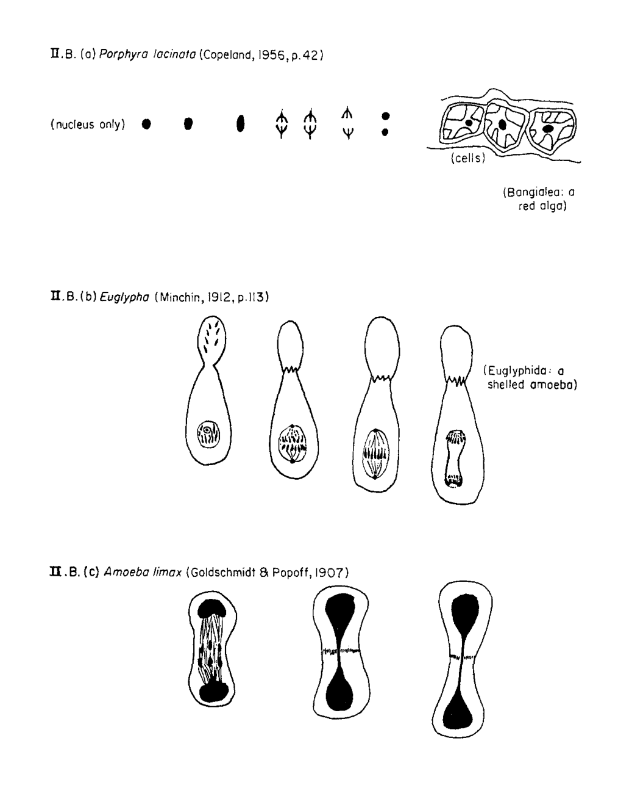

**Original:** Fig. 2. Mitotic figures of some representative eukaryotes (continued).

**中文:** 图 2．部分代表性真核生物的有丝分裂图（续）。

**Source:** p.12 C002

**Original:** FIc. 2. Mitotic figures of some representative eukaryotes (cont.).

**中文:** 图。 2. 一些代表性真核生物的有丝分裂图（续）。

**Source:** p.13 H007

## 2.5 STEPS IN THE EVOLUTION OF EUMITOSIS / 2.5．典型有丝分裂演化的各个步骤

**Source:** p.13 S026

**Original:** The corresponding figures, together comprising "Fig. 2", were adapted from the literature as examples of actual mitotic figures. The term "(9 + 2) homologue" refers to the flagella and cilia, as well as to the more specialized cirri (fused cilia), axopodia, and other cellular organelles with the characteristic electron microscope cross section. "Basal bodies" (found at the base of these motile organelles, maybe self-reproducing), centrioles, or some other submicroscopic homologues are considered to be the repository of the nucleic acid of the replicating system and, thus, the descendants of the genes of the original symbiont. The "division center" is considered to be homologous also (Wilson, 1925, see p. 204). Therefore, the term "(9 +2) homologue" is used here in its most general sense; it implies the genetic system that codes for the development of flagella, cilia, "division centers", centrioles, or any other of these homologous organelles. Diagrams I to VI, which illustrate the hypothesized relationships between host genome and (9+2) homologue genome, include in each generation the ratios of symbiont to host genomes suggested by the theory. Although at least one dividing (9 +2) homologue on each host linkage group (i.e. a chromosomal centromere) is required to insure euploidy, multiple numbers of chromosomes in the schematic diagrams have been omitted for clarity; their omission changes in no way the general argument. We know that very closely related species can differ in their total chromosome number and, in general, the number per se of any fundamentally replicative structure itself is a very poor criterion in taxonomy (Dillon, 1962). In the diagrams, the numerator in the ratio "symbiont (9+2) genomes per host nuclear genome" refers only to functionally distinct (9 + 2) homologues.

**中文:** 相应的图一起组成“图2”，改编自文献作为实际有丝分裂图的例子。术语“(9+2)同源物”指的是鞭毛和纤毛，以及更特化的纤毛（融合纤毛）、轴足和其他具有特征电子显微镜横截面的细胞器。 “基体”（在这些运动细胞器的底部发现，可能自我复制）、中心粒或一些其他亚显微同源物被认为是复制系统的核酸库，因此是原始共生体基因的后代。 “划分中心”也被认为是同源的（Wilson，1925，参见第 204 页）。因此，术语“(9+2)同系物”在此以其最一般的含义使用；它意味着编码鞭毛、纤毛、“分裂中心”、中心粒或任何其他同源细胞器发育的遗传系统。图 I 至 VI 说明了宿主基因组和（9+2）同源基因组之间的假设关系，包括理论所建议的每一代共生体与宿主基因组的比率。尽管每个宿主连锁群（即染色体着丝粒）上至少需要一个分裂（9 +2）同源物来确保整倍性，但为了清楚起见，在示意图中省略了多个染色体；他们的遗漏丝毫不会改变一般论点。我们知道，关系非常密切的物种的染色体总数可能有所不同，一般来说，任何基本复制结构本身的数量本身在分类学中是一个非常糟糕的标准（Dillon，1962）。在图中，比率“每个宿主核基因组的共生体(9+2)基因组”中的分子仅指功能上不同的(9+2)同源物。

**Source:** p.13 S027

**Original:** "Premitosis", in Diagrams I to VI, explicitly illustrates the phenomena presumably at the basis of the lack of "sex" (meiosis and fertilization) in many lower eukaryotes. These organisms have the general features of eukaryotic cells (mitochondria, nuclear membranes, etc.), but their "aberrant" division figures often lack the spindles and centrioles of typical eumitosis. (Amoeba, Euglena, Tetramitus, etc. : see Fig. 2). They are probably not degenerate phytoflagellates, but eukaryotic organisms which are premitotic in the sense that they branched off the main lines of higher cell evolution before eumitosis evolved. The diploid-haploid cycle (i.e. "sex") is the surest indication of the evolution of eumitosis in any group of organisms. Eumitotic organisms, therefore, are those which demonstrate the typical genetic patterns described as Mendelian.

**中文:** 图I至VI中的“有丝分裂前”明确地说明了许多低等真核生物中可能基于缺乏“性”（减数分裂和受精）的现象。这些生物体具有真核细胞的一般特征（线粒体、核膜等），但它们的“异常”分裂图形往往缺乏典型有丝分裂的纺锤体和中心粒。 （变形虫、眼虫、Tetramitus 等：见图 2）。它们可能不是退化的植物鞭毛虫，而是有丝分裂前的真核生物，因为它们在有丝分裂进化之前从高等细胞进化的主线中分支出来。二倍体-单倍体循环（即“性别”）是任何生物体群体有丝分裂进化的最可靠指示。因此，有丝分裂生物是那些表现出孟德尔典型遗传模式的生物。

**Source:** p.13 H008

## 2.5.1. (9+2) Homologue as basal body for flagella only / 2.5.1．（9+2）同源结构仅作为鞭毛基体

**Source:** p.13 S028

**Original:** In the first group of primitive eukaryotic flagellates, the nucleic acid of the motile symbiont is used only for its own replication and synthesis of

**中文:** 在第一组原始真核鞭毛虫中，运动共生体的核酸仅用于其自身的复制和合成

**Source:** p.14 F004

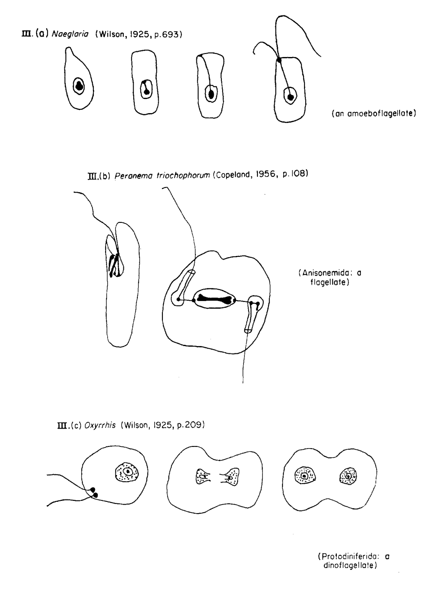

**Original:** Fig. 2. Mitotic figures of some representative eukaryotes (continued).

**中文:** 图 2．部分代表性真核生物的有丝分裂图（续）。

**Source:** p.14 C003

**Original:** FIG. 2. Mitotic figures of some representative eukaryotes (cont.).

**中文:** 如图。 2. 一些代表性真核生物的有丝分裂图（续）。

**Source:** p.15 S029

**Original:** its own protein. The immediate selective advantage of the acquisition of the (9 + 2) endosymbiont was motility. Relic of this event may persist in some isolated groups of small flagellates, e.g. Tetramitus (Wilson, 1925, see p. 82.) "Mitosis" in these organisms is by no means standard and, of course, sexuality in the meiotic sense is unknown and, by hypothesis, will never be found (Fig. 2. I, Diagram I).

**中文:** 它自己的蛋白质。获得（9+2）内共生体的直接选择优势是运动性。这一事件的遗迹可能会持续存在于一些孤立的小鞭毛虫群体中，例如Tetramitus（Wilson，1925，参见第 82 页。）这些生物体中的“有丝分裂”绝不是标准的，当然，减数分裂意义上的性行为是未知的，并且根据假设，永远不会被发现（图 2. I，图 I）。

**Source:** p.15 F005

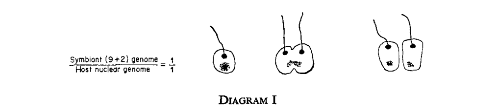

**Original:** Diagram I.

**中文:** 示意图 I。图例：共生体的（9+2）基因组、宿主核基因组；premitosis 为前有丝分裂阶段，eumitosis 为典型有丝分裂阶段。

**Source:** p.15 H009

## 2.5.2. (9+2) Homologue incorporated into the nucleus for division center, no flagella / 2.5.2．（9+2）同源结构进入细胞核并充当分裂中心，不形成鞭毛

**Source:** p.15 S030

**Original:** Mutations occurring in populations of organisms described in section 2.5.1, led to attractions between host and (9 + 2) endosymbiont nucleic acid, which resulted in the incorporation of the replicating genome of the (9 + 2) symbiont into the nucleus of the host. When the (9 + 2) symbiont divided, it was utilized by the host as an intranuclear "division center". (The term "division center" is taken from the classical literature, see Wilson, 1925, p. 204.) The body stains deeply with nuclear dyes. Its homologies to basal bodies of flagella, etc., were recognized (and disputed) in the elegant lightmicroscopic studies on protozoan mitosis early in this century (Wilson, 1925, p. 206; Wenyon, 1926, see pp. 62 and 102).

**中文:** 第 2.5.1 节中描述的生物群体中发生的突变导致宿主和 (9 + 2) 内共生体核酸之间的吸引，从而导致 (9 + 2) 共生体的复制基因组并入宿主的细胞核中。当(9+2)共生体分裂时，它被宿主用作核内“分裂中心”。 （术语“分裂中心”取自古典文献，参见 Wilson，1925，第 204 页。）尸体被核染料深深染色。它与鞭毛基体等的同源性在本世纪初对原生动物有丝分裂的优雅光学显微镜研究中得到了认可（并有争议）（Wilson，1925，第 206 页；Wenyon，1926，参见第 62 和 102 页）。

**Source:** p.15 S031

**Original:** These events first produced premitotic amoebae, which never have flagella at any stage of their life cycle but contain intranuclear division centers. Possibly multinuclear and other asexual amoebae are relics of this premitotic stage. For example, Dobell says of division in Amoeba lacertae: "No equatorial plate is formed and the 'chromosomes', or chromatic granules wander irregularly toward the poles, the whole karyosome meanwhile drawing out into a spindle shape and finally dividing. It is doubtful whether we can here speak of chromosomes or even mitosis, but such a type of division might well form the point of departure for the evolution of a true mitotic process" (Wilson, 1925, p. 213; Wenyon, 1926, p. 101) [Fig. 2. II A. (a) to (c)].

**中文:** 这些事件首先产生了有丝分裂前的变形虫，它们在生命周期的任何阶段都没有鞭毛，但含有核内分裂中心。多核变形虫和其他无性变形虫可能是这个有丝分裂前阶段的遗迹。例如，多贝尔在谈到蛇形变形虫的分裂时说道：“没有形成赤道板，‘染色体’或彩色颗粒不规则地向两极漂移，整个核体同时拉成纺锤形并最终分裂。我们在这里是否可以谈论染色体甚至有丝分裂是值得怀疑的，但这种类型的分裂很可能构成真正有丝分裂过程进化的出发点”（威尔逊， 1925 年，第 213 页；温尼恩，1926 年，第 101 页） 2. II A. (a) 至 (c)]。

**Source:** p.15 S032

**Original:** Eventually different groups of eumitotic organisms evolved from these various amoebae, namely, some eumitotic amoebae; the zygomycetes, ascomycetes, and basidiomycetes; the cellular slime molds; the conjugating green algae; the two great classes of red algae and their green counterparts

**中文:** 最终，不同类群的有丝分裂生物从这些不同的变形虫进化而来，即一些有丝分裂的变形虫。接合菌、子囊菌和担子菌；细胞粘菌；接合绿藻；两大类红藻及其绿藻

**Source:** p.16 F006

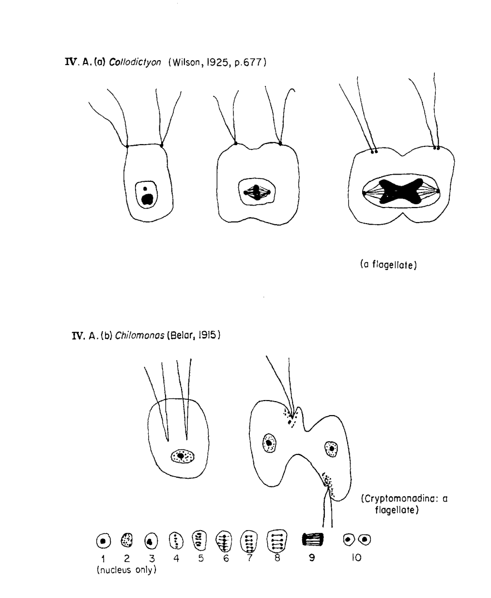

**Original:** Fig. 2. Mitotic figures of some representative eukaryotes (continued).

**中文:** 图 2．部分代表性真核生物的有丝分裂图（续）。

**Source:** p.16 C004

**Original:** Fla. 2. Mitotic figures of some representative eukaryotes (cont.).

**中文:** Fla. 2. 一些代表性真核生物的有丝分裂图（续）。

**Source:** p.17 S033

**Original:** --the Schizogoniacea. All of these organisms lack flagella at all stages in their life cycles, even though many of them are aquatic [Fig. 2. liB. (a) to (c)] (Copeland, 1956, p. 42; Minchin, 1912, p. 113; Goldschmidt & Popoff, 190 7).

**中文:** ——裂殖科。所有这些生物体在其生命周期的各个阶段都缺乏鞭毛，尽管其中许多是水生的[图1]。 2. 库。 (a) 至 (c)]（Copeland，1956 年，第 42 页；Minchin，1912 年，第 113 页；Goldschmidt 和 Popoff，190 7）。

**Source:** p.17 S034

**Original:** How did eumitosis begin in this line which permanently lacked flagella? The first step may have involved replications of the (9 + 2) homologue (after it had become the intranuclear division center) in the absence of nuclear division. This made available pairs of intranuclear (9+2) homologues. Some mutation then occurred causing one member of the pair to be attracted to host chromatin and eventually to function as chromosomal centromere. The other, not attracted to host chromatin, functioned as an intranuclear centriole. The members of these pairs attracted one another. The attraction of the (9 +2) homologue (chromosomal centromere) dragging with it host chromatin as it moved toward its sister (9+2) homologue (intranuclear centriole) may be analogous to whatever mechanisms are generally involved in attractions of prokaryotic cells to each other prior to mating.

**中文:** 在这个永久缺乏鞭毛的品系中，有丝分裂是如何开始的？第一步可能涉及在没有核分裂的情况下（9 + 2）同源物的复制（在它成为核内分裂中心之后）。这使得核内 (9+2) 同系物对可用。然后发生一些突变，导致这对中的一个成员被宿主染色质吸引，并最终充当染色体着丝粒。另一个不被宿主染色质吸引，充当核内中心粒。这些组合的成员互相吸引。当 (9+2) 同源物（染色体着丝粒）向其姊妹 (9+2) 同源物（核内中心粒）移动时，其拖曳宿主染色质的吸引力可能类似于原核细胞在交配前相互吸引所涉及的任何机制。

**Source:** p.17 F007

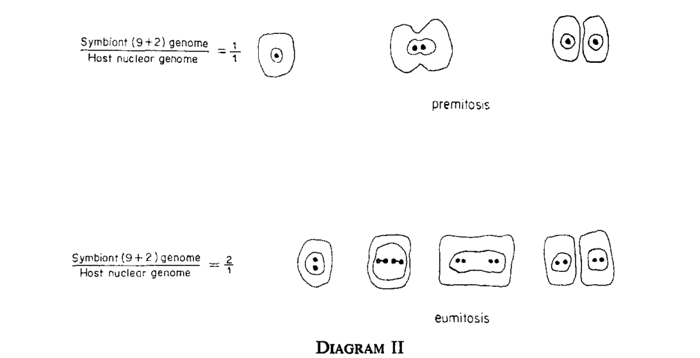

**Original:** Diagram II.

**中文:** 示意图 II。图例：共生体的（9+2）基因组、宿主核基因组；premitosis 为前有丝分裂阶段，eumitosis 为典型有丝分裂阶段。

**Source:** p.17 H010

## 2.5.3. (9+2) Homologue used both as intranuclear division center and as flagellar basal body / 2.5.3．（9+2）同源结构同时作为核内分裂中心和鞭毛基体

**Source:** p.17 S035

**Original:** Off of this ancestral animal flagellate line, cells evolved which were motile at certain stages in the life cycle. At other stages the (9 +2) flagellar basal body entered the nucleus and divided. While the (9 + 2) homologue divided, it was "borrowed" as an intranuclear division center for segregation of host chromatin. After division, the (9 + 2) homologue resumed its function at the base of the flagellum. This line may have led to a number of amoebo-flagellates which do not divide during their motile stages; in some a morphological relationship between flagella and nucleus may be seen [Fig. 2. III (a) to (c)].

**中文:** 从这种祖先动物鞭毛线中，细胞进化出来，在生命周期的某些阶段具有活动性。在其他阶段，(9+2)鞭毛基体进入细胞核并分裂。当(9+2)同源物分裂时，它被“借用”作为核内分裂中心，用于分离宿主染色质。分裂后，(9 + 2) 同源物在鞭毛基部恢复其功能。这条线可能导致了许多阿米巴鞭毛虫在运动阶段不分裂。在某些情况下，可以看到鞭毛和细胞核之间的形态关系[图1]。 2. 三(a)至(c)]。

**Source:** p.18 F008

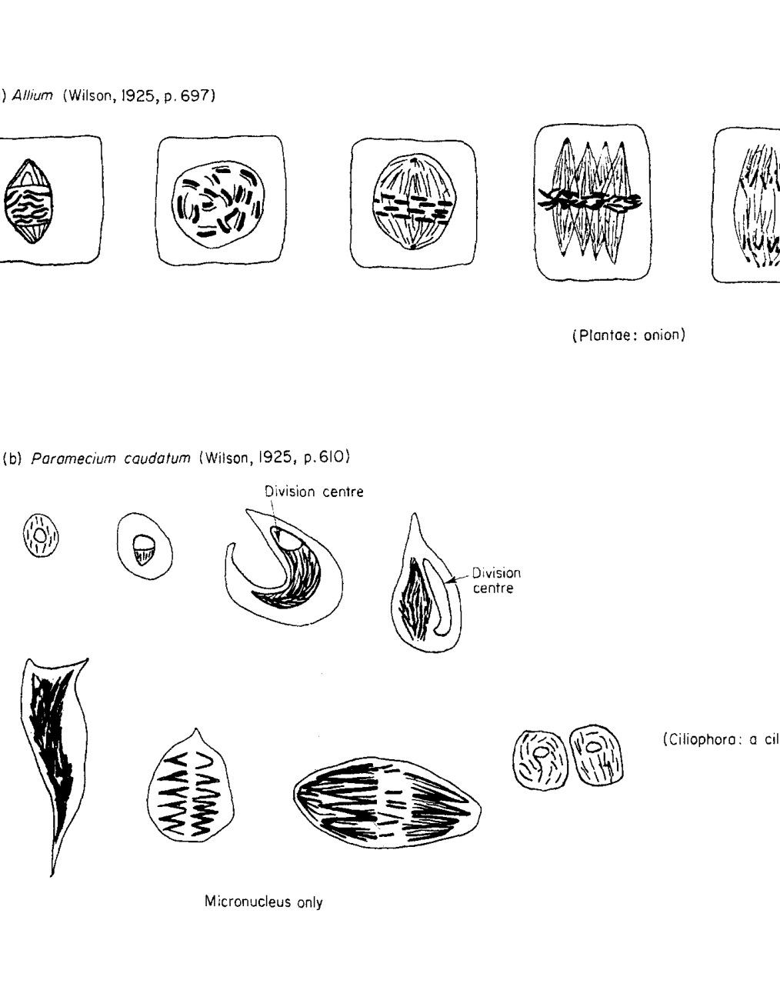

**Original:** Fig. 2. Mitotic figures of some representative eukaryotes (continued).

**中文:** 图 2．部分代表性真核生物的有丝分裂图（续）。

**Source:** p.18 C005

**Original:** FIG. 2. Mitotic figures of some representative eukaryotes (cont.).

**中文:** 如图。 2. 一些代表性真核生物的有丝分裂图（续）。

**Source:** p.19 S036

**Original:** p. 209); Dimastigamoeba, ltfastigella and Mastigina (Goldschmidt. 1907). The first three groups are considered to be premitotic in that sexual phenomena are not known, or its occurrence seriously disputed (Diagram III).

**中文:** p。 209）； Dimastigamoba、ltfastigella 和 Mastigina (Goldschmidt. 1907)。前三组被认为是有丝分裂前的，因为性现象尚不清楚，或者其发生存在严重争议（图 III）。

**Source:** p.19 F009

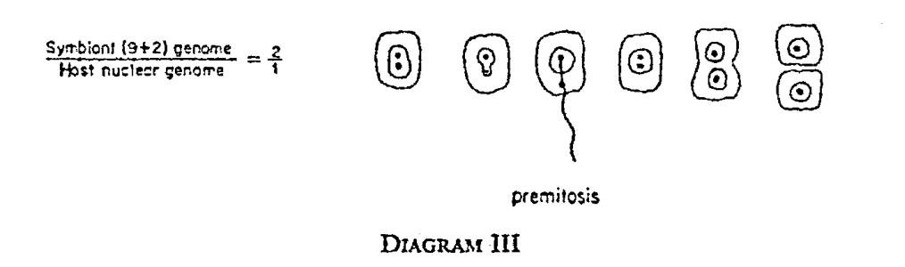

**Original:** Diagram III.

**中文:** 示意图 III。图例：共生体的（9+2）基因组、宿主核基因组；premitosis 为前有丝分裂阶段，eumitosis 为典型有丝分裂阶段。

**Source:** p.19 H011

## 2.5.4. (9+2) Homologues used as basal bodies to flagella and other (9+2) homologues permanently differentiated as intranuclear division centers / 2.5.4．部分（9+2）同源结构作为鞭毛基体，另一些永久分化为核内分裂中心

**Source:** p.19 S037

**Original:** Mutations occurring off the general line of amoeboflagellates essentially produced two separate (9+2) homologue "clones". One mutant (9+2) homologue produced "offspring" which served permanently as intranuclear division centers. The other (9+2) homologue produced offspring which

**中文:** 变形虫鞭毛虫总系发生的突变基本上产生了两个独立的（9+2）同源“克隆”。一种突变体（9+2）同源物产生“后代”，永久充当核内分裂中心。另一个 (9+2) 同源物产生的后代

**Source:** p.19 S038

**Original:** remained as basal bodies to the flagella only. An intranuclear division center and eventually eumitosis evolved in a line in which (9+2) homologue-basal bodies to independent flagella were retained. This series of mutations (which may have occurred more than once) presumably led to groups ofprotozoans, green algae, golden algae, etc. Some of these groups are clearly premitotic (e.g. Euglenids) [Fig. 2. IV (a), (b)], (Wilson, 1925, p. 697; Belar, 1915).

**中文:** 仅保留为鞭毛的基体。核内分裂中心和最终的有丝分裂在保留了独立鞭毛的(9+2)同源基体的谱系中进化。这一系列突变（可能发生不止一次）可能导致原生动物、绿藻、金藻等群体的产生。其中一些群体明显是有丝分裂前的（例如眼虫）[图 1]。 2. IV (a), (b)]，（Wilson，1925 年，第 697 页；Belar，1915 年）。

**Source:** p.19 S039

**Original:** One, or perhaps several, of these lines led to the eumitotic green plants with anteriorly flagellated motile stages and (by hypothesis) intranuclear division centers (Wilson, 1925, p. 151); another may have evolved some sporozoans (Copeland, 1956, p. 17).

**中文:** 这些品系中的一个或几个可能导致了有丝分裂的绿色植物，其具有前面有鞭毛的运动阶段和（根据假设）核内分裂中心（Wilson，1925，p.151）；另一种可能进化出了一些孢子虫（Copeland，1956，p.17）。

**Source:** p.19 S040

**Original:** The selective advantage of these mutations is clear: they insure the organism both equal distribution of its chromatin and retention of its flagellar motility.

**中文:** 这些突变的选择性优势是显而易见的：它们确保生物体染色质的均匀分布和鞭毛运动的保留。

**Source:** p.19 S041

**Original:** The relatively homogenous groups of protozoans, the ciliates with their dimorphic nuclei, presumably evolved from an analogous series of mutations off the primitive amoeboflagellate line. They have a eumitotic micro-nucleus (with an intranuclear spindle) reserved for genetic continuity (Weinrich, 1954). They also maintain replicating basal bodies to the (9+2) cilia of the cortex independent of the mitotic apparatus. However, the

**中文:** 相对同质的原生动物类群，即具有二态性核的纤毛虫，可能是从原始阿米巴鞭毛虫系的一系列类似突变进化而来的。它们有一个为遗传连续性而保留的有丝分裂微核（具有核内纺锤体）（Weinrich，1954）。它们还独立于有丝分裂器维持将基体复制到皮质的（9+2）纤毛。然而，

**Source:** p.20 F010

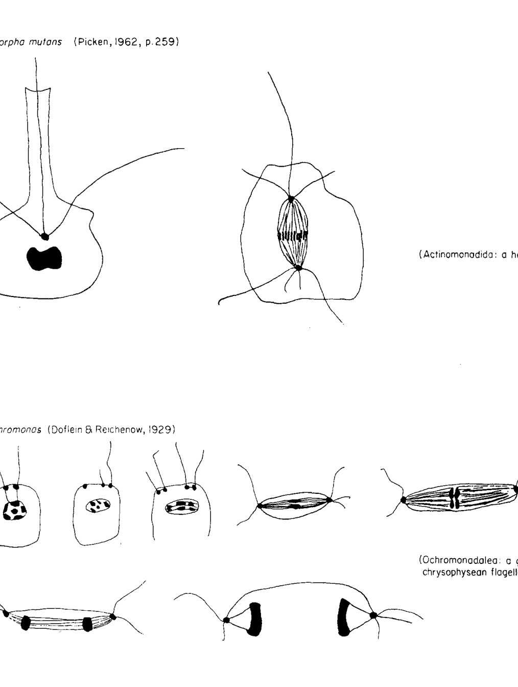

**Original:** Fig. 2. Mitotic figures of some representative eukaryotes (continued).

**中文:** 图 2．部分代表性真核生物的有丝分裂图（续）。

**Source:** p.20 C006

**Original:** FIG. 2. Mitotic figures of some representative eukaryotes (cont.).

**中文:** 如图。 2. 一些代表性真核生物的有丝分裂图（续）。

**Source:** p.21 S042

**Original:** nucleus contains no chromosomal centromeres or individual chromosomes and divides by amitosis. Presumably, the series of mutations which were selected for in the evolution of eumitosis in the micronucleus began in a binucleate cell, one in which many copies of the genome were regularly produced and reserved for the active administration of protein synthesis. The evolution of eumitosis never occurred in the macronucleus [Fig. 2. IV B. (b)] (Wilson, 1925, p. 610).

**中文:** 细胞核不包含染色体着丝粒或单个染色体，并通过有丝分裂进行分裂。据推测，在微核有丝分裂进化过程中选择的一系列突变始于双核细胞，在双核细胞中，有规律地产生许多基因组拷贝，并保留用于蛋白质合成的主动管理。有丝分裂的进化从未在大核中发生过[图1]。 2.IV B.(b)]（威尔逊，1925 年，第 610 页）。

**Source:** p.21 F011

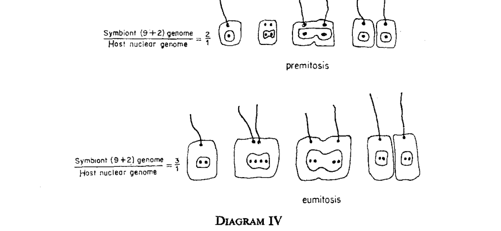

**Original:** Diagram IV.

**中文:** 示意图 IV。图例：共生体的（9+2）基因组、宿主核基因组；premitosis 为前有丝分裂阶段，eumitosis 为典型有丝分裂阶段。

**Source:** p.21 H012

## 2.5.5. (9+2) Homologue used both as basal body to flagella and as extranuclear "division center" / 2.5.5．（9+2）同源结构同时作为鞭毛基体和核外“分裂中心”

**Source:** p.21 S043

**Original:** In members of the early amoeboflageUate populations already containing intranuclear (9 +2) homologues mutations must have occurred leading to cells in which the basal bodies of the flagella, when they divided, functioned as extranuclear division centers. Such striking examples of the basal body functioning as an extranuclear division center during mitotic stages exist in quite different forms among many extant organisms [Dimorpha mutans (Picken, 1962), Clathrina (Wilson, 1925, p. 42), Ochromonas and Centropyxis (Doflein & Reichenow, 1929)]. Some of these organisms [e.g. Aeanthocystis (Calkins, 1909), Wagnerella (Wilson, 1925, p. 677)] have animal-type division figures, but ones in which centrioles are indistinguishable from the flagellar basal bodies. During division the flagella of many of these organisms are still attached to the centrioles at the poles of the mitotic figure. In some cases when the (9+2) homologue divides, one product of the division functions as centriole, and the other gives rise to the flagellar basal body which differentiates and is no longer capable of continued replication (Renaud & Swift, 1964).

**中文:** 在已经含有核内（9+2）同源物的早期变形鞭毛群体的成员中，一定发生了突变，导致细胞中鞭毛的基体在分裂时充当核外分裂中心。基体在有丝分裂阶段作为核外分裂中心的这种引人注目的例子在许多现存生物中以完全不同的形式存在[Dimorpha mutans (Picken, 1962)、Cathrina (Wilson, 1925, p. 42)、Ochromonas 和 Centropyxis (Doflein & Reichenow, 1929)]。其中一些生物体[例如Aeanthocystis (Calkins, 1909), Wagnerella (Wilson, 1925, p. 677)]具有动物型分裂图形，但中心粒与鞭毛基体无法区分。在分裂过程中，许多这些生物体的鞭毛仍然附着在有丝分裂图两极的中心粒上。在某些情况下，当（9+2）同源物分裂时，分裂的一种产物充当中心粒，另一种产生鞭毛基体，鞭毛基体分化并且不再能够继续复制（Renaud＆Swift，1964）。

**Source:** p.22 F012

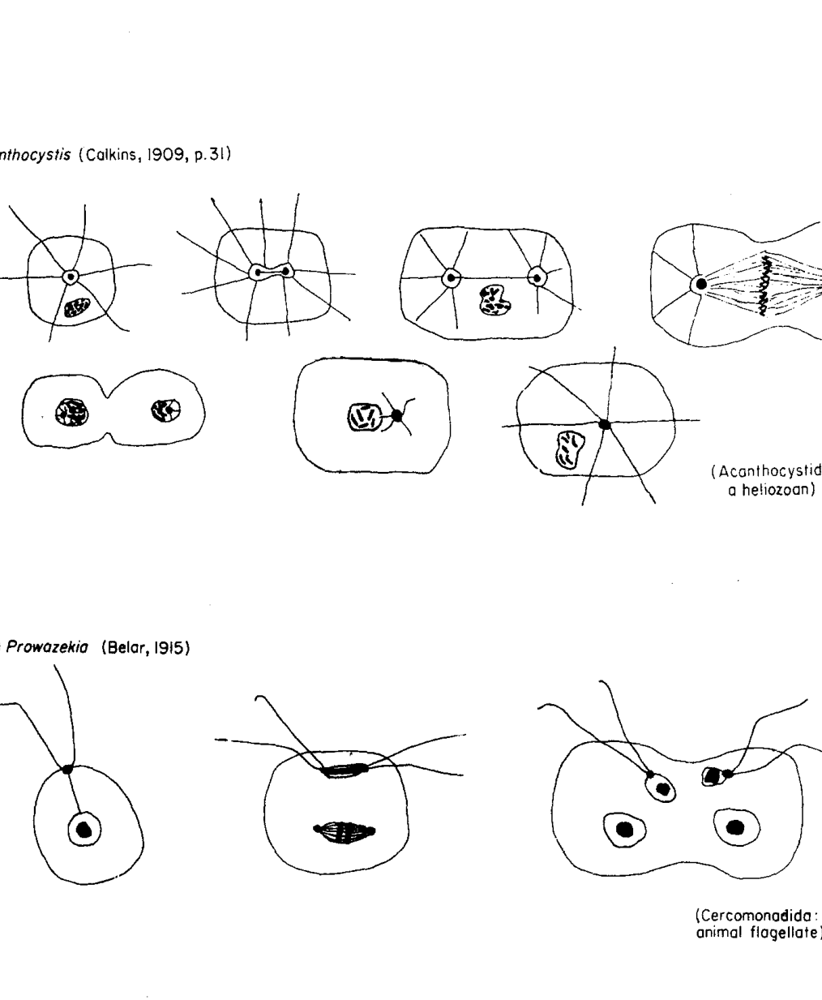

**Original:** Fig. 2. Mitotic figures of some representative eukaryotes (continued).

**中文:** 图 2．部分代表性真核生物的有丝分裂图（续）。

**Source:** p.22 C007

**Original:** FI~. 2. Mitotic figures of some representative eukaryotes (cont.).

**中文:** 菲～。 2. 一些代表性真核生物的有丝分裂图（续）。

**Source:** p.23 S044

**Original:** On this evolutionary line, in which dividing extranuclear basal bodies functioned as centrioles attracted to intranuclear chromosomal centromeres, it is likely that a series of specialized flagellates arose, which maintain throughout the life cycle some morphological connection between the flagellar apparatus and the mitotic figure, e.g. Trichomonas (Wilson, 1925, p. 205); Polymastix (Wilson, 1925, p. 694); Heteromita (Wenyon, 1926, p. 118); Prowazekia (Belar, 1915) and Eudorina (Hartmann, 1921). In some organisms this connection was probably secondarily lost, e.g. Cryptobia (Copeland, 1956, p. 160); Herpetomonas (Wenyon, 1926, p. 118); Vaucheria (Fritsch, 1935, p. 70); Dictyota (Wilson, 1925, p. 200); Paramoeba (Goldschmidt & Popoff, 1907); Gurleya (Wenyon, 1926, p. 742). Hypermastigote protozoans, whose mitotic centrioles form from the flagellar band in the living ceil, are especially illustrative of this group (Copeland, 1956, p. 171; Cleveland, 1956, 1963). For example, after much study of the life cycle of the centrioles in the hypermastigote, Barbulanympha, Cleveland concludes:

**中文:** 在这条进化路线上，分裂的核外基体起到吸引核内染色体着丝粒的中心粒的作用，很可能出现了一系列专门的鞭毛虫，它们在整个生命周期中维持鞭毛器和有丝分裂图之间的一些形态学联系，例如鞭毛器和有丝分裂图。滴虫（Wilson，1925，第 205 页）； Polymastix（Wilson，1925，第 694 页）； Heteromita（Wenyon，1926，第 118 页）； Prowazekia (Belar, 1915) 和 Eudorina (Hartmann, 1921)。在某些生物体中，这种联系可能会继而丧失，例如。 Cryptobia（Copeland，1956，第 160 页）；疱疹单胞菌 (Wenyon, 1926, p. 118)； Vaucheria（Fritsch，1935，第 70 页）； Dictyota (Wilson, 1925, p. 200)；帕拉米巴（Goldschmidt & Popoff，1907）； Gurleya（Wenyon，1926，第 742 页）。超鞭毛体原生动物的有丝分裂中心粒由活细胞中的鞭毛带形成，是该类群的特别说明（Copeland，1956，第 171 页；Cleveland，1956，1963）。例如，在对超鞭毛体 Barbulanympha 中心粒的生命周期进行大量研究后，克利夫兰得出结论：

**Source:** p.23 S045

**Original:** "... the reorganization process (of the centrioles)just described shows several things clearly; a definite relationship between the hypermastigote centrioles and those of higher forms of life; the ability of the centriole at certain times to function more than once in the formation of flagella axostyles, and parabasals, just as it is able to do at'all times in the formation of the achromatic figure (i.e. mitotic apparatus); the ability of the centrioles to function in the production of extranuclear organelles without reproducing themselves, and also without accompanying nuclear or cytoplasmic reproduction; the inability of flagella, parabasals and axostyles to reproduce themselves; and most important of all, the fact that the anterior tip of these unusually large centrioles of flagellates is their reproducing portion" (Cleveland, 1956).

**中文:** “......刚刚描述的（中心粒）重组过程清楚地表明了几件事；超鞭毛体中心粒与高等生命形式之间的明确关系；中心粒在某些时候在鞭毛轴杆和副基底细胞的形成中多次发挥作用的能力，就像它在无色体（即有丝分裂器）的形成过程中始终能够发挥作用一样；中心粒在生产中发挥作用的能力核外细胞器不进行自我复制，也不伴随核或细胞质复制；鞭毛、副基底细胞和轴柱无法自我复制；最重要的是，这些异常大的鞭毛中心粒的前部是它们的复制部分”（Cleveland，1956）。

**Source:** p.23 F013

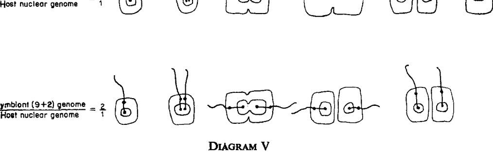

**Original:** Diagram V.

**中文:** 示意图 V。图例：共生体的（9+2）基因组与宿主核基因组。

**Source:** p.24 H013

## 2.5.6. (9+2) Homologues used as basal bodies to flagella and other (9+2) homologues permanently differentiated as extranuclear division centers (centrioles) / 2.5.6．部分（9+2）同源结构作为鞭毛基体，另一些永久分化为核外分裂中心（中心粒）

**Source:** p.24 S046

**Original:** This series of mutations leading to the typical centrioles and amphiasters of animal-type mitosis involve steps analogous to those in section 2.5.4. Two "clones" of (9 + 2) homologues were produced: in one, the (9 + 2) homologue permanently gives rise to basal bodies which only gives rise to other basal bodies which produce flagella. In the other, the (9 +2) homologue gives rise to extranuclear centrioles. This may have invo'lved mutations leading to the loss of the two central fibers of the (9 + 2) homologue leading to the non-motile (9+0) centriole structure. [It may be the central fibers confer motility on the flagella and are somewhat analogous to the axial fiber of spirochaetes (Stanier et aL, 1963, p. 158).] The selective advantage of a permanent functional differentiation of the two organelles is clear, as in section 2.5.4, flagellar motility is completely independent of the mitotic apparatus: flagellated cells, in eumitotic organisms, too, can divide. Examples of this type of mitosis with amphiasters surrounding the extranuclear centrioles are found in some protozoans, and most eumetazoan groups (Wilson, 1925, p. 124). The conspicuous extranuclear centriole of the diatoms may be functionally homologous, too. This is consistent with the interesting late arrival of this relatively homogeneous group of advanced algae on the fossil scene, during the Cretaceous [Fig. 2. VI (b)] (Fritsch, 1935, p. 660).

**中文:** 导致动物型有丝分裂的典型中心粒和两性体的这一系列突变涉及与第 2.5.4 节中的步骤类似的步骤。产生了(9+2)同源物的两个“克隆”：在一个中，(9+2)同源物永久地产生基体，该基体仅产生产生鞭毛的其他基体。在另一种情况下，(9 +2) 同系物产生核外中心粒。这可能涉及导致(9+2)同源物的两个中心纤维丢失的突变，从而导致非运动的(9+0)中心粒结构。 [它可能是中央纤维赋予鞭毛运动性，并且在某种程度上类似于螺旋体的轴向纤维（Stanier等人，1963年，第158页）。]两个细胞器的永久功能分化的选择性优势是明显的，如第2.5.4节中，鞭毛运动性完全独立于有丝分裂装置：在有丝分裂生物中，有鞭毛的细胞也可以分裂。在一些原生动物和大多数真后生动物群体中发现了这种类型的有丝分裂的例子，其核外中心粒周围有两性体（Wilson，1925，第 124 页）。硅藻明显的核外中心粒在功能上也可能是同源的。这与白垩纪化石场景中这一相对同质的高级藻类的有趣较晚出现是一致的[图 1]。 2.VI(b)]（Fritsch，1935 年，第 660 页）。

**Source:** p.24 F014

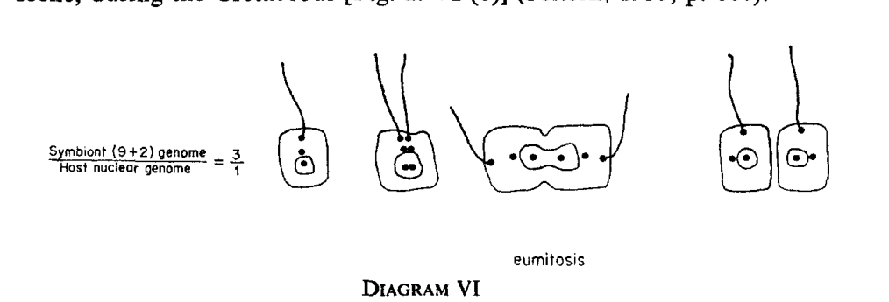

**Original:** Diagram VI.

**中文:** 示意图 VI。图例：共生体的（9+2）基因组、宿主核基因组；premitosis 为前有丝分裂阶段，eumitosis 为典型有丝分裂阶段。

**Source:** p.24 H014

## 2.6. THE EVOLUTION OF EUKARYOTIC PLANTS FROM VARIOUS LINES OF PROTOZOANS WHICH ACQUIRED SYMBIOTIC PROKARYOTIC ALGAE / 2.6．获得共生原核藻类的不同原生动物支系向真核植物的演化

**Source:** p.24 S047

**Original:** As outlined above, the evolution of mitosis is assumed to have occurred millions of years after the evolution of photosynthesis. This hypothetical origin of eukaryotes is completely incompatible with the notion that a simple phytoflagellate is the ancestor to extant higher cells--eukaryotic plant cells did not evolve oxygen-eliminating photosynthesis which later "packaged" into membrane-bounded plastids; they acquired it by sym-

**中文:** 如上所述，有丝分裂的进化被认为是在光合作用进化数百万年后发生的。这种假想的真核生物起源与简单的植物鞭毛虫是现存高等细胞的祖先的观点完全不相容——真核植物细胞没有进化出消除氧气的光合作用，这种光合作用后来被“包装”成膜质质体；他们通过sym-获得了它

**Source:** p.25 F015

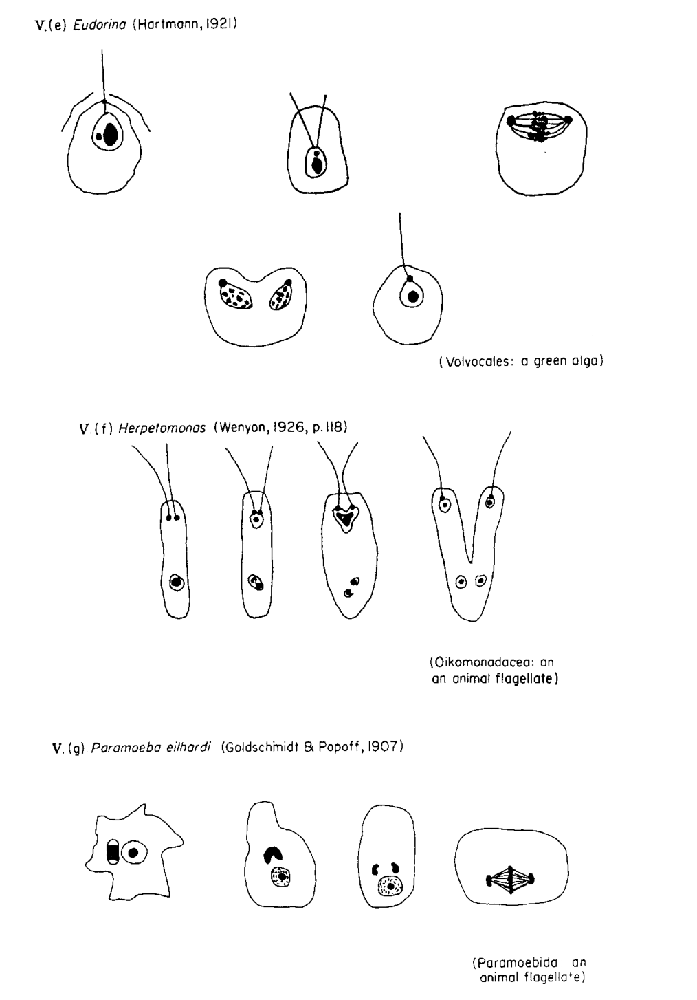

**Original:** Fig. 2. Mitotic figures of some representative eukaryotes (continued).

**中文:** 图 2．部分代表性真核生物的有丝分裂图（续）。

**Source:** p.25 C008

**Original:** FIG. 2. Mitotic figures of some representative eukaryotes (cont.).

**中文:** 如图。 2. 一些代表性真核生物的有丝分裂图（续）。

**Source:** p.26 F016

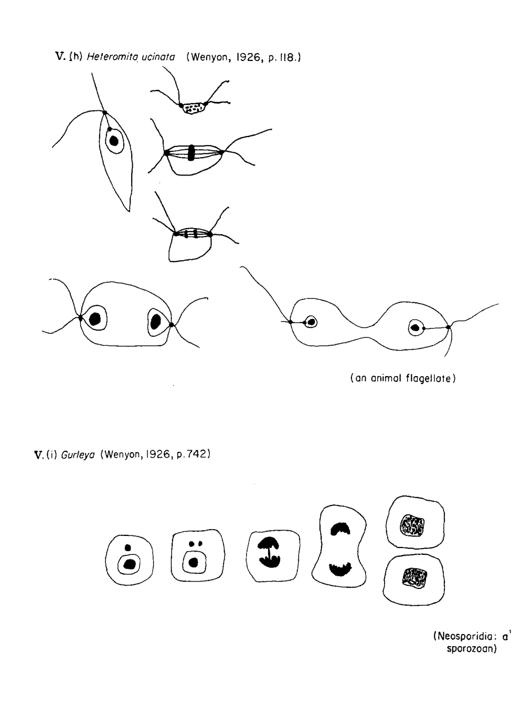

**Original:** Fig. 2. Mitotic figures of some representative eukaryotes (continued).

**中文:** 图 2．部分代表性真核生物的有丝分裂图（续）。

**Source:** p.26 C009

**Original:** FIG. 2. Mitotic figures of some representative eukaryotes (cont.).

**中文:** 如图。 2. 一些代表性真核生物的有丝分裂图（续）。

**Source:** p.27 S048

**Original:** biosis. The diversity of cell structure and the life cycle in lower eukaryotic algae imply that different photosynthetic prokaryotes (protoplastids) were ingested by heterotrophic protozoans at various times during the evolution of eumitosis. The protoplastids themselves evolved from oxygeneliminating prokaryotes, homologous to blue-green algae. To their own selective advantage they remained in the protozoan hosts which had ingested them and eventually became the obligately symbiotic plastids, retaining their characteristic photosynthetic pigments and pathways. In many eukaryotic algae and all higher plants, of course, the symbiosis continued to evolve a great deal, and vestiges of heterotrophy were eventually lost. This implies that in eukaryotic plants the plastids are homologous to blue-green algae; the non-chloroplast part of plants is directly homologous to eukaryotic heterotrophs.

**中文:** 生化。低等真核藻类细胞结构和生命周期的多样性意味着，在有丝分裂进化过程中，异养原生动物在不同时期摄取了不同的光合原核生物（原生质体）。原生质体本身是由除氧原核生物进化而来，与蓝绿藻同源。为了它们自己的选择优势，它们保留在摄入它们的原生动物宿主中，并最终成为专性共生质体，保留了它们特有的光合色素和途径。当然，在许多真核藻类和所有高等植物中，共生关系继续大量进化，异养的痕迹最终消失了。这意味着真核植物中的质体与蓝绿藻是同源的。植物的非叶绿体部分与真核异养生物直接同源。

**Source:** p.27 S049

**Original:** The Phylogenetic Tree--Fig. 1. Based on the above hypothesis, Fig. 1 presents the major groups of eukaryotic lower organisms on a phylogenetic tree. In an extremely original taxonomic treatise, H. F. Copeland classified many of these lower eukaryotic organisms into relatively isolated natural groups. Except for accepting genetic autonomy of photosynthetic plastids, Copeland's independent work is remarkably consistent with the evolutionary theory presented here. His book (Copeland, 1956) was invaluable to the development of this phylogeny.

**中文:** 系统发生树--图。 1. 基于上述假设，图1展示了真核低等生物主要类群的系统发生树。在一篇极其原创的分类学论文中，H. F. Copeland 将许多低等真核生物划分为相对孤立的自然类群。除了接受光合质体的遗传自主性之外，科普兰的独立工作与这里提出的进化理论非常一致。他的书（Copeland，1956）对于这一系统发育的发展具有无价的价值。

**Source:** p.27 S050

**Original:** Thus, there are two major innovations presented in the phylogenetie tree. One involves the separation of lower eukaryotic algae into groups based on the supposed homologies of the "host" or protozoan part of the organism. The lettered circles representing plastids on the lines indicate the homologies of the prokaryotic photosynthetic endosymbiont; with less accuracy, the positions of these circles represent the stage in evolution at which the symbiotic acquisition occurred. The second is an attempt to reclassify admittedly heterogeneous groups of protozoans (e.g. sporozoans, sarkodina, etc.) according to their mitotic cytologies and, hence, the stages they presumably represent in the evolution of eumitosis. Aside from these major modifications, standard taxonomy has been followed. Copeland's terminology is adapted on the phylogenetic tree for all organisms except the green algae. The terminology of Fritsch is used for these. Except for organisms explicitly mentioned elsewhere on the tree, the groups are considered to be equivalent to those of Copeland.

**中文:** 因此，系统发生树中有两项主要创新。一种涉及根据生物体的“宿主”或原生动物部分的假定同源性将低等真核藻类分成几组。线上代表质体的字母圆圈表示原核光合作用内共生体的同源性；虽然准确性较低，但这些圆圈的位置代表了共生获取发生的进化阶段。第二个尝试是根据原生动物的有丝分裂细胞学，以及它们可能在有丝分裂进化中所代表的阶段，对公认的异质原生动物群体（例如孢子虫、肉足动物等）进行重新分类。除了这些重大修改之外，还遵循了标准分类法。科普兰的术语适用于除绿藻之外的所有生物体的系统发生树。 Fritsch 的术语用于这些。除了树上其他地方明确提到的生物体之外，这些群体被认为与科普兰的群体相同。

**Source:** p.27 S051

**Original:** The acquisition of photosynthesis by eukaryotic heterotrophs then, may be thought of as quite analogous to some recognized symbioses, which on the basis of the identification of the photosynthetic symbiont, must have originated much more recently, e.g. Paramecium bursaria, chrysophytes in Radiolarians, Hydra viridis, the algal-fungal associations in lichens. Occur-

**中文:** 那么，真核异养生物获得光合作用，可以被认为与一些公认的共生体非常相似，基于光合共生体的识别，这些共生体一定起源于更近的时期，例如。草履虫、放射虫中的金藻、绿色水螅、地衣中的藻类-真菌组合。发生-

**Source:** p.28 F017

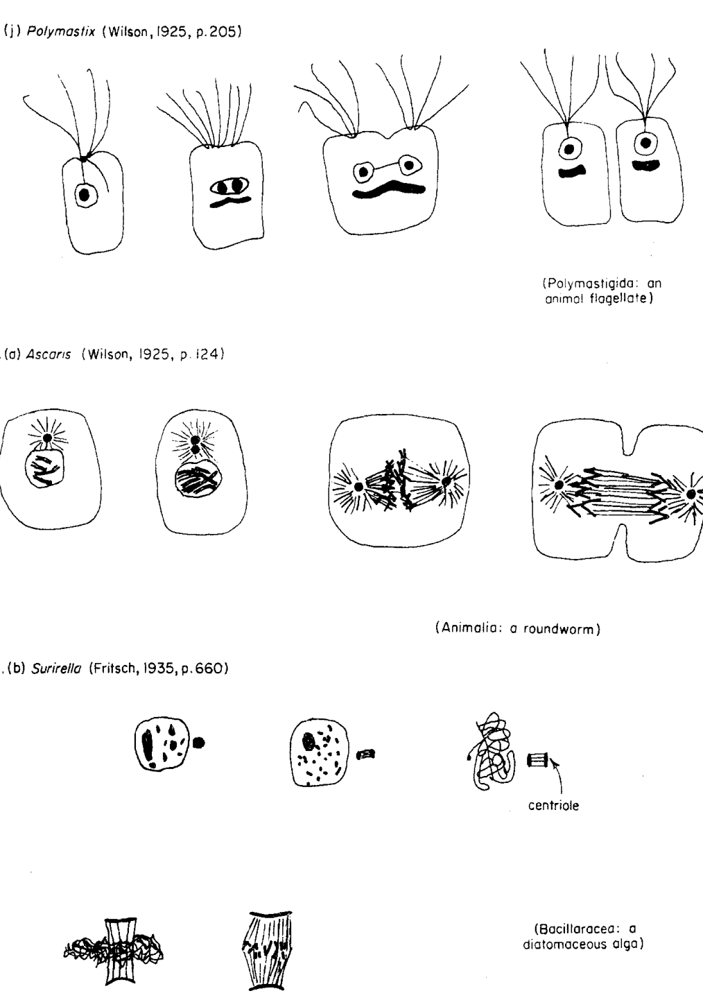

**Original:** Fig. 2. Mitotic figures of some representative eukaryotes (continued).

**中文:** 图 2．部分代表性真核生物的有丝分裂图（续）。

**Source:** p.28 C010

**Original:** FIG. 2. Mitotic figures of some representative eukaryotes (cont.).

**中文:** 如图。 2. 一些代表性真核生物的有丝分裂图（续）。

**Source:** p.29,30 T001

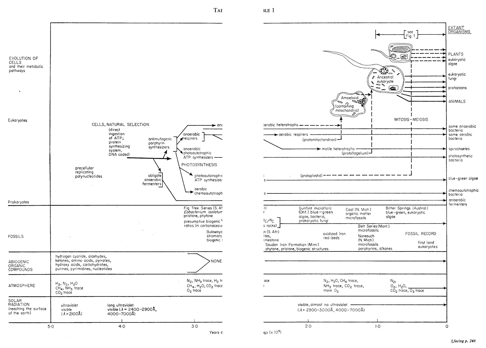

**Original:** Table 1. Evolution of cells and their metabolic pathways.

**中文:** 表 1．细胞及其代谢途径的演化。图中并列表示真核生物、原核生物、化石、非生物来源的有机化合物、大气与地质记录，以及发酵、光合作用、有氧呼吸等代谢途径。

**Source:** p.31 S052

**Original:** rences of green, blue-green and cryptomonad algal symbionts in the tissues have been reported in most groups of lower animals (Buchner, 1930, 1953).

**中文:** 据报道，大多数低等动物群​​体的组织中都存在绿色、蓝绿色和隐藻共生体（Buchner，1930，1953）。

**Source:** p.31 S053

**Original:** The entire chronology presented here is summarized in Table 1. In order to document this theory, the following, at the very least, are required: (1), the theory must be consistent with the geological and fossil records; (2), each of the three cytoplasmic organelles (the mitochondria, the (9 + 2) homologues, and the plastids) must demonstrate general features characteristic of cells originating in hosts as symbionts. None may have features that conflict with such an origin; (3), predictions based on this account of the origin of eukaryotes must be verified. The rest of this paper discusses the evidence for this theory in terms of assumptions based on molecular biology which can be made concerning evolutionary mechanisms.

**中文:** 表1总结了这里提出的整个年代学。为了证明这一理论，至少需要满足以下条件：（1）该理论必须与地质和化石记录一致； (2)，三种细胞质细胞器（线粒体、(9 + 2) 同源物和质体）中的每一种都必须表现出源自宿主作为共生体的细胞的一般特征。任何一个都不得具有与这种起源相冲突的特征； （3），基于真核生物起源的描述的预测必须得到验证。本文的其余部分根据基于分子生物学的假设来讨论该理论的证据，这些假设可以对进化机制做出。

**Source:** p.31 H015

## 3. Evidence from the Literature / 3．文献中的证据

**Source:** p.31 H016

## 3.1. ON CRITERIA FOR A NATURAL MICROBIAL PHYLOGENY / 3.1．微生物自然系统发生的判定标准

**Source:** p.31 S054

**Original:** Throughout the systematic literature there exists the underlying assumption that the more traits two organisms possess in common, the more closely related they are. Higher organisms, such as vertebrates and flowering plants, show consistent morphological patterns which change in steps that can be related directly to adaptive value. Observation of living organisms, comparative physiology and anatomy, and the fossil record all provide much evidence for this assumption.

**中文:** 在整个系统文献中，存在一个基本假设：两种生物体拥有的共同特征越多，它们的相关性就越密切。高等生物，如脊椎动物和开花植物，表现出一致的形态模式，这些模式的变化与适应价值直接相关。对生物体的观察、比较生理学和解剖学以及化石记录都为这一假设提供了很多证据。

**Source:** p.31 S055

**Original:** However, the lack of a comparable series of consistent morphological criteria has thwarted attempts to trace the evolutionary history of the "lower organisms", e.g. the "phycomycetes", the "mastigophora", the "sarkodina", etc., as any investigation of the literature on the subject will show.

**中文:** 然而，缺乏一系列可比较的一致形态标准，阻碍了追踪“低等生物”进化历史的尝试，例如低等生物。正如任何有关该主题的文献调查都会显示的那样，“藻菌纲”、“鞭毛纲”、“肉足纲”等。

**Source:** p.31,32 S056

**Original:** On what, then, can the reconstruction of the evolutionary history of microbes be based ? Recent advances in molecular biology provide some idea of the relative significance of various criteria in the development of microbial phylogeny, even if a great deal of fundamental data are still not available. For example, it is clear that we may not simply collect an arbitrarily large number of equal valued "traits" and try to group microorganisms on the basis of the largest number of such common "traits". Instead, as the genetic basis of many "traits" becomes known, we can rank them on the basis of the total number of single step mutations required to evolve them. In determining the relationship of two microbes--that is, the amount of time elapsed since they diverged from a common ancestor--we may ask: how many homologous base pair sequences in DNA do they share? The number of mutational steps which occurred to produce one from the other is related to the number of generations elapsed since the two populations diverged. Thus, although two organisms may differ in a single measurable "trait", it must be dearly recognized that the genetic basis of such a trait may vary from a single (or a very few) DNA base pair changes to thousands or tens of thousands of such changes.l"

**中文:** 那么，重建微生物进化史的基础是什么？分子生物学的最新进展为微生物系统发育发展中各种标准的相对重要性提供了一些想法，即使仍然没有大量的基础数据。例如，很明显，我们不能简单地收集任意大量的同等价值的“特征”，并尝试根据最大数量的此类共同“特征”对微生物进行分组。相反，随着许多“性状”的遗传基础被了解，我们可以根据进化它们所需的单步突变总数对它们进行排名。在确定两种微生物的关系时，即它们从共同祖先分离以来经过的时间量，我们可能会问：它们在 DNA 中共有多少个同源碱基对序列？从另一个群体产生一个群体所发生的突变步骤的数量与两个群体分化以来经过的世代数有关。因此，尽管两个生物体可能在一个可测量的“性状”上有所不同，但必须清楚地认识到，这种性状的遗传基础可能会从单个（或极少数）DNA碱基对变化到数千或数万个这样的变化。

**Source:** p.32 S057

**Original:** Clearly, to construct a taxonomy reflecting natural phylogeny and not evolutionary analogy, microbes must be grouped on the basis of the total amount of genetic homology they share. A single mutation in a micro-organism, resulting in a small chemical change with a profound phenotypic effect with respect to selection could easily mislead the taxonomist of lower organisms. On the other hand, organisms may share phenotypic traits and still be distantly related. For example, the fact that two microbes both metabolize glucose, but along entirely different pathways, implies a large number of different cistrons and, therefore, a long time since the two organisms diverged from a common ancestor.

**中文:** 显然，为了构建反映自然系统发育而不是进化类比的分类法，微生物必须根据它们共享的遗传同源性总量进行分组。微生物中的单一突变会导致微小的化学变化，并对选择产生深远的表型效应，很容易误导低等生物的分类学家。另一方面，生物体可能具有相同的表型特征并且仍然具有远亲关系。例如，两种微生物都代谢葡萄糖，但沿着完全不同的途径，这一事实意味着存在大量不同的顺反子，因此，这两种生物体从共同祖先分离出来已经很长时间了。

**Source:** p.32 S058

**Original:** Because of the lack of information, it is impossible of course to determine the number and order of DNA base pairs coding for a particular advantageous cistron, however certain criteria for ascertaining the degree of relationship between two microbes can be ranked in order of general validity (Table 2). For example, the homology of an entire metabolic pathway is a much more significant taxonomic criterion than the presence or absence of a single enzyme or pigment. In fact, the point at which metabolic pathways diverge in two otherwise similar microbes may help determine the elapsed time since the two microbes themselves diverged from a common ancestor.

**中文:** 由于缺乏信息，当然不可能确定编码特定有利顺反子的 DNA 碱基对的数量和顺序，但是可以按照一般有效性的顺序对确定两种微生物之间关系程度的某些标准进行排序（表 2）。例如，整个代谢途径的同源性是比单一酶或色素的存在或不存在更重要的分类标准。事实上，两种相似的微生物代谢途径的分歧点可能有助于确定这两种微生物本身从共同祖先分歧以来所经过的时间。

**Source:** p.32 S059

**Original:** The necessity for comprehending entire metabolic patterns, rather than individual biochemical traits, is especially relevant in botanical evolutionary

**中文:** 理解整个代谢模式而不是个体生化特征的必要性在植物进化中尤其重要

**Source:** p.32 S060

**Original:** ~" This can be illustrated by an example drawn from two species of single-celled algae. Streptomycin resistant and streptomycin sensitive Chlamydomonas may differ only in a single trait--so may "bleached" and green strains of Euglena gracilis differ only in the single trait of "green color". However, it is likely that the difference in Chlamydomonas is due only to a single muton (Sager & Tsubo, 1961), whereas in clones of Euglena the one trait of green color (e.g. chlorophyll) in permanently "bleached" cells has been related to the presence of the entire chloroplast, and the potentiality for its formation (Lyman, Epstein & Sehiff, 1961). Thus "green" and "bleached" Euglena, differing in the single obvious trait of color, betray a genetic difference of thousands of mutons. In the Euglena chloroplast there are at least 15 different kinds of enzymes (Smillie, 1963) and each one can roughly be estimated to be about 100 amino acid residues long. With a coding ratio of three nucleotides to each amino acid, the presence of a chloroplast implies enough genetic material, for structural genes alone, to code for 15 x 100 x 3 = 4500 independent mutons. On the assumption that one cell in about a million contains a random mutation which turns out to be favorable for the evolution of the structural genes in the chloroplast, it would have taken about (2 ~ ~ l0 s, n ~ 20) twenty generations of Euglena to derive each of the 4500 favorable mutations in the pathway. Therefore, the trait of green color in Euglena, which may be permanently lost by exposure of the cells for a few rninutm to ultraviolet light fLyman, Epstein & Sehiff, 1961), must have taken (very roughly but probably an extreme lower limit), 20 x 4500, or 90,000 generations to evolve.

**中文:** ~”这可以通过从两种单细胞藻类中提取的例子来说明。链霉素抗性和链霉素敏感性衣藻可能仅在单一性状上有所不同，因此眼虫的“漂白”和绿色菌株可能仅在“绿色”的单一性状上有所不同。然而，衣藻的差异很可能仅归因于单一突变（Sager＆Tsubo，1961），而在眼虫克隆中，永久“漂白”细胞中的绿色特征（例如叶绿素）与整个叶绿体的存在及其形成的可能性有关（Lyman，Epstein & Sehiff，1961），因此，“绿色”和“漂白”眼虫，在单一明显的颜色特征上存在差异，在眼虫叶绿体中存在数千个突变体的遗传差异。至少有 15 种不同的酶（Smillie，1963），并且每种酶的长度可粗略估计为约 100 个氨基酸残基，每个氨基酸的编码比例为 3 个核苷酸，叶绿体的存在意味着仅对于结构基因而言，就足以编码 15 x 100 x 3 = 4500 个独立的突变体。根据叶绿体中结构基因的进化，眼虫需要大约（2～10秒，n～20）二十代才能衍生出该途径中的4500个有利突变中的每一个。因此，眼虫的绿色特征，通过将细胞暴露在紫外线下几分钟，可能会永久丧失（fLyman，Epstein＆Sehiff，1961），必须采取（非常粗略但可能极其低的）。限制），20 x 4500 或 90,000 代的进化。

**Source:** p.33 T002

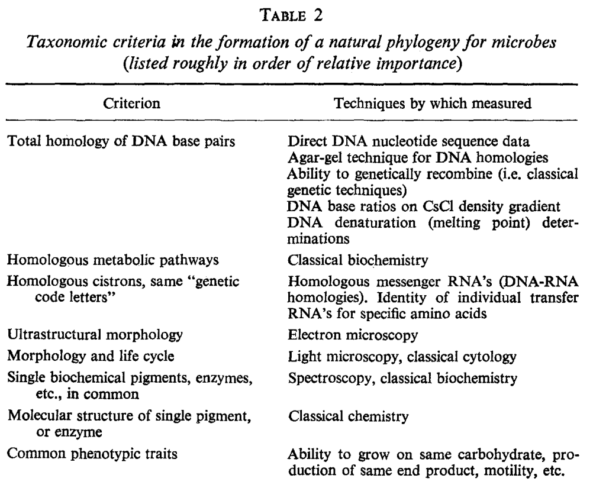

**Original:** Table 2. Taxonomic criteria in the formation of a natural phylogeny for microbes (listed roughly in order of relative importance).

**中文:** 表 2．建立微生物自然系统发生关系的分类学判据（大致按相对重要性排列）。

| 判据 | 测定技术 |
| --- | --- |
| DNA 碱基对的总体同源性 | 直接获取 DNA 核苷酸序列；琼脂凝胶法测定 DNA 同源性；遗传重组能力（经典遗传学技术）；CsCl 密度梯度中的 DNA 碱基比率；DNA 变性（熔点）测定。 |
| 同源代谢途径 | 经典生物化学。 |
| 同源顺反子，相同的“遗传密码字母” | 同源信使 RNA（DNA–RNA 同源性）；特定氨基酸对应的各类转运 RNA 的一致性。 |
| 超微结构形态 | 电子显微镜。 |
| 形态与生活史 | 光学显微镜、经典细胞学。 |
| 共有的单种生化色素、酶等 | 光谱学、经典生物化学。 |
| 单种色素或酶的分子结构 | 经典化学。 |
| 共有的表型性状 | 利用同种碳水化合物生长的能力、产生相同终产物、运动能力等。 |

**Source:** p.33 S061

**Original:** work on "lower plants", where common photosynthetic pigments and metabolic products have been considered primary phylogenetic markers. Some groups of organisms have been considered closely related on the basis of their pigments [i.e. Schizogoniacea, Euglenids, Conjugacea, and other chlorophytes (Fritsch, 1935, p. 70), Myxochrysis and Crysothylakion (Copeland, 1956, p. 63]. Even red algae are thought to have been derived from blue-greens in some botanical literature:

**中文:** 研究“低等植物”，其中常见的光合色素和代谢产物被认为是主要的系统发育标记。一些生物体类群因其色素而被认为是密切相关的[即。 Schizogoniacea、Euglenids、Conjugacea 和其他叶绿藻 (Fritsch, 1935, p. 70)、Myxochrysis 和 Crysothylakion (Copeland, 1956, p. 63]。在一些植物学文献中，甚至红藻也被认为源自蓝绿藻：

**Source:** p.33 S062

**Original:** "Fucoxanthin, which is shared by chrysomonads, diatoms and brown algae supports a common evolutionary origin for these members of the 'brown' line of metaprotists. The common possession of diadinoxanthin by diatoms and dinoflagellates is suggestive of an affinity between these groups .... The common possession of this class of chromoproteins--the bili-proteins--by the blue-green and red algae fits very well with derivation of the red algae photosynthetic apparatus from that of the blue-green algae..." (Dougherty & Allen, 1960, p. 129).

**中文:** “金藻、硅藻和褐藻所共有的岩藻黄质支持了后生生物‘褐’系成员的共同进化起源。硅藻和甲藻共同拥有二氮黄质暗示着这些群体之间的亲和力……蓝绿藻和红藻共同拥有这类色素蛋白——胆蛋白——非常吻合。从蓝绿藻的光合装置衍生出红藻的光合装置……”（Dougherty & Allen，1960，第 129 页）。

**Source:** p.33,34 S063

**Original:** Classically photosynthetic organisms have been segregated into separate Kingdoms (or Classes) from their plastid-lacking counterparts, regardless of their cellular morphologies which imply (at least to zoologists) that they should be grouped together [e.g. "Chrysamoebida (order): Rhizochrysidaeae, Chrysarachiaceae, Myxochrysidacea (families)... organisms in which only plastids distinguish them from various different groups of Rhizopods, Heliozoans and Sarkodina"] (Copeland, 1956, p. 63). Since zoologists assign relatively less importance to plastid characteristics, and tend to place such pigmented organisms in their respective protozoan groups, inconsistencies are rampant in the taxonomic literature of lower eukaryotes.

**中文:** 经典的光合生物已被从其缺乏质体的对应物中分离成不同的界（或类），无论它们的细胞形态如何，这意味着（至少对动物学家而言）它们应该被分组在一起[例如，光合作用生物]。 “Chrysamoebida（目）：Rhizochrysidaae、Chrysarachiaceae、Myxochrysidacea（科）...只有质体才能将它们与根足动物、日光动物和肉丁动物的各种不同类群区分开来的生物体”]（Copeland，1956，第 63 页）。由于动物学家对质体特征的重视程度相对较低，并且倾向于将此类有色生物归入各自的原生动物类群，因此低等真核生物的分类学文献中的不一致现象十分普遍。

**Source:** p.34 H017

## 3.2. SOLUTION OF SOME TAXONOMIC PROBLEMS / 3.2．若干分类学问题的解决

**Source:** p.34 S064

**Original:** According to the fundamental thesis of this paper, these problems are resolved if the validity of both views are seen simultaneously. For example, in the Chrysamoebida, it is unnecessary for zoologists to hypothesize that chrysophysean-type photosynthesis evolved separately, yet exactly analogously, in several diverse heliozoan, rhizopodal and sarkodinal lines; it is equally unnecessary for botanists to believe that the various rhizopods, heliozoans, and sarkodinae evolved from immediate chrysophysean ancestors by loss of photosynthetic plastids. Consistent with the above-mentioned hypothesis is the theory that algae, with chrysophysean photosynthetic characteristics, evolved millions of years before from photosynthetic prokaryotes and were acquired symbiotically in heliozoan, rhizopodal, and sarkodinal species, and that these prokaryotic algae became the obligately symbiotic plastids in the various protozoans. In other cases (e.g. Chloramoeba and Chrysamoebae), both chrysophysean and typical "green" prokaryotic algae were ingested by very similar amoeboflagellates whose descendants subsequently evolved "algal" ways of life. Presumably, too, typical green prokaryotic algae were acquired by euglenids, chloromonads, Schizogoniacea, etc., explaining the remarkable similarity in the chloroplast-related features in these different "host" organisms. There is really no other reasonable explanation for the evolution of certain natural groups of highly specialized flagellates which are found to contain distinct types of plastids with distinct pigments and storage products [e.g. Cryptomonadina (family): Rhodomonas (red), Cryptochrysis (ehrysophysean), Chilomonas (colorless)]. As is now recognized in lichen classification, the host and plastid components of photosynthetic eukaryotes, like the component fungi and algae of lichens, ought to be classified separately. Perhaps, then, a natural phylogeny of the lower eukaryotes could be developed which is satisfactory to botanists, zoologists and mycologists.

**中文:** 根据本文的基本论点，如果同时看到两种观点的有效性，这些问题就可以得到解决。例如，在金毛虫中，动物学家没有必要假设金龟类光合作用在几种不同的日光动物、根足动物和肉足动物中是单独进化的，但又完全相似。同样，植物学家也没有必要相信各种根足动物、日光动物和肉足动物亚科是由直接金藻类祖先通过光合质体的丧失而进化而来的。与上述假说相一致的理论是，具有金藻光合特性的藻类在数百万年前从光合原核生物进化而来，并在日光动物、根足动物和肉足动物中共生，这些原核藻类成为各种原生动物中的专性共生质体。在其他情况下（例如金变形虫和金变形虫），金藻和典型的“绿色”原核藻类都被非常相似的变形鞭毛虫摄入，其后代随后进化出了“藻类”生活方式。据推测，典型的绿色原核藻类也是由眼虫、氯单胞菌、裂殖纲等获得的，这解释了这些不同“宿主”生物体中叶绿体相关特征的显着相似性。对于某些高度专业化的鞭毛虫自然群体的进化，确实没有其他合理的解释，这些鞭毛虫被发现含有不同类型的质体，具有不同的色素和储存产品[例如， Cryptomonadina（科）：Rhodomonas（红色）、Cryptochrysis（ehrysophysean）、Chilomonas（无色）]。正如现在地衣分类中所认识到的那样，光合真核生物的宿主和质体成分，就像地衣的真菌和藻类成分一样，应该分开分类。那么，也许可以开发出令植物学家、动物学家和真菌学家满意的低等真核生物的自然系统发育学。

**Source:** p.34,35 S065

**Original:** In some cases, no doubt, the secondary loss of plastids from various protozoans have resulted in their return to the heterotrophic habit. The probability that the host can tolerate the loss of the symbiont must be related to the extent to which the symbiosis itself has evolved. For example, Paramecium bursaria and various other animal cells harboring symbiotic algae can survive induced loss of their photosynthetic capabilities (Siegel & Karakashian, 1959). Euglena gracilis can survive loss of its chloroplasts. In both of these organisms, "curing the cells" of their photosynthetic algae or chloroplasts involves some loss of viability in most media, however (Karakashian, 1963). For example, Paramecium bursaria grown in the dark will lose its algae. Although this ciliate can still divide asexually, it cannot go through the meiotic events prior to conjugation in the absence of its symbiotic zoochlorellae (Siegel, personal communication). The symbionthost relationship can be restored readily in P. bursaria by feeding the specific zoochorellae (which can be grown in vitro) to the "cured" ciliate (Siegel, 1960). However, growth of the chloroplast in vitro and its reintroduction into Euglena have posed insurmountable technical problems to date. The dependence of the "host" on the symbiotic plastid is, of course, still more pronounced in most higher plants unable to survive a loss of photosynthetic capacity at all except, perhaps, under very special conditions. (For example, people may keep albino corn alive by feeding the plants sugar directly through their leaves).

**中文:** 毫无疑问，在某些情况下，各种原生动物质体的继发性损失导致它们恢复了异养习性。宿主能够容忍共生体丧失的概率一定与共生体本身进化的程度有关。例如，草履虫和其他含有共生藻类的动物细胞可以在光合能力丧失的情况下存活下来（Siegel & Karakashian，1959）。细小眼虫在叶绿体损失后仍能存活。然而，在这两种生物体中，“治愈细胞”的光合藻类或叶绿体都会导致大多数介质中活力的丧失（Karakashian，1963）。例如，在黑暗中生长的草履虫会失去藻类。尽管这种纤毛虫仍然可以无性分裂，但在没有共生动物小球藻的情况下，它无法在接合前经历减数分裂事件（Siegel，个人通讯）。通过将特定的动物小球藻（可以在体外生长）喂给“治愈的”纤毛虫，可以很容易地在 P. bursaria 中恢复共生体关系（Siegel，1960）。然而，迄今为止，叶绿体的体外生长及其重新引入眼虫中已经提出了难以克服的技术问题。当然，“宿主”对共生质体的依赖性在大多数高等植物中更为明显，这些植物根本无法在光合能力丧失的情况下生存，除非在非常特殊的条件下。 （例如，人们可以通过直接通过叶子给植物喂食糖来保持白化玉米的存活）。

**Source:** p.35 S066

**Original:** Thus, in general, a greater mutual dependency probably reflects a longer host-symbiont association. This is because new syntheses, made possible by the symbiosis, will be selected for and gradually will become necessary for survival. It is highly probable that many of the pathways particular to plant metabolism--the formation of the plant cell wall, alkaloid syntheses, formation of certain storage products, etc.--originate from the ancient protozoanprokaryotic algal symbioses, analogous to starch synthesis in Peliaina.

**中文:** 因此，一般来说，更大的相互依赖性可能反映了更长的宿主-共生体关联。这是因为通过共生而成为可能的新合成将被选择并逐渐成为生存所必需的。植物代谢特有的许多途径——植物细胞壁的形成、生物碱合成、某些储存产物的形成等——很可能起源于古老的原生动物原核藻类共生，类似于 Peliaina 中的淀粉合成。

**Source:** p.35 S067

**Original:** "Peliaina eyanea is a flagellate (chrysomonad or cryptomonad in its affinities) which harbors from one larger to six smaller cyanella (blue-green algae). Rare assymetric fissions yield colorless monads (host flagellates) which produce oily reserves rather than starch like the Peliaina complex. Since free cyanophytes do not produce starch either, the complex has achieved a new function. The syncyanom must be of some antiquity as there is no way the flagellate could have ingested the cyanella. Phagotrophic, amoeboid phases have been described for some primitive flagellates, and the ingestion of a free living cyanophyte by an amoeboid ancestor l~resumably initiated the symbiosis..." (Lederberg, 1952).

**中文:** “Peliina eyanea 是一种鞭毛虫（金单胞菌或隐单胞菌的亲缘关系），包含一个较大到六个较小的蓝藻（蓝绿藻）。罕见的不对称裂变产生无色单子（寄主鞭毛虫），它产生油性储备，而不是像 Peliaina 复合体那样产生淀粉。由于游离蓝藻也不产生淀粉，因此该复合体实现了新功能。同步藻必须具有某种功能。古代鞭毛虫不可能摄入蓝藻，一些原始鞭毛虫的吞噬、变形虫阶段已被描述，并且变形虫祖先摄入自由生活的蓝藻可能引发了共生……”（Lederberg，1952）。

**Source:** p.35,36 S068

**Original:** On the basis of a very general biological argument too, it can be said that photosynthesis evolved in the prokaryotes and mitosis evolved in the protozoans. That is, from our knowledge of evolution in higher organisms, it seems that to identify the population in which a multicistronically determined trait evolved, related organisms must demonstrate a large range of small variations in the given trait that can be correlated to specific selective environmental factors.

**中文:** 同样基于非常普遍的生物学论证，可以说光合作用是在原核生物中进化的，有丝分裂是在原生动物中进化的。也就是说，从我们对高等生物进化的了解来看，为了识别进化出多顺反子决定的性状的群体，相关生物必须表现出给定性状的大范围的微小变化，这些变化可以与特定的选择性环境因素相关。

**Source:** p.36 S069

**Original:** Lack of variation in a multicistronically determined trait in a natural group of organisms suggests the trait evolved earlier in some other ancestral population. (For example, in mammals: the metabolism of glucose; the histology of bone tissue; lungs developed from an outpocketing in the gut; the closed circulatory system containing red blood corpuscles; the vertebral column; the dorsal, hollow nervous system, etc.; in angiosperms: Krebs cycle intermediates; green plant photosynthesis; meiosis and fertilization; vascular tissue; seeds; etc.)

**中文:** 自然生物群体中多顺反子决定的性状缺乏变异，表明该性状在其他一些祖先群体中进化得更早。 （例如，在哺乳动物中：葡萄糖的代谢；骨组织的组织学；从肠道中向外发育的肺；含有红细胞的封闭循环系统；脊柱；背侧、中空神经系统等；在被子植物中：克雷布斯循环中间体；绿色植物光合作用；减数分裂和受精；维管组织；种子等）

**Source:** p.36 S070

**Original:** On the other hand, that the variations can be understood in terms of adaptive value to the population is considered evidence that, for example, these traits evolved in the following natural groups: triploblastic development in metazoans; the five-digit tetrapod in amphibious vertebrates; development through the total life cycle in dry environments in amphibians and reptiles; wide variety of beaks and feet forms in Galapagos Island finches; the mammary glands in mammals; and the flower in angiosperms.

**中文:** 另一方面，可以根据对种群的适应价值来理解这些变化，这被认为是证据，例如，这些特征在以下自然群体中进化：后生动物的三叶细胞发育；两栖脊椎动物的五位数四足动物；两栖动物和爬行动物在干燥环境中整个生命周期的发育；加拉帕戈斯岛雀的喙和脚形状多种多样；哺乳动物的乳腺；和被子植物中的花。

**Source:** p.36 S071

**Original:** We have already discussed some of the variations on the theme of mitosis in protozoans, sections 2.4 to 2.5.6; for the discussion of the variations in photosynthetic metabolism in contemporary prokaryotes, see sections 3.4 and 3.5.

**中文:** 我们已经讨论了原生动物有丝分裂主题的一些变化，第 2.4 至 2.5.6 节；有关当代原核生物光合代谢变化的讨论，请参见第 3.4 和 3.5 节。

**Source:** p.36 H018

## 3.3. GENERAL PROPERTIES OF SYMBIOSIS / 3.3．共生的一般性质

**Source:** p.36 S072

**Original:** The argument presented for the origin of the eukaryotic cell unequivocally points to the acquisition by symbiosis of mitochondria; the genome of the (9 + 2) complex flagellum; and the plastid. What are the general criteria of organelles derived by symbioses ?

**中文:** 关于真核细胞起源的论点明确指出线粒体是通过共生获得的。 (9 + 2) 复合鞭毛的基因组；和质体。共生产生的细胞器的一般标准是什么？

**Source:** p.36,37 S073

**Original:** (1) A symbiont originated as a free-living cell and therefore must have once been able to replicate its own DNA on its own protein synthesizing machinery. As outlined above, these subcellular organelles are hypothesized to have evolved along the main line of terrestrial cellular evolution and, therefore, must have contained DNA, messenger and ribosomal RNA, etc., that is, all minimal requirements for cell reproduction common to terrestrial cellular life. This is not meant to preclude the possibility that alternative modes of cellular replication antedated the ones with which we are concerned (Pirie, 1959). Thus at the very least, a symbiont must have had: (a) DNA; (b) messenger RNA (mRNA) complimentary to that DNA; (e) a functioning protein synthesizing system; (d) a source of ATP and other nueleotides; (e) a source of small molecules from which to make proteins and nucleic acids; and (f) a cell membrane synthesizing system. Upon entry into a host, such a symbiont may lose from none to all of its synthetic capabilities except the ability to replicate its own DNA and synthesize complementary mRNA from that DNA--the sine qua non of any organism. Hence, if any of these organelles originated as symbionts, their characteristic specific DNA must be present in the host at every stage of the host life cycle. It, of course, follows, too, that the ratio of host genome DNA synthesis to symbiont genome DNA synthesis must approximate 1 : 1. If the ratio is greater than 1 : 1 the host will outgrow the symbiont and give rise to daughters which lack it; if the ratio of host DNA synthesis to symbiont DNA Synthesis is less than 1 : 1 the symbiont will outgrow the host and lysis will ensue.

**中文:** (1) 共生体起源于自由生活的细胞，因此必须曾经能够在自己的蛋白质合成机器上复制自己的 DNA。如上所述，这些亚细胞细胞器被假设是沿着陆地细胞进化的主线进化的，因此必须包含DNA、信使和核糖体RNA等，即陆地细胞生命所共有的细胞繁殖的所有最低要求。这并不意味着排除细胞复制的替代模式早于我们所关注的模式的可能性（Pirie，1959）。因此，至少，共生体必须具有：（a）DNA； (b) 与该 DNA 互补的信使 RNA (mRNA)； (e) 功能正常的蛋白质合成系统； (d) ATP 和其他核苷酸的来源； (e) 用于制造蛋白质和核酸的小分子来源； (f)细胞膜合成系统。一旦进入宿主，这样的共生体可能会失去所有合成能力，除了复制自身 DNA 和从该 DNA 合成互补 mRNA 的能力——这是任何生物体的必要条件。因此，如果这些细胞器中的任何一个起源于共生体，那么它们特有的特定DNA必定存在于宿主生命周期的每个阶段。当然，宿主基因组 DNA 合成与共生体基因组 DNA 合成的比例必须近似为 1:1。如果该比例大于 1:1，宿主将无法生长出共生体，并产生缺乏共生体的子体；否则，共生体将无法生长。如果宿主 DNA 合成与共生体 DNA 合成的比例小于 1:1，共生体将生长超过宿主，并发生裂解。

**Source:** p.37 S074

**Original:** By analogy with parasitism and mutualism in higher organisms, it is highly likely that after long association the redundancy intrinsic in symbiotic relationships will be selected against; the symbiont will tend to relegate all dispensable metabolic functions to the host. This tendency results ultimately in symbioses which become progressively more obligate.

**中文:** 类比高等生物中的寄生和互利共生，经过长时间的关联，共生关系中固有的冗余很可能会被选择反对；共生体倾向于将所有可有可无的代谢功能交给宿主。这种趋势最终导致共生关系逐渐变得更加强制性。

**Source:** p.37 S075

**Original:** (2) If an organism or organelle has been acquired by symbiosis, it will be retained intracellularly in its host if, and only if, there exists some mechanism to insure that each daughter cell of the host receives at least one copy of the symbiont genome at each division. Any mutation that insures the symbiont's distribution to both daughters in each division will be of high selective value for the complex (e.g. a common effective but expensive mechanism would be the presence of many copies of the symbiont within the host cellS, increasing the probability that each daughter receives at least one symbion 0. Indeed, when viewed in this way, many classical cytological observations on the behavior of centrioles, mitochondria and chloroplasts in cells of their "hosts" can easily be interpreted, as they indeed were, to be mechanisms that insure the genetic continuity of the organelle genome.

**中文:** (2) 如果一个生物体或细胞器是通过共生获得的，当且仅当存在某种机制来确保宿主的每个子细胞在每次分裂时至少接收到一个共生体基因组的拷贝时，它才会保留在宿主的细胞内。任何确保共生体分布到每个分裂中的两个子代的突变都将对复合体具有很高的选择性价值（例如，一种常见的有效但昂贵的机制是宿主细胞内存在许多共生体副本，从而增加了每个子代接收至少一个共生体0的概率。事实上，当以这种方式看待时，关于其“宿主”细胞中中心粒、线粒体和叶绿体行为的许多经典细胞学观察可以很容易地被理解。事实上，它们被解释为确保细胞器基因组遗传连续性的机制。

**Source:** p.37 S076

**Original:** (3) If a cellular organelle is acquired by symbiosis, there should be no organism containing intermediate intracellular stages of the organelle. The entire series of metabolic capabilities conferred on the host by the symbiont must be acquired together, i.e. "packeted" as a unit.

**中文:** (3)如果细胞器是通过共生获得的，则不应存在含有该细胞器的中间细胞内阶段的生物体。共生体赋予宿主的整个系列代谢能力必须一起获得，即“打包”为一个单元。

**Source:** p.37,38 S077

**Original:** (4) If the symbiont is lost, all metabolic characteristics coded for on the symbiont genome must be lost together. Once lost, a symbiont can never be regained unless it is reacquired by ingestion. Indeed, unless the reingestion quickly succeeds the loss, it is unlikely that precisely the same symbiont will be reacquired. For example, such reingestion has been suggested for the origin of Glaucoeystis nostoc, an organism with the "host" features of an Oocystaceae containing distinctly blue-green algae-like, rather than "green", plastids (Fritseh, 1935, p. 186) and for Gloeochaete, "long referred as an anomalous genus of the Myxophyceae, but now known to represent a colorless Tetraspraceous form in which the blue-green chromatophores are symbiotic blue-green algae" (Fritsch, 1935, p. 125).

**中文:** (4)如果共生体丢失，共生体基因组上编码的所有代谢特征也必须一起丢失。一旦失去，共生体就永远无法恢复，除非通过摄入重新获得。事实上，除非重新摄入能够迅速弥补损失，否则不太可能重新获得完全相同的共生体。例如，这种重新摄入已被认为是蓝藻的起源，蓝藻是一种具有卵囊科“宿主”特征的生物体，含有明显的蓝绿藻类而非“绿色”质体（Fritseh，1935年，第186页），而粘毛菌“长期以来被称为粘藻纲的异常属，但现在已知代表无色”。四孢子形式，其中蓝绿色素细胞是共生蓝绿藻”（Fritsch，1935，第 125 页）。

**Source:** p.38 S078

**Original:** Of course, a clear distinction must be made between the loss and the dedifferentiation of the symbiont. In dedifferentiation, the genetic potential for symbiont formation is retained implying a complete retention of the permanent symbiont genome and, therefore, of its DNA. Loss of the symbiont implies permanent loss of symbiont DNA.

**中文:** 当然，必须明确区分共生体的丧失和去分化。在去分化过程中，共生体形成的遗传潜力被保留，这意味着永久共生体基因组及其 DNA 的完全保留。共生体的丧失意味着共生体 DNA 的永久丧失。

**Source:** p.38 S079

**Original:** Metabolic pathways reflected in some morphology (e.g. ribosomes, lysosomes, endoplasmic reticulum, nuclear membranes, etc.) which are coded for on the nuclear genome if lost from the cytoplasm, may be replaceable in the proper environment by the action of the nuclear genes. This can never be true of organelles whic, h originated by symbiosis.

**中文:** 反映在某些形态（例如核糖体、溶酶体、内质网、核膜等）中的代谢途径如果从细胞质中丢失，则可以在适当的环境中通过核基因的作用进行替换，这些形态是在核基因组上编码的。对于由共生起源的细胞器来说，情况绝非如此。

**Source:** p.38 S080

**Original:** (5) Since any intracellular symbiont must have its own genes, a correlation can be made between genetic traits conferred on the host by the symbiont and the morphological presence of the symbiont. For example, in all eukaryotes the number of mitochondda and plastids will not necessarily be halved at meiosis and doubled at fertilization to establish their constancy. Hence, they will not necessarily display the Mendelian distribution of characteristics from generation to generation. The observations that in some cases mitochondria and plastids are inherited only with the larger female gamete in anisogametic fertilizations, led to the early hypotheses that these organelles were bearers of "cytoplasmic heredity". Thus, non-mendelian genetics should be found in those organisms in which mitochondria or chloroplasts are inherited uniparentally. The transmission of the trait should be associated with the donor Parent [e.g. sea urchins where all paternal mitochondria are found in only one blastomere at the 32-cell stage (Wilson, 1925, p. 713). In exceptional cases this might apply to (9 +2) homologues as well (e.g. patrilinear inheritance of the centrosome, e.g. in Culex (Darlington, 1958, p. 174)]. In general, of course, genetic traits carried by the (9 + 2) chromosomal centromeres will show strict Mendelian inheritance patterns.

**中文:** (5)由于任何细内共生体都必须有自己的基因，因此可以在共生体赋予宿主的遗传特征和共生体的形态存在之间建立相关性。例如，在所有真核生物中，线粒体和质体的数量不一定会在减数分裂时减半并在受精时加倍以建立其稳定性。因此，他们不一定会一代又一代地表现出孟德尔分布的特征。在某些情况下，线粒体和质体在异配受精中仅通过较大的雌配子遗传的观察结果导致了早期的假设，即这些细胞器是“细胞质遗传”的承载者。因此，非孟德尔遗传学应该存在于那些线粒体或叶绿体单亲遗传的生物体中。该性状的传递应与捐赠者亲本有关[例如海胆的所有父本线粒体都只存在于 32 细胞阶段的一个卵裂球中（Wilson，1925，第 713 页）。在特殊情况下，这也可能适用于 (9 +2) 同源物（例如，中心体的父系遗传，例如库蚊 (Darlington, 1958, p. 174)]。当然，一般来说，(9 + 2) 染色体着丝粒携带的遗传性状将表现出严格的孟德尔遗传模式。

**Source:** p.38 S081

**Original:** (6) If an organelle originated as a free-living cell, it is possible that naturally occurring counterparts still can be found among extant organisms. Even if precise extant morphological and physiological codescendants cannot be found, the organelle must have genetic and physiological characteristics known to be consistent with those generally present in terrestrial cells.

**中文:** (6) 如果细胞器起源于自由生活的细胞，则有可能在现存生物体中仍然可以找到天然存在的对应物。即使无法找到精确的现存形态学和生理学共后代，该细胞器也必须具有已知与陆地细胞中普遍存在的遗传和生理特征一致的遗传和生理特征。

**Source:** p.38,39 S082

**Original:** Applying the above criteria, the nucleus of the eukaryotic cell could not have originated by symbiosis. The great body of literature on the genetics and cytology of higher organisms defends the thesis that nuclear genes control cytoplasmic syntheses which make possible the duplication of nuclear DNA and growth of the cell prior to the next division (Brachet, 1957). Recent evidence indicates a large number of sites spread over many nuclear chromosomes control the production of the cytoplasmic RNA (Prescott, 1964). The nucleus and cytoplasm of the eukaryotic system, are clearly part of a highly integrated continuous system; it seems there is little evidence that can be cited for their independent origins.

**中文:** 应用上述标准，真核细胞的细胞核不可能是由共生产生的。关于高等生物的遗传学和细胞学的大量文献都捍卫这样的论点：核基因控制细胞质合成，这使得核 DNA 的复制和细胞在下一次分裂之前的生长成为可能（Brachet，1957）。最近的证据表明分布在许多核染色体上的大量位点控制着细胞质 RNA 的产生（Prescott，1964）。真核系统的细胞核和细胞质显然是高度集成的连续系统的一部分；似乎没有什么证据可以证明它们的独立起源。

**Source:** p.39 S083

**Original:** To document this theory, the rest of the discussion is devoted to the origin of prokaryotic cells hypothetically destined to become organelles of eukaryotes, and to the present status of cytoplasmic organelles in terms of the general criteria for symbiotic origin developed above.

**中文:** 为了证明这一理论，其余的讨论将致力于假设注定要成为真核生物细胞器的原核细胞的起源，以及根据上面制定的共生起源的一般标准来讨论细胞质细胞器的现状。

**Source:** p.39 H019

## 3.4. ANCIENT ANAEROBIOSIS AND MICROBIAL PHOTOSYNTHESIS / 3.4．远古的厌氧条件与微生物光合作用

**Source:** p.39 S084

**Original:** The earth's atmosphere, both in its absence of hydrogen and presence of large quantities of oxygen is cosmically atypical. Although there is no consensus on details astronomers and geologists today believe that the original terrestrial atmosphere, which was subsequently lost, was composed primarily of hydrogen. Many different laboratory attempts to simulate the origin of life have been made; a variety of molecules (e.g. amino acids, pyrimidines, ATP) found in contemporary organisms can be produced if the net chemical conditions are reducing. However, if conditions are oxidizing, such as they are in the present atmosphere, the production of common organic compounds is exceedingly inefficient. All of the evidence is consistent with the widely accepted hypothesis that life arose under reducing conditions of the primitive atmosphere (Sagan, 1965b).

**中文:** 地球的大气层，无论是在缺乏氢的情况下还是存在大量的氧，在宇宙中都是非典型的。尽管在细节上尚未达成共识，但今天的天文学家和地质学家认为，随后消失的原始陆地大气主要由氢组成。人们已经进行了许多不同的实验室尝试来模拟生命的起源。如果净化学条件降低，则可以产生当代生物体中发现的各种分子（例如氨基酸、嘧啶、ATP）。然而，如果条件是氧化性的，例如在现有的大气中，那么常见有机化合物的生产效率就会极其低下。所有证据都与广泛接受的假设一致，即生命是在原始大气的还原条件下产生的（Sagan，1965b）。

**Source:** p.39 S085

**Original:** Photosynthesis, in the general sense of the utilization of solar energy in the production of organic compounds, probably antedates the origin of life itself. The strong ultraviolet light absorption capabilities of the major nucleic acid components, of ATP, and of amino acids and peptides may have led to their local accumulation in the absence of replicating cellular systems upon which natural selection acted, as early as 4 to 5 billion years ago (Sagan, 1961).

**中文:** 光合作用，一般意义上的利用太阳能生产有机化合物，可能早于生命本身的起源。早在 4 至 50 亿年前，主要核酸成分、ATP、氨基酸和肽的强紫外线吸收能力可能导致它们在缺乏自然选择作用的复制细胞系统的情况下局部积累（Sagan，1961）。

**Source:** p.39 S086

**Original:** When did the atmosphere become oxidizing? Geochemical studies independent of biological speculation provide evidence on the question of dating the transition to the oxidizing atmosphere. As recently as 2 to 3 billion years ago, sediments in Canadian, Brazilian and South African shields were deposited containing uraninite (UO2) that had not been oxidized to pitchblends, suggesting the absence of an appreciable oxygen partial pressure at the time of deposition. However, oxidized rocks as old as 2'5 x 109 years have been found, suggesting that free oxygen was abundant enough to oxidize iron to form limonite red-beds at this time (Rutton, 1962).

**中文:** 大气什么时候变得氧化的？独立于生物学推测的地球化学研究为确定向氧化大气过渡的年代问题提供了证据。就在 2 至 30 亿年前，加拿大、巴西和南非地盾的沉积物中含有尚未氧化成沥青混合料的铀矿 (UO2)，这表明沉积时不存在明显的氧分压。然而，已经发现了长达 2'5 x 109 年的氧化岩石，这表明此时游离氧足以氧化铁形成褐铁矿红层（Rutton，1962）。

**Source:** p.40 S087

**Original:** Recently, Cloud has reviewed this literature and amassed a good deal of evidence resolving the apparent discrepancies in the data. He has found microstructures, indisputably fossils, which he considers to greatly resemble extant prokaryotes (blue-green algae and iron bacteria) in rocks definitely dating 2.1 × 109 years ago. [In fact, microstructures of fossil prokaryotes-- (e.g. Eobacterium isolatum) have now been reported in rocks as old as 3-1 x 109 years (Barghoorn & Schopf, 1966).] In concluding his review, Cloud points out,

**中文:** 最近，克劳德审查了这些文献，并收集了大量证据来解决数据中明显的差异。他发现了微观结构，毫无疑问是化石，他认为这些结构与岩石中现存的原核生物（蓝绿藻和铁细菌）非常相似，其年代肯定可以追溯到 2.1 × 109 年前。 [事实上，原核生物化石的微观结构（例如 Eobacter isolatum）现已在 3-1 x 109 年的岩石中被报道（Barghoorn & Schopf，1966）。] 在总结他的评论时，Cloud 指出，

**Source:** p.40 S088

**Original:** "The combined evidence of paleontology and stratigraphy, therefore, indicates that the potentiality for the evolution of oxygen by green plant photosynthesis existed at least 2.7 to 2-1 x 109 years ago, and that atmospheric oxygen first began to be available in relatively large quantities probably about 1.2 x 109 years ago (a conclusion independently reached on a different line of reasoning by Lepp and Goldich)" (Cloud, 1965).

**中文:** “因此，古生物学和地层学的综合证据表明，绿色植物光合作用演化氧气的潜力至少存在于 2.7 至 2-1 x 109 年前，并且大气中的氧气可能在大约 1.2 x 109 年前首次开始大量存在（Lepp 和 Goldich 根据不同的推理路线独立得出的结论）”（Cloud，1965）。

**Source:** p.40 S089

**Original:** (The "green plant" photosynthesis referred to by Cloud includes prokaryotic blue-green algal photosynthesis; it is distinguished from bacterial photosynthesis by the elimination of gaseous oxygen in the process.)

**中文:** （克劳德所指的“绿色植物”光合作用包括原核蓝绿藻光合作用；它与细菌光合作用的区别在于过程中消除了气态氧。）

**Source:** p.40 S090

**Original:** Correct identification of the fossils implies the origin of photosynthetic metabolism which uses the visible portions of the spectrum, occurred in cellular systems earlier than 2.1 billion years ago or even 3.1 x 109 years ago, This is consistent with independent astronomical arguments which indicates that uv absorbing reduced compounds were probably in the atmosphere contemporaneous with these prokaryotic photosynthetic algae (Sagan, 1965b).

**中文:** 对化石的正确识别意味着使用光谱可见部分的光合代谢的起源，发生在早于 21 亿年前甚至 3.1 x 109 年前的细胞系统中。这与独立的天文学论点一致，表明吸收紫外线的还原化合物可能与这些原核光合藻类同时存在于大气中（Sagan，1965b）。

**Source:** p.40 S091

**Original:** In any case, the utilization of visible light in microbial photosynthesis must have evolved more than 1.2 x 109 years ago (the time at which free gaseous oxygen was clearly present) because it is likely that, at that time, the ultraviolet light that penetrated the ozone layer of the upper atmosphere was insufficient to provide energy for the formation of organic compounds upon which all life is based. Even if the production of new organic matter continued, it would have been destroyed by oxidation. Thus, within the confines of these dates, this outline for the evolution of cellular photosynthesis was reconstructed.

**中文:** 无论如何，微生物光合作用中可见光的利用一定是在 1.2 x 109 年前（当时明显存在游离气态氧的时间）已经进化出来的，因为当时穿透上层大气臭氧层的紫外线很可能不足以为所有生命赖以生存的有机化合物的形成提供能量。即使新的有机物继续产生，它也会被氧化破坏。因此，在这些日期的范围内，细胞光合作用进化的轮廓被重建。

**Source:** p.40,41 S092

**Original:** Porphyrins (metal-chelated tetrapyrroles such as those found in catalase and peroxidase) of some kind are of universal occurrence in all extant cells with the exception of some obligate anaerobes (Lascelles, 1964). Their ubiquity has been related to their ability to reduce mutagenic oxidizing agents. Molecular oxygen is continually being produced by the photolysis of water in the upper atmosphere and the escape of hydrogen (Urey, 1959). This oxygen must have been lethal to the early self-replicating systems. Atmospheric photoproduction of oxygen throughout the ages presumably provided selection pressures for the retention of these ancient cistrons involved in the synthesis of porphydn antimutagens. By hypothesis, the incidental fact that these antimutagenic tetrapyrole compounds were strong visible light absorbers was later put to advantage in the evolution of chlorophyll-mediated microbial photosynthesis (Sagan, 1961).

**中文:** 某种卟啉（金属螯合的四吡咯，例如在过氧化氢酶和过氧化物酶中发现的那些）在所有现存细胞中普遍存在，除了一些专性厌氧菌外（Lascelles，1964）。它们的普遍存在与其减少诱变氧化剂的能力有关。高层大气中水的光解和氢气的逸出不断产生分子氧（Urey，1959）。这种氧气对于早期的自我复制系统肯定是致命的。各个时期大气中氧气的光产生可能为这些参与卟啉抗诱变剂合成的古老顺反子的保留提供了选择压力。根据假设，这些抗突变四吡咯化合物是强可见光吸收剂的偶然事实后来在叶绿素介导的微生物光合作用的进化中得到了利用（Sagan，1961）。

**Source:** p.41 S093

**Original:** The CO 2 fixation (the dark reactions) of photosynthesis is known to be present for the production of cell material in many different non-photosynthetic organisms (e.g. chemolithotrophs: bacteria capable of oxidizing hydrogen gas, sulfide, sulfur, ammonia and nitrite). It is possible that mutations causing the porphyrins to be used in cellular photoproduction of ATP originally occurred in microbes which already contained the CO2 fixing "dark reactions". This could have resulted in the evolution of the fundamental photosynthetic mechanism, providing a new source of ATP, produced by visible light absorbed by porphyrins. In some organisms, chemotrophic or direct heterotrophic methods of obtaining ATP presumably were then replaced by the visible light-chlorophyll mediated methods characteristic of all microbial photosynthesizers.

**中文:** 已知光合作用的 CO 2 固定（暗反应）存在于许多不同的非光合作用生物体（例如化能营养生物：能够氧化氢气、硫化物、硫、氨和亚硝酸盐的细菌）中产生细胞材料。导致卟啉用于细胞光生产 ATP 的突变最初可能发生在已经包含 CO2 固定“暗反应”的微生物中。这可能导致基本光合作用机制的进化，提供新的 ATP 来源，由卟啉吸收可见光产生。在一些生物体中，获得 ATP 的化能或直接异养方法可能被所有微生物光合作用的可见光叶绿素介导方法所取代。

**Source:** p.41 S094

**Original:** The relationship of porphyrin synthesis to intermediary metabolism, i.e. the synthesis via glutamate, a-ketoglutaric acid, and succinyl-CoA, suggests that the porphyrins originally selected for because of their antimutagenic properties--for example, in the reduction of hydrogen peroxide--may have eventually been used in the more efficient oxidation of carbohydrate. Organisms unable to form these porphyrins were doomed to eternal obligate anaerobiosis (Stanier et al., 1963, p. 85). Thus, heterotrophic, anaerobic respirers (microbes which oxidize carbohydrates in the absence of molecular oxygen to make ATP via iron-chelated porphyrins such as cytochromes) could also have evolved from primitive porphyrin synthesizers.

**中文:** 卟啉合成与中间代谢（即通过谷氨酸、α-酮戊二酸和琥珀酰辅酶A的合成）的关系表明，最初选择卟啉是因为其抗突变特性（例如，在过氧化氢的还原中）可能最终被用于更有效地氧化碳水化合物。无法形成这些卟啉的生物体注定会永远专性厌氧（Stanier et al., 1963, p. 85）。因此，异养厌氧呼吸器（在没有分子氧的情况下氧化碳水化合物以通过铁螯合卟啉（例如细胞色素）制造 ATP 的微生物）也可能是从原始卟啉合成器进化而来的。

**Source:** p.41 S095

**Original:** Eventually in prokaryotic anaerobic photosynthesizers, mutations must have occurred that led to the development of organisms capable of using H atoms from (the much more abundan0 water instead of from (the less abundant) hydrogen gas or hydrogen sulfide (e.g. the anaerobic photosynthesizer, Thiorhodacea) as electron donors to chlorophyll. The natural consequence of these mutations was the elimination of oxygen derived from that water in the photosynthetic process.

**中文:** 最终，在原核厌氧光合作用器中，一定发生了突变，导致生物体能够使用来自（丰富得多的水，而不是来自（较少丰富的）氢气或硫化氢的H原子）作为叶绿素的电子供体。这些突变的自然结果是在光合作用过程中消除了从水中产生的氧。

**Source:** p.41 S096

**Original:** The fact that oxidized limonite red-beds are as old as 2.5 x 10 9 years is strong evidence that mutations for oxygen eliminating photosynthesis occurred in some microbial autotrophs well before that time.

**中文:** 氧化褐铁矿红床的历史长达 2.5 x 10 9 年，这一事实强有力地证明，早在该时期之前，一些微生物自养生物就发生了消除光合作用的氧突变。

**Source:** p.41 H020

## 3.5. ATMOSPHERE OXYGEN AND THE ORIGIN OF AEROBES / 3.5．大气氧与需氧生物的起源

**Source:** p.41,42 S097

**Original:** The presence of increasing amounts of oxygen, produced by the new photosynthesis must have been extremely deleterious: there was no longer any abiogenic synthesis of organic compounds; the obligate anaerobes found progressively fewer niches; and all life became ultimately dependent on visible light photosynthesis to produce nucleotides and oxidizable carbohydrates. Under such conditions, constant selection pressure must have been placed on any microbes capable of tolerating and utilizing oxygen. In the case of the cytochrome-containing anaerobic respirers--cells which already had genes to code for earlier steps in the respiratory pathways--mutants were selected that could transfer hydrogen atoms to oxygen (instead of to nitrogen or sulfate). This could have resulted in the evolution of ATP pathways involving the complete oxidation of production via the aerobic carbohydrate. Such mutations leading to the aerobic breakdown of carbohydrates presumably occurred in some photoautotrophs too, evolving the ancestors of blue-green algae.

**中文:** 新的光合作用产生的氧气量不断增加，必定是极其有害的：不再有任何有机化合物的非生物合成；专性厌氧菌发现的生态位逐渐减少；所有生命最终都依赖于可见光光合作用来产生核苷酸和可氧化碳水化合物。在这种条件下，必须对任何能够耐受和利用氧气的微生物施加恒定的选择压力。对于含有细胞色素的厌氧呼吸器（这些细胞已经具有编码呼吸途径早期步骤的基因），选择的突变体可以将氢原子转移到氧（而不是氮或硫酸盐）。这可能导致 ATP 途径的进化，涉及通过需氧碳水化合物产生的完全氧化。这种导致碳水化合物有氧分解的突变可能也发生在一些光合自养生物中，从而进化出了蓝绿藻的祖先。

**Source:** p.42 S098

**Original:** It is consistent with both microbial metabolism and the geological evidence to assume, then, from 2.1 to 0.6x 109 years ago the prokaryotic photosynthesizers eliminated more and more oxygen into the atmosphere. In response to this, different types of microbes evolved (including the protomitochondrion and prokaryotic aerobic algae), capable of coping with the increasing abundance of oxygen. The goal of the long metabolic sequences coded for on microbial genomes was then, as it is today, maintenance of the highly reduced surroundings required for reproduction. Ironically, the change from reducing to oxidizing conditions to which microbial cells were forced to adapt had been caused by the cells themselves.

**中文:** 这与微生物代谢和地质证据一致，假设从 2.1 到 0.6 x 109 年前，原核光合作用器向大气中消除了越来越多的氧气。为了应对这种情况，不同类型的微生物（包括原线粒体和原核需氧藻类）进化出来，能够应对日益丰富的氧气。当时和今天一样，微生物基因组上编码的长代谢序列的目标是维持繁殖所需的高度减少的环境。讽刺的是，微生物细胞被迫适应的从还原条件到氧化条件的变化是由细胞本身引起的。

**Source:** p.42 S099

**Original:** Interestingly enough for our argument, although micro-fossil forms quite analogous to extant prokaryotes are found from 3.1 × 10 9 years ago, no eukaryotic algae appear in dated rocks until the dawn of the Paleozoic. Dasycladaceans are known from early Ordovician, about 0.4x 109 years ago, and algal filaments perhaps reds or brown (Epiphyton) are known as old as early Cambrian 0.50 to 0.55 x 109 years ago (Cloud, 1965, personal communication).t Thus, not only are "missing links" between prokaryotic and eukaryotic algae conspicuously absent from all present day flora, but they are missing from the fossil record during those 2700 million years (i.e. from 3.1 x 10 9 to 0"4 X 10 9 years ago), in which first prokaryotic cells (Schopf & Barghoorn, personal communication) and later atmospheric oxygen were known to be present!

**中文:** 对于我们的论点来说，有趣的是，尽管在 3.1 × 10 9 年前就发现了与现存原核生物非常相似的微化石，但直到古生代黎明之前，在古老的岩石中都没有出现真核藻类。 Dasycladaceans 已知于奥陶纪早期，大约 0.4x 109 年前，而红色或棕色的藻丝（Epiphyton）已知早于 0.50 至 0.55 x 109 年前的寒武纪早期（Cloud，1965，个人通讯）。因此，不仅原核和真核藻类之间的“缺失环节”在所有现存藻类中都明显缺失白天植物区系，但在这 27 亿年（即从 3.1 x 10 9 到 0"4 X 10 9 年前）的化石记录中缺失了它们，其中已知存在第一批原核细胞（Schopf & Barghoorn，个人通讯）和后来的大气氧！

**Source:** p.42 S100

**Original:** Besides the direct evidence of the fossil record, there are biological reasons for regarding photosynthesis as a fundamentally anaerobic process which evolved in prokaryotes. Both blue-green algae and bacterial photosynthesizers are clearly related to other prokaryotes.

**中文:** 除了化石记录的直接证据之外，还有生物学原因将光合作用视为原核生物中进化的基本厌氧过程。蓝绿藻和细菌光合作用者都与其他原核生物明显相关。

**Source:** p.43 S101

**Original:** All bacterial photosynthesizers are morphologically typical gram negative bacteria. The exception to this is Rhodomicrobium, photosynthetic budding bacteria, which also have typically prokaryotic nonphotosynthetic counterparts (Hyphomierobium). In all these bacterial photosynthesizers, the photosynthetic process itself is anaerobic. It is only in the dark that any bacterial photosynthesizers are aerobic and respire. Even in blue-green algae, oxygen uptake is inhibited by light (Marsh, Gatmiche & Gibbs, 1964).

**中文:** 所有细菌光合细菌在形态上都是典型的革兰氏阴性细菌。例外的是红微菌属（Rhodomicrobium），一种光合芽生细菌，它也有典型的原核非光合作用细菌（Hyphomierobium）。在所有这些细菌光合作用器中，光合作用过程本身都是厌氧的。只有在黑暗中，任何细菌的光合作用才进行有氧呼吸。即使在蓝绿藻中，光的吸收也会受到抑制（Marsh、Gatmiche 和 Gibbs，1964）。

**Source:** p.43 S102

**Original:** Blue-green algae also have nonphotosynthetic morphological counterparts among prokaryotes (the filamentous gliding bacteria). Some of these, like Beggiota, metabolize H2S to form sulfur. These organisms grow using CO2 as their only source of carbon; the H atoms from H2S are transferred to "fix" CO 2 for reduction to cell material. In the blue-greens H atoms from H20 are transferred to "fix" CO2 for reduction to cell material using photosynthetically produced ATP. Thus these gliding bacteria are physiologically as well as morphologically related to blue-greens.

**中文:** 蓝绿藻在原核生物（丝状滑翔细菌）中也有非光合作用的形态对应物。其中一些，如 Beggiota，代谢 H2S 形成硫。这些生物体生长时使用二氧化碳作为唯一的碳源；来自H2S的H原子被转移以“固定”CO 2 以还原成电池材料。在蓝绿色中，H20 中的 H 原子被转移到“固定”CO2，从而利用光合作用产生的 ATP 还原为细胞物质。因此，这些滑行细菌在生理上和形态上都与蓝绿色细菌相关。

**Source:** p.43 S103

**Original:** The fact that some blue-greens metabolize along the pentose phosphate (rather than the Embden-Meyerhof pathway so ubiquitous in mitochondriacontaining eukaryotes) also reflects their origin and relationship to prokaryotes (Fewson, A1-Hafidh & Gibbs, 1962). This difference in the first steps of carbohydrate metabolism in these two great groups of oxygen eliminating algae indicates their ancient evolutionary divergence~ (Haldane, 1954).

**中文:** 一些蓝绿色化合物沿着磷酸戊糖（而不是在含有线粒体的真核生物中普遍存在的 Embden-Meyerhof 途径）代谢的事实也反映了它们的起源以及与原核生物的关系（Fewson，A1-Hafidh 和 Gibbs，1962）。这两类除氧藻类在碳水化合物代谢第一步中的差异表明了它们古老的进化分歧~（Haldane，1954）。

**Source:** p.43 S104

**Original:** The monophyletic evolution of eukaryotic algae from blue-greens is hard to reconcile with many other facts. Blue-greens are typical prokaryotes: they lack a membrane bounded nucleus, mitochondria, flage!la, mitosis, sex, simultaneity of respiration and photosynthesis, and, in general, they are smaller than other algae. Furthermore, no intermediate organisms between blue-green and green algae have ever been found, even though they have been extensively sought.

**中文:** 真核藻类从蓝绿藻的单系进化很难与许多其他事实相一致。蓝绿藻是典型的原核生物：它们缺乏膜界核、线粒体、鞭毛、有丝分裂、性别、呼吸和光合作用的同时性，并且一般来说，它们比其他藻类小。此外，尽管人们广泛寻找蓝藻和绿藻之间的中间生物体，但尚未发现它们。

**Source:** p.43 S105

**Original:** For a comprehensive review of recent literature demonstrating the striking similarities in cell structure of the blue-green algae and the bacteria, see Echlin & Morris, 1965.

**中文:** 有关证明蓝绿藻和细菌细胞结构惊人相似的最新文献的综合综述，请参阅 Echlin & Morris, 1965。

**Source:** p.43 S106

**Original:** Why then are the photosynthetic mechanisms in prokaryotic blue-green algae and eukaryotic green algae so similar? If the prokaryotic blue-greens were not ancestral to the eukaryotic algae and the higher plants, what organisms were ?

**中文:** 那么为什么原核蓝绿藻和真核绿藻的光合作用机制如此相似呢？如果原核蓝绿藻不是真核藻类和高等植物的祖先，那么什么生物是？

**Source:** p.43,44 S107

**Original:** t This type of reasoning was first used by Haldane in 1929. He pointed to the uniformity of the first steps in anaerobic metabolism and the diversity in the molecular oxygen utilizing --or avoiding--later steps to indicate the greater age of the anaerobic processes. From this, he inferred something of the nature of the reducing atmosphere--in the absence of the laboratory simulation experiments and the geological data that is available to us today I This apparent paradox can be resolved by recognizing the validity of the thesis presented in this paper, namely, that the evolution of photosynthesis preceded the evolution of the eukaryotic cell by millions of years, and that green plant oxygen-eliminating photosynthesis--so characteristic of both blue-green algae and "chlorophytes"--evolved in prokaryotes and was later acquired symbiotically by various eukaryotes.

**中文:** 这种类型的推理首先由 Haldane 于 1929 年使用。他指出无氧代谢的第一步的一致性以及分子氧利用（或避免）后续步骤的多样性，表明无氧过程的年龄更大。由此，他在缺乏实验室模拟实验和我们今天可以获得的地质数据的情况下，推断出了还原性大气的一些本质。这一明显的悖论可以通过认识到本文提出的论点的有效性来解决，即光合作用的进化先于真核细胞的进化数百万年，而绿色植物消除氧气的光合作用（蓝绿藻和“叶绿植物”的特征）进化了。存在于原核生物中，后来被各种真核生物共生获得。

**Source:** p.44 S108

**Original:** This view is valid only if the evolution of the eukaryotic cell itself from an aerobic, heterotrophic ancestor can be understood. What evidence have we that mitosing eukaryotic cells evolved monophyletica]ly and independent of the evolution of photosynthesis ? What is the basis for the claim that mitochondria and (9+2) homologues originated as endosymbionts, and that our hypothesis concerning the evolution of the eukaryotic cell is, at ]east in essential outline, correct ?

**中文:** 只有当我们能够理解真核细胞本身从需氧、异养祖先的进化过程时，这种观点才有效。我们有什么证据表明真核细胞的有丝分裂是单系进化的并且独立于光合作用的进化？线粒体和 (9+2) 同源物起源于内共生体，以及我们关于真核细胞进化的假设至少在本质上是正确的，其基础是什么？

**Source:** p.44 H021

## 3.6. THE REPRODUCING MITOCHONDRION / 3.6．能够繁殖的线粒体

**Source:** p.44 S109

**Original:** A plethora of recent studies elegantly reviewed by Gibor & Granick have presented inexorable testimony for the following: mitochondria contain specific DNA and RNA; they are self-duplicating bodies that do not arise de novo; the multigenic system of the organelle is responsible, in part, for the specific biochemical properties of the organelle; and mitochondrial development (in yeast cells, at least) are controlled by an adaptive mechanism which is responsive to oxygen. There have been some reports that mitochondria are capable of limited incorporation of amino acids into proteins and they contain their own protein synthesizing mechanisms, as well. For a detailed description and bibliography of the pertinent literature, the reader is referred to this excellent review (Gibor & Granick, 1964). That mitochondria have sources of ATP and small molecules, is indisputable. Whether the mitochondrial membranes are coded for by the mitochondrial genes themselves is not clear. In any case, the mitochondria satisfy the first criteria for ceils originating as endosymbionts as discussed earlier (section 3.3).

**中文:** Gibor 和 Granick 精心审查的大量最新研究为以下内容提供了无可辩驳的证据：线粒体含有特定的 DNA 和 RNA；线粒体含有特定的 DNA 和 RNA；它们是自我复制的身体，并不是从头开始产生的；细胞器的多基因系统部分地决定了细胞器的特定生化特性；线粒体发育（至少在酵母细胞中）是由对氧气敏感的适应性机制控制的。有一些报道称线粒体能够有限地将氨基酸掺入蛋白质中，并且它们也包含自己的蛋白质合成机制。有关相关文献的详细描述和参考书目，读者可以参考这篇精彩的评论（Gibor & Granick，1964）。线粒体具有 ATP 和小分子来源，这是无可争议的。线粒体膜是否由线粒体基因本身编码尚不清楚。无论如何，线粒体满足细胞起源于内共生体的第一个标准，如前所述（第 3.3 节）。

**Source:** p.44 S110

**Original:** In 1927, Wallin argued that mitochondria originated as endosymbionts in higher cells. His evidence was based on the size, shape, staining properties and general cytological behavior of the organelIes which he claimed were comparable to bacteria. Of course, at that time he could have had little concept of their physiology. The most convincing evidence for the genetic autonomy of mitochondria involved studies of their continuity. These observations reviewed by Wilson in 1925, indicated that mitochondria are invariably included in sperm cells and are, in genera], present at every stage of the life cycle in eukaryotic cells. Some of the mechanisms by which mitochondria are retained in daughters during cell divisions are listed in Table 3. Full discussions appear in the classical literature (Wilson, 1925).

**中文:** 1927 年，沃林认为线粒体起源于高等细胞的内共生体。他的证据基于细胞器的大小、形状、染色特性和一般细胞学行为，他声称这些细胞器与细菌相当。当然，当时他对它们的生理机能几乎没有概念。线粒体遗传自主性最令人信服的证据涉及对其连续性的研究。威尔逊在 1925 年回顾了这些观察结果，表明线粒体总是包含在精子细胞中，并且通常存在于真核细胞生命周期的每个阶段。表 3 列出了细胞分裂过程中线粒体保留在子细胞中的一些机制。完整的讨论出现在经典文献中（Wilson，1925）。

**Source:** p.45 T003

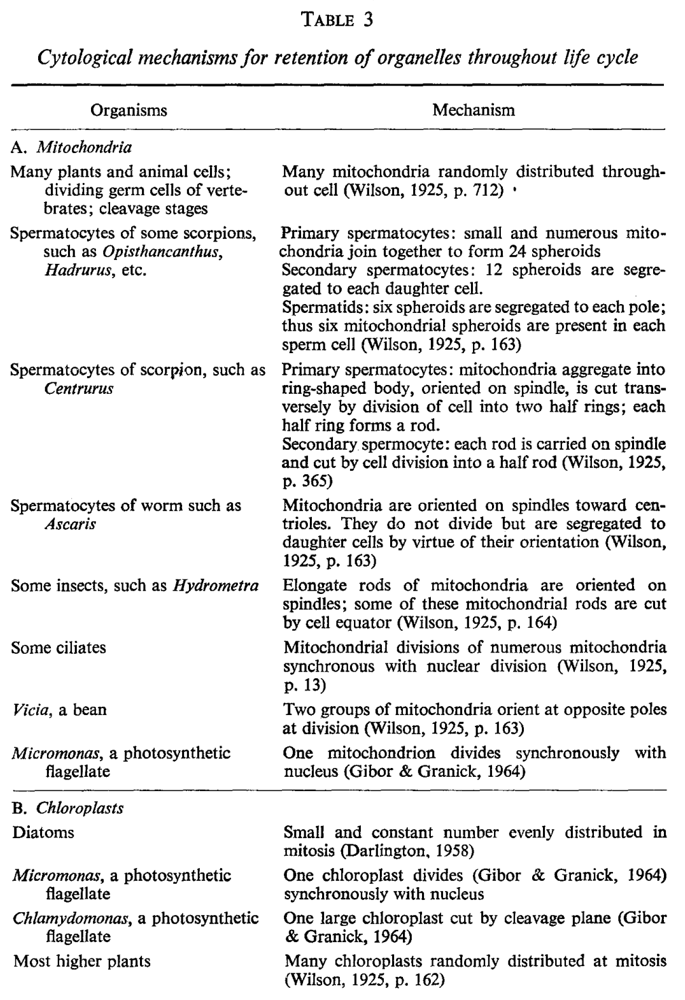

**Original:** Table 3. Cytological mechanisms for retention of organelles throughout life cycle.

**中文:** 表 3．在整个生活史中保留细胞器的细胞学机制。

| 生物／细胞 | 保留细胞器的机制 |
| --- | --- |
| A．线粒体 |  |
| 许多动植物细胞；脊椎动物中分裂的生殖细胞；卵裂阶段 | 许多线粒体随机分布在整个细胞中（Wilson，1925，第 712 页）。 |
| 某些蝎子的精母细胞，如 Opisthacanthus、Hadrurus 等 | 初级精母细胞：大量小线粒体合并为 24 个球状体。次级精母细胞：每个子细胞分配到 12 个球状体。精子细胞：每一极分配到 6 个球状体，因此每个精子中有 6 个线粒体球状体（Wilson，1925，第 163 页）。 |
| 蝎子的精母细胞，如 Centrurus | 初级精母细胞：线粒体聚集为环状体，在纺锤体上定向，细胞分裂将其横切成两个半环，各半环形成棒状体。次级精母细胞：各棒状体由纺锤体携带，并在细胞分裂时切成半棒（Wilson，1925，第 365 页）。 |
| 蠕虫的精母细胞，如 Ascaris | 线粒体在纺锤体上朝向中心粒定向。它们不分裂，但因其定向而被分配到子细胞中（Wilson，1925，第 163 页）。 |
| 某些昆虫，如 Hydrometra | 棒状的细长线粒体在纺锤体上定向；其中一些被细胞赤道面切断（Wilson，1925，第 164 页）。 |
| 某些纤毛虫 | 大量线粒体的分裂与细胞核分裂同步（Wilson，1925，第 13 页）。 |
| Vicia，一种豆科植物 | 两组线粒体在分裂时分别朝向相反两极（Wilson，1925，第 163 页）。 |
| Micromonas，一种光合鞭毛虫 | 一个线粒体与细胞核同步分裂（Gibor 与 Granick，1964）。 |
| B．叶绿体 |  |
| 硅藻 | 数量少且恒定的叶绿体在有丝分裂中均匀分配（Darlington，1958）。 |
| Micromonas，一种光合鞭毛虫 | 一个叶绿体与细胞核同步分裂（Gibor 与 Granick，1964）。 |
| Chlamydomonas，一种光合鞭毛虫 | 一个大型叶绿体被分裂面切开（Gibor 与 Granick，1964）。 |
| 大多数高等植物 | 许多叶绿体在有丝分裂时随机分布（Wilson，1925，第 162 页）。 |

**Source:** p.46 S111

**Original:** Recently, the absence of visible mitochondria in the cytoplasm of anaerobic yeast (as seen through the electron microscope) has again been taken as evidence for the lack of genetic continuity of the organelle. Since we now know the fundamental replication event takes place on the molecular level, conclusive experimental evidence for the contrary could come from simply showing that yeast "satellite band DNA" (e.g. mitochondrial DNA) is still present in those organisms which lack visible mitochondria but retain the potential to form them.

**中文:** 最近，厌氧酵母细胞质中不存在可见的线粒体（通过电子显微镜观察）再次被视为细胞器缺乏遗传连续性的证据。由于我们现在知道基本的复制事件发生在分子水平上，因此相反的结论性实验证据可能来自简单地表明酵母“卫星带DNA”（例如线粒体DNA）仍然存在于那些缺乏可见线粒体但保留形成线粒体潜力的生物体中。

**Source:** p.46 S112

**Original:** The entries in Table 3 can be interpreted as mechanisms which insure that each daughter cell of the host receives at least one copy of the symbiont genome at each division. In the formation of sperm, mitochondria are often wrapped around the axial fiber, a (9 + 2) homologue, insuring continuity of the organelle through fertilization as well (Wilson, 1925, p. 373) (criterion (2), section 3.3).

**中文:** 表3中的条目可以解释为确保宿主的每个子细胞在每次分裂时接收至少一个共生体基因组拷贝的机制。在精子的形成过程中，线粒体通常缠绕在轴纤维（9 + 2）同源物周围，确保细胞器在受精过程中的连续性（Wilson，1925，第 373 页）（标准 (2)，第 3.3 节）。

**Source:** p.46 S113

**Original:** Do mitochondria fulfil other requirements for organelles originating in symbionts ? There seem to be no extant examples of organisms that totally lack mitochondria and contain other characteristics of eukaryotes. This is probably because the mitochondrial symbiosis is so ancient it is obligate in all eukaryotes: total loss of the organelle is invariably lethal (criteria (3), section 3.3). However, neither are there nucleated or plastid-containing organisms which contain mitochondrial enzymes "unpackaged" (criteria (4), section 3.3).

**中文:** 线粒体是否满足源自共生体的细胞器的其他要求？似乎没有现存的生物体完全缺乏线粒体并包含真核生物的其他特征的例子。这可能是因为线粒体共生是如此古老，它在所有真核生物中都是必然的：细胞器的完全丧失总是致命的（标准（3），第3.3节）。然而，也不存在含有“未包装”线粒体酶的有核或含质体生物体（标准（4），第 3.3 节）。

**Source:** p.46 S114

**Original:** Examples of mitochondrial cytoplasmic heredity are well known (Gibor & Granick, 1964; Jinks, 1964) (criterion (5), section 3.3). Many aerobic bacteria provide free-living extant counterparts to the protomitochondrion, since aerobic cytochrome-mediated glucose metabolism is well known among bacteria (criterion (6), section 3.3).

**中文:** 线粒体细胞质遗传的例子是众所周知的（Gibor & Granick，1964；Jinks，1964）（标准（5），第 3.3 节）。许多需氧细菌提供了原线粒体的自由生活的现存对应物，因为需氧细胞色素介导的葡萄糖代谢在细菌中是众所周知的（标准（6），第3.3节）。

**Source:** p.46 S115

**Original:** Regardless of the history, it must have taken thousands of mutational steps to evolve mitochondria (i.e. approximately 100 enzymes x 100 amino acids per enzyme x 3 nucleotide pairs per amino acid ~ 3 × 104 nucleotide pairs). The evolution of the chloroplast in an aerobic cell containing mitochondria resulting in green plant photosynthesis precisely analogous to that of blue-green algae is highly improbable. Such a monophyletic origin of chloroplasts would require thousands of further highly specific mutations to evolve photosynthesis. The absence of both fossil evidence and extant intermediate organisms in the evolution of this "primitive phytoflagellate" makes it unlikely that plastid-contained aerobic photosynthesis itself evolved in a cell containing mitochondria. Since we have already presented evidence that photosynthesis is fundamentally an anaerobic process which evolved in prokaryotes (section 3.5), this is especially unlikely.

**中文:** 无论历史如何，线粒体的进化都必须经过数千个突变步骤（即大约 100 个酶 x 每个酶 100 个氨基酸 x 每个氨基酸 3 个核苷酸对 ~ 3 × 104 个核苷酸对）。含有线粒体的需氧细胞中叶绿体的进化导致绿色植物的光合作用与蓝绿藻的光合作用完全相似，这是极不可能的。叶绿体的这种单系起源将需要数千个进一步的高度特异性的突变才能进化光合作用。在这种“原始植物鞭毛虫”的进化过程中，化石证据和现存中间生物体的缺乏使得包含质体的有氧光合作用本身不太可能在包含线粒体的细胞中进化。由于我们已经提供了证据表明光合作用本质上是在原核生物中进化的厌氧过程（第 3.5 节），因此这种情况尤其不可能。

**Source:** p.46,47 S116

**Original:** On the other hand, if the evolution of mitochondria followed the evolution of plastids, there is no obvious reason why photosynthetic eukaryotes should show remarkable uniformity in mitochondrial structure and metabolism. Plastid-containing organisms with alternative carbohydrate metabolic patterns should have evolved, especially since such alternative pathways are known to be present in blue-green algae.

**中文:** 另一方面，如果线粒体的进化跟随质体的进化，那么光合作用真核生物在线粒体结构和代谢方面应该表现出显着的一致性，就没有明显的理由。具有替代碳水化合物代谢模式的含有质体的生物体应该已经进化出来，特别是因为已知这种替代途径存在于蓝绿藻中。

**Source:** p.47 H022

## 3.7. THE REPRODUCING (9+2) HOMOLOGUES AND THEIR RELATIONSHIP TO THE NUCLEUS / 3.7．能够繁殖的（9+2）同源结构及其与细胞核的关系

**Source:** p.47 S117

**Original:** "... that a fundamental dualism exists in the phenomenon of mitosis, the origin and transformation of the achromatic figure being in large measure independent of those occurring in the chromatic elements. Mitosis consists, in fact, of two closely correlated but separable series of events" (Wilson, 1925).

**中文:** “......有丝分裂现象中存在基本的二元论，无色图形的起源和转变在很大程度上独立于彩色元素中发生的那些。有丝分裂实际上由两个紧密相关但又可分离的事件系列组成”（Wilson，1925）。

**Source:** p.47 S118

**Original:** The homology of the "achromatic figure" (i.e. mitotic apparatus, basal bodies, centrioles, etc.) and its relative independence of nuclear chromatin is at the base of the above statement which summarizes the results of some 40 years of cytological observation, by perhaps the finest biologists of the time (c. 1885-1925).

**中文:** “消色差图”（即有丝分裂器、基体、中心粒等）的同源性及其与核染色质的相对独立性是上述陈述的基础，该陈述总结了也许是当时最优秀的生物学家（约 1885-1925）约 40 年细胞学观察的结果。

**Source:** p.47 S119

**Original:** Classical cytogenetics and more recent experimental work involving modern techniques have confirmed and extended the observations of the early workers. Especially relevant are the careful studies of Cleveland which experimentally disassociate chromosome replication and cell division.

**中文:** 经典细胞遗传学和最近涉及现代技术的实验工作已经证实并扩展了早期工作者的观察结果。尤其相关的是克利夫兰的仔细研究，该研究通过实验分离了染色体复制和细胞分裂。

**Source:** p.47 S120

**Original:** "Oxygen concentrations of 70-80 ~o destroy all the chromosomes of the hypermastigote flagellate, Trichonympha, provided the oxygen treatment was carried out during early stages of gametogenesis when chromosomes are in process of duplicating themselves. This treatment does no damage to the cytoplasm and its organelles, following the loss of chromosomes. The centrioles function in the production of the achromatic figure (e.g. the mitotic apparatus), the flagella and the parabasal bodies. Then the cytoplasm divides, thus producing two anucleatic gametes which make some progress in the cytoplasmic differentiation characteristic of the normal male and female gametes of Trichonympha" (Cleveland, 1956).

**中文:** “70-80℃的氧气浓度会破坏超鞭毛虫毛毛虫的所有染色体，前提是在配子发生的早期阶段进行氧气处理，此时染色体处于自我复制的过程中。在染色体丢失后，这种处理不会损害细胞质及其细胞器。中心粒在无色体（例如有丝分裂器）、鞭毛和细胞器的产生中发挥作用。然后细胞质分裂，从而产生两个无核配子，这在正常毛毛虫雄性和雌性配子的细胞质分化特征方面取得了一些进展”（Cleveland，1956）。

**Source:** p.47 S121

**Original:** On the other hand, Cleveland's observations of binucleate 5-centriole cell showed that "... without centrioles no achromatic figure is formed, there is no poleward movement of the chromosomes to form daughter nuclei. The chromosomes reproduce themselves but the nucleus does not. However, two or more centrioles must be present and must be fairly close to the nucleus if the nucleus is to reproduce itself" (Cleveland, 1963). When there is a choice in these multicentrioled cells, chromosomes will move along other than the central spindle.

**中文:** 另一方面，克利夫兰对双核 5 中心粒细胞的观察表明，“……没有中心粒，就不会形成无色图形，染色体不会向极移动形成子核。染色体会自我繁殖，但细胞核不会。然而，如果细胞核要自我繁殖，则必须存在两个或多个中心粒，并且必须非常靠近细胞核”（Cleveland，1963）。当这些多中心体细胞进行选择时，染色体将沿着中央纺锤体以外的方向移动。

**Source:** p.47,48 S122

**Original:** The fundamental difference between eukaryotic mitosis and the equal distribution of genes in prokaryotic cell division is the total amount of DNA which can be distributed to the daughter cells. If newly synthesized cellular DNA could be attached to some intracellular self-replicating body which at the time of host division segregated from its sister offspring, then a mechanism for equal distribution of genetic material could result. This mechanism, operating quite independent of the "messages" carried by the host DNA, would simply insure the segregation of the newly synthesized host DNA associated with the self-replicating intracellular body. In such a scheme, it is unnecessary to explain how the self-replicating body differentiated from the nucleus before it was selected as a division center. The alternative assumption that a pre-existing replicating endosymbiont, the basal body of the flagellum, was utilized in a new role, is consistent with traditional belief--that evolution is opportunistic and not foresighted. The role of host chromatin segregation is the recognized function of the centromere; cells lacking centromeres simply do not arrive at the poles of the mitotic spindle to be incorporated into daughter nuclei, and chromosomes always proceed to the poles centromere first. Chromosomes may contain two centromeres that travel to opposite poles of the dividing cell; often when these dicentric chromosomes break, each fragment attached to its centromere is incorporated into the resulting daughter cell.

**中文:** 真核细胞有丝分裂与原核细胞分裂中基因的均等分配之间的根本区别在于可以分配给子细胞的DNA总量。如果新合成的细胞 DNA 可以附着在某些细胞内自我复制体上，而这些体在宿主分裂时与其姐妹后代分离，那么就会产生一种遗传物质均等分配的机制。这种机制的运作完全独立于宿主DNA携带的“信息”，它可以简单地确保与自我复制的细胞内体相关的新合成的宿主DNA的分离。在这样的方案中，没有必要解释自我复制体在被选为分裂中心之前是如何与细胞核分化的。另一种假设是，先前存在的复制内共生体（鞭毛的基体）被用于新的角色，这与传统信念是一致的，即进化是机会主义的而不是有远见的。宿主染色质分离的作用是着丝粒的公认功能；缺乏着丝粒的细胞根本无法到达有丝分裂纺锤体的两极并入子细胞核，并且染色体总是首先到达两极着丝粒。染色体可能包含两个着丝粒，它们移动到分裂细胞的相反两极；通常，当这些双着丝粒染色体断裂时，附着在其着丝粒上的每个片段都会被整合到产生的子细胞中。

**Source:** p.48 S123

**Original:** The function of the flagellar basal apparatus in mitosis and its use in distribution of cellular organelles was widely recognized in the classical cytological literature (Table 3). A striking example of this is to be found in Trypanoplasma (Belar, 1915). The division of the blepharoplast at the base of the flagellum--called the blephoplasteilung--is quite as conspicuous as the nuclear division, forming an apparent second "mitotic apparatus" related to the flagella [for example, Fig. 2. V (d); [criterion (2), section 3.3].

**中文:** 鞭毛基底器在有丝分裂中的功能及其在细胞器分布中的用途在经典细胞学文献中得到了广泛认可（表3）。锥虫属就是一个显着的例子（Belar，1915）。鞭毛基部的眼睑质体分裂（称为 blephoplasteilung）与核分裂一样明显，形成与鞭毛相关的明显的第二个“有丝分裂装置”[例如，图 2.V (d)； [标准 (2)，第 3.3 节]。

**Source:** p.48 S124

**Original:** In Leishmania the kinetoplast attached to the flagellar apparatus, for example, is Fuelgen positive and known to divide. Very clear evidence for a specialized DNA satellite band associated with the organelle has been presented (Du Buy, Mattern & Riley, 1964) consistent with evidence that the organelle incorporates thymidine into DNA (Gibor & Granick, 1964). Electron microscopy indicates that the kinetoplast contains the single mitochondrion which differentiates during the part of the life cycle in which oxidative metabolism is required. It is possible that a specialized association between (9+2) homologue and the one mitochondrion has evolved to insure distribution of the mitochondrion to the daughter cells in a way analogous to the distribution of daughter nuclear genomes. The homology of the kinetoplast DNA may be ascertained by DNA hybridization experiments with the mitochondrial and flagellar DNA's.

**中文:** 例如，在利什曼原虫中，附着在鞭毛器上的动质体呈 Fuelgen 阳性，并且已知会分裂。已经提出了与细胞器相关的专门 DNA 卫星带的非常明确的证据 (Du Buy, Mattern & Riley, 1964)，这与细胞器将胸苷掺入 DNA 的证据一致 (Gibor & Granick, 1964)。电子显微镜表明动质体含有单个线粒体，该线粒体在生命周期中需要氧化代谢的部分中分化。 (9+2)同源物和一个线粒体之间的特殊关联可能已经进化，以确保线粒体以类似于子核基因组分布的方式分布到子细胞。动质体DNA的同源性可以通过与线粒体和鞭毛DNA的DNA杂交实验来确定。

**Source:** p.48,49 S125

**Original:** The homology of the centriole and the flagellar basal body, first suggested in 1898 (Wilson, 1925, p. 697), is now widely accepted especially as their structure (as revealed by the electron microscope) has been elucidated (Sleigh, 1962). The excellent evidence for the "genetic autonomy" of these cytoplasmic self-replicating (9 + 2) organelles has been well reviewed Oinks, 1964). There are reports in the literature of irreversible losses of (9+2) homologues (Lederberg, 1952; Jinks, 1964) (criterion (4), section 3.3). A specific (9 + 2) homologue DNA which presumably codes for the characteristic proteins,, has been suggested by some studies (Seaman, 1960) but has not been definitely shown (Hoffman, 1965) (criterion (1), section 3.3). No intermediate organisms between those containing the (9+2) complex flagella and the simple eubacterial flagella are known (criterion (3), section 3.3). Hence, the origin of the (9 + 2) homologues as endosymbionts is not inconsistent with the evidence; but the argument that these homologues were of exogenous origin and did not pinch off from the cell (i.e. did not originate as episomes) must be justified.

**中文:** 中心粒和鞭毛基体的同源性最早于 1898 年提出（Wilson，1925，第 697 页），现在已被广泛接受，特别是因为它们的结构（如电子显微镜所揭示的）已被阐明（Sleigh，1962）。这些细胞质自我复制 (9 + 2) 细胞器的“遗传自主性”的极好证据已得到很好的审查（Oinks，1964）。文献中有关于 (9+2) 同系物不可逆损失的报道（Lederberg，1952；Jinks，1964）（标准（4），第 3.3 节）。一些研究（Seaman，1960）已经提出了可能编码特征蛋白质的特定（9 + 2）同源 DNA，但尚未明确显示（Hoffman，1965）（标准（1），第 3.3 节）。在含有 (9+2) 复杂鞭毛和简单真细菌鞭毛的生物之间，不存在已知的中间生物体（标准 (3)，第 3.3 节）。因此，（9+2）同系物作为内共生体的起源与证据并不矛盾；但是，这些同系物是外源来源并且不是从细胞中夹断（即不是起源于附加体）的论点必须得到证实。

**Source:** p.49 S126

**Original:** For various reasons, spirochaete or spirochaete-like organisms have been suggested as likely candidates for free-living counterparts of the motile (9 + 2) endosymbiont which later differentiated into the flagellum, centrioles, and chromosomal centromeres. Spirochaetes are known to be associated with protozoans; for example, in Dienympha and Pyrsonympha (eukaryotic animal flagellates found in insects) the family (Dienymphida) to which they belong has been characterized by the following description: "... elongate flagellates, the four or eight anterior flagella adherent to the body and spirally twisted with it, free at their distal ends. Often they are beset with spirochaetes which have been mistaken for additional flagella; the family has been misplaced in the order Hypermastigina" (Copeland, 1956, p. 166). The same is true of another family of eukaryotic flagellates, the Devescovinida: "Spirochaetes which share the habitat of these organisms are commonly found adhering to their cell membranes, and were mistaken for additional flagella in the original descriptions of some of the genera" (Copeland, 1956, p. 167).t

**中文:** 由于各种原因，螺旋体或类螺旋体生物体被认为是运动型 (9 + 2) 内共生体的自由生活对应物的可能候选者，后来分化为鞭毛、中心粒和染色体着丝粒。已知螺旋体与原生动物有关。例如，在双鞭毛虫和双鞭毛虫（昆虫中发现的真核动物鞭毛虫）中，它们所属的鞭毛科（双鞭毛虫）的特征如下：“……细长的鞭毛，四或八根前鞭毛附着在身体上，并与身体呈螺旋状扭曲，远端自由。它们经常被螺旋体包围，这些螺旋体被误认为是额外的鞭毛；该科在顺序上被放错了位置Hypermastigina”（Copeland，1956，第 166 页）。真核鞭毛虫的另一个科 Devescovinida 也是如此：“与这些生物体共享栖息地的螺旋体通常粘附在其细胞膜上，并且在某些属的原始描述中被误认为是额外的鞭毛”（Copeland，1956，第 167 页）。

**Source:** p.49 S127

**Original:** Spirochaetes are approximately the same size as flagella, they are made of subunit strands (Stanier et aL, 1963, p. 158) varying in number depending on the species. They are usually found in micro-aerophilic environments; they are always motile; their motility is sensitive to ATP; and, like flagella, they divide longitudinally. Indeed, it would be most interesting if the flagellar ATPase, other characteristic proteins (Gibbons, 1963), and (9+2) sub-

**中文:** 螺旋体的大小与鞭毛大致相同，它们由亚基链组成（Stanier 等人，1963 年，第 158 页），其数量根据物种而异。它们通常存在于微需氧环境中；他们总是充满活力；它们的运动对 ATP 敏感；并且，像鞭毛一样，它们纵向分裂。事实上，如果鞭毛 ATP 酶、其他特征蛋白 (Gibbons, 1963) 和 (9+2) sub-

**Source:** p.49,50 S128

**Original:** 1964.) structure could be identified with the proteins and axial fiber of some free-living spirochaete (criterion (6), section 3.3).

**中文:** 1964.）结构可以用一些自由生活的螺旋体的蛋白质和轴向纤维来识别（标准（6），第3.3节）。

**Source:** p.50 S129

**Original:** If the flagellar basal body had escaped from the host genome for the purpose of distributing nuclear DNA, it is likely that such episomal escape would have occurred in many different lines of microbes and that not all extant examples would be homologous. There is no immediate selective advantage to the escape of such a piece of host nucleic acid. If episomal in origin, we might expect examples of organelles which lyzed the host for their own continued replication. If (9 + 2) homologue centrioles pinched off and were selected for because they distributed cellular DNA efficiently, they should not necessarily be related to the flagella at all. If they escaped from the nucleus, these (9 + 2) homologues should be more sensitive to treatments which affect the nucleus than to those which are related to the destruction of the flagella. In fact, the opposite is true (Weinrich, 1954, p. 135; Yow, 1961).

**中文:** 如果鞭毛基体出于分配核DNA的目的而从宿主基因组中逃逸，那么这种附加型逃逸很可能会发生在许多不同的微生物系中，并且并非所有现存的例子都是同源的。逃逸这样一段宿主核酸并没有直接的选择优势。如果起源于附加型，我们可能会期待一些细胞器裂解宿主以使其继续复制的例子。如果 (9 + 2) 个同源中心粒被掐断并被选择，因为它们有效地分布细胞 DNA，那么它们根本不一定与鞭毛有关。如果它们从细胞核中逃逸，这些(9+2)同系物应该对影响细胞核的处理比那些与鞭毛破坏相关的处理更敏感。事实上，事实恰恰相反（Weinrich，1954，第 135 页；Yow，1961）。

**Source:** p.50 H023

## 3.8. THE REPRODUCING CHLOROPLAST / 3.8．能够繁殖的叶绿体

**Source:** p.50 S130

**Original:** Presumably because it was the least ancient of the symbioses, the exogenous origin of the photosynthetic plastid is the easiest to defend (Ris & Plaut, 1962; Echlin, 1966). Chloroplast DNA has been found in many different photosynthetic eukaryotes. [In Euglena, direct autoradiographic evidence for nuclear and plastid DNA has recently been presented. The in situ DNA has been correlated with the presence of labeled main band (nuclear) and satellite band (chloroplast) DNA on a cesium chloride density gradient (Sagan, Ben-Shaul, Schiff & Epstein, 1965).] This satellite DNA band is totally absent in permanently "bleached" cells, those which permanently lack the potential for chloroplast formation (Left, Mandel, Epstein & Schiff, 1963) (criterion (4), section 3.3). The disappearance of the "satellite band" DNA has been correlated with the ultraviolet treatment which permanently "cures" Euglena of its chloroplasts (Edelman, Epstein & Schiff, 1964; Edelman, Schift & Epstein, 1965).

**中文:** 大概因为它是最古老的共生体，光合质体的外源起源是最容易捍卫的（Ris & Plaut，1962；Echlin，1966）。在许多不同的光合真核生物中都发现了叶绿体 DNA。 [在眼虫中，最近提出了核和质体 DNA 的直接放射自显影证据。原位 DNA 与氯化铯密度梯度上标记的主带（核）和卫星带（叶绿体）DNA 的存在相关（Sagan、Ben-Shaul、Schiff & Epstein，1965）。] 该卫星 DNA 带在永久“漂白”细胞中完全不存在，这些细胞永久缺乏叶绿体形成的潜力（Left、Mandel、Epstein & Schiff，1963）（标准（4），第3.3）。 “卫星带”DNA 的消失与永久“治愈”眼虫叶绿体的紫外线处理有关（Edelman、Epstein & Schiff，1964；Edelman、Schift & Epstein，1965）。

**Source:** p.50 S131

**Original:** Other characteristics implied by an endosymbiotic origin have been reported for chloroplasts as well: chloroplast-specific RNA complimentary to chloroplast DNA (Eisenstadt & Braverman, 1963); ribosomes (Lyttleton, 1962); and chloroplast ribosomal RNA; evidence for DNA-dependent RNA synthesis; and the uptake of radioactive amino acids into isolated chloroplasts (Gibor & Granick, 1964).

**中文:** 叶绿体还报道了内共生起源所暗示的其他特征：叶绿体特异性 RNA 与叶绿体 DNA 互补（Eisenstadt & Braverman，1963）；核糖体（Lyttleton，1962）；和叶绿体核糖体RNA； DNA 依赖性 RNA 合成的证据；以及将放射性氨基酸吸收到分离的叶绿体中（Gibor & Granick，1964）。

**Source:** p.50,51 S132

**Original:** In summing up both the classical observations on replication of chloroplasts and the recent work on the biochemistry of the organelle, Gibor and Granick provide convincing evidence that: the plastids (like the mitochondria) contain DNA and RNA; they are self-duplicating bodies which do not arise de novo; the DNA represents a multigenic hereditary system which is not derived from the nucleus and is, in part, responsible for the biochemical properties of the organelle; and that the differentiation of the mature chloroplast from the proplastid is an adaptive system responsive to visible light (criterion (1), section 3.3).

**中文:** Gibor 和 Granick 总结了叶绿体复制的经典观察和细胞器生物化学的最新研究，提供了令人信服的证据：质体（如线粒体）含有 DNA 和 RNA；它们是自我复制的身体，并不是从头开始产生的； DNA 代表一个多基因遗传系统，该系统并非源自细胞核，并且部分负责细胞器的生化特性；成熟叶绿体与前质体的分化是一个对可见光敏感的适应性系统（标准（1），第 3.3 节）。

**Source:** p.51 S133

**Original:** Some mechanisms which assure distribution of at least one copy of the plastid to each daughter of the host throughout the life cycle in plants are summarized in Table 3 (criterion (2), section 3.3).

**中文:** 表3总结了一些确保在植物的整个生命周期中向宿主的每个子体分配至少一个质体拷贝的机制（标准（2），第3.3节）。

**Source:** p.51 S134

**Original:** Examples of organisms which lack plastids but are clearly counterpart to plastid-containing cells are very well known (e.g. Astasia, Polytoma, etc.). Blue-green algae themselves may be considered free-living prokaryote counterparts of plastids (criterion (6), section 3.3). Despite the search for them, neither fossil nor extant examples of intermediate organisms between the plastid-lacking blue-greens and the plastid-containing eukaryotes have ever been found (criterion (3), section 3.3).

**中文:** 缺乏质体但明显与含有质体的细胞相对应的生物体的例子是众所周知的（例如Astasia、Polytoma等）。蓝绿藻本身可以被认为是质体的自由生活的原核生物对应物（标准（6），第 3.3 节）。尽管进行了寻找，但在缺乏质体的蓝绿生物和含有质体的真核生物之间，无论是化石还是现存的中间生物体都没有被发现（标准（3），第3.3节）。

**Source:** p.51 S135

**Original:** "Cytoplasmic heredity" was first discovered in cases of uniparental chloroplast inheritance. The literature has been well reviewed (Jinks, 1964; Granick, 1962) (criterion (5), section 3.3). Characterization of the phenomena known collectively as "cytoplasmic heredity" is based on the non-chromo- Somal (and therefore non-mendelian) inheritance of genes. The logical explanation for cytoplasmic non-mendelian genetic systems is based on their legacy as genes of once free-living cells which have become organelles, i.e. hereditary endosymbiosis (Lederberg, 1952).

**中文:** “细胞质遗传”首先是在单亲叶绿体遗传的情况下发现的。文献已得到充分审查（Jinks，1964；Granick，1962）（标准（5），第 3.3 节）。统称为“细胞质遗传”的现象的表征是基于基因的非染色体（因此非孟德尔）遗传。对细胞质非孟德尔遗传系统的逻辑解释是基于它们作为曾经自由生活的细胞的基因的遗产，这些细胞已成为细胞器，即遗传性内共生（Lederberg，1952）。

**Source:** p.51 S136

**Original:** Apparently another major piece of circumstantial evidence for the endosymbiotic origin of these organelles is their size. We now know that replication takes place strictly on the molecular level; the flagellum itself is the size (and indeed the shape) of a respectable prokaryote, as are the mitochondria and plastids. The self-replication of such organelles of course involves synthesis of all the non-nucleic acid components for perpetuation. The probability that bodies of such enormous size (from a molecular point of view) would form multigenic systems in the cytoplasm is extremely low. The explanation that "... certain mutations could occur independently in each organellar DNA unit, and these mutations could be carried along so that, when drastic environmental changes occurred, there could be selection for the most suitable organelles. Thus, a multiple number of mutated organelles per cell could provide for more rapid evolutionary change" (Gibor & Granick, 1964) is patently Lamarckian. These were, however, the reasons given by Gibor & Granick for the large number of remarkably consistent experimental results implying genetic continuity of mitochondria and plastids.

**中文:** 显然，这些细胞器内共生起源的另一个主要间接证据是它们的大小。我们现在知道复制严格发生在分子水平上。鞭毛本身的大小（实际上是形状）与原核生物相当，线粒体和质体也是如此。这种细胞器的自我复制当然涉及所有非核酸成分的合成以使其永存。如此巨大的物体（从分子的角度来看）在细胞质中形成多基因系统的可能性极低。 “……某些突变可以在每个细胞器 DNA 单元中独立发生，并且这些突变可以被携带，这样，当发生剧烈的环境变化时，可以选择最合适的细胞器。因此，每个细胞的多个突变细胞器可以提供更快速的进化变化”（Gibor & Granick，1964）显然是拉马克式的。然而，这些是 Gibor 和 Granick 给出的大量非常一致的实验结果的原因，表明线粒体和质体的遗传连续性。

**Source:** p.52 H024

## 4. Some Predictions / 4．若干预测

**Source:** p.52 S137

**Original:** It is likely that the classifications presented in the phylogenetic tree (Fig. 1) err in that the author lacks first-hand knowledge of most of the organisms. It is also true that flagella and chloroplasts can be secondarily lost. However, if the theory presented in this paper is correct, all eukaryotes should ultimately be classified completely, correctly, and consistently according to their position in the origin of mitosis. Consistent with this view is the empirical fact that the flagellar attachment has proven to be a reliable taxonomic criterion.

**中文:** 系统发生树（图 1）中提出的分类很可能是错误的，因为作者缺乏对大多数生物体的第一手知识。鞭毛和叶绿体也确实可能会二次丢失。然而，如果本文提出的理论是正确的，那么所有真核生物最终都应该根据它们在有丝分裂起源中的位置进行完整、正确和一致的分类。与这一观点相一致的是鞭毛附着已被证明是可靠的分类标准的经验事实。

**Source:** p.52 S138

**Original:** Analogous to the quantitative relationship between DNA and ploidy, satellite DNA correlated specifically with the various organelles should be found in cells in direct proportion to the number of organelles in these cells. No eukaryotic cell having flagellar basal bodies, cilia, centrioles, centromeres, or any other of the homologues can lack (9 +2) homologue-specific DNA. It is likely that this DNA has evaded detection because it has very little metabolic responsibility and needs to be only a few cistrons long to code for its few specific proteins. Identification of (9 + 2) homologue-speeific DNA and a complete characterization of its RNA and of its limited biochemical functions should eventually be possible. This is true of mitochondrial and plastid DNA as well.

**中文:** 类似于DNA和倍性之间的定量关系，与各种细胞器特异性相关的卫星DNA应该在细胞中被发现，并且与这些细胞中细胞器的数量成正比。具有鞭毛基体、纤毛、中心粒、着丝粒或任何其他同源物的真核细胞不能缺乏(9+2)同源物特异性DNA。这种 DNA 很可能逃避了检测，因为它几乎没有代谢责任，并且只需要几个顺反子长即可编码其少数特定蛋白质。 (9 + 2) 同源特异性 DNA 的鉴定及其 RNA 及其有限生化功能的完整表征最终应该是可能的。线粒体和质体 DNA 也是如此。

**Source:** p.52 S139

**Original:** If these organelles did indeed originate as free-living microbes, our advancing technology should eventually allow us to supply all growth factors requisite for in vivo replication of all three of them--the coup de grace to genetic autonomy.

**中文:** 如果这些细胞器确实起源于自由生活的微生物，那么我们先进的技术最终应该允许我们提供这三种细胞器在体内复制所需的所有生长因子——这是遗传自主性的致命一击。

**Source:** p.52 S140

**Original:** It is likely that biochemical pathways entirely unique to eukaryotes (e.g. steroid synthesis) should have component parts coded for by more than one organellar genome. [For example, it is possible that the biochemical pathway to squalene in steroid synthesis is under nuclear control, and that the subsequent members of the biosynthetic chain--those admittedly tightly bound to particulate elements in the cell--are under the control of the mitochondrial genome (Block, 1965).] The component parts of metabolic pathways in plant metabolism--analogous to starch synthesis in Peliaina (Lederberg, 1952) (section 3.2) for example--may eventually be understood in terms of "complementation", e.g. syntheses made possible by the presence in the cell of at least two genomes--host and plastid.

**中文:** 真核生物完全独特的生化途径（例如类固醇合成）很可能应该具有由多个细胞器基因组编码的组成部分。 [例如，类固醇合成中角鲨烯的生化途径可能受到核控制，而生物合成链的后续成员——公认与细胞中的颗粒元素紧密结合的成员——受到线粒体基因组的控制（Block，1965）。]植物代谢中代谢途径的组成部分——类似于 Peliaina 中的淀粉合成（Lederberg，1952）（第 3.2 节）示例——最终可以用“互补”来理解，例如细胞中至少存在两个基因组——宿主基因组和质体基因组，使得合成成为可能。

**Source:** p.52,53 S141

**Original:** In keeping with the hypothesis, the following organisms should have evolved: a free-living complex flagellar counterpart; a free-living mitochondrion counterpart; and a heterotrophic prokaryote capable of ingesting cells. Free-living cells co-descendant with eukaryotic organelles might still contain cistrons homologous to those in (9+2) homologues, mitochondria, and plastids. For example, we may one day find different types of blue-green algae that are co-descendant with typical chrysophsean and rhodophysean plastids, which contain DNA with cistrons homologous to those in the plastids.

**中文:** 根据这一假设，以下生物体应该已经进化：自由生活的复杂鞭毛对应物；自由生活的线粒体对应物；以及能够摄取细胞的异养原核生物。与真核细胞器共同后代的自由生活细胞可能仍含有与 (9+2) 同源物、线粒体和质体中的顺反子同源的顺反子。例如，有一天我们可能会发现不同类型的蓝绿藻，它们与典型的黄藻和红藻质体共同后代，这些质体含有与质体中的顺反子同源的DNA。

**Source:** p.53 S142

**Original:** If the theory is correct all eukaryotic cells must be seen as multi-genomed systems. This implies that a goal of cellular chemistry is understanding the way in which all biochemical reactions are coded off the nucleic acid of the nucleus and the subcellular organelles. All eukaryotes must contain at least three specific types of DNA: nuclear, mitochondrial, and (9 +2) homologue. An additional DNA that is associated with the chloroplasts must be found in all eukaryotic plants. The plastids of organisms sharing similar photosynthetic metabolic characteristics (e.g. dinoflagellates, brown algae, and diatoms; red and blue-green algae) should have homologous plastid-specific nucleic acid. At the same time, those organisms which demonstrate "host homologies" (e.g. non-pigmented and pigmented dinoflagellates, Schizogoniacea and Porphyra) should share homologous nuclear, and not necessarily plastid, DNA's. This is quite analogous to the presence of two distinct DNA bands of nearly equal size found in CsCl density gradient runs on DNA isolated from Paramecium bursaria (Sagan, L., 1964, unpublished data). In this experiment, the larger DNA band corresponded to a base ratio of G+ C = 29 ~, presumably, quite characteristic of the ciliates (Schildkraut, Mandel, Levisohn, Smith-Sonneborn & Marmur, 1962). The smaller band corresponded to 60 ~ G + C, characteristic of chlorellae, and is presumably due to the presence of the photosynthetic zoochlorellar endosymbiont (Sueoka, 1961). The relative abundance of the chlorella band with respect to the nuclear, perhaps indicates the symbiosis is quite recent. Cgnsistent with other data, it is possible that when our technology is more advanced, the quantitative relationship between the amounts of"'main band" and "satellite band" DNA's on aCsC1 gradient will directly indicate the relative amounts Of metabolic responsibility relegated to the nuclear (main band) genome and, hence, to the age of the symbiosis in general. When we know the precise metabolic pathways and their genetic basis, we will be able to calculate directly the number of generations elapsed since each organism evolved from a common ancestor--from the number of mutational sites at which they differ.

**中文:** 如果该理论是正确的，那么所有真核细胞都必须被视为多基因组系统。这意味着细胞化学的目标是了解所有生化反应是如何由细胞核和亚细胞细胞器的核酸编码的。所有真核生物都必须含有至少三种特定类型的 DNA：核 DNA、线粒体 DNA 和 (9 +2) 同系物。在所有真核植物中都必须发现与叶绿体相关的额外 DNA。具有相似光合代谢特征的生物体（例如甲藻、褐藻和硅藻；红藻和蓝绿藻）的质体应该具有同源的质体特异性核酸。同时，那些表现出“宿主同源性”的生物体（例如非色素和色素甲藻、裂殖纲和紫菜）应该共享同源的核DNA，而不一定是质体DNA。这与在从草履虫分离的 DNA 上进行 CsCl 密度梯度运行时发现的两条大小几乎相等的不同 DNA 带的存在非常相似（Sagan, L., 1964，未发表的数据）。在这个实验中，较大的 DNA 带对应于 G+C = 29 的碱基比率，大概是纤毛虫的特征（Schildkraut、Mandel、Levisohn、Smith-Sonneborn 和 Marmur，1962）。较小的条带对应于 60 ~ G + C，小球藻的特征，并且可能是由于光合动物小球藻内共生体的存在（Sueoka，1961）。小球藻带相对于核的相对丰度，也许表明共生是最近发生的。与其他数据一致，当我们的技术更先进时，aCsC1梯度上的“主带”和“卫星带”DNA数量之间的定量关系将直接指示归咎于核（主带）基因组的代谢责任的相对量，因此，一般而言，归结为共生的年龄。当我们知道精确的代谢途径及其遗传基础时，我们将能够根据它们不同的突变位点数量，直接计算出每个生物体从共同祖先进化而来的世代数。

**Source:** p.53,54 S143

**Original:** Some searches will continue to be futile: for example, attempts to find eumitosis in all eukaryotes (if found, it will clearly be analogous, rather than homologous, to eumitosis in higher eukaryotes, cf. reports of sexuality in Noctiluca, a dinoflagellate); "missing links" in the origin of the ancestral phytoflagellate, such as organisms containing chloroplasts but no mitochondria; eumitotic organisms with bacterial flagella, or eumitotic fossils dating from anaerobic times. The cytological basis of most "cytoplasmic inheritance" will probably be related either to mitochondria, (9 + 2) homologues, plastids, or other much less generally distributed cytoplasmic organelles (e.g. Kappa in Paramecium aurelia). As an example, the inheritance of the sr-500 gene in Chlamydomonas with the"plus" mating type (mt +) suggests that a correlated uniparental inheritance of chloroplast-specific DNA should be sought (Sager & Tsubo, 1961).

**中文:** 一些搜索将继续是徒劳的：例如，试图在所有真核生物中寻找有丝分裂（如果找到的话，它显然与高等真核生物中的有丝分裂相似，而不是同源，参见夜光藻（一种甲藻）有性行为的报告）；祖先植物鞭毛虫起源中的“缺失环节”，例如含有叶绿体但不含线粒体的生物体；具有细菌鞭毛的有丝分裂生物，或可追溯到无氧时代的有丝分裂化石。大多数“细胞质遗传”的细胞学基础可能与线粒体、(9 + 2) 同源物、质体或其他不太普遍分布的细胞质细胞器（例如草履虫中的 Kappa）有关。作为一个例子，衣藻中sr-500基因的遗传具有“加”交配型(mt+)，这表明应该寻找叶绿体特异性DNA的相关单亲遗传(Sager & Tsubo，1961)。

**Source:** p.54 S144

**Original:** As in the past, future attempts to relate the various classes of algae directly to each other will be futile. For example, the ancestor of the relatively recent and isolated algae the Bacillaracea (diatoms), might be better sought among primitive metazoans than the chrysophytes or dinoflagellates. A simple flagellated organism with characteristic rhodophyte pigments probably never existed. A flagellated ancestor to the true molds and premitotic amoebae probably did not either.

**中文:** 与过去一样，未来将各类藻类直接相互联系起来的尝试将是徒劳的。例如，相对较新且孤立的藻类 Bacillaracea（硅藻）的祖先可能比金藻类或甲藻类更容易在原始后生动物中寻找。具有特征性红藻色素的简单的有鞭毛的生物可能从未存在过。真霉菌和有丝分裂前变形虫的有鞭毛祖先可能也没有。

**Source:** p.54 S145

**Original:** The range of DNA base ratios in all plants and animals is quite limited compared to that in prokaryotes (Sueoka, 1961).

**中文:** 与原核生物相比，所有植物和动物中 DNA 碱基比例的范围相当有限（Sueoka，1961）。

**Source:** p.54 S146

**Original:** "... The base of the Cambrian period (0.6 x 109 years ago) is marked in marine sediments around the world by the appearance of abundant animal life .... This sudden appearance of diverse animal stocks has been the most vexing riddle in paleontology" (Fischer, 1965).

**中文:** “......寒武纪时期（0.6×109年前）的基础在世界各地的海洋沉积物中以丰富的动物生命的出现为标志......这种多样化动物种群的突然出现一直是古生物学中最令人烦恼的谜团”（Fischer，1965）。

**Source:** p.54 S147

**Original:** The evolution of mitosis in ancestral heterotrophic amoeboflagellates, making possible mendelian genetic patterns and the tissue and organ level of biological organization, is presumably at the basis of both observations: the small variation in DNA base ratio in all plants and animals and the plethora of new forms of life marking the dawn of the fossil record.

**中文:** 祖先异养变形鞭毛虫的有丝分裂进化使孟德尔遗传模式以及生物组织的组织和器官水平成为可能，这可能是基于以下两项观察：所有植物和动物中DNA碱基比例的微小变化以及标志着化石记录黎明的大量新生命形式。

**Source:** p.54 S148

**Original:** The author acknowledges with pleasure the aid, encouragement and criticism of Drs J. William Schopf, M. Ptashne and Professors J. D. Bernal, E. Barghoorn, C. Sagan, Y. Ben-Shaul, A. O. Klein, T. N. Margulis, D. Hawkins, P. Morrison, P. E. Cloud and especially Professor R. A. Lewin. She is immensely grateful to Mrs J. R. Williams and Mr George Cope for editorial and production assistance.

**中文:** 作者很高兴地感谢 J. William Schopf 博士、M. Ptashne 博士和 J. D. Bernal、E. Barghoorn、C. Sagan、Y. Ben-Shaul、A. O. Klein、T. N. Margulis、D. Hawkins、P. Morrison、P. E. Cloud 教授，特别是 R. A. Lewin 教授的帮助、鼓励和批评。她非常感谢 J. R. Williams 夫人和 George Cope 先生提供的编辑和制作协助。

**Source:** p.54 H025

## REFERENCES / 参考文献

**Source:** p.54 R001

**Original:** ABELSON, P. (1963). J. Wash. Acad. Sci. 53, 105.

**中文:** 阿贝尔森，P.（1963）。 J.华盛顿学院。科学。 53、105。

**Source:** p.54 R002

**Original:** BARGHOORN, E. S. & SCHOPF, J. WM. (1966). Scienoe, N.Y. 150, 758.

**中文:** BARGHOORN, E. S. & SCHOPF, J. WM. （1966）。纽约州希诺 150, 758。

**Source:** p.54 R003

**Original:** BELAR, K. (1915). Arch. Protistenk. 36, 24.

**中文:** 贝拉尔，K. (1915)。拱。原生动物。 36、24。

**Source:** p.54 R004

**Original:** BERNAL, J. D. (1957). The Problem of Stages in Biopoesis in "The Origin of Life on the Earth", Symposium of the International Union of Biochemistry, Moscow. New York: Macmillan.

**中文:** 贝尔纳尔，J.D. (1957)。 “地球上生命的起源”中的生命阶段问题，国际生物化学联合会研讨会，莫斯科。纽约：麦克米伦。

**Source:** p.54 R005

**Original:** BLOCK, K. (1965). Science, N.Y. 150~ 19.

**中文:** 布洛克，K.（1965）。 《科学》，纽约 150~ 19。

**Source:** p.54 R006

**Original:** BRACHET, J. (1957). "Biochemical Cytology". New York: Academic Press.

**中文:** 布拉切特，J.（1957）。 “生化细胞学”。纽约：学术出版社。

**Source:** p.54 R007

**Original:** BUCrtNER, P. (1930). "Tier and Pflanze in Symbiose". Berlin: Borntraeger.

**中文:** 布克特纳，P.（1930）。 “Tier 和 Pflanze 共生”。柏林：博恩特拉格。

**Source:** p.54,55 R008

**Original:** BUCHNEg, P. (1953). "Endosymbiose der Tier mit Pflanz/ichen Microorganisms". Basil & Stuttgart: Birkhauser. CALKrNS, G. N. (1909). "Protozoology", p. 31. New York & Philadelphia: Lea & Febiger.

**中文:** 布赫内格，P. (1953)。 “内共生 der Tier mit Pflanz/ichen 微生物”。巴兹尔和斯图加特：伯克豪瑟。卡尔克恩斯，G.N.（1909）。 “原生动物学”，p。 31. 纽约和费城：Lea 和 Febiger。

**Source:** p.55 R009

**Original:** CLEVELAND, L. B. (1956). J. Protozool. 3, 78.

**中文:** 克利夫兰，L.B.（1956）。 J.原生动物。 3、78。

**Source:** p.55 R010

**Original:** CLEVELAND, L. B. (1963). Function of Flagellate and Other Centrioles in Cell Repro-

**中文:** 克利夫兰，L.B.（1963）。鞭毛和其他中心粒在细胞繁殖中的功能

**Source:** p.55 R011

**Original:** duction in "The Cell in Mitosis" (L. Levine, ed.). New York: Academic Press.

**中文:** “有丝分裂中的细胞”（L. Levine，编辑）中的诱导。纽约：学术出版社。

**Source:** p.55 R012

**Original:** CLOUD, P. E., JR. (1965). Science, N. I:. 148, 27.

**中文:** 克劳德，P.E.，JR。 （1965）。科学，N.I：。 148、27。

**Source:** p.55 R013

**Original:** COPELAND, H. F. (1956). "The Classification of the Lower Organisms". Palo Alto,

**中文:** 科普兰，H.F. (1956)。 “低等生物的分类”。帕洛阿尔托,

**Source:** p.55 R014

**Original:** California: Pacific Books.

**中文:** 加利福尼亚：太平洋图书。

**Source:** p.55 R015

**Original:** CRONQUIST, A. (1960). Bot. Rev. 26, 425.

**中文:** 克朗奎斯特，A.（1960）。机器人。修订版 26, 425。

**Source:** p.55 R016

**Original:** DARLINGTON, C. D. (1958). "The Evolution of Genetic Systems". New York: Basic Books,

**中文:** 达林顿 (1958)。 “遗传系统的进化”。纽约：基础书籍，

**Source:** p.55 R017

**Original:** Inc.

**中文:** 公司

**Source:** p.55 R018

**Original:** DILLON, L. S. (1962). Evolution, 16, 102.

**中文:** 狄龙，L.S.（1962）。进化论，16, 102。

**Source:** p.55 R019

**Original:** DOFLEIN, F. & REICHENOW, E. (1929). "Lehrbuch der Protozoenkunde: eine Darstellung

**中文:** DOFLEIN, F. 和 REICHENOW, E. (1929)。 “原生动物知识手册：eine Darstellung

**Source:** p.55 R020

**Original:** der Naturgeschicte der Protozoen mit besonderer Beruchsichtigung der parasitischen

**中文:** 原生动物的自然史与寄生虫的分类

**Source:** p.55 R021

**Original:** und pathogenen Formen"..lena: Fischer.

**中文:** 和病原体 Formen”..lena：Fischer。

**Source:** p.55 R022

**Original:** DOUGHERTY, E. & ALLEN, M. B. (1960). Is Pigmentation a Clue to Protistan Phylogeny?

**中文:** 多尔蒂，E. 和艾伦，M. B. (1960)。色素沉着是原生生物系统发育的线索吗？

**Source:** p.55 R023

**Original:** /n "Comparative Biochemistry of Photoreaction Systems". New York: Academic Press.

**中文:** /n“光反应系统的比较生物化学”。纽约：学术出版社。

**Source:** p.55 R024

**Original:** DuBuY, H., MATTERN, C. V. T. & RILEY, F. (1964). J. Cell BioL 23, 26A.

**中文:** DuBuY, H.、马特恩、C. V. T. 和 RILEY, F. (1964)。 J. 细胞生物学 23, 26A。

**Source:** p.55 R025

**Original:** ECHLIN, P. & MORmS, I. (1965), BioL Rev. 40, 193.

**中文:** ECHLIN, P. & MORmS, I. (1965)，BioL Rev. 40, 193。

**Source:** p.55 R026

**Original:** EOELMAN, M., EPSTEIN, H. T. & SCHIFF, J. A. (1964). proc. hath. Acad. Sci. U.S.A. 52, 1214.

**中文:** 埃尔曼，M.，爱泼斯坦，H.T. 和希夫，J.A. (1964)。程序。有。阿卡德。科学。美国 52, 1214。

**Source:** p.55 R027

**Original:** EDELMAN, M., SCHIFF, J. & EPSTEIN, H. T. (1965). 3". molec. Biol. 11, 769.

**中文:** 埃德尔曼，M.，希夫，J. 和爱泼斯坦，H.T. (1965)。 3".molec.Biol.11, 769.

**Source:** p.55 R028

**Original:** EISENSTADT, J. & BRAVERMAN, G. (1963). Biochem. biophys. Acts, 26, 319.

**中文:** 艾森斯塔特，J. 和布雷弗曼，G. (1963)。生物化学。生物物理学。使徒行传，26, 319。

**Source:** p.55 R029

**Original:** FEWSON, C. A., AL-HAFIDH, M. & GraBS, M. (1962). P1. Physiol. 37, 402.

**中文:** FEWSON, C. A.、AL-HAFIDH, M. 和 GraBS, M. (1962)。 P1。生理学。 37、402。

**Source:** p.55 R030

**Original:** FISCHER, A. G. (1965). Proc. hath. Acad. Sei. U.S.A. 53, 1205.

**中文:** 菲舍尔，A.G.（1965）。过程。有。阿卡德。塞。美国 53, 1205。

**Source:** p.55 R031

**Original:** FRITSCH, F. E. (1935). "The Structure and Reproduction of the Algae", Vol. 1. London & New York: Cambridge University Press.

**中文:** 弗里奇，F.E.（1935）。 “藻类的结构和繁殖”，卷。 1. 伦敦和纽约：剑桥大学出版社。

**Source:** p.55 R032

**Original:** GABRIEL, M. (1960). ,4m. Nat. 94, 257.

**中文:** 加布里埃尔，M.（1960）。 ,4m。纳特。 94、257。

**Source:** p.55 R033

**Original:** GIBBONS, I. R. (1963). Proe. natn..dead. ScL U.S.A. 50, 1002.

**中文:** 吉本斯，I.R. (1963)。普罗。 natn..死了。 ScL 美国 50, 1002。

**Source:** p.55 R034

**Original:** GIBOR, A. & GRANICK, S. (1964). Science, N.Y. 145, 890.

**中文:** 吉博尔，A. 和格兰尼克，S. (1964)。 《科学》，纽约 145, 890。

**Source:** p.55 R035

**Original:** GOLDSCI-tMIDr, R. (1907). Archly flrotistenk. 8, 84.

**中文:** GOLDSCI-tMIDr, R. (1907)。优雅的花花。 8、84。

**Source:** p.55 R036

**Original:** GOLDSCI-IMEOT, R. & PoPo~,, M. (1907). Archiv Protistenk. 8, 321.

**中文:** GOLDSCI-IMEOT, R. 和 PoPo~,, M. (1907)。档案 Protistenk。 8、321。

**Source:** p.55 R037

**Original:** GRANICK, S. (1962). The Chloroplasts: Inheritance, Structure and Function in "The Cell", Vol. II (J. Brachet & A. Mirsky, eds.). New York: Academic Press.

**中文:** 格兰尼克，S.（1962）。叶绿体：《细胞》中的遗传、结构和功能，卷。 II（J. Brachet 和 A. Mirsky，编辑）。纽约：学术出版社。

**Source:** p.55 R038

**Original:** HALDANE, J. B. S. (1954). The Origins of Life in "New Biology, No. 16" (M. L. Johnson, M. Abercrombie & G. E. Fogg, eds.). London: Penguin Books.

**中文:** 霍尔丹，J. B. S. (1954)。 《新生物学》第 16 期《生命的起源》（M. L. Johnson、M. Abercrombie 和 G. E. Fogg 编辑）。伦敦：企鹅图书。

**Source:** p.55 R039

**Original:** HARTMANN, M. (1921). Archly Protistenk. 43, 223.

**中文:** 哈特曼，M.（1921）。阿奇利·普罗斯蒂滕克。 43、223。

**Source:** p.55 R040

**Original:** HOFFMAN, E. J. (1965). J. Cell Biol. 25, 217.

**中文:** 霍夫曼，E.J.（1965）。 J.细胞生物学。 25、217。

**Source:** p.55 R041

**Original:** J~KS, J. L. (1964). "Extrachromosomal Inheritance." Englewood Cliffs, N.J.: Prentio~- Hall.

**中文:** J~KS，J.L.(1964)。 “染色体外遗传。”新泽西州恩格尔伍德悬崖：Prentio~- 大厅。

**Source:** p.55 R042

**Original:** KARAKASHIAN, S. J. (1963). Physiol. Zoi~l. 36, 52.

**中文:** 卡拉卡什安，S.J. (1963)。生理学。佐伊〜l。 36、52。

**Source:** p.55 R043

**Original:** LASCELLES, J. (1964). "Tetrapyrrole Biosynthesis and its Regulations", p. 17. New York: W. A. Benjamin.

**中文:** 拉塞尔斯，J. (1964)。 “四吡咯生物合成及其调控”，第 14 页。 17.纽约：W.A.本杰明。

**Source:** p.55 R044

**Original:** LEDERnERG, J. (1952). PhysioL Rev. 32, 403.

**中文:** 莱德恩格，J.（1952）。生理学修订版 32, 403。

**Source:** p.55 R045

**Original:** LEFF, J., MANDEL, M., EPSTEIN, H. T. & SCHIFF, J. A. (1963). Biochem. biophys. Res. Comm. 13, 126.

**中文:** 莱夫，J.，曼德尔，M.，爱泼斯坦，H.T. 和希夫，J.A. (1963)。生物化学。生物物理学。资源。通讯。 13、126。

**Source:** p.55 R046

**Original:** LYMAN, H., EPSTEIN, H. T. & SCHIFF, J. A. (1961). Biochim. biophys. Acta, 50, 301.

**中文:** 莱曼，H.，爱泼斯坦，H.T. 和希夫，J.A. (1961)。生物化学。生物物理学。阿克塔，50，301。

**Source:** p.55 R047

**Original:** LY'rrLETON, J. W. (1962). ExpL Cell Res. 26, 312.

**中文:** LY'rrLETON，J.W.（1962）。 ExpL 细胞研究。 26、312。

**Source:** p.55 R048

**Original:** MARSH, H. V., GALMICHE, J. M. & GIBBS, M. (1964). Rec. chem. Prog. 25, 260.

**中文:** 马什，H.V.，加尔米什，J.M. 和吉布斯，M. (1964)。推荐。化学。程序。 25、260。

**Source:** p.55 R049

**Original:** MERECHOWSKY, M. (1910) & MINcmN, E. A. (1915). In "The Cell in Development and Heredity", by E. B. Wilson (1925). New York: Macmillan.

**中文:** MERECHOWSKY, M. (1910) 和 MINcmN, E.A. (1915)。 E. B. Wilson 的《发育和遗传中的细胞》（1925 年）。纽约：麦克米伦。

**Source:** p.55 R050

**Original:** MINCmN, E. A. (1912). "An Introduction to the Study of the Protozoa", p. 113. London: Edward Arnold.

**中文:** MINCmN，E.A.（1912）。 “原生动物研究简介”，p。 113. 伦敦：爱德华·阿诺德。

**Source:** p.55 R051

**Original:** PtCKEN, L. (1962). "The Organization of Cells and Other Organisms", p. 259. Oxford, England: Clarendon Press.

**中文:** PtCKEN，L.（1962）。 “细胞和其他生物体的组织”，p。 259.英国牛津：克拉伦登出版社。

**Source:** p.55,56 R052

**Original:** PixIE, N. M. (1959). Chemical Diversity and the Origin of Life in "The Origin of Life on the Earth", International Union of Biochem. New York & London: Pergamon Press. "r.B. 19 PRESCOTT, D. M. (1964). Cellular Sites of RNA Synthesis in "Progress in Nucleic Acid Research and Molecular Biology" (J. N. Davidson & W. E. Cohn, eds.). New York: Academic Press.

**中文:** PixIE，新墨西哥州 (1959)。国际生物化学联合会“地球上生命的起源”中的化学多样性和生命起源。纽约和伦敦：佩加蒙出版社。 “r.B. 19 PRESCOTT, D. M. (1964)。“核酸研究和分子生物学进展”中的 RNA 合成的细胞位点（J. N. Davidson & W. E. Cohn，编辑）。纽约：学术出版社。

**Source:** p.56 R053

**Original:** RENAUD, F. H. & SWIFT, H. (1964). J. Cell Biol. 23, 339.

**中文:** 雷诺，F. H. 和斯威夫特，H. (1964)。 J.细胞生物学。 23、339。

**Source:** p.56 R054

**Original:** RIs, H. & PLAUT, W. (1962). d. Cell BioL 12, 383.

**中文:** RIs, H. 和 PLAUT, W. (1962)。 d.细胞生物学 12, 383。

**Source:** p.56 R055

**Original:** RUTTEN, M. G. (1962). "The Geological Aspects of the Origin of Life on Earth." Amsterdam & New York: Elsevier Publishing Co.

**中文:** 鲁滕，M.G. (1962)。 “地球生命起源的地质方面。”阿姆斯特丹和纽约：爱思唯尔出版公司。

**Source:** p.56 R056

**Original:** SAGAN, C. (1961). Radiat. Res. 15, 174.

**中文:** 萨根，C.（1961）。辐射。资源。 15、174。

**Source:** p.56 R057

**Original:** SAGAN, C. (1965a). Ultraviolet Synthesis of Nucleoside Phosphates in "Origin of Prebiological Systems" (S. Fox, ed.). New York: Academic Press.

**中文:** 萨根，C.（1965a）。 “前生物系统的起源”中核苷磷酸盐的紫外合成（S. Fox，编辑）。纽约：学术出版社。

**Source:** p.56 R058

**Original:** SAGAN, C. (1965b). Origins of the Atmospheres of the Earth and Planets in Section I of "International Dictionary of Geophysics" (S. K. Runcorn, ed.-in-ehief). London: Pergamon Press.

**中文:** 萨根，C.（1965b）。 《国际地球物理学词典》第一部分中的地球和行星大气层的起源（S.K. Runcorn，主编）。伦敦：佩加蒙出版社。

**Source:** p.56 R059

**Original:** SAGAN, L., BEN-SHAUL, Y., SCHIFF, J. A. & EPSTEIN, H. T. (1965). J. PI. PhysioL 40, 1257

**中文:** 萨根，L.，本-肖尔，Y.，希夫，J.A. 和爱泼斯坦，H.T. (1965)。 J. PI.生理 40, 1257

**Source:** p.56 R060

**Original:** SAGER, R. & TSUBO, Y. (1961). Zeitschrift fur Vererbungslehre, 92, 439.

**中文:** 萨格，R. 和坪，Y. (1961)。 《Vererbungslehre 时代杂志》，92, 439。

**Source:** p.56 R061

**Original:** SCHILDKRAUT, C., MANDEL, M., LEVlSOI-rN, S., SMITH-SONNEBORN, J. & MARMUR, J. (1962). Nature, Lond. 196, 795.

**中文:** SCHILDKRAUT, C.、MANDEL, M.、LEVlSOI-rN, S.、SMITH-SONNEBORN, J. 和 MARMUR, J. (1962)。自然，伦敦。 196、795。

**Source:** p.56 R062

**Original:** SEAMAN, G. R. (1960). Exp. Cell Res. 21, 292.

**中文:** 希曼，G.R.（1960）。过期。细胞研究。 21、292。

**Source:** p.56 R063

**Original:** SIEGEL, R. W. (1960). Expl. Cell Res. 19, 239.

**中文:** 西格尔，R.W. (1960)。解释。细胞研究。 19、239。

**Source:** p.56 R064

**Original:** SIEGEL, R. W. & KARAKASHIAN, S. J. (1959). Anatomical Record, 134, 639.

**中文:** 西格尔，R.W. 和卡拉卡什安，S.J. (1959)。解剖记录，134, 639。

**Source:** p.56 R065

**Original:** SLEIGH, M. (1962). "Biology of Cilia and Flagella." Oxford: Pergamon Press.

**中文:** 斯莱，M.（1962）。 “纤毛和鞭毛的生物学。”牛津：佩加蒙出版社。

**Source:** p.56 R066

**Original:** SMILLIE, R. (1963). Can. J. Bot. 41, 123.

**中文:** 斯米利，R. (1963)。能。 J.博特。 41、123。

**Source:** p.56 R067

**Original:** STANIER, R., DOUDEROFF, M. ~,~ ADELBERG, E. (1963). "The Microbial World", 2nd Ed. Englewood Cliffs, N.J. : Prentice-Hall Inc.

**中文:** 斯坦尼尔，R.，杜德罗夫，M.〜，〜阿德尔伯格，E.（1963）。 《微生物世界》，第二版。新泽西州恩格尔伍德悬崖：Prentice-Hall Inc.

**Source:** p.56 R068

**Original:** SUEOKA, N. (1961). J. molec. Biol. 3, 31.

**中文:** 苏冈，N. (1961)。 J.莫莱克。生物。 3、31。

**Source:** p.56 R069

**Original:** TRAGER, W. (1964). The Cytoplasm of Protozoa in "The Cell", Vol. VI (J. Brachet & A. Mirsky, eds.). New York: Academic Press.

**中文:** 特拉格，W. (1964)。 《细胞》中原生动物的细胞质，卷。 VI（J. Brachet 和 A. Mirsky，编辑）。纽约：学术出版社。

**Source:** p.56 R070

**Original:** UREY, H. C. (1959). "Primitive Planetary Atmospheres and the Origin of Life" in "The Origin of Life on the Earth", International Union of Biochemistry. New York & London. Pergamon Press.

**中文:** 尤里，H.C. (1959)。国际生物化学联合会《地球生命的起源》中的“原始行星大气和生命起源”。纽约和伦敦。佩加蒙出版社。

**Source:** p.56 R071

**Original:** WALLIN, J. E. (1922). Am. J. Anat. IV, in Wilson (1925).

**中文:** 沃林，J.E.（1922）。是。 J·阿纳特。 IV，威尔逊（1925）。

**Source:** p.56 R072

**Original:** WALLIN, J. E. (1927). "Symbionticism and the Origin of Species". Baltimore: Williams & Wilkins.

**中文:** 沃林，J.E.（1927）。 “共生论和物种起源”。巴尔的摩：威廉姆斯和威尔金斯。

**Source:** p.56 R073

**Original:** WEINRICH, D. H. (1954). Sex in Protozoa: A Comparative Review in "Sex in Micro-organisms" (D. H. Weinrich, chairman and ed.). Publication of the American Association for the Advancement of Science, Washington.

**中文:** 温里希，D. H. (1954)。原生动物中的性别：“微生物中的性别”中的比较评论（D. H. Weinrich，主席兼主编）。美国科学促进会出版物，华盛顿。

**Source:** p.56 R074

**Original:** WENYON, C. M. (1926). "Protozoology: A Manual for Medical Men, Veterinarians and Zoologists." London: Bailliere, Tindall & Cox.

**中文:** 温永，C.M. (1926)。 “原生动物学：医务人员、兽医和动物学家手册。”伦敦：Bailliere、Tindall 和 Cox。

**Source:** p.56 R075

**Original:** WILSON, E. B. (1925). "The Cell in Development and Heredity." New York: Macmillan.

**中文:** 威尔逊，E.B. (1925)。 “发育和遗传中的细胞”。纽约：麦克米伦。

**Source:** p.56 R076

**Original:** Yow, F. W. (1961). J. Protozool. Suppl. 8, 20.

**中文:** 尤，F.W. (1961)。 J.原生动物。补编。 8、20。

**Source:** p. H-notes

## Notes / 注释

**Source:** p.2 N001

**Original:** t "More recently, Wallin (1922) has maintained that chondriosomes may be regarded as symbiotic bacteria whose associations with other cytoplasmic components may have arisen in the earliest stages of evolution.., to many, no doubt, such speculations may appear too fantastic for present mention in polite biological society; nevertheless, it is in the range of possibility that they may some day call for more serious consideration" (Wilson, 1925, see p. 378).

**中文:** “最近，Wallin (1922) 坚持认为，线粒体可能被视为共生细菌，其与其他细胞质成分的关联可能在进化的最早阶段就出现了……毫无疑问，对于许多人来说，这种推测对于目前在礼貌的生物学界中提及来说可能显得过于荒诞；尽管如此，它们有可能有一天需要更认真的考虑”（Wilson，1925，参见第 378 页）。

**Source:** p.42 N004

**Original:** -~ Note added in proof." It is now likely that Australian (Bitter Springs) PreCambrian fossils about 0.8 x 100 yeats old contain primitive eukaryotic coccoid algae (Schopf & Barghoorn, 1966, personal communication).

**中文:** -~ 证据中添加的注释。” 现在，大约 0.8 x 100 年前的澳大利亚（苦泉）前寒武纪化石很可能含有原始真核球状藻类（Schopf & Barghoorn，1966，个人通讯）。

**Source:** p.49 N005

**Original:** t Note added ht proof." Recent Elegant studies of myxotrixa paradoxa indicate symbiotic spirochaetes on the surface of these cells are responsible for the hosts' movements! Moreover these flagellates typically have at least three different types of symbiotic prokaryotes associated with them. (Grimstone, A. V. & Cleveland, L. R. Proc. R. Soe, Lon. 159, 668,

**中文:** 请注意添加的 ht 证据。”最近对粘液菌悖论的优雅研究表明这些细胞表面的共生螺旋体负责宿主的运动！此外，这些鞭毛虫通常具有至少三种不同类型的共生原核生物与之相关。（Grimstone, A. V. & Cleveland, L. R. Proc. R. Soe, Lon. 159, 668,

## 术语表

| English | 中文 |
| --- | --- |
| eukaryotic | 真核 |
| prokaryotic | 原核 |
| endosymbiosis | 内共生 |
| plastid | 质体 |
| basal body | 基体 |
| centriole | 中心粒 |
| centromere | 着丝粒 |
| eumitosis | 典型有丝分裂 |
| premitosis | 前有丝分裂 |
| phylogeny | 系统发生 |
| blue-green algae | 蓝绿藻 |
